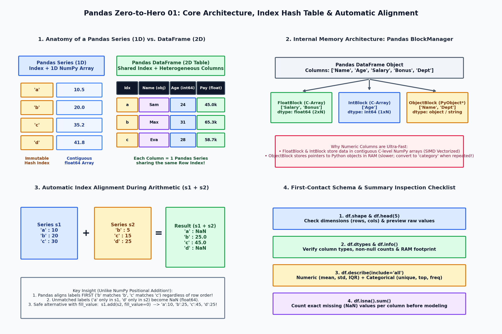
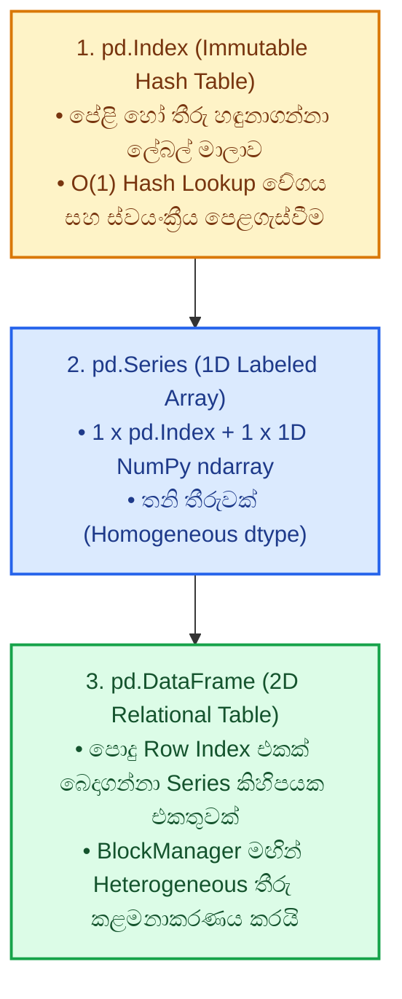

# Dependency Lesson 01.1: `Pandas` Core Architecture — `Index`, `Series` සහ `DataFrame` Internals මුල සිට සරලව

**අදාළ ප්‍රධාන පාඩම් (Related Core Lessons):**
- [Lesson 6.5: Introduction to Pandas & Mastering Series](../../Module_06_Exploratory_Data_Analysis_and_Pandas_Mastery/Lesson_6.5_Introduction_to_Pandas_and_Mastering_Series.md)
- [Lesson 6.6: Mastering Pandas DataFrame — Creation, I/O & Manipulation](../../Module_06_Exploratory_Data_Analysis_and_Pandas_Mastery/Lesson_6.6_Mastering_Pandas_DataFrame_Creation_IO_and_Manipulation.md)
- [Lesson 6.7: DataFrame Arithmetic, Merging, Joining & Advanced EDA](../../Module_06_Exploratory_Data_Analysis_and_Pandas_Mastery/Lesson_6.7_DataFrame_Arithmetic_Merging_Joining_and_Advanced_EDA.md)

---

## 1. හැඳින්වීම: `NumPy` තිබියදී `Pandas` නිර්මාණය කළේ ඇයි? (Why Was `Pandas` Invented?)

අපි Module 4 හිදී ඉගෙන ගත් පරිදි, **`NumPy` (`ndarray`)** යනු එකම දත්ත වර්ගයකට (**Homogeneous Data Type** - උදා: සියල්ලම `float64` හෝ `int64`) අයත් සංඛ්‍යාත්මක න්‍යාස (Matrices) මත අධිවේගී ගණිතමය ක්‍රියාකාරකම් සිදු කිරීමට නිර්මාණය කළ විශිෂ්ට පුස්තකාලයකි.

නමුත් සැබෑ ලෝකයේ Data Science ව්‍යාපෘතියකදී අපට ලැබෙන දත්ත (උදා: Excel Spreadsheet එකක් හෝ SQL Database Table එකක්) දෙස බලන්න:
1. **විවිධ දත්ත වර්ග එකම වගුවක පැවතීම (Heterogeneous Columns):** එක තීරුවක සේවකයාගේ නම (`string`), තවත් තීරුවක වයස (`int64`), තවත් තීරුවක වැටුප (`float64`), සහ තවත් තීරුවක සේවයට බැඳුණු දිනය (`datetime64`) අඩංගු වේ. `NumPy` array එකක මේ සියල්ල එකට දැමුවහොත් සියල්ලම Strings බවට පත් වී ගණිතමය හැකියාවන් නැති වී යයි!
2. **අර්ථවත් ලේබල් අවශ්‍ය වීම (Labeled Axes):** `arr[0, 3]` ලෙස ඉලක්කම්වලින් තීරු සහ පේළි මතක තබා ගැනීම වෙනුවට, `df.loc['EMP_101', 'Salary']` ලෙස **Row Index Labels** සහ **Column Names** මඟින් දත්ත හැසිරවීමට අපට අවශ්‍ය වේ.
3. **අස්ථානගත දත්ත (`Missing Data / NaN`) සහ ස්වයංක්‍රීය පෙළගැස්වීම (`Automatic Index Alignment`):** වගු දෙකක පේළි අනුපිළිවෙල වෙනස් වුවත්, ඒවායේ Index ලේබල් අනුව ස්වයංක්‍රීයව ගලපා ගණනය කිරීම් සිදු කිරීමට `NumPy` හට නොහැක.

2008 දී **Wes McKinney** විසින් **`Pandas`** (नामය හැදුණේ **Pan**el **Da**ta හෙවත් Econometrics හි බහු-මාන දත්ත යන වචනයෙනි) නිර්මාණය කළේ `NumPy` හි C-මට්ටමේ වේගය සහ SQL / Excel හි නම්‍යශීලී වගු හැසිරවීමේ හැකියාව එකම Python පුස්තකාලයකට ගෙන ඒමටයි!



---

## 2. `Pandas` හි මූලික ගොඩනැගුම් ඒකක 3: `Index`, `Series` සහ `DataFrame`

`Pandas` පුස්තකාලයේ සියලුම බලය රඳා පවතින්නේ එකිනෙකට සම්බන්ධ ප්‍රධාන වස්තූන් (Core Objects) 3 ක් මතය:



### A. `pd.Index` — වෙනස් කළ නොහැකි (Immutable) Hash Table ලේබල් පද්ධතිය:
බොහෝ ආධුනිකයන් සිතන්නේ `Index` එක යනු නිකම්ම පේළි අංක (`0, 1, 2...`) පමණක් බවයි. නමුත් `Pandas` හි `Index` එකක් යනු:
- **Hash Table එකකි:** Python `dict` එකක Key එකක් සොයනවා මෙන්, මිලියනයක් පේළි ඇති වගුවක වුවද `s['EMP_99999']` ලෙස ලේබලයෙන් දත්තයක් සෙවීම **$O(1)$ Constant Time** වේගයෙන් සිදු කරයි!
- **Immutable (වෙනස් කළ නොහැකි) ව්‍යුහයකි:** ඔබට `s.index[0] = 'new_label'` ලෙස තනි Index ලේබලයක් පමණක් වෙනස් කළ නොහැක (`TypeError: Index does not support mutable operations`). එයට හේතුව `DataFrame` එකක තීරු (Series) කිහිපයක්ම එකම `Index` වස්තුව මතකයේ (Memory) ආරක්ෂිතව බෙදා ගැනීමයි!
- **Duplicate Labels තිබිය හැක:** Python `dict` එකක මෙන් නොව, `Pandas Index` එකක එකම ලේබලය දෙවරක් තිබිය හැක (එවිට `s.loc['a']` මඟින් තනි අගයක් වෙනුවට අනුරූප පේළි සියල්ල අඩංගු `Series` එකක් ලබා දෙයි).

### B. `pd.Series` — 1D Labeled Column Vector:
`Series` එකක් අභ්‍යන්තරව කොටස් දෙකකින් සමන්විත වේ:
1. **`s.index`**: `pd.Index` වස්තුව (ලේබල් මාලාව).
2. **`s.to_numpy()` (හෝ `s.values`)**: සැබෑ දත්ත ගබඩා කර ඇති 1-Dimensional `NumPy ndarray` එක.

```python
import numpy as np
import pandas as pd

# Series එකක් නිර්මාණය කර එහි අභ්‍යන්තර කොටස් පරීක්ෂා කිරීම
salaries = pd.Series([45000.0, 65000.0, 58000.0], index=['Sam', 'Max', 'Tania'], name='Monthly_Salary')

print("Index Object :", salaries.index)         # Index(['Sam', 'Max', 'Tania'], dtype='object')
print("NumPy Array  :", salaries.to_numpy())    # [45000. 65000. 58000.]
print("Data Type    :", salaries.dtype)         # float64
print("Series Name  :", salaries.name)          # Monthly_Salary
```

### C. `pd.DataFrame` සහ Internal `BlockManager` Architecture:
ඉහත රූපයේ **Panel 2** හි පෙන්වා ඇති පරිදි, `DataFrame` එකක් මතකයේ (RAM) දත්ත ගබඩා කරන්නේ පේළි වශයෙන් (Row-major) නොව, **එකම දත්ත වර්ගයේ තීරු එකට කාණ්ඩ කළ `BlockManager` (Columnar Blocks)** ව්‍යුහයක් ලෙසය:
- ඔබේ වගුවේ `float64` තීරු 2 ක් (`Salary`, `Bonus`) තිබේ නම්, ඒ දෙකම එකම 2D `FloatBlock` `NumPy` array එකක ගබඩා වේ.
- `int64` තීරු සියල්ල `IntBlock` එකක ගබඩා වේ.
- String (`object`) තීරු `ObjectBlock` එකක (Python String Objects වෙත යොමු වන Pointers ලෙස) ගබඩා වේ.
- **ප්‍රායෝගික වාසිය:** මේ නිසා `df['Salary'] + df['Bonus']` වැනි තීරු අතර ගණනය කිරීම් C-මට්ටමේ වේගයෙන් ක්‍රියාත්මක වේ! තවද `'HR'`, `'IT'`, `'Sales'` වැනි නැවත නැවත යෙදෙන Strings සහිත තීරුවක් `df['Dept'] = df['Dept'].astype('category')` ලෙස හැරවීමෙන් RAM භාවිතය 80% කින් පමණ අඩු කර ගත හැක!

---

## 3. Automatic Index Alignment (ස්වයංක්‍රීය ලේබල් පෙළගැස්වීම) — `NumPy` සහ `Pandas` අතර ප්‍රධානතම වෙනස!

`NumPy` arrays දෙකක් එකතු කරන විට (`arr1 + arr2`), එය බලන්නේ **ස්ථානය (Position `0, 1, 2`)** දෙස පමණි. නමුත් `Pandas` හි `Series` දෙකක් හෝ `DataFrame` දෙකක් අතර ඕනෑම ගණිතමය ක්‍රියාකාරකමක් (`+`, `-`, `*`, `/`) සිදු කරන විට, **පළමුවෙන්ම සිදුවන්නේ Index ලේබල් එකිනෙක ගැලපීමයි (`Automatic Index Alignment`)!**

ඉහත රූපයේ **Panel 3** හි දැක්වෙන උදාහරණය පියවරෙන් පියවර බලමු:

```python
import pandas as pd

# ආයතනයේ ජනවාරි සහ පෙබරවාරි මාසවල අලෙවි දත්ත (පේළි අනුපිළිවෙල සහ පුද්ගලයින් වෙනස්!)
jan_sales = pd.Series({'a': 10, 'b': 20, 'c': 30})
feb_sales = pd.Series({'b': 5,  'c': 15, 'd': 25})

# 1. සාමාන්‍ය '+' ක්‍රියාකාරකම (Unmatched labels -> NaN!)
total_1 = jan_sales + feb_sales
print("--- Using '+' Operator ---")
print(total_1)
# a     NaN   <-- 'a' පෙබරවාරි වල නොමැති නිසා 10 + NaN = NaN වේ!
# b    25.0   <-- 'b' දෙකෙහිම ඇත: 20 + 5 = 25.0
# c    45.0   <-- 'c' දෙකෙහිම ඇත: 30 + 15 = 45.0
# d     NaN   <-- 'd' ජනවාරි වල නොමැති නිසා NaN + 25 = NaN වේ!
# dtype: float64

# 2. NaN ඇතිවීම වළක්වා අස්ථානගත තැන්වලට 0 ආදේශ කර එකතු කිරීම (.add with fill_value=0)
total_2 = jan_sales.add(feb_sales, fill_value=0)
print("\n--- Using .add(fill_value=0) ---")
print(total_2)
# a    10.0   (10 + 0)
# b    25.0   (20 + 5)
# c    45.0   (30 + 15)
# d    25.0   (0 + 25)
# dtype: float64
```

> [!IMPORTANT]
> **💡 Exam & Practical Trap:** `int64` අගයන් පමණක් තිබූ Series දෙකක් එකතු කළ විට ප්‍රතිඵලයේ `dtype` එක `float64` බවට පත් වූයේ ඇයි?  
> සම්මත `NumPy` ආකෘතිය තුළ **`NaN` (Not a Number)** යනු IEEE-754 Floating-Point විශේෂ අගයකි. එබැවින් තීරුවක එක `NaN` අගයක් හෝ ඇතුළත් වූ විගස `Pandas` විසින් එම සම්පූර්ණ තීරුවම ස්වයංක්‍රීයව `int64` සිට `float64` බවට පරිවර්තනය (Upcast) කරයි!

---

## 4. නව දත්ත කට්ටලයක් ලැබුණු විගස කළ යුතු පරීක්ෂාවන් 5 (First-Contact Inspection Protocol)

Exploratory Data Analysis (EDA) ආරම්භයේදී ඕනෑම `DataFrame` එකක් පරීක්ෂා කිරීමට භාවිතා කරන අත්‍යවශ්‍යම attributes සහ methods 5 පහත වගුවේ දැක්වේ:

| විධානය (Command) | වර්ගය | ලබා දෙන තොරතුර සහ වැදගත්කම |
| :--- | :---: | :--- |
| **`df.shape`** | Attribute | `(rows, columns)` යුගලයක් (Tuple) ලබා දෙයි (උදා: `(11, 4)`). වරහන් `()` නොයොදයි! |
| **`df.dtypes`** | Attribute | එක් එක් තීරුවේ දත්ත වර්ගය (`int64`, `float64`, `object`, `datetime64[ns]`) Series එකක් ලෙස පෙන්වයි. |
| **`df.head(n)` / `df.tail(n)`** | Method | මුල් පේළි `n` හෝ අවසාන පේළි `n` (Default `n=5`) පෙන්වයි. |
| **`df.info()`** | Method | පේළි ගණන, සෑම තීරුවකම **Non-Null Count** එක, `dtype` එක සහ මුළු **RAM Memory Usage** එක පෙන්වයි. |
| **`df.describe(include='all')`** | Method | සංඛ්‍යාත්මක තීරුවල **Mean (මධ්‍යන්‍යය)**, **Standard Deviation (සම්මත අපගමනය)**, **Quartiles (චතුර්ථක - 25%, 50%, 75%)** සහ Categorical තීරුවල `unique`, `top` (Mode), `freq` එකවර ගණනය කරයි! |

---

## 🛠️ Practical Task / Hands-On Exercise (ප්‍රායෝගික අභ්‍යාසය)

### Scenario / Goal:
ඔබ ශ්‍රී ලංකාවේ සුපිරි වෙළඳසැල් ජාලයක (Supermarket Chain) Data Analyst කෙනෙකි. ශාඛා 4 ක (`Colombo`, `Kandy`, `Galle`, `Jaffna`) Q1 සහ Q2 කාර්තුවල අලෙවි ආදායම (රුපියල් මිලියන වලින්) වෙනම Dictionaries දෙකක ලැබී ඇත. නමුත් සමහර ශාඛාවල දත්ත එක් කාර්තුවක පමණක් පවතී.

### Step-by-Step Tasks:
1. `q1_dict = {'Colombo': 120.5, 'Kandy': 85.0, 'Galle': 64.2}` සහ `q2_dict = {'Kandy': 92.5, 'Galle': 70.8, 'Jaffna': 55.0}` යන Dictionaries දෙකෙන් `s_q1` සහ `s_q2` නමින් `Pandas Series` දෙකක් නිර්මාණය කරන්න.
2. `s_q1 + s_q2` මඟින් එකතුව ලබාගෙන කුමන ශාඛාවලට `NaN` ලැබෙන්නේදැයි නිරීක්ෂණය කරන්න.
3. `.add(..., fill_value=0)` භාවිතා කර කිසිදු ශාඛාවක දත්ත අපතේ නොයන සේ නිවැරදි මුළු ආදායම (`s_total`) ගණනය කරන්න.
4. `Q1`, `Q2`, සහ `Total` යන තීරු 3 අඩංගු `df_branch` නමැති `DataFrame` එකක් සාදා, එහි `.shape`, `.dtypes`, සහ `.describe()` ප්‍රතිඵල මුද්‍රණය කරන්න.

### Starter Code:
```python
import pandas as pd

q1_dict = {'Colombo': 120.5, 'Kandy': 85.0, 'Galle': 64.2}
q2_dict = {'Kandy': 92.5, 'Galle': 70.8, 'Jaffna': 55.0}

# TODO 1: Create Series s_q1 and s_q2
# TODO 2: Compute naive addition (s_q1 + s_q2)
# TODO 3: Compute safe addition using .add(fill_value=0)
# TODO 4: Build DataFrame df_branch and inspect .shape, .dtypes, .describe()
```

### Expected Output / Reference Solution:
```python
import pandas as pd

q1_dict = {'Colombo': 120.5, 'Kandy': 85.0, 'Galle': 64.2}
q2_dict = {'Kandy': 92.5, 'Galle': 70.8, 'Jaffna': 55.0}

# 1. Series දෙක නිර්මාණය කිරීම
s_q1 = pd.Series(q1_dict, name='Q1')
s_q2 = pd.Series(q2_dict, name='Q2')

# 2. සාමාන්‍ය '+' එකතුව (Colombo සහ Jaffna සඳහා NaN ලැබේ)
naive_total = s_q1 + s_q2
print("--- 1. Naive Addition (s_q1 + s_q2) ---")
print(naive_total)

# 3. fill_value=0 සහිතව ආරක්ෂිතව එකතු කිරීම
s_total = s_q1.add(s_q2, fill_value=0)
print("\n--- 2. Safe Addition with fill_value=0 ---")
print(s_total)

# 4. DataFrame එකක් ලෙස සංවිධානය කිරීම සහ පරීක්ෂා කිරීම
df_branch = pd.DataFrame({
    'Q1': s_q1,
    'Q2': s_q2,
    'Total': s_total
}).fillna(0.0)

print("\n--- 3. Branch Revenue DataFrame ---")
print(df_branch)
print("\nShape:", df_branch.shape)
print("\nData Types:\n", df_branch.dtypes)
print("\nSummary Statistics:\n", df_branch.describe())
```

**Expected Console Output:**
```text
--- 1. Naive Addition (s_q1 + s_q2) ---
Colombo      NaN
Galle      135.0
Jaffna       NaN
Kandy      177.5
dtype: float64

--- 2. Safe Addition with fill_value=0 ---
Colombo    120.5
Galle      135.0
Jaffna      55.0
Kandy      177.5
dtype: float64

--- 3. Branch Revenue DataFrame ---
            Q1    Q2  Total
Colombo  120.5   0.0  120.5
Galle     64.2  70.8  135.0
Jaffna     0.0  55.0   55.0
Kandy     85.0  92.5  177.5

Shape: (4, 3)
```

---

## 🔗 Next Steps & Back-Links to Core Module Lessons

- **ඊළඟ Dependency පාඩම:** [02_Mastering_loc_iloc_Boolean_Masking_and_SettingWithCopyWarning.md](02_Mastering_loc_iloc_Boolean_Masking_and_SettingWithCopyWarning.md)
- **ආපසු ප්‍රධාන පාඩම් වෙත (Back to Core Lessons):**
  - [Lesson 6.5: Introduction to Pandas & Mastering Series](../../Module_06_Exploratory_Data_Analysis_and_Pandas_Mastery/Lesson_6.5_Introduction_to_Pandas_and_Mastering_Series.md)
  - [Lesson 6.6: Mastering Pandas DataFrame — Creation, I/O & Manipulation](../../Module_06_Exploratory_Data_Analysis_and_Pandas_Mastery/Lesson_6.6_Mastering_Pandas_DataFrame_Creation_IO_and_Manipulation.md)
