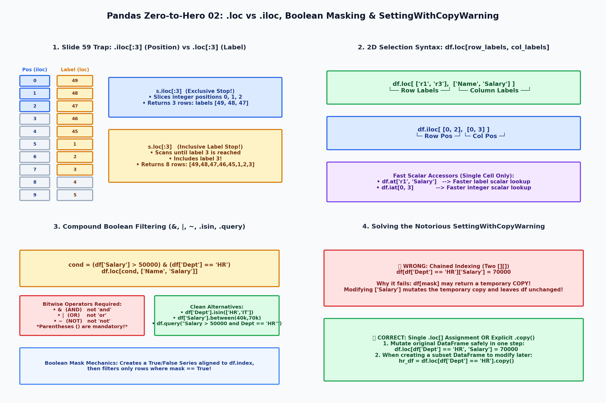
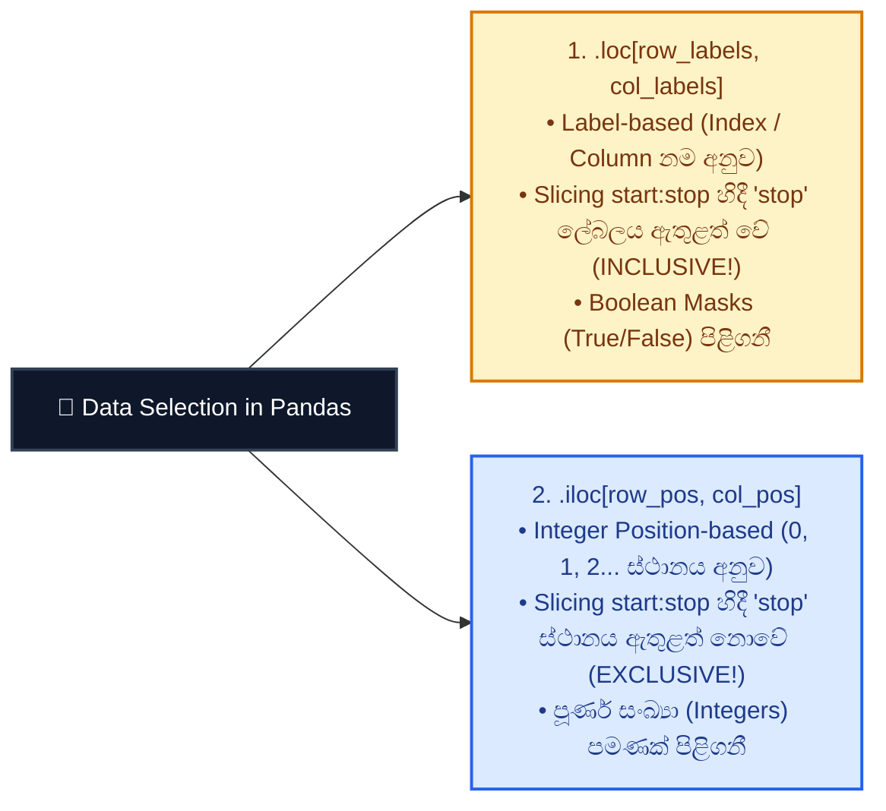

# Dependency Lesson 01.2: `.loc[]`, `.iloc[]`, Boolean Masking සහ `SettingWithCopyWarning` මුල සිට ප්‍රගුණ කිරීම

**අදාළ ප්‍රධාන පාඩම් (Related Core Lessons):**
- [Lesson 6.5: Introduction to Pandas & Mastering Series](../../Module_06_Exploratory_Data_Analysis_and_Pandas_Mastery/Lesson_6.5_Introduction_to_Pandas_and_Mastering_Series.md)
- [Lesson 6.6: Mastering Pandas DataFrame — Creation, I/O & Manipulation](../../Module_06_Exploratory_Data_Analysis_and_Pandas_Mastery/Lesson_6.6_Mastering_Pandas_DataFrame_Creation_IO_and_Manipulation.md)

---

## 1. හැඳින්වීම: `df[...]` පමණක් ප්‍රමාණවත් නොවන්නේ ඇයි? (Why Square Brackets Are Ambiguous)

Python `list` එකකදී `my_list[0]` යනු 0 වන ස්ථානයයි. Python `dict` එකකදී `my_dict['a']` යනු `'a'` නමැති යතුරයි (Key).  
නමුත් **`Pandas DataFrame`** එකකට **පේළි ලේබල් (`Row Index`)**, **තීරු ලේබල් (`Column Names`)**, සහ **පූර්ණ සංඛ්‍යා ස්ථාන (`Integer Positions 0, 1, 2...`)** යන සියල්ලම එකවර තිබේ!

විශේෂයෙන්ම ඔබේ `Series` එකේ හෝ `DataFrame` එකේ Row Index එකට `[100, 105, 107]` හෝ `[49, 48, 47, 1, 2, 3]` වැනි **ඉලක්කම් ලේබල් (Integer Labels)** ලබා දී ඇති විට, `s[1]` හෝ `s[:3]` යන්නෙන් අදහස් කරන්නේ **1 නමැති ලේබලයද (`Label`)**, නැතිනම් **1 වන ස්ථානයද (`Position`)** යන බරපතල ගැටලුව මතු වේ!

මෙම ව්‍යාකූලත්වය 100% ක්ම විසඳීම සඳහා `Pandas` විසින් ඉතා පැහැදිලි Selection Accessors දෙකක් හඳුන්වා දී ඇත:
1. **`.loc[]` (Label-based Selection):** පේළි සහ තීරුවල **ලේබල් නාමය (Label Name)** පමණක් භාවිතා කරයි.
2. **`.iloc[]` (Integer Position-based Selection):** ලේබලය කුමක් වුවත්, `0, 1, 2...` යන **ස්ථානීය අංකය (0-based Integer Position)** පමණක් භාවිතා කරයි.



---

## 2. `.loc[]` vs. `.iloc[]` ගැඹුරු සංසන්දනය සහ Slide 59 හි විභාග උගුල!



### ⚠️ Slicing හි ප්‍රධානතම වෙනස: Inclusive vs. Exclusive Stop!
- **`.iloc[0:3]` (Exclusive Stop):** සාමාන්‍ය Python List slicing මෙන් `0, 1, 2` යන ස්ථාන 3 පමණක් ලබා දෙයි (`3` වන ස්ථානය අත්හරියි).
- **`.loc['a':'c']` (Inclusive Stop):** `'a'` ලේබලයේ සිට `'c'` ලේබලය දක්වා (**`'c'` ලේබලයද ඇතුළුව!**) සියලුම පේළි ලබා දෙයි! (මන්ද `'c'` ට පසු ඇති ලේබලය කුමක්දැයි කලින් දැනගත නොහැකි නිසා `.loc` සැමවිටම අවසන් ලේබලය ඇතුළත් කරයි).

### Slide 59 හි සුප්‍රසිද්ධ උදාහරණය (ඉහත රූපයේ Panel 1):
```python
import numpy as np
import pandas as pd

# අනුපිළිවෙලින් නොමැති Integer Labels සහිත Series එකක්
s = pd.Series(np.nan, index=[49, 48, 47, 46, 45, 1, 2, 3, 4, 5])

# 1. .iloc[:3] -> මුල් ස්ථාන 3 (Positions 0, 1, 2) පමණක් කපා ගනී!
print("--- s.iloc[:3] (3 rows) ---")
print(s.iloc[:3])
# 49   NaN
# 48   NaN
# 47   NaN

# 2. .loc[:3] -> Index එකේ '3' නමැති ලේබලය හමුවන තෙක් (3 ද ඇතුළුව!) පේළි 8 ම කපා ගනී!
print("\n--- s.loc[:3] (8 rows!) ---")
print(s.loc[:3])
# 49   NaN
# 48   NaN
# 47   NaN
# 46   NaN
# 45   NaN
# 1    NaN
# 2    NaN
# 3    NaN
```

### 2D `DataFrame` එකක `.loc[rows, cols]` සහ `.iloc[rows, cols]` භාවිතය:
`DataFrame` එකකදී කොමාවකින් (`,`) වෙන් කර පළමුව **පේළි (Rows)** ද, දෙවනුව **තීරු (Columns)** ද ලබා දෙයි:

```python
df = pd.DataFrame({
    'Name': ['Sam', 'Max', 'Tony', 'Sarah'],
    'Dept': ['Research', 'HR', 'Marketing', 'Sales'],
    'Salary': [45034.88, 65343.45, 53423.27, 76422.34]
}, index=['E1', 'E2', 'E3', 'E4'])

# 1. තනි අගයක් ලබා ගැනීම (Scalar Lookup):
print(df.loc['E2', 'Salary'])       # 65343.45 (හෝ වඩාත් වේගවත් df.at['E2', 'Salary'])
print(df.iloc[1, 2])                # 65343.45 (හෝ වඩාත් වේගවත් df.iat[1, 2])

# 2. පේළි කිහිපයක් සහ තීරු කිහිපයක් ලැයිස්තුවක් ලෙස තේරීම:
print(df.loc[['E1', 'E4'], ['Name', 'Salary']])
print(df.iloc[[0, 3], [0, 2]])

# 3. සියලුම පේළිවල නිශ්චිත තීරු කිහිපයක් පමණක් තේරීම (':' මඟින් සියලුම පේළි):
print(df.loc[:, 'Name':'Dept'])     # 'Name' සහ 'Dept' තීරු දෙකම ඇතුළත් වේ!
```

---

## 3. Boolean Masking (කොන්දේසි මත දත්ත පෙරහන් කිරීම)

SQL හි `WHERE` විධානය මෙන්, කොන්දේසි එකක් හෝ කිහිපයක් මත පේළි පෙරහන් කිරීමට **Boolean Masking** භාවිතා කරයි.

### පියවර 2ක ක්‍රියාවලිය:
1. `df['Salary'] > 50000` වැනි ප්‍රකාශනයක් ලියූ විට, එය සෑම පේළියක් සඳහාම `True` හෝ `False` අඩංගු **Boolean Series (Mask)** එකක් ජනනය කරයි.
2. එම Boolean Series එක `df.loc[mask]` තුළට ලබා දුන් විට, `True` ඇති පේළි පමණක් පෙරී (Filter වී) ලැබේ!

### ⚠️ බහු-කොන්දේසි (Compound Conditions) ලිවීමේ නීති 2:
Python හි සාමාන්‍ය `and`, `or`, `not` වචන Series දෙකක් අතර භාවිතා කළ නොහැක (`ValueError: The truth value of a Series is ambiguous`). ඒ වෙනුවට:
1. **Bitwise Operators** භාවිතා කළ යුතුය:
   - **`&`** = AND (කොන්දේසි දෙකම සත්‍ය විය යුතුය)
   - **`|`** = OR (එක කොන්දේසියක් හෝ සත්‍ය විය යුතුය)
   - **`~`** = NOT (කොන්දේසියේ ප්‍රතිවිරුද්ධය)
2. **සෑම කොන්දේසියක්ම වරහන් `()` තුළ ලිවීම අනිවාර්ය වේ!** (මන්ද Python හි `&` සහ `|` වලට `>` හෝ `==` ට වඩා ඉහළ Operator Precedence එකක් ඇති නිසා වරහන් නොදැමුවහොත් දෝෂයක් ලැබේ!).

```python
# 1. වැටුප 50,000 ට වැඩි සහ දෙපාර්තමේන්තුව 'HR' හෝ 'Sales' වන සේවකයින් තේරීම:
cond = (df['Salary'] > 50000) & ((df['Dept'] == 'HR') | (df['Dept'] == 'Sales'))
print(df.loc[cond, ['Name', 'Dept', 'Salary']])

# 2. OR ('|') ගොඩක් ලිවීම වෙනුවට .isin() භාවිතා කිරීම (වඩාත් පිරිසිදු ක්‍රමය!):
cond_clean = (df['Salary'] > 50000) & (df['Dept'].isin(['HR', 'Sales']))
print(df.loc[cond_clean])

# 3. පරාසයක් පරීක්ෂා කිරීමට .between() සහ String ප්‍රකාශනයකින් පෙරීමට .query():
print(df[df['Salary'].between(50000, 70000)])
print(df.query("Salary > 50000 and Dept in ['HR', 'Sales']"))
```

---

## 4. `SettingWithCopyWarning` යනු කුමක්ද සහ එය 100% ක් නිවැරදිව විසඳන්නේ කෙසේද?

`Pandas` භාවිතා කරන විට ආධුනිකයන්ට නිතරම හමුවන ප්‍රසිද්ධම අනතුරු ඇඟවීම වන්නේ **`SettingWithCopyWarning: A value is trying to be set on a copy of a slice from a DataFrame`** යන්නයි (ඉහත රූපයේ Panel 4 බලන්න).

### මෙම දෝෂය ඇතිවන්නේ ඇයි? (Chained Indexing Trap):
ඔබ එකවර කොටු වරහන් දෙකක් (`df[...][...] = value`) භාවිතා කරන විට එයට **Chained Indexing** යැයි කියනු ලැබේ:
```python
# ❌ වැරදි ක්‍රමය (Chained Indexing):
df[df['Dept'] == 'HR']['Salary'] = 70000.0
```
මෙහිදී Python පළමුව `df[df['Dept'] == 'HR']` කොටස ක්‍රියාත්මක කරයි. එය මතකයේ වෙනම **තාවකාලික පිටපතක් (Temporary Copy)** සාදයි. ඉන්පසු දෙවන `['Salary'] = 70000.0` කොටස මඟින් වෙනස් කරන්නේ එම තාවකාලික පිටපතේ අගය මිස ඔබේ මුල් `df` වගුවේ අගය නොවේ! ඊළඟ පේළියේදී එම තාවකාලික පිටපත මැකී යන අතර ඔබේ මුල් `df` එක කිසිදු වෙනසක් නොවී පවතී!

### ✅ නිවැරදි විසඳුම් 2:
1. **මුල් `DataFrame` එකේ අගයන් කොන්දේසියක් මත වෙනස් කිරීමට නම් සැමවිටම තනි `.loc[row_indexer, col_indexer]` එකක් භාවිතා කරන්න:**
   ```python
   # ✅ නිවැරදි ක්‍රමය 1: තනි .loc[] විධානයකින් මුල් df එකම ආරක්ෂිතව යාවත්කාලීන කිරීම
   df.loc[df['Dept'] == 'HR', 'Salary'] = 70000.0
   ```
2. **උප-වගුවක් (Subset DataFrame) වෙනම විචල්‍යයකට ගෙන පසුව එය වෙනස් කිරීමට නම් පැහැදිලිවම `.copy()` යොදන්න:**
   ```python
   # ✅ නිවැරදි ක්‍රමය 2: ස්වාධීන පිටපතක් (Independent Copy) බව Pandas වෙත දැනුම් දීම
   hr_df = df.loc[df['Dept'] == 'HR'].copy()
   hr_df['Bonus'] = hr_df['Salary'] * 0.10   # කිසිදු Warning එකක් නොලැබේ!
   ```

---

## 🛠️ Practical Task / Hands-On Exercise (ප්‍රායෝගික අභ්‍යාසය)

### Scenario / Goal:
`EDA.ipynb` හි අඩංගු සේවක වගුව (`dfemp_rec`) භාවිතා කරමින් `.loc[]`, `.iloc[]`, Boolean Masking සහ ආරක්ෂිතව දත්ත යාවත්කාලීන කිරීම පුහුණු වෙමු.

### Step-by-Step Tasks:
1. පහත Starter Code හි දී ඇති සේවකයින් 8 දෙනාගේ `df_emp` වගුවෙන් `.iloc` භාවිතා කර 2 වන පේළියේ සිට 5 වන පේළිය දක්වා (Positions `2, 3, 4`) පළමු තීරු 3 තෝරා මුද්‍රණය කරන්න.
2. Boolean Mask එකක් සහ `.isin()` භාවිතා කර `HR` හෝ `IT` දෙපාර්තමේන්තුවල සේවය කරන, වැටුප `40,000` ට වැඩි සේවකයින්ගේ `Name`, `Dept`, සහ `Salary` තෝරන්න.
3. `SettingWithCopyWarning` ඇති නොවන සේ තනි `.loc[]` විධානයක් භාවිතා කර, `IT` දෙපාර්තමේන්තුවේ සියලුම සේවකයින්ගේ වැටුප 10% කින් (`Salary * 1.10`) වැඩි කරන්න.

### Starter Code:
```python
import pandas as pd

df_emp = pd.DataFrame({
    'Name': ['Sam', 'Max', 'Tony', 'Sarah', 'Tania', 'David', 'Mark', 'Charles'],
    'Dept': ['Research', 'HR', 'Marketing', 'Sales', 'Finance', 'IT', 'HR', 'IT'],
    'ID': [10001, 10002, 10003, 10004, 10005, 10006, 10007, 10009],
    'Salary': [45034.88, 65343.45, 53423.27, 76422.34, 58753.00, 34323.44, 66544.60, 55234.96]
})

# TODO 1: Slice positions 2, 3, 4 and first 3 columns using .iloc
# TODO 2: Filter employees in ['HR', 'IT'] with Salary > 40000
# TODO 3: Safely increase Salary by 10% for all 'IT' employees using .loc
```

### Expected Output / Reference Solution:
```python
import pandas as pd

df_emp = pd.DataFrame({
    'Name': ['Sam', 'Max', 'Tony', 'Sarah', 'Tania', 'David', 'Mark', 'Charles'],
    'Dept': ['Research', 'HR', 'Marketing', 'Sales', 'Finance', 'IT', 'HR', 'IT'],
    'ID': [10001, 10002, 10003, 10004, 10005, 10006, 10007, 10009],
    'Salary': [45034.88, 65343.45, 53423.27, 76422.34, 58753.00, 34323.44, 66544.60, 55234.96]
})

# 1. .iloc මඟින් Positions 2, 3, 4 සහ මුල් තීරු 3 තේරීම
print("--- 1. .iloc[2:5, :3] ---")
print(df_emp.iloc[2:5, :3])

# 2. Compound Boolean Masking with .isin()
mask = (df_emp['Dept'].isin(['HR', 'IT'])) & (df_emp['Salary'] > 40000)
print("\n--- 2. Filtered HR & IT Employees (Salary > 40,000) ---")
print(df_emp.loc[mask, ['Name', 'Dept', 'Salary']])

# 3. තනි .loc[] මඟින් IT සේවකයින්ගේ වැටුප 10% කින් ඉහළ නැංවීම
df_emp.loc[df_emp['Dept'] == 'IT', 'Salary'] = (df_emp.loc[df_emp['Dept'] == 'IT', 'Salary'] * 1.10).round(2)
print("\n--- 3. Updated IT Department Salaries (+10%) ---")
print(df_emp.loc[df_emp['Dept'] == 'IT'])
```

**Expected Console Output:**
```text
--- 1. .iloc[2:5, :3] ---
    Name       Dept     ID
2   Tony  Marketing  10003
3  Sarah      Sales  10004
4  Tania    Finance  10005

--- 2. Filtered HR & IT Employees (Salary > 40,000) ---
      Name Dept    Salary
1      Max   HR  65343.45
6     Mark   HR  66544.60
7  Charles   IT  55234.96

--- 3. Updated IT Department Salaries (+10%) ---
      Name Dept     ID    Salary
5    David   IT  10006  37755.78
7  Charles   IT  10009  60758.46
```

---

## 🔗 Next Steps & Back-Links to Core Module Lessons

- **පෙර Dependency පාඩම:** [01_Pandas_Core_Architecture_Index_Series_and_DataFrame_Internals.md](01_Pandas_Core_Architecture_Index_Series_and_DataFrame_Internals.md)
- **ඊළඟ Dependency පාඩම:** [03_Data_Cleaning_Missing_Values_Duplicates_String_and_Datetime_Methods.md](03_Data_Cleaning_Missing_Values_Duplicates_String_and_Datetime_Methods.md)
- **ආපසු ප්‍රධාන පාඩම් වෙත (Back to Core Lessons):**
  - [Lesson 6.5: Introduction to Pandas & Mastering Series](../../Module_06_Exploratory_Data_Analysis_and_Pandas_Mastery/Lesson_6.5_Introduction_to_Pandas_and_Mastering_Series.md)
  - [Lesson 6.6: Mastering Pandas DataFrame — Creation, I/O & Manipulation](../../Module_06_Exploratory_Data_Analysis_and_Pandas_Mastery/Lesson_6.6_Mastering_Pandas_DataFrame_Creation_IO_and_Manipulation.md)
