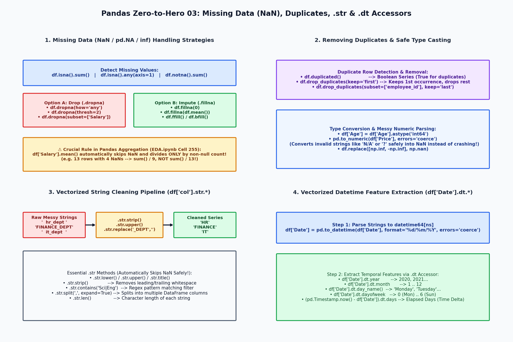
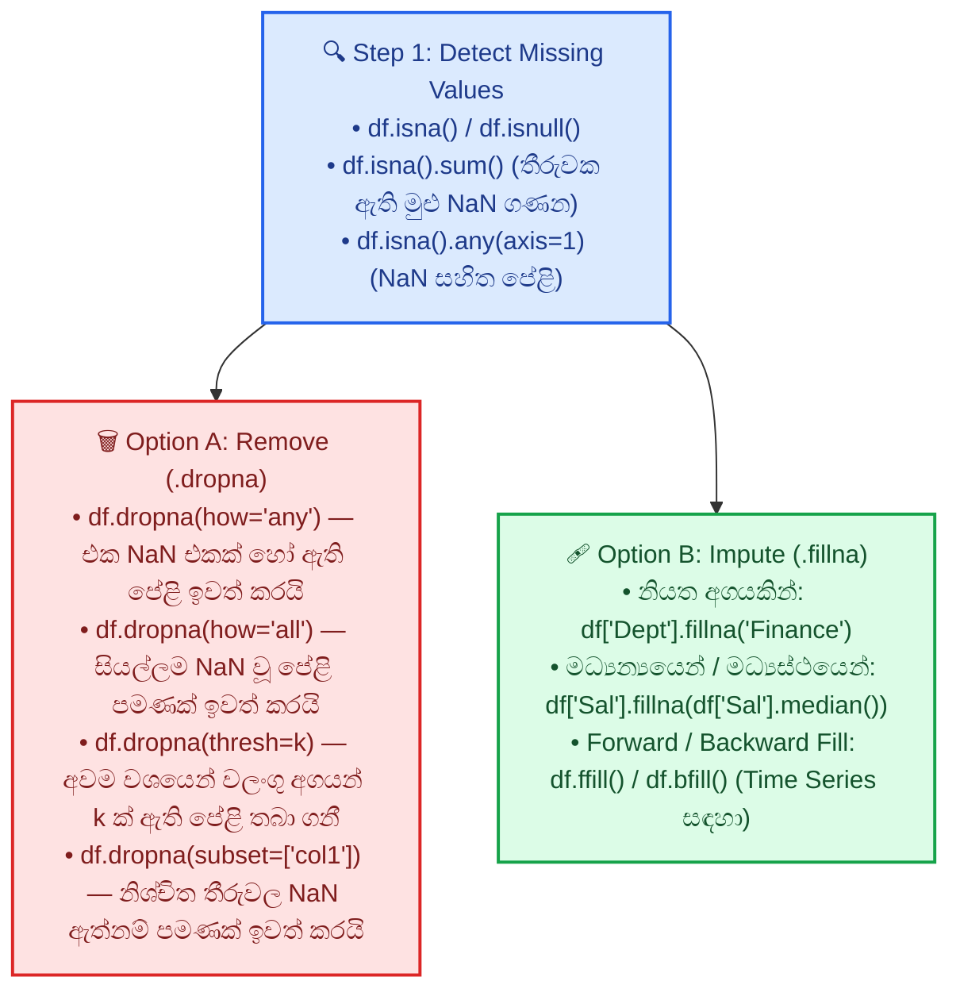

# Dependency Lesson 01.3: Data Cleaning — Missing Values (`NaN`), Duplicates, `.str` සහ `.dt` Accessors

**අදාළ ප්‍රධාන පාඩම් (Related Core Lessons):**
- [Lesson 6.1: Nature of Data — Sources, Types & Common Quality Issues](../../Module_06_Exploratory_Data_Analysis_and_Pandas_Mastery/Lesson_6.1_Nature_of_Data_Sources_Types_and_Quality_Issues.md)
- [Lesson 6.6: Mastering Pandas DataFrame — Creation, I/O & Manipulation](../../Module_06_Exploratory_Data_Analysis_and_Pandas_Mastery/Lesson_6.6_Mastering_Pandas_DataFrame_Creation_IO_and_Manipulation.md)
- [Lesson 6.7: DataFrame Arithmetic, Merging, Joining & Advanced EDA](../../Module_06_Exploratory_Data_Analysis_and_Pandas_Mastery/Lesson_6.7_DataFrame_Arithmetic_Merging_Joining_and_Advanced_EDA.md)

---

## 1. හැඳින්වීම: සැබෑ ලෝකයේ දත්ත පිරිසිදු කිරීම (Data Cleaning / Wrangling)

අපි Lesson 6.1 (Slide 10) හිදී ඉගෙන ගත් පරිදි, සැබෑ ලෝකයේ දත්ත කට්ටලවල ප්‍රධාන ගැටලු වන්නේ **Missing Values (අස්ථානගත අගයන්)**, **Wrong / Duplicate Values (වැරදි හෝ අනුපිටපත් අගයන්)**, සහ **Messy Formats (අවුල් සහගත Strings සහ දින ආකෘති)** ය. Data Scientist කෙනෙකුගේ කාලයෙන් 60%–80% ක්ම වැය වන්නේ මෙම දත්ත පිරිසිදු කර විශ්ලේෂණයට සූදානම් කිරීමටයි.

මෙම පාඩමෙන් අපි `Pandas` හි ඇති බලගතුම Data Cleaning මෙවලම් 4 මුල සිට ප්‍රගුණ කරමු:
1. **Missing & Infinite Data (`NaN`, `None`, `pd.NA`, `np.inf`)** හඳුනා ගැනීම, ඉවත් කිරීම (`.dropna()`) සහ ආදේශ කිරීම (`.fillna()`).
2. **Duplicate Rows (`.duplicated()`, `.drop_duplicates()`)** සහ **Data Type Casting (`.astype()`, `pd.to_numeric()`)**.
3. **Vectorized String Methods (`.str`)** මඟින් Text තීරු පිරිසිදු කිරීම.
4. **Vectorized Datetime Methods (`.dt`)** මඟින් දින සහ කාල දත්ත විශ්ලේෂණය කිරීම.



---

## 2. Missing Data (`NaN`) සහ Infinite Values (`np.inf`) හැසිරවීම



### A. `NaN` හඳුනා ගැනීම, `.dropna()` සහ `.fillna()` (`EDA.ipynb` Cells 212 – 244):
> [!CAUTION]
> **⚠️ Python හි `x == np.nan` කිසිවිටෙකත් භාවිතා කරන්න එපා!**  
> IEEE-754 Floating-Point සම්මතයට අනුව `np.nan == np.nan` යන්නෙහි අගය සැමවිටම **`False`** වේ! එබැවින් අස්ථානගත අගයන් පරීක්ෂා කිරීමට සැමවිටම **`df.isna()`** (හෝ `df.isnull()`) සහ වලංගු අගයන් පරීක්ෂා කිරීමට **`df.notna()`** භාවිතා කළ යුතුය.

```python
import numpy as np
import pandas as pd

df_miss = pd.DataFrame({
    'employee_name': ['Sam', 'Max', 'Tony', 'Sarah', 'Tania', 'Bob'],
    'employee_dept': ['Research', 'HR', np.nan, 'Sales', 'Finance', 'IT'],
    'employee_id':   [10001, 10002, 10003, np.nan, 10005, np.inf],
    'employee_salary': [np.nan, 65343.45, 53423.27, np.nan, 58753.00, 39078.60]
})

# 1. එක් එක් තීරුවේ ඇති මුළු NaN ගණන සහ වලංගු අගයන් ගණන:
print("Missing count per column:\n", df_miss.isna().sum())
print("Valid count per column:\n", df_miss.notna().sum())

# 2. අවම වශයෙන් එක් NaN අගයක් හෝ සහිත පේළි පමණක් පෙරහන් කර බැලීම:
print(df_miss[df_miss.isna().any(axis=1)])

# 3. thresh=3: අවම වශයෙන් වලංගු (Non-NA) අගයන් 3ක් වත් ඇති පේළි පමණක් තබා ගැනීම:
print(df_miss.dropna(thresh=3))

# 4. හිස්තැන් පිරවීම (Imputation):
# Categorical තීරුවක් නියත අගයකින් හෝ Mode (මාතය) මඟින් පිරවීම:
df_miss['employee_dept'] = df_miss['employee_dept'].fillna('Finance')
# සංඛ්‍යාත්මක තීරුවක් Mean (මධ්‍යන්‍යය) හෝ Median (මධ්‍යස්ථය) මඟින් පිරවීම:
df_miss['employee_salary'] = df_miss['employee_salary'].fillna(df_miss['employee_salary'].mean())
```

### B. Infinite Values (`np.inf` / `-np.inf`) සහ `NaN` තිබියදී ගණනය කිරීම් (`EDA.ipynb` Cells 246 – 257):
- බින්දුවෙන් බෙදීම වැනි ගණනය කිරීම් නිසා ඇතිවන `np.inf` (අනන්තය) සාමාන්‍යයෙන් `df.isna()` හෝ `df.dropna()` මඟින් අල්ලා ගන්නේ නැත.
- `EDA.ipynb` (Cell 251) හි පැරණි `pd.options.mode.use_inf_as_na = True` විධානය පෙන්වා ඇති අතර, නවීන `Pandas` හිදී වඩාත්ම ආරක්ෂිත ක්‍රමය වන්නේ:
  ```python
  df_miss = df_miss.replace([np.inf, -np.inf], np.nan)
  ```
- **සංඛ්‍යානමය ගණනය කිරීම්වලදී `skipna=True` (Default) හැසිරීම:**  
  `df['employee_salary'].mean()` ගණනය කරන විට, `Pandas` විසින් `NaN` අගයන් ස්වයංක්‍රීයව නොසලකා හරින අතර, මුළු එකතුව බෙදන්නේ මුළු පේළි ගණනින් නොව **වලංගු (Non-Null) අගයන් ගණනින් පමණි!** (ඔබට එක `NaN` එකක් හෝ ඇත්නම් ප්‍රතිඵලය `NaN` ලෙස ලබා ගැනීමට අවශ්‍ය නම් `df.mean(skipna=False)` භාවිතා කළ හැක).

---

## 3. Duplicate Records ඉවත් කිරීම සහ Data Type Casting

```python
# 1. අනුපිටපත් පේළි (Duplicates) හඳුනා ගැනීම සහ ඉවත් කිරීම (Cell 245):
print(df[df.duplicated()])                              # කලින් හමු වූ පේළියකට 100% සමාන පේළි පෙන්වයි
df_clean = df.drop_duplicates(keep='first')             # පළමු පේළිය තබාගෙන අනුපිටපත් ඉවත් කරයි
df_unique_id = df.drop_duplicates(subset=['emp_id'])    # emp_id තීරුව අනුව පමණක් අනුපිටපත් ඉවත් කරයි

# 2. Data Type Conversion (.astype සහ pd.to_numeric):
# සමහර CSV ගොනුවල සංඛ්‍යාත්මක තීරුවක 'N/A' හෝ '?' වැනි අකුරක් තිබුණහොත් මුළු තීරුවම 'object' (string) වේ!
# errors='coerce' මඟින් වැරදි අකුරු ස්වයංක්‍රීයව NaN බවට හරවා ඉතිරි සියල්ල float/int බවට පත් කරයි!
df['Salary'] = pd.to_numeric(df['Salary'], errors='coerce')
```

---

## 4. Vectorized String Accessor (`.str`) සහ Datetime Accessor (`.dt`)

`for` ලූප් නොලියා, තීරුවක ඇති දහස් ගණනක් Strings හෝ Dates එකවර (`NaN` අගයන් නිසා බිඳ වැටෙන්නේ නැතිව!) සැකසීමට `.str` සහ `.dt` Accessors භාවිතා කරයි (ඉහත රූපයේ Panels 3 සහ 4 බලන්න):

```python
# --- A. Vectorized String (.str) Methods ---
raw_names = pd.Series(['  sam perera ', 'MAX SILVA', None, 'tania fernando  '])

# එකම පේළියකින් (Method Chaining) හිස්තැන් ඉවත් කර Title Case බවට හැරවීම:
clean_names = raw_names.str.strip().str.title()
print(clean_names)
# 0        Sam Perera
# 1         Max Silva
# 2              None   <-- None / NaN ආරක්ෂිතව මඟ හරියි!
# 3    Tania Fernando

# මුල් නම සහ වාසගම තීරු දෙකකට වෙන් කිරීම:
name_parts = clean_names.str.split(' ', expand=True)
name_parts.columns = ['First_Name', 'Last_Name']

# --- B. Vectorized Datetime (.dt) Methods ---
dates = pd.Series(['07/10/2020', '08/10/2020', '09/10/2020'])
dt_series = pd.to_datetime(dates, format='%d/%m/%Y')

print("Year     :", dt_series.dt.year.tolist())       # [2020, 2020, 2020]
print("Month    :", dt_series.dt.month.tolist())      # [10, 10, 10]
print("Day Name :", dt_series.dt.day_name().tolist()) # ['Wednesday', 'Thursday', 'Friday']
```

---

## 🛠️ Practical Task / Hands-On Exercise (ප්‍රායෝගික අභ්‍යාසය)

### Scenario / Goal:
ඔබට අවුල් සහගත (Messy) සේවක වාර්තා අඩංගු `df_dirty` නමැති වගුවක් ලැබී ඇත. එහි අනවශ්‍ය හිස්තැන් සහිත දෙපාර්තමේන්තු නාම, `np.inf` සහ `'MISSING'` වැනි වැරදි අගයන්, අනුපිටපත් පේළි, සහ String ආකෘතියෙන් ඇති දින අඩංගු වේ.

### Step-by-Step Tasks:
1. `df_dirty` හි අනුපිටපත් පේළි (`.drop_duplicates()`) ඉවත් කරන්න.
2. `Dept` තීරුවේ ඇති හිස්තැන් ඉවත් කර (`.str.strip()`) සියල්ලම Upper-case (`.str.upper()`) බවට හරවන්න; එහි `NaN` අගයන් `'FINANCE'` ලෙස පුරවන්න.
3. `Salary` තීරුව `pd.to_numeric(..., errors='coerce')` මඟින් සංඛ්‍යා බවට හරවා, `np.inf` අගයන්ද `np.nan` බවට පත් කර, අස්ථානගත වැටුප් අගයන් වලංගු වැටුප්වල **Median (මධ්‍යස්ථය)** මඟින් පුරවන්න.
4. `Join_Date` තීරුව `pd.to_datetime()` මඟින් දින බවට හරවා, `.dt.year` භාවිතා කර `Join_Year` නමින් අලුත් තීරුවක් එක් කරන්න.

### Starter Code:
```python
import numpy as np
import pandas as pd

df_dirty = pd.DataFrame({
    'Name': ['Sam', 'Max', 'Tony', 'Max', 'Tania', 'Bob'],
    'Dept': ['  hr ', 'IT', np.nan, 'IT', ' finance ', '  sales'],
    'Salary': ['45000', '65000', 'MISSING', '65000', '58000', np.inf],
    'Join_Date': ['2019-05-12', '2020-08-01', '2021-03-15', '2020-08-01', '2018-11-20', '2022-01-10']
})

# TODO 1: Drop duplicate rows
# TODO 2: Clean 'Dept' strings (.str.strip().str.upper()) and fillna('FINANCE')
# TODO 3: Coerce 'Salary' to numeric, replace inf with NaN, and fillna with median
# TODO 4: Parse 'Join_Date' to datetime and extract 'Join_Year'
```

### Expected Output / Reference Solution:
```python
import numpy as np
import pandas as pd

df_dirty = pd.DataFrame({
    'Name': ['Sam', 'Max', 'Tony', 'Max', 'Tania', 'Bob'],
    'Dept': ['  hr ', 'IT', np.nan, 'IT', ' finance ', '  sales'],
    'Salary': ['45000', '65000', 'MISSING', '65000', '58000', np.inf],
    'Join_Date': ['2019-05-12', '2020-08-01', '2021-03-15', '2020-08-01', '2018-11-20', '2022-01-10']
})

# 1. අනුපිටපත් පේළි ඉවත් කිරීම
df_clean = df_dirty.drop_duplicates().copy()

# 2. Dept තීරුව පිරිසිදු කර NaN පිරවීම
df_clean['Dept'] = df_clean['Dept'].str.strip().str.upper().fillna('FINANCE')

# 3. Salary තීරුව සංඛ්‍යා බවට හරවා, inf ඉවත් කර, Median මඟින් පිරවීම
df_clean['Salary'] = pd.to_numeric(df_clean['Salary'], errors='coerce')
df_clean['Salary'] = df_clean['Salary'].replace([np.inf, -np.inf], np.nan)
median_sal = df_clean['Salary'].median()
df_clean['Salary'] = df_clean['Salary'].fillna(median_sal)

# 4. Join_Date දින බවට හරවා Join_Year තීරුව ව්‍යුත්පන්න කිරීම
df_clean['Join_Date'] = pd.to_datetime(df_clean['Join_Date'])
df_clean['Join_Year'] = df_clean['Join_Date'].dt.year

print("--- Cleaned Employee DataFrame ---")
print(df_clean)
```

**Expected Console Output:**
```text
--- Cleaned Employee DataFrame ---
    Name     Dept   Salary  Join_Date  Join_Year
0    Sam       HR  45000.0 2019-05-12       2019
1    Max       IT  65000.0 2020-08-01       2020
2   Tony  FINANCE  58000.0 2021-03-15       2021
4  Tania  FINANCE  58000.0 2018-11-20       2018
5    Bob    SALES  58000.0 2022-01-10       2022
```

---

## 🔗 Next Steps & Back-Links to Core Module Lessons

- **පෙර Dependency පාඩම:** [02_Mastering_loc_iloc_Boolean_Masking_and_SettingWithCopyWarning.md](02_Mastering_loc_iloc_Boolean_Masking_and_SettingWithCopyWarning.md)
- **ඊළඟ Dependency පාඩම:** [04_Split_Apply_Combine_GroupBy_Pivot_Tables_Reshaping_and_Relational_Joins.md](04_Split_Apply_Combine_GroupBy_Pivot_Tables_Reshaping_and_Relational_Joins.md)
- **ආපසු ප්‍රධාන පාඩම් වෙත (Back to Core Lessons):**
  - [Lesson 6.1: Nature of Data — Sources, Types & Common Quality Issues](../../Module_06_Exploratory_Data_Analysis_and_Pandas_Mastery/Lesson_6.1_Nature_of_Data_Sources_Types_and_Quality_Issues.md)
  - [Lesson 6.7: DataFrame Arithmetic, Merging, Joining & Advanced EDA](../../Module_06_Exploratory_Data_Analysis_and_Pandas_Mastery/Lesson_6.7_DataFrame_Arithmetic_Merging_Joining_and_Advanced_EDA.md)
