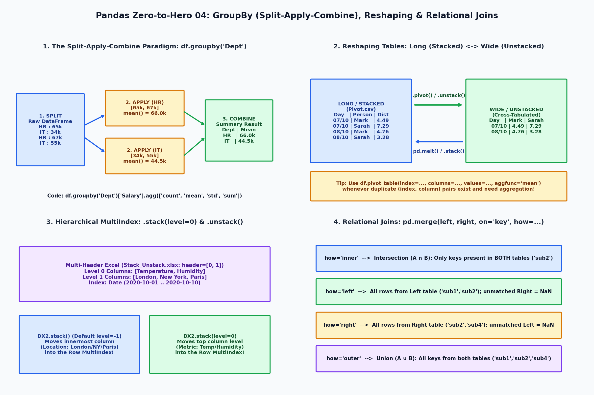
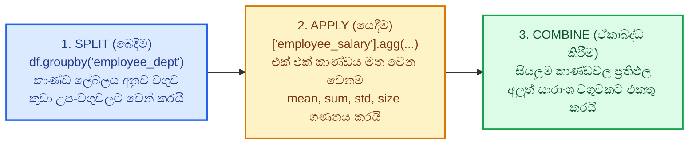

# Dependency Lesson 01.4: Split-Apply-Combine (`GroupBy`), Reshaping (`Pivot`, `Melt`, `Stack`/`Unstack`) සහ Relational Joins (`pd.merge`)

**අදාළ ප්‍රධාන පාඩම් (Related Core Lessons):**
- [Lesson 6.3: Data Organization (Stacked vs. Unstacked) & Variance Analysis](../../Module_06_Exploratory_Data_Analysis_and_Pandas_Mastery/Lesson_6.3_Data_Organization_Stacked_vs_Unstacked_and_Variance_Analysis.md)
- [Lesson 6.7: DataFrame Arithmetic, Merging, Joining & Advanced EDA](../../Module_06_Exploratory_Data_Analysis_and_Pandas_Mastery/Lesson_6.7_DataFrame_Arithmetic_Merging_Joining_and_Advanced_EDA.md)

---

## 1. හැඳින්වීම: තනි වගුවකින් ඔබ්බට යන උසස් දත්ත විශ්ලේෂණය

සැබෑ ලෝකයේ Data Science ගැටලුවලදී හුදෙක් මුළු වගුවේම සාමාන්‍යය (`df['Salary'].mean()`) සෙවීම ප්‍රමාණවත් නොවේ. අපට නිතරම මෙවැනි ප්‍රශ්නවලට පිළිතුරු දීමට සිදුවේ:
1. **"එක් එක් දෙපාර්තමේන්තුවේ (`Dept`) සහ විනෝදාංශයේ (`Hobby`) සාමාන්‍ය වැටුප, සම්මත අපගමනය සහ සේවක සංඛ්‍යාව කොපමණද?"** $\rightarrow$ **`GroupBy` (Split-Apply-Combine)**.
2. **"දිගට ගොඩගැසූ (`Stacked / Long`) වගුවක් හරස් වගුවක් (`Unstacked / Wide`) බවට හෝ නැවත Long ආකෘතියට හරවන්නේ කෙසේද?"** $\rightarrow$ **`.pivot()`, `pd.melt()`, `.stack()`, `.unstack()`**.
3. **"වෙනම වගු දෙකක (උදා: `Employees` සහ `Departments`) විසිරී ඇති දත්ත පොදු යතුරක් (`Key Column`) මඟින් එකට යා කරන්නේ කෙසේද?"** $\rightarrow$ **`pd.merge()` සහ `pd.concat()`**.



---

## 2. `GroupBy` සහ Split-Apply-Combine ක්‍රමවේදය (`EDA.ipynb` Cells 261 – 271)

Hadley Wickham විසින් හඳුන්වා දුන් **Split-Apply-Combine** යනු ඕනෑම කාණ්ඩගත විශ්ලේෂණයක (Grouped Aggregation) මූලික පියවර 3 යි (ඉහත රූපයේ Panel 1 බලන්න):



### `GroupBy` හි ප්‍රධාන Methods සහ `.agg()` භාවිතය:
```python
import numpy as np
import pandas as pd

D1 = pd.DataFrame({
    'employee_name': ['Sam', 'Max', 'Tony', 'Sarah', 'Tania', 'David', 'Mark', 'Charles'],
    'employee_dept': ['Research', 'HR', 'Marketing', 'Sales', 'Finance', 'IT', 'HR', 'IT'],
    'employee_salary': [45034.88, 65343.45, 53423.27, 76422.34, 58753.00, 34323.44, 66544.60, 55234.96],
    'employee_hobby': ['Traveling', 'Reading', 'Sports', 'Reading', 'Traveling', 'Sports', 'Sports', 'Sports']
})

# 1. GroupBy වස්තුව නිර්මාණය කිරීම (Lazy Evaluation: තවම ගණනය කිරීමක් සිදු කර නැත!)
grp = D1.groupby('employee_dept')

# 2. එක් එක් කාණ්ඩයට අයත් පේළි Index බලා ගැනීම (.groups) සහ එක් කාණ්ඩයක් වෙන් කර ගැනීම (.get_group):
print("Groups Dict :", grp.groups)
print("HR Group    :\n", grp.get_group('HR'))

# 3. එකවර සංඛ්‍යානමය මිනුම් කිහිපයක් ගණනය කිරීම (.agg):
summary = grp['employee_salary'].agg(['count', 'mean', 'std', 'sum'])
print("\nDepartment Salary Summary:\n", summary)

# 4. තීරු දෙකක් (Multi-Column) අනුව කාණ්ඩ කිරීම:
multi_grp = D1.groupby(['employee_dept', 'employee_hobby'])['employee_salary'].mean()
print("\nMulti-Column GroupBy:\n", multi_grp)
```

---

## 3. Reshaping DataFrames: `.pivot()`, `.pivot_table()`, `pd.melt()`, `.stack()`, `.unstack()`

Lesson 6.3 (Slide 20) හිදී අපි **Stacked (Long Format)** සහ **Unstacked (Wide Format)** දත්ත ආකෘති දෙක ඉගෙන ගත්තෙමු. `Pandas` හි මේ ආකෘති දෙක අතර දත්ත හුවමාරු කරන ප්‍රධාන ක්‍රම 4 පහත දැක්වේ (ඉහත රූපයේ Panels 2 සහ 3):

### A. `.pivot()` vs. `.pivot_table()` (Long $\rightarrow$ Wide):
- **`df.pivot(index=..., columns=..., values=...)`**: සෑම `(index, column)` යුගලයකටම **එකම එක අගයක් පමණක්** ඇති විට (උදා: `Pivot.csv` හි එක් දිනයක එක් පුද්ගලයෙකුට ඇත්තේ එක දත්ත පේළියක් පමණි) කෙලින්ම Wide වගුවකට හරවයි.
- **`df.pivot_table(index=..., columns=..., values=..., aggfunc='mean')`**: එකම `(index, column)` යුගලයට පේළි කිහිපයක් (Duplicates) තිබේ නම් `.pivot()` මඟින් `ValueError: Index contains duplicate entries` දෝෂයක් ලබා දෙයි! එවිට ඒවායේ සාමාන්‍යය හෝ එකතුව ගනිමින් Wide වගුවක් සෑදීමට `.pivot_table()` භාවිතා කරයි.

### B. `pd.melt()` (Wide $\rightarrow$ Long):
Wide ආකෘතියේ ඇති තීරු කිහිපයක් නැවතත් `variable` සහ `value` ලෙස දිගු පේළි (Stacked / Long Format) බවට හකුළුවාලීමට `pd.melt()` භාවිතා කරයි:

```python
# Pivot.csv වැනි Long වගුවක්:
dx = pd.DataFrame({
    'Day': ['07/10/2020', '07/10/2020', '08/10/2020', '08/10/2020'],
    'Person': ['Mark', 'Sarah', 'Mark', 'Sarah'],
    'CaloriesConsumed': [2475, 1795, 2013, 1800]
})

# 1. Long -> Wide (.pivot)
wide_df = dx.pivot(index='Day', columns='Person', values='CaloriesConsumed')
print("--- Wide Format (.pivot) ---\n", wide_df)

# 2. Wide -> Long (pd.melt)
# reset_index() මඟින් 'Day' Index එක සාමාන්‍ය තීරුවක් බවට පත් කර id_vars ලෙස තබා ගනී:
long_df = pd.melt(wide_df.reset_index(), id_vars=['Day'], var_name='Person', value_name='Calories')
print("\n--- Back to Long Format (pd.melt) ---\n", long_df)
```

### C. Hierarchical MultiIndex: `.stack()` සහ `.unstack()` (`Stack_Unstack.xlsx`):
- **`df.stack(level=-1)`**: තීරු (Columns) මට්ටමක් පේළි (Row Index) මට්ටමක් බවට හරවයි (Wide $\rightarrow$ Long). `level=0` දුන් විට ඉහළම තීරු මට්ටම පේළි බවට පත් වේ.
- **`df.unstack(level=-1)`**: පේළි (Row Index) මට්ටමක් නැවත තීරු (Columns) බවට දිගහරියි (Long $\rightarrow$ Wide).

---

## 4. Relational Joins (`pd.merge`) සහ Concatenation (`pd.concat`)

### A. `pd.merge(left, right, on=..., how=...)` — SQL Joins 4 (Slides 78, 80):
වගු දෙකක පොදු තීරුවක් (Key Column) මත පදනම්ව තිරස් අතට තීරු ඒකාබද්ධ කිරීමට `pd.merge()` භාවිතා කරයි (ඉහත රූපයේ Panel 4 බලන්න):

| `how=` පරාමිතිය | SQL සමානතාවය | ක්‍රියාකාරීත්වය (Set Logic) |
| :--- | :--- | :--- |
| **`'inner'`** *(Default)* | `INNER JOIN` | වගු දෙකෙහිම පොදුවේ පවතින යතුරු ($A \cap B$) පමණක් තබා ගනී. |
| **`'left'`** | `LEFT OUTER JOIN` | වම් වගුවේ ($A$) සියලුම පේළි තබා ගනී; දකුණු වගුවේ නොගැලපෙන තැන්වලට `NaN` යොදයි. |
| **`'right'`** | `RIGHT OUTER JOIN` | දකුණු වගුවේ ($B$) සියලුම පේළි තබා ගනී; වම් වගුවේ නොගැලපෙන තැන්වලට `NaN` යොදයි. |
| **`'outer'`** | `FULL OUTER JOIN` | වගු දෙකෙහිම ඇති සියලුම යතුරු ($A \cup B$) තබා ගනී; අඩු තැන්වලට `NaN` යොදයි. |

> **💡 Suffixes:** වගු දෙකෙහිම යතුරු තීරුවට අමතරව එකම නම ඇති වෙනත් තීරුවක් (උදා: `Name`) තිබේ නම්, `Pandas` විසින් ස්වයංක්‍රීයව ඒවා `Name_x` සහ `Name_y` ලෙස නම් කරයි (`suffixes=('_left', '_right')` මඟින් මෙය වෙනස් කළ හැක).

### B. `pd.concat([df1, df2], axis=0)` — වගු එකක් යටින් එකක් ඇමිණීම (Slide 79):
එකම තීරු ව්‍යුහයක් සහිත වගු දෙකක් (උදා: ජනවාරි වගුව සහ පෙබරවාරි වගුව) එකක් යටින් එකක් (`axis=0`) ඇමිණීමට `pd.concat([df1, df2], ignore_index=True)` භාවිතා කරයි.

---

## 🛠️ Practical Task / Hands-On Exercise (ප්‍රායෝගික අභ්‍යාසය)

### Scenario / Goal:
ඔබට සිසුන්ගේ විෂය ලකුණු අඩංගු `df_scores` වගුවක් සහ එක් එක් විෂයට අදාළ දෙපාර්තමේන්තුව අඩංගු `df_subjects` වගුවක් දී ඇත.

### Step-by-Step Tasks:
1. `pd.merge()` (`how='left'`) භාවිතා කර `df_scores` සහ `df_subjects` වගු දෙක `'Subject'` තීරුව මත ඒකාබද්ධ කර `df_merged` සාදන්න.
2. `df_merged.groupby('Subject')['Score'].agg(['count', 'mean', 'max'])` මඟින් එක් එක් විෂයයේ සිසුන් ගණන, මධ්‍යන්‍ය ලකුණ සහ වැඩිම ලකුණ ගණනය කරන්න.
3. `df_scores.pivot(index='Student', columns='Subject', values='Score')` භාවිතා කර සිසුන් පේළි ලෙසත් විෂයයන් තීරු ලෙසත් පෙන්වන Unstacked (Wide) වගුව නිර්මාණය කරන්න.

### Starter Code:
```python
import pandas as pd

df_scores = pd.DataFrame({
    'Student': ['Amal', 'Amal', 'Nimal', 'Nimal', 'Kamal', 'Kamal'],
    'Subject': ['Python', 'Stats', 'Python', 'Stats', 'Python', 'ML'],
    'Score':   [88, 76, 92, 85, 79, 95]
})

df_subjects = pd.DataFrame({
    'Subject': ['Python', 'Stats', 'Databases'],
    'Faculty': ['Computing', 'Mathematics', 'Computing']
})

# TODO 1: Left merge df_scores with df_subjects on 'Subject'
# TODO 2: GroupBy 'Subject' and compute count, mean, max of 'Score'
# TODO 3: Pivot df_scores to Wide format (index='Student', columns='Subject', values='Score')
```

### Expected Output / Reference Solution:
```python
import pandas as pd

df_scores = pd.DataFrame({
    'Student': ['Amal', 'Amal', 'Nimal', 'Nimal', 'Kamal', 'Kamal'],
    'Subject': ['Python', 'Stats', 'Python', 'Stats', 'Python', 'ML'],
    'Score':   [88, 76, 92, 85, 79, 95]
})

df_subjects = pd.DataFrame({
    'Subject': ['Python', 'Stats', 'Databases'],
    'Faculty': ['Computing', 'Mathematics', 'Computing']
})

# 1. Left Join මඟින් වගු දෙක ඒකාබද්ධ කිරීම ('ML' සඳහා Faculty = NaN ලැබේ)
df_merged = pd.merge(df_scores, df_subjects, on='Subject', how='left')
print("--- 1. Left Merged DataFrame ---")
print(df_merged)

# 2. GroupBy Aggregation
subj_stats = df_merged.groupby('Subject')['Score'].agg(['count', 'mean', 'max'])
print("\n--- 2. GroupBy Subject Statistics ---")
print(subj_stats)

# 3. Pivot Table (Long -> Wide)
df_wide = df_scores.pivot(index='Student', columns='Subject', values='Score')
print("\n--- 3. Pivoted Wide DataFrame ---")
print(df_wide)
```

**Expected Console Output:**
```text
--- 1. Left Merged DataFrame ---
  Student Subject  Score      Faculty
0    Amal  Python     88    Computing
1    Amal   Stats     76  Mathematics
2   Nimal  Python     92    Computing
3   Nimal   Stats     85  Mathematics
4   Kamal  Python     79    Computing
5   Kamal      ML     95          NaN

--- 2. GroupBy Subject Statistics ---
         count       mean  max
Subject                       
ML           1  95.000000   95
Python       3  86.333333   92
Stats        2  80.500000   85

--- 3. Pivoted Wide DataFrame ---
Subject    ML  Python  Stats
Student                     
Amal      NaN    88.0   76.0
Kamal    95.0    79.0    NaN
Nimal     NaN    92.0   85.0
```

---

## 🔗 Next Steps & Back-Links to Core Module Lessons

- **පෙර Dependency පාඩම:** [03_Data_Cleaning_Missing_Values_Duplicates_String_and_Datetime_Methods.md](03_Data_Cleaning_Missing_Values_Duplicates_String_and_Datetime_Methods.md)
- **ආපසු ප්‍රධාන පාඩම් වෙත (Back to Core Lessons):**
  - [Lesson 6.3: Data Organization (Stacked vs. Unstacked) & Variance Analysis](../../Module_06_Exploratory_Data_Analysis_and_Pandas_Mastery/Lesson_6.3_Data_Organization_Stacked_vs_Unstacked_and_Variance_Analysis.md)
  - [Lesson 6.7: DataFrame Arithmetic, Merging, Joining & Advanced EDA](../../Module_06_Exploratory_Data_Analysis_and_Pandas_Mastery/Lesson_6.7_DataFrame_Arithmetic_Merging_Joining_and_Advanced_EDA.md)
