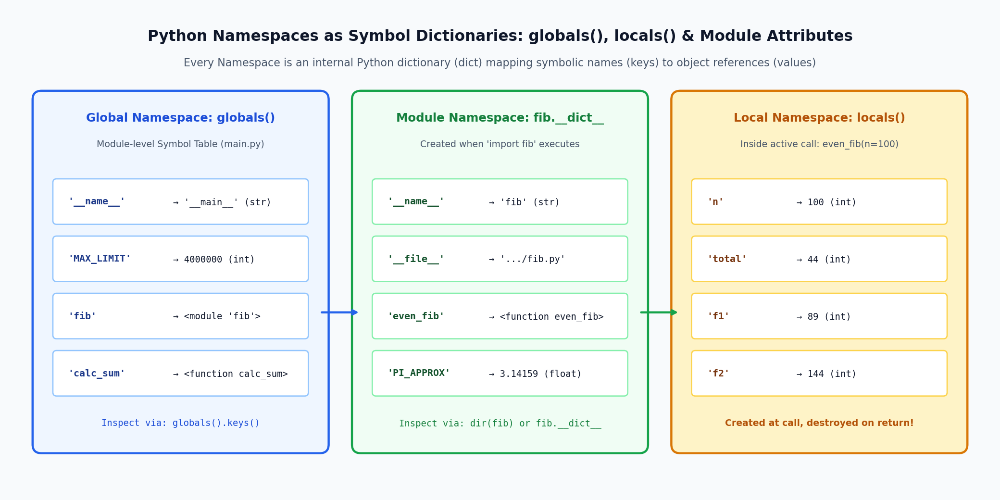
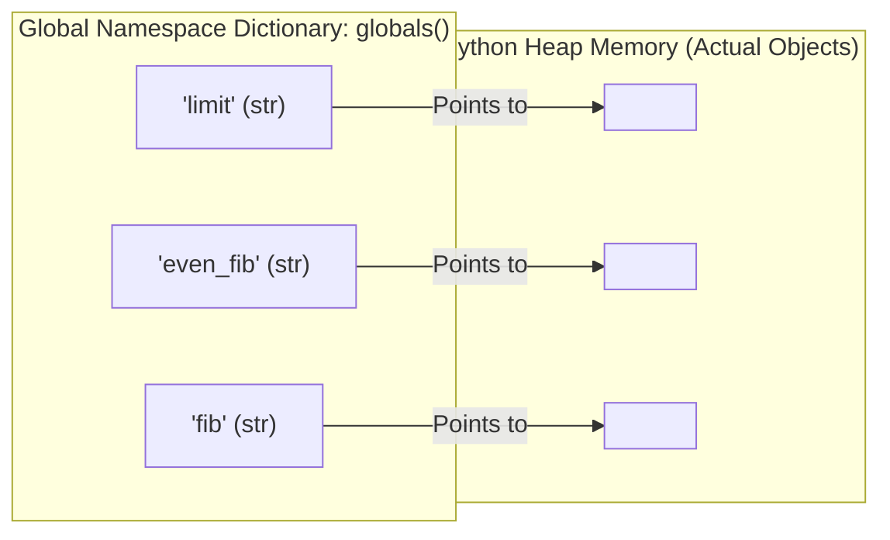

# Dependency Lesson 01.1: What is a Namespace? — `globals()`, `locals()`, and `dir()`

**අදාළ ප්‍රධාන පාඩම් (Related Core Module 3 Lessons):**
- [Lesson 3.1: Python Modules, Import Mechanics & `__name__ == "__main__"`](../../Module_03_Modular_and_Intermediate_Python/Lesson_3.1_Python_Modules_Import_Mechanics_and_Main.md)
- [Lesson 3.2: The Module Search Path (`sys.path` & `PYTHONPATH`)](../../Module_03_Modular_and_Intermediate_Python/Lesson_3.2_The_Module_Search_Path_sys_path_and_PYTHONPATH.md)

---

## 1. හැඳින්වීම: ඇයි අපිට Namespaces අවශ්‍ය වන්නේ? (Why Were Namespaces Invented?)

සිතන්න ඔබේ පන්තියේ **"Kasun"** නමින් සිසුන් දෙදෙනෙක් සිටිනවා කියා. ගුරුවරයා පන්තියට පැමිණ *"Kasun, පොත ගේන්න"* කියා පැවසුවහොත්, කුමන Kasun ද කියා ව්‍යාකූලත්වයක් (**Name Collision / Naming Conflict**) ඇති වේ. නමුත් ගුරුවරයා **"Group A හි Kasun (`Group_A.Kasun`)"** සහ **"Group B හි Kasun (`Group_B.Kasun`)"** ලෙස කණ්ඩායම් නාමය (Context / Prefix) සමඟ කතා කළහොත් කිසිදු පැටලිල්ලක් සිදු නොවේ!

Python වැඩසටහනකදීත් අපි Variables, Functions, සහ Classes දහස් ගණනක් නිර්මාණය කරන අතර, බාහිර Modules (`math`, `numpy`, `pandas`, `fib`) ගණනාවක් Import කරමු. උදාහරණයක් ලෙස `math` module එකෙහිත් `sin()` නමින් function එකක් ඇත; `numpy` module එකෙහිත් `sin()` නමින් function එකක් ඇත. මේ නම් දෙක එකිනෙක ගැටී (Overwrite වී) විනාශ නොවී වෙන්ව තබා ගැනීමට Python භාවිතා කරන විශ්මිත ක්‍රමවේදය **Namespace (නාම අවකාශය)** ලෙස හැඳින්වේ.

The **Zen of Python (`import this`)** හි අවසාන සහ ඉතාම වැදගත් වාක්‍යය වන්නේද මෙයයි:
> *"Namespaces are one honking great idea — let's do more of those!"*



---

## 2. Namespace එකක් යනු ඇත්තටම කුමක්ද? (Namespace as a Symbol Dictionary)

බොහෝ දෙනෙක් Namespace යනු සංකීර්ණ දෙයක් ලෙස සිතුවද, Python අභ්‍යන්තරයේදී (Under the hood) **Namespace එකක් යනු සාමාන්‍ය Python Dictionary (`dict`) එකකි!**

මෙම **Symbol Table (සංකේත වගුව)** නමැති Dictionary එක තුළ:
- **Keys (යතුරු):** ඔබ ලබා දෙන Variable හෝ Function නාමයන් (`str` වර්ගයේ Strings ලෙස, උදා: `'x'`, `'even_fib'`, `'__name__'`).
- **Values (අගයන්):** පරිගණක මතකයේ (Heap Memory) ඇති සැබෑ Python Object එකේ **Object Reference (වස්තු යොමුව)** වේ!



ඔබ Python හි `limit = 4000000` ලෙස ලියන විට සැබවින්ම සිදුවන්නේ වත්මන් Namespace Dictionary එකට `namespace_dict['limit'] = 4000000` ලෙස අලුත් Key-Value යුගලයක් එක් කිරීමයි!

---

## 3. Python හි ප්‍රධාන Namespace වර්ග 4 (The 4 Types of Namespaces)

Python වැඩසටහනක් ක්‍රියාත්මක වන විට විවිධ ආයු කාලයන් (**Lifetimes**) සහිත Namespaces 4ක් පවතී:

| Namespace වර්ගය | නිර්මාණය වන අවස්ථාව (Created When) | විනාශ වන අවස්ථාව (Destroyed When) | පරීක්ෂා කරන Built-in මෙවලම |
| :--- | :--- | :--- | :--- |
| **1. Built-in Namespace** | Python Interpreter එක ආරම්භ වන මොහොතේදීම | Interpreter එකෙන් ඉවත් වන විට (`exit()`) | `import builtins; dir(builtins)` |
| **2. Global (Module) Namespace** | `.py` ගොනුවක් Run කරන විට හෝ Module එකක් `import` කරන විට | වැඩසටහන අවසන් වන විට | `globals()` හෝ `module.__dict__` |
| **3. Enclosing Namespace** | Outer function එකක් කැඳවන විට (Nested functions සඳහා) | Outer function එක සහ Closure එක අවසන් වන විට | `locals()` (Outer function තුළදී) |
| **4. Local Namespace** | Function එකක් Call කරන සෑම මොහොතකදීම (`func()`) | Function එක `return` වූ සැණින්! | `locals()` (Function එක තුළදී) |

---

## 4. `globals()`, `locals()`, සහ `dir()` ප්‍රායෝගිකව භාවිතා කරමින් පරීක්ෂා කිරීම

අපට ඕනෑම මොහොතක Python හි Built-in functions වන `globals()`, `locals()`, සහ `dir()` භාවිතා කර Namespaces ඇතුළත තිබෙන දේවල් සජීවීව බලාගත හැක.

### 4.1 `globals()` — Global Namespace Dictionary එක බැලීම
`globals()` කැඳවූ විට වත්මන් Module එකේ Global Namespace එක නිරූපණය කරන සැබෑ Dictionary එක ආපසු ලබා දෙයි:

```python
# Global විචල්‍යයක් සහ ශ්‍රිතයක් නිර්මාණය කරමු
course_code = "MSC_ADP_2026"

def square(n):
    return n ** 2

# Global Namespace හි ඇති Keys පරීක්ෂා කරමු
global_ns = globals()
print("Type of globals():", type(global_ns))
print("'course_code' in globals():", 'course_code' in global_ns)
print("'square' in globals():", 'square' in global_ns)
print("Value via dictionary lookup:", global_ns['course_code'])
print("Module __name__ via globals():", global_ns['__name__'])
```

**Output:**
```text
Type of globals(): <class 'dict'>
'course_code' in globals(): True
'square' in globals(): True
Value via dictionary lookup: MSC_ADP_2026
Module __name__ via globals(): __main__
```

### 4.2 `locals()` — Function එකක් ඇතුළත Local Namespace එක බැලීම
Function එකක් ක්‍රියාත්මක වන අතරතුර `locals()` කැඳවූ විට, එම Function call එකට පමණක් අදාළ Local parameters සහ variables අඩංගු Dictionary එක ලබා දෙයි:

```python
def calculate_ kinetic_energy(mass, velocity):
    # Energy formula: E = 0.5 * m * v^2
    half_factor = 0.5
    energy = half_factor * mass * (velocity ** 2)
    
    # Function එක ඇතුළත Local Namespace එක පරීක්ෂා කිරීම
    print("Inside Function - locals():", locals())
    return energy

result = calculate_kinetic_energy(10, 4)
```

**Output:**
```text
Inside Function - locals(): {'mass': 10, 'velocity': 4, 'half_factor': 0.5, 'energy': 80.0}
```
*(සටහන: Module එකේ Top-level හිදී, එනම් Function එකකින් පිටතදී `locals()` කැඳවුවහොත්, එය `globals()` හා සමානම Dictionary එක ලබා දෙයි: `locals() is globals()` $\rightarrow$ `True`!).*

### 4.3 `dir()` සහ `__dict__` — Import කළ Module එකක Namespace එක පරීක්ෂා කිරීම
[Lesson 3.1](../../Module_03_Modular_and_Intermediate_Python/Lesson_3.1_Python_Modules_Import_Mechanics_and_Main.md) හිදී අපි ඉගෙන ගත් පරිදි `import math` හෝ `import fib` vs `from fib import even_fib` අතර වෙනස Namespace ඇසුරෙන් ඉතා පැහැදිලිව තේරුම් ගත හැක:

1. **`import fib` කළ විට:** Python විසින් `fib.py` ක්‍රියාත්මක කර එහි සියලුම Functions/Variables අඩංගු **වෙනමම Module Namespace එකක් (`fib.__dict__`)** සාදයි. ඔබේ වත්මන් Global Namespace එකට එකතු වන්නේ `'fib'` යන තනි නම පමණි! එබැවින් ඔබ `fib.even_fib()` ලෙස Dot notation (`.`) භාවිතා කර එම `fib` namespace එක ඇතුළට පිවිසිය යුතුය.
2. **`from fib import even_fib` කළ විට:** `fib` නම වෙනුවට කෙලින්ම `'even_fib'` යන නම ඔබේ වත්මන් Global Namespace එකට පිටපත් වේ.
3. **`from fib import *` (Wildcard Import) කළ විට:** `fib` module එකේ ඇති සියලුම නම් ඔබේ Global Namespace එක තුළට කෙලින්ම එකතු වේ (**Namespace Pollution**). ඔබේ ගොනුවේත් ඒ නමින්ම වෙනත් Function එකක් තිබුණහොත් එය නිහඬවම මැකී යයි (Shadowing / Overwriting)!

```python
import math

# math module එකේ Namespace එක තුළ ඇති Attributes ලැයිස්තුව බැලීම:
print("First 8 attributes in math:", dir(math)[:8])

# math.__dict__ යනු math module එකේ සැබෑ Namespace dictionary එකයි:
print("pi from math.__dict__:", math.__dict__['pi'])
```

---

## 🛠️ Practical Task / Hands-On Exercise (ප්‍රායෝගික අභ්‍යාසය)

### Scenario / Goal:
ඔබ Data Science ව්‍යාපෘතියකදී Modules දෙකක් Import කරන විට සිදුවන **Namespace Collision (නම් ගැටීම)** හඳුනා ගැනීමට සහ `globals()`, `locals()`, හා `dir()` මගින් Namespaces පරීක්ෂා කිරීමට කුඩා පරීක්ෂණ කේතයක් ලිවිය යුතුය.

### Step-by-Step Tasks:
1. Global මට්ටමින් `pi = 3.14` නමින් විචල්‍යයක් සාදන්න.
2. `from math import pi` ලෙස ක්‍රියාත්මක කළ විට ඔබේ මුල් `pi` අගයට කුමක් සිදුවේදැයි `globals()['pi']` මගින් පරීක්ෂා කරන්න.
3. එම ගැටලුව වළක්වා ගැනීමට ඔබේ `pi = 3.14` නැවත පිහිටුවා, `import math` භාවිතා කර `pi` සහ `math.pi` යන දෙකම එකවර වෙන වෙනම භාවිතා කර පෙන්වන්න.
4. `inspect_circle(radius)` නමින් ශ්‍රිතයක් ලියා, එය තුළදී `area = math.pi * (radius ** 2)` ගණනය කර, `locals()` හි ඇති සියලුම Keys ලැයිස්තුව (`list(locals().keys())`) සහ `area` අගය Tuple එකක් ලෙස Return කරන්න.

### Starter Code:
```python
import math

# Task 1 & 3: Global variable
pi = 3.14

def inspect_circle(radius):
    # TODO: Calculate area using math.pi and return (list_of_local_keys, area)
    pass

# Test your function
print(inspect_circle(5))
```

### Expected Output / Reference Solution:
```python
import math

# 1. අපගේ Global Namespace හි 'pi' විචල්‍යය:
pi = 3.14
print("Custom Global pi:", globals()['pi'])

# 2. 'import math' භාවිතා කළ විට math.pi වෙනම Namespace එකක පවතී (ගැටීමක් නැත!):
print("math Module Namespace pi:", math.__dict__['pi'])

# 3. Local Namespace පරීක්ෂා කරන ශ්‍රිතය:
def inspect_circle(radius):
    area = math.pi * (radius ** 2)
    local_keys = list(locals().keys())
    return local_keys, round(area, 4)

keys, circle_area = inspect_circle(5)
print("Local Namespace Keys inside inspect_circle:", keys)
print("Calculated Circle Area:", circle_area)
```

**Expected Output:**
```text
Custom Global pi: 3.14
math Module Namespace pi: 3.141592653589793
Local Namespace Keys inside inspect_circle: ['radius', 'area']
Calculated Circle Area: 78.5398
```

---

## 📝 Summary & Exam Revision Cheat Sheet

| Concept / Function | Purpose & Behavior |
| :--- | :--- |
| **Namespace** | Symbolic Name (`str`) එකක් සහ Memory Object Reference එකක් යා කරන අභ්‍යන්තර Python Dictionary එකකි. |
| **`globals()`** | වත්මන් Module එකේ Global Namespace dictionary එක ආපසු ලබා දෙයි. |
| **`locals()`** | දැනට ක්‍රියාත්මක වන Function එකේ Local Namespace dictionary එක ලබා දෙයි. |
| **`dir(obj)`** | Module එකක හෝ Object එකක ඇති සියලුම Attributes/Names ලැයිස්තුවක් (`list`) ලෙස ලබා දෙයි. |
| **`import mod` vs `from mod import *`** | `import mod` මගින් `mod` සඳහා වෙනම Namespace එකක් තබා ගනී; `from mod import *` මගින් Global Namespace එකට සියල්ල එකතු කර නම් ගැටීම් (Namespace Pollution) ඇති කළ හැක. |

---

**ඊළඟ Dependency පාඩම:** [02_The_LEGB_Scope_Rule_global_and_nonlocal_Keywords.md](02_The_LEGB_Scope_Rule_global_and_nonlocal_Keywords.md)  
**ආපසු ප්‍රධාන පාඩමට (Back to Main Lesson):** [Lesson 3.1: Python Modules, Import Mechanics & `__name__ == "__main__"`](../../Module_03_Modular_and_Intermediate_Python/Lesson_3.1_Python_Modules_Import_Mechanics_and_Main.md)
