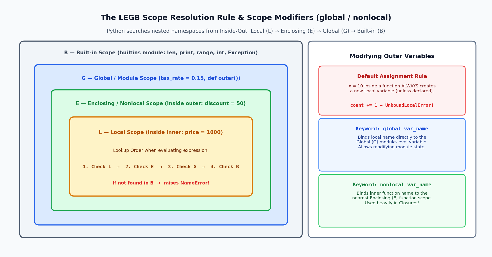
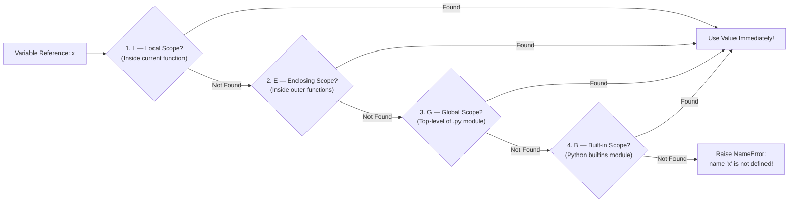

# Dependency Lesson 01.2: The LEGB Scope Rule, `global`, and `nonlocal` Keywords

**අදාළ ප්‍රධාන පාඩම් (Related Core Module 3 Lessons):**
- [Lesson 3.1: Python Modules, Import Mechanics & `__name__ == "__main__"`](../../Module_03_Modular_and_Intermediate_Python/Lesson_3.1_Python_Modules_Import_Mechanics_and_Main.md)
- [Lesson 3.3: Function Arguments — Default Values & The Mutable Default Pitfall](../../Module_03_Modular_and_Intermediate_Python/Lesson_3.3_Function_Arguments_Default_Values_and_Mutable_Pitfall.md)
- [Lesson 3.5: Anonymous `lambda` Functions & List Comprehensions](../../Module_03_Modular_and_Intermediate_Python/Lesson_3.5_Anonymous_Lambda_Functions_and_List_Comprehensions.md)

---

## 1. හැඳින්වීම: Variable Scope (විචල්‍ය විෂය පථය) යනු කුමක්ද?

[පෙර පාඩමෙන් (`01_What_is_a_Namespace...`)](01_What_is_a_Namespace_globals_locals_and_dir.md) අපි ඉගෙන ගත්තේ Python වැඩසටහනක Local, Enclosing, Global සහ Built-in වශයෙන් Namespaces 4ක් එකවර පැවතිය හැකි බවයි.

දැන් ප්‍රශ්නය මෙයයි: ඔබ Function එකක් ඇතුළත `print(x)` ලෙස ලියූ විට, Python විසින් එම `x` නමැති විචල්‍යය සොයන්නේ කුමන Namespace එක තුළද? Local එකෙහිත් `x` තිබී Global එකෙහිත් `x` තිබුණහොත් කුමන අගය තෝරා ගනීද?

වැඩසටහනක යම් ස්ථානයක සිට කෙලින්ම ප්‍රවේශ විය හැකි Namespaces කලාපය **Variable Scope (විචල්‍ය විෂය පථය)** ලෙස හැඳින්වේ. Python විසින් විචල්‍ය නාමයක් සොයන නිශ්චිත ධූරාවලි අනුපිළිවෙළ **LEGB Scope Resolution Rule** ලෙස හැඳින්වේ!



---

## 2. LEGB නීතිය: ඇතුළත සිට පිටතට සෙවීම (Inside-Out Lookup Order)

Python හි ඕනෑම තැනක විචල්‍ය නාමයක් (Symbol) හමු වූ විට, Python එය සොයන්නේ **ඇතුළතම ස්තරයේ සිට පිටතම ස්තරය දක්වා (`L` $\rightarrow$ `E` $\rightarrow$ `G` $\rightarrow$ `B`)** පිළිවෙළටය:



1. **L — Local Scope (ස්ථානීය විෂය පථය):**
   - දැනට ක්‍රියාත්මක වන Function එක (`def` හෝ `lambda`) ඇතුළත නිර්මාණය කළ විචල්‍යයන් සහ එහි Parameters පරීක්ෂා කරයි.
2. **E — Enclosing / Nonlocal Scope (වටකර ඇති පිටත ශ්‍රිතයේ විෂය පථය):**
   - Function එකක් තවත් Function එකක් ඇතුළත ලියා ඇති විට (**Nested Functions**), පිටතින් ඇති Outer function එකේ Local namespace එක පරීක්ෂා කරයි.
3. **G — Global / Module Scope (ගෝලීය / මොඩියුල විෂය පථය):**
   - වත්මන් `.py` ගොනුවේ ඉහළම මට්ටමේ (Top-level හි) අර්ථ දක්වා ඇති විචල්‍යයන් පරීක්ෂා කරයි. (සටහන: Python හි "Global" යන්නෙන් අදහස් කරන්නේ **එම තනි Module ගොනුවට පමණක් පොදු** බවයි; සියලුම `.py` ගොනුවලට ඉබේම පොදු නොවේ!).
4. **B — Built-in Scope (අභ්‍යන්තර විෂය පථය):**
   - ඉහත තැන් තුනෙහිම නොමැති නම්, Python හි `builtins` module එක (`print`, `len`, `range`, `max`, `int`, `list`, `ValueError` ආදිය) පරීක්ෂා කරයි. එහිත් නොමැති නම් **`NameError`** දෝෂයක් නිකුත් කරයි!

### LEGB ක්‍රියාකාරීත්වය පෙන්වන සම්පූර්ණ කේත උදාහරණය:

```python
# G — Global Scope
x = "Global X"

def outer():
    # E — Enclosing Scope
    x = "Enclosing X"
    
    def inner():
        # L — Local Scope
        x = "Local X"
        print("Inside inner():", x)   # L හි 'x' හමුවන නිසා "Local X" මුද්‍රණය වේ
        
    inner()
    print("Inside outer():", x)       # E හි 'x' හමුවන නිසා "Enclosing X" මුද්‍රණය වේ

outer()
print("At Module Level:", x)          # G හි 'x' හමුවන නිසා "Global X" මුද්‍රණය වේ
```

**Output:**
```text
Inside inner(): Local X
Inside outer(): Enclosing X
At Module Level: Global X
```

---

## 3. Reading vs. Assigning: `UnboundLocalError` උගුල!

ආධුනිකයින් බොහෝ දෙනෙක් වරද්දා ගන්නා ඉතාම වැදගත් නීතියක් Python හි ඇත:
- **කියවීම (Reading):** Function එකක් ඇතුළත සිට Global විචල්‍යයක අගය **කියවීමට (Read කිරීමට)** කිසිදු විශේෂ Keyword එකක් අවශ්‍ය නැත.
- **අගයක් ආදේශ කිරීම (Assignment `=`):** නමුත් Function එකක් ඇතුළත කොතැනක හෝ `var = ...` හෝ `var += 1` ලෙස ලියා තිබුණහොත්, Python Compiler එක Function එක Compile කරන මොහොතේදීම තීරණය කරන්නේ **`var` යනු එම Function එකට අයත් අලුත්ම Local විචල්‍යයක්** බවයි!

පහත උදාහරණය දෙස බලන්න:

```python
counter = 10  # Global variable

def increment_broken():
    # counter = counter + 1 ලෙස ලියූ නිසා Python සිතන්නේ 'counter' යනු Local විචල්‍යයක් කියාය!
    # නමුත් දකුණු පස ඇති 'counter' කියවන මොහොතේ Local 'counter' එකට තවම අගයක් ලැබී නැත!
    counter = counter + 1
    print(counter)

# increment_broken()  # <-- මෙය කැඳවූ විට UnboundLocalError: cannot access local variable 'counter' ලැබේ!
```

---

## 4. `global` සහ `nonlocal` Keywords භාවිතය

Function එකක් ඇතුළත සිට පිටත Scope එකක ඇති විචල්‍යයකට **අලුත් අගයක් ආදේශ කිරීමට (Rebind / Reassign කිරීමට)** අවශ්‍ය නම් පහත Keywords දෙක භාවිතා කළ යුතුය:

### 4.1 `global` Keyword එක (Global Scope හි විචල්‍යයක් වෙනස් කිරීමට)
`global counter` ලෙස සඳහන් කිරීමෙන් *"මෙම Function එක තුළ අලුත් Local `counter` එකක් හදන්න එපා; කෙලින්ම Module මට්ටමේ ඇති Global `counter` විචල්‍යයම භාවිතා කරන්න"* යැයි Python වෙත දැනුම් දෙයි:

```python
counter = 10  # Global Scope (G)

def increment_fixed():
    global counter          # Global 'counter' වෙත සම්බන්ධ වන්න
    counter = counter + 1   # Global අගය 10 සිට 11 බවට පත් කරයි!

increment_fixed()
print("Updated Global counter:", counter)  # Output: 11
```

### 4.2 `nonlocal` Keyword එක (Enclosing Scope හි විචල්‍යයක් වෙනස් කිරීමට)
Nested function එකක් (ඇතුළත පිහිටි ශ්‍රිතයක්) තුළ සිට ඊට පිටතින් ඇති Outer function එකේ (**Enclosing Scope - E**) විචල්‍යයක් වෙනස් කිරීමට `nonlocal` භාවිතා වේ:

```python
def make_accumulator(start_value):
    total = start_value     # Enclosing Scope (E) විචල්‍යය
    
    def add(amount):
        nonlocal total      # Outer function එකේ 'total' විචල්‍යය වෙනස් කිරීමට අවසර ගනී
        total += amount
        return total
        
    return add

acc = make_accumulator(100)
print(acc(25))   # Output: 125
print(acc(50))   # Output: 175
```

> [!CAUTION]
> **Built-in Shadowing අවදානම (`list = [1, 2, 3]`):**  
> ඔබ ඔබේ කේතයේ විචල්‍යයකට `list = [10, 20]` හෝ `sum = 50` හෝ `max = 100` ලෙස නමක් තැබුවහොත් කුමක් සිදුවේද?  
> LEGB නීතියට අනුව **Global (`G`) හෝ Local (`L`) ස්තරය Built-in (`B`) ස්තරයට වඩා ඉහළින් පවතී!** එබැවින් ඔබ `list = [10, 20]` ලියූ මොහොතේ සිට Built-in `list()` function එක වැසී යන අතර (Shadowed), පසුව ඔබ `list("abc")` ලෙස කැඳවූ විට `TypeError: 'list' object is not callable` නමැති දෝෂය ලැබේ! එසේ වැරදීමකින් Built-in නමක් Global scope හි Overwrite වුවහොත් `del list` මගින් එම Global නම මකා දමා නැවත Built-in `list()` සක්‍රිය කර ගත හැක.

---

## 🛠️ Practical Task / Hands-On Exercise (ප්‍රායෝගික අභ්‍යාසය)

### Scenario / Goal:
ඔබ බැංකු ගනුදෙනු ගණනය කරන කුඩා මොඩියුලයක් ගොඩනගමින් සිටියි. Global මට්ටමින් මුළු ගනුදෙනු සංඛ්‍යාව (`total_transactions = 0`) පවත්වා ගන්නා අතර, එක් එක් ගිණුම් හිමියා සඳහා Nested function එකක් මගින් ගිණුම් ශේෂය (`balance`) යාවත්කාලීන කරන Closure එකක් නිර්මාණය කළ යුතුය.

### Step-by-Step Tasks:
1. Global මට්ටමින් `total_transactions = 0` විචල්‍යය සාදන්න.
2. `create_account(initial_balance)` නමින් Outer function එකක් ලියා, එහි `balance = initial_balance` නමින් Enclosing විචල්‍යයක් තබා ගන්න.
3. එය ඇතුළත `deposit(amount)` නමින් Inner function එකක් ලියා:
   - `nonlocal` භාවිතා කර `balance` එකට `amount` එකතු කරන්න.
   - `global` භාවිතා කර `total_transactions` අගය `1` කින් වැඩි කරන්න.
   - නව `balance` අගය Return කරන්න.
4. `create_account(1000)` මගින් ගිණුමක් සාදා, දෙවරක් මුදල් තැන්පත් කර (`500` සහ `250`), අවසාන ශේෂය සහ Global `total_transactions` අගය මුද්‍රණය කරන්න.

### Starter Code:
```python
total_transactions = 0

def create_account(initial_balance):
    balance = initial_balance
    
    def deposit(amount):
        # TODO: Use nonlocal and global appropriately
        pass
        
    return deposit

# Test your implementation
my_deposit = create_account(1000)
print("Balance after 1st deposit:", my_deposit(500))
print("Balance after 2nd deposit:", my_deposit(250))
print("Total Bank Transactions:", total_transactions)
```

### Expected Output / Reference Solution:
```python
total_transactions = 0

def create_account(initial_balance):
    balance = initial_balance
    
    def deposit(amount):
        nonlocal balance
        global total_transactions
        
        balance += amount
        total_transactions += 1
        return balance
        
    return deposit

my_deposit = create_account(1000)
print("Balance after 1st deposit:", my_deposit(500))
print("Balance after 2nd deposit:", my_deposit(250))
print("Total Bank Transactions:", total_transactions)
```

**Expected Output:**
```text
Balance after 1st deposit: 1500
Balance after 2nd deposit: 1750
Total Bank Transactions: 2
```

---

## 📝 Summary & Exam Revision Cheat Sheet

| Scope / Keyword | Meaning & Rule |
| :--- | :--- |
| **L (Local)** | වත්මන් Function call එක ඇතුළත පමණක් පවතින විචල්‍යයන්. |
| **E (Enclosing)** | Nested function එකකදී පිටතින් ඇති Outer function එකේ විචල්‍යයන්. |
| **G (Global)** | වත්මන් `.py` Module ගොනුවේ Top-level විචල්‍යයන්. |
| **B (Built-in)** | Python හි පෙර-නිර්මිත නාමයන් (`len`, `print`, `range`, `int`). |
| **`UnboundLocalError`** | `global` හෝ `nonlocal` නොමැතිව Function එකක් තුළදී පිටත විචල්‍යයක් `x = x + 1` ලෙස වෙනස් කිරීමට උත්සාහ කළ විට ලැබෙන දෝෂය. |
| **`global x` vs `nonlocal x`** | `global x` මගින් Module මට්ටමේ (`G`) විචල්‍යයට බැඳේ; `nonlocal x` මගින් පිටත Function එකේ (`E`) විචල්‍යයට බැඳේ. |

---

**ඊළඟ Dependency පාඩම:** [03_Call_Stack_Frames_and_Definition_Time_vs_Runtime_Evaluation.md](03_Call_Stack_Frames_and_Definition_Time_vs_Runtime_Evaluation.md)  
**ආපසු ප්‍රධාන පාඩමට (Back to Main Lesson):** [Lesson 3.3: Function Arguments — Default Values & The Mutable Default Pitfall](../../Module_03_Modular_and_Intermediate_Python/Lesson_3.3_Function_Arguments_Default_Values_and_Mutable_Pitfall.md)
