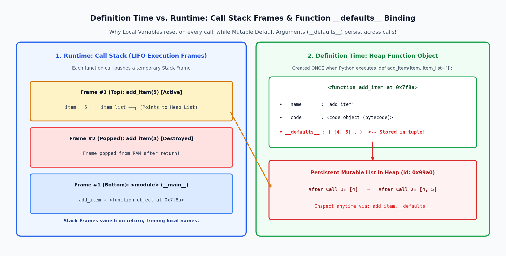
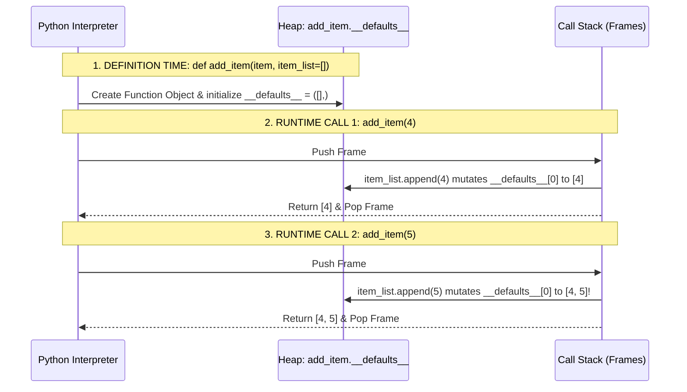

# Dependency Lesson 01.3: Call Stack Frames, Definition Time vs. Runtime Evaluation, and `__defaults__`

**අදාළ ප්‍රධාන පාඩම් (Related Core Module 3 Lessons):**
- [Lesson 3.3: Function Arguments — Default Values & The Mutable Default Pitfall](../../Module_03_Modular_and_Intermediate_Python/Lesson_3.3_Function_Arguments_Default_Values_and_Mutable_Pitfall.md)
- [Lesson 3.4: Keyword Arguments, Packing (`*args`, `**kwargs`) & Unpacking](../../Module_03_Modular_and_Intermediate_Python/Lesson_3.4_Keyword_Arguments_Packing_args_kwargs_and_Unpacking.md)

---

## 1. හැඳින්වීම: ඇයි Mutable Default Arguments (`item_list=[]`) කැඳවීම් අතරතුර මැකී නොයන්නේ?

[Lesson 3.3](../../Module_03_Modular_and_Intermediate_Python/Lesson_3.3_Function_Arguments_Default_Values_and_Mutable_Pitfall.md) හිදී අපි Python හි ඉතාම ප්‍රසිද්ධ "Surprising Behavior" උගුල දුටුවෙමු:

```python
def add_item(item, item_list=[]):
    item_list.append(item)
    return item_list

print(add_item(4))  # [4]
print(add_item(5))  # [4, 5]  <-- කලින් Call එකේ 4 තවමත් ඉතිරි වී ඇත්තේ ඇයි?!
```

සාමාන්‍යයෙන් Function එකක් ඇතුළත සාදන Local විචල්‍යයන් එම Function එක අවසන් වූ සැණින් මතකයෙන් මැකී යයි. එසේ නම් `def add_item(item, item_list=[]):` හි ඇති `item_list` එක පමණක් Function එක අවසන් වූ පසුවත් මැකී නොගොස් දිගටම පවතින්නේ ඇයි?

මෙය 100%ක්ම නිරවුල්ව තේරුම් ගැනීමට නම්, Python හි **Call Stack Frames (Runtime)** සහ **Heap Function Objects (`__defaults__` at Definition Time)** ක්‍රියා කරන ආකාරය දැනගත යුතුය!



---

## 2. Definition Time vs. Runtime (නිර්වචන කාලය සහ ධාවන කාලය අතර වෙනස)

Python විසින් Function එකක් සමඟ කටයුතු කරන අවධි දෙකක් ඇත:

### අවධිය 1: Definition Time (`def` පේළිය කියවන මොහොත)
Python Interpreter එක ඔබේ කේතය ඉහළ සිට පහළට කියවගෙන යන විට `def add_item(item, item_list=[]):` යන පේළිය හමු වූ සැණින්:
1. Function එක ඇතුළත ඇති කේතය (Body) තවම ක්‍රියාත්මක **නොකරයි** (එය Bytecode බවට පමණක් හරවා තබා ගනී).
2. **නමුත් Function Header එකෙහි ඇති Default Argument අගයන් (`[]`) එම මොහොතේදීම එකම එක වතාවක් (Evaluated ONCE at definition time) ගණනය කරයි!**
3. Heap මතකයේ `<function add_item>` නමින් **First-Class Function Object** එකක් නිර්මාණය කර, එම Function Object එකේ අභ්‍යන්තර Attribute එකක් වන **`add_item.__defaults__`** නමැති Tuple එක තුළ අර අලුතින් සෑදූ List එක ගබඩා කර තබයි!

### අවධිය 2: Runtime / Call Time (`add_item(4)` කැඳවන මොහොත)
ඔබ පසුව `add_item(4)` ලෙස Function එක Call කරන සෑම වාරයකදීම:
1. Python විසින් **Call Stack (ඇමතුම් රාමු ගොන්න)** මත අලුත්ම **Stack Frame (Execution Frame)** එකක් නිර්මාණය කරයි (**Push**).
2. එම Stack Frame එක තුළ Local විචල්‍යයන් (`item = 4`) සාදයි.
3. ඔබ `item_list` සඳහා අගයක් ලබා දී නොමැති නම්, Python අලුත් List එකක් සාදන්නේ නැත! ඒ වෙනුවට `add_item.__defaults__[0]` හි දැනටමත් ගබඩා කර ඇති List Object එක වෙතම Local `item_list` විචල්‍යය යොමු කරයි (Bind කරයි)!
4. Function එක `return` වූ සැණින් එම තාවකාලික Stack Frame එක මතකයෙන් ඉවත් වේ (**Pop**). නමුත් `add_item` නමැති Function Object එක සහ එහි `add_item.__defaults__` තුළ ඇති List එක තවමත් Heap මතකයේ නිරුපද්‍රිතව පවතී!



---

## 3. `__defaults__` Attribute එක සජීවීව පරීක්ෂා කර බැලීම (Live Inspection!)

අපට මෙම ක්‍රියාවලිය ඇස් දෙකෙන්ම දැක බලා ගැනීමට `add_item.__defaults__` පරීක්ෂා කළ හැක:

```python
def add_item(item, item_list=[]):
    item_list.append(item)
    return item_list

# 1. Function එක සෑදූ විගස (තවම එක වරක්වත් Call කර නැත!):
print("Before any call, __defaults__ :", add_item.__defaults__)

# 2. පළමු Call එකෙන් පසු:
add_item(4)
print("After add_item(4), __defaults__:", add_item.__defaults__)

# 3. දෙවන Call එකෙන් පසු:
add_item(5)
print("After add_item(5), __defaults__:", add_item.__defaults__)
```

**Output:**
```text
Before any call, __defaults__ : ([],)
After add_item(4), __defaults__: ([4],)
After add_item(5), __defaults__: ([4, 5],)
```

බලන්න! `add_item.__defaults__` යනු `([],)` නමැති Tuple එකකි. Tuple එකක් Immutable වුවද, ඒ ඇතුළත ඇති පළමු අංගය (`__defaults__[0]`) Mutable List එකකි! එබැවින් `.append()` කරන සෑම වාරයකදීම Function Object එක ඇතුළත තිබෙන එම List එක දිගින් දිගටම වෙනස් වේ!

---

## 4. `None` Sentinel Fix එක මතකයේ ක්‍රියා කරන ආකාරය

දැන් අපි [Lesson 3.3 (Slide 24)](../../Module_03_Modular_and_Intermediate_Python/Lesson_3.3_Function_Arguments_Default_Values_and_Mutable_Pitfall.md) හි ඉගෙන ගත් නිවැරදි ක්‍රමය (`item_list=None`) මතකයේ ක්‍රියා කරන්නේ කෙසේදැයි බලමු:

```python
def add_item_safe(item, item_list=None):
    if item_list is None:
        item_list = []      # <-- මෙය ඇත්තේ Function Body එක ඇතුළතයි (Evaluated at RUNTIME!)
    item_list.append(item)
    return item_list

print("Safe __defaults__:", add_item_safe.__defaults__)
```
- මෙහිදී **Definition Time** හිදී `add_item_safe.__defaults__` තුළ ගබඩා වන්නේ `(None,)` නමැති වෙනස් කළ නොහැකි (**Immutable**) Sentinel අගයයි.
- `item_list = []` යන පේළිය ලියා ඇත්තේ Function Header එකේ නොව **Function Body එක ඇතුළතය**!
- Function Body එක ක්‍රියාත්මක වන්නේ **Runtime (Call Time)** හිදී බැවින්, ඔබ `add_item_safe(4)` සහ `add_item_safe(5)` කැඳවන සෑම වාරයකදීම අලුත් Stack Frame එක තුළ **අලුත්ම List Object එකක් (`[]`)** නිර්මාණය වේ!

---

## 🛠️ Practical Task / Hands-On Exercise (ප්‍රායෝගික අභ්‍යාසය)

### Scenario / Goal:
ඔබේ කණ්ඩායමේ කනිෂ්ඨ ක්‍රමලේඛකයෙකු ශිෂ්‍යයින්ගේ ලකුණු ගබඩා කිරීමට `register_student(name, score, grade_book={})` නමින් Dictionary එකක් Default අගය ලෙස ගන්නා Function එකක් ලියා ඇත. එහි ඇති Mutable Default Bug එක `__defaults__` මගින් ඔප්පු කර පෙන්වා, එය `None` Sentinel අගය මගින් නිවැරදි කරන්න.

### Step-by-Step Tasks:
1. `register_buggy(name, score, grade_book={})` නමින් Function එකක් ලියා `grade_book[name] = score` එක් කර `grade_book` ආපසු ලබා දෙන්න.
2. `"Amal", 85` සහ `"Nimal", 92` සඳහා වෙන වෙනම `register_buggy` කැඳවා, `register_buggy.__defaults__` සහ `id()` මගින් කැඳවීම් දෙකෙහිදීම භාවිතා වූයේ එකම Dictionary Object එක බව ඔප්පු කරන්න.
3. `register_fixed(name, score, grade_book=None)` නමින් නිවැරදි Function එක ලියන්න.
4. `"Amal", 85` සහ `"Nimal", 92` සඳහා `register_fixed` කැඳවා, ඒ දෙකෙහිදී වෙනමම Dictionaries දෙකක් (`id(d1) != id(d2)`) නිර්මාණය වන බව පෙන්වන්න.

### Starter Code:
```python
def register_buggy(name, score, grade_book={}):
    grade_book[name] = score
    return grade_book

def register_fixed(name, score, grade_book=None):
    # TODO: Implement the None sentinel pattern
    pass

# Test both functions and compare __defaults__ and object IDs
```

### Expected Output / Reference Solution:
```python
def register_buggy(name, score, grade_book={}):
    grade_book[name] = score
    return grade_book

b1 = register_buggy("Amal", 85)
b2 = register_buggy("Nimal", 92)
print("Buggy Call 2 Result:", b2)
print("Buggy __defaults__ :", register_buggy.__defaults__)
print("Same dict object in memory? (b1 is b2):", b1 is b2)

print("-" * 50)

def register_fixed(name, score, grade_book=None):
    if grade_book is None:
        grade_book = {}
    grade_book[name] = score
    return grade_book

f1 = register_fixed("Amal", 85)
f2 = register_fixed("Nimal", 92)
print("Fixed Call 1 Result:", f1)
print("Fixed Call 2 Result:", f2)
print("Fixed __defaults__ :", register_fixed.__defaults__)
print("Same dict object in memory? (f1 is f2):", f1 is f2)
```

**Expected Output:**
```text
Buggy Call 2 Result: {'Amal': 85, 'Nimal': 92}
Buggy __defaults__ : ({'Amal': 85, 'Nimal': 92},)
Same dict object in memory? (b1 is b2): True
--------------------------------------------------
Fixed Call 1 Result: {'Amal': 85}
Fixed Call 2 Result: {'Nimal': 92}
Fixed __defaults__ : (None,)
Same dict object in memory? (f1 is f2): False
```

---

## 📝 Summary & Exam Revision Cheat Sheet

| Aspect | Definition Time (`def func(x=[]):`) | Runtime / Call Time (`func()`) |
| :--- | :--- | :--- |
| **When Executed** | Module එක Load වන විට **එකම එක වතාවක්** පමණි. | Function එක Call කරන **සෑම වාරයකදීම**. |
| **What Happens** | Default expressions ගණනය කර `func.__defaults__` Tuple එකෙහි ගබඩා කරයි. | Call Stack මත අලුත් Stack Frame එකක් Push කර Function Body එක ක්‍රියාත්මක කරයි. |
| **Memory Lifetime** | Function Object එක පවතින තුරුම Heap මතකයේ පවතී. | Function එක `return` වූ සැණින් Stack Frame එක Pop වී මැකී යයි. |
| **Best Practice** | Default අගයන් සඳහා සෑමවිටම `None`, `int`, `str`, `tuple` වැනි **Immutable** අගයන් පමණක් යොදන්න. | `list`, `dict`, `set` වැනි **Mutable** වස්තූන් Function Body එක ඇතුළත (`if arg is None:`) නිර්මාණය කරන්න. |

---

**ආපසු ප්‍රධාන පාඩම්වලට (Back to Core Module 3 Lessons):**
- [Lesson 3.3: Function Arguments — Default Values & The Mutable Default Pitfall](../../Module_03_Modular_and_Intermediate_Python/Lesson_3.3_Function_Arguments_Default_Values_and_Mutable_Pitfall.md)
- [Lesson 3.4: Keyword Arguments, Packing (`*args`, `**kwargs`) & Unpacking](../../Module_03_Modular_and_Intermediate_Python/Lesson_3.4_Keyword_Arguments_Packing_args_kwargs_and_Unpacking.md)
