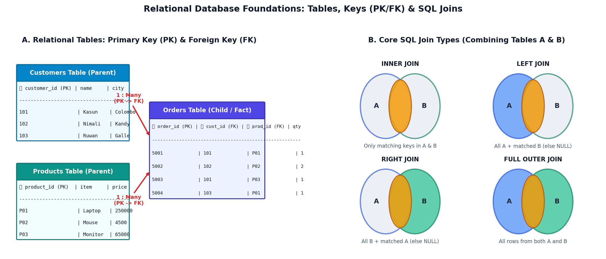
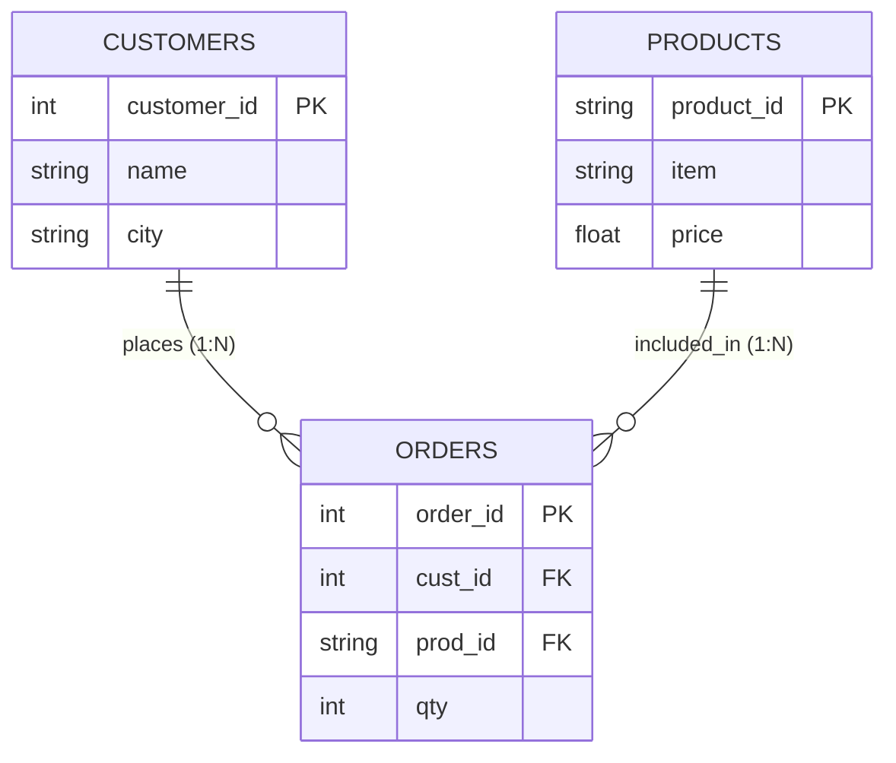

# Dependency Lesson 01.1: Relational Databases (RDBMS), Tables, Keys (PK/FK) සහ SQL මූලිකාංග (Zero-to-Hero Guide)

> [!TIP]
> **🔗 Back to Core Module 1 Lessons:** මෙම පාඩම අධ්‍යයනය කිරීමෙන් පසු නැවත ප්‍රධාන පාඩම් වෙත යාමට පහත සබැඳි භාවිතා කරන්න:
> - [Lesson 1.2: Data Asset Organization, Data Warehousing & ETL](../../Module_01_Course_Orientation_and_Data_Science_Landscape/Lesson_1.2_Data_Asset_Organization_Data_Warehousing_and_ETL.md)
> - [Lesson 1.3: Introduction to Big Data — Structured vs. Unstructured Data](../../Module_01_Course_Orientation_and_Data_Science_Landscape/Lesson_1.3_Introduction_to_Big_Data_Structured_vs_Unstructured.md)
> - [Lesson 1.7: Understanding Data — Basic Questions, Wrangling & Exploration](../../Module_01_Course_Orientation_and_Data_Science_Landscape/Lesson_1.7_Understanding_Data_Questions_Wrangling_and_Exploration.md)

---

## 1. හැඳින්වීම: Relational Database එකක් අවශ්‍ය වන්නේ ඇයි? (Why Was RDBMS Invented?)

ඔබට කිසිදු Database දැනුමක් නොමැති යැයි සිතමු. ඔබ කුඩා පොත් සාප්පුවක් ආරම්භ කරන විට, පාරිභෝගිකයින් මිලදී ගන්නා පොත් පිළිබඳ විස්තර සටහන් කර ගැනීමට තනි Excel Sheet එකක් (Spreadsheet) භාවිතා කරයි. එහි පහත පරිදි තීරු (Columns) ඇත:

`Order_ID | Date | Customer_Name | Customer_Phone | Customer_City | Book_Title | Book_Price | Quantity`

මුලදී මෙය ඉතා සරලව පෙනුණත්, ගනුදෙනු දහස් ගණනක් සිදුවන විට ප්‍රධාන ගැටලු 3ක් (**Data Anomalies**) මතු වේ:

1. **Data Redundancy (දත්ත අනවශ්‍ය ලෙස නැවත නැවත ලිවීම):** "Kasun Perera" නමැති පාරිභෝගිකයා වසරකට පොත් 50ක් මිලදී ගත්තොත්, ඔහුගේ නම, දුරකථන අංකය සහ නගරය පේළි 50කම නැවත නැවත ලිවීමට සිදු වේ. මෙය Storage නාස්තියකි.
2. **Update Anomaly (යාවත්කාලීන කිරීමේ දෝෂ):** Kasun තම දුරකථන අංකය වෙනස් කළහොත්, පේළි 50ම සොයා වෙනස් කළ යුතුය. අත්වැරදීමකින් පේළි 48ක් පමණක් වෙනස් වුවහොත්, එකම පුද්ගලයාට දුරකථන අංක දෙකක් පෙන්වයි (**Inconsistent Data**)!
3. **Delete Anomaly (මකා දැමීමේ දෝෂ):** යම් පොතක් මිලදී ගත් එකම ඇණවුම අවලංගු කර එම පේළිය මකා දැමුවහොත්, එම පොතේ මිල සහ නම පිළිබඳ තොරතුරුත් සදහටම අතුරුදහන් වේ!

1970 දී IBM ආයතනයේ විද්‍යාඥ **Edgar F. Codd** විසින් මෙම ගැටලුව විසඳීමට **Relational Model** එක හඳුන්වා දුන්නේය. එහි මූලික අදහස වන්නේ: **"සියලුම දත්ත එකම තනි වගුවක පුරවනවා වෙනුවට, එකිනෙකට සම්බන්ධ කුඩා වගු (Tables / Relations) කිහිපයකට වෙන් කර තබා ගැනීමයි."**

---

## 2. RDBMS හි මූලික ව්‍යුහය: Tables, Rows, Columns සහ Data Types

**RDBMS (Relational Database Management System)** යනු මෙවැනි සම්බන්ධිත වගු කළමනාකරණය කරන මෘදුකාංග පද්ධතියකි (උදා: `PostgreSQL`, `MySQL`, `SQLite`, `Oracle`, `Microsoft SQL Server`).

* **Table (Relation / වගුව):** එක් නිශ්චිත වස්තුවක් (Entity) පිළිබඳ දත්ත ගබඩා කරන ව්‍යුහයයි (උදා: `Customers` වගුව, `Products` වගුව, `Orders` වගුව).
* **Row (Record / Tuple / පේළිය):** වගුවක ඇති එක් සම්පූර්ණ දත්ත ඒකකයක් (උදා: එක් පාරිභෝගිකයෙකුගේ විස්තර).
* **Column (Field / Attribute / තීරුව):** එම ඒකකයේ එක් ලක්ෂණයක් (උදා: `customer_id`, `city`, `price`). සෑම තීරුවකටම නිශ්චිත **Data Type** එකක් ඇත:
  * `INTEGER` / `INT`: පූර්ණ සංඛ්‍යා (උදා: `101`, `25`).
  * `REAL` / `FLOAT` / `DECIMAL`: දශම සංඛ්‍යා (උදා: `2500.50`).
  * `VARCHAR(n)` / `TEXT`: අක්ෂර සහ වචන (උදා: `'Colombo'`).
  * `DATE` / `TIMESTAMP`: දිනයන් සහ වේලාවන් (උදා: `'2024-09-29'`).

---

## 3. Primary Key (PK) සහ Foreign Key (FK) — වගු එකිනෙකට යා කරන පාලම

වෙන් කරන ලද වගු දෙකක් එකිනෙකට නිවැරදිව සම්බන්ධ කරන්නේ කෙසේද? ඒ සඳහා **Keys (යතුරු)** වර්ග දෙකක් භාවිතා වේ:



### 3.1 Primary Key (PK - ප්‍රාථමික යතුර)
වගුවක ඇති සෑම පේළියක්ම (Row) **අනන්‍යව හඳුනා ගැනීමට (Uniquely Identify)** භාවිතා කරන තීරුව **Primary Key** ලෙස හැඳින්වේ.
* **නියමය 1 (Unique):** Primary Key තීරුවේ එකම අගය දෙවරක් තිබිය නොහැක (No Duplicates).
* **නියමය 2 (NOT NULL):** Primary Key එක කිසිවිටෙකත් හිස්ව (`NULL`) තැබිය නොහැක.
* *උදාහරණ:* පුද්ගලයින් දෙදෙනෙකුට එකම නම ("Kasun Perera") තිබිය හැකි නිසා `name` තීරුව Primary Key ලෙස ගත නොහැක. ඒ වෙනුවට අපි `customer_id` (`101`, `102`, `103`) හෝ ජාතික හැඳුනුම්පත් අංකය (`NIC`) Primary Key ලෙස භාවිතා කරමු.

### 3.2 Foreign Key (FK - ආගන්තුක යතුර)
එක් වගුවක (Child Table - උදා: `Orders`) ඇති තීරුවක් මගින් වෙනත් වගුවක (Parent Table - උදා: `Customers`) ඇති **Primary Key** එකකට යොමු කිරීමක් (Reference) සිදු කරයි නම්, එය **Foreign Key** එකක් ලෙස හැඳින්වේ.
* `Orders` වගුවේ Kasun ගේ සියලු විස්තර නැවත ලියනවා වෙනුවට, අපි ලියන්නේ ඔහුගේ `customer_id = 101` (Foreign Key) පමණි!
* **Referential Integrity:** `Customers` වගුවේ නොමැති `customer_id` එකක් (උදා: `999`) `Orders` වගුවට ඇතුළත් කිරීමට RDBMS එක ඉඩ නොදෙයි. මෙමගින් දත්තවල නිරවද්‍යතාවය ආරක්ෂා වේ.



---

## 4. CRUD Operations සහ මූලික SQL විධාන (Structured Query Language)

Lesson 1.2 හි සඳහන් වූ පරිදි Database එකක මූලික කාර්යය වන්නේ **CRUD Operations** (Create, Read, Update, Delete) සිදු කිරීමයි. RDBMS එකක් සමඟ කතා කිරීමට අපි **SQL (Structured Query Language)** භාවිතා කරමු:

| CRUD Operation | තේරුම | අදාළ SQL විධානය (SQL Keyword) | උදාහරණය (SQL Example) |
| :--- | :--- | :--- | :--- |
| **C — Create** | අලුත් දත්ත පේළියක් ඇතුළත් කිරීම | `INSERT INTO` | `INSERT INTO Customers VALUES (104, 'Amal', 'Matara');` |
| **R — Read** | දත්ත කියවීම, සෙවීම සහ පෙරහන් කිරීම | `SELECT ... FROM ... WHERE` | `SELECT name, city FROM Customers WHERE city = 'Colombo';` |
| **U — Update** | පවතින දත්තයක් වෙනස් කිරීම | `UPDATE ... SET ... WHERE` | `UPDATE Products SET price = 4800 WHERE product_id = 'P02';` |
| **D — Delete** | දත්ත පේළියක් මකා දැමීම | `DELETE FROM ... WHERE` | `DELETE FROM Orders WHERE order_id = 5004;` |

---

## 5. SQL Joins සහ Aggregations (වගු එකතු කිරීම සහ සාරාංශ ගණනය කිරීම)

Data Scientist කෙනෙකුට නිතරම වගු දෙකක් හෝ කිහිපයක් එකට සම්බන්ධ කර (**Join**) දත්ත ලබා ගැනීමට සිදු වේ (Lesson 1.7 හි මූලික ප්‍රශ්න 6–8 බලන්න).

### ප්‍රධාන Join වර්ග 4:
1. **`INNER JOIN`:** වගු දෙකෙහිම (A සහ B) Key එක ගැළපෙන පේළි පමණක් ලබා දෙයි. (ඇණවුමක් කර නොමැති පාරිභෝගිකයින් මෙහිදී ඉවත් වේ).
2. **`LEFT JOIN`:** වම්පස වගුවේ (A - උදා: `Customers`) **සියලුම පේළි** ලබා දෙන අතර, දකුණු වගුවේ (B - `Orders`) ගැළපෙන දත්ත තිබේ නම් ඒවා පෙන්වයි. ගැළපීමක් නොමැති නම් `NULL` (හිස්) ලෙස පෙන්වයි.
3. **`RIGHT JOIN`:** දකුණු වගුවේ (B) සියලුම පේළි සහ වම් වගුවේ (A) ගැළපෙන පේළි පමණක් ලබා දෙයි.
4. **`FULL OUTER JOIN`:** වගු දෙකෙහිම ඇති සියලුම පේළි ලබා දෙයි.

### Python (`sqlite3` + `pandas`) මගින් RDBMS එකක් සාදා SQL Queries ධාවනය කරන ආකාරය:
ඔබේ පරිගණකයේ කිසිදු බාහිර Database Server එකක් ස්ථාපනය නොකර, Python සමඟම ලැබෙන `sqlite3` library එක මගින් SQL ප්‍රායෝගිකව අත්හදා බැලිය හැක:

```python
import sqlite3
import pandas as pd

# 1. RAM එක තුළ තාවකාලික SQLite Database එකක් සෑදීම
conn = sqlite3.connect(":memory:")
cursor = conn.cursor()

# 2. Customers සහ Orders වගු සෑදීම (CREATE TABLE)
cursor.executescript("""
CREATE TABLE Customers (
    customer_id INTEGER PRIMARY KEY,
    name TEXT NOT NULL,
    city TEXT
);

CREATE TABLE Orders (
    order_id INTEGER PRIMARY KEY,
    cust_id INTEGER,
    amount REAL,
    FOREIGN KEY (cust_id) REFERENCES Customers(customer_id)
);

INSERT INTO Customers VALUES (101, 'Kasun', 'Colombo'), (102, 'Nimali', 'Kandy'), (103, 'Ruwan', 'Galle'), (104, 'Dilani', 'Colombo');
INSERT INTO Orders VALUES (5001, 101, 250000), (5002, 102, 9000), (5003, 101, 65000);
""")

# 3. LEFT JOIN සහ GROUP BY මගින් එක් එක් පාරිභෝගිකයාගේ මුළු වියදම සෙවීම
query = """
SELECT 
    c.customer_id,
    c.name,
    c.city,
    COUNT(o.order_id) AS total_orders,
    COALESCE(SUM(o.amount), 0) AS total_spent
FROM Customers c
LEFT JOIN Orders o ON c.customer_id = o.cust_id
GROUP BY c.customer_id, c.name, c.city
ORDER BY total_spent DESC;
"""

df_result = pd.read_sql_query(query, conn)
print(df_result)
```

**Output:**
```text
   customer_id    name     city  total_orders  total_spent
0          101   Kasun  Colombo             2     315000.0
1          102  Nimali    Kandy             1       9000.0
2          103   Ruwan    Galle             0          0.0
3          104  Dilani  Colombo             0          0.0
```
*(මෙහිදී Ruwan සහ Dilani කිසිදු ඇණවුමක් කර නොමැති වුවත් `LEFT JOIN` නිසා ඔවුන්ගේ නම් ඉවත් නොවී `total_orders = 0` ලෙස නිවැරදිව පෙන්වන ආකාරය නිරීක්ෂණය කරන්න!)*

---

## 🛠️ Practical Task / Hands-On Exercise (ප්‍රායෝගික අභ්‍යාසය)

### Scenario / Goal:
ඔබ රෝහලක දත්ත විශ්ලේෂකයෙකු ලෙස කටයුතු කරයි. රෝහලේ වෛද්‍යවරුන් (`Doctors`) සහ රෝගීන්ගේ හමුවීම් (`Appointments`) පිළිබඳ වගු දෙකක් SQLite තුළ නිර්මාණය කර, කිසිදු රෝගියෙකු හමුවී නොමැති වෛද්‍යවරුන් සහ එක් එක් වෛද්‍යවරයා උපයා ඇති මුළු ගාස්තුව (**Total Revenue (මුළු ආදායම)**) හා **Arithmetic Mean (සමාන්තර මධ්‍යන්‍යය)** SQL මගින් සොයාගත යුතුය.

### Step-by-Step Tasks:
1. `sqlite3.connect(":memory:")` මගින් Database එකක් සාදා `Doctors` (`doc_id` PK, `doc_name`, `specialty`) සහ `Appointments` (`app_id` PK, `doc_id` FK, `fee`) වගු දෙක නිර්මාණය කරන්න.
2. වෛද්‍යවරුන් 4 දෙනෙකුගේ දත්ත සහ හමුවීම් 5ක දත්ත ඇතුළත් කරන්න (එක් වෛද්‍යවරයෙකුට කිසිදු හමුවීමක් නොතිබිය යුතුය).
3. `LEFT JOIN` සහ `GROUP BY` භාවිතා කර සෑම වෛද්‍යවරයෙකුගේම හමුවීම් ගණන (`appointment_count`), මුළු ආදායම (`total_fee`), සහ සාමාන්‍ය ගාස්තුව (`avg_fee`) Pandas DataFrame එකකට ලබා ගන්න.

### Starter Code:
```python
import sqlite3
import pandas as pd

conn = sqlite3.connect(":memory:")
# TODO: Create tables, insert records, and run your LEFT JOIN SQL query
```

### Expected Output / Reference Solution:
```python
import sqlite3
import pandas as pd

conn = sqlite3.connect(":memory:")
cur = conn.cursor()

cur.executescript("""
CREATE TABLE Doctors (
    doc_id INTEGER PRIMARY KEY,
    doc_name TEXT,
    specialty TEXT
);
CREATE TABLE Appointments (
    app_id INTEGER PRIMARY KEY,
    doc_id INTEGER,
    fee REAL,
    FOREIGN KEY (doc_id) REFERENCES Doctors(doc_id)
);

INSERT INTO Doctors VALUES 
    (1, 'Dr. Perera', 'Cardiology'),
    (2, 'Dr. Silva', 'Neurology'),
    (3, 'Dr. Fernando', 'Pediatrics'),
    (4, 'Dr. Jayasinghe', 'Dermatology');

INSERT INTO Appointments VALUES
    (101, 1, 3500.0),
    (102, 1, 4500.0),
    (103, 2, 5000.0),
    (104, 3, 2500.0),
    (105, 3, 3000.0);
""")

sql = """
SELECT 
    d.doc_id,
    d.doc_name,
    d.specialty,
    COUNT(a.app_id) AS appointment_count,
    COALESCE(SUM(a.fee), 0) AS total_fee,
    COALESCE(AVG(a.fee), 0) AS avg_fee
FROM Doctors d
LEFT JOIN Appointments a ON d.doc_id = a.doc_id
GROUP BY d.doc_id, d.doc_name, d.specialty
ORDER BY total_fee DESC;
"""

df_doctors = pd.read_sql_query(sql, conn)
print(df_doctors.to_string(index=False))
```

**Expected Output:**
```text
 doc_id       doc_name   specialty  appointment_count  total_fee  avg_fee
      1     Dr. Perera  Cardiology                  2     8000.0   4000.0
      3   Dr. Fernando  Pediatrics                  2     5500.0   2750.0
      2      Dr. Silva   Neurology                  1     5000.0   5000.0
      4 Dr. Jayasinghe Dermatology                  0        0.0      0.0
```

---

## 📝 Summary & Exam Revision Cheat Sheet

| Concept / Term | Core Meaning & Rule |
| :--- | :--- |
| **RDBMS** | Relational Database Management System — දත්ත එකිනෙකට සම්බන්ධ වගු (Tables) ලෙස ගබඩා කරන පද්ධතියකි. |
| **Primary Key (PK)** | වගුවක සෑම පේළියක්ම අනන්‍යව හඳුනා ගන්නා තීරුව (`Unique` + `NOT NULL`). |
| **Foreign Key (FK)** | වෙනත් වගුවක Primary Key එකකට යොමු කරන තීරුව (වගු දෙක අතර සම්බන්ධතාවය ගොඩනගයි). |
| **CRUD Operations** | **C**reate (`INSERT`), **R**ead (`SELECT`), **U**pdate (`UPDATE`), **D**elete (`DELETE`). |
| **`INNER JOIN` vs `LEFT JOIN`** | `INNER JOIN` මගින් වගු දෙකෙහිම ගැළපෙන පේළි පමණක් ලබා දෙන අතර, `LEFT JOIN` මගින් වම් වගුවේ සියලුම පේළි රඳවා ගනී. |

---

**Next Dependency Lesson:** [02_OLTP_vs_OLAP_and_Star_Snowflake_Schemas.md](02_OLTP_vs_OLAP_and_Star_Snowflake_Schemas.md) | **Back to Core Lesson:** [Lesson 1.2](../../Module_01_Course_Orientation_and_Data_Science_Landscape/Lesson_1.2_Data_Asset_Organization_Data_Warehousing_and_ETL.md)
