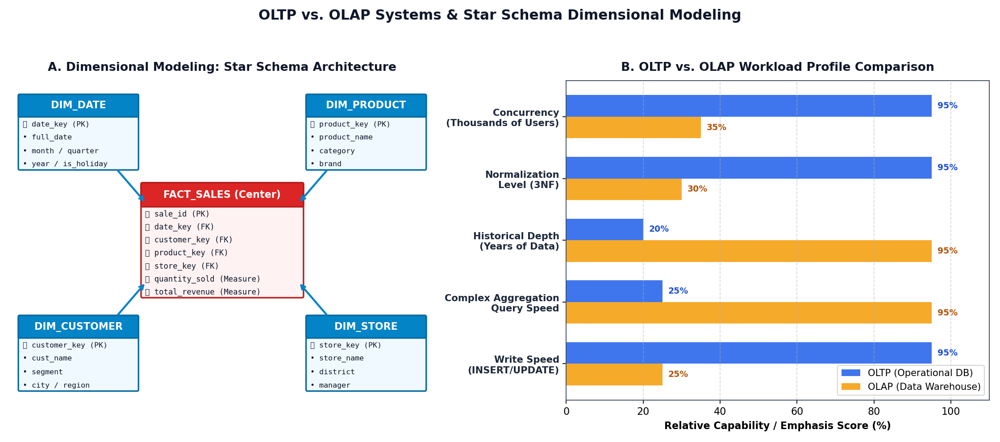
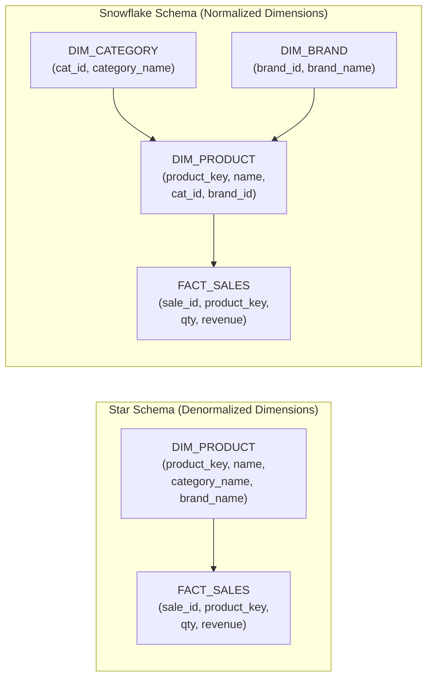

# Dependency Lesson 01.2: OLTP vs. OLAP පද්ධති සහ Star / Snowflake Schemas (Dimensional Modeling Zero-to-Hero)

> [!TIP]
> **🔗 Back to Core Module 1 Lessons:**
> - [Previous Dependency Lesson: 01_Relational_Databases_Tables_Keys_and_SQL_Basics.md](01_Relational_Databases_Tables_Keys_and_SQL_Basics.md)
> - [Core Lesson 1.2: Data Asset Organization, Data Warehousing & ETL](../../Module_01_Course_Orientation_and_Data_Science_Landscape/Lesson_1.2_Data_Asset_Organization_Data_Warehousing_and_ETL.md)

---

## 1. හැඳින්වීම: එකම Database එකෙන් එදිනෙදා වැඩ සහ විශ්ලේෂණ යන දෙකම කළ නොහැක්කේ ඇයි?

සිතන්න ඔබ ලංකාව පුරා ශාඛා 500ක් ඇති දැවැන්ත සුපිරි වෙළඳසැල් ජාලයක (Supermarket Chain) ප්‍රධාන Data Engineer වරයා කියා. සෑම තත්පරයකම දිවයින පුරා Cashiers ලා දහස් ගණනක් පාරිභෝගික බිල්පත් (`Bills / Transactions`) පද්ධතියට ඇතුළත් කරති.

මෙම අවස්ථාවේදී ආයතනයේ අධ්‍යක්ෂ මණ්ඩලයට මෙවැනි ප්‍රශ්නයකට පිළිතුරු අවශ්‍ය වේ:
> *"පසුගිය වසර 5 තුළ සෑම පළාතකම, සෑම භාණ්ඩ කාණ්ඩයකම මාසික ආදායම් වර්ධන වේගය සහ වැඩිම භාණ්ඩ ආපසු භාර දුන් (Returned) පාරිභෝගිකයින් 100 දෙනා කවුරුන්ද?"*

ඔබ මෙම දැවැන්ත විශ්ලේෂණාත්මක Query එක (පේළි මිලියන 500ක් පරීක්ෂා කරන) අර Cashiers ලා බිල් කඩන **Operational Database** එක මතම ධාවනය කළහොත් කුමක් සිදුවේද?
* Database Server එකේ CPU සහ RAM 100%ක්ම එම Query එකට වැය වේ.
* වගු Lock වීම නිසා දිවයින පුරාම සුපිරි වෙළඳසැල්වල බිල් කැඩීම විනාඩි ගණනාවකට නතර වේ!

මෙන්න මේ නිසා තමයි දත්ත ලෝකයේ පද්ධති ප්‍රධාන වර්ග දෙකකට බෙදා වෙන් කරන්නේ:
1. **OLTP (Online Transaction Processing)** — එදිනෙදා ගනුදෙනු වේගයෙන් සිදු කරන Operational Databases.
2. **OLAP (Online Analytical Processing)** — කළමනාකාරීත්වයට තීරණ ගැනීමට සහ Data Scientists ලාට දැවැන්ත විශ්ලේෂණ කිරීමට වෙන් කළ Data Warehouses.

---

## 2. OLTP vs. OLAP ගැඹුරු තාක්ෂණික සංසන්දනය



| නිර්ණායකය (Dimension) | OLTP (Operational Processing) | OLAP (Informational / Analytical Processing) |
| :--- | :--- | :--- |
| **මූලික අරමුණ (Primary Goal)** | එදිනෙදා ව්‍යාපාරික ගනුදෙනු (Daily transactions) බාධාවකින් තොරව තත්පරයෙන් පංගුවකදී සිදු කිරීම. | ඓතිහාසික දත්ත විශ්ලේෂණය කර උපායමාර්ගික තීරණ ගැනීමට (Decision support & BI) සහාය වීම. |
| **පරිශීලකයින් (Typical Users)** | Cashiers, බැංකු ලිපිකරුවන්, වෙබ් අඩවි පාරිභෝගිකයින් (දහස් ගණනක් එකවර). | Data Scientists, Data Analysts, Business Executives (සීමිත පිරිසක්). |
| **ප්‍රධාන ක්‍රියාවලීන් (Workload)** | කුඩා `INSERT`, `UPDATE`, `DELETE` ගනුදෙනු මිලියන ගණනක් (**Write-heavy**). | වගු මිලියන ගණනක් එකතු කර සාරාංශ ගණනය කරන සංකීර්ණ `SELECT` queries (**Read-heavy**). |
| **දත්තවල කාල පරාසය (Time Horizon)** | වර්තමාන දත්ත (Current operational state - දින 30–90). | වසර 5–10ක ඓතිහාසික දත්ත (Consolidated historical data). |
| **Database සැලැස්ම (Schema Design)** | **Normalized (3NF)** — දත්ත පිටපත් වීම (Redundancy) වැළැක්වීමට කුඩා වගු රාශියකට කඩා ඇත. | **Denormalized (Star Schema / Snowflake Schema)** — Joins ගණන අඩු කර කියවීමේ වේගය වැඩි කිරීමට සැලසුම් කර ඇත. |

---

## 3. Normalization (3NF) vs. Dimensional Modeling (Star Schema)

### 3.1 OLTP වලදී Normalization භාවිතා කරන්නේ ඇයි?
OLTP Database එකකදී දත්ත ඇතුළත් කිරීමේ වේගය සහ නිරවද්‍යතාවය වැදගත් නිසා අපි **Third Normal Form (3NF)** වැනි ක්‍රම මගින් දත්ත කුඩා වගු 50–100කට වෙන් කරමු. එවිට එකම තොරතුර දෙතැනක ලියවෙන්නේ නැත. නමුත් එහි අවාසිය නම්, විශ්ලේෂණයක් කිරීමට ගිය විට වගු 15–20ක් එකවර `JOIN` කිරීමට සිදුවීම නිසා Query එක ඉතා මන්දගාමී වීමයි!

### 3.2 OLAP / Data Warehouse සඳහා Ralph Kimball හඳුන්වා දුන් Star Schema
Data Warehouse එකකදී අපි නිතරම දත්ත `UPDATE` කරන්නේ නැත; අපට අවශ්‍ය වන්නේ අතිවිශාල දත්ත ප්‍රමාණයක් ඉතා වේගයෙන් කියවා (**Fast Read / Aggregations**) විශ්ලේෂණය කිරීමයි. ඒ සඳහා **Star Schema** භාවිතා වේ. එහි ප්‍රධාන වගු වර්ග 2ක් ඇත:

1. **Fact Table (මැද පිහිටි ප්‍රධාන සිදුවීම් වගුව):**
   * ව්‍යාපාරයේ සිදුවන ප්‍රමාණාත්මක සිදුවීම් (Measurements / Metrics / Facts) මෙහි ගබඩා වේ.
   * මෙහි ඇත්තේ **Foreign Keys** (අවට වගුවලට යොමු වන) සහ ගණනය කළ හැකි සංඛ්‍යාත්මක අගයන් (**Numerical Measures** — උදා: `quantity_sold`, `unit_price`, `discount_amount`, `total_revenue`) පමණි.
   * Fact Table එකක පේළි මිලියන හෝ බිලියන ගණනක් පවතී.
2. **Dimension Tables (වටේට පිහිටි විස්තරාත්මක වගු):**
   * *"කවුද? කුමක්ද? කොහේද? කවදාද?"* (Who, What, Where, When) යන ප්‍රශ්නවලට පිළිතුරු දෙන විස්තරාත්මක තොරතුරු (Descriptive attributes) මෙහි අඩංගු වේ.
   * උදාහරණ: `DIM_DATE` (දිනය, මාසය, කාර්තුව, වසර), `DIM_PRODUCT` (භාණ්ඩයේ නම, කාණ්ඩය, වෙළඳ නාමය), `DIM_CUSTOMER` (පාරිභෝගිකයාගේ නම, නගරය, වයස් කාණ්ඩය), `DIM_STORE` (ශාඛාවේ නම, දිස්ත්‍රික්කය).

මැදින් Fact Table එකත්, තරුවක හැඩයට වටේට Dimension Tables කිහිපයකුත් පිහිටන නිසා මෙයට **Star Schema** යැයි කියනු ලැබේ.

### 3.3 Star Schema vs. Snowflake Schema


* **Star Schema:** Dimension වගු තවදුරටත් කුඩා වගුවලට කඩා නැත (Denormalized). එම නිසා `FACT_SALES` සිට එක් `JOIN` එකකින් ඕනෑම වාර්තාවක් ඉතා වේගයෙන් ලබා ගත හැක.
* **Snowflake Schema:** Dimension වගුත් තවදුරටත් උප-වගුවලට (Sub-dimensions) Normalize කර ඇත (හිම පියල්ලක හැඩයට). Storage ඉතිරි වුවත් `JOIN` ගණන වැඩි නිසා Star Schema තරම් වේගවත් නැත.

---

## 4. OLAP Cube Operations 4 ප්‍රායෝගිකව තේරුම් ගැනීම

Lesson 1.2 (Slide 15) හි සඳහන් වූ OLAP ක්‍රියාවලීන් 4 Star Schema එකක් මත ක්‍රියා කරන ආකාරය බලමු:

1. **Slice (පෙත්තක් වෙන් කිරීම):** එක් Dimension එකකට නිශ්චිත එක් අගයක් ලබා දී දත්ත පෙරහන් කිරීම (උදා: `WHERE year = 2024`).
2. **Dice (කුට්ටියක් වෙන් කිරීම):** Dimensions දෙකකට හෝ වැඩි ගණනකට කොන්දේසි යොදා උප-කොටසක් වෙන් කිරීම (උදා: `WHERE year = 2024 AND district IN ('Colombo', 'Kandy') AND category = 'Electronics'`).
3. **Drill Down vs. Roll Up (Drill Up):**
   * **Drill Down:** `Year` $\rightarrow$ `Quarter` $\rightarrow$ `Month` $\rightarrow$ `Day` ලෙස සාරාංශයේ සිට සවිස්තරාත්මක මට්ටමට යාම.
   * **Roll Up (Drill Up):** `Day` $\rightarrow$ `Month` $\rightarrow$ `Year` ලෙස ඉහළ මට්ටමකට එකතු කිරීම.
4. **Pivot (Rotate):** පේළිවල (Rows) තිබූ `District` සහ තීරුවල (Columns) තිබූ `Product Category` හරස් වගුවක් (Cross-tabulation) ලෙස හැරවීම.

---

## 🛠️ Practical Task / Hands-On Exercise (ප්‍රායෝගික අභ්‍යාසය)

### Scenario / Goal:
ඔබ සතුව Star Schema ආකෘතියට සැකසූ `FACT_SALES`, `DIM_PRODUCT` සහ `DIM_STORE` වගු 3ක් ඇත. Python (`sqlite3` + `pandas`) භාවිතා කරමින් OLAP **Slice-and-Dice**, **Roll-Up**, සහ **Pivoting** ක්‍රියාවලීන් ප්‍රායෝගිකව ක්‍රියාත්මක කර පෙන්වන්න.

### Step-by-Step Tasks:
1. පහත Starter Code එක ධාවනය කර Star Schema වගු 3 නිර්මාණය කරන්න.
2. **Task A (Roll-Up Query):** එක් එක් `district` සහ `category` අනුව මුළු විකුණුම් ආදායම (`total_revenue`) SQL `GROUP BY` මගින් ලබා ගන්න.
3. **Task B (OLAP Pivot):** ලැබුණු DataFrame එක `df.pivot(index='district', columns='category', values='total_revenue')` මගින් Cross-tabulation වගුවක් බවට හරවන්න.

### Starter Code & Reference Solution:
```python
import sqlite3
import pandas as pd

conn = sqlite3.connect(":memory:")
conn.executescript("""
CREATE TABLE DIM_PRODUCT (prod_key INT PRIMARY KEY, prod_name TEXT, category TEXT);
CREATE TABLE DIM_STORE (store_key INT PRIMARY KEY, store_name TEXT, district TEXT);
CREATE TABLE FACT_SALES (sale_id INT PRIMARY KEY, prod_key INT, store_key INT, year INT, revenue REAL);

INSERT INTO DIM_PRODUCT VALUES (1, 'Laptop', 'Electronics'), (2, 'Mouse', 'Electronics'), (3, 'Office Chair', 'Furniture');
INSERT INTO DIM_STORE VALUES (10, 'Colombo City', 'Colombo'), (20, 'Kandy Center', 'Kandy');
INSERT INTO FACT_SALES VALUES 
    (1, 1, 10, 2024, 500000), (2, 2, 10, 2024, 25000),
    (3, 3, 10, 2024, 120000), (4, 1, 20, 2024, 250000),
    (5, 3, 20, 2024, 90000),  (6, 1, 10, 2023, 400000);
""")

# Task A: Slice (year = 2024) + Roll-Up by District and Category
olap_query = """
SELECT 
    s.district,
    p.category,
    SUM(f.revenue) AS total_revenue
FROM FACT_SALES f
JOIN DIM_STORE s ON f.store_key = s.store_key
JOIN DIM_PRODUCT p ON f.prod_key = p.prod_key
WHERE f.year = 2024
GROUP BY s.district, p.category;
"""

df_olap = pd.read_sql_query(olap_query, conn)
print("--- 1. OLAP Roll-Up Table (2024 Slice) ---")
print(df_olap)

# Task B: OLAP Pivot Operation
df_pivot = df_olap.pivot(index='district', columns='category', values='total_revenue').fillna(0)
print("\n--- 2. OLAP Pivoted Cross-Tab ---")
print(df_pivot)
```

**Expected Output:**
```text
--- 1. OLAP Roll-Up Table (2024 Slice) ---
  district     category  total_revenue
0  Colombo  Electronics       525000.0
1  Colombo    Furniture       120000.0
2    Kandy  Electronics       250000.0
3    Kandy    Furniture        90000.0

--- 2. OLAP Pivoted Cross-Tab ---
category  Electronics  Furniture
district                        
Colombo      525000.0   120000.0
Kandy        250000.0    90000.0
```

---

## 📝 Summary & Exam Revision Cheat Sheet

| Term | Quick Definition |
| :--- | :--- |
| **OLTP** | Online Transaction Processing — එදිනෙදා ගනුදෙනු (`INSERT`/`UPDATE`) වේගයෙන් සිදු කරන Operational Database. |
| **OLAP** | Online Analytical Processing — ඓතිහාසික දත්ත මත සංකීර්ණ විශ්ලේෂණ සිදු කරන Data Warehouse පද්ධති. |
| **Fact Table** | Star Schema හි මැද ඇති ප්‍රමාණාත්මක මිනුම් (Measures) සහ Foreign Keys අඩංගු වගුව. |
| **Dimension Table** | Fact Table එක වටා ඇති විස්තරාත්මක තොරතුරු (`Who, What, Where, When`) අඩංගු වගු. |
| **Slice / Dice / Drill / Pivot** | OLAP දත්ත කපා වෙන් කර බැලීමට, ගැඹුරට යාමට සහ හරවා බැලීමට භාවිතා කරන මූලික ක්‍රියාවලීන් 4. |

---

**Next Dependency Lesson:** [03_ETL_Pipelines_Data_Warehouses_Data_Marts_and_Data_Lakes.md](03_ETL_Pipelines_Data_Warehouses_Data_Marts_and_Data_Lakes.md) | **Back to Core Lesson:** [Lesson 1.2](../../Module_01_Course_Orientation_and_Data_Science_Landscape/Lesson_1.2_Data_Asset_Organization_Data_Warehousing_and_ETL.md)
