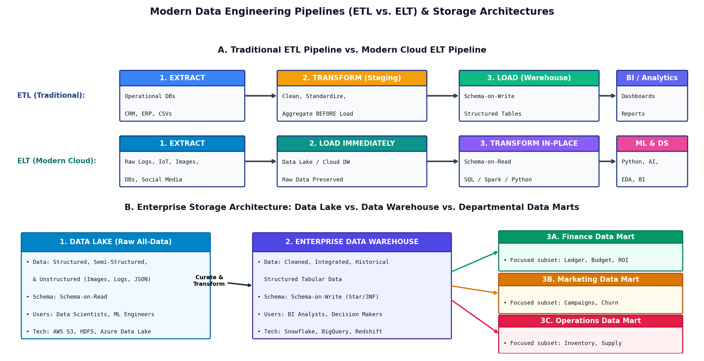
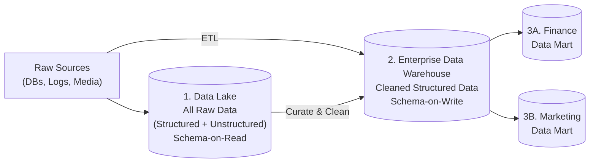

# Dependency Lesson 01.3: ETL vs. ELT Pipelines, Data Warehouses, Data Marts සහ Data Lakes (Zero-to-Hero)

> [!TIP]
> **🔗 Back to Core Module 1 Lessons:**
> - [Previous Dependency Lesson: 02_OLTP_vs_OLAP_and_Star_Snowflake_Schemas.md](02_OLTP_vs_OLAP_and_Star_Snowflake_Schemas.md)
> - [Core Lesson 1.2: Data Asset Organization, Data Warehousing & ETL](../../Module_01_Course_Orientation_and_Data_Science_Landscape/Lesson_1.2_Data_Asset_Organization_Data_Warehousing_and_ETL.md)
> - [Core Lesson 1.3: Introduction to Big Data — Structured vs. Unstructured Data](../../Module_01_Course_Orientation_and_Data_Science_Landscape/Lesson_1.3_Introduction_to_Big_Data_Structured_vs_Unstructured.md)

---

## 1. හැඳින්වීම: විසිරුණු දත්ත එකම තැනකට ගෙන එන Data Engineering පාලම

ආයතනයක දත්ත එකම තැනක පිළිවෙළකට තිබෙන්නේ කලාතුරකිනි.
* ගිණුම් අංශයේ දත්ත **SQL Database** එකක ඇත.
* භාණ්ඩ තොග විස්තර පැරණි **Excel / CSV** ගොනුවල ඇත.
* වෙබ් අඩවියේ පාරිභෝගික ක්‍රියාකාරකම් **JSON Server Logs** ලෙස ඇත.
* පාරිභෝගික පැමිණිලි **Text Emails** ලෙස ඇත.

මෙම විවිධාකාර මූලාශ්‍රවල ඇති දත්ත සියල්ල එකතු කර, පිරිසිදු කර, විශ්ලේෂණයට සුදුසු මධ්‍යගත ගබඩාවකට ගෙන ඒමේ ක්‍රියාවලිය **ETL (Extract, Transform, Load)** හෝ **ELT (Extract, Load, Transform)** ලෙස හැඳින්වේ.

---

## 2. ETL vs. ELT Pipelines සහ Schema-on-Write vs. Schema-on-Read



### 2.1 සාම්ප්‍රදායික ETL (Extract $\rightarrow$ Transform $\rightarrow$ Load)
1. **Extract (උකහා ගැනීම):** විවිධ Operational Databases, ERP, CRM සහ Flat files වලින් අමු දත්ත (Raw data) කියවා ගැනීම.
2. **Transform (පරිවර්තනය සහ පිරිසිදු කිරීම - Staging Area තුළ):** Data Warehouse එකට දත්ත ඇතුළත් කිරීමට **පෙර** වෙනම සර්වරයකදී (Staging server) දත්ත පිරිසිදු කිරීම:
   * වැරදි හෝ අනවශ්‍ය පේළි ඉවත් කිරීම (Filtering / Deduplication).
   * විවිධ ආකෘති එකම සම්මතයකට ගෙන ඒම (Standardization: උදා: `'LK'`, `'Sri Lanka'`, `'SRI LANKA'` යන සියල්ල `'Sri Lanka'` බවට පත් කිරීම).
   * මුදල් හා දින ආකෘති පරිවර්තනය (Currency & Date conversions).
   * හිස් අගයන් (`NULL` / `NaN`) සඳහා සුදුසු Default අගයන් හෝ **Median (මධ්‍යස්ථය)** / **Arithmetic Mean (සමාන්තර මධ්‍යන්‍යය)** ආදේශ කිරීම.
   * නව තීරු ගණනය කිරීම (Derived columns: `net_amount = qty * price - discount`).
3. **Load (ගබඩා කිරීම):** පිරිසිදු කර ව්‍යුහගත කළ දත්ත Data Warehouse එකේ Star Schema වගුවලට ඇතුළත් කිරීම. මෙහිදී දත්ත ඇතුළත් කිරීමට පෙරම වගු ව්‍යුහය තීරණය කර ඇති නිසා එය **Schema-on-Write** ලෙස හැඳින්වේ.

### 2.2 නවීන Cloud ELT (Extract $\rightarrow$ Load $\rightarrow$ Transform)
Big Data සහ Cloud Computing (AWS S3, Snowflake, Google BigQuery, Databricks) දියුණු වීමත් සමඟ, අතිවිශාල Unstructured සහ Semi-structured දත්ත පිරිසිදු කරන තුරු බලා සිටීම ප්‍රායෝගික නොවීය.
* **ELT හිදී:** මුලින්ම අමු දත්ත (Raw Data) කිසිදු වෙනස්කමක් නොකර එලෙසම **Data Lake** එකකට හෝ Cloud Warehouse එකකට **Load** කරයි.
* ඉන්පසු Data Scientist හෝ Analyst ට අවශ්‍ය වේලාවට, එම ගබඩාව තුළදීම (In-place) Python/Spark/SQL මගින් අවශ්‍ය පරිදි **Transform** කරගනී. දත්ත කියවන මොහොතේදී ව්‍යුහය තීරණය කරන නිසා මෙය **Schema-on-Read** ලෙස හැඳින්වේ.

---

## 3. Data Warehouse vs. Data Mart vs. Data Lake

බොහෝ සිසුන් විභාගවලදී සහ සම්මුඛ පරීක්ෂණවලදී පටලවා ගන්නා ප්‍රධානම ගබඩා වර්ග 3හි වෙනස පැහැදිලිව තේරුම් ගනිමු:



| ලක්ෂණය (Feature) | 1. Enterprise Data Warehouse (EDW) | 2. Data Mart (දෙපාර්තමේන්තු දත්ත ගබඩාව) | 3. Data Lake (දත්ත විල) |
| :--- | :--- | :--- | :--- |
| **මූලික අර්ථ දැක්වීම** | මුළු ආයතනයේම පිරිසිදු කළ, ඒකාබද්ධ කළ ඓතිහාසික දත්ත තැන්පත් කර ඇති මධ්‍යගත ගබඩාව. | Data Warehouse එකෙන් **එක් නිශ්චිත දෙපාර්තමේන්තුවකට** (උදා: Finance හෝ Marketing) පමණක් වෙන් කළ කුඩා උප-ගබඩාවකි (Subset). | ආයතනයේ සියලුම අමු දත්ත (Raw data) ඒවායේ මුල් ආකෘතියෙන්ම (Native format) ගබඩා කරන දැවැන්ත ගබඩාවකි. |
| **දත්තවල ව්‍යුහය (Data Types)** | **Structured Data** පමණි (Tabular rows & columns). | **Structured Data** (අදාළ දෙපාර්තමේන්තුවට අදාළ වගු පමණි). | **සියලුම වර්ග:** Structured (Tables) + Semi-structured (JSON, XML, Logs) + Unstructured (Images, Audio, Video, PDFs). |
| **Schema ක්‍රමවේදය** | **Schema-on-Write** (ඇතුළත් කිරීමට පෙර ව්‍යුහගත කළ යුතුය). | **Schema-on-Write** (Star Schema). | **Schema-on-Read** (ඕනෑම ගොනුවක් එලෙසම දැමිය හැක; කියවන විට ව්‍යුහගත කරයි). |
| **ප්‍රමාණය සහ පිරිවැය** | Terabytes (TB) — සැකසුම් සහ ගබඩා පිරිවැය සාපේක්ෂව ඉහළය. | Gigabytes (GB) — කුඩා, වේගවත් සහ අඩු පිරිවැයකින් යුක්තය. | Petabytes (PB) — ඉතා ලාභදායී Cloud Object Storage (AWS S3 / HDFS) භාවිතා කරයි. |
| **ප්‍රධාන පරිශීලකයින්** | Business Analysts, BI Developers, Executives. | Departmental Managers & Analysts (උදා: Marketing team). | **Data Scientists**, Machine Learning Engineers, Data Engineers. |

> [!WARNING]
> **Data Swamp (දත්ත වගුරක්) වීමේ අවදානම:**  
> Data Lake එකකට නිසි නාමාවලියක් (Metadata Catalog) සහ ප්‍රමිතියක් (Data Governance) නොමැතිව සියලුම කුණු දත්ත ගොඩගැසුවහොත්, කිසිවෙකුට කිසිවක් සොයාගත නොහැකි **Data Swamp** එකක් බවට එය පත් වේ!

---

## 4. Python වලින් සම්පූර්ණ Mini-ETL Pipeline එකක් ලිවීම

Lesson 1.2 (Slide 18) හි සඳහන් සියලුම ETL කාර්යයන් 5 (Conversions, Eliminate unwanted data, Search & replace common names, Calculate derived data, Populate missing defaults) ඇතුළත් සම්පූර්ණ Python ETL Pipeline එකක් බලමු:

```python
import pandas as pd
import numpy as np

# ==========================================
# STEP 1: EXTRACT (අමු අවිධිමත් දත්ත කියවීම)
# ==========================================
raw_data = [
    {"tx_id": 1, "cust_gender": "M",      "date": "2024-09-01", "qty": 2,    "unit_price": 1500.0, "status": "COMPLETED"},
    {"tx_id": 2, "cust_gender": "Female", "date": "2024/09/02", "qty": None, "unit_price": 2000.0, "status": "COMPLETED"},
    {"tx_id": 3, "cust_gender": "Male",   "date": "2024-09-03", "qty": 5,    "unit_price": 800.0,  "status": "TEST_DUMMY"},
    {"tx_id": 4, "cust_gender": "F",      "date": "2024-09-04", "qty": 3,    "unit_price": 1200.0, "status": "COMPLETED"},
]
df_raw = pd.DataFrame(raw_data)

# ==========================================
# STEP 2: TRANSFORM (පිරිසිදු කිරීම හා සම්මතකරණය)
# ==========================================
df_clean = df_raw.copy()

# 2.1 Eliminate unwanted data (TEST_DUMMY පේළි ඉවත් කිරීම)
df_clean = df_clean[df_clean["status"] == "COMPLETED"].copy()

# 2.2 Search and replace common names ('M'/'Male' -> 'Male', 'F'/'Female' -> 'Female')
gender_map = {"M": "Male", "Male": "Male", "F": "Female", "Female": "Female"}
df_clean["cust_gender"] = df_clean["cust_gender"].map(gender_map)

# 2.3 Conversions (විවිධ දින ආකෘති එකම සම්මත YYYY-MM-DD ආකෘතියකට හැරවීම)
df_clean["date"] = pd.to_datetime(df_clean["date"], format="mixed").dt.strftime("%Y-%m-%d")

# 2.4 Populate missing data with defaults (qty හිස් නම් 1 ලෙස ආදේශ කිරීම)
df_clean["qty"] = df_clean["qty"].fillna(1).astype(int)

# 2.5 Calculate summaries and derived data (total_amount ගණනය කිරීම)
df_clean["total_amount"] = df_clean["qty"] * df_clean["unit_price"]

print(df_clean)
```

**Output:**
```text
   tx_id cust_gender        date  qty  unit_price     status  total_amount
0      1        Male  2024-09-01    2      1500.0  COMPLETED        3000.0
1      2      Female  2024-09-02    1      2000.0  COMPLETED        2000.0
3      4      Female  2024-09-04    3      1200.0  COMPLETED        3600.0
```

---

## 🛠️ Practical Task / Hands-On Exercise (ප්‍රායෝගික අභ්‍යාසය)

### Scenario / Goal:
විවිධ ශාඛාවලින් එකතු කරන ලද අලෙවි දත්ත ලැයිස්තුවක මුදල් ඒකක (`USD` සහ `LKR`) මිශ්‍ර වී ඇති අතර, සමහර වට්ටම් (`discount`) අගයන් හිස්ව (`None`) පවතී. තවද සෘණ ප්‍රමාණයන් (`qty < 0`) සහිත දෝෂ සහිත පේළි ඇතුළත් වී ඇත. මෙම දත්ත පිරිසිදු කර SQLite Data Warehouse වගුවකට Load කරන ETL Function එකක් ගොඩනගන්න.

### Step-by-Step Tasks:
1. `qty <= 0` වන වැරදි පේළි ඉවත් කරන්න (Eliminate unwanted data).
2. `discount` තීරුවේ ඇති හිස් අගයන් (`None`/`NaN`) සඳහා `0.0` ආදේශ කරන්න (Populate missing defaults).
3. `currency == 'USD'` නම් `price_lkr = price * 300`, නැතහොත් `price_lkr = price` ලෙස එකම මුදල් ඒකකයකට පරිවර්තනය කරන්න (Currency conversion).
4. `net_revenue_lkr = (qty * price_lkr) - discount` ලෙස Derived Column එකක් සාදා SQLite හි `warehouse_sales` වගුවට Load කරන්න.

### Starter Code & Reference Solution:
```python
import sqlite3
import pandas as pd

raw_branch_sales = [
    {"branch": "Colombo", "qty": 3,  "price": 100.0,   "currency": "USD", "discount": None},
    {"branch": "Kandy",   "qty": -2, "price": 5000.0,  "currency": "LKR", "discount": 200.0},
    {"branch": "Galle",   "qty": 4,  "price": 12000.0, "currency": "LKR", "discount": 1000.0},
    {"branch": "Colombo", "qty": 1,  "price": 50.0,    "currency": "USD", "discount": 500.0},
]

# 1. EXTRACT
df = pd.DataFrame(raw_branch_sales)

# 2. TRANSFORM
df = df[df["qty"] > 0].copy()
df["discount"] = df["discount"].fillna(0.0)
df["price_lkr"] = df.apply(lambda r: r["price"] * 300.0 if r["currency"] == "USD" else r["price"], axis=1)
df["net_revenue_lkr"] = (df["qty"] * df["price_lkr"]) - df["discount"]

# 3. LOAD into SQLite Data Warehouse
conn = sqlite3.connect(":memory:")
df[["branch", "qty", "price_lkr", "discount", "net_revenue_lkr"]].to_sql("warehouse_sales", conn, index=False)

# Verify from Warehouse
print(pd.read_sql_query("SELECT * FROM warehouse_sales", conn))
```

**Expected Output:**
```text
    branch  qty  price_lkr  discount  net_revenue_lkr
0  Colombo    3    30000.0       0.0          90000.0
1    Galle    4    12000.0    1000.0          47000.0
2  Colombo    1    15000.0     500.0          14500.0
```

---

## 📝 Summary & Exam Revision Cheat Sheet

| Concept | Key Takeaway |
| :--- | :--- |
| **ETL vs. ELT** | **ETL** හිදී ගබඩා කිරීමට පෙර දත්ත පිරිසිදු කරයි (Schema-on-Write); **ELT** හිදී අමු දත්ත මුලින්ම Data Lake/Cloud DW වෙත Load කර පසුව පිරිසිදු කරයි (Schema-on-Read). |
| **Data Warehouse** | මුළු ආයතනයේම පිරිසිදු කළ Structured ඓතිහාසික දත්ත ගබඩාව. |
| **Data Mart** | එක් දෙපාර්තමේන්තුවකට (උදා: Marketing, Finance) පමණක් වෙන් කළ කුඩා Data Warehouse කොටසකි. |
| **Data Lake** | Structured, Semi-structured සහ Unstructured අමු දත්ත (Raw Data) සියල්ල මුල් ආකෘතියෙන්ම තබා ගන්නා විශාල ගබඩාවකි. |

---

**Return to Core Module 1 Lessons:**
- [Lesson 1.2: Data Asset Organization, Data Warehousing & ETL](../../Module_01_Course_Orientation_and_Data_Science_Landscape/Lesson_1.2_Data_Asset_Organization_Data_Warehousing_and_ETL.md)
- [Lesson 1.3: Introduction to Big Data — Structured vs. Unstructured Data](../../Module_01_Course_Orientation_and_Data_Science_Landscape/Lesson_1.3_Introduction_to_Big_Data_Structured_vs_Unstructured.md)
- [Lesson 1.7: Understanding Data — Questions, Wrangling & Exploration](../../Module_01_Course_Orientation_and_Data_Science_Landscape/Lesson_1.7_Understanding_Data_Questions_Wrangling_and_Exploration.md)
