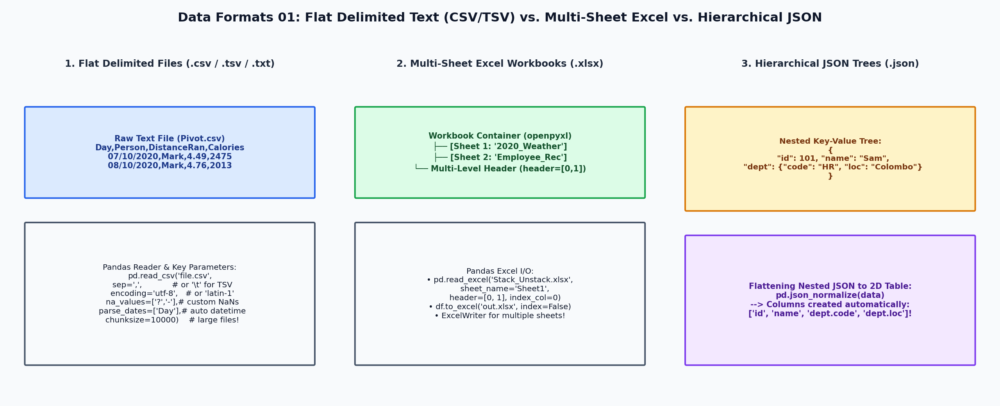
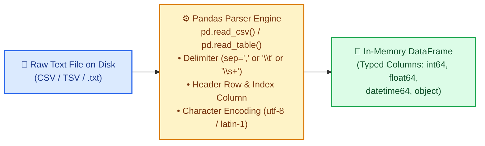

# Dependency Lesson 02.1: Tabular & Hierarchical File Formats — `CSV`, `TSV`, `Excel (.xlsx)` සහ `JSON` මුල සිට ප්‍රගුණ කිරීම

**අදාළ ප්‍රධාන පාඩම් (Related Core Lessons):**
- [Lesson 6.1: Nature of Data — Sources, Types & Common Quality Issues](../../Module_06_Exploratory_Data_Analysis_and_Pandas_Mastery/Lesson_6.1_Nature_of_Data_Sources_Types_and_Quality_Issues.md)
- [Lesson 6.6: Mastering Pandas DataFrame — Creation, I/O & Manipulation](../../Module_06_Exploratory_Data_Analysis_and_Pandas_Mastery/Lesson_6.6_Mastering_Pandas_DataFrame_Creation_IO_and_Manipulation.md)
- [Lesson 6.7: DataFrame Arithmetic, Merging, Joining & Advanced EDA](../../Module_06_Exploratory_Data_Analysis_and_Pandas_Mastery/Lesson_6.7_DataFrame_Arithmetic_Merging_Joining_and_Advanced_EDA.md)

---

## 1. හැඳින්වීම: Data Science හිදී විවිධ ගොනු ආකෘති (File Formats) භාවිතා වන්නේ ඇයි?

සැබෑ ලෝකයේ ව්‍යාපෘතියකදී දත්ත අප වෙත ලැබෙන්නේ Python කේතය තුළම ටයිප් කළ Lists හෝ Dictionaries ලෙස නොව, බාහිර ගොනු (External Files) ලෙසය. මෙම ගොනු ප්‍රධාන වර්ග 3 කට බෙදිය හැක:
1. **Flat Delimited Text Files (`CSV`, `TSV`, `.txt`):** කොමාවකින් (`,`), ටැබ් එකකින් (`\t`), හෝ හිස්තැනකින් (` `) තීරු වෙන් කළ සරල පෙළ ගොනු.
2. **Binary Spreadsheet Workbooks (`Excel .xlsx` / `.xls`):** එකම ගොනුව තුළ පිටු කිහිපයක් (Multiple Sheets), ශීර්ෂ මට්ටම් කිහිපයක් (Multi-level Headers - උදා: `Stack_Unstack.xlsx`), සහ Formatting අඩංගු ගොනු.
3. **Hierarchical / Semi-Structured Data (`JSON`):** වෙබ් යෙදුම් සහ REST APIs මඟින් දත්ත හුවමාරු කරන Nested Dictionaries සහ Lists සහිත ගස් ව්‍යුහයකි (Tree Structure).



---

## 2. Flat Delimited Text Files: `CSV`, `TSV` සහ Space-Delimited `.txt`



### A. `CSV` (Comma-Separated Values) සහ `TSV` (Tab-Separated Values) ව්‍යුහය:
`CSV` ගොනුවක සෑම පේළියක්ම (`\n`) වගුවේ එක් Row එකක් වන අතර, කොමාවකින් (`,`) තීරු (Columns) වෙන් කරයි.  
- **⚠️ Quoting Rule:** යම් පෙළ අගයක් තුළම කොමාවක් තිබේ නම් (උදා: `"Colombo, Sri Lanka"`), එම අගය උද්ධෘත ලකුණු (`"..."`) තුළ තැබීමෙන් එය තීරු දෙකකට කැඩී යාම වළක්වයි.

### B. `pd.read_csv()` සහ `pd.read_table()` හි අත්‍යවශ්‍ය පරාමිතීන් (Slides 66 – 67, 81):
```python
import pandas as pd

# 1. සම්මත CSV ගොනුවක් කියවීම (Slide 67 & Pivot.csv):
df_csv = pd.read_csv('Pivot.csv', sep=',')

# 2. හිස්තැන් (Whitespace) මඟින් වෙන් වූ සහ ශීර්ෂ පේළියක් නොමැති .txt ගොනුවක් කියවීම (Slide 66):
# සටහන: delim_whitespace=True වෙනුවට නව Pandas හි sep=r'\s+' නිර්දේශ කෙරේ.
df_txt = pd.read_table('./input/dists.txt', sep=r'\s+', names=['A', 'B', 'C'])

# 3. සැබෑ ලෝකයේ ගැටලු විසඳන ප්‍රබල read_csv පරාමිතීන්:
df_adv = pd.read_csv(
    'filename.csv',
    sep=',',                        # TSV සඳහා sep='\t'
    header=0,                       # 0 වන පේළිය Column Names ලෙස ගනී (Header නැත්නම් header=None)
    index_col='Date',               # 'Date' තීරුව Row Index එක බවට පත් කරයි
    usecols=['Date', 'price'],      # අවශ්‍ය තීරු පමණක් RAM එකට Load කරයි!
    na_values=['?', 'N/A', '-999'], # මේ සංකේත ස්වයංක්‍රීයව NaN බවට හරවයි
    parse_dates=['Date'],           # String දින කෙලින්ම datetime64[ns] බවට හරවයි
    encoding='utf-8'                # UnicodeDecodeError ආවොත් 'latin-1' හෝ 'cp1252' යොදන්න
)

# 4. DataFrame එකක් ආපසු CSV ගොනුවකට ලිවීම (Slide 81):
# index=False යෙදීමෙන් 0, 1, 2... පේළි අංක අමතර තීරුවක් ලෙස ලිවීම වළක්වයි!
df_csv.to_csv('export_dataframe.csv', index=False, header=True)
```

---

## 3. Microsoft Excel Workbooks (`.xlsx`) සහ Multi-Level Headers (`Stack_Unstack.xlsx`)

`CSV` ගොනුවක තිබිය හැක්කේ එක් වගුවක් පමණි. නමුත් **Excel Workbook (`.xlsx`)** එකක් තුළ:
- පිටු කිහිපයක් (**Multiple Worksheets** - උදා: `Sheet1`, `Sales_2024`, `HR_Data`) තිබිය හැක.
- `Stack_Unstack.xlsx` ගොනුවේ මෙන් **Merged Cells සහිත ශීර්ෂ පේළි 2 ක් (`MultiIndex Columns`: ඉහළ පේළියේ `Temperature`/`Humidity` සහ දෙවන පේළියේ `London`/`New York`/`Paris`)** තිබිය හැක!

Python මඟින් `.xlsx` ගොනු කියවීමට සහ ලිවීමට `Pandas` අභ්‍යන්තරව **`openpyxl`** පුස්තකාලය භාවිතා කරයි (`pip install openpyxl`):

```python
import pandas as pd

# 1. සාමාන්‍ය Excel පිටුවක් කියවීම සහ ලිවීම (EDA.ipynb Cells 185-187):
df.to_excel('sample-excel.xlsx', sheet_name='Employees', index=False)
df_emp = pd.read_excel('sample-excel.xlsx', sheet_name='Employees')

# 2. ශීර්ෂ පේළි 2ක් (Multi-Level Header) සහිත Stack_Unstack.xlsx කියවීම (Cell 282):
# header=[0, 1] මඟින් 0 සහ 1 පේළි දෙකම MultiIndex Column Headers ලෙස කියවයි!
# index_col=0 මඟින් පළමු තීරුව (Date) Row Index එක බවට පත් කරයි!
dx2 = pd.read_excel('Stack_Unstack.xlsx', header=[0, 1], index_col=0)
print(dx2.head(2))
#            Temperature               Humidity              
# Location        London New York Paris  London New York Paris
# 2020-10-01          12        8    12      61       53    77
# 2020-10-02          15       10    10      64       59    56
```

---

## 4. `JSON` (JavaScript Object Notation) සහ Nested JSON Flattening (`pd.json_normalize`)

Lesson 6.1 (Slide 9) හිදී අපි **Compound Data Types** ලෙස Python **`list`** සහ **`dict`** ඉගෙන ගත්තෙමු. **`JSON`** යනු Python `dict` (`{ "key": value }`) සහ `list` (`[ ... ]`) එකිනෙක තුළ කැදලි ගැසුණු (Nested) අන්තර්ජාලයේ ජනප්‍රියතම දත්ත ආකෘතියයි.

- සරල 2D JSON ගොනුවක් `pd.read_json('data.json')` මඟින් කෙලින්ම කියවිය හැක.
- නමුත් සැබෑ ලෝකයේ REST API එකකින් ලැබෙන JSON දත්ත තුළ Dictionary එකක් ඇතුළේ තවත් Dictionary එකක් (**Nested JSON Tree**) පවතී. එවැනි Nested JSON ව්‍යුහයක් තනි පැතලි 2D `DataFrame` එකක් බවට පත් කිරීමට **`pd.json_normalize()`** භාවිතා කරයි (ඉහත රූපයේ Panel 3 බලන්න):

```python
import json
import pandas as pd

# Nested JSON දත්ත (Dictionary ඇතුළේ තවත් Dictionary එකක්):
nested_json = [
    {
        "emp_id": 10001,
        "name": "Sam",
        "department": {"code": "RES", "location": "Colombo"},
        "metrics": {"salary": 45034.88, "rating": 4.5}
    },
    {
        "emp_id": 10002,
        "name": "Max",
        "department": {"code": "HR", "location": "Kandy"},
        "metrics": {"salary": 65343.45, "rating": 4.8}
    }
]

# pd.json_normalize() මඟින් Nested Keys ස්වයංක්‍රීයව තිතකින් ('.') වෙන් වූ තීරු බවට පැතලි කරයි!
df_flat = pd.json_normalize(nested_json)
print(df_flat)
#    emp_id name department.code department.location  metrics.salary  metrics.rating
# 0   10001  Sam             RES             Colombo        45034.88             4.5
# 1   10002  Max              HR               Kandy        65343.45             4.8
```

---

## 🛠️ Practical Task / Hands-On Exercise (ප්‍රායෝගික අභ්‍යාසය)

### Scenario / Goal:
ඔබට IoT කාලගුණ සංවේදක (Weather Sensors) දෙකකින් ලැබුණු Nested JSON දත්ත ලැයිස්තුවක් සහ String ආකෘතියෙන් ඇති CSV පෙළ කොටසක් ලැබී ඇත. ඒවා දෙකම 2D `DataFrame` බවට හරවා ඒකාබද්ධ කළ යුතුය.

### Step-by-Step Tasks:
1. පහත Starter Code හි දී ඇති `sensor_json` දත්ත `pd.json_normalize()` භාවිතා කර පැතලි `DataFrame` එකක් (`df_json`) බවට හරවන්න.
2. `io.StringIO(csv_text)` සහ `pd.read_csv(..., sep=';', na_values=['ERR'])` භාවිතා කර semicolon (`;`) මඟින් වෙන් වූ CSV දත්ත `df_csv` වෙත කියවන්න (`'ERR'` අගය ස්වයංක්‍රීයව `NaN` වන සේ).
3. `df_json` සහ `df_csv` වගු දෙක `'sensor_id'` තීරුව මත `pd.merge()` කර අවසන් ප්‍රතිඵලය මුද්‍රණය කරන්න.

### Starter Code:
```python
import io
import pandas as pd

sensor_json = [
    {"sensor_id": "S1", "location": {"city": "Colombo", "zone": "West"}, "status": "Active"},
    {"sensor_id": "S2", "location": {"city": "Kandy", "zone": "Central"}, "status": "Active"}
]

csv_text = """sensor_id;temp_c;humidity_pct
S1;31.5;78
S2;ERR;82
"""

# TODO 1: Flatten sensor_json using pd.json_normalize()
# TODO 2: Parse csv_text using pd.read_csv(io.StringIO(csv_text), sep=';', na_values=['ERR'])
# TODO 3: Merge the two DataFrames on 'sensor_id'
```

### Expected Output / Reference Solution:
```python
import io
import pandas as pd

sensor_json = [
    {"sensor_id": "S1", "location": {"city": "Colombo", "zone": "West"}, "status": "Active"},
    {"sensor_id": "S2", "location": {"city": "Kandy", "zone": "Central"}, "status": "Active"}
]

csv_text = """sensor_id;temp_c;humidity_pct
S1;31.5;78
S2;ERR;82
"""

# 1. Nested JSON පැතලි 2D DataFrame එකක් බවට හැරවීම
df_json = pd.json_normalize(sensor_json)
print("--- 1. Normalized JSON DataFrame ---")
print(df_json)

# 2. Semicolon-delimited CSV කියවීම සහ 'ERR' -> NaN බවට හැරවීම
df_csv = pd.read_csv(io.StringIO(csv_text), sep=';', na_values=['ERR'])
print("\n--- 2. Parsed CSV DataFrame ---")
print(df_csv)

# 3. sensor_id මත Merge කිරීම
df_final = pd.merge(df_json, df_csv, on='sensor_id')
print("\n--- 3. Merged Sensor Dataset ---")
print(df_final)
```

**Expected Console Output:**
```text
--- 1. Normalized JSON DataFrame ---
  sensor_id  status location.city location.zone
0        S1  Active       Colombo          West
1        S2  Active         Kandy       Central

--- 2. Parsed CSV DataFrame ---
  sensor_id  temp_c  humidity_pct
0        S1    31.5            78
1        S2     NaN            82

--- 3. Merged Sensor Dataset ---
  sensor_id  status location.city location.zone  temp_c  humidity_pct
0        S1  Active       Colombo          West    31.5            78
1        S2  Active         Kandy       Central     NaN            82
```

---

## 🔗 Next Steps & Back-Links to Core Module Lessons

- **ඊළඟ Dependency පාඩම:** [02_Fetching_External_Data_REST_APIs_HTTP_Requests_and_RSS_Feeds.md](02_Fetching_External_Data_REST_APIs_HTTP_Requests_and_RSS_Feeds.md)
- **ආපසු ප්‍රධාන පාඩම් වෙත (Back to Core Lessons):**
  - [Lesson 6.1: Nature of Data — Sources, Types & Common Quality Issues](../../Module_06_Exploratory_Data_Analysis_and_Pandas_Mastery/Lesson_6.1_Nature_of_Data_Sources_Types_and_Quality_Issues.md)
  - [Lesson 6.6: Mastering Pandas DataFrame — Creation, I/O & Manipulation](../../Module_06_Exploratory_Data_Analysis_and_Pandas_Mastery/Lesson_6.6_Mastering_Pandas_DataFrame_Creation_IO_and_Manipulation.md)
