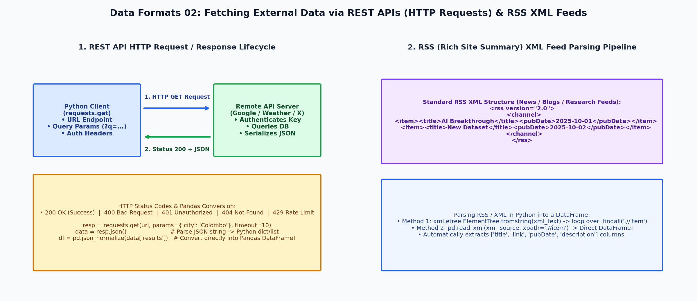
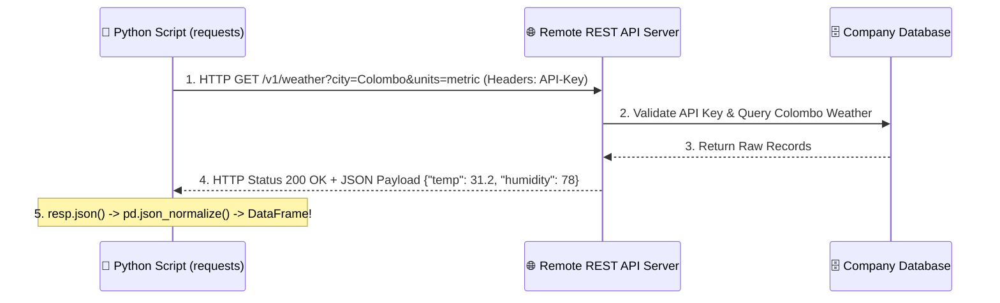

# Dependency Lesson 02.2: Fetching External Data — REST APIs, HTTP Requests සහ RSS Feeds මුල සිට සරලව

**අදාළ ප්‍රධාන පාඩම් (Related Core Lessons):**
- [Lesson 6.1: Nature of Data — Sources, Types & Common Quality Issues](../../Module_06_Exploratory_Data_Analysis_and_Pandas_Mastery/Lesson_6.1_Nature_of_Data_Sources_Types_and_Quality_Issues.md)
- [Lesson 6.6: Mastering Pandas DataFrame — Creation, I/O & Manipulation](../../Module_06_Exploratory_Data_Analysis_and_Pandas_Mastery/Lesson_6.6_Mastering_Pandas_DataFrame_Creation_IO_and_Manipulation.md)

---

## 1. හැඳින්වීම: API සහ RSS යනු මොනවාද? (Slide 5 Context)

Lesson 6.1 (Slide 5) හිදී අන්තර්ජාලයේ පවතින බාහිර දත්ත (Online External Data) අපේ Python වැඩසටහනකට ලබා ගන්නා ප්‍රධාන ක්‍රම 3 අතරින් පළමු ක්‍රම දෙක ලෙස **API (Application Programming Interface)** සහ **RSS (Rich Site Summary)** හඳුන්වා දී ඇත.

ආධුනිකයෙකුට මේ දෙක ඉතාම සරලව තේරුම් ගැනීමට **අවන්හලක (Restaurant) උපමාව** ගනිමු:
- ඔබ (ඔබේ Python වැඩසටහන / **Client**) අවන්හලේ මේසයක වාඩි වී සිටියි. කුස්සිය (සමාගමේ Database Server එක) තුළට කෙලින්ම යාමට ඔබට අවසර නැත.
- එබැවින් ඔබ **වේටර්වරයා (API - Application Programming Interface)** අතේ ඔබේ ඇණවුම (**HTTP GET Request**) කුස්සියට යවයි. වේටර්වරයා කුස්සියට ගොස් ඔබ ඉල්ලූ ආහාරය පමණක් පිළිවෙලට පිඟානක තබා (**JSON Response**) ඔබ වෙත ගෙනැවිත් දෙයි!
- **RSS Feed** එකක් යනු පුවත්පත් ආයතනයක් හෝ බ්ලොග් අඩවියක් විසින් අලුත් පුවතක් පළ වූ සැණින් ස්වයංක්‍රීයව යාවත්කාලීන කරන සම්මත **XML දැන්වීම් පුවරුවකි**.



---

## 2. REST API සහ HTTP Request / Response චක්‍රය ක්‍රියා කරන ආකාරය



### A. HTTP Request එකක ප්‍රධාන කොටස් 4:
1. **Endpoint URL:** දත්ත ඉල්ලන වෙබ් ලිපිනය (උදා: `https://api.openweathermap.org/data/2.5/weather`).
2. **HTTP Method (`GET` vs. `POST`):** දත්ත කියවීමට (Read/Fetch) සැමවිටම **`GET`** භාවිතා වේ; සර්වරයට දත්ත යැවීමට **`POST`** භාවිතා වේ.
3. **Query Parameters (`params`):** URL එකේ `?` ලකුණට පසුව යවන පෙරහන් කොන්දේසි (උදා: `?city=Colombo&limit=50`).
4. **Headers:** Authentication සඳහා යවන `Authorization: Bearer <API_KEY>` හෝ `User-Agent` තොරතුරු.

### B. අත්‍යවශ්‍ය HTTP Status Codes 5 (සර්වරයෙන් ලැබෙන තත්ත්ව කේත):
| Status Code | තේරුම (Meaning) | Data Scientist කළ යුතු දේ |
| :---: | :--- | :--- |
| **`200 OK`** | ඉල්ලීම සාර්ථකයි! දත්ත නිවැරදිව ලැබී ඇත. | `resp.json()` මඟින් දත්ත `DataFrame` එකට ගන්න. |
| **`400 Bad Request`** | ඔබ යැවූ Query Parameters වල ව්‍යාකරණ දෝෂයක් ඇත. | `params` Dictionary එකේ නම් සහ අගයන් පරීක්ෂා කරන්න. |
| **`401 Unauthorized` / `403 Forbidden`** | API Key එක වැරදියි හෝ අවසර නැත. | ඔබේ API Key එක සහ `headers` පරීක්ෂා කරන්න. |
| **`404 Not Found`** | ඉල්ලූ Endpoint URL එක හෝ දත්තය සර්වරයේ නැත. | URL අක්ෂර වින්‍යාසය පරීක්ෂා කරන්න. |
| **`429 Too Many Requests`** | තත්පරයකට යැවිය හැකි උපරිම ඉල්ලීම් සීමාව (Rate Limit) ඉක්මවා ඇත! | ඉල්ලීම් අතර `time.sleep(1)` යොදා වේගය පාලනය කරන්න. |

### C. Python `requests` පුස්තකාලයෙන් API දත්ත ලබාගෙන `DataFrame` එකකට හැරවීම:
```python
import requests
import pandas as pd

# (උදාහරණයක් ලෙස API Endpoint එකකින් JSON ලබා ගන්නා සම්මත Production Pattern එක)
url = "https://api.example.com/v1/stocks"
query_params = {"symbol": "AAPL", "days": 5}
headers = {"Accept": "application/json", "User-Agent": "CI7340-MSc-Student/1.0"}

# timeout=10 යෙදීමෙන් සර්වරය ප්‍රතිචාර නොදක්වන විට වැඩසටහන සදහටම හිරවීම (Hang) වළක්වයි!
# resp = requests.get(url, params=query_params, headers=headers, timeout=10)
# resp.raise_for_status()            # Status 200 නොවේ නම් වහාම HTTPError එකක් මතු කරයි
# payload = resp.json()              # JSON String එක Python dict/list බවට හරවයි
# df = pd.DataFrame(payload['data']) # කෙලින්ම Pandas DataFrame එකක් බවට පත් කරයි!
```

---

## 3. RSS (Rich Site Summary) XML Feeds කියවීම සහ `DataFrame` එකකට ගැනීම (Slide 5)

ප්‍රවෘත්ති අඩවි (BBC, Reuters), පර්යේෂණ ජර්නල (arXiv), සහ බ්ලොග් අඩවි තම නවතම ලිපි ලැයිස්තුව **RSS (XML)** ආකෘතියෙන් ප්‍රකාශයට පත් කරයි. සෑම පුවතක්ම `<item>` ටැගයක් තුළ `<title>`, `<link>`, `<pubDate>`, සහ `<description>` ලෙස පවතී (ඉහත රූපයේ Panel 2 බලන්න).

Python හි තිළැති (Built-in) **`xml.etree.ElementTree`** මඟින් ඕනෑම RSS Feed එකක් කියවා තත්පරයකින් `Pandas DataFrame` එකක් බවට පත් කළ හැක:

```python
import xml.etree.ElementTree as ET
import pandas as pd

# සම්මත RSS 2.0 XML Feed ආකෘතියක්:
rss_xml_data = """<?xml version="1.0" encoding="UTF-8" ?>
<rss version="2.0">
  <channel>
    <title>Data Science Daily News</title>
    <item>
      <title>Pandas 2.2 Released with PyArrow Backend</title>
      <category>Python</category>
      <pubDate>2025-10-01</pubDate>
      <views>1450</views>
    </item>
    <item>
      <title>New Argon Isotope Study Honours Lord Rayleigh</title>
      <category>Physics</category>
      <pubDate>2025-10-02</pubDate>
      <views>980</views>
    </item>
  </channel>
</rss>
"""

# XML ගස Parse කර සියලුම <item> ටැගයන් ලූප් කර DataFrame එකක් සෑදීම:
root = ET.fromstring(rss_xml_data)
records = []
for item in root.findall('.//item'):
    records.append({
        'Title': item.findtext('title'),
        'Category': item.findtext('category'),
        'PubDate': item.findtext('pubDate'),
        'Views': int(item.findtext('views'))
    })

df_rss = pd.DataFrame(records)
print(df_rss)
```

---

## 🛠️ Practical Task / Hands-On Exercise (ප්‍රායෝගික අභ්‍යාසය)

### Scenario / Goal:
ඔබට කොටස් වෙළඳපොළ (Stock Market) REST API එකකින් ලැබුණු JSON ප්‍රතිචාරයක් (`api_json_response`) සහ මූල්‍ය පුවත් RSS Feed එකක XML පෙළක් (`financial_rss_xml`) ලබා දී ඇත. මේ දෙකම Parse කර දිනය (`Date`) මත ඒකාබද්ධ කළ යුතුය.

### Step-by-Step Tasks:
1. `json.loads(api_json_response)` මඟින් JSON ප්‍රතිචාරය කියවා, එහි `'prices'` යතුර යටතේ ඇති දත්ත `pd.DataFrame` එකකට (`df_stocks`) ලබා ගන්න.
2. `ET.fromstring(financial_rss_xml)` භාවිතා කර සෑම `<item>` එකකම `<date>` සහ `<headline>` උපුටා ගෙන `df_news` නමැති `DataFrame` එක සාදන්න.
3. `pd.merge(df_stocks, df_news, on='date')` මඟින් දෛනික කොටස් මිල සහ එදින පළ වූ ප්‍රධාන පුවත් සිරස්තලය එකම වගුවකට ඒකාබද්ධ කරන්න.

### Starter Code:
```python
import json
import xml.etree.ElementTree as ET
import pandas as pd

api_json_response = """
{
  "status": 200,
  "symbol": "TECH",
  "prices": [
    {"date": "2025-11-01", "close": 152.40, "volume": 12000},
    {"date": "2025-11-02", "close": 161.80, "volume": 28500}
  ]
}
"""

financial_rss_xml = """
<rss version="2.0">
  <channel>
    <item><date>2025-11-01</date><headline>TECH Announces Q3 Earnings</headline></item>
    <item><date>2025-11-02</date><headline>TECH Launches New AI Chip</headline></item>
  </channel>
</rss>
"""

# TODO 1: Parse api_json_response and create df_stocks from payload['prices']
# TODO 2: Parse financial_rss_xml and create df_news with columns ['date', 'headline']
# TODO 3: Merge df_stocks and df_news on 'date'
```

### Expected Output / Reference Solution:
```python
import json
import xml.etree.ElementTree as ET
import pandas as pd

api_json_response = """
{
  "status": 200,
  "symbol": "TECH",
  "prices": [
    {"date": "2025-11-01", "close": 152.40, "volume": 12000},
    {"date": "2025-11-02", "close": 161.80, "volume": 28500}
  ]
}
"""

financial_rss_xml = """
<rss version="2.0">
  <channel>
    <item><date>2025-11-01</date><headline>TECH Announces Q3 Earnings</headline></item>
    <item><date>2025-11-02</date><headline>TECH Launches New AI Chip</headline></item>
  </channel>
</rss>
"""

# 1. REST API JSON Payload එකෙන් df_stocks සෑදීම
payload = json.loads(api_json_response)
df_stocks = pd.DataFrame(payload['prices'])

# 2. RSS XML Feed එකෙන් df_news සෑදීම
root = ET.fromstring(financial_rss_xml)
news_list = [
    {'date': item.findtext('date'), 'headline': item.findtext('headline')}
    for item in root.findall('.//item')
]
df_news = pd.DataFrame(news_list)

# 3. දිනය මත වගු දෙක ඒකාබද්ධ කිරීම
df_combined = pd.merge(df_stocks, df_news, on='date')
print("--- Combined Stock API & RSS News DataFrame ---")
print(df_combined)
```

**Expected Console Output:**
```text
--- Combined Stock API & RSS News DataFrame ---
         date  close  volume                    headline
0  2025-11-01  152.4   12000  TECH Announces Q3 Earnings
1  2025-11-02  161.8   28500   TECH Launches New AI Chip
```

---

## 🔗 Next Steps & Back-Links to Core Module Lessons

- **පෙර Dependency පාඩම:** [01_Tabular_and_Hierarchical_File_Formats_CSV_TSV_Excel_and_JSON.md](01_Tabular_and_Hierarchical_File_Formats_CSV_TSV_Excel_and_JSON.md)
- **ඊළඟ Dependency පාඩම:** [03_Web_Scraping_Fundamentals_HTML_DOM_and_BeautifulSoup_to_DataFrame.md](03_Web_Scraping_Fundamentals_HTML_DOM_and_BeautifulSoup_to_DataFrame.md)
- **ආපසු ප්‍රධාන පාඩම් වෙත (Back to Core Lessons):**
  - [Lesson 6.1: Nature of Data — Sources, Types & Common Quality Issues](../../Module_06_Exploratory_Data_Analysis_and_Pandas_Mastery/Lesson_6.1_Nature_of_Data_Sources_Types_and_Quality_Issues.md)
  - [Lesson 6.6: Mastering Pandas DataFrame — Creation, I/O & Manipulation](../../Module_06_Exploratory_Data_Analysis_and_Pandas_Mastery/Lesson_6.6_Mastering_Pandas_DataFrame_Creation_IO_and_Manipulation.md)
