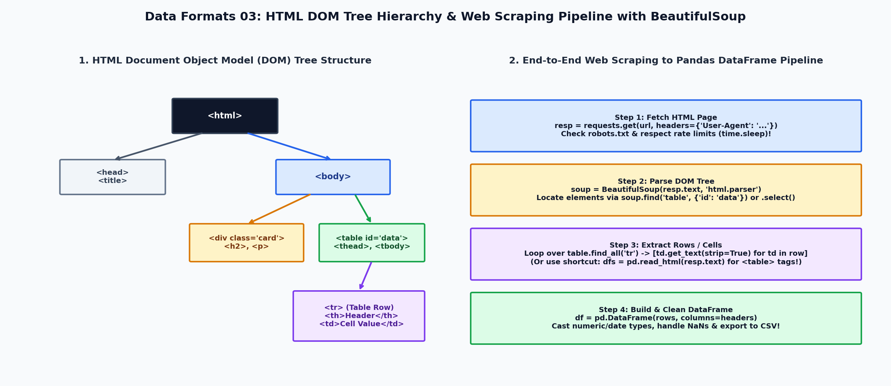
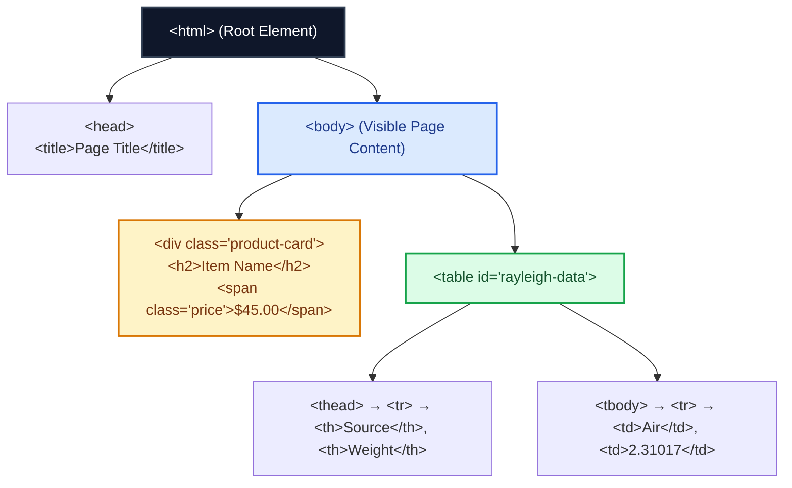

# Dependency Lesson 02.3: Web Scraping Fundamentals — HTML DOM Tree සහ `BeautifulSoup` මඟින් `DataFrame` එකකට දත්ත උපුටා ගැනීම

**අදාළ ප්‍රධාන පාඩම් (Related Core Lessons):**
- [Lesson 6.1: Nature of Data — Sources, Types & Common Quality Issues](../../Module_06_Exploratory_Data_Analysis_and_Pandas_Mastery/Lesson_6.1_Nature_of_Data_Sources_Types_and_Quality_Issues.md)
- [Lesson 6.6: Mastering Pandas DataFrame — Creation, I/O & Manipulation](../../Module_06_Exploratory_Data_Analysis_and_Pandas_Mastery/Lesson_6.6_Mastering_Pandas_DataFrame_Creation_IO_and_Manipulation.md)

---

## 1. හැඳින්වීම: Web Scraping යනු කුමක්ද සහ එය අවශ්‍ය වන්නේ කුමන අවස්ථාවේදීද? (Slide 4 & Slide 5)

Lesson 6.1 (Slide 4) හිදී අපි **"External Sources Requiring Collection Efforts"** යනුවෙන් තුන්වන දත්ත මූලාශ්‍ර කාණ්ඩයක් ඉගෙන ගත්තෙමු. බොහෝ වෙබ් අඩවිවල (උදා: භාණ්ඩ මිල ගණන්, දේපළ වෙළඳාම් දැන්වීම්, විශ්වවිද්‍යාල ප්‍රතිඵල වගු, හෝ ඓතිහාසික ක්‍රීඩා දත්ත) දත්ත මිනිසුන්ට කියවීම සඳහා වෙබ් පිටුවේ පෙන්වා තිබුණද, ඒවා බාගත කිරීමට `CSV` බොත්තමක් හෝ `REST API` එකක් ලබා දී නොමැත.

එවැනි අවස්ථාවක වෙබ් පිටුවේ පෙන්වන දේ හෝ එහි **HTML ගොනුව (HTML Source File)** තුළ අඩංගු දත්ත Python Script එකක් මඟින් ස්වයංක්‍රීයව උපුටා ගෙන (Extract කර) ව්‍යුහගත `Pandas DataFrame` එකක් බවට පත් කිරීමේ ක්‍රියාවලියට **Web Scraping** යැයි කියනු ලැබේ (Slide 5):
> **“Web scraping: using software, scripts or by-hand extracting data from what is displayed on a page or what is contained in the HTML file.”** — Slide 5



---

## 2. HTML සහ DOM Tree (Document Object Model) ව්‍යුහය තේරුම් ගැනීම

ඕනෑම වෙබ් පිටුවක් නිර්මාණය වී ඇත්තේ **HTML (HyperText Markup Language)** ටැගයන් (`<tag attribute="value">Content</tag>`) එකක් තුළ එකක් කැදලි ගැසුණු ගස් ව්‍යුහයක් (**DOM Tree**) ලෙසය (ඉහත රූපයේ Panel 1 බලන්න):



### Web Scraping සඳහා දැනගත යුතු ප්‍රධානතම HTML Tags සහ Attributes:
1. **`<table>`, `<thead>`, `<tbody>`, `<tr>` (Table Row), `<th>` (Table Header), `<td>` (Table Data Cell):** වෙබ් පිටුවක වගුවක් නිර්මාණය කරන ටැග් පවුලයි.
2. **`<div>`, `<p>`, `<span>`, `<h1>`–`<h6>`:** පෙළ සහ කාඩ්පත් (Cards) රඳවන ටැගයන්ය.
3. **`<a href="https://...">Link Text</a>`:** වෙනත් පිටුවකට යන සබැඳි (Hyperlinks) අඩංගු ටැගයයි.
4. **`id="..."` සහ `class="..."` Attributes:** වෙබ් පිටුවක දහස් ගණනක් `<div>` හෝ `<table>` අතරින් අපට අවශ්‍ය නිශ්චිත කොටස පමණක් ඉලක්ක කර අල්ලා ගැනීමට (Target කිරීමට) භාවිතා කරන හැඳුනුම්පත් වේ!

---

## 3. `BeautifulSoup` සහ `html.parser` මඟින් HTML පිටුවකින් දත්ත උපුටා ගැනීම

HTML පෙළක් තුළින් දත්ත උපුටා ගැනීමට Python හි ජනප්‍රියතම පුස්තකාලය වන්නේ **`BeautifulSoup` (`bs4`)** ය (හෝ Python Standard Library හි `html.parser`).

### A. `BeautifulSoup` හි ප්‍රධානතම සෙවුම් ශ්‍රිත 4:
1. **`soup.find('table', {'id': 'scores'})`**: ලබා දුන් ටැගය සහ attribute එකට ගැලපෙන **පළමු** HTML අවයවය සොයා දෙයි.
2. **`soup.find_all('tr')`**: ගැලපෙන **සියලුම** HTML අවයව ලැයිස්තුවක් (`list`) ලෙස ලබා දෙයි.
3. **`element.get_text(strip=True)`**: ටැග් ඉවත් කර ඇතුළත ඇති පිරිසිදු පෙළ (Text) පමණක් ලබා දෙයි.
4. **`element.get('href')`**: `<a>` ටැගයක ඇති URL attribute අගය ලබා දෙයි.

### B. HTML Table එකක් කෙලින්ම `DataFrame` එකකට ගැනීමේ කෙටිම ක්‍රමය (`pd.read_html`):
වෙබ් පිටුවක දත්ත ඇත්තේ සම්මත `<table>...</table>` ටැගයක් තුළ නම්, `dfs = pd.read_html(html_string)` විධානයෙන් පිටුවේ ඇති සියලුම HTML වගු ස්වයංක්‍රීයව `DataFrame` ලැයිස්තුවක් බවට පත් කර ගත හැක!

---

## 4. Ethical & Responsible Web Scraping (වගකීම් සහගතව දත්ත උපුටා ගැනීමේ නීති 4)

වෘත්තීය Data Scientist කෙනෙකු ලෙස Web Scraping සිදු කිරීමේදී පහත ආචාර ධර්ම සහ තාක්ෂණික නීති 4 අනිවාර්යයෙන්ම පිළිපැදිය යුතුය:
1. **API එකක් තිබේදැයි පළමුව බලන්න:** වෙබ් අඩවිය නිල API එකක් ලබා දේ නම් Web Scraping නොකර API එක භාවිතා කරන්න.
2. **`robots.txt` ගොනුව පරීක්ෂා කරන්න:** ඕනෑම වෙබ් අඩවියක `https://domain.com/robots.txt` පරීක්ෂා කිරීමෙන් කුමන පිටු Scrape කිරීමට අවසර ඇත්ද (`Allow`) සහ තහනම්ද (`Disallow`) යන්න දැනගත හැක.
3. **Rate Limiting (`time.sleep`):** තත්පරයට ඉල්ලීම් සිය ගණනක් යවා වෙබ් සර්වරය අඩපණ (DDoS) නොකරන්න; ඉල්ලීම් අතර `time.sleep(1)` හෝ `2` යොදන්න.
4. **Data Privacy & Copyright:** පුද්ගලික දත්ත (PII) හෝ ප්‍රකාශන හිමිකම් (Copyright) මඟින් තහනම් කර ඇති දත්ත අනවසරයෙන් රැස් නොකරන්න.

---

## 🛠️ Practical Task / Hands-On Exercise (ප්‍රායෝගික අභ්‍යාසය)

### Scenario / Goal:
Lesson 6.4 (Slide 35) හි දැක්වෙන **Lord Rayleigh ගේ නයිට්‍රජන් බර පරීක්ෂණයේ** දත්ත විද්‍යාත්මක වෙබ් අඩවියක HTML වගුවක් (`<table id="rayleigh">`) ලෙස පළ කර ඇතැයි සිතන්න. ඔබ Python හි තිළැති `html.parser` (හෝ `BeautifulSoup`) භාවිතා කර එම HTML වගුවෙන් දත්ත උපුටා ගෙන, `Pandas DataFrame` එකක් සාදා, `Air` සහ `Chemical` කාණ්ඩ දෙකෙහි මධ්‍යන්‍ය බර (**Mean Weight**) සංසන්දනය කළ යුතුය!

### Step-by-Step Tasks:
1. පහත Starter Code හි දී ඇති `html_page` තුළ ඇති `<tr>` පේළිවලින් `<td>` අගයන් උපුටා ගෙන `rows` ලැයිස්තුවට එක් කරන්න.
2. `['Date', 'Source', 'Method', 'Weight']` තීරු සහිත `df_rayleigh` නමැති `Pandas DataFrame` එක සාදන්න.
3. `'Weight'` තීරුව `float` බවට පරිවර්තනය කරන්න (`.astype(float)`).
4. `df_rayleigh.groupby('Source')['Weight'].agg(['count', 'mean'])` මඟින් එක් එක් ප්‍රභවයේ මධ්‍යන්‍ය බර ගණනය කර, `Air` වලින් ගත් නයිට්‍රජන් බර වැඩි බව තහවුරු කරන්න!

### Starter Code:
```python
from html.parser import HTMLParser
import pandas as pd

html_page = """
<html>
  <body>
    <h2>Lord Rayleigh Nitrogen Weight Experiment (1893-1894)</h2>
    <table id="rayleigh">
      <tr><th>Date</th><th>Source</th><th>Method</th><th>Weight</th></tr>
      <tr><td>29.11.93</td><td>NO</td><td>hot iron</td><td>2.30143</td></tr>
      <tr><td>05.12.93</td><td>NO</td><td>hot iron</td><td>2.29816</td></tr>
      <tr><td>12.12.93</td><td>Air</td><td>hot iron</td><td>2.31017</td></tr>
      <tr><td>14.12.93</td><td>Air</td><td>hot iron</td><td>2.30986</td></tr>
      <tr><td>26.12.93</td><td>N2O</td><td>hot iron</td><td>2.29889</td></tr>
      <tr><td>27.01.94</td><td>Air</td><td>ferrous hydrate</td><td>2.31024</td></tr>
    </table>
  </body>
</html>
"""

# TODO 1: Parse the HTML table rows (<td> cells)
# TODO 2: Create DataFrame df_rayleigh with columns ['Date', 'Source', 'Method', 'Weight']
# TODO 3: Cast 'Weight' to float and compute GroupBy mean per 'Source'
```

### Expected Output / Reference Solution:
```python
from html.parser import HTMLParser
import pandas as pd

html_page = """
<html>
  <body>
    <h2>Lord Rayleigh Nitrogen Weight Experiment (1893-1894)</h2>
    <table id="rayleigh">
      <tr><th>Date</th><th>Source</th><th>Method</th><th>Weight</th></tr>
      <tr><td>29.11.93</td><td>NO</td><td>hot iron</td><td>2.30143</td></tr>
      <tr><td>05.12.93</td><td>NO</td><td>hot iron</td><td>2.29816</td></tr>
      <tr><td>12.12.93</td><td>Air</td><td>hot iron</td><td>2.31017</td></tr>
      <tr><td>14.12.93</td><td>Air</td><td>hot iron</td><td>2.30986</td></tr>
      <tr><td>26.12.93</td><td>N2O</td><td>hot iron</td><td>2.29889</td></tr>
      <tr><td>27.01.94</td><td>Air</td><td>ferrous hydrate</td><td>2.31024</td></tr>
    </table>
  </body>
</html>
"""

# 1. HTML Table Parser (Standard Library html.parser — works anywhere without external deps!)
class TableExtractor(HTMLParser):
    def __init__(self):
        super().__init__()
        self.in_td = False
        self.current_row = []
        self.rows = []
    def handle_starttag(self, tag, attrs):
        if tag == 'td':
            self.in_td = True
    def handle_endtag(self, tag):
        if tag == 'td':
            self.in_td = False
        elif tag == 'tr' and self.current_row:
            self.rows.append(self.current_row)
            self.current_row = []
    def handle_data(self, data):
        if self.in_td:
            self.current_row.append(data.strip())

parser = TableExtractor()
parser.feed(html_page)

# 2. DataFrame නිර්මාණය කිරීම සහ 'Weight' තීරුව float බවට හැරවීම
df_rayleigh = pd.DataFrame(parser.rows, columns=['Date', 'Source', 'Method', 'Weight'])
df_rayleigh['Weight'] = df_rayleigh['Weight'].astype(float)

print("--- 1. Scraped Lord Rayleigh DataFrame ---")
print(df_rayleigh)

# 3. Source අනුව මධ්‍යන්‍ය බර (Mean Weight) සංසන්දනය කිරීම
print("\n--- 2. GroupBy Source Summary (Discovering Argon Anomaly!) ---")
print(df_rayleigh.groupby('Source')['Weight'].agg(['count', 'mean']))
```

**Expected Console Output:**
```text
--- 1. Scraped Lord Rayleigh DataFrame ---
       Date Source           Method   Weight
0  29.11.93     NO         hot iron  2.30143
1  05.12.93     NO         hot iron  2.29816
2  12.12.93    Air         hot iron  2.31017
3  14.12.93    Air         hot iron  2.30986
4  26.12.93    N2O         hot iron  2.29889
5  27.01.94    Air  ferrous hydrate  2.31024

--- 2. GroupBy Source Summary (Discovering Argon Anomaly!) ---
        count      mean
Source                 
Air         3  2.310090
N2O         1  2.298890
NO          2  2.299795
```

---

## 🔗 Next Steps & Back-Links to Core Module Lessons

- **පෙර Dependency පාඩම:** [02_Fetching_External_Data_REST_APIs_HTTP_Requests_and_RSS_Feeds.md](02_Fetching_External_Data_REST_APIs_HTTP_Requests_and_RSS_Feeds.md)
- **ආපසු ප්‍රධාන පාඩම් වෙත (Back to Core Lessons):**
  - [Lesson 6.1: Nature of Data — Sources, Types & Common Quality Issues](../../Module_06_Exploratory_Data_Analysis_and_Pandas_Mastery/Lesson_6.1_Nature_of_Data_Sources_Types_and_Quality_Issues.md)
  - [Lesson 6.4: Pattern Recognition & Classic EDA Case Studies](../../Module_06_Exploratory_Data_Analysis_and_Pandas_Mastery/Lesson_6.4_Pattern_Recognition_and_Classic_EDA_Case_Studies.md)
  - [Lesson 6.6: Mastering Pandas DataFrame — Creation, I/O & Manipulation](../../Module_06_Exploratory_Data_Analysis_and_Pandas_Mastery/Lesson_6.6_Mastering_Pandas_DataFrame_Creation_IO_and_Manipulation.md)
