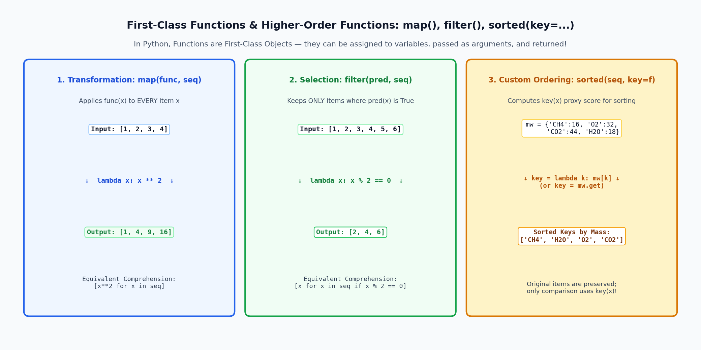
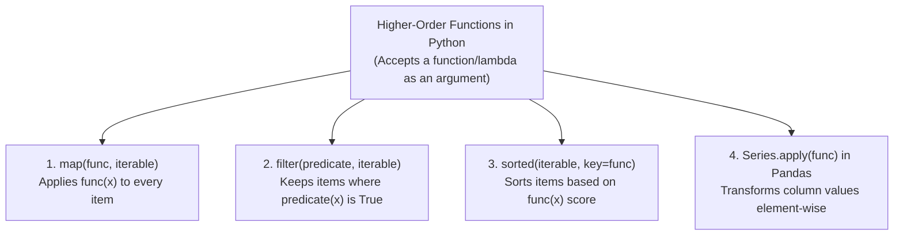

# Dependency Lesson 02.1: First-Class Functions & Higher-Order Functions (`map`, `filter`, `sorted`)

**අදාළ ප්‍රධාන පාඩම (Related Core Module 3 Lesson):**
- [Lesson 3.5: Anonymous `lambda` Functions & List Comprehensions](../../Module_03_Modular_and_Intermediate_Python/Lesson_3.5_Anonymous_Lambda_Functions_and_List_Comprehensions.md)

---

## 1. හැඳින්වීම: `lambda` ශ්‍රිත ඇත්තටම භාවිතා කරන්නේ කොතැනද?

`Python 3-2.pdf` දේශන සටහනේ 35 වන Slide එකෙහි **`lambda`** ශ්‍රිත හඳුන්වා දෙන විට ඉතාම වැදගත් කරුණු දෙකක් සඳහන් කර ඇත:
1. *"Can be used wherever function objects are used."* (Function objects භාවිතා කරන ඕනෑම තැනක යෙදිය හැක).
2. *"Typically used with functional programming tools."* (සාමාන්‍යයෙන් Functional programming මෙවලම් සමඟ භාවිතා වේ).

එමෙන්ම අපගේ `f1.ipynb` Notebook එකෙහි Dictionary එකක් එහි අගයන් (Values) අනුව Sort කිරීමට `sorted(mw, key=mw.get)` යනුවෙන් ශ්‍රිතයක් තවත් ශ්‍රිතයක් ඇතුළට Argument එකක් ලෙස යවා ඇත!

මෙය තේරුම් ගැනීමට නම්, Python හි **First-Class Functions (පළමු පෙළ ශ්‍රිත)** සහ **Higher-Order Functions (උසස් පෙළ ශ්‍රිත)** යනු මොනවාදැයි මුල සිටම ඉගෙන ගනිමු.



---

## 2. First-Class Functions (පළමු පෙළ ශ්‍රිත) යනු කුමක්ද?

Python හි සංඛ්‍යාවක් (`42`), අකුරු පෙළක් (`"hello"`), හෝ List එකක් (`[1, 2, 3]`) යම් සේ Object එකක් වන්නේද, **Function එකක්ද ඒ හා සමානම First-Class Object එකකි (`<class 'function'>`)!**

එනම් Python හි ඕනෑම Function එකකට පහත හැකියාවන් 4 ඇත:
1. **විචල්‍යයකට ආදේශ කළ හැක (Assign to a variable):** `my_func = print` හෝ `g = lambda x: x**2`
2. **Data Structure එකක් (List/Dict) තුළ ගබඩා කළ හැක:** `ops = [abs, len, sum]`
3. **තවත් Function එකකට Argument එකක් ලෙස යැවිය හැක (Pass as an argument to another function):** `sorted(mw, key=mw.get)`
4. **තවත් Function එකකින් ප්‍රතිඵලයක් ලෙස ආපසු ලබා දිය හැක (Return from another function).**

```python
def square(x):
    return x ** 2

# 1. වරහන් () නොමැතිව 'square' ලියූ විට එය Function Object එකයි:
f_obj = square
print("Object:", f_obj, "| Type:", type(f_obj))
print("Calling via alias f_obj(8):", f_obj(8))
```

**Output:**
```text
Object: <function square at 0x7f...> | Type: <class 'function'>
Calling via alias f_obj(8): 64
```
> [!IMPORTANT]
> **`square(8)` vs `square` අතර වෙනස:**  
> - `square(8)` ලෙස වරහන් සහිතව ලියූ විට ශ්‍රිතය **එම මොහොතේදීම ක්‍රියාත්මක වී (Call වී)** එහි ප්‍රතිඵලය වන `64` ලබා දෙයි.  
> - `square` ලෙස **වරහන් නොමැතිව** ලියූ විට ශ්‍රිතය ක්‍රියාත්මක නොවේ; එම **ශ්‍රිත වස්තුවම (Function Object reference)** තවත් තැනකට යැවිය හැක! (`f1.ipynb` හි `sorted(mw, key=mw.get)` හිදී `mw.get` යවා ඇත්තේ වරහන් නොමැතිව බව නිරීක්ෂණය කරන්න!).

---

## 3. Higher-Order Functions (උසස් පෙළ ශ්‍රිත) සහ Functional Programming මෙවලම් 3

**Higher-Order Function (උසස් පෙළ ශ්‍රිතයක්)** යනු තවත් ශ්‍රිතයක් පරාමිතියක් (Argument) ලෙස ලබා ගන්නා හෝ ශ්‍රිතයක් ප්‍රතිඵලයක් ලෙස ආපසු ලබා දෙන ඕනෑම ශ්‍රිතයකි.

Python හි `lambda` (Anonymous Function — නිර්නාමික ශ්‍රිතය) බහුලවම භාවිතා වන Built-in Higher-Order Functions 3 සහ Pandas `.apply()` පහතින් බලමු:



### 3.1 `map(function, iterable)` — සෑම අංගයක්ම පරිවර්තනය කිරීම (Transformation)
Sequence එකක ඇති සෑම අංගයකටම `function` එක යොදා අලුත් අගයන් මාලාවක් ලබා ගැනීමට `map()` භාවිතා වේ:

```python
numbers = [1, 2, 3, 4, 5]

# lambda ශ්‍රිතයක් map() වෙත කෙලින්ම ලබා දීම:
squared_nums = list(map(lambda x: x ** 2, numbers))
print("Mapped squares:", squared_nums)
# Output: [1, 4, 9, 16, 25]
```

### 3.2 `filter(predicate_function, iterable)` — කොන්දේසියක් අනුව පෙරා ගැනීම (Filtering)
`True` හෝ `False` ආපසු ලබා දෙන ශ්‍රිතයක් (**Predicate Function — තාර්කික පරීක්ෂණ ශ්‍රිතය**) ලබා දුන් විට, `True` ලැබෙන අංග පමණක් තෝරා ගැනීමට `filter()` භාවිතා වේ:

```python
numbers = range(0, 9)

# ඉරට්ටේ සංඛ්‍යා (x % 2 == 0) පමණක් තෝරා ගැනීම:
evens = list(filter(lambda x: x % 2 == 0, numbers))
print("Filtered evens:", evens)
# Output: [0, 2, 4, 6, 8]
```

### 3.3 `sorted(iterable, key=function)` — Custom Key අනුව පෙළගැස්වීම (`f1.ipynb` Case Study)
අපගේ `f1.ipynb` (Cells 28–29) හි රසායනික සංයෝගවල **Molar Mass (මවුලික ස්කන්ධය)** අඩංගු `mw` Dictionary එක Sort කරන ආකාරය දෙස බලන්න:

```python
mw = {'CH4': 16.04, 'O2': 32.0, 'CO2': 44.01, 'C8H18': 114.23, 'C6H12': 60.67}

# 1. key එකක් නොමැතිව sorted(mw) කළ විට අකාරාදී පිළිවෙළට (Alphabetical order of keys) හැදේ:
print("Sorted by Key (Alphabetical):", sorted(mw))

# 2. key=mw.get හෝ key=lambda k: mw[k] ලබා දුන් විට Molar Mass අගය (Value) අනුව කුඩාම අගයේ සිට පෙළගැසේ!
print("Sorted by Value (using lambda):", sorted(mw, key=lambda species: mw[species]))
print("Sorted by Value (using mw.get):", sorted(mw, key=mw.get))
```

**Output:**
```text
Sorted by Key (Alphabetical): ['C6H12', 'C8H18', 'CH4', 'CO2', 'O2']
Sorted by Value (using lambda): ['CH4', 'O2', 'CO2', 'C6H12', 'C8H18']
Sorted by Value (using mw.get): ['CH4', 'O2', 'CO2', 'C6H12', 'C8H18']
```

---

## 4. `map()` / `filter()` vs. List Comprehensions සංසන්දනය

[Lesson 3.5](../../Module_03_Modular_and_Intermediate_Python/Lesson_3.5_Anonymous_Lambda_Functions_and_List_Comprehensions.md) හි අපි ඉගෙන ගන්නා **List Comprehensions** මගින් `map()` සහ `filter()` දෙකෙහිම කාර්යයන් තනි පේළියකින් වඩාත් පැහැදිලිව (Pythonic ලෙස) සිදු කළ හැක:

| Operation | Functional Style (`map` / `filter` + `lambda`) | Pythonic List Comprehension Style |
| :--- | :--- | :--- |
| **Mapping (Transform)** | `list(map(lambda x: x**2, range(11)))` | `[x**2 for x in range(11)]` |
| **Filtering (Select)** | `list(filter(lambda x: x % 2 == 0, range(9)))` | `[x for x in range(9) if x % 2 == 0]` |
| **Map + Filter Combined** | `list(map(lambda x: (x, x**2, x**3), filter(lambda x: x % 2 == 0, range(9))))` | `[(x, x**2, x**3) for x in range(9) if x % 2 == 0]` |

---

## 🛠️ Practical Task / Hands-On Exercise (ප්‍රායෝගික අභ්‍යාසය)

### Scenario / Goal:
ඔබ සතුව භාණ්ඩ ලැයිස්තුවක් (Tuples of `(product_name, price_usd, rating)`) ඇත. `lambda` ශ්‍රිත සමඟ `filter()`, `map()`, සහ `sorted()` භාවිතා කර දත්ත විශ්ලේෂණය කරන්න.

### Step-by-Step Tasks:
1. `products = [("Laptop", 1200, 4.7), ("Mouse", 25, 4.3), ("Monitor", 300, 4.8), ("Cable", 10, 3.9), ("Keyboard", 80, 4.6)]` දත්ත ලැයිස්තුව ගන්න.
2. **Task 1 (`filter` + `lambda`):** Rating අගය `4.5` හෝ ඊට වැඩි (`p[2] >= 4.5`) උසස් තත්ත්වයේ භාණ්ඩ පමණක් `high_rated` ලෙස පෙරා ගන්න.
3. **Task 2 (`sorted` + `lambda`):** සියලුම `products` ඒවායේ මිල (`price_usd`, එනම් `p[1]`) අනුව වැඩිම මිලේ සිට අඩුම මිලට (`reverse=True`) පෙළගස්වන්න.
4. **Task 3 (`map` + `lambda`):** `high_rated` භාණ්ඩවල USD මිල රුපියල් බවට (`1 USD = 300 LKR`) හරවා `(product_name, price_lkr)` Tuples ලැයිස්තුවක් සාදන්න.

### Starter Code:
```python
products = [
    ("Laptop", 1200, 4.7),
    ("Mouse", 25, 4.3),
    ("Monitor", 300, 4.8),
    ("Cable", 10, 3.9),
    ("Keyboard", 80, 4.6)
]

# TODO: Complete Tasks 1, 2, and 3 using filter, sorted, and map with lambda
```

### Expected Output / Reference Solution:
```python
products = [
    ("Laptop", 1200, 4.7),
    ("Mouse", 25, 4.3),
    ("Monitor", 300, 4.8),
    ("Cable", 10, 3.9),
    ("Keyboard", 80, 4.6)
]

# 1. Filter products with rating >= 4.5
high_rated = list(filter(lambda p: p[2] >= 4.5, products))
print("1. High Rated (>= 4.5):", high_rated)

# 2. Sort products by price descending
sorted_by_price = sorted(products, key=lambda p: p[1], reverse=True)
print("2. Sorted by Price (Desc):", sorted_by_price)

# 3. Map high_rated products to (name, price_in_LKR)
prices_lkr = list(map(lambda p: (p[0], p[1] * 300), high_rated))
print("3. High Rated Prices in LKR:", prices_lkr)
```

**Expected Output:**
```text
1. High Rated (>= 4.5): [('Laptop', 1200, 4.7), ('Monitor', 300, 4.8), ('Keyboard', 80, 4.6)]
2. Sorted by Price (Desc): [('Laptop', 1200, 4.7), ('Monitor', 300, 4.8), ('Keyboard', 80, 4.6), ('Mouse', 25, 4.3), ('Cable', 10, 3.9)]
3. High Rated Prices in LKR: [('Laptop', 360000), ('Monitor', 90000), ('Keyboard', 24000)]
```

---

## 📝 Summary & Exam Revision Cheat Sheet

| Function / Concept | Signature | What It Returns |
| :--- | :--- | :--- |
| **`lambda`** | `lambda args: expr` | තනි ප්‍රකාශනයකින් යුත් **Anonymous Function (නිර්නාමික ශ්‍රිතය)** වස්තුවක්. |
| **`map()`** | `map(func, iterable)` | සෑම අංගයකටම `func(x)` යොදන Iterator එකක් (`list()` මගින් ලැයිස්තුවකට හැරවිය හැක). |
| **`filter()`** | `filter(pred, iterable)` | `pred(x)` සත්‍ය (`True`) වන අංග පමණක් ලබා දෙන Iterator එකක්. |
| **`sorted()`** | `sorted(iterable, key=func, reverse=False)` | `func(x)` අගය මත පදනම්ව පෙළගැස්වූ අලුත්ම List එකක්. |

---

**ඊළඟ Dependency පාඩම:** [02_Iterables_vs_Iterators_and_the_Iterator_Protocol.md](02_Iterables_vs_Iterators_and_the_Iterator_Protocol.md)  
**ආපසු ප්‍රධාන පාඩමට (Back to Main Lesson):** [Lesson 3.5: Anonymous `lambda` Functions & List Comprehensions](../../Module_03_Modular_and_Intermediate_Python/Lesson_3.5_Anonymous_Lambda_Functions_and_List_Comprehensions.md)
