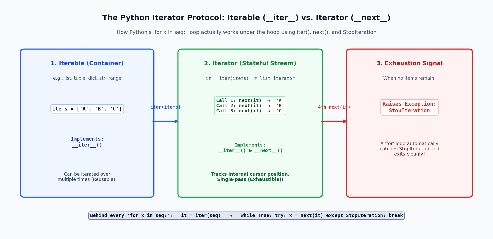
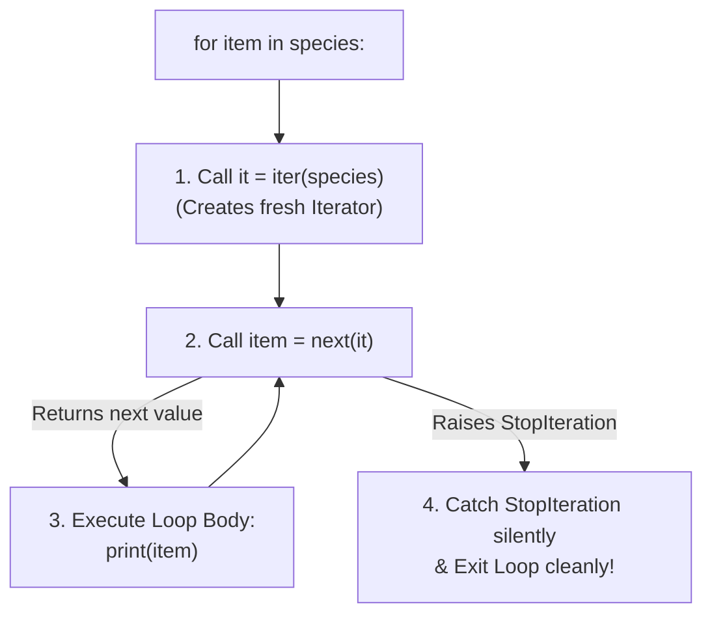

# Dependency Lesson 02.2: Iterables vs. Iterators and the Iterator Protocol (`__iter__` & `__next__`)

**අදාළ ප්‍රධාන පාඩම් (Related Core Module 3 Lessons):**
- [Lesson 3.4: Keyword Arguments, Packing (`*args`, `**kwargs`) & Unpacking](../../Module_03_Modular_and_Intermediate_Python/Lesson_3.4_Keyword_Arguments_Packing_args_kwargs_and_Unpacking.md)
- [Lesson 3.5: Anonymous `lambda` Functions & List Comprehensions](../../Module_03_Modular_and_Intermediate_Python/Lesson_3.5_Anonymous_Lambda_Functions_and_List_Comprehensions.md)

---

## 1. හැඳින්වීම: Python හි `for x in sequence:` Loop එකක් ඇතුළත සැබවින්ම සිදුවන්නේ කුමක්ද?

ඔබ Python හි `for x in [10, 20, 30]:` හෝ `[x**2 for x in range(10)]` හෝ `func(*args)` (Argument Unpacking) ලියන විට, List එකක, Tuple එකක, String එකක, Dictionary එකක හෝ File එකක ඇති අංග එකින් එක ලබා ගන්නේ කෙසේදැයි Python දන්නේ කොහොමද?

මේ සියලුම වස්තූන් පොදු නීති පද්ධතියක් අනුගමනය කරයි. එය **The Python Iterator Protocol (පුනරාවර්තක නියමාවලිය)** ලෙස හැඳින්වේ! මෙම පාඩමෙන් අපි **Iterable** එකක් සහ **Iterator** එකක් අතර ඇති තීරණාත්මක වෙනස ඉගෙන ගනිමු.



---

## 2. සැබෑ ජීවිතයේ උදාහරණයක්: පොතක් (Iterable) vs. පොත් යොමුවක් / Bookmark එකක් (Iterator)

**Iterable** සහ **Iterator** යන වචන දෙක එක වගේ පෙනුනත් ඒ දෙක සම්පූර්ණයෙන්ම වෙනස් දේවල් දෙකකි:

1. **Iterable (පොතක් වැනිය — Container / Sequence):**
   - පොතක පිටු 100ක් තිබේ. පොතට තනිවම *"මම දැන් කියවමින් සිටින්නේ කීවෙනි පිටුවද?"* කියා මතක තබා ගත නොහැක. නමුත් පොතක් කිහිප දෙනෙකුටම මුල සිට නැවත නැවත කියවිය හැක (**Reusable**).
   - Python හි `list`, `tuple`, `str`, `dict`, `set`, සහ `range` යන සියල්ලම **Iterables** වේ!
   - තාක්ෂණිකව: `__iter__()` ක්‍රමවේදය ඇති (`iter(obj)` කැඳවූ විට අලුත් Iterator එකක් ලබා දෙන) ඕනෑම වස්තුවක් **Iterable** එකකි.

2. **Iterator (පොත ඇතුළේ තබන Bookmark එකක් වැනිය — Stateful Stream):**
   - ඔබ පොත කියවීම ආරම්භ කරන විට `iter(book)` මගින් Bookmark එකක් (**Iterator**) ලබා ගනී.
   - ඔබ `next(bookmark)` කැඳවන සෑම වාරයකදීම එය වත්මන් පිටුව ලබා දී, Bookmark එක **ඊළඟ පිටුවට ඉදිරියට ගෙන යයි**!
   - අවසාන පිටුවෙන් පසුව නැවත `next()` කැඳවූ විට පොත අවසන් බව දැන්වීමට **`StopIteration`** නමැති සංඥාව (Exception) නිකුත් කරයි!
   - එක වරක් අවසානය දක්වා ගිය පසු එම Iterator එක **අවසන් වේ (Exhausted / Single-pass)** — එය ආපසු හැරවිය නොහැක!

---

## 3. `iter()`, `next()`, සහ `StopIteration` අත්හදා බැලීම

අපි සාමාන්‍ය List එකක් ගෙන `for` loop එකක් භාවිතා නොකර අතින්ම (`iter()` සහ `next()` මගින්) එහි අගයන් ලබා ගන්නා ආකාරය බලමු:

```python
# 1. 'species' යනු Iterable එකකි (List):
species = ['CH4', 'H2O', 'O2']

# 2. iter() මගින් එයින් Iterator object එකක් ලබා ගනිමු:
it = iter(species)
print("Iterator object:", it)

# 3. next() කැඳවමින් අංග එකින් එක ඉදිරියට ලබා ගනිමු:
print("1st call to next(it):", next(it))
print("2nd call to next(it):", next(it))
print("3rd call to next(it):", next(it))

# 4. දැන් අංග 3ම අවසන්! 4 වන වතාවට next(it) කැඳවුවහොත් StopIteration ලැබේ:
try:
    print(next(it))
except StopIteration:
    print("4th call raised StopIteration! The iterator is now exhausted.")
```

**Output:**
```text
Iterator object: <list_iterator object at 0x7f...>
1st call to next(it): CH4
2nd call to next(it): H2O
3rd call to next(it): O2
4th call raised StopIteration! The iterator is now exhausted.
```

---

## 4. `for` Loop එකක් අභ්‍යන්තරයේ ක්‍රියාත්මක වන සැබෑ කේතය

ඔබ Python හි පහත `for` loop එක ලියන සෑම අවස්ථාවකදීම:
```python
for item in species:
    print(item)
```

Python විසින් තිරය පිටුපසදී (Under the hood) එය පහත `while` loop එක බවට පරිවර්තනය කර ක්‍රියාත්මක කරයි:



```python
# Python හි 'for item in species:' පිටුපස ක්‍රියාත්මක වන සැබෑ යාන්ත්‍රණය:
_iterator = iter(species)
while True:
    try:
        item = next(_iterator)
    except StopIteration:
        break   # Loop එකෙන් ස්වයංක්‍රීයව ඉවත් වේ!
    
    # --- Loop Body ---
    print(item)
```

---

## 5. Single-Pass Exhaustion උගුල (`map`, `filter`, `zip` සමඟ ප්‍රවේශම් වන්න!)

[පෙර පාඩමේදී (`01_First_Class_Functions...`)](01_First_Class_Functions_Higher_Order_Functions_map_filter_sorted.md) අපි ඉගෙන ගත් `map()` සහ `filter()` මගින් ආපසු ලබා දෙන්නේ List එකක් නොව **Iterator** එකකි!

Iterator එකක් **එක වරක් පමණක් (Single-pass)** භාවිතා කළ හැකි නිසා, ඔබ එය දෙවන වරටත් Loop කිරීමට හෝ `list()` කිරීමට උත්සාහ කළහොත් එය **හිස් (`[]`)** වී තිබෙනු ඇත!

```python
nums = [1, 2, 3, 4]
squares_iter = map(lambda x: x**2, nums)   # Returns a map iterator!

# පළමු වතාවට කියවීම (Iterator එකේ අගයන් සියල්ල Consume වේ):
print("1st pass:", list(squares_iter))     # Output: [1, 4, 9, 16]

# දෙවන වතාවට එම Iterator එකම කියවීමට උත්සාහ කිරීම:
print("2nd pass:", list(squares_iter))     # Output: []  <-- හිස් ලැයිස්තුවක්!
```

---

## 🛠️ Practical Task / Hands-On Exercise (ප්‍රායෝගික අභ්‍යාසය)

### Scenario / Goal:
[Lesson 3.1](../../Module_03_Modular_and_Intermediate_Python/Lesson_3.1_Python_Modules_Import_Mechanics_and_Main.md) හි `fib.py` මොඩියුලයේ අපි Fibonacci සංඛ්‍යා ගණනය කළෙමු. දැන් අපි Python හි Iterator Protocol (`__iter__` සහ `__next__`) භාවිතා කර, `max_limit` අගයට අඩු Fibonacci සංඛ්‍යා එකින් එක ලබා දෙන `FibonacciIterator` නමින් Custom Iterator Class එකක් ගොඩනගමු (හෝ `iter()`/`next()` මගින් Manual Iteration එකක් ලියමු).

### Step-by-Step Tasks:
1. `manual_sum_even(iterable)` නමින් ශ්‍රිතයක් ලියන්න.
2. **කොන්දේසිය:** මෙම ශ්‍රිතය ඇතුළත `for` loop එකක් භාවිතා **නොකර**, `iter()`, `while True:`, `next()`, සහ `try...except StopIteration:` පමණක් භාවිතා කරමින් `iterable` එකේ ඇති ඉරට්ටේ සංඛ්‍යාවල (`val % 2 == 0`) එකතුව ගණනය කර Return කරන්න.
3. `[1, 2, 3, 5, 8, 13, 21, 34, 55, 89]` යන Fibonacci ලැයිස්තුව ලබා දී ඔබේ ශ්‍රිතය පරීක්ෂා කරන්න (`2 + 8 + 34 = 44` ලැබිය යුතුය).

### Starter Code:
```python
def manual_sum_even(iterable):
    # TODO: Use iter(), next(), and StopIteration without using a 'for' loop!
    pass

fib_sample = [1, 2, 3, 5, 8, 13, 21, 34, 55, 89]
print("Sum of even numbers:", manual_sum_even(fib_sample))
```

### Expected Output / Reference Solution:
```python
def manual_sum_even(iterable):
    it = iter(iterable)
    total = 0
    while True:
        try:
            val = next(it)
            if val % 2 == 0:
                total += val
        except StopIteration:
            break
    return total

fib_sample = [1, 2, 3, 5, 8, 13, 21, 34, 55, 89]
print("Sum of even numbers:", manual_sum_even(fib_sample))
```

**Expected Output:**
```text
Sum of even numbers: 44
```

---

## 📝 Summary & Exam Revision Cheat Sheet

| Feature | Iterable (e.g., `list`, `tuple`, `dict`, `range`) | Iterator (e.g., `list_iterator`, `map`, `filter`, Generator) |
| :--- | :--- | :--- |
| **Required Method** | `__iter__()` | `__iter__()` සහ `__next__()` යන දෙකම |
| **How to Test** | `iter(obj)` කැඳවිය හැක | `next(obj)` කෙලින්ම කැඳවිය හැක |
| **Reusability** | වාර ගණනාවක් නැවත නැවත Loop කළ හැක (Multi-pass) | එක වරක් පමණක් ගමන් කළ හැක; ඉන්පසු අවසන් වේ (Single-pass / Exhaustible) |
| **End Signal** | අලුත් Iterator එකක් සාදයි | අංග අවසන් වූ විට `StopIteration` නිකුත් කරයි |

---

**ඊළඟ Dependency පාඩම:** [03_Generator_Functions_yield_and_Generator_Expressions.md](03_Generator_Functions_yield_and_Generator_Expressions.md)  
**ආපසු ප්‍රධාන පාඩමට (Back to Main Lesson):** [Lesson 3.5: Anonymous `lambda` Functions & List Comprehensions](../../Module_03_Modular_and_Intermediate_Python/Lesson_3.5_Anonymous_Lambda_Functions_and_List_Comprehensions.md)
