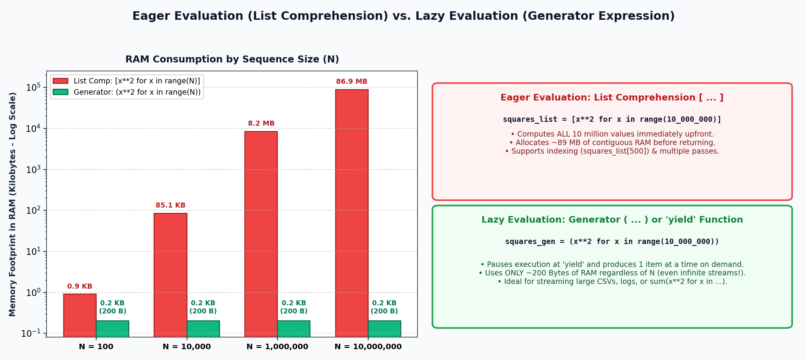
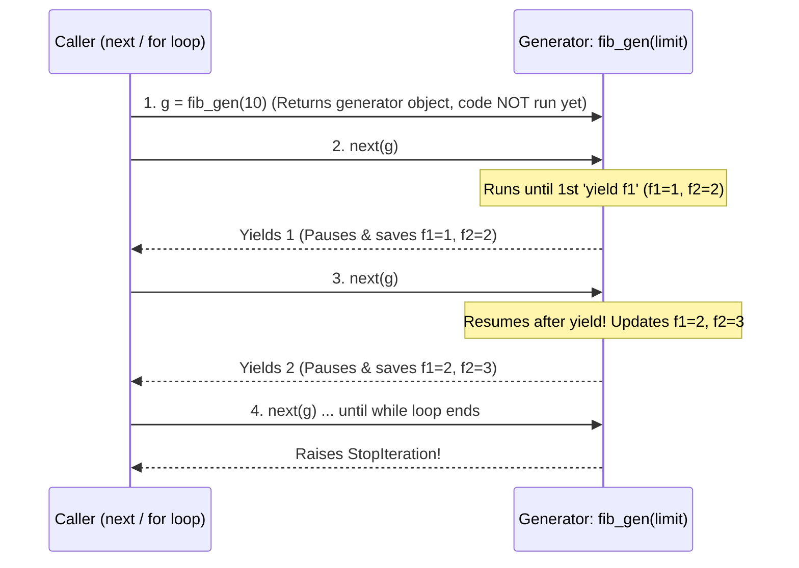

# Dependency Lesson 02.3: Generator Functions (`yield`) and Generator Expressions

**අදාළ ප්‍රධාන පාඩම් (Related Core Module 3 Lessons):**
- [Lesson 3.1: Python Modules, Import Mechanics & `__name__ == "__main__"`](../../Module_03_Modular_and_Intermediate_Python/Lesson_3.1_Python_Modules_Import_Mechanics_and_Main.md)
- [Lesson 3.5: Anonymous `lambda` Functions & List Comprehensions](../../Module_03_Modular_and_Intermediate_Python/Lesson_3.5_Anonymous_Lambda_Functions_and_List_Comprehensions.md)

---

## 1. හැඳින්වීම: ඇයි List Comprehensions වලට අමතරව Generators අවශ්‍ය වන්නේ?

[Lesson 3.5](../../Module_03_Modular_and_Intermediate_Python/Lesson_3.5_Anonymous_Lambda_Functions_and_List_Comprehensions.md) හිදී අපි List Comprehensions (`[x**2 for x in range(0, 11)]`) ඉගෙන ගනිමු. සංඛ්‍යා 10ක් හෝ 1,000ක් සඳහා List Comprehension එකක් ඉතාම වේගවත්ය.

නමුත් Data Science ව්‍යාපෘතියකදී ඔබට පේළි කෝටි 10ක් ($10^8$) සහිත දැවැන්ත Log ගොනුවක් හෝ සංඛ්‍යා පරාසයක් සැකසීමට සිදු වුවහොත් කුමක් සිදුවේද?
- ඔබ `[x**2 for x in range(100_000_000)]` ලෙස කොටු වරහන් (`[...]`) භාවිතා කර List Comprehension එකක් ලියුවහොත්, Python විසින් එම අගයන් කෝටි 10ම එකවර ගණනය කර RAM මතකයේ ගබඩා කිරීමට උත්සාහ කරයි (**Eager Evaluation**). එවිට ඔබේ පරිගණකයේ RAM මතකය ගිගාබයිට් ගණනක් පිරී ගොස් වැඩසටහන `MemoryError` එකකින් බිඳ වැටිය හැක!

මෙයට විසඳුම ලෙස Python ලබා දෙන විශ්මිත තාක්ෂණය වන්නේ **Lazy Evaluation (අවශ්‍ය මොහොතේදී පමණක් එකින් එක ගණනය කිරීම)** මත ක්‍රියා කරන **Generators** ය!



---

## 2. Generator Functions: `return` vs. `yield`

සාමාන්‍ය Function එකක සහ Generator Function එකක ඇති එකම වෙනස වන්නේ `return` වෙනුවට **`yield`** යන මූලපදය භාවිතා කිරීමයි:

- **`return` (සාමාන්‍ය ශ්‍රිතයක):** අගයක් ආපසු ලබා දී, Function එකේ Stack Frame එක සහ Local විචල්‍යයන් සියල්ලම මතකයෙන් **සම්පූර්ණයෙන්ම මකා දමා** Function එක අවසන් කරයි.
- **`yield` (Generator ශ්‍රිතයක):** අගයක් පිටතට ලබා දී, Function එකේ ක්‍රියාකාරීත්වය **එම පේළියේදීම තාවකාලිකව නතර කර තබයි (Pauses / Suspends execution while preserving local state)!** ඊළඟ වතාවේ `next()` කැඳවූ විට, මුල සිට නොව නතර කළ තැන සිටම නැවත ක්‍රියාත්මක වේ!



### `fib.py` උදාහරණය Generator Function එකක් ලෙස ලිවීම:
[Lesson 3.1](../../Module_03_Modular_and_Intermediate_Python/Lesson_3.1_Python_Modules_Import_Mechanics_and_Main.md) හි අපි දුටු Fibonacci ශ්‍රිතය `yield` භාවිතා කර Generator එකක් ලෙස ලියා බලමු:

```python
def fib_generator(max_limit):
    f1, f2 = 1, 2
    while f1 < max_limit:
        yield f1            # f1 අගය පිටතට ලබා දී මෙතැන තාවකාලිකව Pause වේ!
        f1, f2 = f2, f1 + f2

# Generator object එකක් සෑදීම:
gen = fib_generator(15)
print("Generator object:", gen)

# next() මගින් හෝ for loop එකකින් අගයන් එකින් එක ලබා ගැනීම:
print("Generated Fibonacci numbers < 15:", list(gen))
```

**Output:**
```text
Generator object: <generator object fib_generator at 0x7f...>
Generated Fibonacci numbers < 15: [1, 2, 3, 5, 8, 13]
```

---

## 3. Generator Expressions: `[...]` වෙනුවට `(...)` භාවිතය!

[Lesson 3.5](../../Module_03_Modular_and_Intermediate_Python/Lesson_3.5_Anonymous_Lambda_Functions_and_List_Comprehensions.md) හි ඉගෙන ගන්නා List Comprehension එකක කොටු වරහන් `[...]` වෙනුවට **වටකුරු වරහන් `(...)`** යෙදූ සැණින් එය **Generator Expression** එකක් බවට පත් වේ!

```python
import sys

# 1. List Comprehension [ ... ] -> Eagerly creates 1,000,000 numbers in RAM:
squares_list = [x ** 2 for x in range(1_000_000)]

# 2. Generator Expression ( ... ) -> Lazily computes 1 number at a time on demand:
squares_gen  = (x ** 2 for x in range(1_000_000))

print("Memory used by List Comprehension :", sys.getsizeof(squares_list), "Bytes (~8.4 MB)")
print("Memory used by Generator Expression:", sys.getsizeof(squares_gen),  "Bytes (~200 Bytes!)")
```

**Output:**
```text
Memory used by List Comprehension : 8448728 Bytes (~8.4 MB)
Memory used by Generator Expression: 208 Bytes (~200 Bytes!)
```

### Data Science හි `sum()`, `max()`, `min()` සමඟ Generator Expressions භාවිතය:
ඔබට සංඛ්‍යා මිලියනයක වර්ගවල එකතුව (`sum`) සෙවීමට අවශ්‍ය යැයි සිතන්න. එවිට අතරමැදි List එකක් සාදා මතකය නාස්ති කිරීමට අවශ්‍යම නැත! `sum()` ඇතුළත කෙලින්ම Generator Expression එකක් ලබා දිය හැක:

```python
# fib.py හි even_fib(4000000) ගැටලුව Generator එකකින් තනි පේළියෙන් විසඳීම!
total_even_fib = sum(x for x in fib_generator(4000000) if x % 2 == 0)
print("Even Fibonacci sum (< 4,000,000):", total_even_fib)
# Output: 4613732
```

---

## 🛠️ Practical Task / Hands-On Exercise (ප්‍රායෝගික අභ්‍යාසය)

### Scenario / Goal:
ඔබ IoT Sensor එකකින් ලැබෙන උෂ්ණත්ව දත්ත ප්‍රවාහයක් (Data Stream) සැකසීමට මතකය ඉතිරි කරන (Memory-efficient) Generator Pipeline එකක් නිර්මාණය කළ යුතුය.

### Step-by-Step Tasks:
1. `sensor_stream(n)` නමින් Generator function එකක් (`yield` භාවිතා කර) ලියන්න. එය `i = 1` සිට `n` දක්වා `20.0 + (i % 15)` යන සූත්‍රයෙන් උෂ්ණත්ව අගයන් (Celsius) එකින් එක `yield` කළ යුතුය.
2. Generator Expression එකක් මගින් `sensor_stream(100000)` හි ඇති `30.0°C` ට වැඩි (`temp > 30.0`) උෂ්ණත්ව අගයන් පමණක් තෝරා ගෙන ඒවා Fahrenheit බවට (`temp * 1.8 + 32`) හරවන `high_temps_f` නමැති Generator Expression එක සාදන්න.
3. `sys.getsizeof(high_temps_f)` මගින් එම අගයන් 100,000 සැකසීමට වැය වන RAM මතකය Bytes කීයදැයි පරීක්ෂා කරන්න.
4. `next(high_temps_f)` තුන් වරක් කැඳවා පළමු අධික උෂ්ණත්ව අගයන් 3 මුද්‍රණය කරන්න.

### Starter Code:
```python
import sys

def sensor_stream(n):
    # TODO: Yield 20.0 + (i % 15) for i in range(1, n + 1)
    pass

# TODO: Create Generator Expression high_temps_f for temp > 30.0 converted to Fahrenheit
```

### Expected Output / Reference Solution:
```python
import sys

def sensor_stream(n):
    for i in range(1, n + 1):
        yield 20.0 + (i % 15)

# Generator expression pipeline (Zero intermediate lists in RAM!):
high_temps_f = (temp * 1.8 + 32 for temp in sensor_stream(100_000) if temp > 30.0)

print("Generator Pipeline Memory Size:", sys.getsizeof(high_temps_f), "Bytes")
print("1st High Temp (F):", next(high_temps_f))
print("2nd High Temp (F):", next(high_temps_f))
print("3rd High Temp (F):", next(high_temps_f))
```

**Expected Output:**
```text
Generator Pipeline Memory Size: 208 Bytes
1st High Temp (F): 87.8
2nd High Temp (F): 89.6
3rd High Temp (F): 91.4
```

---

## 📝 Summary & Exam Revision Cheat Sheet

| Feature | List Comprehension `[expr for x in seq]` | Generator Expression `(expr for x in seq)` |
| :--- | :--- | :--- |
| **Syntax** | Square brackets `[ ... ]` | Parentheses `( ... )` |
| **Evaluation Strategy** | **Eager Evaluation** (සියලුම අගයන් එකවර ගණනය කරයි) | **Lazy Evaluation** (`next()` ඉල්ලන විට එකින් එක ගණනය කරයි) |
| **Memory Footprint** | $O(N)$ — අංග ගණන සමඟ RAM භාවිතය ඉහළ යයි | $O(1)$ — අංග කෝටි ගණනක් වුවද ~200 Bytes පමණක් ගනී! |
| **Indexing & Reuse** | `lst[0]`, `len(lst)` සහ නැවත නැවත Loop කළ හැක | Indexing නැත; එක වරක් පමණක් Consume කළ හැක (Single-pass Iterator) |

---

**ආපසු ප්‍රධාන පාඩම්වලට (Back to Core Module 3 Lessons):**
- [Lesson 3.1: Python Modules, Import Mechanics & `__name__ == "__main__"`](../../Module_03_Modular_and_Intermediate_Python/Lesson_3.1_Python_Modules_Import_Mechanics_and_Main.md)
- [Lesson 3.5: Anonymous `lambda` Functions & List Comprehensions](../../Module_03_Modular_and_Intermediate_Python/Lesson_3.5_Anonymous_Lambda_Functions_and_List_Comprehensions.md)
