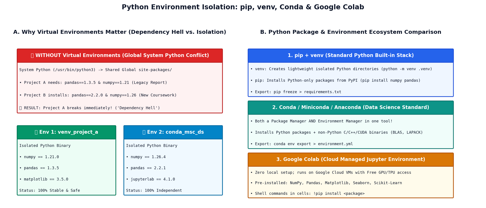
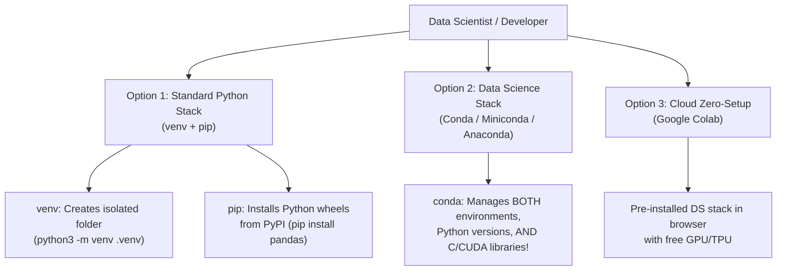

# Dependency Lesson 02.1: Python Virtual Environments, `pip`, `venv` සහ `Conda` (Zero-to-Hero Setup Guide)

> [!TIP]
> **🔗 Back to Core Module 1 Lessons:** මෙම පාඩම අධ්‍යයනය කිරීමෙන් පසු නැවත ප්‍රධාන පාඩම් වෙත යාමට පහත සබැඳි භාවිතා කරන්න:
> - [Lesson 1.1: Module Overview, Expectations & Assessment Structure](../../Module_01_Course_Orientation_and_Data_Science_Landscape/Lesson_1.1_Module_Overview_Expectations_and_Assessment.md)
> - [Lesson 1.5: Tools for Data Science — Python vs. R vs. SAS](../../Module_01_Course_Orientation_and_Data_Science_Landscape/Lesson_1.5_Tools_for_Data_Science_Python_vs_R_vs_SAS.md)

---

## 1. හැඳින්වීම: "Dependency Hell" යනු කුමක්ද සහ Virtual Environments අවශ්‍ය වන්නේ ඇයි?

Lesson 1.5 (Slide 45) හිදී අපි Python භාෂාවේ ප්‍රධාන අවාසියක් ලෙස **"Decentralized with packages"** (පැකේජ විවිධ කණ්ඩායම් විසින් වෙන වෙනම නඩත්තු කිරීම) හඳුනා ගත්තෙමු. මෙයින් ප්‍රායෝගිකව ඇතිවන ගැටලුව කුමක්දැයි සරල උදාහරණයකින් බලමු:

1. ඔබ 2023 වසරේදී පාරිභෝගික විශ්ලේෂණ ව්‍යාපෘතියක් (**Project A**) සිදු කළා යැයි සිතන්න. ඒ සඳහා ඔබ පරිගණකයේ ප්‍රධාන Python පද්ධතියට (`Global System Python`) `pandas==1.3.5` සහ `numpy==1.21.0` ස්ථාපනය කළේය.
2. මාස කිහිපයකට පසු ඔබ MSc පාඨමාලාවේ නව ව්‍යාපෘතියක් (**Project B**) ආරම්භ කරන අතර, එයට අලුත්ම `pandas==2.2.1` සහ `numpy==1.26.4` අවශ්‍ය වේ.
3. ඔබ Global Python තුළම `pip install --upgrade pandas numpy` ලෙස ධාවනය කළ විගස, පැරණි `pandas 1.3.5` මැකී ගොස් අලුත් Version එක ස්ථාපනය වේ.
4. දැන් ඔබ නැවත **Project A** ක්‍රියාත්මක කිරීමට ගිය විට, පැරණි Functions (උදා: `df.append()`) අලුත් Pandas වලින් ඉවත් කර ඇති නිසා **Project A සම්පූර්ණයෙන්ම බිඳ වැටේ (Crash වේ)!**

මෙලෙස විවිධ ව්‍යාපෘතිවලට අවශ්‍ය පැකේජ සංස්කරණ (Package Versions) එකිනෙක ගැටීම මෘදුකාංග ලෝකයේ **"Dependency Hell"** ලෙස හැඳින්වේ.



### විසඳුම: Virtual Environments (හුදකලා කළ පරිසරයන්)
**Virtual Environment** එකක් යනු එක් එක් ව්‍යාපෘතිය සඳහා ඔබේ පරිගණකය තුළ සාදන **වෙනමම හුදකලා කළ කාමරයකි (Isolated Sandbox/Folder)**.
* **Project A** කාමරය තුළ `pandas 1.3.5` තබා ගත හැක.
* **Project B** කාමරය තුළ `pandas 2.2.1` තබා ගත හැක.
* මේ කාමර දෙක කිසිවිටෙකත් එකිනෙක ගැටෙන්නේ නැත!

---

## 2. `pip` + `venv` vs. `Conda` (Anaconda / Miniconda)

Python ලෝකයේ පැකේජ සහ Virtual Environments කළමනාකරණය කිරීමට ප්‍රධාන මෙවලම් පවුල් 2ක් භාවිතා වේ:



| ලක්ෂණය (Feature) | `pip` + `venv` (Standard Python) | `Conda` / `Miniconda` / `Anaconda` |
| :--- | :--- | :--- |
| **මූලික කාර්යය** | `venv` මගින් Environment එක සාදන අතර, `pip` මගින් **PyPI (Python Package Index)** වෙතින් Python පැකේජ ස්ථාපනය කරයි. | **Environment Manager** සහ **Package Manager** යන දෙකම එකම මෙවලමක් (`conda`) මගින් සිදු කරයි. |
| **Python නොවන Dependencies** | හුදෙක් Python පැකේජ පමණක් කළමනාකරණය කරයි. | Python පැකේජ පමණක් නොව, Data Science/Deep Learning වලට අවශ්‍ය **C, C++, Fortran, MKL, BLAS, CUDA (GPU)** වැනි Binary libraries ද ස්වයංක්‍රීයව ස්ථාපනය කරයි! |
| **Python Version මාරු කිරීම** | පරිගණකයේ දැනට ස්ථාපනය කර ඇති Python version එක මත රඳා පවතී. | ඕනෑම Python version එකක් (උදා: `python=3.10` හෝ `python=3.11`) එක විධානයකින් ස්ථාපනය කළ හැක. |
| **Anaconda vs. Miniconda** | Python සමඟම Built-in ලැබේ (අමතරව බාගත කළ යුතු නැත). | **Anaconda:** පැකේජ 250+ ක් (`NumPy`, `Pandas`, `Jupyter`, `Scikit-Learn`) පෙර-ස්ථාපනය කළ විශාල (~3GB) පැකේජයකි.<br/>**Miniconda:** `conda` සහ `Python` පමණක් අඩංගු සැහැල්ලු (~100MB) සංස්කරණයයි. |

---

## 3. අත්‍යවශ්‍ය Command Line Cheat Sheet (`venv`/`pip` සහ `conda`)

### 3.1 `venv` සහ `pip` භාවිතා කරන පියවර:
```bash
# 1. අලුත් Virtual Environment එකක් සෑදීම (.venv නමින් ෆෝල්ඩරයක් සෑදේ)
python3 -m venv .venv

# 2. Environment එක සක්‍රීය කිරීම (Activate)
source .venv/bin/activate        # Linux / macOS සඳහා
# .venv\Scripts\activate         # Windows (Command Prompt) සඳහා

# 3. Data Science පැකේජ ස්ථාපනය කිරීම
pip install numpy pandas matplotlib seaborn scipy jupyterlab

# 4. දැනට ස්ථාපනය කර ඇති සියලුම පැකේජ සහ ඒවායේ exact versions ගොනුවකට සුරැකීම (Reproducibility සඳහා!)
pip freeze > requirements.txt

# 5. වෙනත් පරිගණකයකදී එම requirements.txt ගොනුවෙන්ම පැකේජ ස්ථාපනය කිරීම
pip install -r requirements.txt

# 6. Environment එකෙන් ඉවත් වීම
deactivate
```

### 3.2 `conda` භාවිතා කරන පියවර:
```bash
# 1. Python 3.11 සහිත අලුත් Conda Environment එකක් සෑදීම
conda create -n msc_ds python=3.11 -y

# 2. එය සක්‍රීය කිරීම
conda activate msc_ds

# 3. පැකේජ ස්ථාපනය කිරීම
conda install numpy pandas matplotlib seaborn scipy jupyterlab -y

# 4. Environment එක Export කිරීම
conda env export > environment.yml
```

---

## 4. Google Colab — Cloud මත ක්‍රියාත්මක වන Jupyter පරිසරය

Lesson 1.1 (Slide 4) හි සඳහන් වන **Google Colab (Collaboratory)** යනු ඔබේ පරිගණකයේ කිසිවක් ස්ථාපනය නොකර, Google සමාගමේ Cloud Servers මත Web Browser එක හරහා නොමිලේ භාවිතා කළ හැකි Jupyter Notebook පරිසරයකි.
* **ප්‍රධාන වාසි:**
  1. `NumPy`, `Pandas`, `Matplotlib`, `Seaborn`, `SciPy`, `Scikit-Learn`, `TensorFlow`, `PyTorch` යන සියල්ල පෙර-ස්ථාපනය (Pre-installed) කර ඇත.
  2. නොමිලේ **GPU / TPU** පහසුකම් ලබා ගත හැක.
  3. Google Drive සමඟ කෙලින්ම සම්බන්ධ කර ගොනු කියවීමට සහ සගයන් සමඟ Google Docs මෙන් Share කර එකවර වැඩ කිරීමට හැකිය.

---

## 🛠️ Practical Task / Hands-On Exercise (ප්‍රායෝගික අභ්‍යාසය)

### Scenario / Goal:
ඔබේ CI7340 Practical Project (ලකුණු 50%) භාර දීමේදී, කථිකාචාර්යවරයාගේ පරිගණකයේදීත් ඔබේ කේතය කිසිදු Version ගැටලුවකින් තොරව ධාවනය වන බව තහවුරු කිරීමට **Environment Audit & `requirements.txt` Generator** Python script එකක් ලිවිය යුතුය.

### Step-by-Step Tasks:
1. Python හි `sys` සහ `importlib.metadata` (හෝ පැකේජවල `__version__` attribute එක) භාවිතා කර දැනට ක්‍රියාත්මක වන Python Interpreter එකේ Path එක සහ Version එක පරීක්ෂා කරන්න.
2. `numpy`, `pandas`, `matplotlib`, සහ `scipy` යන පැකේජ 4 ස්ථාපනය වී තිබේදැයි පරීක්ෂා කර ඒවායේ නිශ්චිත Versions ලබා ගන්න.
3. එම Versions `requirements.txt` ආකෘතියෙන් (`package==version`) මුද්‍රණය කරන්න.

### Starter Code & Reference Solution:
```python
import sys
import importlib

required_packages = ["numpy", "pandas", "matplotlib", "scipy"]

print(f"Python Executable : {sys.executable}")
print(f"Python Version    : {sys.version.split()[0]}\n")

requirements_lines = []
for pkg_name in required_packages:
    try:
        module = importlib.import_module(pkg_name)
        version = getattr(module, "__version__", "unknown")
        requirements_lines.append(f"{pkg_name}=={version}")
    except ImportError:
        requirements_lines.append(f"# {pkg_name} is NOT installed!")

print("--- Generated requirements.txt Content ---")
print("\n".join(requirements_lines))
```

**Expected Output (Example):**
```text
Python Executable : /usr/bin/python3
Python Version    : 3.11.2

--- Generated requirements.txt Content ---
numpy==1.26.4
pandas==2.2.1
matplotlib==3.8.3
scipy==1.12.0
```

---

## 📝 Summary & Exam Revision Cheat Sheet

| Tool / File | Purpose in Data Science |
| :--- | :--- |
| **Virtual Environment** | විවිධ ව්‍යාපෘතිවල පැකේජ Versions එකිනෙක ගැටීම ("Dependency Hell") වළක්වන හුදකලා පරිසරයකි. |
| **`pip`** | Python Package Index (PyPI) වෙතින් Python පැකේජ ස්ථාපනය කරන සම්මත මෙවලම. |
| **`venv`** | Python සමඟ Built-in ලැබෙන සැහැල්ලු Virtual Environment නිර්මාණකාරකය. |
| **`conda`** | Python පැකේජ මෙන්ම C/C++/CUDA libraries සහ Python versions කළමනාකරණය කරන Data Science මෙවලම. |
| **`requirements.txt`** | ව්‍යාපෘතියකට අවශ්‍ය පැකේජ සහ ඒවායේ exact versions ලැයිස්තුගත කරන ගොනුව (`pip freeze > requirements.txt`). |

---

**Next Dependency Lesson:** [02_Jupyter_Notebook_Architecture_Kernels_and_Shortcuts.md](02_Jupyter_Notebook_Architecture_Kernels_and_Shortcuts.md) | **Back to Core Lesson:** [Lesson 1.5](../../Module_01_Course_Orientation_and_Data_Science_Landscape/Lesson_1.5_Tools_for_Data_Science_Python_vs_R_vs_SAS.md)
