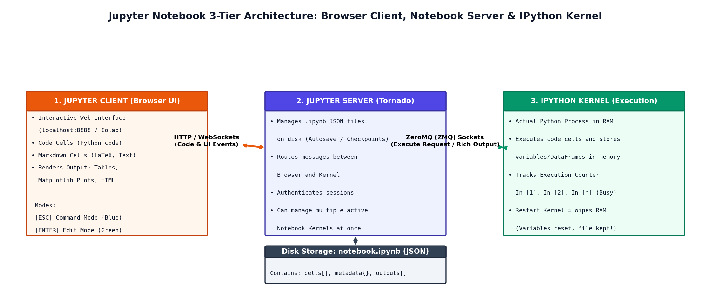
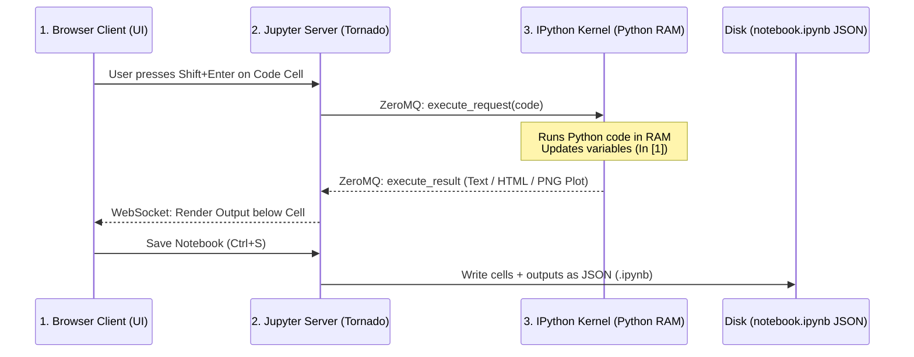

# Dependency Lesson 02.2: Jupyter Notebook Architecture, IPython Kernels සහ Keyboard Shortcuts (Zero-to-Hero)

> [!TIP]
> **🔗 Back to Core Module 1 Lessons:**
> - [Previous Dependency Lesson: 01_Python_Environments_Pip_Conda_and_Virtualenv.md](01_Python_Environments_Pip_Conda_and_Virtualenv.md)
> - [Core Lesson 1.1: Module Overview, Expectations & Assessment Structure](../../Module_01_Course_Orientation_and_Data_Science_Landscape/Lesson_1.1_Module_Overview_Expectations_and_Assessment.md)
> - [Core Lesson 1.5: Tools for Data Science — Python vs. R vs. SAS](../../Module_01_Course_Orientation_and_Data_Science_Landscape/Lesson_1.5_Tools_for_Data_Science_Python_vs_R_vs_SAS.md)

---

## 1. හැඳින්වීම: සාමාන්‍ය `.py` Script එකක් වෙනුවට Data Scientists ලා Jupyter Notebook (`.ipynb`) භාවිතා කරන්නේ ඇයි?

සාම්ප්‍රදායික Software Engineer කෙනෙකු කේත ලියන්නේ `.py` ගොනුවක (Script) ය. ඔබ පේළි 100ක `.py` ගොනුවක් ධාවනය කරන විට (`python script.py`), සෑම වතාවකම 1 වන පේළියේ සිට 100 වන පේළිය දක්වා මුල සිට ක්‍රියාත්මක වී අවසානයේ RAM එකෙන් සියලුම දත්ත මැකී යයි.

නමුත් Data Science වලදී මෙය විශාල ගැටලුවකි! ඇයි?
* සිතන්න ඔබ ගිගාබයිට් 2ක (`2 GB`) විශාල CSV දත්ත ගොනුවක් Load කරනවා කියා. එය කියවීමට තත්පර 45ක් ගත වේ.
* දැන් ඔබට එහි ප්‍රස්තාරයක වර්ණය හෝ ශීර්ෂය (Title) වෙනස් කර බැලීමට අවශ්‍ය වේ. සාමාන්‍ය `.py` script එකක නම්, එම පුංචි වෙනස්කම බැලීමට නැවතත් තත්පර 45ක් බලාගෙන සිට මුල සිටම 2 GB ගොනුව Load කළ යුතුය!

මෙම ගැටලුව විසඳීමට **Fernando Pérez** විසින් **IPython (Interactive Python)** සහ පසුව **Project Jupyter** නිර්මාණය කරන ලදී (*"**Ju**lia + **Pyt**hon + **R**"* යන භාෂා තුනේම මුල් අකුරු එක් කර **Jupyter** යන නම සෑදී ඇත).

**Jupyter Notebook එකක ඇති සුවිශේෂී වාසිය:**
1. ඔබේ කේතය කුඩා කොටු (**Cells**) වලට බෙදා ඇත.
2. පළමු Cell එකේදී 2 GB දත්ත ගොනුව Load කළ පසු, එය පසුබිමේ ක්‍රියාත්මක වන **Kernel** එකේ RAM එක තුළ දිගටම රැඳී පවතී!
3. දැන් ඔබට දත්ත නැවත Load නොකර, ඊළඟ Cells වලදී තත්පරයෙන් පංගුවකදී ප්‍රස්තාර අඳිමින්, සංඛ්‍යානමය ගණනය කිරීම් කරමින් සහ ඒ අතරටම පැහැදිලි කිරීම් (**Markdown Text & Formulas**) ලියමින් අන්තර්ක්‍රියාකාරීව (**Interactive Exploratory Data Analysis**) වැඩ කළ හැක!

---

## 2. Jupyter Notebook හි අභ්‍යන්තර 3-Tier Architecture එක

බොහෝ දෙනා සිතන්නේ Jupyter Notebook යනු හුදෙක් Web Browser එකක් තුළ දුවන වෙබ් අඩවියක් කියාය. නමුත් සැබවින්ම එය ප්‍රධාන කොටස් 3කින් සමන්විත Client-Server පද්ධතියකි:





1. **Jupyter Client (Web Browser UI):** ඔබ දකින අතුරුමුහුණතයි (`http://localhost:8888`). ඔබ කේත ලියන්නේ සහ ප්‍රස්තාර දකින්නේ මෙහිදීය.
2. **Jupyter Notebook Server:** ඔබේ Hard Disk එකේ ඇති `.ipynb` ගොනු කියවීම, සුරැකීම (Saving) සහ Browser එකත් Kernel එකත් අතර පණිවිඩ හුවමාරු කිරීම (HTTP, WebSockets සහ ZeroMQ හරහා) සිදු කරයි.
3. **IPython Kernel (Execution Engine):** සැබවින්ම ඔබේ Python කේත ක්‍රියාත්මක කරන සහ සියලුම Variables හා DataFrames තම **RAM (Memory)** එකේ තබා ගන්නා Python ක්‍රියාවලියයි (Process).
   * **වැදගත්:** ඔබ **"Restart Kernel"** කළ විට සිදුවන්නේ මෙම Kernel ක්‍රියාවලියේ RAM එක හිස් වී නැවත මුල සිට ආරම්භ වීමයි (ඔබ ලියූ කේත කිසිවක් මැකෙන්නේ නැත, නමුත් RAM එකේ තිබූ Variables මැකෙන නිසා Cells නැවත Run කළ යුතුය).

---

## 3. `.ipynb` ගොනුවක සැබෑ ස්වභාවය සහ Execution Counters (`In [1]`, `In [*]`)

### 3.1 `.ipynb` යනු JSON ගොනුවකි!
ඔබේ `.ipynb` ගොනුවක් සාමාන්‍ය Text Editor එකකින් විවෘත කර බැලුවහොත්, එය සරල Python ගොනුවක් නොව **JSON (JavaScript Object Notation)** ආකෘතියෙන් ලියැවුණු ව්‍යුහගත ගොනුවක් බව පෙනෙනු ඇත. එහි:
* `cells`: ඔබ ලියූ සියලුම `code` සහ `markdown` කොටු ලැයිස්තුව,
* `outputs`: එක් එක් Cell එකෙන් ලැබුණු ප්‍රතිඵල සහ ප්‍රස්තාර (Base64 encoded PNGs ලෙස),
* `metadata`: භාවිතා කළ Python Kernel එක පිළිබඳ විස්තර අඩංගු වේ.

### 3.2 Execution Prompt (`In [ ]`) තේරුම් ගැනීම:
සෑම Code Cell එකක් ඉදිරියෙන්ම ඇති වරහන තුළ පෙන්වන සලකුණෙන් එහි තත්ත්වය දැනගත හැක:
* **`In [ ]` (හිස්):** මෙම Cell එක තවම එක් වරක්වත් ධාවනය (Run) කර නැත.
* **`In [*]` (තරු ලකුණ):** මෙම Cell එක **මේ මොහොතේ ක්‍රියාත්මක වෙමින් පවතී (Kernel is Busy)**. විශාල ගණනය කිරීමක් හෝ Infinite Loop එකක් සිරවී ඇත්නම් `In [*]` ලෙසම පවතින අතර, එවිට **Interrupt Kernel (`I, I`)** මගින් එය නැවැත්විය හැක.
* **`In [1]`, `In [2]`, `In [3]`:** Kernel එක ආරම්භ වූ මොහොතේ සිට එම Cell එක ක්‍රියාත්මක වූ අනුපිළිවෙළ (Execution order) පෙන්වයි.

---

## 4. Command Mode vs. Edit Mode සහ වේගවත් Keyboard Shortcuts

Jupyter Notebook තුළ Mouse එක භාවිතා නොකර ඉතා වේගයෙන් වැඩ කිරීමට ප්‍රධාන Modes 2ක් ඇත:

1. **Edit Mode (කොළ පාට / ඇතුළත කර්සරය ඇත - Press `Enter`):** Cell එකක් ඇතුළත කේත හෝ අකුරු ටයිප් කරන අවස්ථාවයි.
2. **Command Mode (නිල් පාට / පිටත රාමුව තේරී ඇත - Press `Esc`):** සමස්ත Notebook එකේ Cells එකතු කිරීමට, මැකීමට හෝ වර්ගය වෙනස් කිරීමට භාවිතා කරන අවස්ථාවයි.

| Keyboard Shortcut | Mode | සිදුවන කාර්යය (Action) |
| :--- | :---: | :--- |
| **`Shift + Enter`** | Both | වත්මන් Cell එක **Run** කර ඊළඟ Cell එක වෙත යයි (වැඩියෙන්ම භාවිතා වන Shortcut එක!). |
| **`Ctrl + Enter`** | Both | වත්මන් Cell එක **Run** කර එම Cell එක තුළම රැඳී සිටියි. |
| **`Alt + Enter`** | Both | වත්මන් Cell එක **Run** කර ඊට පහළින් අලුත් Cell එකක් ඇතුළත් කරයි. |
| **`Esc`** | Edit $\rightarrow$ Command | Edit Mode එකෙන් ඉවත් වී Command Mode වෙත මාරු වේ. |
| **`Enter`** | Command $\rightarrow$ Edit | තෝරාගත් Cell එක ඇතුළත ටයිප් කිරීමට Edit Mode වෙත මාරු වේ. |
| **`A`** | Command | වත්මන් Cell එකට **ඉහළින් (Above)** අලුත් Cell එකක් එක් කරයි. |
| **`B`** | Command | වත්මන් Cell එකට **පහළින් (Below)** අලුත් Cell එකක් එක් කරයි. |
| **`M`** | Command | තෝරාගත් Cell එක **Markdown Cell** එකක් බවට පත් කරයි. |
| **`Y`** | Command | තෝරාගත් Cell එක **Code Cell** එකක් බවට පත් කරයි. |
| **`D, D`** (`D` දෙවරක්) | Command | තෝරාගත් Cell එක **Delete (මකා දැමීම)** කරයි. |
| **`Z`** | Command | මකා දැමූ Cell එකක් නැවත ලබා ගනී (Undo cell deletion). |
| **`Tab` / `Shift + Tab`** | Edit | `Tab`: Auto-complete කරයි / `Shift + Tab`: Function එකක **Docstring (Help)** පෙන්වයි! |

---

## 🛠️ Practical Task / Hands-On Exercise (ප්‍රායෝගික අභ්‍යාසය)

### Scenario / Goal:
ඔබට `.ipynb` ගොනුවක් JSON ගොනුවක් ලෙස Python මගින්ම පරීක්ෂා කර (Parse කර), එහි ඇති මුළු Cells ගණන, Code Cells ගණන, Markdown Cells ගණන සහ ක්‍රියාත්මක නොකළ (`execution_count is None`) Code Cells තිබේදැයි ස්වයංක්‍රීයව පරීක්ෂා කරන **Notebook Inspector** කේතයක් ලිවීමට පැවරී ඇත.

### Step-by-Step Tasks:
1. පහත දී ඇති Sample `.ipynb` JSON ව්‍යුහය Python `json` module එකෙන් කියවන්න.
2. එහි ඇති `cells` ලැයිස්තුව හරහා Loop කරමින් `markdown` සහ `code` cells ගණන වෙන වෙනම ගණනය කරන්න.
3. Code cells අතරින් `execution_count` අගය `None` වන (තවම Run කර නොමැති) හෝ අනුපිළිවෙළ වැරදි Cells හඳුනාගෙන වාර්තාවක් මුද්‍රණය කරන්න.

### Starter Code & Reference Solution:
```python
import json

# Sample structure of an actual .ipynb file on disk
sample_ipynb_json = """
{
  "cells": [
    {"cell_type": "markdown", "metadata": {}, "source": ["# EDA Report"]},
    {"cell_type": "code", "execution_count": 1, "metadata": {}, "outputs": [], "source": ["import pandas as pd"]},
    {"cell_type": "code", "execution_count": 3, "metadata": {}, "outputs": [], "source": ["df = pd.read_csv('data.csv')"]},
    {"cell_type": "code", "execution_count": null, "metadata": {}, "outputs": [], "source": ["print(df.head())"]}
  ],
  "metadata": {"kernelspec": {"display_name": "Python 3", "language": "python", "name": "python3"}},
  "nbformat": 4,
  "nbformat_minor": 5
}
"""

nb_data = json.loads(sample_ipynb_json)
cells = nb_data["cells"]

md_count = sum(1 for c in cells if c["cell_type"] == "markdown")
code_cells = [c for c in cells if c["cell_type"] == "code"]
unexecuted = [c["source"][0] for c in code_cells if c["execution_count"] is None]
exec_order = [c["execution_count"] for c in code_cells if c["execution_count"] is not None]

print(f"Total Cells          : {len(cells)}")
print(f"Markdown Cells       : {md_count}")
print(f"Code Cells           : {len(code_cells)}")
print(f"Execution Order      : {exec_order}")
print(f"Unexecuted Code Cells: {unexecuted}")
```

**Expected Output:**
```text
Total Cells          : 4
Markdown Cells       : 1
Code Cells           : 3
Execution Order      : [1, 3]
Unexecuted Code Cells: ['print(df.head())']
```

---

## 📝 Summary & Exam Revision Cheat Sheet

| Component / Shortcut | Key Point |
| :--- | :--- |
| **IPython Kernel** | පසුබිමේ ක්‍රියාත්මක වෙමින් Variables සහ DataFrames RAM එකේ තබා ගන්නා Python ක්‍රියාවලියයි. |
| **`.ipynb` Format** | Code, Markdown, Outputs (Plots/Tables) සහ Metadata එකට ගබඩා කරන **JSON** ගොනුවකි. |
| **`In [*]`** | Kernel එක මේ මොහොතේ කාර්යබහුල බව (Cell එක තවම ධාවනය වන බව) පෙන්වයි. |
| **`Shift + Enter`** | Cell එක Run කර ඊළඟ Cell එකට යයි. |
| **`Esc` $\rightarrow$ `A` / `B` / `M` / `Y` / `DD`** | Command Mode හිදී ඉහළින්/පහළින් Cell එකතු කිරීම, Markdown/Code වලට හැරවීම සහ මැකීම. |

---

**Next Dependency Lesson:** [03_Markdown_Magic_Commands_and_Reproducible_DS_Workflows.md](03_Markdown_Magic_Commands_and_Reproducible_DS_Workflows.md) | **Back to Core Lesson:** [Lesson 1.1](../../Module_01_Course_Orientation_and_Data_Science_Landscape/Lesson_1.1_Module_Overview_Expectations_and_Assessment.md)
