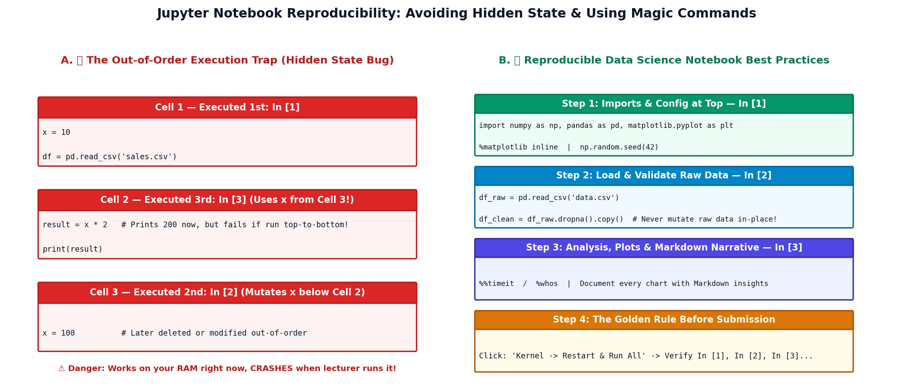

# Dependency Lesson 02.3: Markdown, LaTeX Equations, IPython Magic Commands සහ Reproducible Workflows

> [!TIP]
> **🔗 Back to Core Module 1 Lessons:**
> - [Previous Dependency Lesson: 02_Jupyter_Notebook_Architecture_Kernels_and_Shortcuts.md](02_Jupyter_Notebook_Architecture_Kernels_and_Shortcuts.md)
> - [Core Lesson 1.1: Module Overview, Expectations & Assessment Structure](../../Module_01_Course_Orientation_and_Data_Science_Landscape/Lesson_1.1_Module_Overview_Expectations_and_Assessment.md)
> - [Core Lesson 1.5: Tools for Data Science — Python vs. R vs. SAS](../../Module_01_Course_Orientation_and_Data_Science_Landscape/Lesson_1.5_Tools_for_Data_Science_Python_vs_R_vs_SAS.md)
> - [Core Lesson 1.8: Feature Extraction, Modeling, Communication, Deployment & Iteration](../../Module_01_Course_Orientation_and_Data_Science_Landscape/Lesson_1.8_Feature_Extraction_Modeling_Communication_and_Deployment.md)

---

## 1. හැඳින්වීම: Literate Programming සහ විද්‍යාත්මක වාර්තාකරණය

Lesson 1.1 හි ඔබ ඉගෙන ගත් පරිදි CI7340 විෂයයේ ලකුණු **40%ක් Research and Analysis Report** එකටත්, **50%ක් Practical Project** එකටත් හිමි වේ. Data Scientist කෙනෙකුගේ Jupyter Notebook එකක් යනු හුදෙක් කේත ගොඩක් පමණක් නොවේ; එය කේතය (Code), ප්‍රස්තාර (Visualizations), ගණිතමය සූත්‍ර (Mathematical Equations) සහ ඒවායේ විද්‍යාත්මක විග්‍රහය (Narrative Text) එකට බැඳුණු **Literate Programming** ලේඛනයකි.

මෙම පාඩමෙන් අපි:
1. Markdown සහ $\LaTeX$ මගින් ගණිතමය හා සංඛ්‍යානමය සූත්‍ර ලිවීම,
2. IPython **Magic Commands** (`%` සහ `%%`) හා Shell Commands (`!`) භාවිතය,
3. සහ Notebook වලදී බහුලවම සිදුවන **"Hidden State / Out-of-Order Execution Trap"** එක වළක්වා **100% Reproducible Workflow** එකක් පවත්වා ගන්නා ආකාරය ඉගෙන ගනිමු.

---

## 2. Markdown Cells සහ $\LaTeX$ ගණිතමය සූත්‍ර ලිවීම

Jupyter Notebook එකක Cell එකක් Command Mode (`Esc`) හිදී `M` එබීමෙන් **Markdown Cell** එකක් බවට පත් කළ හැක. එහිදී ප්‍රධාන සංඛ්‍යානමය සංකල්ප සහ සූත්‍ර ලිවීමට $\LaTeX$ (`$ ... $` හෝ `$$ ... $$`) භාවිතා කරන ආකාරය බලමු:

| ඔබට ලිවීමට අවශ්‍ය අංගය | Markdown / $\LaTeX$ Syntax | ලැබෙන පෙනුම / තේරුම |
| :--- | :--- | :--- |
| **ප්‍රධාන සහ උප මාතෘකා** | `# Heading 1`<br/>`## Heading 2` | ප්‍රධාන මාතෘකා සහ උප-කොටස් වෙන් කිරීම. |
| **Inline Math (පේළියක් මැද සූත්‍ර)** | `$\mu = \frac{1}{N}\sum_{i=1}^{N} x_i$` | **Arithmetic Mean (සමාන්තර මධ්‍යන්‍යය):** $\mu = \frac{1}{N}\sum_{i=1}^{N} x_i$ |
| **Block Math (වෙනම පේළියක සූත්‍ර)** | `$$\sigma = \sqrt{\frac{1}{N}\sum_{i=1}^{N}(x_i - \mu)^2}$$` | **Standard Deviation (සම්මත අපගමනය):** $$\sigma = \sqrt{\frac{1}{N}\sum_{i=1}^{N}(x_i - \mu)^2}$$ |
| **Z-Score සූත්‍රය** | `$$Z = \frac{x - \mu}{\sigma}$$` | **Z-Score (සම්මත ලකුණු):** $$Z = \frac{x - \mu}{\sigma}$$ |

---

## 3. IPython Magic Commands (`%` Line Magics සහ `%%` Cell Magics)

IPython Kernel එක මගින් සාමාන්‍ය Python වලට අමතරව Data Scientists ලාගේ කාලය ඉතිරි කරන විශේෂ **Magic Commands** ලබා දෙයි. මේවා වර්ග දෙකකි:
* **Line Magics (`%`):** තනි පේළියකට පමණක් බලපායි.
* **Cell Magics (`%%`):** මුළු Cell එකටම බලපායි (Cell එකේ පළමු පේළියේම ලිවිය යුතුය).
* **Shell Commands (`!`):** Operating System එකේ Terminal විධානයක් Notebook එක තුළ සිටම ක්‍රියාත්මක කරයි.

| Magic / Shell Command | වර්ගය | කාර්යය සහ Data Science හි වැදගත්කම |
| :--- | :---: | :--- |
| **`%timeit <statement>`** | Line Magic | තනි Python ප්‍රකාශයක් දහස් වාරයක් ධාවනය කර එහි සාමාන්‍ය ධාවන කාලය (**Arithmetic Mean (සමාන්තර මධ්‍යන්‍යය)** සහ **Standard Deviation (සම්මත අපගමනය)**) මයික්‍රෝ/මිලි තත්පරවලින් ලබා දෙයි. |
| **`%%timeit`** | Cell Magic | මුළු Cell එකේම ඇති කේතයේ වේගය මැන බලයි (උදා: Python `for` loop එකක් සහ `NumPy` vectorized කේතයක් සංසන්දනය කිරීමට). |
| **`%%time`** | Cell Magic | Cell එක එක් වරක් පමණක් ධාවනය කර එයට ගතවූ Wall time සහ CPU time පෙන්වයි. |
| **`%whos`** | Line Magic | මේ මොහොතේ Kernel එකේ RAM එක තුළ ඇති සියලුම Variables, ඒවායේ Data Types සහ ධාරිතාව (Size/Shape) වගුවක් ලෙස පෙන්වයි! |
| **`%matplotlib inline`** | Line Magic | `Matplotlib` සහ `Seaborn` ප්‍රස්තාර වෙනම Window එකක විවෘත නොවී, Notebook Cell එකට පහළින්ම ඇඳීමට සලස්වයි. |
| **`%%writefile script.py`** | Cell Magic | Cell එක තුළ ඇති කේතය Hard Disk එකේ `script.py` නමැති බාහිර ගොනුවකට සුරකියි. |
| **`%run script.py`** | Line Magic | බාහිර `.py` ගොනුවක් Notebook එක තුළ ධාවනය කර එහි ප්‍රතිඵල ලබා ගනී. |
| **`!pip install <pkg>`** / **`!ls -lh`** | Shell (`!`) | Notebook එකෙන් පිටතට නොගොස් Terminal විධාන ක්‍රියාත්මක කරයි. |

---

## 4. "Hidden State" උගුල සහ Reproducible Data Science Workflows

Lesson 1.8 (Section 2.9 - *Iterating*) හිදී Field Cady ඉතා වැදගත් අවවාදයක් ලබා දෙයි:
> *"It is really, really easy after several hours at the command line to lose track of exactly what processing you did to get your data into its current form. Keep things reproducible from the beginning."*

Jupyter Notebook භාවිතා කරන සිසුන් 90%ක්ම වැටෙන භයානකම උගුල වන්නේ **Out-of-Order Execution (Hidden State Bug)** ය:



### මෙම උගුල සිදුවන්නේ කෙසේද?
1. ඔබ Cell 1 හි `x = 10` ලෙස ලියා Run කරයි (`In [1]`).
2. පසුව Cell 3 හි `x = 100` ලෙස ලියා Run කරයි (`In [2]`).
3. දැන් ඔබ නැවත ඉහළට ගොස් **Cell 2** හි `print(x * 2)` ලියා Run කරයි (`In [3]`). එවිට RAM එකේ `x = 100` තිබෙන නිසා `200` ලෙස පිළිතුර ලැබේ.
4. පසුව ඔබට Cell 3 අනවශ්‍ය යැයි සිතී **Cell 3 මකා දමයි (Delete කරයි)!** නමුත් ඔබේ RAM එකේ තවමත් `x = 100` පවතී!
5. ඔබ Notebook එක Save කර කථිකාචාර්යවරයාට භාර දෙයි. කථිකාචාර්යවරයා ඔබේ Notebook එක විවෘත කර මුල සිට අගට (Top-to-Bottom) Run කළ විට `200` වෙනුවට `20` ලැබේ (නැතහොත් `NameError: variable not defined` ලෙස Crash වේ)!

### Reproducible Notebook එකක් සඳහා රන් නියමයන් 4 (Golden Rules):


1. **සියලුම `import` ප්‍රකාශ සහ Random Seeds පළමු Cell එකේම තබන්න:** Random අගයන් සෑම වාරයකදීම එකම අගය ලබා දීමට `np.random.seed(42)` යොදන්න.
2. **අමු දත්ත (`df_raw`) කිසිවිටෙකත් කෙලින්ම වෙනස් නොකරන්න:** පිරිසිදු කිරීම් සඳහා `df_clean = df_raw.copy()` ලෙස වෙනම Variable නමක් භාවිතා කරන්න.
3. **නැවත නැවත භාවිතා වන කේත Functions (`def`) බවට පත් කරන්න.**
4. **Submission කිරීමට පෙර අනිවාර්යයෙන්ම `Kernel -> Restart & Run All` ක්ලික් කරන්න:** එවිට සියලුම Cells `In [1]`, `In [2]`, `In [3]`... ලෙස අනුපිළිවෙළින් කිසිදු දෝෂයකින් තොරව ක්‍රියාත්මක වන බව 100%ක් තහවුරු වේ!

---

## 🛠️ Practical Task / Hands-On Exercise (ප්‍රායෝගික අභ්‍යාසය)

### Scenario / Goal:
Jupyter Notebook වලදී `%%timeit` මගින් කේතයක කාර්යක්ෂමතාව (Performance Benchmarking) පරීක්ෂා කරන්නා සේම, Python හි `timeit` module එක සහ `np.random.seed(42)` භාවිතා කරමින් සංඛ්‍යා 100,000ක **Arithmetic Mean (සමාන්තර මධ්‍යන්‍යය)** සහ **Standard Deviation (සම්මත අපගමනය)** ගණනය කිරීමට Pure Python Loop එකකට සහ NumPy Vectorized ක්‍රමයට ගතවන කාලය සංසන්දනය කරන්න.

### Step-by-Step Tasks:
1. `np.random.seed(42)` යොදා සංඛ්‍යා 100,000ක Array එකක් ජනනය කරන්න (100% Reproducible).
2. Pure Python `sum()` සහ List Comprehension මගින් Mean සහ Standard Deviation ගණනය කරන Function එකක් ලියන්න.
3. `np.mean()` සහ `np.std()` මගින් එම ගණනය කිරීමම සිදු කරන Function එකක් ලියන්න.
4. `timeit.timeit(..., number=20)` මගින් ක්‍රම දෙකේම වේගය මැන NumPy කොපමණ ගුණයකින් වේගවත්දැයි (`Speedup Factor`) මුද්‍රණය කරන්න.

### Starter Code & Reference Solution:
```python
import timeit
import math
import numpy as np

# 1. Reproducible random dataset
np.random.seed(42)
data_np = np.random.normal(loc=50.0, scale=10.0, size=100_000)
data_list = data_np.tolist()

# 2. Pure Python implementation
def pure_python_stats(arr):
    n = len(arr)
    mean_val = sum(arr) / n
    variance = sum((x - mean_val) ** 2 for x in arr) / n
    return mean_val, math.sqrt(variance)

# 3. Vectorized NumPy implementation
def numpy_stats(arr):
    return np.mean(arr), np.std(arr)

# 4. Benchmark both (equivalent to %timeit)
t_py = timeit.timeit(lambda: pure_python_stats(data_list), number=20) / 20
t_np = timeit.timeit(lambda: numpy_stats(data_np), number=20) / 20

m_py, s_py = pure_python_stats(data_list)
m_np, s_np = numpy_stats(data_np)

print(f"Pure Python -> Mean: {m_py:.4f}, Std: {s_py:.4f} | Avg Time: {t_py*1000:.2f} ms")
print(f"NumPy       -> Mean: {m_np:.4f}, Std: {s_np:.4f} | Avg Time: {t_np*1000:.2f} ms")
print(f"🚀 NumPy Speedup Factor: {t_py / t_np:.1f}x faster!")
```

**Expected Output (Approximate):**
```text
Pure Python -> Mean: 50.0097, Std: 10.0090 | Avg Time: 11.45 ms
NumPy       -> Mean: 50.0097, Std: 10.0090 | Avg Time: 0.24 ms
🚀 NumPy Speedup Factor: 47.7x faster!
```

---

## 📝 Summary & Exam Revision Cheat Sheet

| Feature / Command | Description |
| :--- | :--- |
| **`%timeit` / `%%timeit`** | කේත පේළියක හෝ Cell එකක සාමාන්‍ය ධාවන කාලය මැන බලන Magic Command එක. |
| **`%whos`** | Kernel RAM එකේ දැනට පවතින සියලුම Variables සහ ඒවායේ විස්තර පෙන්වයි. |
| **`%matplotlib inline`** | ප්‍රස්තාර Notebook Cell එකට පහළින්ම Embed කර පෙන්වයි. |
| **Hidden State Trap** | Cells අනුපිළිවෙළින් තොරව (Out-of-order) Run කිරීම නිසා RAM එකේ පැරණි අගයන් ඉතිරි වී ඇතිවන දෝෂය. |
| **Restart & Run All** | Notebook එකක් භාර දීමට පෙර 100% Reproducibility තහවුරු කිරීමට අනිවාර්යයෙන්ම කළ යුතු පියවර. |

---

**Return to Core Module 1 Lessons:**
- [Lesson 1.1: Module Overview, Expectations & Assessment Structure](../../Module_01_Course_Orientation_and_Data_Science_Landscape/Lesson_1.1_Module_Overview_Expectations_and_Assessment.md)
- [Lesson 1.5: Tools for Data Science — Python vs. R vs. SAS](../../Module_01_Course_Orientation_and_Data_Science_Landscape/Lesson_1.5_Tools_for_Data_Science_Python_vs_R_vs_SAS.md)
- [Lesson 1.8: Feature Extraction, Modeling, Communication, Deployment & Iteration](../../Module_01_Course_Orientation_and_Data_Science_Landscape/Lesson_1.8_Feature_Extraction_Modeling_Communication_and_Deployment.md)
