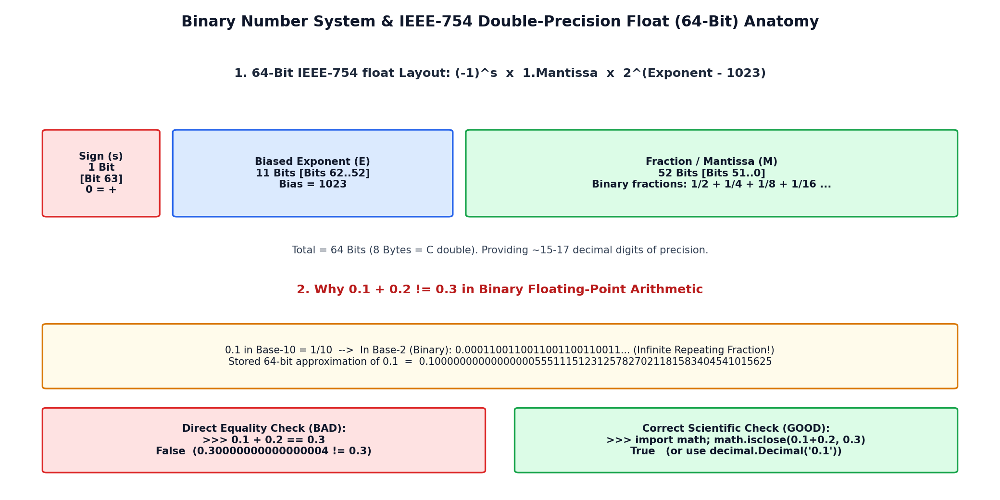
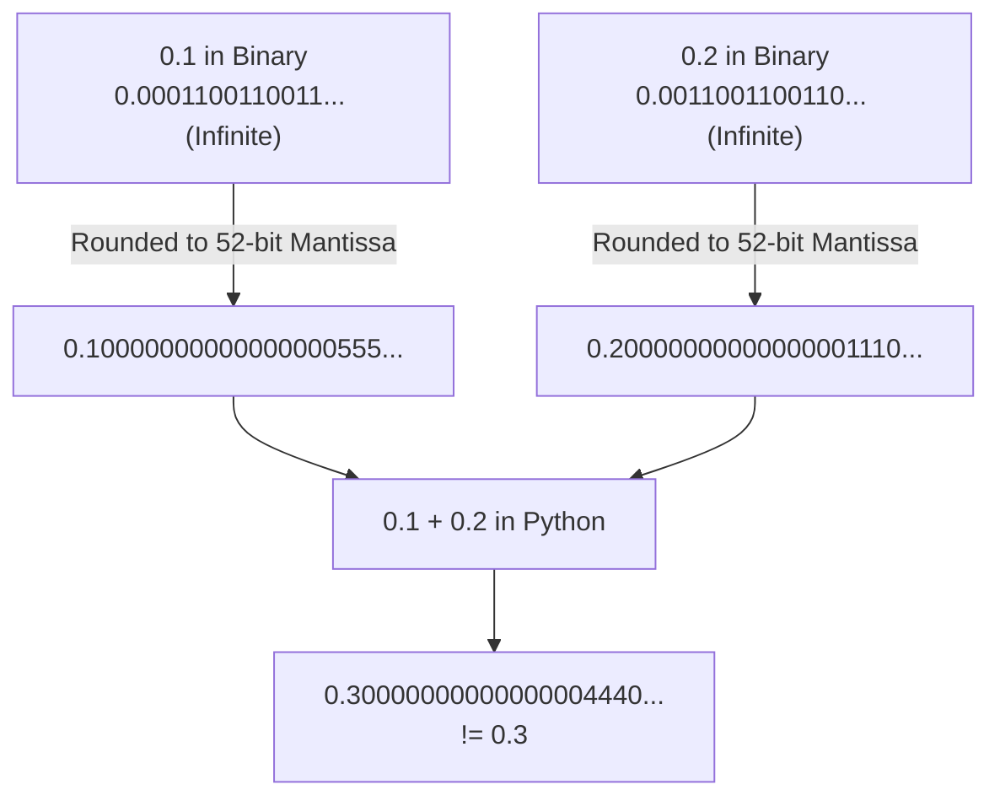

# Dependency Lesson 02.1: ද්වීමය හා ෂඩ් දශමය සංඛ්‍යා පද්ධති සහ IEEE-754 Floating-Point Precision (`0.1 + 0.2 != 0.3` වන්නේ ඇයි?)

**අදාළ ප්‍රධාන පාඩම් (Related Core Lessons):**
- [Lesson 2.2: Python Syntax Fundamentals, Dynamic Typing & Numeric Types](../../Module_02_Python_Programming_Foundations/Lesson_2.2_Python_Syntax_Dynamic_Typing_and_Numeric_Types.md)
- [Lesson 2.3: Sequence Data Types — Strings, Unicode, Lists & Tuples](../../Module_02_Python_Programming_Foundations/Lesson_2.3_Sequence_Data_Types_Strings_Unicode_Lists_Tuples.md)

---

## 1. හැඳින්වීම: පරිගණකය සංඛ්‍යා තේරුම් ගන්නේ කෙසේද?

ඔබ `Lesson 2.2` (Slide 11) හිදී Python හි `float` දත්ත වර්ගය C භාෂාවේ **64-bit `double` (IEEE-754 Double-Precision Floating-Point)** වලට සමාන බව ඉගෙන ගත්තා. එමෙන්ම `Lesson 2.3` (Slide 15) හිදී `\xe4\xf6\xfc` වැනි **Hexadecimal (ෂඩ් දශමය)** කේත දුටුවා.

තවද, ඔබ Python තුළ `0.1 + 0.2` ගණනය කළහොත් ලැබෙන්නේ `0.3` නොව `0.30000000000000004` යන අගයයි! ඇයි එසේ සිදුවන්නේ? මෙම පාඩමෙන් අපි කිසිදු පූර්ව දැනුමක් නොමැතිව **Binary Number System (ද්වීමය සංඛ්‍යා පද්ධතිය)**, **Hexadecimal Number System (ෂඩ් දශමය සංඛ්‍යා පද්ධතිය)** සහ **IEEE-754 Floating-Point Precision (ඉපිලෙන ලක්ෂ්‍ය නිරවද්‍යතාවය)** ගැන බින්දුවේ සිට ඉගෙන ගනිමු.



---

## 2. සංඛ්‍යා පද්ධති 3: Decimal (Base-10), Binary (Base-2) සහ Hexadecimal (Base-16)

මිනිසුන් වන අපි එදිනෙදා ගණනය කිරීම් සඳහා ඉලක්කම් 10ක් (`0` සිට `9` දක්වා) ඇති **Decimal Number System (දශමය සංඛ්‍යා පද්ධතිය - Base 10)** භාවිතා කරමු. නමුත් පරිගණකයේ CPU එක සහ RAM එක නිර්මාණය කර ඇත්තේ විද්‍යුත් ස්විච (Transistors — On=`1`, Off=`0`) බිලියන ගණනකිනි. එබැවින් පරිගණකයට තේරුම් ගත හැක්කේ **Binary Number System (ද්වීමය සංඛ්‍යා පද්ධතිය - Base 2)** පමණි!

| සංඛ්‍යා පද්ධතිය (Number System) | පාදය (Base / Radix) | භාවිතා වන සංකේත (Digits) | Python Prefix | උදාහරණය (`42` නිරූපණය) |
| :--- | :--- | :--- | :--- | :--- |
| **Decimal Number System (දශමය සංඛ්‍යා පද්ධතිය)** | Base 10 ($10^n$) | `0, 1, 2, 3, 4, 5, 6, 7, 8, 9` | *(නැත)* | `42` ($4 \times 10^1 + 2 \times 10^0$) |
| **Binary Number System (ද්වීමය සංඛ්‍යා පද්ධතිය)** | Base 2 ($2^n$) | `0, 1` | **`0b`** | `0b101010` ($32 + 8 + 2 = 42$) |
| **Hexadecimal Number System (ෂඩ් දශමය සංඛ්‍යා පද්ධතිය)** | Base 16 ($16^n$) | `0–9` සහ `A(10), B(11), C(12), D(13), E(14), F(15)` | **`0x`** | `0x2a` ($2 \times 16^1 + 10 \times 16^0 = 42$) |

### ඇයි අපි Hexadecimal (`0x` හෝ `\x`) භාවිතා කරන්නේ?
* Binary වලින් `1 Byte` (Bits 8ක්) ලිවීමට `11100100` ලෙස දිගට ලිවිය යුතුය.
* නමුත් Binary Bits 4ක කාණ්ඩයක් (Nibble) හරියටම තනි Hexadecimal අකුරකින් (`0` සිට `F` දක්වා) දැක්විය හැක!
  * උදාහරණය: `1110` = $8+4+2 = 14$ (`e`), සහ `0100` = $4$ (`4`). එබැවින් `11100100` යන Byte එක Hexadecimal වලින් ඉතා කෙටියෙන් **`0xe4`** (හෝ String එකක **`\xe4`**) ලෙස ලිවිය හැක!

```python
# Python හි bin(), hex() සහ int() භාවිතය:
num = 42
print("Binary of 42     :", bin(num))         # '0b101010'
print("Hexadecimal of 42:", hex(num))         # '0x2a'

# Binary හෝ Hex නැවත Decimal int බවට හැරවීම:
print("0b101010 to int  :", 0b101010)         # 42
print("0xe4 to int      :", int("e4", 16))    # 228 (Slide 15 හි \xe4 අගය!)
```

---

## 3. IEEE-754 Double-Precision `float` (64-Bit) ආකෘතිය

Python හි `float` දත්ත වර්ගය (උදා: `3.14`, `16.04`) ගබඩා කරන්නේ ජාත්‍යන්තර **IEEE-754 Double-Precision (64-bit / 8 Bytes)** සම්මතයට අනුවය. එම Bits 64 කොටස් 3කට බෙදේ:

$$\text{Value} = (-1)^{\text{sign}} \times (1.\text{Mantissa})_2 \times 2^{\text{Exponent} - 1023}$$

1. **Sign Bit (1 Bit):** ලකුණ (`0` නම් ධන `+`, `1` නම් සෘණ `-`).
2. **Biased Exponent (11 Bits):** දෙකේ බලය (Power of 2 / Scale).
3. **Mantissa / Significand / Fraction (52 Bits):** දශම තිතට පසුව එන ද්වීමය භාග කොටස ($\frac{1}{2} + \frac{1}{4} + \frac{1}{8} + \frac{1}{16} + \dots$).

---

## 4. ඇයි `0.1 + 0.2 == 0.3` අගය `False` වන්නේ? (The Floating-Point Representation Error)

මෙය Python වල දෝෂයක් (Bug එකක්) නොවේ; C, C++, Java, JavaScript ඇතුළු IEEE-754 භාවිතා කරන සෑම භාෂාවකම දක්නට ලැබෙන ගණිතමය ස්වභාවයකි!

* **Base-10 උදාහරණය:** අපි සාමාන්‍ය දශම ක්‍රමයෙන් $\frac{1}{3}$ ලියන්නට උත්සාහ කළහොත් $0.3333333\dots$ ලෙස අනන්තයට දිවෙන දශමයක් (**Infinite Repeating Fraction (අනන්ත පුනරාවර්තන භාගයක්)**) ලැබේ. කොතරම් ඉලක්කම් ලිව්වත් $0.3333 + 0.3333 + 0.3333 = 0.9999 \neq 1.0$ වේ.
* **Base-2 (Binary) වලදී $\frac{1}{10}$ (`0.1`) හි තත්ත්වය:** දෙකේ බලවල භාග ($\frac{1}{2}=0.5, \frac{1}{4}=0.25, \frac{1}{8}=0.125, \frac{1}{16}=0.0625\dots$) එකතු කර හරියටම $0.1$ සෑදිය නොහැක! Binary වලින් $0.1$ යනු අනන්තයට දිවෙන පුනරාවර්තන භාගයකි:
  $$(0.1)_{10} = (0.000110011001100110011\dots)_2$$
* RAM එකේ Mantissa කොටසේ ඇත්තේ **Bits 52ක් පමණක්** නිසා, 52 වන Bit එකෙන් පසු කොටස කපා හැරීමට (Round කිරීමට) පරිගණකයට සිදුවේ. එම නිසා `0.1` සහ `0.2` ගබඩා වන්නේ ඉතාම කුඩා ආසන්න අගයක් ලෙසය:



### විසඳුම: Python හි `float` අගයන් නිවැරදිව සසඳන්නේ කෙසේද?

1. **විද්‍යාත්මක හා Data Science ගණනය කිරීම් සඳහා — `math.isclose(a, b)`:**
   `==` වෙනුවට `math.isclose()` (හෝ `abs(a - b) < 1e-9`) භාවිතා කරන්න!
2. **මූල්‍යමය (Financial / Currency) ගණනය කිරීම් සඳහා — `decimal.Decimal`:**
   මුදල් ගණනය කිරීම්වලදී ශත ගණනක හෝ වෙනසක් සිදුවිය නොහැකි නිසා Base-10 ආකාරයෙන්ම ගණනය කරන `Decimal('0.1')` භාවිතා කරන්න.

```python
import math
from decimal import Decimal

# 1. ගැටලුව:
print("0.1 + 0.2          =", 0.1 + 0.2)           # 0.30000000000000004
print("0.1 + 0.2 == 0.3   :", (0.1 + 0.2) == 0.3)  # False!

# 2. විසඳුම 1 (Data Science සඳහා math.isclose):
print("math.isclose()     :", math.isclose(0.1 + 0.2, 0.3))  # True!

# 3. විසඳුම 2 (මූල්‍ය ගණනය කිරීම් සඳහා Decimal):
exact_sum = Decimal('0.1') + Decimal('0.2')
print("Decimal exact sum  :", exact_sum)           # 0.3
print("Decimal == 0.3     :", exact_sum == Decimal('0.3'))   # True!
```

---

## 5. 🛠️ Practical Task / Hands-On Exercise (ප්‍රායෝගික අභ්‍යාසය)

### Scenario / Goal:
ඔබ රසායනාගාර සංවේදකයකින් (Sensor) ලැබෙන Hexadecimal දත්ත (`0x10`, `0xe4`, `0xff`) Decimal සහ Binary බවට පරිවර්තනය කරන අතර, රසායනික ප්‍රතික්‍රියාවක ස්කන්ධ එකතුව (`0.15 + 0.15 + 0.15` vs `0.45`) පරීක්ෂා කිරීමේදී සිදුවන Floating-Point Precision ගැටලුව විසඳිය යුතුය.

### Step-by-Step Tasks:
1. `hex_codes = [0x10, 0xe4, 0xff]` යන ලැයිස්තුවේ එක් එක් අගය සඳහා එහි Decimal (`int`) අගය සහ Binary (`bin()`) නිරූපණය මුද්‍රණය කරන්න.
2. `sample_total = 0.1 + 0.1 + 0.1` සහ `expected = 0.3` යන විචල්‍ය දෙක සාදා, `sample_total == expected` අගය සහ `{:.20f}` මගින් ඒවායේ දශමස්ථාන 20ක සැබෑ අගය මුද්‍රණය කරන්න.
3. `math.isclose()` සහ `decimal.Decimal` යන ක්‍රම දෙකම භාවිතා කර නිවැරදිව `True` ලබා ගන්නා ආකාරය පෙන්වන්න.

### Starter Code:
```python
import math
from decimal import Decimal

# Task 1: Convert Hexadecimal sensor bytes to Decimal and Binary
hex_codes = [0x10, 0xe4, 0xff]
# TODO: Loop through hex_codes and print hex, decimal, and binary forms

# Task 2: Inspect Floating-Point Precision Error
sample_total = 0.1 + 0.1 + 0.1
expected = 0.3
# TODO: Print sample_total == expected and format both to 20 decimal places

# Task 3: Fix using math.isclose() and Decimal
# TODO: Verify using math.isclose() and Decimal('0.1')
```

### Expected Output / Reference Solution:
```python
import math
from decimal import Decimal

# Task 1: Convert Hexadecimal sensor bytes to Decimal and Binary
hex_codes = [0x10, 0xe4, 0xff]
for code in hex_codes:
    print(f"Hex: {hex(code):<5} | Decimal: {code:<4} | Binary: {bin(code)}")

# Task 2: Inspect Floating-Point Precision Error
sample_total = 0.1 + 0.1 + 0.1
expected = 0.3
print(f"\nDirect == check: {sample_total == expected}")
print(f"sample_total (20 decimals): {sample_total:.20f}")
print(f"expected     (20 decimals): {expected:.20f}")

# Task 3: Fix using math.isclose() and Decimal
print("Fixed with math.isclose():", math.isclose(sample_total, expected))
dec_total = Decimal('0.1') + Decimal('0.1') + Decimal('0.1')
print("Fixed with Decimal       :", dec_total == Decimal('0.3'), f"(Value = {dec_total})")
```

**Expected Output:**
```text
Hex: 0x10  | Decimal: 16   | Binary: 0b10000
Hex: 0xe4  | Decimal: 228  | Binary: 0b11100100
Hex: 0xff  | Decimal: 255  | Binary: 0b11111111

Direct == check: False
sample_total (20 decimals): 0.30000000000000004441
expected     (20 decimals): 0.29999999999999998890
Fixed with math.isclose(): True
Fixed with Decimal       : True (Value = 0.3)
```

---

## 6. Summary & Exam Revision Cheat Sheet (සාරාංශය)

| සංකල්පය (Concept) | Python ශ්‍රිත / Syntax | ප්‍රධාන විභාග කරුණ (Key Takeaway) |
| :--- | :--- | :--- |
| **Binary (Base-2)** | `0b1010`, `bin(x)`, `int('1010', 2)` | පරිගණක මතකයේ සියලුම දත්ත ගබඩා වන්නේ `0` සහ `1` (Bits) ලෙසය. |
| **Hexadecimal (Base-16)** | `0xe4`, `hex(x)`, `int('e4', 16)` | 1 Byte (8 bits) ක් හරියටම Hex අකුරු 2කින් (`00` සිට `FF` දක්වා) නිරූපණය කළ හැක. |
| **IEEE-754 `float`** | `float(x)` (64-bit: 1 Sign, 11 Exp, 52 Mantissa) | Base-2 භාග ලෙස `0.1` හරියටම නිරූපණය කළ නොහැකි නිසා `0.1 + 0.2 != 0.3` වේ. |
| **Safe Float Comparison** | `math.isclose(a, b)` හෝ `Decimal('0.1')` | `float` අගයන් දෙකක් සැසඳීමේදී `==` වෙනුවට `math.isclose()` භාවිතා කරන්න. |

---

**ඊළඟ Dependency පාඩම:** [02_Character_Encoding_ASCII_Unicode_Code_Points_and_UTF8.md](02_Character_Encoding_ASCII_Unicode_Code_Points_and_UTF8.md) — ASCII, Unicode Code Points (`ord`/`chr`) සහ UTF-8 Byte Encoding ගැන ඉගෙන ගනිමු.  
**ආපසු ප්‍රධාන පාඩම් වෙත (Back to Core Lessons):** [Lesson 2.2](../../Module_02_Python_Programming_Foundations/Lesson_2.2_Python_Syntax_Dynamic_Typing_and_Numeric_Types.md) | [Lesson 2.3](../../Module_02_Python_Programming_Foundations/Lesson_2.3_Sequence_Data_Types_Strings_Unicode_Lists_Tuples.md)
