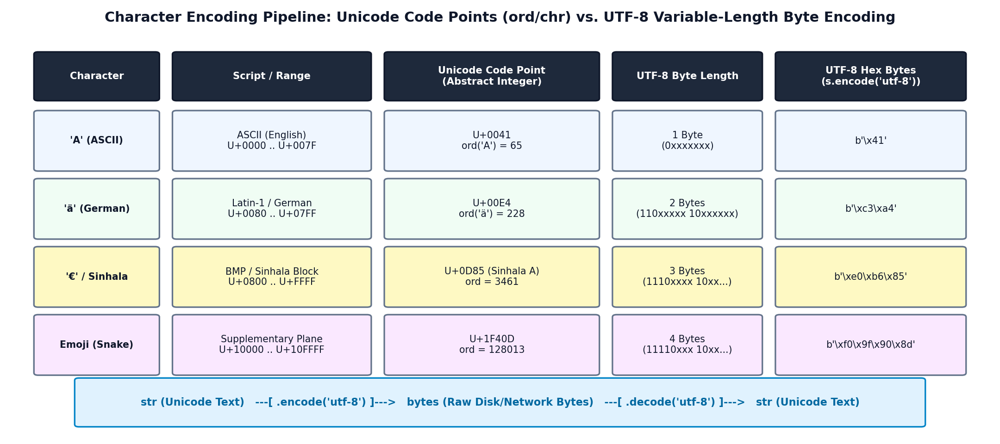
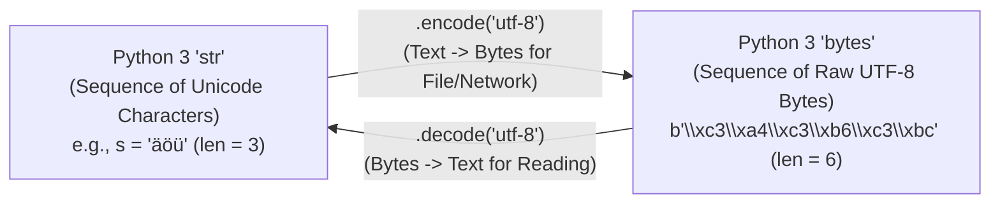

# Dependency Lesson 02.2: අක්ෂර කේතනය — ASCII, Unicode Code Points සහ UTF-8 (Character Encoding: ASCII, Unicode Code Points & UTF-8)

**අදාළ ප්‍රධාන පාඩම් (Related Core Lessons):**
- [Lesson 2.3: Sequence Data Types — Strings, Unicode, Lists & Tuples](../../Module_02_Python_Programming_Foundations/Lesson_2.3_Sequence_Data_Types_Strings_Unicode_Lists_Tuples.md)

---

## 1. හැඳින්වීම: පරිගණකය අකුරු, සිංහල වචන සහ Emojis ගබඩා කරන්නේ කෙසේද?

ඔබ `Lesson 2.3` (Slide 15) හිදී **Unicode Strings** පිළිබඳව පහත කේතය දුටුවා:
```python
myunicodestr2 = u"Hi\u0020Class!"
newunicode = u'\xe4\xf6\xfc'        # Output: äöü
newstr = newunicode.encode('utf-8')
```

පරිගණකයේ RAM එකේ සහ Hard Disk එකේ ගබඩා කළ හැක්කේ සංඛ්‍යා (Binary `0` සහ `1`) පමණක් නම්, එය `'A'`, `'ä'`, `'අ'` හෝ `'🐍'` වැනි අකුරු සහ සංකේත හඳුනා ගන්නේ කෙසේද? **ASCII**, **Unicode Code Points**, සහ **UTF-8** අතර වෙනස කුමක්ද? `.encode('utf-8')` සහ `.decode('utf-8')` මගින් සිදුවන්නේ කුමක්ද? මෙම පාඩමෙන් අපි බින්දුවේ සිට (Zero-to-Hero) මෙම සම්පූර්ණ ක්‍රියාවලිය ඉගෙන ගනිමු.



---

## 2. පියවර 1: ASCII ක්‍රමය (1960 ගණන්වල ආරම්භය — ඉංග්‍රීසි අකුරු පමණයි!)

පරිගණක යුගයේ මුල් කාලයේදී ඇමරිකානු විද්‍යාඥයන් විසින් ඉංග්‍රීසි අකුරු (`A-Z`, `a-z`), ඉලක්කම් (`0-9`) සහ විරාම ලකුණු සඳහා `0` සිට `127` දක්වා අංක ලබා දෙමින් **ASCII (American Standard Code for Information Interchange)** වගුව හඳුන්වා දෙන ලදී:
* `'Space'` (හිස්තැන) = `32` (Hexadecimal වලින් `0x20` $\rightarrow$ Slide 15 හි `\u0020`!)
* `'0'` = `48`, `'A'` = `65` (`0x41`), `'a'` = `97` (`0x61`).

**ASCII හි සීමාව:** `1 Byte` (Bits 8) කින් නිරූපණය කළ හැක්කේ උපරිම වශයෙන් $2^8 = 256$ (`0` සිට `255` දක්වා) අගයන් පමණි. ජර්මන් (`ä, ö, ü`), ප්‍රංශ, සිංහල (`අ, ආ...`), දෙමළ, චීන සහ ජපන් වැනි ලෝකයේ සියලුම භාෂාවල අකුරු ලක්ෂ ගණනක් `256` ක් තුළට දැමිය නොහැක!

---

## 3. පියවර 2: Unicode Standard — ලෝකයේ සෑම අකුරකටම අනන්‍ය අංකයක් (Code Point)!

මෙම ගැටලුව විසඳීමට **Unicode Consortium** ආයතනය විසින් ලෝකයේ සියලුම භාෂාවල අකුරු, ගණිත සංකේත සහ Emojis (150,000+ කට වැඩි ප්‍රමාණයක්) සඳහා අනන්‍ය අංකයක් හෙවත් **Unicode Code Point** එකක් ලබා දෙන ලදී.
* මෙය ලියනු ලබන්නේ **`U+`** ඉදිරියෙන් Hexadecimal අංකයක් ලෙසය (උදා: `U+0041`).
* **Python හි Built-in ශ්‍රිත දෙක (`ord()` සහ `chr()`):**
  * **`ord(char)`:** ඕනෑම අකුරකට අදාළ Unicode Code Point අංකය (Decimal integer) ලබා දෙයි.
  * **`chr(int)`:** Unicode Code Point අංකයක් දුන් විට ඊට අදාළ අකුර ලබා දෙයි.

```python
# 1. ඉංග්‍රීසි ASCII අකුරු:
print("ord('A')   :", ord('A'), "-> Hex:", hex(ord('A')))     # 65 -> 0x41 (U+0041)

# 2. Slide 15 හි ජර්මන් අකුරු (ä, ö, ü):
print("ord('ä')   :", ord('ä'), "-> Hex:", hex(ord('ä')))     # 228 -> 0xe4 (\xe4)
print("ord('ö')   :", ord('ö'), "-> Hex:", hex(ord('ö')))     # 246 -> 0xf6 (\xf6)
print("ord('ü')   :", ord('ü'), "-> Hex:", hex(ord('ü')))     # 252 -> 0xfc (\xfc)

# 3. සිංහල අකුරු (Sinhala Unicode Block: U+0D80 to U+0DFF):
print("ord('අ')   :", ord('අ'), "-> Hex:", hex(ord('අ')))     # 3461 -> 0xd85 (U+0D85)
print("chr(3461)  :", chr(3461))                              # 'අ'

# 4. Emojis:
print("ord('🐍')  :", ord('🐍'), "-> Hex:", hex(ord('🐍')))   # 128013 -> 0x1f40d
```

---

## 4. පියවර 3: UTF-8 Encoding — Unicode අංක Bytes ලෙස ගබඩා කරන දක්ෂතම ක්‍රමය!

Unicode මගින් සෑම අකුරකටම අංකයක් (Abstract Code Point) ලබා දුන්නත්, එම අංකය Hard Disk එකේ හෝ ජාලයක (Network) **Bytes** ලෙස ගබඩා කරන්නේ කෙසේද යන්න තීරණය කරන්නේ **UTF-8 (Unicode Transformation Format - 8-bit)** මගිනි.

UTF-8 යනු **Variable-Length Encoding (විචල්‍ය දිගකින් යුත් කේතන)** ක්‍රමයකි:
1. **ASCII අකුරු (`U+0000` – `U+007F`):** හරියටම **1 Byte** එකක් පමණක් භාවිතා කරයි (උදා: `'A'` $\rightarrow$ `b'\x41'`). එම නිසා ඉංග්‍රීසි ලිපි සඳහා කිසිදු අමතර ඉඩක් නාස්ති නොවේ!
2. **යුරෝපීය/ජර්මන් අකුරු (`U+0080` – `U+07FF`):** **Bytes 2ක්** භාවිතා කරයි (උදා: Slide 15 හි `'ä'` $\rightarrow$ `b'\xc3\xa4'`).
3. **සිංහල/දෙමළ/ආසියානු අකුරු (`U+0800` – `U+FFFF`):** **Bytes 3ක්** භාවිතා කරයි (උදා: `'අ'` $\rightarrow$ `b'\xe0\xb6\x85'`).
4. **Emojis සහ දුර්ලභ සංකේත (`U+10000`+):** **Bytes 4ක්** භාවිතා කරයි (උදා: `'🐍'` $\rightarrow$ `b'\xf0\x9f\x90\x8d'`).



---

## 5. Python 2 vs. Python 3 String ආකෘතියේ වෙනස (Slide 15 Gap Analysis)

දේශන සටහනේ 15 වන Slide එකෙහි `u"Hi Class!"` සහ `unicode(newstr, 'utf-8')` ලෙස සඳහන් වන්නේ Python 2 ආකෘතියට අනුවය. Python 3 හිදී මෙය වඩාත් පිරිසිදු සහ සරල කර ඇත:

| ලක්ෂණය (Feature) | Python 2.x (Legacy - Slide 15) | Python 3.x (Modern Standard) |
| :--- | :--- | :--- |
| **Default `str` (`"hello"`)** | Raw ASCII/Byte string එකකි. | **පෙරනිමියෙන්ම Unicode Text (`str`) වේ!** (`"hello"` සහ `u"hello"` දෙකම එකම වේ). |
| **Byte string** | `str` | **`bytes`** (`b"hello"`) ලෙස වෙනම දත්ත වර්ගයකි. |
| **Unicode $\rightarrow$ UTF-8 Bytes** | `u_str.encode('utf-8')` | `text_str.encode('utf-8')` $\rightarrow$ `bytes` ලබා දෙයි. |
| **UTF-8 Bytes $\rightarrow$ Unicode** | `unicode(byte_str, 'utf-8')` | **`byte_str.decode('utf-8')`** හෝ `str(byte_str, 'utf-8')` *(Python 3 හි `unicode()` නමින් ශ්‍රිතයක් නොමැත!)*. |

### Slide 15 කේතය Python 3 හිදී ක්‍රියාත්මක වන ආකාරය:
```python
myunicodestr1 = u"Hi Class!"
myunicodestr2 = u"Hi\u0020Class!"   # \u0020 යනු Space (ASCII 32) අකුරයි
print(myunicodestr1, myunicodestr2) # Output: Hi Class! Hi Class!

newunicode = u'\xe4\xf6\xfc'
print("Unicode str :", newunicode, "| Char length:", len(newunicode))
# Output: äöü | Char length: 3

# .encode('utf-8') මගින් Unicode str එක UTF-8 bytes බවට හරවයි:
newbytes = newunicode.encode('utf-8')
print("UTF-8 bytes :", newbytes, "| Byte length:", len(newbytes))
# Output: b'\xc3\xa4\xc3\xb6\xc3\xbc' | Byte length: 6 (එක් අකුරකට Bytes 2 බැගින්!)

# .decode('utf-8') මගින් නැවත Unicode str බවට හරවයි:
decoded_str = newbytes.decode('utf-8')
print("Decoded str :", decoded_str)
# Output: äöü
```

---

## 6. 🛠️ Practical Task / Hands-On Exercise (ප්‍රායෝගික අභ්‍යාසය)

### Scenario / Goal:
ඔබ බහු-භාෂා (Multilingual) NLP දත්ත පිරිසිදු කිරීමේ පද්ධතියක් ගොඩනගයි. ඉංග්‍රීසි, ජර්මන් සහ සිංහල අකුරු අඩංගු වචනයක Character Length (`len(s)`) සහ UTF-8 Byte Length (`len(s.encode('utf-8'))`) අතර වෙනස පරීක්ෂා කිරීම ඔබේ කාර්යයයි.

### Step-by-Step Tasks:
1. `samples = ['A', 'ä', 'අ', '🐍']` යන ලැයිස්තුවේ එක් එක් අකුර සඳහා එහි Unicode Code Point එක (`ord()` සහ `U+XXXX` ආකෘතියෙන්), UTF-8 encoded bytes (`.encode('utf-8')`), සහ Byte length එක මුද්‍රණය කරන්න.
2. Slide 15 හි ඇති `escape_text = "Data\u0020Science\u0021"` යන String එක මුද්‍රණය කර `\u0020` සහ `\u0021` මගින් නිරූපණය වන අකුරු මොනවාදැයි පරීක්ෂා කරන්න.
3. `raw_packet = b'Lank\xc3\xa4'` යන UTF-8 byte sequence එක `.decode('utf-8')` මගින් නැවත කියවිය හැකි Python `str` එකක් බවට හරවන්න.

### Starter Code:
```python
# Task 1: Inspect Unicode Code Points and UTF-8 Byte lengths
samples = ['A', 'ä', 'අ', '🐍']
# TODO: Loop through samples and print ord(ch), hex code point, utf-8 bytes, and byte length

# Task 2: Decode Unicode Escape Sequences
escape_text = "Data\u0020Science\u0021"
# TODO: Print escape_text

# Task 3: Decode raw UTF-8 bytes back to str
raw_packet = b'Lank\xc3\xa4'
# TODO: Decode raw_packet using .decode('utf-8') and print
```

### Expected Output / Reference Solution:
```python
# Task 1: Inspect Unicode Code Points and UTF-8 Byte lengths
samples = ['A', 'ä', 'අ', '🐍']
for ch in samples:
    utf8_b = ch.encode('utf-8')
    print(f"Char: {ch} | Code Point: U+{ord(ch):04X} (ord={ord(ch):<6}) | UTF-8 Bytes: {str(utf8_b):<20} | Byte Len: {len(utf8_b)}")

# Task 2: Decode Unicode Escape Sequences
escape_text = "Data\u0020Science\u0021"
print("\nTask 2 - Escape text:", escape_text)

# Task 3: Decode raw UTF-8 bytes back to str
raw_packet = b'Lank\xc3\xa4'
decoded_text = raw_packet.decode('utf-8')
print("Task 3 - Decoded packet:", decoded_text)
```

**Expected Output:**
```text
Char: A | Code Point: U+0041 (ord=65    ) | UTF-8 Bytes: b'A'                 | Byte Len: 1
Char: ä | Code Point: U+00E4 (ord=228   ) | UTF-8 Bytes: b'\xc3\xa4'          | Byte Len: 2
Char: අ | Code Point: U+0D85 (ord=3461  ) | UTF-8 Bytes: b'\xe0\xb6\x85'      | Byte Len: 3
Char: 🐍 | Code Point: U+1F40D (ord=128013) | UTF-8 Bytes: b'\xf0\x9f\x90\x8d'  | Byte Len: 4

Task 2 - Escape text: Data Science!
Task 3 - Decoded packet: Lankä
```

---

## 7. Summary & Exam Revision Cheat Sheet (සාරාංශය)

| සංකල්පය (Concept) | Python කේතය / උදාහරණය | ප්‍රධාන විභාග කරුණ (Key Takeaway) |
| :--- | :--- | :--- |
| **ASCII** | `ord('A') == 65`, `\u0020 == ' '` | මුල් ඉංග්‍රීසි අකුරු 128 (`0`–`127`) සඳහා 1 Byte භාවිතා කරයි. |
| **Unicode Code Point** | `ord('අ') == 3461` (`U+0D85`) | ලෝකයේ සෑම අකුරකටම හා Emoji එකකටම ලබා දී ඇති අනන්‍ය අංකයයි. |
| **UTF-8 Encoding** | `s.encode('utf-8')` $\rightarrow$ `bytes` | Unicode අකුරක් Bytes 1 සිට 4 දක්වා විචල්‍ය දිගකින් ගබඩා කරන සම්මත ක්‍රමයයි. |
| **UTF-8 Decoding** | `b.decode('utf-8')` $\rightarrow$ `str` | UTF-8 `bytes` නැවත Python 3 `str` (Unicode) බවට පරිවර්තනය කරයි. |

---

**ඊළඟ Dependency පාඩම:** [03_How_Hash_Functions_and_Hash_Tables_Power_Sets_and_Dicts.md](03_How_Hash_Functions_and_Hash_Tables_Power_Sets_and_Dicts.md) — Hash Functions සහ Hash Tables මගින් Python `set` සහ `dict` වලට $O(1)$ සුපිරි වේගයක් ලබා දෙන ආකාරය ඉගෙන ගනිමු.  
**ආපසු ප්‍රධාන පාඩම වෙත (Back to Core Lesson):** [Lesson 2.3: Sequence Data Types — Strings, Unicode, Lists & Tuples](../../Module_02_Python_Programming_Foundations/Lesson_2.3_Sequence_Data_Types_Strings_Unicode_Lists_Tuples.md)
