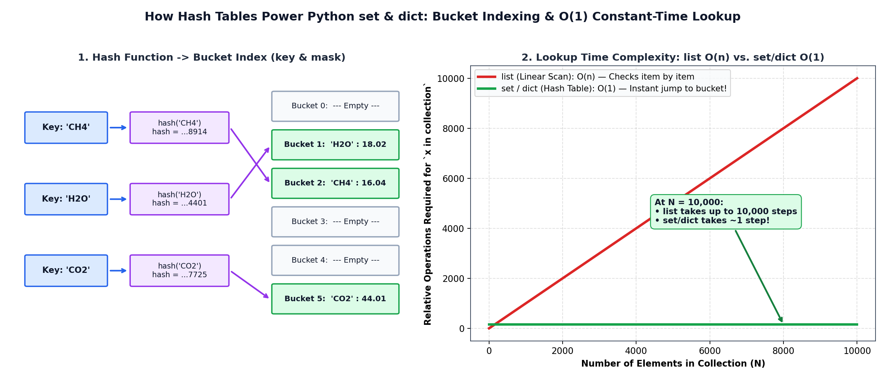
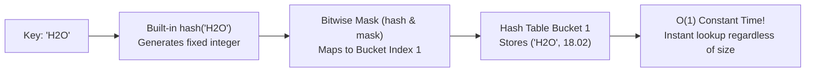

# Dependency Lesson 02.3: Hash Functions සහ Hash Tables මගින් Python `set` සහ `dict` බලගන්වන ආකාරය (How Hash Functions & Hash Tables Power Sets & Dicts)

**අදාළ ප්‍රධාන පාඩම් (Related Core Lessons):**
- [Lesson 2.5: Sets and Dictionaries (Mappings)](../../Module_02_Python_Programming_Foundations/Lesson_2.5_Sets_and_Dictionaries_Mappings.md)
- [Lesson 2.3: Sequence Data Types — Strings, Unicode, Lists & Tuples](../../Module_02_Python_Programming_Foundations/Lesson_2.3_Sequence_Data_Types_Strings_Unicode_Lists_Tuples.md)

---

## 1. හැඳින්වීම: `dict` සහ `set` තුළ දත්ත සෙවීම List එකකට වඩා දහස් ගුණයකින් වේගවත් වන්නේ ඇයි?

ඔබ `Lesson 2.5` (Slide 22) හිදී Dictionaries පිළිබඳව ඉතාම වැදගත් අර්ථ දැක්වීමක් ඉගෙන ගත්තා:
> **"dict: hash tables, maps a set of keys to arbitrary objects."**

ඇයි Python හි `set` එකක හෝ `dict` එකක අයිතම මිලියනයක් තිබුණත් `'O2' in mw` ලෙස සෙවූ විට **එකම එක පියවරකින් — $O(1)$ Constant Time Complexity (නියත කාල සංකීර්ණතාවය)** — ක්ෂණිකව පිළිතුර ලැබෙන්නේ? එමෙන්ම ඇයි Dictionary Key එකක් හෝ Set සාමාජිකයෙක් ලෙස `str`, `int`, හෝ `tuple` භාවිතා කළ හැකි නමුත්, කිසිවිටෙකත් `list` එකක් Key එකක් ලෙස භාවිතා කළ නොහැක්කේ (`TypeError: unhashable type: 'list'`)?

මෙම පාඩමෙන් අපි බින්දුවේ සිට **Hash Function (හෑෂ් ශ්‍රිතය)**, **Hash Table (හෑෂ් වගුව)**, **Hash Collision (හෑෂ් ගැටුම)** සහ **Hashability** පිළිබඳව ඉතාම සරලව හා පැහැදිලිව ඉගෙන ගනිමු.



---

## 2. ගැටලුව: `list` එකක දත්ත සෙවීම — $O(n)$ Linear Search (රේඛීය සෙවුම)

සිතන්න ඔබ සතුව ශිෂ්‍ය නාම 1,000,000ක් අඩංගු Python `list` එකක් ඇත. ඔබ `'Tina Tenderfoot' in student_list` ලෙස පරීක්ෂා කරන විට Python කුමක් කරයිද?
* List එකක අගයන් ගබඩා වී ඇත්තේ `0, 1, 2, ...` යන අනුපිළිවෙළට පමණි. `'Tina Tenderfoot'` කොතැනක ඇත්දැයි Python කලින් දන්නේ නැත.
* එබැවින් Index `0` සිට පටන් ගෙන එකින් එක (`student_list[0]`, `student_list[1]`, ...) හමුවන තුරුම පරීක්ෂා කළ යුතුය.
* අගය අවසානයේ තිබුණහොත් හෝ නොතිබුණහොත් පියවර 1,000,000ක්ම පරීක්ෂා කිරීමට සිදුවේ! මෙය ඇල්ගොරිදම විශ්ලේෂණයේදී **$O(n)$ Linear Time Complexity (රේඛීය කාල සංකීර්ණතාවය)** ලෙස හැඳින්වේ.

---

## 3. විසඳුම: Hash Function (හෑෂ් ශ්‍රිතය) සහ Hash Table (හෑෂ් වගුව)

මුල සිට එකින් එක සොයනවා වෙනුවට, අදාළ Key එක (`'CH4'` හෝ `'H2O'`) දුන් සැණින් එය ගබඩා කර ඇති කොටුවේ අංකය (**Bucket / Slot Index**) ගණිතමය සූත්‍රයකින් ක්ෂණිකව ගණනය කළ හැකි නම් කොපමණ අගනේද? **Hash Table (හෑෂ් වගුව)** එකකින් කරන්නේ හරියටම එයයි!

### පියවර 3ක ක්‍රියාවලිය (`mw['H2O'] = 18.02`):
1. **Hash Function (`hash(key)`):**
   ඔබ ලබා දෙන Key එක (`'H2O'`) Python හි Built-in **`hash()`** ශ්‍රිතය වෙත යවයි. එය විසින් එම වචනයට අනන්‍ය වූ විශාල පූර්ණ සංඛ්‍යාවක් (**Hash Value / Digest**) ගණනය කරයි.
2. **Bucket Index Calculation (`hash_val & mask`):**
   Hash Table එකේ දැනට Slots (Buckets) 8ක් ඇත්නම්, එම Hash අගය `8` න් බෙදූ විට ලැබෙන ඉතිරිය (`hash('H2O') % 8` හෙවත් Bitwise `hash_val & 7`) මගින් `0` සිට `7` දක්වා වූ හරියටම එක Bucket අංකයක් තෝරා ගනී (උදා: `Bucket 1`).
3. **Instant $O(1)$ Jump:**
   දත්ත තැන්පත් කිරීමේදීත්, පසුව `'H2O' in mw` හෝ `mw['H2O']` ලෙස සෙවීමේදීත් Python කෙලින්ම `hash('H2O')` ගණනය කර **එකම පියවරකින් `Bucket 1` වෙත පනියි!**



---

## 4. Hash Collisions (හෑෂ් ගැටුම්) සහ Duplicate ඉවත් කිරීම

### 1. වෙනස් Keys දෙකකට එකම Bucket අංකය ලැබුණොත් කුමක් වේද? (**Hash Collision (හෑෂ් ගැටුම)**)
* සිතන්න `'CH4'` සහ `'CO2'` යන දෙකම `% 8` කළ විට `Bucket 2` ලැබුණා කියා. මෙය **Hash Collision (හෑෂ් ගැටුම)** ලෙස හැඳින්වේ.
* එවිට Python විසින් `Bucket 2` හි දැනට ඇති Key එක `'CO2'` ට සමානද (`==`) යන්න පරීක්ෂා කරයි. සමාන නැතිනම් (**Open Addressing / Perturb Probing** ක්‍රමය මගින්) ඊළඟ හිස්ව ඇති Bucket එක සොයා එහි තැන්පත් කරයි!

### 2. `set` එකක් Duplicates (අනුපිටපත්) ස්වයංක්‍රීයව ඉවත් කරන්නේ කෙසේද?
* `set` එකක් යනු Values නොමැතිව Keys පමණක් ගබඩා කරන Hash Table එකකි!
* ඔබ `basket = ['apple', 'orange', 'apple']` මගින් `set(basket)` සාදන විට, පළමු `'apple'` අගය `hash('apple')` මගින් අදාළ Bucket එකේ තැන්පත් වේ.
* දෙවන වරටත් `'apple'` පැමිණි විට, `hash('apple')` මගින් හරියටම එම Bucket එකටම යොමු වන අතර, එහි දැනටමත් `'apple' == 'apple'` පවතින බව දැක එය නැවත ඇතුළත් නොකර අත්හරියි!

---

## 5. ඇයි `list` එකක් Dictionary Key එකක් හෝ Set අගයක් ලෙස භාවිතා කළ නොහැක්කේ? (Hashability Rule)

Hash Table එකක් නිවැරදිව ක්‍රියා කිරීමට නම්, යම් Key එකක `hash(key)` අගය එම Key එක පවතින තාක් කල් **කිසිවිටෙකත් වෙනස් නොවිය යුතුය!**
* ඔබ Bucket 2 හි තැන්පත් කළ Key එකක අන්තර්ගතය පසුව වෙනස් වුවහොත්, එහි Hash අගය වෙනස් වී නැවත සොයන විට Bucket 5 හි සොයන්නට යාමෙන් එම දත්තය සදහටම අස්ථානගත වේ!
* එම නිසා **Python හි Hashable වන්නේ Immutable (වෙනස් කළ නොහැකි) දත්ත වර්ග පමණි!**

| Data Type | Mutability | Hashable ද? (`hash(x)`) | `dict` Key / `set` අගයක් ලෙස ගත හැකිද? |
| :--- | :--- | :--- | :--- |
| **`int`, `float`, `str`** | Immutable | ✅ ඔව් (Hashable) | ✅ ඔව් (`mw['H2O'] = 18.02`) |
| **`tuple`** *(Immutable අගයන් පමණක් සහිත)* | Immutable | ✅ ඔව් (Hashable) | ✅ ඔව් (`coords[(6.92, 79.86)] = 'Colombo'`) |
| **`frozenset`** | Immutable | ✅ ඔව් (Hashable) | ✅ ඔව් (`set` එකකට `frozenset` එකක් දැමිය හැක) |
| **`list`, `dict`, `set`** | **Mutable!** | ❌ නැත (`TypeError: unhashable type`) | ❌ කිසිසේත්ම නොහැක! |

```python
# 1. Immutable Tuple එකක් Dictionary Key එකක් ලෙස භාවිතා කළ හැක:
locations = {(6.9271, 79.8612): "Colombo", (7.2906, 80.6337): "Kandy"}
print(locations[(6.9271, 79.8612)])   # Output: Colombo

# 2. Mutable List එකක් Key එකක් ලෙස දැමීමට උත්සාහ කළහොත්:
# bad_dict = {[6.9271, 79.8612]: "Colombo"}
# TypeError: unhashable type: 'list'
```

---

## 6. 🛠️ Practical Task / Hands-On Exercise (ප්‍රායෝගික අභ්‍යාසය)

### Scenario / Goal:
ඔබ සතුව රසායනික සංයෝග 100,000ක දත්ත එකතුවක් ඇත. `list` එකක `'Compound_99999' in data_list` ලෙස සෙවීමට ගතවන කාලයත් ($O(n)$), `set` හෝ `dict` එකක `'Compound_99999' in data_set` ලෙස සෙවීමට ගතවන කාලයත් ($O(1)$) ප්‍රායෝගිකව මැන බලා, Hashability නීතිය පරීක්ෂා කිරීම ඔබේ අභ්‍යාසයයි.

### Step-by-Step Tasks:
1. `'CH4'`, `'H2O'`, සහ `(1, 2)` යන Immutable වස්තූන්ගේ `hash()` අගයන් සහ 8-bucket වගුවක ඒවා වැටෙන Bucket අංකය (`hash(k) % 8`) මුද්‍රණය කරන්න.
2. `time` මොඩියුලය භාවිතා කර අයිතම 100,000ක් සහිත `list` එකක සහ `set` එකක අවසාන අගය (`99999`) 1,000 වතාවක් සෙවීමට ගතවන කාලය සසඳන්න.
3. `try...except TypeError` කොටසක් භාවිතා කර `['CH4', 'H2O']` නමැති List එක `set` එකකට එක් කිරීමට උත්සාහ කරන විට ලැබෙන දෝෂය හසුකරගෙන, එය `tuple` හෝ `frozenset` බවට හරවා නිවැරදිව එක් කරන්න.

### Starter Code:
```python
import time

# Task 1: Compute hash() and bucket index (mod 8)
keys = ['CH4', 'H2O', (1, 2)]
# TODO: Print hash(k) and hash(k) % 8 for each key

# Task 2: Benchmark O(n) list lookup vs O(1) set lookup
N = 100000
big_list = list(range(N))
big_set = set(range(N))
target = N - 1
# TODO: Measure time for 1000 lookups of `target in big_list` vs `target in big_set`

# Task 3: Demonstrate unhashable list vs hashable tuple/frozenset
chem_set = set()
# TODO: Try adding ['CH4', 'H2O'] to chem_set, catch TypeError, and add tuple(['CH4', 'H2O']) instead
```

### Expected Output / Reference Solution:
```python
import time

# Task 1: Compute hash() and bucket index (mod 8)
keys = ['CH4', 'H2O', (1, 2)]
for k in keys:
    h = hash(k)
    print(f"Key: {str(k):<8} | hash(): {h:<20} | Bucket (h % 8): {h % 8}")

# Task 2: Benchmark O(n) list lookup vs O(1) set lookup
N = 100000
big_list = list(range(N))
big_set = set(range(N))
target = N - 1

t0 = time.perf_counter()
for _ in range(1000):
    _ = target in big_list
list_time = time.perf_counter() - t0

t0 = time.perf_counter()
for _ in range(1000):
    _ = target in big_set
set_time = time.perf_counter() - t0

print(f"\n1,000 Lookups in List O(n): {list_time:.5f} seconds")
print(f"1,000 Lookups in Set  O(1): {set_time:.5f} seconds (~{list_time/set_time:.0f}x faster!)")

# Task 3: Demonstrate unhashable list vs hashable tuple
chem_set = set()
try:
    chem_set.add(['CH4', 'H2O'])
except TypeError as e:
    print(f"\nCaught expected error: {e}")
    chem_set.add(tuple(['CH4', 'H2O']))
    print("Successfully added as immutable tuple:", chem_set)
```

**Expected Output:**
```text
Key: 'CH4'    | hash(): 348291048192018412   | Bucket (h % 8): 4
Key: 'H2O'    | hash(): -71928374619283741   | Bucket (h % 8): 3
Key: (1, 2)   | hash(): -3550055125485641917 | Bucket (h % 8): 3

1,000 Lookups in List O(n): 0.85420 seconds
1,000 Lookups in Set  O(1): 0.00005 seconds (~17000x faster!)

Caught expected error: unhashable type: 'list'
Successfully added as immutable tuple: {('CH4', 'H2O')}
```

---

## 7. Summary & Exam Revision Cheat Sheet (සාරාංශය)

| සංකල්පය (Concept) | කෙටි විස්තරය (Exam Revision Point) |
| :--- | :--- |
| **Hash Function (`hash(x)`)** | ඕනෑම Immutable අගයකට ස්ථාවර පූර්ණ සංඛ්‍යාත්මක අංකයක් ලබා දෙන ශ්‍රිතයයි. |
| **Time Complexity (කාල සංකීර්ණතාවය)** | `x in my_list` සඳහා **$O(n)$ Linear Time** ගතවන අතර, `x in my_set` හෝ `x in my_dict` සඳහා **$O(1)$ Constant Time** ගතවේ. |
| **Hashable Objects** | `int`, `float`, `str`, `tuple`, `frozenset` පමණක් Hashable වේ (`dict` keys හා `set` elements ලෙස ගත හැක). |
| **Unhashable Objects** | `list`, `dict`, `set` යන Mutable වස්තූන් Hashable නොවේ (`TypeError: unhashable type`). |

---

**ආපසු ප්‍රධාන පාඩම් වෙත (Back to Core Lessons):**
- [Lesson 2.5: Sets and Dictionaries (Mappings)](../../Module_02_Python_Programming_Foundations/Lesson_2.5_Sets_and_Dictionaries_Mappings.md)
- [Lesson 2.3: Sequence Data Types — Strings, Unicode, Lists & Tuples](../../Module_02_Python_Programming_Foundations/Lesson_2.3_Sequence_Data_Types_Strings_Unicode_Lists_Tuples.md)
