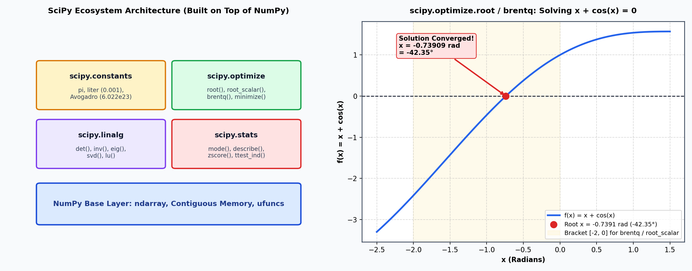
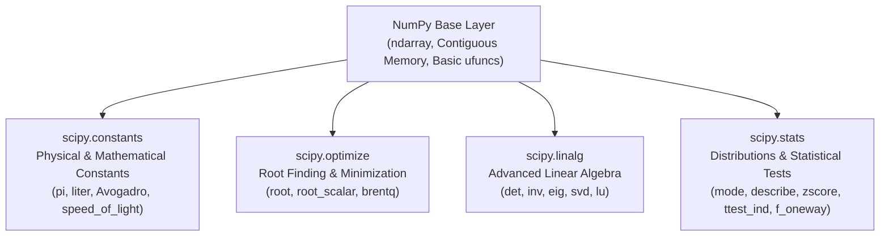

# Dependency Lesson 02.1: SciPy Ecosystem හැඳින්වීම, `scipy.constants`, `scipy.optimize` සහ `scipy.linalg`

**ආශ්‍රිත ප්‍රධාන පාඩම් (Connected Module 4 Core Lessons):**
- [Lesson 4.2: Matrices, Determinants, Transpose & Matrix Terminology](../../Module_04_Mathematics_and_Statistics_for_Data_Science/Lesson_4.2_Matrices_Determinants_Transpose_and_Terminology.md)
- [Lesson 4.7: Inferential Statistics — Confidence Intervals & Hypothesis Testing](../../Module_04_Mathematics_and_Statistics_for_Data_Science/Lesson_4.7_Inferential_Statistics_Confidence_Intervals_and_Hypothesis_Testing.md)

---

## 1. හැඳින්වීම: SciPy යනු කුමක්ද? NumPy සහ SciPy අතර වෙනස කුමක්ද?

බොහෝ සිසුන්ට මතුවන ප්‍රධාන ප්‍රශ්නයක් නම්: *"අපට NumPy තිබේ නම් ඇයි තවත් `SciPy` කියා Library එකක් අවශ්‍ය වන්නේ?"*

* **NumPy (Numerical Python):** මූලික `ndarray` දත්ත ව්‍යුහය, Slicing, Broadcasting සහ මූලික අරා ගණනය කිරීම් සපයන **අත්තිවාරමයි (Foundation Layer)**.
* **SciPy (Scientific Python):** NumPy අත්තිවාරම මත ගොඩනගා ඇති, උසස් විද්‍යාත්මක, ඉංජිනේරුමය සහ සංඛ්‍යානමය ඇල්ගොරිදම (**Optimization, Root Finding, Advanced Linear Algebra, Statistical Distributions, Hypothesis Tests, Signal Processing**) සපයන පුස්තකාලයයි!





---

## 2. `scipy.constants`: විද්‍යාත්මක හා භෞතික නියතයන් (`Maths&stat.ipynb` Cells 118–122)

භෞතික විද්‍යාව, රසායන විද්‍යාව සහ ඉංජිනේරු ගණනය කිරීම්වලදී භාවිතා වන සම්මත ජාත්‍යන්තර (SI / CODATA) නියතයන් සිය ගණනක් `scipy.constants` තුළ නිවැරදිව ගබඩා කර ඇත:

```python
import scipy as sc
from scipy import constants

# 1. පරිමා ඒකක පරිවර්තන: ලීටර 1ක් යනු ඝන මීටර් (m^3) කීයද?
print("1 Liter in m^3:", constants.liter)       # 0.001

# 2. ගණිතමය පයි (Pi) නියතය:
print("Pi:", constants.pi)                      # 3.141592653589793

# 3. ඇවගාඩ්‍රෝ නියතය (Avogadro's Number - මවුලයක ඇති අංශු ගණන):
print("Avogadro:", constants.Avogadro)          # 6.02214076e+23

# constants තුළ ඇති සියලුම නියතයන් ලැයිස්තුව බැලීමට:
print(dir(constants)[:15])
```

---

## 3. `scipy.optimize`: රේඛීය නොවන සමීකරණ විසඳීම (`root`, `root_scalar`, `brentq` — `Maths&stat.ipynb` Cells 128, 137)

සරල වීජීය සමීකරණයක් (උදා: $2x + 4 = 0 \implies x = -2$) අපට අතින් විසඳිය හැක. නමුත්:
$$f(x) = x + \cos(x) = 0$$
වැනි **Transcendental / Non-linear Equation (රේඛීය නොවන සමීකරණයක්)** වීජීය වශයෙන් අතින් විසඳිය නොහැක! එවැනි සමීකරණයක $f(x) = 0$ වන $x$ අගය (**Root / මූලය**) සංඛ්‍යාත්මකව (Numerically) සෙවීමට `scipy.optimize` හි ක්‍රම 3ක් `Maths&stat.ipynb` හි භාවිතා කර ඇත:

1. **`root(eqn, x0)`:** ආරම්භක අනුමානයක් (`x0 = 0`) ලබා දී Hybrid Powell ක්‍රමයෙන් මූලය සොයයි. (සටහන: `root` මගින් `x` ලබා දෙන්නේ 1D NumPy array එකක් ලෙස බැවින් `math.cos(x)` වෙනුවට **`np.cos(x)`** භාවිතා කිරීමෙන් NumPy 1.25+ DeprecationWarning එක වළක්වා ගත හැක!).
2. **`root_scalar(eqn, bracket=[-2, 0])`:** මූලය පිහිටන පරාසයක් (`bracket=[-2, 0]`) ලබා දී Scalar මූලය සොයයි.
3. **`brentq(eqn, -2, 0)`:** Brent's bracketing algorithm මගින් `[-2, 0]` පරාසය තුළ ඇති මූලය ඉතා වේගයෙන් සහ නිවැරදිව සොයයි.

```python
import numpy as np
from scipy.optimize import root, root_scalar, brentq

# f(x) = x + cos(x) ශ්‍රිතය නිර්වචනය කිරීම (x රේඩියනවලින්):
def eqn(x):
    return x + np.cos(x)

# ක්‍රමය 1: root(eqn, initial_guess=0)
myroot = root(eqn, 0)
print("Full OptimizeResult:\n", myroot)
print("Root via root():", myroot.x[0])          # -0.7390851332151607 radians

# ක්‍රමය 2: root_scalar(eqn, bracket=[-2, 0])
res_scalar = root_scalar(eqn, bracket=[-2, 0])
print("Root via root_scalar():", res_scalar.root) # -0.7390851332151607

# ක්‍රමය 3: brentq(eqn, -2, 0)
res_brentq = brentq(eqn, -2, 0)
print("Root via brentq():", res_brentq)           # -0.7390851332151607

# ලැබුණු රේඩියන අගය අංශකවලට (Degrees) හැරවීම:
deg_val = (res_brentq / np.pi) * 180
print("Root in Degrees:", deg_val)                # -42.34645883409292°
```

---

## 🛠️ Practical Task / Hands-On Exercise (ප්‍රායෝගික අභ්‍යාසය)

### Scenario / Goal:
ඔබට $f(x) = x^2 - 4\sin(x) - 1 = 0$ යන රේඛීය නොවන සමීකරණයේ ධන මූලය (Positive root, $[1, 3]$ පරාසය තුළ) `scipy.optimize` මගින් සෙවීමට පැවරී ඇත.

### Step-by-Step Tasks:
1. `f(x) = x**2 - 4*np.sin(x) - 1` ශ්‍රිතය ලියන්න.
2. `brentq(f, 1, 3)` සහ `root(f, 2.0)` මගින් එහි මූලය සොයන්න.
3. ලැබුණු මූලය නැවත `f(x)` වෙත ආදේශ කර පිළිතුර `0.0` බව තහවුරු කරන්න.

### Starter Code:
```python
import numpy as np
from scipy.optimize import root, brentq

def f(x):
    # Write equation here
    pass

# Solve using brentq on bracket [1, 3] and root with initial guess 2.0
```

### Expected Output / Reference Solution:
```python
import numpy as np
from scipy.optimize import root, brentq

def f(x):
    return x**2 - 4 * np.sin(x) - 1

r_brent = brentq(f, 1, 3)
r_root = root(f, 2.0).x[0]

print(f"Root via brentq: {r_brent:.8f}")
print(f"Root via root() : {r_root:.8f}")
print(f"Verification f(root) = {f(r_brent):.2e}")
```
**Expected Output:**
```text
Root via brentq: 2.15143949
Root via root() : 2.15143949
Verification f(root) = 0.00e+00
```

---

## 📝 Summary & Exam Revision Cheat Sheet

| Function / Module | කාර්යය (Purpose) | `Maths&stat.ipynb` උදාහරණය |
| :--- | :--- | :--- |
| `constants.liter` | ලීටර 1ක ඝන මීටර් අගය | `0.001` |
| `constants.Avogadro` | ඇවගාඩ්‍රෝ නියතය ($N_A$) | `6.02214076e+23` |
| `optimize.root(eqn, 0)` | ආරම්භක අනුමානයක් දී $f(x)=0$ විසඳීම | `myroot.x` $\to$ `[-0.73908513]` |
| `optimize.root_scalar(eqn, bracket=[-2,0])` | පරාසයක් තුළ Scalar මූලය සෙවීම | `res_scalar.root` $\to$ `-0.73908513` |
| `optimize.brentq(eqn, -2, 0)` | Brent's ක්‍රමයෙන් වේගවත්ව මූලය සෙවීම | `-0.7390851332151607` (`-42.35°`) |

---

**ඊළඟ Dependency පාඩම:** [02_SciPy_stats_Distributions_PDF_CDF_PPF_and_Z_Scores.md](02_SciPy_stats_Distributions_PDF_CDF_PPF_and_Z_Scores.md)  
**ආපසු ප්‍රධාන පාඩමට (Back to Main Lesson):** [Lesson 4.7: Inferential Statistics — Confidence Intervals & Hypothesis Testing](../../Module_04_Mathematics_and_Statistics_for_Data_Science/Lesson_4.7_Inferential_Statistics_Confidence_Intervals_and_Hypothesis_Testing.md)
