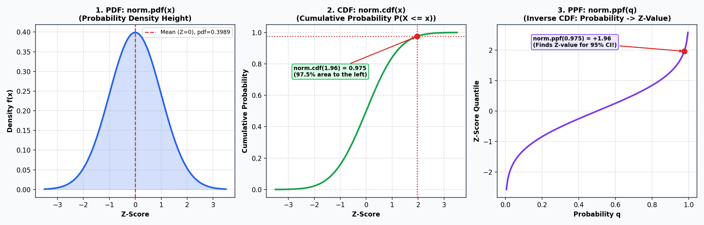
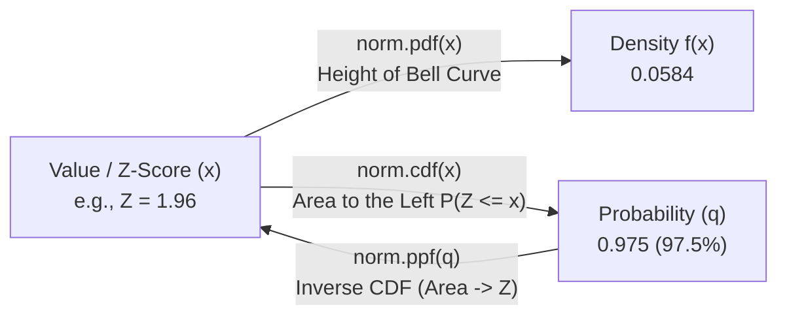

# Dependency Lesson 02.2: `scipy.stats` — Mode, Describe, Z-Scores සහ Normal Distribution (`pdf`, `cdf`, `ppf`)

**ආශ්‍රිත ප්‍රධාන පාඩම් (Connected Module 4 Core Lessons):**
- [Lesson 4.4: Descriptive Statistics I — Measures of Central Tendency](../../Module_04_Mathematics_and_Statistics_for_Data_Science/Lesson_4.4_Descriptive_Statistics_I_Measures_of_Central_Tendency.md)
- [Lesson 4.5: Descriptive Statistics II — Measures of Spread & Correlation](../../Module_04_Mathematics_and_Statistics_for_Data_Science/Lesson_4.5_Descriptive_Statistics_II_Measures_of_Spread_and_Correlation.md)
- [Lesson 4.6: The Normal (Gaussian) Distribution](../../Module_04_Mathematics_and_Statistics_for_Data_Science/Lesson_4.6_The_Normal_Gaussian_Distribution.md)

---

## 1. හැඳින්වීම: ඇයි සංඛ්‍යානය සඳහා `scipy.stats` අත්‍යවශ්‍ය වන්නේ?

NumPy මගින් `mean()`, `std()`, `var()`, `median()` වැනි මූලික ගණනය කිරීම් ලබා දුන්නද:
* **Mode (මාතය)** සහ එය යෙදුණු වාර ගණන (`count`) සෙවීමට,
* එකම Function එකකින් **Skewness (කුටිකතාව)** සහ **Kurtosis (වක්‍රතාව)** ඇතුළු සම්පූර්ණ විස්තරාත්මක සාරාංශයක් (`describe`) ලබා ගැනීමට,
* **Z-Scores** ස්වයංක්‍රීයව ගණනය කිරීමට, සහ
* **Normal Distribution (ප්‍රමත ව්‍යාප්තිය)** ඇතුළු සම්භාවිතා ව්‍යාප්තිවල **PDF, CDF, PPF** ගණනය කිරීමට අපි `scipy.stats` (`import scipy.stats as stat`) භාවිතා කරමු!



---

## 2. `stat.mode()` සහ `stat.describe()` (`Maths&stat.ipynb` Cells 139–172)

### 1. `stat.mode(a, axis=0)` — Mode (මාතය) සහ Frequency Count:
* 1D දෛශිකයක හෝ 2D න්‍යාසයක වැඩිම වාර ගණනක් යෙදෙන අගය (`mode`) සහ එය යෙදුණු වාර ගණන (`count`) `ModeResult` object එකක් ලෙස ලබා දෙයි.
* **වැදගත් නීතිය:** යම් තීරුවක හෝ පේළියක අගයන් කිහිපයක් සමාන උපරිම වාර ගණනක් යෙදී ඇත්නම් (Tie), `scipy.stats.mode` මගින් සෑමවිටම ඉන් **කුඩාම අගය (Smallest value)** තෝරා ගනී!

```python
import numpy as np
import scipy.stats as stat

st_ages = np.array([22, 21, 23, 28, 23, 34, 30, 24, 49, 27, 23, 22, 32, 28, 26])

# 1. 1D Array එකක Mode සහ Count:
res = stat.mode(st_ages)
print("Mode:", res.mode)                        # 23
print("Count:", res.count)                      # 3 (23 යන්න 3 වතාවක් යෙදී ඇත)

# 2. 2D Matrix එකක axis=0, axis=1, සහ axis=None අනුව Mode සෙවීම:
mat_1 = np.array([
    [1, 5, 6, 7],
    [3, 2, 5, 6],
    [6, 5, 3, 4]
])

# Column-wise (axis=0, default):
# Col 0: [1,3,6] -> සියල්ල 1 වරක් බැවින් කුඩාම අගය 1!
# Col 1: [5,2,5] -> 5 දෙවරක්!
# Col 2: [6,5,3] -> කුඩාම අගය 3!
# Col 3: [7,6,4] -> කුඩාම අගය 4!
print(stat.mode(mat_1))             # ModeResult(mode=array([1, 5, 3, 4]), count=array([1, 2, 1, 1]))

# Row-wise (axis=1): එක් එක් පේළියේ කුඩාම අගය (සියල්ල 1 වරක් බැගින් ඇති නිසා)
print(stat.mode(mat_1, 1))          # ModeResult(mode=array([1, 2, 3]), count=array([1, 1, 1]))

# මුළු න්‍යාසයම එකක් ලෙස සලකා (axis=None):
# 5 සහ 6 යන දෙකම 3 වතාවක් යෙදී ඇත; ඉන් කුඩාම අගය 5 තෝරා ගනී!
print(stat.mode(mat_1, axis=None))  # ModeResult(mode=np.int64(5), count=np.int64(3))
```

### 2. `stat.describe()` — සම්පූර්ණ සංඛ්‍යානමය සාරාංශය:
එකම Function call එකකින් වැදගත් සංඛ්‍යානමය මිනුම් 6ක් ලබා දෙයි:
1. `nobs`: නිරීක්ෂණ ගණන (Number of observations)
2. `minmax`: `(min, max)` Tuple එක
3. `mean`: **Mean (මධ්‍යන්‍යය)**
4. `variance`: **Sample Variance (නියැදි විචලතාවය - $n-1$ මගින් බෙදූ)**
5. `skewness`: ව්‍යාප්තියේ අසමමිතික බව (Skewness)
6. `kurtosis`: ව්‍යාප්තියේ උල් බව / Tail heaviness (Kurtosis)

```python
print(stat.describe(mat_1, axis=0))     # තීරු ඔස්සේ (nobs=3)
print(stat.describe(mat_1, axis=1))     # පේළි ඔස්සේ (nobs=4)
print(stat.describe(mat_1, axis=None))  # මුළු න්‍යාසයේම අවයව 12 සඳහා (nobs=12)
```

---

## 3. `stat.zscore()`: Standard Score (Z-Score) සහ Outliers සෙවීම (`Maths&stat.ipynb` Cells 178–193)

යම් දත්ත අගයක් ($x$) එහි **Mean (මධ්‍යන්‍යය - $\mu$)** සිට **Standard Deviation (සම්මත අපගමනය - $\sigma$)** කීයක් දුරින් පිහිටා ඇත්දැයි පෙන්වන මිනුම **Z-Score** වේ:
$$Z = \frac{x - \mu}{\sigma}$$

```python
z_vals = stat.zscore(st_ages)
print(np.round(z_vals, 4))
# [-0.7947 -0.9401 -0.6494  0.0775 -0.6494  0.9498  0.3683 -0.504
#   3.1305 -0.0678 -0.6494 -0.7947  0.659   0.0775 -0.2132]

# ඉහළම Z-scores 5 සහ ඒවාට අදාළ සිසුන්ගේ වයස් සෙවීම (Maths&stat.ipynb Cells 192-193):
top5_z = np.partition(z_vals, -5)[-5:]
for z in top5_z:
    ind1 = np.where(z_vals == z)
    print("Index:", ind1, "| Ages:", [st_ages[j] for j in ind1[0]])
```
* වයස `49` වූ ශිෂ්‍යයාගේ Z-Score එක **`+3.1305`** ($> 3.0$) වේ! එනම් එය Mean අගයට වඩා Standard Deviations 3.13ක් ඉහළින් පිහිටි පැහැදිලි **Outlier** අගයකි.

---

## 4. Normal Distribution හි `pdf()`, `cdf()`, සහ `ppf()`

`scipy.stats.norm` තුළ ප්‍රධාන Functions 3ක් ඇත:



```python
from scipy.stats import norm

# 1. PDF (Probability Density Function): Z = 0 හිදී වක්‍රයේ උස
print("PDF at Z=0:", norm.pdf(0, loc=0, scale=1))       # 0.39894228

# 2. CDF (Cumulative Distribution Function): Z = 1.96 ට වම් පසින් ඇති වර්ගඵලය (සම්භාවිතාව)
print("CDF at Z=1.96:", norm.cdf(1.96))                 # 0.975002 (97.5%)
# -1.96 සහ +1.96 අතර ඇති සම්භාවිතාව:
print("Area between -1.96 and +1.96:", norm.cdf(1.96) - norm.cdf(-1.96)) # 0.9500 (95%!)

# 3. PPF (Percent Point Function / Inverse CDF): 95% Confidence Interval සඳහා Z අගය සෙවීම
# දෙපසින් 2.5% බැගින් ඉතිරි වන නිසා වම් පසින් 97.5% (0.975) වන Z අගය:
print("Z-value for 95% CI:", norm.ppf(0.975))           # 1.95996398 (1.96!)
```

---

## 🛠️ Practical Task / Hands-On Exercise (ප්‍රායෝගික අභ්‍යාසය)

### Scenario / Goal:
පන්තියක සිසුන් 12 දෙනෙකුගේ විභාග ලකුණු `[55, 62, 62, 68, 70, 72, 75, 78, 80, 82, 85, 99]` ලෙස දී ඇත. `scipy.stats` භාවිතා කර එහි Mode, Describe සාරාංශය, සහ සෑම ශිෂ්‍යයෙකුගේම Z-Score ගණනය කරන්න.

### Step-by-Step Tasks:
1. `stat.mode(marks)` මගින් වැඩිම වාර ගණනක් යෙදුණු ලකුණ සහ එහි වාර ගණන සොයන්න.
2. `stat.describe(marks)` මගින් `mean`, `variance`, `skewness` මුද්‍රණය කරන්න.
3. `stat.zscore(marks)` මගින් ලකුණු 99 ගත් ශිෂ්‍යයාගේ Z-Score එක කීයදැයි සොයන්න.

### Starter Code:
```python
import numpy as np
import scipy.stats as stat

marks = np.array([55, 62, 62, 68, 70, 72, 75, 78, 80, 82, 85, 99])

# Write your solution here
```

### Expected Output / Reference Solution:
```python
import numpy as np
import scipy.stats as stat

marks = np.array([55, 62, 62, 68, 70, 72, 75, 78, 80, 82, 85, 99])

m = stat.mode(marks)
print(f"Mode: {m.mode} (Occurred {m.count} times)")

desc = stat.describe(marks)
print(f"Mean: {desc.mean:.2f} | Sample Variance: {desc.variance:.2f} | Skewness: {desc.skewness:.4f}")

z = stat.zscore(marks)
print("Z-score of highest mark (99):", np.round(z[-1], 4))
```
**Expected Output:**
```text
Mode: 62 (Occurred 2 times)
Mean: 74.00 | Sample Variance: 141.27 | Skewness: 0.4227
Z-score of highest mark (99): 2.1969
```

---

## 📝 Summary & Exam Revision Cheat Sheet

| Function | ප්‍රතිදානය (Output) | ප්‍රධාන භාවිතය |
| :--- | :--- | :--- |
| `stat.mode(arr, axis)` | `ModeResult(mode, count)` | වැඩිම වාර ගණනක් යෙදෙන අගය (සමාන නම් කුඩාම අගය) සෙවීම. |
| `stat.describe(arr, axis)` | `nobs, minmax, mean, variance, skewness, kurtosis` | සම්පූර්ණ Descriptive Statistics සාරාංශය එකවර ලබා ගැනීම. |
| `stat.zscore(arr)` | Z-Scores Array ($\frac{x-\mu}{\sigma}$) | දත්ත ප්‍රමතකරණය (Standardization) සහ Outliers ($|Z|>3$) හඳුනා ගැනීම. |
| `norm.pdf(x)` / `cdf(x)` / `ppf(q)` | Density / Probability / Z-Quantile | Normal Distribution ගණනය කිරීම් සහ CI Z-values සෙවීම. |

---

**ඊළඟ Dependency පාඩම:** [03_Statistical_Tests_in_SciPy_ttest_ANOVA_and_Correlation.md](03_Statistical_Tests_in_SciPy_ttest_ANOVA_and_Correlation.md)  
**ආපසු ප්‍රධාන පාඩමට (Back to Main Lesson):** [Lesson 4.6: The Normal (Gaussian) Distribution](../../Module_04_Mathematics_and_Statistics_for_Data_Science/Lesson_4.6_The_Normal_Gaussian_Distribution.md)
