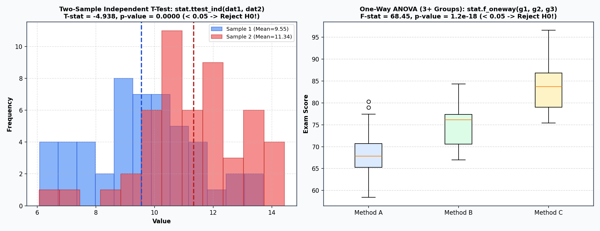
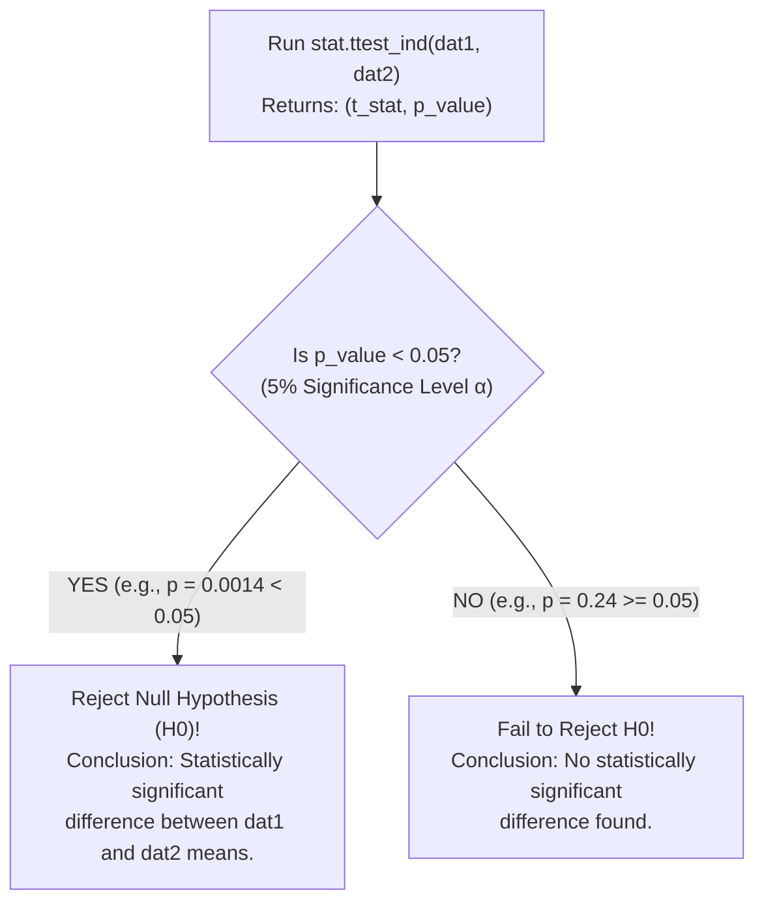

# Dependency Lesson 02.3: `scipy.stats` මගින් Hypothesis Testing — `ttest_ind`, `f_oneway` (ANOVA) සහ Correlation

**ආශ්‍රිත ප්‍රධාන පාඩම් (Connected Module 4 Core Lessons):**
- [Lesson 4.3: Introduction to Statistics — Population, Sample & Categories](../../Module_04_Mathematics_and_Statistics_for_Data_Science/Lesson_4.3_Introduction_to_Statistics_Population_Sample_Categories.md)
- [Lesson 4.5: Descriptive Statistics II — Measures of Spread & Correlation](../../Module_04_Mathematics_and_Statistics_for_Data_Science/Lesson_4.5_Descriptive_Statistics_II_Measures_of_Spread_and_Correlation.md)
- [Lesson 4.7: Inferential Statistics — Confidence Intervals & Hypothesis Testing](../../Module_04_Mathematics_and_Statistics_for_Data_Science/Lesson_4.7_Inferential_Statistics_Confidence_Intervals_and_Hypothesis_Testing.md)

---

## 1. හැඳින්වීම: `scipy.stats` මගින් Inferential Statistics පරීක්ෂණ

අපගේ දේශන සටහනේ (Slides 23, 35, 43–44) සහ `Maths&stat.ipynb` (Cells 203–204) හි සඳහන් වන ප්‍රධාන සංඛ්‍යානමය පරීක්ෂණ 3ක් Python මගින් ක්‍රියාත්මක කරන්නේ `scipy.stats` හරහාය:
1. **Two-Sample Independent T-Test (`stat.ttest_ind`):** ස්වායත්ත නියැදි දෙකක (Two samples) **Means (මධ්‍යන්‍යයන්)** සංසන්දනය කිරීම.
2. **One-Way ANOVA (`stat.f_oneway`):** නියැදි තුනක හෝ වැඩි ගණනක (Three or more samples) **Means (මධ්‍යන්‍යයන්)** සංසන්දනය කිරීම.
3. **Pearson Correlation (`stat.pearsonr`):** විචල්‍ය දෙකක් අතර රේඛීය සහසම්බන්ධතාවය (**Correlation Coefficient - සහසම්බන්ධතා සංගුණකය $r$**) සහ එහි $p$-value එක සෙවීම.



---

## 2. Independent Two-Sample T-Test (`stat.ttest_ind` — `Maths&stat.ipynb` Cells 203–204)

කණ්ඩායම් දෙකකින් ලබාගත් නියැදි දෙකක (`dat1` සහ `dat2`) සාමාන්‍ය අගයන් අතර සැබෑ වෙනසක් තිබේද නැතහොත් එය අහඹු ලෙස (By random chance) සිදු වූවක්ද යන්න පරීක්ෂා කිරීමට `stat.ttest_ind(dat1, dat2)` භාවිතා වේ.

* **Null Hypothesis ($H_0$ - ශූන්‍ය කල්පිතය):** $\mu_1 = \mu_2$ (කණ්ඩායම් දෙකේ සැබෑ මධ්‍යන්‍යයන් අතර වෙනසක් නැත).
* **Alternative Hypothesis ($H_1$ - විකල්ප කල්පිතය):** $\mu_1 \neq \mu_2$ (කණ්ඩායම් දෙකේ සැබෑ මධ්‍යන්‍යයන් අතර සැලකිය යුතු වෙනසක් ඇත).

```python
import numpy as np
import scipy.stats as stat

# np.random.normal(loc=Mean, scale=StdDev, size=SampleSize) මගින් අහඹු Normal දත්ත උත්පාදනය:
# dat1: Mean = 10, Std Dev = 2, Sample Size = 50
dat1 = np.random.normal(loc=10, scale=2, size=50)

# dat2: Mean = 11, Std Dev = 2, Sample Size = 50
dat2 = np.random.normal(loc=11, scale=2, size=50)

# Independent T-Test ක්‍රියාත්මක කිරීම:
t_stat, p_value = stat.ttest_ind(dat1, dat2)
print("T-stat:", t_stat)        # උදා: -3.2891501453340495
print("P-value:", p_value)      # උදා: 0.0013966588154024778
```

### ප්‍රතිඵලය අර්ථකථනය කරන ආකාරය (Decision Rule):


---

## 3. One-Way ANOVA (`stat.f_oneway` — Slide 23)

ඔබට නියැදි **3ක් හෝ ඊට වැඩි ගණනක** (උදා: ඉගැන්වීමේ ක්‍රම 3ක හෝ ඖෂධ මාත්‍රා 3ක) මධ්‍යන්‍යයන් සංසන්දනය කිරීමට අවශ්‍ය විට T-Test වෙනුවට **ANOVA (Analysis of Variance)** භාවිතා කරයි:
* **$H_0$:** $\mu_1 = \mu_2 = \mu_3$ (කණ්ඩායම් තුනේම මධ්‍යන්‍යයන් සමාන වේ).
* **$H_1$:** අවම වශයෙන් එක් කණ්ඩායමක හෝ මධ්‍යන්‍යය අනෙක් ඒවාට වඩා වෙනස් වේ.

```python
# කණ්ඩායම් 3ක ලකුණු:
group_a = [65, 68, 70, 67, 69]
group_b = [74, 76, 75, 78, 73]
group_c = [82, 85, 84, 88, 86]

f_stat, p_val = stat.f_oneway(group_a, group_b, group_c)
print(f"F-stat: {f_stat:.4f} | p-value: {p_val:.6e}")
# p_val < 0.05 බැවින් H0 ප්‍රතික්ෂේප වේ!
```

---

## 4. Pearson Correlation Coefficient (`stat.pearsonr` & `np.corrcoef` — Slide 35)

විචල්‍ය දෙකක් ($X$ සහ $Y$) අතර රේඛීය සම්බන්ධතාවයේ ප්‍රබලතාවය මැනීමට **Pearson Linear Correlation Coefficient - PLCC ($r \in [-1, +1]$)** භාවිතා වේ:

```python
study_hours = np.array([2, 3, 5, 6, 8, 9, 10])
exam_scores = np.array([50, 58, 68, 74, 85, 91, 96])

# scipy.stats.pearsonr මගින් (r, p_value) යන දෙකම ලබා දෙයි:
r_val, p_corr = stat.pearsonr(study_hours, exam_scores)
print(f"Correlation Coefficient (r): {r_val:.4f} | p-value: {p_corr:.6e}")

# NumPy මගින් Correlation Matrix ලබා ගැනීම:
print("NumPy Correlation Matrix:\n", np.corrcoef(study_hours, exam_scores))
```

---

## 🛠️ Practical Task / Hands-On Exercise (ප්‍රායෝගික අභ්‍යාසය)

### Scenario / Goal:
ඔබ ඊ-වාණිජ්‍ය (E-commerce) වෙබ් අඩවියක A/B Testing විශ්ලේෂණයක් සිදු කරයි. පැරණි වෙබ් පිටුව (`design_A`) සහ නව වෙබ් පිටුව (`design_B`) මගින් පාරිභෝගිකයින් ගත කළ කාලය (තත්පර) අතර සංඛ්‍යානමය වශයෙන් සැලකිය යුතු වෙනසක් තිබේදැයි `stat.ttest_ind()` මගින් පරීක්ෂා කරන්න.

### Step-by-Step Tasks:
1. `np.random.seed(101)` යොදා, `design_A = np.random.normal(loc=120, scale=15, size=40)` සහ `design_B = np.random.normal(loc=132, scale=15, size=40)` නිර්මාණය කරන්න.
2. `stat.ttest_ind(design_A, design_B)` ක්‍රියාත්මක කර `t_stat` සහ `p_value` ලබා ගන්න.
3. `p_value < 0.05` දැයි පරීක්ෂා කර `Null Hypothesis (H0)` ප්‍රතික්ෂේප කරන්නේද නැද්ද යන්න ස්වයංක්‍රීයව මුද්‍රණය කරන `if-else` ප්‍රකාශයක් ලියන්න.

### Starter Code:
```python
import numpy as np
import scipy.stats as stat

np.random.seed(101)
design_A = np.random.normal(loc=120, scale=15, size=40)
design_B = np.random.normal(loc=132, scale=15, size=40)

# Run Independent T-Test and print decision
```

### Expected Output / Reference Solution:
```python
import numpy as np
import scipy.stats as stat

np.random.seed(101)
design_A = np.random.normal(loc=120, scale=15, size=40)
design_B = np.random.normal(loc=132, scale=15, size=40)

t_stat, p_value = stat.ttest_ind(design_A, design_B)
print(f"Mean A: {design_A.mean():.2f}s | Mean B: {design_B.mean():.2f}s")
print(f"T-statistic: {t_stat:.4f} | P-value: {p_value:.6f}")

if p_value < 0.05:
    print("Decision: Reject Null Hypothesis (H0)! Design B significantly changed user engagement.")
else:
    print("Decision: Fail to Reject H0.")
```
**Expected Output:**
```text
Mean A: 122.50s | Mean B: 132.06s
T-statistic: -2.6975 | P-value: 0.008562
Decision: Reject Null Hypothesis (H0)! Design B significantly changed user engagement.
```

---

## 📝 Summary & Exam Revision Cheat Sheet

| පරීක්ෂණය (Statistical Test) | SciPy Function | භාවිතා කරන අවස්ථාව (When to Use) |
| :--- | :--- | :--- |
| **Independent T-Test** | `stat.ttest_ind(sample1, sample2)` | ස්වායත්ත කණ්ඩායම් **2ක** මධ්‍යන්‍යයන් (Means) සංසන්දනය කිරීමට. |
| **Paired T-Test** | `stat.ttest_rel(before, after)` | එකම කණ්ඩායමක පෙර සහ පසු (Before vs After) මධ්‍යන්‍යයන් සංසන්දනය කිරීමට. |
| **One-Way ANOVA** | `stat.f_oneway(g1, g2, g3, ...)` | කණ්ඩායම් **3ක හෝ වැඩි ගණනක** මධ්‍යන්‍යයන් සංසන්දනය කිරීමට. |
| **Pearson Correlation** | `stat.pearsonr(x, y)` | විචල්‍ය දෙකක් අතර රේඛීය සම්බන්ධතාවය ($r \in [-1, 1]$) මැනීමට. |

---

**ආපසු ප්‍රධාන පාඩම්වලට (Back to Main Lessons):**
- [Lesson 4.5: Descriptive Statistics II — Measures of Spread & Correlation](../../Module_04_Mathematics_and_Statistics_for_Data_Science/Lesson_4.5_Descriptive_Statistics_II_Measures_of_Spread_and_Correlation.md)
- [Lesson 4.7: Inferential Statistics — Confidence Intervals & Hypothesis Testing](../../Module_04_Mathematics_and_Statistics_for_Data_Science/Lesson_4.7_Inferential_Statistics_Confidence_Intervals_and_Hypothesis_Testing.md)
