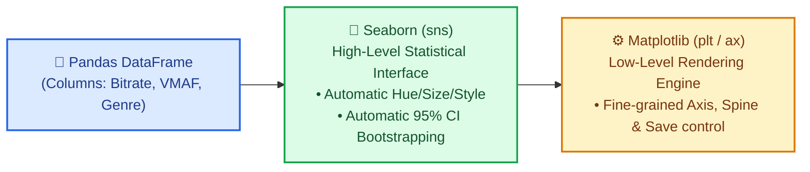
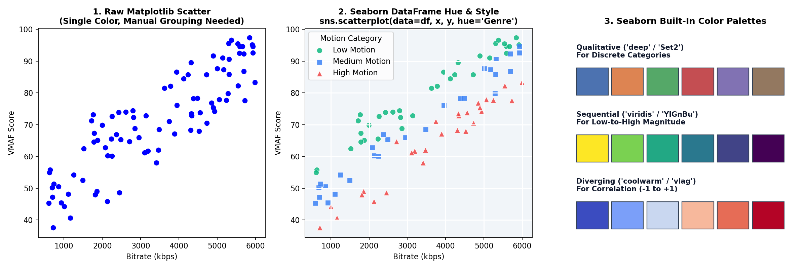

# Dep 02 - පාඩම 01: Seaborn හඳුන්වා දීම — Themes, Color Palettes සහ Pandas DataFrame Integration (Zero-to-Hero Guide)

**අදාළ ප්‍රධාන පාඩම් (Related Core Lessons):**
- [⬅️ Back to Lesson 5.1: Purpose of Data Visualization & Tufte Principles](../../Module_05_Data_Visualization_Principles_and_Techniques/Lesson_5.1_Purpose_of_Data_Visualization_and_Tufte_Principles.md)
- [⬅️ Back to Lesson 5.4: Visualizing the Impossible — High-Dimensional & Multivariate Data](../../Module_05_Data_Visualization_Principles_and_Techniques/Lesson_5.4_Visualizing_the_Impossible_High_Dimensional_and_Multivariate.md)

---

## 1. හැඳින්වීම: Matplotlib තිබියදී ඇයි අපට Seaborn අවශ්‍ය වන්නේ?

අපි `Dep_01_Matplotlib_Zero_to_Hero` පාඩම් මාලාවෙන් ඉගෙන ගත් පරිදි, **Matplotlib** යනු ඉතා බලවත් මූලික පුස්තකාලයකි. නමුත් සැබෑ ලෝකයේ Data Science ව්‍යාපෘතිවලදී අපේ දත්ත පවතින්නේ **Pandas DataFrames** තුළයි.
- උදාහරණයක් ලෙස Slide 22 හි දැක්වෙන පරිදි, DataFrame එකක ඇති Categorical තීරුවකට (`Genre = 'Low Motion', 'Medium Motion', 'High Motion'`) අනුව Scatter Plot එකක් **Color Coding** කිරීමට Matplotlib වලින් ලියන්නට ගියහොත්, අපට `for` loop එකක් ලියා එක් එක් කාණ්ඩය වෙන වෙනම Filter කර වර්ණ සහ Legends අතින් ලබා දීමට සිදුවේ.
- එමෙන්ම Slide 26 හි දැක්වෙන **95% Confidence Interval (95% විශ්වාසනීය ප්‍රාන්තරය)** සහිත තීරු හෝ රේඛා ඇඳීමට Matplotlib වලදී සංඛ්‍යානමය ගණනය කිරීම් සියල්ල අප විසින්ම කළ යුතුය.

මෙම ගැටලුව විසඳීමට **Michael Waskom** විසින් Matplotlib මත පදනම්ව (Built on top of Matplotlib) **Seaborn (`import seaborn as sns`)** නිර්මාණය කරන ලදී.





---

## 2. Matplotlib vs. Seaborn: කේත පේළි 10ක් වෙනුවට තනි කේත පේළියක්!

Pandas DataFrame එකක තීරු නම් (`Column Names`) කෙලින්ම `x`, `y`, `hue` (වර්ණය), `style` (හැඩය), සහ `size` (විශාලත්වය) වෙත ලබා දීමේ හැකියාව Seaborn සතු ප්‍රබලතම ලක්ෂණයයි:

```python
import pandas as pd
import seaborn as sns
import matplotlib.pyplot as plt

# නියැදි DataFrame එකක් සෑදීම
df = pd.DataFrame({
    'Bitrate': [500, 1000, 2000, 4000, 600, 1500, 3000, 5000],
    'VMAF':    [48,  65,   78,   91,   42,  58,   72,   85],
    'Motion':  ['Low', 'Low', 'Low', 'Low', 'High', 'High', 'High', 'High']
})

# තනි කේත පේළියකින් X, Y, Color (hue), සහ Marker Shape (style) යන සියල්ල ස්වයංක්‍රීයව ඇඳීම!
sns.scatterplot(data=df, x='Bitrate', y='VMAF', hue='Motion', style='Motion', s=100)

plt.title('Bitrate vs VMAF Color-Coded by Motion Category')
plt.show()
```

---

## 3. Seaborn Themes සහ Contexts (`sns.set_theme`)

Edward Tufte ගේ මූලධර්මවලට අනුව ප්‍රස්තාරයක පසුබිම සහ අකුරු ප්‍රමාණය එය ඉදිරිපත් කරන මාධ්‍යයට (Research Paper, Lecture Slide, Poster) ගැලපිය යුතුය. `sns.set_theme()` මඟින් තත්පරයකින් මුළු ප්‍රස්තාරයේම පෙනුම වෙනස් කළ හැක:

### A. Built-in Styles 5 (`style=`):
1. `'darkgrid'` (Default): ලා අළු පසුබිමක් මත සුදු Grid රේඛා — දත්ත ගවේෂණයට (EDA) ඉතා පහසුය.
2. `'whitegrid'`: සුදු පසුබිමක් මත සියුම් අළු Grid රේඛා — Boxplots සහ Bar charts සඳහා විශිෂ්ටයි.
3. `'ticks'`: Grid රේඛා නොමැතිව අක්ෂ මත Ticks පමණක් යොදයි — IEEE / Springer පර්යේෂණ පත්‍රිකා සඳහා වඩාත්ම සුදුසුය.
4. `'white'`: සම්පූර්ණ පිරිසිදු සුදු පසුබිම.
5. `'dark'`: Grid රේඛා නොමැති අළු පසුබිම.

### B. Scaling Contexts 4 (`context=`):
- `'paper'`, `'notebook'` (Default), `'talk'` (දේශන Slides සඳහා විශාල අකුරු), `'poster'` (පෝස්ටර් සඳහා ඉතා විශාල අකුරු).

```python
# දේශන Slide එකක් සඳහා සුදුසු Theme එකක් සහ අකුරු ප්‍රමාණයක් සැකසීම
sns.set_theme(style='whitegrid', context='talk')

# ඉහළ සහ දකුණු Spines ඉවත් කිරීමට Seaborn හි තනි විධානය:
sns.despine()
```

---

## 4. විද්‍යාත්මක වර්ණ මාලාවන් (Seaborn Color Palettes)

Slide 29 (*Pre-attentive Processing*) හි සඳහන් පරිදි වර්ණ තෝරා ගැනීමේදී දත්තවල ස්වභාවය අනුව නිවැරදි **Color Palette** වර්ගය තෝරා ගත යුතුය:

1. **Qualitative Palettes (`'deep'`, `'Set2'`, `'colorblind'`):**
   - අනුපිළිවෙලක් නොමැති විවික්ත කාණ්ඩ (**Discrete Categories** - උදා: රටවල්, ක්‍රීඩා වර්ග) වෙන් කර පෙන්වීමට.
2. **Sequential Palettes (`'viridis'`, `'YlGnBu'`, `'rocket'`, `'Blues'`):**
   - අඩු අගයේ සිට වැඩි අගය දක්වා (**Low to High Magnitude** - උදා: 0% සිට 100% දක්වා Acceptance Rate Heatmap - Slide 24) පෙන්වීමට.
3. **Diverging Palettes (`'coolwarm'`, `'vlag'`, `'RdBu_r'`):**
   - මැද බිංදුව ($0$) හෝ මධ්‍යස්ථ අගයක් තිබී දෙපසට ධන සහ සෘණ ලෙස විහිදෙන දත්ත (උදා: $-1.0$ සිට $+1.0$ දක්වා **Pearson Correlation (සහසම්බන්ධතාවය)**) පෙන්වීමට.

---

## 🛠️ 5. Practical Task / Hands-On Exercise (ප්‍රායෝගික අභ්‍යාසය)

### Scenario / Goal:
ඔබ ළඟ ක්‍රීඩා වීඩියෝ 12ක `Bitrate`, `VMAF`, `FPS` (Frames Per Second), සහ `Codec` (`H.264`, `HEVC`, `AV1`) අඩංගු Pandas DataFrame එකක් ඇත. Seaborn හි `whitegrid` තේමාව සහ `colorblind` වර්ණ මාලාව භාවිතා කර, එකම ප්‍රස්තාරයක් තුළ **මානයන් 4ක්** (`x='Bitrate'`, `y='VMAF'`, `hue='Codec'`, `size='FPS'`) නිරූපණය කරන Bubble Scatter Plot එකක් අඳින්න.

### Step-by-Step Tasks:
1. `sns.set_theme(style='whitegrid', palette='colorblind')` සක්‍රීය කරන්න.
2. `fig, ax = plt.subplots(figsize=(8, 5))` සාදා `sns.scatterplot(..., ax=ax)` තුළ `x`, `y`, `hue`, `style`, සහ `size` (`sizes=(60, 250)`) ලබා දෙන්න.
3. `sns.despine()` මඟින් ඉහළ සහ දකුණු මායිම් ඉවත් කර Title සහ ඒකක සහිත Labels එකතු කරන්න.

### Starter Code:
```python
import pandas as pd
import seaborn as sns
import matplotlib.pyplot as plt

df_video = pd.DataFrame({
    'Bitrate': [500, 1500, 3000, 5000, 500, 1500, 3000, 5000, 500, 1500, 3000, 5000],
    'VMAF':    [45,  68,   80,   88,   52,  75,   86,   93,   58,  81,   91,   97],
    'FPS':     [30,  30,   60,   60,   30,  60,   60,   120,  60,  60,   120,  120],
    'Codec':   ['H.264']*4 + ['HEVC']*4 + ['AV1']*4
})

# TODO: Configure theme, plot 4D scatterplot using hue and size, and despine
```

### Expected Output / Reference Solution:
```python
import pandas as pd
import seaborn as sns
import matplotlib.pyplot as plt

df_video = pd.DataFrame({
    'Bitrate': [500, 1500, 3000, 5000, 500, 1500, 3000, 5000, 500, 1500, 3000, 5000],
    'VMAF':    [45,  68,   80,   88,   52,  75,   86,   93,   58,  81,   91,   97],
    'FPS':     [30,  30,   60,   60,   30,  60,   60,   120,  60,  60,   120,  120],
    'Codec':   ['H.264']*4 + ['HEVC']*4 + ['AV1']*4
})

# 1. Theme සහ Colorblind-safe Palette සැකසීම
sns.set_theme(style='whitegrid', palette='colorblind')

fig, ax = plt.subplots(figsize=(8.5, 5))

# 2. මානයන් 4ක් (Bitrate, VMAF, Codec, FPS) එකවර නිරූපණය කිරීම
sns.scatterplot(
    data=df_video,
    x='Bitrate',
    y='VMAF',
    hue='Codec',
    style='Codec',
    size='FPS',
    sizes=(70, 260),
    alpha=0.85,
    ax=ax
)

# 3. Spines ඉවත් කර ලේබල් යෙදීම
sns.despine()
ax.set_title('4D Video Quality Analysis: Bitrate, VMAF, Codec & FPS', fontsize=14, fontweight='bold')
ax.set_xlabel('Bitrate (kbps)', fontsize=12)
ax.set_ylabel('VMAF Perceptual Quality Score', fontsize=12)

plt.tight_layout()
plt.show()
```

---

**🔗 Next Dependency Lesson:** [02_Distribution_Categorical_and_Relational_Plots_in_Seaborn.md](02_Distribution_Categorical_and_Relational_Plots_in_Seaborn.md)
