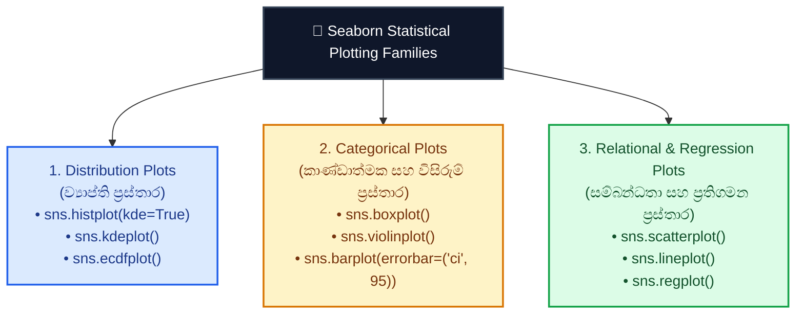
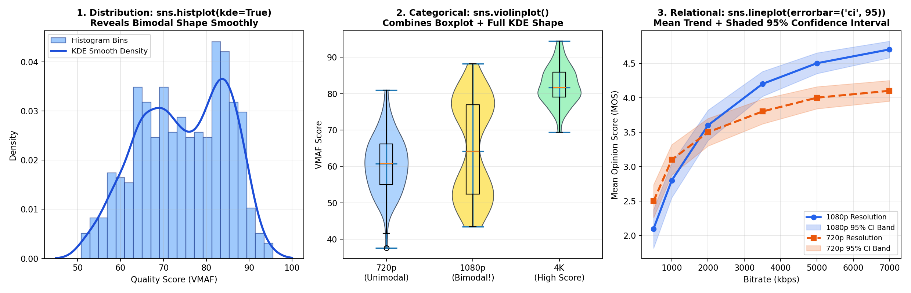

# Dep 02 - පාඩම 02: ව්‍යාප්ති, කාණ්ඩාත්මක සහ සම්බන්ධතා ප්‍රස්තාර — Distribution, Categorical & Relational Plots in Seaborn

**අදාළ ප්‍රධාන පාඩම් (Related Core Lessons):**
- [⬅️ Back to Lesson 5.2: Choosing the Right Visualization — Distributions & Relationships](../../Module_05_Data_Visualization_Principles_and_Techniques/Lesson_5.2_Choosing_Right_Visualization_Distributions_and_Relationships.md)
- [⬅️ Back to Lesson 5.3: Visualizing Composition, Spread & Comparisons](../../Module_05_Data_Visualization_Principles_and_Techniques/Lesson_5.3_Visualizing_Composition_Spread_and_Comparisons.md)
- [⬅️ Back to Lesson 5.4: Visualizing the Impossible — High-Dimensional & Multivariate Data](../../Module_05_Data_Visualization_Principles_and_Techniques/Lesson_5.4_Visualizing_the_Impossible_High_Dimensional_and_Multivariate.md)

---

## 1. හැඳින්වීම: Seaborn හි ප්‍රධාන ප්‍රස්තාර පවුල් 3

Slide 10 හි අපි ඉගෙන ගත් **Distribution (ව්‍යාප්තිය)**, **Relationship (සම්බන්ධතාවය)**, සහ **Comparison (සංසන්දනය)** යන අරමුණු ඉටු කර ගැනීම සඳහා Seaborn පුස්තකාලය ප්‍රධාන Modules 3කට බෙදා ඇත:





---

## 2. Distribution Plots: Histogram හි Bin Sensitivity ගැටලුවට KDE විසඳුම

Slide 12 හි අපි දුටු වැදගත්ම කරුණක් වන්නේ **"Trends in histograms are sensitive to the number of bins"** (Histogram එකක හැඩය Bins ගණන මත රඳා පවතින බව) යන්නයි.
- **Seaborn හි විසඳුම (`kde=True`):**
  `sns.histplot(data=df, x='VMAF', kde=True)` භාවිතා කළ විට, Histogram තීරු මතින් සුමට **Kernel Density Estimate - KDE (කර්නල් ඝනත්ව ඇස්තමේන්තු වක්‍රයක්)** ස්වයංක්‍රීයව අඳියි. එමඟින් Bins ගණන නිසා සැඟවී යන **Bimodal Distributions (මුදුන් දෙකක් සහිත ව්‍යාප්ති)** සහ **Skewness (කුටිකතාවය)** ඉතා පැහැදිලිව හඳුනා ගත හැක!
- **Overlapping Distributions (Slide 20):**
  `sns.histplot(data=df, x='VMAF', hue='Resolution', element='step', kde=True)` මඟින් කාණ්ඩ කිහිපයක ව්‍යාප්ති එකම අක්ෂය මත ඉතා පැහැදිලිව සංසන්දනය කළ හැක.

---

## 3. Categorical Plots: Box Plot හි සීමාව ජයගන්නා Violin Plot!

Slide 17 හි Dr. Ranathunga ඉතා වැදගත් සීමාවක් පෙන්වා දෙයි:
> **"Box-and-whisker-plot: Not good to show the data distribution compared to histograms."**

- **ඇයි Box Plot එකකින් සම්පූර්ණ ව්‍යාප්තිය නොපෙනෙන්නේ?**
  දත්ත කට්ටලයකට මුදුන් දෙකක් (**Bimodal Distribution**) තිබුණත්, එහි **Median (මධ්‍යස්ථය)** සහ **Quartiles ($Q_1, Q_3$ - චතුර්ථක)** සාමාන්‍ය **Normal Distribution (ප්‍රමත ව්‍යාප්තිය)** එකකට සමාන විය හැක. එවිට Box Plot එකෙන් එම මුදුන් දෙක පෙනෙන්නේ නැත (ඉහත රූපයේ Panel 2 බලන්න).
- **Seaborn හි `sns.violinplot()`:**
  **Violin Plot** එකක් මඟින් මැදින් සාමාන්‍ය Box Plot එක (Median සහ IQR) පෙන්වන අතරම, දෙපැත්තෙන් **KDE Distribution** හැඩය ද පෙන්වයි! එබැවින් Box Plot සහ Histogram යන දෙකේම වාසි එකවර ලැබේ.

### ස්වයංක්‍රීය 95% Confidence Interval සහිත `sns.barplot()` (Slide 26):
Matplotlib හි `ax.bar()` වලදී අපට Error Bars (`yerr`) අතින් ගණනය කර ලබා දීමට සිදු විය. නමුත් Seaborn හි `sns.barplot()` වෙත අමු දත්ත (Raw DataFrame) ලබා දුන් විට, එය ස්වයංක්‍රීයව **Sample Mean (සාම්පල මධ්‍යන්‍යය)** ගණනය කර, Bootstrapping මඟින් **95% Confidence Interval (95% විශ්වාසනීය ප්‍රාන්තරය)** Error Bars ලෙස අඳියි!

```python
import seaborn as sns
import matplotlib.pyplot as plt

# Slide 26 හි Multi-Variate Bar Plot with 95% CI තනි පේළියකින් ඇඳීම:
sns.barplot(
    data=df,
    x='Bitrate',
    y='MOS',
    hue='Resolution',
    errorbar=('ci', 95),   # 95% Confidence Interval ස්වයංක්‍රීයව ගණනය කරයි!
    capsize=0.1
)
```

---

## 4. Relational & Regression Plots (`lineplot` & `regplot`)

1. **`sns.lineplot()` with Shaded Confidence Bands:**
   කාලය හෝ Bitrate එක සමඟ වාර කිහිපයකදී ගත් මිනුම් ඇති විට, `sns.lineplot(data=df, x='Bitrate', y='MOS', hue='Resolution')` මඟින් මධ්‍යන්‍ය රේඛාවත්, ඒ වටා අර්ධ-විනිවිද පෙනෙන (**Shaded 95% Confidence Band**) පරාසයත් ස්වයංක්‍රීයව අඳියි (ඉහත රූපයේ Panel 3).
2. **`sns.regplot()` — Pearson Correlation සහ Linear Regression:**
   Slide 13–14 හි සඳහන් Scatter Plot එකක් මත **Linear Regression Trend Line (රේඛීය ප්‍රතිගමන රේඛාව)** සහ එහි 95% විශ්වාසනීය කලාපය ඇඳීමට `sns.regplot(data=df, x='True_VMAF', y='Predicted_VMAF')` භාවිතා කරයි.

---

## 🛠️ 5. Practical Task / Hands-On Exercise (ප්‍රායෝගික අභ්‍යාසය)

### Scenario / Goal:
ඔබ ළඟ විවිධ Gaming Sequences 3ක් (`CSGO`, `Dota2`, `FIFA`) සඳහා තත්පර 50 බැගින් මනින ලද **Spatial Information (SI)** අගයන් අඩංගු DataFrame එකක් ඇත (`CSGO` සාමාන්‍ය ව්‍යාප්තියකි, `Dota2` මුදුන් දෙකක Bimodal ව්‍යාප්තියකි, `FIFA` Outliers සහිත ව්‍යාප්තියකි). Subplots දෙකක් (`1x2`) සාදා, වම් පසින් **Box Plot** එකක් සහ දකුණු පසින් **Violin Plot** එකක් ඇඳ මේ දෙකේ වෙනස පරීක්ෂා කරන්න.

### Step-by-Step Tasks:
1. පහත Starter Code හි දී ඇති DataFrame එක භාවිතා කරන්න.
2. `fig, (ax1, ax2) = plt.subplots(1, 2, figsize=(11, 4.5), sharey=True)` සාදන්න.
3. `ax1` මත `sns.boxplot(data=df_si, x='Game', y='SI_Value', ax=ax1)` අඳින්න.
4. `ax2` මත `sns.violinplot(data=df_si, x='Game', y='SI_Value', inner='box', ax=ax2)` අඳින්න.

### Starter Code:
```python
import numpy as np
import pandas as pd
import seaborn as sns
import matplotlib.pyplot as plt

np.random.seed(42)
si_csgo  = np.random.normal(55, 6, 100)
si_dota2 = np.concatenate([np.random.normal(42, 3, 50), np.random.normal(68, 3, 50)]) # Bimodal!
si_fifa  = np.append(np.random.normal(50, 5, 95), [82, 85, 88, 18, 20])               # With Outliers!

df_si = pd.DataFrame({
    'Game': ['CSGO']*100 + ['Dota2']*100 + ['FIFA']*100,
    'SI_Value': np.concatenate([si_csgo, si_dota2, si_fifa])
})

# TODO: Create 1x2 subplots comparing sns.boxplot and sns.violinplot
```

### Expected Output / Reference Solution:
```python
import numpy as np
import pandas as pd
import seaborn as sns
import matplotlib.pyplot as plt

np.random.seed(42)
si_csgo  = np.random.normal(55, 6, 100)
si_dota2 = np.concatenate([np.random.normal(42, 3, 50), np.random.normal(68, 3, 50)])
si_fifa  = np.append(np.random.normal(50, 5, 95), [82, 85, 88, 18, 20])

df_si = pd.DataFrame({
    'Game': ['CSGO']*100 + ['Dota2']*100 + ['FIFA']*100,
    'SI_Value': np.concatenate([si_csgo, si_dota2, si_fifa])
})

sns.set_theme(style='whitegrid')
fig, (ax1, ax2) = plt.subplots(1, 2, figsize=(11, 4.8), sharey=True)

# 1. Box Plot (Outliers පැහැදිලිව පෙන්වයි, නමුත් Dota2 හි Bimodal හැඩය සැඟවී ඇත)
sns.boxplot(data=df_si, x='Game', y='SI_Value', palette='Set2', ax=ax1)
ax1.set_title('1. Box Plot (Shows 5-Number Summary & Outliers)', fontweight='bold')
ax1.set_ylabel('Spatial Information (SI)')

# 2. Violin Plot (Dota2 හි මුදුන් දෙකේ Bimodal හැඩය පැහැදිලිවම හෙළි කරයි!)
sns.violinplot(data=df_si, x='Game', y='SI_Value', palette='Set2', inner='box', ax=ax2)
ax2.set_title('2. Violin Plot (Reveals Dota2 Bimodal Distribution!)', fontweight='bold')
ax2.set_ylabel('')

plt.tight_layout()
plt.show()
```

---

**🔗 Next Dependency Lesson:** [03_Multivariate_Visualization_PairPlot_FacetGrid_and_Heatmaps.md](03_Multivariate_Visualization_PairPlot_FacetGrid_and_Heatmaps.md)
