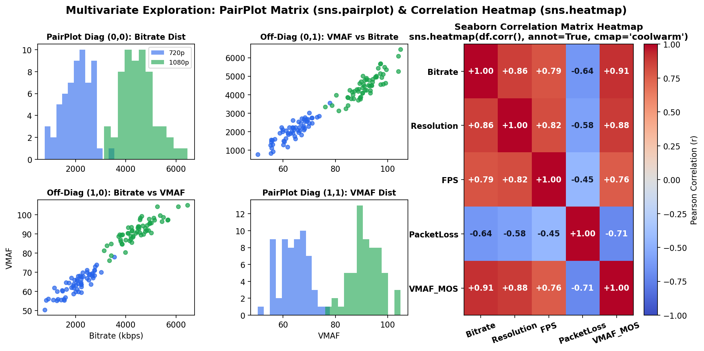

# Dep 02 - පාඩම 03: බහු-විචල්‍ය දෘශ්‍යකරණය — Multivariate Visualization: PairPlot, FacetGrid & Annotated Heatmaps

**අදාළ ප්‍රධාන පාඩම් (Related Core Lessons):**
- [⬅️ Back to Lesson 5.4: Visualizing the Impossible — High-Dimensional & Multivariate Data](../../Module_05_Data_Visualization_Principles_and_Techniques/Lesson_5.4_Visualizing_the_Impossible_High_Dimensional_and_Multivariate.md)
- [⬅️ Back to Lesson 5.5: Graph Selection Criteria & Human Visual Perception](../../Module_05_Data_Visualization_Principles_and_Techniques/Lesson_5.5_Graph_Selection_Criteria_and_Human_Visual_Perception.md)

---

## 1. හැඳින්වීම: "Visualizing the Impossible" සඳහා Seaborn මෙවලම්

`Intro-to-Visualization.pdf` හි Slides 21–24 මඟින් අපට ඉදිරිපත් කළ ප්‍රධානතම අභියෝගය වන්නේ විචල්‍යයන් රාශියක් සහිත **High-Dimensional Data (අධි-මාන දත්ත)** 2D තිරයක් මත පෙන්වන්නේ කෙසේද යන්නයි.
එහිදී Dr. Ranathunga පෙන්වා දුන් ප්‍රධාන විසඳුම් දෙක Seaborn මඟින් තනි කේත පේළියකින් ක්‍රියාත්මක කළ හැක:
1. **"Relationships may be easier to spot by producing multiple plots of lower dimensionality" (Slide 22):**
   - `sns.pairplot()` සහ `sns.FacetGrid()` / `sns.relplot(col=...)`
2. **Heat Maps (Slide 24):**
   - `sns.heatmap(annot=True)`



---

## 2. `sns.pairplot()` — සියලුම විචල්‍ය යුගල එකවර පරීක්ෂා කිරීම

ඔබට විචල්‍යයන් 5ක් (`Bitrate`, `Resolution`, `FPS`, `PacketLoss`, `VMAF`) සහිත DataFrame එකක් ලැබුණු විට, ඒවා අතර ඇති සියලුම ද්වි-මාන සම්බන්ධතා (Pairwise Relationships) එකවර බලා ගැනීමට `sns.pairplot(df, hue='Category')` භාවිතා කරයි:
- **ප්‍රධාන විකර්ණය (Diagonal Plots):** එක් එක් විචල්‍යයේ 1D ව්‍යාප්තිය (**Histogram** හෝ **KDE**) පෙන්වයි.
- **විකර්ණයෙන් පිටත කොටු (Off-Diagonal Plots):** සෑම විචල්‍ය යුගලයක් ($X_i$ vs $X_j$) අතරම **Scatter Plot** එක පෙන්වයි!

```python
import seaborn as sns
import matplotlib.pyplot as plt

# DataFrame එකේ සියලුම සංඛ්‍යාත්මක තීරු අතර Pairwise Plots තනි විධානයකින් ඇඳීම:
sns.pairplot(df, hue='Resolution', diag_kind='kde', markers=['o', 's', '^'])
plt.show()
```

---

## 3. `sns.FacetGrid` සහ `col=` / `row=` (Small Multiples)

Slide 22 හි සඳහන් පරිදි Categorical විචල්‍යයක් (උදා: `Game = 'CSGO', 'Dota2', 'FIFA'`) අනුව දත්ත කට්ටලය උප-ප්‍රස්තාර කිහිපයකට බෙදා එක පෙළට ඇඳීමට Seaborn හි Figure-level functions (`sns.relplot`, `sns.catplot`, `sns.displot`) හි **`col=`** පරාමිතිය භාවිතා කළ හැක:

```python
# එක් එක් Game වර්ගය සඳහා වෙනම Subplot එකක් ස්වයංක්‍රීයව සාදා Bitrate vs VMAF ඇඳීම
sns.relplot(
    data=df,
    x='Bitrate',
    y='VMAF',
    hue='Resolution',
    col='Game',          # Game අනුව තීරු (Columns) වලට බෙදයි!
    kind='scatter',
    height=4,
    aspect=1
)
plt.show()
```

---

## 4. `sns.heatmap()` — Correlation Matrices සහ Pivot Tables දෘශ්‍යකරණය (Slide 24)

Pure Matplotlib හි `ax.imshow()` මඟින් Heatmap එකක් ඇඳීමේදී අපට `for` loops ලියා කොටු ඇතුළත ඉලක්කම් (`ax.text`) සහ Tick Labels අතින් යෙදීමට සිදු විය. නමුත් **`sns.heatmap()`** මඟින් එය ඉතාම පහසුවෙන් සිදු කරයි:
- **`annot=True`:** සෑම කොටුවක් ඇතුළතම එහි සංඛ්‍යාත්මක අගය ස්වයංක්‍රීයව ලියයි (දීප්තිය අනුව අකුරුවල පැහැය සුදු හෝ කළු ලෙස ස්වයංක්‍රීයව මාරු කරයි!).
- **`fmt='.2f'`:** දශමස්ථාන ගණන පාලනය කරයි (උදා: දශමස්ථාන 2කට `0.86`).
- **`cmap='YlGnBu'` හෝ `'coolwarm'`:** වර්ණ පරිමාණය සකසයි.

```python
import pandas as pd
import seaborn as sns
import matplotlib.pyplot as plt

# 1. DataFrame එකේ Pearson Correlation Matrix එක ගණනය කිරීම
corr_matrix = df[['Bitrate', 'FPS', 'PacketLoss', 'VMAF']].corr()

# 2. Annotated Heatmap එක ඇඳීම
fig, ax = plt.subplots(figsize=(7, 5.5))
sns.heatmap(
    corr_matrix,
    annot=True,          # කොටු තුළ r අගයන් පෙන්වන්න
    fmt='.2f',           # දශමස්ථාන 2කට වටයන්න
    cmap='coolwarm',     # -1 (නිල්) සිට +1 (රතු) දක්වා වර්ණ
    vmin=-1, vmax=1,
    linewidths=1,
    ax=ax
)
ax.set_title('Feature Correlation Matrix Heatmap')
plt.tight_layout()
plt.show()
```

---

## 🛠️ 5. Practical Task / Hands-On Exercise (ප්‍රායෝගික අභ්‍යාසය)

### Scenario / Goal:
Slide 24 හි දැක්වෙන **Gaming Video Quality Acceptance Rate (%)** පර්යේෂණ දත්ත ඔබට ලබා දී ඇත. එහි ක්‍රීඩා 4ක් (`CSGO`, `Dota2`, `FIFA`, `PUBG`) සහ Quality Levels 5ක් (`Q1_Low` සිට `Q5_Ultra` දක්වා) ඇත. Pandas DataFrame එකක් ලෙස ඇති මෙම දත්ත `sns.heatmap()` භාවිතා කර සියලුම ප්‍රතිශත අගයන් කොටු තුළ පෙනෙන සේ (`annot=True`) ඇඳ පෙන්වන්න.

### Step-by-Step Tasks:
1. පහත දී ඇති `df_accept` DataFrame එක භාවිතා කරන්න.
2. `fig, ax = plt.subplots(figsize=(8, 4.5))` සාදන්න.
3. `sns.heatmap()` තුළ `annot=True`, `fmt='d'` (පූර්ණ සංඛ්‍යා සඳහා), `cmap='YlGnBu'`, සහ `cbar_kws={'label': 'Acceptance Rate (%)'}` ලබා දී Heatmap එක නිර්මාණය කරන්න.

### Starter Code:
```python
import pandas as pd
import seaborn as sns
import matplotlib.pyplot as plt

df_accept = pd.DataFrame(
    data=[
        [22, 48, 75, 91, 98],
        [18, 42, 68, 86, 95],
        [30, 55, 82, 94, 99],
        [12, 35, 60, 80, 92]
    ],
    index=['CSGO', 'Dota2', 'FIFA', 'PUBG'],
    columns=['Q1 (Low)', 'Q2 (Med-Low)', 'Q3 (Medium)', 'Q4 (High)', 'Q5 (Ultra)']
)

# TODO: Plot annotated Seaborn heatmap with YlGnBu colormap
```

### Expected Output / Reference Solution:
```python
import pandas as pd
import seaborn as sns
import matplotlib.pyplot as plt

df_accept = pd.DataFrame(
    data=[
        [22, 48, 75, 91, 98],
        [18, 42, 68, 86, 95],
        [30, 55, 82, 94, 99],
        [12, 35, 60, 80, 92]
    ],
    index=['CSGO', 'Dota2', 'FIFA', 'PUBG'],
    columns=['Q1 (Low)', 'Q2 (Med-Low)', 'Q3 (Medium)', 'Q4 (High)', 'Q5 (Ultra)']
)

fig, ax = plt.subplots(figsize=(8, 4.8))

sns.heatmap(
    df_accept,
    annot=True,
    fmt='d',
    cmap='YlGnBu',
    vmin=0,
    vmax=100,
    linewidths=1.5,
    cbar_kws={'label': 'User Acceptance Rate (%)'},
    ax=ax
)

ax.set_title('User Acceptance Rate (%) Across Gaming Video Sequences & Quality Levels', fontsize=13, fontweight='bold')
ax.set_xlabel('Video Encoding Quality Level', fontsize=11)
ax.set_ylabel('Gaming Video Sequence', fontsize=11)

plt.tight_layout()
plt.show()
```

---

**🔗 Return to Module 5 Core Lessons:**
- [Lesson 5.1: Purpose of Data Visualization & Tufte Principles](../../Module_05_Data_Visualization_Principles_and_Techniques/Lesson_5.1_Purpose_of_Data_Visualization_and_Tufte_Principles.md)
- [Lesson 5.2: Choosing the Right Visualization — Distributions & Relationships](../../Module_05_Data_Visualization_Principles_and_Techniques/Lesson_5.2_Choosing_Right_Visualization_Distributions_and_Relationships.md)
- [Lesson 5.3: Visualizing Composition, Spread & Comparisons](../../Module_05_Data_Visualization_Principles_and_Techniques/Lesson_5.3_Visualizing_Composition_Spread_and_Comparisons.md)
- [Lesson 5.4: Visualizing the Impossible — High-Dimensional & Multivariate Data](../../Module_05_Data_Visualization_Principles_and_Techniques/Lesson_5.4_Visualizing_the_Impossible_High_Dimensional_and_Multivariate.md)
- [Lesson 5.5: Graph Selection Criteria & Human Visual Perception](../../Module_05_Data_Visualization_Principles_and_Techniques/Lesson_5.5_Graph_Selection_Criteria_and_Human_Visual_Perception.md)
