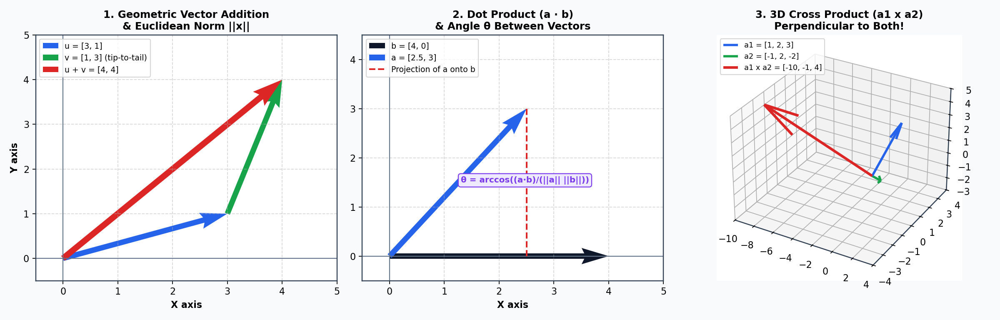
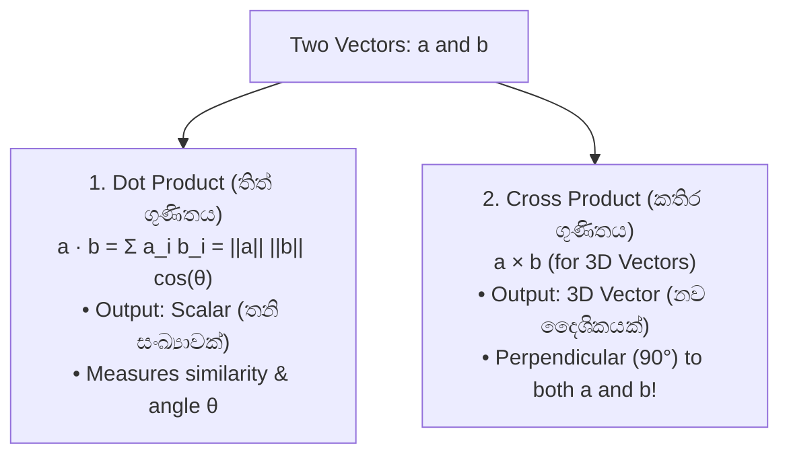

# Dependency Lesson 03.1: Vectors (දෛශික) පිළිබඳ ජ්‍යාමිතික අවබෝධය — Norm, Dot Product සහ Cross Product මුල සිට

**ආශ්‍රිත ප්‍රධාන පාඩම (Connected Module 4 Core Lesson):**
- [Lesson 4.1: Linear Algebra Revision — Vectors & Vector Operations](../../Module_04_Mathematics_and_Statistics_for_Data_Science/Lesson_4.1_Linear_Algebra_Vectors_and_Vector_Operations.md)

---

## 1. හැඳින්වීම: Vector (දෛශිකය) සහ Scalar (අදිශය) යනු සැබෑ ලෝකයේ කුමක්ද?

බොහෝ අය පාසල් හෝ විශ්වවිද්‍යාල මට්ටමේදී **Vector (දෛශිකය)** යනු කොටුවක් ඇතුළේ ලියන ඉලක්කම් පේළියක් පමණක් ලෙස සිතති. නමුත් එය දෘශ්‍යමානව තේරුම් ගත් විට Linear Algebra යනු ඉතාම සරල හා ලස්සන විෂයයකි!

1. **Scalar (අදිශය):** විශාලත්වයක් (Magnitude) පමණක් ඇති තනි සංඛ්‍යාවකි (උදා: උෂ්ණත්වය $30^\circ\text{C}$, මිල රු. $500$, හෝ `5`).
2. **Vector (දෛශිකය):** දෘෂ්ටිකෝණ දෙකකින් තේරුම් ගත හැක:
   * **Data Science දෘෂ්ටිකෝණයෙන් (Slide 3):** නිශ්චිත අනුපිළිවෙළකට පෙළගැස්වූ සංඛ්‍යා ලැයිස්තුවකි (**An ordered list of numbers**). උදාහරණයක් ලෙස නිවසක `[වර්ග අඩි ගණන, කාමර ගණන, වයස, මිල]` යනු මාන 4ක් (Dimension 4) සහිත **$4$-vector** එකකි:
     $$x = \begin{bmatrix} -1.1 \\ 0.0 \\ 3.6 \\ -7.2 \end{bmatrix}$$
   * **ජ්‍යාමිතික දෘෂ්ටිකෝණයෙන් (Geometric Intuition):** ඛණ්ඩාංක තලයේ මූල ලක්ෂ්‍යයේ $(0,0)$ සිට යම් නිශ්චිත දිශාවකට සහ නිශ්චිත දිගකට විහිදෙන **ඊතලයකි (Arrow with Magnitude and Direction)**!



---

## 2. Zero Vector, Ones Vector, Unit Vector සහ Vector Addition

### 1. විශේෂ දෛශික වර්ග 3 (Slide 5):
* **Zero Vector (ශූන්‍ය දෛශිකය - $\mathbf{0}$):** සියලුම අවයව `0` වූ දෛශිකයයි (`[0, 0, 0]`). ජ්‍යාමිතිකව මෙය මූල ලක්ෂ්‍යයේම රැඳී පවතින දිග `0` වූ ලක්ෂ්‍යයයි.
* **Ones Vector (ඒකක අගයන්ගේ දෛශිකය - $\mathbf{1}$):** සියලුම අවයව `1` වූ දෛශිකයයි (`[1, 1, 1]`).
* **Unit Vector (ඒකක දෛශිකය - $e_i$):** දිග හරියටම `1` ක් වූ දෛශිකයකි. සම්මත ඛණ්ඩාංක අක්ෂ ($X, Y, Z$) දිගේ විහිදෙන **Standard Basis Unit Vectors** වල එකම එක අවයවයක් පමණක් `1` වන අතර අනෙක් සියල්ල `0` වේ:
  $$e_1 = \begin{bmatrix} 1 \\ 0 \\ 0 \end{bmatrix}, \quad e_2 = \begin{bmatrix} 0 \\ 1 \\ 0 \end{bmatrix}, \quad e_3 = \begin{bmatrix} 0 \\ 0 \\ 1 \end{bmatrix}$$

### 2. Vector Addition (දෛශික එකතු කිරීම — Tip-to-Tail Rule):
ජ්‍යාමිතිකව $\mathbf{u} = [3, 1]$ සහ $\mathbf{v} = [1, 3]$ එකතු කිරීම යනු: පළමුව $\mathbf{u}$ ඊතලය දිගේ ගොස්, එහි තුඩ (Tip) මතින් $\mathbf{v}$ ඊතලයේ වලිගය (Tail) තබා ගමන් කළ විට ලැබෙන අවසාන ලක්ෂ්‍යය $[3+1, 1+3] = [4, 4]$ වෙත මූල ලක්ෂ්‍යයේ සිට අඳින සම්ප්‍රයුක්ත ඊතලයයි!

---

## 3. Euclidean Norm (දෛශිකයක විශාලත්වය $\|\mathbf{x}\|$) — පයිතගරස් ප්‍රමේයය!

දෛශිකයක දිග හෙවත් **Magnitude / Euclidean Norm ($\|\mathbf{x}\|$)** සොයන්නේ කෙසේද?
2D තලයේ $\mathbf{x} = [3, 4]$ දෛශිකයේ දිග පයිතගරස් ප්‍රමේයයට අනුව $\sqrt{3^2 + 4^2} = \sqrt{25} = 5$ වේ. එලෙසම ඕනෑම මාන $n$ ගණනක දෛශිකයක දිග වන්නේ:
$$\|\mathbf{x}\| = \sqrt{x_1^2 + x_2^2 + \dots + x_n^2}$$

`Maths&stat.ipynb` (Cells 19–20) හි `xL = [1, 2, 3, 4]` දෛශිකයේ දිග අතින් සහ `np.linalg.norm()` මගින් ගණනය කරන ආකාරය:
$$\|xL\| = \sqrt{1^2 + 2^2 + 3^2 + 4^2} = \sqrt{1 + 4 + 9 + 16} = \sqrt{30} \approx 5.477225575$$

---

## 4. Dot Product (තිත් ගුණිතය) සහ Cross Product (කතිර ගුණිතය)



### 1. Dot Product (තිත් ගුණිතය — $\mathbf{a} \cdot \mathbf{b}$):
* **වීජීය සූත්‍රය:** $\mathbf{a} \cdot \mathbf{b} = a_1 b_1 + a_2 b_2 + \dots + a_n b_n$
* **ජ්‍යාමිතික සූත්‍රය:** $\mathbf{a} \cdot \mathbf{b} = \|\mathbf{a}\| \, \|\mathbf{b}\| \cos\theta$
* **ඉන් කියවෙන අදහස:** දෛශික දෙකක් එකම දිශාවට යොමු වී ඇත්නම් Dot Product එක විශාල ධන අගයක් ගනී. දෛශික දෙක එකිනෙකට ලම්බක නම් ($\theta = 90^\circ \implies \cos 90^\circ = 0$), **Dot Product එක හරියටම `0` වේ!**
* **දෛශික දෙකක් අතර කෝණය ($\theta$) සෙවීම (`Maths&stat.ipynb` Cells 22–23):**
  $$\cos\theta = \frac{\mathbf{a} \cdot \mathbf{b}}{\|\mathbf{a}\| \, \|\mathbf{b}\|} \implies \theta = \arccos\left(\frac{\mathbf{a} \cdot \mathbf{b}}{\|\mathbf{a}\| \, \|\mathbf{b}\|}\right)$$

### 2. Cross Product (කතිර ගුණිතය — $\mathbf{a} \times \mathbf{b}$):
ත්‍රිමාණ (3D) දෛශික දෙකක් වන $\mathbf{a} = [a_1, a_2, a_3]$ සහ $\mathbf{b} = [b_1, b_2, b_3]$ හි කතිර ගුණිතයෙන් ලැබෙන්නේ එම දෛශික දෙකම පිහිටි තලයට **ලම්බක (Perpendicular / Normal)** වූ නව 3D දෛශිකයකි:
$$\mathbf{a} \times \mathbf{b} = \begin{bmatrix} a_2 b_3 - a_3 b_2 \\ a_3 b_1 - a_1 b_3 \\ a_1 b_2 - a_2 b_1 \end{bmatrix}$$

* `Maths&stat.ipynb` Cell 18 උදාහරණය: `a1 = [1, 2, 3]` සහ `a2 = [-1, 2, -2]`:
  * 1 වන අවයවය: $(2)(-2) - (3)(2) = -4 - 6 = \mathbf{-10}$
  * 2 වන අවයවය: $(3)(-1) - (1)(-2) = -3 + 2 = \mathbf{-1}$
  * 3 වන අවයවය: $(1)(2) - (2)(-1) = 2 + 2 = \mathbf{4}$
  * ප්‍රතිඵලය: **`array([-10, -1, 4])`**!

---

## 🛠️ Practical Task / Hands-On Exercise (ප්‍රායෝගික අභ්‍යාසය)

### Scenario / Goal:
ත්‍රිමාණ අවකාශයේ පිහිටි $\mathbf{u} = [2, -1, 2]$ සහ $\mathbf{v} = [1, 2, 2]$ යන දෛශික දෙකෙහි දිගවල් (Norms), Dot Product, ඒවා අතර කෝණය (අංශකවලින්), සහ Cross Product එක ගණනය කර, ලැබෙන Cross Product දෛශිකය $\mathbf{u}$ සහ $\mathbf{v}$ යන දෙකටම ලම්බක බව (එනම් Dot Product = 0 බව) තහවුරු කරන්න.

### Step-by-Step Tasks:
1. `np.linalg.norm()` මගින් $\|\mathbf{u}\|$ සහ $\|\mathbf{v}\|$ සොයන්න.
2. `np.dot(u, v)` සහ $\arccos$ මගින් දෛශික දෙක අතර කෝණය අංශකවලින් සොයන්න.
3. `w = np.cross(u, v)` සොයා, `np.dot(w, u) == 0` සහ `np.dot(w, v) == 0` බව පරීක්ෂා කරන්න.

### Starter Code:
```python
import numpy as np

u = np.array([2, -1, 2])
v = np.array([1,  2, 2])

# Write your solution here
```

### Expected Output / Reference Solution:
```python
import numpy as np

u = np.array([2, -1, 2])
v = np.array([1,  2, 2])

norm_u = np.linalg.norm(u)
norm_v = np.linalg.norm(v)
dot_uv = np.dot(u, v)
cos_t = dot_uv / (norm_u * norm_v)
angle_deg = (np.arccos(cos_t) / np.pi) * 180

w = np.cross(u, v)

print(f"||u|| = {norm_u} | ||v|| = {norm_v}")
print(f"Dot Product (u . v) = {dot_uv} | Angle = {angle_deg:.2f}°")
print("Cross Product (w = u x v):", w)
print("Orthogonality check (w . u) =", np.dot(w, u), "| (w . v) =", np.dot(w, v))
```
**Expected Output:**
```text
||u|| = 3.0 | ||v|| = 3.0
Dot Product (u . v) = 4 | Angle = 63.61°
Cross Product (w = u x v): [-6 -2  5]
Orthogonality check (w . u) = 0 | (w . v) = 0
```

---

## 📝 Summary & Exam Revision Cheat Sheet

| සංකල්පය (Concept) | ගණිතමය සූත්‍රය (Formula) | NumPy Function |
| :--- | :--- | :--- |
| **Euclidean Norm (දෛශික විශාලත්වය)** | $\|\mathbf{x}\| = \sqrt{\sum x_i^2}$ | `np.linalg.norm(x)` |
| **Dot Product (තිත් ගුණිතය)** | $\mathbf{a} \cdot \mathbf{b} = \sum a_i b_i$ | `np.dot(a, b)` |
| **Angle Between Vectors ($\theta$)** | $\theta = \arccos\left(\frac{\mathbf{a}\cdot\mathbf{b}}{\|\mathbf{a}\|\|\mathbf{b}\|}\right)$ | `np.degrees(np.arccos(...))` |
| **Cross Product (කතිර ගුණිතය)** | $\mathbf{a} \times \mathbf{b}$ (3D Orthogonal Vector) | `np.cross(a, b)` |

---

**ඊළඟ Dependency පාඩම:** [02_Matrices_as_Linear_Transformations_and_Determinant_Area.md](02_Matrices_as_Linear_Transformations_and_Determinant_Area.md)  
**ආපසු ප්‍රධාන පාඩමට (Back to Main Lesson):** [Lesson 4.1: Linear Algebra Revision — Vectors & Vector Operations](../../Module_04_Mathematics_and_Statistics_for_Data_Science/Lesson_4.1_Linear_Algebra_Vectors_and_Vector_Operations.md)
