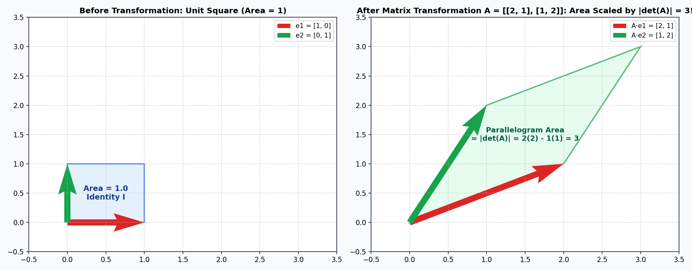
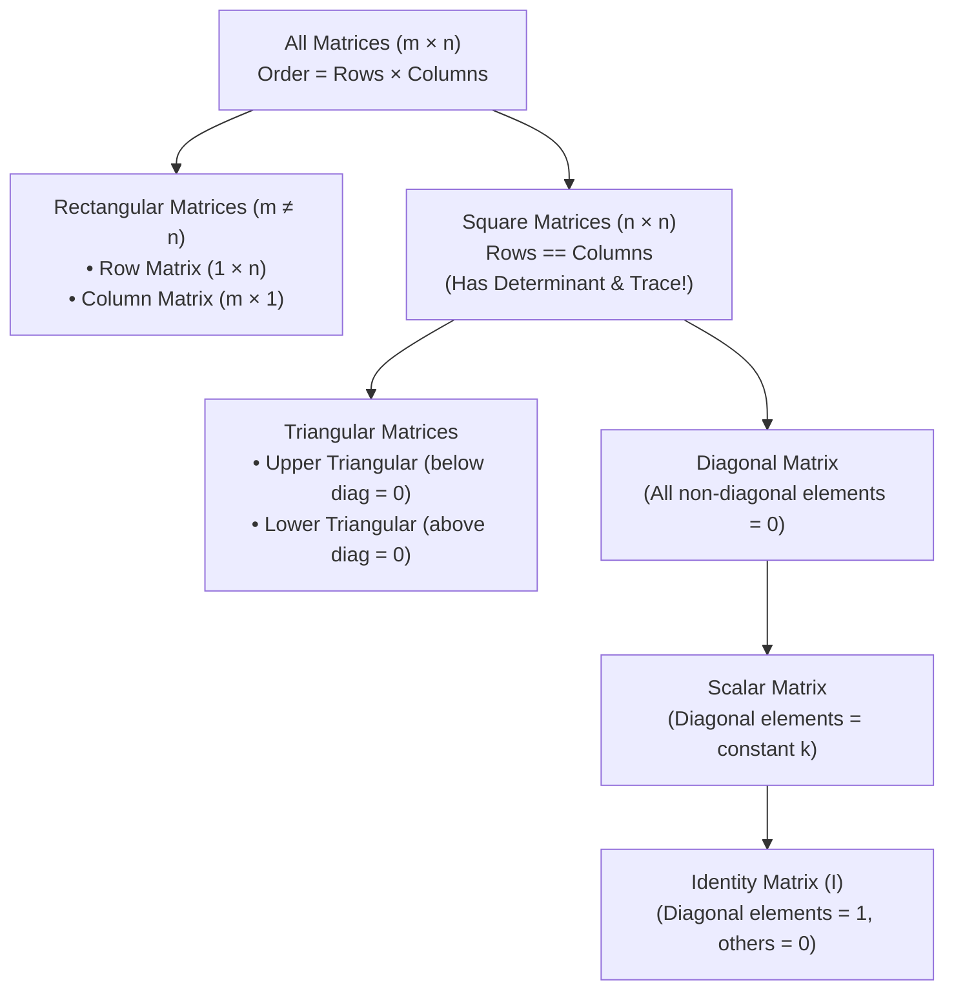

# Dependency Lesson 03.2: Matrices (න්‍යාස) රේඛීය පරිණාමන ලෙස සහ Determinant (නිශ්චායකය) මුල සිට

**ආශ්‍රිත ප්‍රධාන පාඩම (Connected Module 4 Core Lesson):**
- [Lesson 4.2: Matrices, Determinants, Transpose & Matrix Terminology](../../Module_04_Mathematics_and_Statistics_for_Data_Science/Lesson_4.2_Matrices_Determinants_Transpose_and_Terminology.md)

---

## 1. හැඳින්වීම: Matrix (න්‍යාසය) සහ Determinant (නිශ්චායකය) යනු සැබවින්ම කුමක්ද?

දේශන සටහනේ (Slides 8–13) අපි **Matrix (න්‍යාසය)** යනු පේළි (Rows) සහ තීරු (Columns) සහිත සංඛ්‍යා වගුවක් බව ඉගෙන ගත්තෙමු. නමුත් ගණිතමය වශයෙන් Matrix එකකින් සිදු කරන්නේ කුමක්ද?

* **Matrix as a Linear Transformation (රේඛීය පරිණාමනයක් ලෙස):**
  ඔබ දෛශිකයක් ($\mathbf{x}$) න්‍යාසයකින් ($A$) ගුණ කළ විට ($A\mathbf{x}$), එම න්‍යාසය විසින් මුළු ජ්‍යාමිතික අවකාශයම **ඇදීමකට (Stretching), හැකිලීමකට (Squishing), හෝ කරකැවීමකට (Rotation / Shear)** ලක් කරයි!
* **Determinant (නිශ්චායකය - $\det A$ හෝ $|A|$) යනු කුමක්ද?**
  $2 \times 2$ න්‍යාසයකින් තලය පරිණාමනය කළ විට, වර්ගඵලය $1$ ක් වූ **ඒකක සමචතුරස්‍රයේ (Unit Square) වර්ගඵලය කී ගුණයකින් විශාල වේද (Area Scaling Factor)** යන්න පෙන්වන සංඛ්‍යාව එහි **Determinant (නිශ්චායකය)** වේ! (3D අවකාශයේදී නම් ඒකක ඝනකයේ පරිමාව කී ගුණයකින් වෙනස් වේද යන්නයි).



---

## 2. $2 \times 2$ සහ $3 \times 3$ Determinant (නිශ්චායකය) පියවරෙන් පියවර ගණනය කිරීම (Slide 10)

> [!IMPORTANT]
> **Determinant (නිශ්චායකය)** අර්ථ දක්වා ඇත්තේ පේළි ගණන සහ තීරු ගණන සමාන වූ **Square Matrices (සමචතුරස්‍ර න්‍යාස - $n \times n$)** සඳහා පමණි!

### 1. $2 \times 2$ Matrix Determinant සූත්‍රය:
$$A = \begin{bmatrix} a & b \\ c & d \end{bmatrix} \implies \det(A) = |A| = ad - bc$$

* *උදාහරණය:* $A = \begin{bmatrix} 2 & 1 \\ 1 & 2 \end{bmatrix} \implies |A| = (2)(2) - (1)(1) = 4 - 1 = \mathbf{3}$. (එනම් ඒකක කොටුවේ වර්ගඵලය 3 ගුණයකින් වැඩි වේ!).

### 2. $3 \times 3$ Matrix Determinant සූත්‍රය (Cofactor Expansion - Slide 10):
$$A = \begin{bmatrix} a & b & c \\ d & e & f \\ g & h & i \end{bmatrix}$$
පළමු පේළියේ $a, b, c$ අවයව සඳහා ලකුණු **`+`, `-`, `+`** ලෙස මාරුවෙන් මාරුවට යොදා $2 \times 2$ අනු-නිශ්චායක (Minors) ගණනය කරයි:
$$|A| = +a \begin{vmatrix} e & f \\ h & i \end{vmatrix} - b \begin{vmatrix} d & f \\ g & i \end{vmatrix} + c \begin{vmatrix} d & e \\ g & h \end{vmatrix} = a(ei - fh) - b(di - fg) + c(dh - eg)$$

### `Maths&stat.ipynb` Cell 41 හි $3 \times 3$ උදාහරණය අතින් සහ කේතයෙන් සුළු කරමු:
$$\text{mat\_c} = \begin{bmatrix} 1 & -2 & 3 \\ 4 & -5 & 6 \\ 7 & 8 & 9 \end{bmatrix}$$

1. පළමු පදය ($a = 1$): $+1 \times [(-5)(9) - (6)(8)] = 1 \times (-45 - 48) = \mathbf{-93}$
2. දෙවන පදය ($b = -2$): $-(-2) \times [(4)(9) - (6)(7)] = +2 \times (36 - 42) = 2 \times (-6) = \mathbf{-12}$
3. තුන්වන පදය ($c = 3$): $+3 \times [(4)(8) - (-5)(7)] = 3 \times (32 - (-35)) = 3 \times 67 = \mathbf{+201}$
4. **මුළු එකතුව:** $|\text{mat\_c}| = -93 - 12 + 201 = \mathbf{96}$!

```python
import numpy as np

mat_c = np.array([
    [1, -2, 3],
    [4, -5, 6],
    [7,  8, 9]
])

det_val = np.linalg.det(mat_c)
print("Determinant of mat_c:", det_val)         # 95.99999999999999 (හරියටම 96.0!)
```

---

## 3. Matrix Terminologies (න්‍යාස වර්ග 10 — Slide 13)



* **Trace of a Matrix ($\text{Tr}(A)$):** සමචතුරස්‍ර න්‍යාසයක ප්‍රධාන විකර්ණයේ (Main diagonal - වම් ඉහළ කෙළවරේ සිට දකුණු පහළ කෙළවර දක්වා) ඇති අවයවවල එකතුවයි.
  * උදා: ඉහත `mat_c` හි $\text{Trace} = 1 + (-5) + 9 = \mathbf{5}$ (`np.trace(mat_c)`).

---

## 🛠️ Practical Task / Hands-On Exercise (ප්‍රායෝගික අභ්‍යාසය)

### Scenario / Goal:
ඔබට $3 \times 3$ සමචතුරස්‍ර න්‍යාසයක් වන $M = \begin{bmatrix} 2 & 0 & 1 \\ 3 & 4 & -1 \\ 1 & 2 & 3 \end{bmatrix}$ දී ඇත. එහි **Determinant (නිශ්චායකය)**, **Transpose (පෙරළුම)**, **Trace**, සහ $3 \times 3$ **Identity Matrix (ඒකක න්‍යාසය)** සමඟ ගුණිතය Python මගින් සොයන්න.

### Step-by-Step Tasks:
1. `M` න්‍යාසය සාදා `np.linalg.det(M)` මගින් එහි Determinant අගය සොයන්න (අතින්ද $2(12 - (-2)) - 0 + 1(6 - 4) = 28 + 2 = 30$ බව පරීක්ෂා කරන්න).
2. `np.trace(M)` මගින් ප්‍රධාන විකර්ණයේ එකතුව ($2 + 4 + 3 = 9$) සොයන්න.
3. `I = np.eye(3)` සාදා `np.matmul(M, I)` මගින් ලැබෙන්නේ නැවතත් `M` න්‍යාසයම බව තහවුරු කරන්න.

### Starter Code:
```python
import numpy as np

M = np.array([
    [2, 0,  1],
    [3, 4, -1],
    [1, 2,  3]
])

# Write your solution here
```

### Expected Output / Reference Solution:
```python
import numpy as np

M = np.array([
    [2, 0,  1],
    [3, 4, -1],
    [1, 2,  3]
])

print("Determinant |M|:", np.round(np.linalg.det(M), 4))
print("Trace Tr(M):", np.trace(M))
print("Transpose M^T:\n", M.T)

I = np.eye(3)
print("M @ I equals M?:", np.array_equal(np.matmul(M, I), M))
```
**Expected Output:**
```text
Determinant |M|: 30.0
Trace Tr(M): 9
Transpose M^T:
 [[ 2  3  1]
 [ 0  4  2]
 [ 1 -1  3]]
M @ I equals M?: True
```

---

## 📝 Summary & Exam Revision Cheat Sheet

| පදය (Terminology) | ගණිතමය අර්ථය (Mathematical Meaning) | NumPy Function |
| :--- | :--- | :--- |
| **Order of Matrix** | $\text{Rows} \times \text{Columns}$ ($m \times n$) | `M.shape` |
| **Determinant ($\|A\|$)** | Square matrix එකක වර්ගඵල/පරිමා පරිමාණ සාධකය | `np.linalg.det(A)` |
| **Transpose ($A^T$)** | පේළි සහ තීරු හුවමාරු කිරීම | `A.transpose()` හෝ `A.T` |
| **Identity Matrix ($I$)** | ප්‍රධාන විකර්ණය `1` සහ අනෙක් සියල්ල `0` වූ Square matrix එක ($AI = A$) | `np.eye(n)` |
| **Trace ($\text{Tr}(A)$)** | ප්‍රධාන විකර්ණයේ අවයවවල එකතුව ($\sum a_{ii}$) | `np.trace(A)` |

---

**ඊළඟ Dependency පාඩම:** [03_Eigenvalues_Eigenvectors_and_Matrix_Rank_From_Scratch.md](03_Eigenvalues_Eigenvectors_and_Matrix_Rank_From_Scratch.md)  
**ආපසු ප්‍රධාන පාඩමට (Back to Main Lesson):** [Lesson 4.2: Matrices, Determinants, Transpose & Matrix Terminology](../../Module_04_Mathematics_and_Statistics_for_Data_Science/Lesson_4.2_Matrices_Determinants_Transpose_and_Terminology.md)
