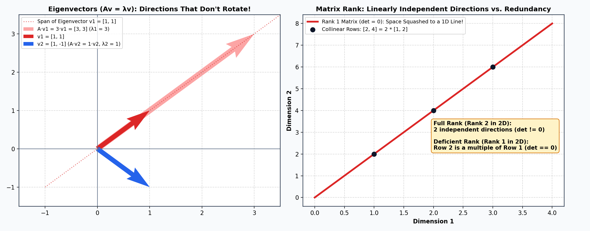
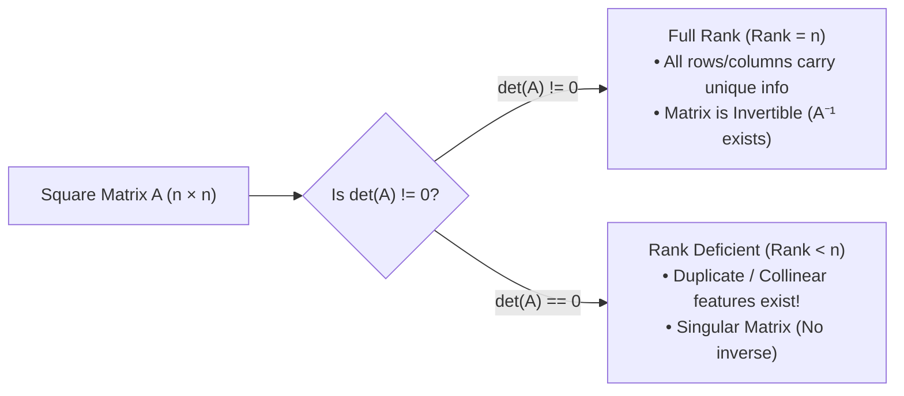

# Dependency Lesson 03.3: Eigenvalues, Eigenvectors සහ Matrix Rank මුල සිට සරලව (Slide 14 Self-Reading Deep Dive)

**ආශ්‍රිත ප්‍රධාන පාඩම (Connected Module 4 Core Lesson):**
- [Lesson 4.2: Matrices, Determinants, Transpose & Matrix Terminology](../../Module_04_Mathematics_and_Statistics_for_Data_Science/Lesson_4.2_Matrices_Determinants_Transpose_and_Terminology.md)

---

## 1. හැඳින්වීම: Slide 14 හි "Self-Reading" මාතෘකා ඇයි Data Science වලදී මෙතරම් වැදගත්?

අපගේ දේශන සටහනේ 14 වන Slide එකෙහි **Self-Reading** යටතේ ඉතාම වැදගත් මාතෘකා 3ක් ලබා දී ඇත:
1. **Different types of Matrices (Ones, Zeros, Identity, etc.) and their application in Data Science**
2. **Eigenvalues and Eigenvectors**
3. **Rank of a Matrix**

විභාගයකදී හෝ Machine Learning සම්මුඛ පරීක්ෂණයකදී බොහෝවිට ප්‍රශ්න අසන්නේ මෙම Self-Reading කොටසෙනි! මෙම පාඩමෙන් අපි කිසිදු මූලික දැනුමක් නොමැති අයෙකුට වුවද 100%ක් පැහැදිලි වන ලෙස මෙම සංකල්ප 3 මුල සිට ඉගෙන ගනිමු.



---

## 2. Eigenvalues ($\lambda$) සහ Eigenvectors ($\mathbf{v}$) යනු කුමක්ද?

පෙර පාඩමේදී අපි දුටුවේ න්‍යාසයකින් ($A$) දෛශිකයක් ගුණ කළ විට සාමාන්‍යයෙන් එම දෛශිකය වෙනත් දිශාවකට හැරෙන (Rotate වන) බවයි. නමුත් සමචතුරස්‍ර න්‍යාසයකට ආවේණික වූ **විශේෂ දිශාවන් (Special axes)** කිහිපයක් ඇත:
* එම විශේෂ දිශාවක පිහිටි දෛශිකයක් ($\mathbf{v} \neq \mathbf{0}$) $A$ න්‍යාසයෙන් ගුණ කළ විට, **එම දෛශිකයේ දිශාව කිසිසේත්ම වෙනස් නොවේ (Does NOT rotate)!** සිදුවන්නේ එහි දිග තනි සංඛ්‍යාවකින් ($\lambda$) දිගු වීම හෝ හැකිලීම පමණි!

$$A\mathbf{v} = \lambda\mathbf{v}$$

* **Eigenvector (ලාක්ෂණික දෛශිකය - $\mathbf{v}$):** න්‍යාස පරිණාමනයේදී දිශාව වෙනස් නොවන එම විශේෂ දෛශිකයයි.
* **Eigenvalue (ලාක්ෂණික අගය - $\lambda$):** එම Eigenvector එක කී ගුණයකින් දිගු වූවාද හෝ හැකිලුණාද යන්න පෙන්වන **Scalar (අදිශ)** අගයයි.

### අතින් ගණනය කරන ආකාරය ($\det(A - \lambda I) = 0$):
උදාහරණයක් ලෙස $A = \begin{bmatrix} 2 & 1 \\ 1 & 2 \end{bmatrix}$ න්‍යාසය සලකමු:
1. **Characteristic Equation (ලාක්ෂණික සමීකරණය):**
   $$\det(A - \lambda I) = \begin{vmatrix} 2-\lambda & 1 \\ 1 & 2-\lambda \end{vmatrix} = (2-\lambda)^2 - 1 = 0$$
2. $(2-\lambda)^2 = 1 \implies 2 - \lambda = \pm 1 \implies \mathbf{\lambda_1 = 3}$ සහ $\mathbf{\lambda_2 = 1}$!
3. $\lambda_1 = 3$ විට Eigenvector එක $\mathbf{v}_1 = \begin{bmatrix} 1 \\ 1 \end{bmatrix}$ වේ. පරීක්ෂා කර බලන්න:
   $$\begin{bmatrix} 2 & 1 \\ 1 & 2 \end{bmatrix} \begin{bmatrix} 1 \\ 1 \end{bmatrix} = \begin{bmatrix} 3 \\ 3 \end{bmatrix} = 3 \begin{bmatrix} 1 \\ 1 \end{bmatrix} \quad (\text{දිශාව වෙනස් නොවී 3 ගුණයකින් දිගු විය!})$$

### Data Science හි ප්‍රායෝගික භාවිතය:
* **PCA (Principal Component Analysis):** විචල්‍ය 100ක් ඇති විශාල දත්ත කට්ටලයක වැඩිම විචලතාවයක් (Maximum Variance) පවතින ප්‍රධාන දිශාවන් (Principal Components) සොයා ගන්නේ Covariance Matrix එකෙහි **Eigenvectors** සහ **Eigenvalues** මගිනි!
* **Google PageRank Algorithm:** ලෝකයේ වෙබ් පිටු අතරින් වැදගත්ම වෙබ් පිටු ශ්‍රේණිගත කිරීමට Google භාවිතා කළේ වෙබ් සබැඳි න්‍යාසයේ ප්‍රධාන Eigenvector එකයි.

```python
import numpy as np

A = np.array([[2, 1], [1, 2]])
eigenvalues, eigenvectors = np.linalg.eig(A)

print("Eigenvalues (lambda):", eigenvalues)     # [3. 1.]
print("Normalized Eigenvectors (columns):\n", eigenvectors)
```

---

## 3. Rank of a Matrix (න්‍යාසයක කෝටිය / Rank) යනු කුමක්ද?

න්‍යාසයක **Rank (කෝටිය)** යනු එම න්‍යාසය තුළ ඇති **එකිනෙකට ස්වායත්ත (Linearly Independent — එනම් එක් පේළියක් තවත් පේළියක ගුණාකාරයක් හෝ එකතුවක් නොවන)** පේළි හෝ තීරු ගණනයි.



### උදාහරණ දෙකක් බලමු:
1. **Full Rank Matrix ($2 \times 2$, $\text{Rank} = 2$):**
   $$A = \begin{bmatrix} 1 & 2 \\ 3 & 4 \end{bmatrix} \implies \text{පේළි දෙක එකිනෙකට ස්වායත්ත වේ } (\det A = -2 \neq 0) \implies \mathbf{\text{Rank} = 2}$$
2. **Rank Deficient Matrix ($2 \times 2$, $\text{Rank} = 1$):**
   $$B = \begin{bmatrix} 1 & 2 \\ 2 & 4 \end{bmatrix} \implies \text{දෙවන පේළිය යනු පළමු පේළිය }\times 2\text{ පමණි! } (\det B = 0) \implies \mathbf{\text{Rank} = 1}$$

### Data Science හි Matrix Rank හි වැදගත්කම:
ඔබේ Dataset එකෙහි එක් තීරුවක "උස සෙන්ටිමීටරවලින්" (`cm`) සහ තවත් තීරුවක "උස මීටර්වලින්" (`m = cm / 100`) තිබුණහොත්, එම තීරු දෙකෙන් කියවෙන්නේ එකම තොරතුරයි (**Multicollinearity / Redundant Features**). එවිට Dataset න්‍යාසයේ **Rank** එක අඩු වන අතර, `np.linalg.matrix_rank()` මගින් එවැනි අනවශ්‍ය අනුපිටපත් තීරු ක්ෂණිකව හඳුනාගත හැක!

---

## 4. විශේෂ Matrices වර්ගවල Data Science භාවිතයන් (Slide 14)

| න්‍යාස වර්ගය (Matrix Type) | NumPy කේතය | Data Science සහ Machine Learning හි සැබෑ භාවිතය |
| :--- | :--- | :--- |
| **Zeros Matrix ($\mathbf{0}$)** | `np.zeros((m, n))` | Neural Network weights/biases ආරම්භ කිරීමට සහ හිස් Image/Data buffers තැනීමට. |
| **Ones Matrix ($\mathbf{1}$)** | `np.ones((m, n))` | Linear Regression හි Intercept ($b_0$) තීරුව එක් කිරීමට සහ Image Masks තැනීමට. |
| **Identity Matrix ($I$)** | `np.eye(n)` | Ridge Regression ($X^TX + \lambda I$) හිදී න්‍යාස Invertible කිරීමට (Regularization). |
| **Diagonal Matrix** | `np.diag(v)` | PCA සහ SVD (Singular Value Decomposition) හි Eigenvalues/Singular values ගබඩා කිරීමට. |

---

## 🛠️ Practical Task / Hands-On Exercise (ප්‍රායෝගික අභ්‍යාසය)

### Scenario / Goal:
ඔබට $3 \times 3$ න්‍යාස දෙකක් දී ඇත: `mat_full` සහ `mat_redundant` (එහි 3 වන පේළිය යනු 1 වන පේළිය සහ 2 වන පේළියේ එකතුවයි). මේ දෙකෙහිම Determinant, Matrix Rank, සහ Eigenvalues `NumPy` මගින් පරීක්ෂා කරන්න.

### Step-by-Step Tasks:
1. `mat_full = np.array([[4, 2], [1, 3]])` හි Eigenvalues සහ Eigenvectors `np.linalg.eig()` මගින් සොයන්න.
2. Eigenvalues වල එකතුව $\text{Trace}(\text{mat\_full})$ ට සමාන බවත්, Eigenvalues වල ගුණිතය $\det(\text{mat\_full})$ ට සමාන බවත් පරීක්ෂා කරන්න!
3. `mat_redundant = np.array([[1, 2, 3], [4, 5, 6], [5, 7, 9]])` හි Rank එක `np.linalg.matrix_rank()` මගින් සොයන්න.

### Starter Code:
```python
import numpy as np

mat_full = np.array([[4, 2], [1, 3]])
mat_redundant = np.array([
    [1, 2, 3],
    [4, 5, 6],
    [5, 7, 9]  # Row 0 + Row 1
])

# Write your solution here
```

### Expected Output / Reference Solution:
```python
import numpy as np

mat_full = np.array([[4, 2], [1, 3]])
vals, vecs = np.linalg.eig(mat_full)

print("Eigenvalues:", vals)
print("Sum of Eigenvalues:", vals.sum(), "| Trace:", np.trace(mat_full))
print("Prod of Eigenvalues:", np.round(vals.prod(), 4), "| Det:", np.round(np.linalg.det(mat_full), 4))

mat_redundant = np.array([
    [1, 2, 3],
    [4, 5, 6],
    [5, 7, 9]
])
print("Rank of mat_full (2x2):", np.linalg.matrix_rank(mat_full))
print("Rank of mat_redundant (3x3):", np.linalg.matrix_rank(mat_redundant))
```
**Expected Output:**
```text
Eigenvalues: [5. 2.]
Sum of Eigenvalues: 7.0 | Trace: 7
Prod of Eigenvalues: 10.0 | Det: 10.0
Rank of mat_full (2x2): 2
Rank of mat_redundant (3x3): 2
```

---

## 📝 Summary & Exam Revision Cheat Sheet

* **Eigenvalue & Eigenvector Equation:** $A\mathbf{v} = \lambda\mathbf{v}$ (`np.linalg.eig(A)`).
* **වැදගත් ගණිතමය ලක්ෂණ 2:**
  1. $\sum \lambda_i = \text{Trace}(A)$ (Eigenvalues වල එකතුව = ප්‍රධාන විකර්ණයේ එකතුව).
  2. $\prod \lambda_i = \det(A)$ (Eigenvalues වල ගුණිතය = නිශ්චායකය).
* **Matrix Rank:** ස්වායත්ත පේළි/තීරු ගණන (`np.linalg.matrix_rank(A)`).

---

**ආපසු ප්‍රධාන පාඩමට (Back to Main Lesson):** [Lesson 4.2: Matrices, Determinants, Transpose & Matrix Terminology](../../Module_04_Mathematics_and_Statistics_for_Data_Science/Lesson_4.2_Matrices_Determinants_Transpose_and_Terminology.md)
