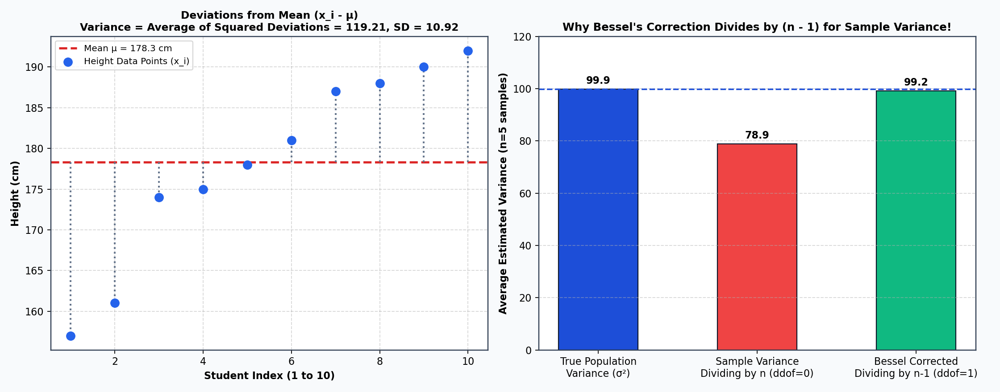
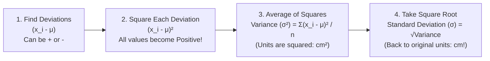

# Dependency Lesson 04.1: Variance (විචලතාවය), Standard Deviation (සම්මත අපගමනය) සහ Bessel's Correction ($n-1$) මුල සිට

**ආශ්‍රිත ප්‍රධාන පාඩම (Connected Module 4 Core Lesson):**
- [Lesson 4.5: Descriptive Statistics II — Measures of Spread & Correlation](../../Module_04_Mathematics_and_Statistics_for_Data_Science/Lesson_4.5_Descriptive_Statistics_II_Measures_of_Spread_and_Correlation.md)

---

## 1. හැඳින්වීම: ඇයි අපිට Variance සහ Standard Deviation අවශ්‍ය වුණේ?

සිතන්න ඔබට පන්ති දෙකක සිසුන් 5 දෙනා බැගින් ලබාගත් ලකුණු දී ඇත:
* **Class A:** `[48, 49, 50, 51, 52]` $\implies \text{Mean (මධ්‍යන්‍යය)} = 50$, $\text{Median (මධ්‍යස්ථය)} = 50$
* **Class B:** `[10, 30, 50, 70, 90]` $\implies \text{Mean (මධ්‍යන්‍යය)} = 50$, $\text{Median (මධ්‍යස්ථය)} = 50$

මේ පන්ති දෙකේම **Mean (මධ්‍යන්‍යය)** සහ **Median (මධ්‍යස්ථය)** හරියටම `50` යි! නමුත් පන්ති දෙක එක සමානද? කොහෙත්ම නැත! Class A හි සියලුම සිසුන් ලකුණු 50 අසලම පොකුරු ගැසී සිටින අතර, Class B හි ලකුණු 10 සිට 90 දක්වා විශාල පරාසයක විසිරී ඇත.

මෙලෙස දත්ත ලක්ෂ්‍යයන් ඒවායේ **Mean (මධ්‍යන්‍යය - $\mu$)** සිට සාමාන්‍යයෙන් කොපමණ දුරකින් විසිරී ඇත්දැයි මැනීමට **Variance (විචලතාවය)** සහ **Standard Deviation (සම්මත අපගමනය)** නිර්මාණය කරන ලදී!



---

## 2. ඇයි අපි අපගමනයන් වර්ග කරන්නේ? (Why Do We Square the Deviations $(x_i - \mu)^2$?)

සෑම දත්ත අගයක්ම ($x_i$) මධ්‍යන්‍යයේ ($\mu$) සිට කොපමණ දුරකින් ඇත්දැයි බැලීමට අපි පළමුව **Deviation from the Mean ($x_i - \mu$)** ගණනය කරමු.
උදාහරණයක් ලෙස Class B (`[10, 30, 50, 70, 90]`, $\mu = 50$) ගනිමු:
* අපගමනයන් (Deviations): $(10-50) = -40, \; (30-50) = -20, \; (50-50) = 0, \; (70-50) = +20, \; (90-50) = +40$.
* දැන් අපි මේවායේ සාමාන්‍යය ගැනීමට ඒවා එකතු කළහොත් කුමක් සිදුවේද?
  $$(-40) + (-20) + 0 + (+20) + (+40) = \mathbf{0}!$$
* **ගැටලුව:** Mean එකට වම් පසින් ඇති සෘණ අගයන් සහ දකුණු පසින් ඇති ධන අගයන් එකිනෙක කැපී ගොස් එකතුව සෑමවිටම `0` වේ!
* **විසඳුම:** සෘණ ලකුණු ඉවත් කර සියලුම අපගමනයන් ධන බවට පත් කිරීමට අපි එක් එක් අපගමනය **වර්ග කරමු ($(x_i - \mu)^2$)**!



### දේශන සටහනේ උස (cm) දත්ත 10 සඳහා පියවරෙන් පියවර ගණනය කිරීම (Slides 32–33):
දත්ත ($n = 10$): $[157, 161, 174, 175, 178, 181, 187, 188, 190, 192]$, $\text{Mean } (\mu) = 178.3\text{ cm}$.

1. **Variance (විචලතාවය - $\sigma^2$):**
   $$\sigma^2 = \frac{(157-178.3)^2 + (161-178.3)^2 + \dots + (192-178.3)^2}{10} = \frac{453.69 + 299.29 + \dots + 187.69}{10} = \frac{1192.1}{10} = \mathbf{119.21\text{ cm}^2}$$
2. **Standard Deviation (සම්මත අපගමනය - $\sigma$):**
   Variance හි ඒකකය $\text{cm}^2$ (වර්ග සෙන්ටිමීටර) වී ඇති නිසා, එය නැවත සාමාන්‍ය $\text{cm}$ බවට පත් කිරීමට වර්ගමූලය ගනිමු:
   $$\sigma = \sqrt{\text{Variance}} = \sqrt{119.21} = \mathbf{10.92\text{ cm}}$$

---

## 3. Population Variance ($\div n$) vs. Sample Variance ($\div (n-1)$ — Bessel's Correction!)

ඔබ `Maths&stat.ipynb` Notebook එක දෙස හොඳින් බැලුවහොත් ඉතා වැදගත් දෙයක් දකිනු ඇත:
* `np.var(mat_1, axis=None)` මගින් ලැබෙන Variance අගය සහ `scipy.stats.describe(mat_1, axis=None).variance` මගින් ලැබෙන Variance අගය එකිනෙකට මදක් වෙනස්ය! ඇයි ඒ?

| මිනුම (Metric) | සූත්‍රය (Formula) | බෙදන්නේ කුමකින්ද? | Python Default Function |
| :--- | :--- | :--- | :--- |
| **Population Variance ($\sigma^2$)** | $$\sigma^2 = \frac{\sum (x_i - \mu)^2}{n}$$ | **$n$** (`ddof=0`) | `np.var(arr)` සහ `np.std(arr)` |
| **Sample Variance ($s^2$)** | $$s^2 = \frac{\sum (x_i - \bar{x})^2}{n - 1}$$ | **$n - 1$** (`ddof=1`) | `scipy.stats.describe(arr).variance` / `np.var(arr, ddof=1)` |

* **ඇයි Sample එකකදී $n-1$ න් බෙදන්නේ (Bessel's Correction)?**
  කුඩා නියැදියක (Sample) අගයන් සැබෑ Population Mean ($\mu$) වලට වඩා එම නියැදියේම Sample Mean ($\bar{x}$) ට වඩාත් සමීපව පිහිටයි. එබැවින් $n$ න් බෙදුවහොත් සැබෑ විචලතාවය අඩුවෙන් තක්සේරු වේ (Underestimates true variance). $n$ වෙනුවට **$n - 1$ (Degrees of Freedom)** මගින් බෙදීමෙන් එම නැඹුරුව (Bias) 100%ක්ම නිවැරදි වේ!

```python
import numpy as np
import scipy.stats as stat

mat_1 = np.array([[1, 5, 6, 7], [3, 2, 5, 6], [6, 5, 3, 4]]) # n = 12 elements

# 1. Population Variance (divides by n = 12, ddof = 0):
print("NumPy Population Variance (ddof=0):", np.var(mat_1))             # 3.07638889

# 2. Sample Variance (divides by n - 1 = 11, ddof = 1):
print("NumPy Sample Variance (ddof=1)    :", np.var(mat_1, ddof=1))     # 3.35606061
print("SciPy describe() Sample Variance  :", stat.describe(mat_1, axis=None).variance) # 3.35606061
```

---

## 🛠️ Practical Task / Hands-On Exercise (ප්‍රායෝගික අභ්‍යාසය)

### Scenario / Goal:
දේශන සටහනේ 32–33 Slides හි දී ඇති උස (cm) දත්ත 10 (`heights = [157, 161, 174, 175, 178, 181, 187, 188, 190, 192]`) සඳහා සූත්‍රය භාවිතා කර පියවරෙන් පියවර Variance සහ Standard Deviation ගණනය කර `np.var()` සහ `np.std()` සමඟ සසඳන්න.

### Step-by-Step Tasks:
1. `heights` Array එකෙහි `mean` අගය (`178.3`) සොයන්න.
2. `deviations = heights - mean` සහ `sq_deviations = deviations ** 2` ගණනය කරන්න.
3. `sq_deviations.sum() / len(heights)` මගින් Population Variance (`119.21`) සහ එහි වර්ගමූලයෙන් Standard Deviation (`10.918`) සොයා `np.var()` සහ `np.std()` සමඟ සමාන බව පෙන්වන්න.

### Starter Code:
```python
import numpy as np

heights = np.array([157, 161, 174, 175, 178, 181, 187, 188, 190, 192])

# Write your step-by-step calculation here
```

### Expected Output / Reference Solution:
```python
import numpy as np

heights = np.array([157, 161, 174, 175, 178, 181, 187, 188, 190, 192])

mu = heights.mean()
deviations = heights - mu
sq_deviations = deviations ** 2

manual_var = sq_deviations.sum() / len(heights)
manual_sd = np.sqrt(manual_var)

print(f"Mean (mu): {mu:.2f}")
print(f"Manual Variance: {manual_var:.2f} | np.var(): {heights.var():.2f}")
print(f"Manual Std Dev : {manual_sd:.2f}  | np.std(): {heights.std():.2f}")
```
**Expected Output:**
```text
Mean (mu): 178.30
Manual Variance: 119.21 | np.var(): 119.21
Manual Std Dev : 10.92  | np.std(): 10.92
```

---

## 📝 Summary & Exam Revision Cheat Sheet

| මිනුම (Measure) | සූත්‍රය (Formula) | ඒකකය (Unit) | අර්ථකථනය (Interpretation) |
| :--- | :--- | :--- | :--- |
| **Variance (විචලතාවය - $\sigma^2$)** | $\frac{\sum (x_i - \mu)^2}{n}$ | වර්ග වූ ඒකකය ($\text{cm}^2$) | මධ්‍යන්‍යයේ සිට වර්ග කළ අපගමනයන්ගේ සාමාන්‍යය. |
| **Standard Deviation (සම්මත අපගමනය - $\sigma$)** | $\sqrt{\text{Variance}}$ | මුල් දත්ත ඒකකයම ($\text{cm}$) | අඩු $\sigma \to$ දත්ත Mean අසල පොකුරු ගැසී ඇත; වැඩි $\sigma \to$ දත්ත ඈතට විසිරී ඇත. |

---

**ඊළඟ Dependency පාඩම:** [02_Probability_Distributions_Central_Limit_Theorem_and_Normal_Distribution.md](02_Probability_Distributions_Central_Limit_Theorem_and_Normal_Distribution.md)  
**ආපසු ප්‍රධාන පාඩමට (Back to Main Lesson):** [Lesson 4.5: Descriptive Statistics II — Measures of Spread & Correlation](../../Module_04_Mathematics_and_Statistics_for_Data_Science/Lesson_4.5_Descriptive_Statistics_II_Measures_of_Spread_and_Correlation.md)
