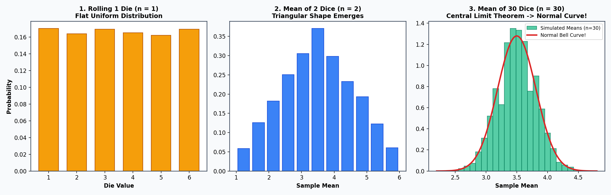
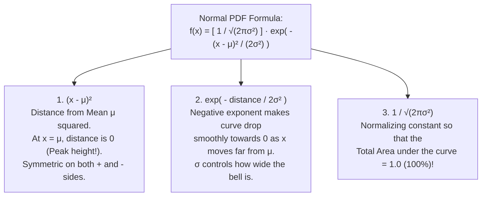

# Dependency Lesson 04.2: Probability Distributions, Central Limit Theorem (CLT) සහ Normal Distribution (ප්‍රමත ව්‍යාප්තිය)

**ආශ්‍රිත ප්‍රධාන පාඩම (Connected Module 4 Core Lesson):**
- [Lesson 4.6: The Normal (Gaussian) Distribution](../../Module_04_Mathematics_and_Statistics_for_Data_Science/Lesson_4.6_The_Normal_Gaussian_Distribution.md)

---

## 1. හැඳින්වීම: ඇයි ස්වභාවධර්මයේ සෑම තැනකම Normal Distribution (සීනු හැඩැති වක්‍රය) දක්නට ලැබෙන්නේ?

දේශන සටහනේ 37 වන Slide එකෙහි සඳහන් වන්නේ:
* *"Normal Distribution: Most widely used probability distribution. Occurs naturally in many situations (Examples: size of people, IQ-scores, etc.)."*

ඇයි මිනිසුන්ගේ උස, බර, රුධිර පීඩනය, IQ ලකුණු සහ කර්මාන්තශාලාවක නිෂ්පාදනවල මිනුම් සියල්ලම මෙම **Bell Curve (සීනුවක හැඩැති වක්‍රය)** අනුගමනය කරන්නේ? ඊට හේතුව සංඛ්‍යානයේ ඇති විශ්මිතම නියමය වන **Central Limit Theorem (මධ්‍ය සීමා ප්‍රමේයය - CLT)** ය!



### Central Limit Theorem (CLT) සරල උදාහරණයකින්:
* ඔබ දාදු කැටයක් (1 සිට 6 දක්වා) 1 වරක් උඩ දැමුවහොත් 1, 2, 3, 4, 5, 6 ලැබීමේ සම්භාවිතාව සමාන වේ (එය පැතලි **Uniform Distribution** එකකි).
* නමුත් ඔබ දාදු කැට 30ක් එකවර උඩ දමා ඒවායේ **සාමාන්‍යය (Sample Mean)** ගතහොත්, බොහෝ විට සාමාන්‍යය ලැබෙන්නේ `3.5` අවටයි! සියලුම දාදු කැට 30ම `1` හෝ `6` වීම ඉතාම දුර්ලභය.
* **CLT නියමය:** මුල් දත්ත කවර හැඩයක ව්‍යාප්තියක් ගත්තද, ඉන් ලබාගන්නා ස්වායත්ත සාධක හෝ නියැදි ගණන ($n \ge 30$) වැඩි වන විට ඒවායේ එකතුව හෝ මධ්‍යන්‍යය ස්වයංක්‍රීයව **Normal Distribution (ප්‍රමත ව්‍යාප්තිය)** බවට පත් වේ! මිනිසෙකුගේ උස හෝ IQ ලකුණ ජාන සහ පාරිසරික සාධක සිය ගණනක එකතුවක් නිසා එය ස්වභාවිකවම Normal Distribution එකක් ගනී!

---

## 2. Probability Density Function (සම්භාවිතා ඝනත්ව ශ්‍රිතය - PDF) කෑල්ලෙන් කෑල්ල තේරුම් ගනිමු (Slide 37)

Normal Distribution වක්‍රය අඳින ගණිතමය සූත්‍රය (**Probability Density Function - PDF**) Slide 37 හි දී ඇත:

$$f(x) = \frac{1}{\sqrt{2\pi\sigma^2}} \, e^{-\frac{(x - \mu)^2}{2\sigma^2}}$$

බැලූ බැල්මට සංකීර්ණ ලෙස පෙනෙන මෙම සූත්‍රයේ එක් එක් කොටසින් සිදුවන්නේ කුමක්දැයි බලමු:



1. **ඇයි $(x - \mu)^2$ තිබෙන්නේ?** $x = \mu$ (හරියටම මධ්‍යන්‍යය) වන විට $(x-\mu)^2 = 0$ වී $e^0 = 1$ වේ. එනම් වක්‍රයේ **උසම මුදුන (Peak)** හරියටම $\mu$ හි පිහිටයි! වර්ග කර ඇති නිසා $\mu$ ට වම් පස සහ දකුණු පස 100%ක් සමමිතික වේ.
2. **ඇයි $2\sigma^2$ න් බෙදා ඇත්තේ?** $\sigma$ (**Standard Deviation - සම්මත අපගමනය**) මගින් වක්‍රයේ පළල පාලනය කරයි (Slides 38–39).
3. **ඇයි ඉදිරියෙන් $\frac{1}{\sqrt{2\pi\sigma^2}}$ තිබෙන්නේ?** වක්‍රය යටතේ ඇති **මුළු වර්ගඵලය (Total Probability Area) හරියටම `1.0` (100%)** බවට පත් කිරීමටයි!

---

## 3. Empirical Rule ($68.27\% - 95.45\% - 99.73\%$) සහ Z-Score (Slide 40)

Normal Distribution එකක **Mean ($\mu$)** සහ **Standard Deviation ($\sigma$)** දන්නේ නම්, මුළු ව්‍යාප්තියේම ඕනෑම පරාසයක් තුළ ඇති දත්ත ප්‍රතිශතය අපට ක්ෂණිකව කිව හැක:
* **$\mu \pm 1\sigma$:** දත්තවලින් **$68.27\%$** ක් (එක් පසෙක $34.13\%$ බැගින්).
* **$\mu \pm 2\sigma$:** දත්තවලින් **$95.45\%$** ක් (එක් පසෙක $34.13\% + 13.59\% = 47.72\%$ බැගින්).
* **$\mu \pm 3\sigma$:** දත්තවලින් **$99.73\%$** ක් ($\pm 2\sigma$ සහ $\pm 3\sigma$ අතර එක් පසෙක $2.14\%$ බැගින්).
* **$\pm 3\sigma$ න් පිටත:** ඉතිරි වන්නේ $0.27\%$ ක් (එක් වලිගයක $0.135\%$ බැගින්) පමණි!

---

## 🛠️ Practical Task / Hands-On Exercise (ප්‍රායෝගික අභ්‍යාසය)

### Scenario / Goal:
Slide 37 හි දී ඇති Normal Distribution PDF සූත්‍රය Python මගින් කෙලින්ම කේතනය කර, $\mu = 0, \sigma = 1$ (Standard Normal Distribution) සඳහා $x = [-3, -2, -1, 0, 1, 2, 3]$ හි PDF අගයන් ගණනය කරන්න.

### Step-by-Step Tasks:
1. `normal_pdf(x, mu, sigma)` නමින් Python ශ්‍රිතයක් `np.pi`, `np.e` (හෝ `np.exp`), සහ `np.sqrt` භාවිතා කර ලියන්න.
2. `x = np.array([-3, -2, -1, 0, 1, 2, 3])` සඳහා `mu=0, sigma=1` ආදේශ කර PDF අගයන් මුද්‍රණය කරන්න.
3. `-x` සහ `+x` හි PDF අගයන් සමාන බව (Symmetry) පෙන්වන්න.

### Starter Code:
```python
import numpy as np

def normal_pdf(x, mu=0.0, sigma=1.0):
    # Implement f(x) = (1 / sqrt(2 * pi * sigma^2)) * exp(-(x - mu)^2 / (2 * sigma^2))
    pass

x_vals = np.array([-3, -2, -1, 0, 1, 2, 3])
```

### Expected Output / Reference Solution:
```python
import numpy as np

def normal_pdf(x, mu=0.0, sigma=1.0):
    coeff = 1.0 / np.sqrt(2 * np.pi * (sigma ** 2))
    exponent = -((x - mu) ** 2) / (2 * (sigma ** 2))
    return coeff * np.exp(exponent)

x_vals = np.array([-3, -2, -1, 0, 1, 2, 3])
pdf_vals = normal_pdf(x_vals, mu=0.0, sigma=1.0)

for xv, pv in zip(x_vals, pdf_vals):
    print(f"x = {xv:+d} | f(x) = {pv:.6f}")
```
**Expected Output:**
```text
x = -3 | f(x) = 0.004432
x = -2 | f(x) = 0.053991
x = -1 | f(x) = 0.241971
x = +0 | f(x) = 0.398942
x = +1 | f(x) = 0.241971
x = +2 | f(x) = 0.053991
x = +3 | f(x) = 0.004432
```

---

## 📝 Summary & Exam Revision Cheat Sheet

* **Normal PDF:** $f(x) = \frac{1}{\sqrt{2\pi\sigma^2}} e^{-\frac{(x-\mu)^2}{2\sigma^2}}$
* **සුවිශේෂී ලක්ෂණය (Slide 38):** **Mean ($\mu$)** සහ **Standard Deviation ($\sigma$)** යන පරාමිතීන් දෙක පමණක් මුළු Normal Distribution එකම 100%ක් විස්තර කිරීමට ප්‍රමාණවත් වේ!
* **Empirical Rule (Slide 40):** $\mu \pm 1\sigma \to 68.27\%$, $\mu \pm 2\sigma \to 95.45\%$, $\mu \pm 3\sigma \to 99.73\%$.

---

**ඊළඟ Dependency පාඩම:** [03_Sampling_Distributions_Standard_Error_and_Confidence_Intervals.md](03_Sampling_Distributions_Standard_Error_and_Confidence_Intervals.md)  
**ආපසු ප්‍රධාන පාඩමට (Back to Main Lesson):** [Lesson 4.6: The Normal (Gaussian) Distribution](../../Module_04_Mathematics_and_Statistics_for_Data_Science/Lesson_4.6_The_Normal_Gaussian_Distribution.md)
