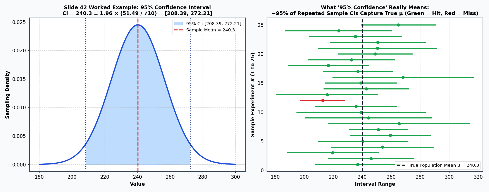
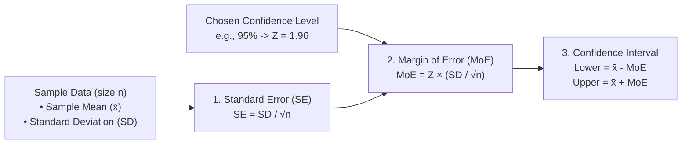

# Dependency Lesson 04.3: Sampling Distributions, Standard Error ($\text{SE}$) සහ Confidence Intervals (විශ්වාසනීය ප්‍රාන්තර)

**ආශ්‍රිත ප්‍රධාන පාඩම් (Connected Module 4 Core Lessons):**
- [Lesson 4.3: Introduction to Statistics — Population, Sample & Categories](../../Module_04_Mathematics_and_Statistics_for_Data_Science/Lesson_4.3_Introduction_to_Statistics_Population_Sample_Categories.md)
- [Lesson 4.7: Inferential Statistics — Confidence Intervals & Hypothesis Testing](../../Module_04_Mathematics_and_Statistics_for_Data_Science/Lesson_4.7_Inferential_Statistics_Confidence_Intervals_and_Hypothesis_Testing.md)

---

## 1. හැඳින්වීම: Standard Deviation ($\text{SD}$) සහ Standard Error ($\text{SE}$) අතර වෙනස කුමක්ද?

දේශන සටහනේ 41 වන Slide එකෙහි **Confidence Interval (විශ්වාසනීය ප්‍රාන්තරය)** සූත්‍රය දෙස බලන විට බොහෝ සිසුන් අසන ප්‍රශ්නයක් නම්:
$$\text{CI} = \bar{x} \pm Z \times \frac{\text{SD}}{\sqrt{n}}$$
*"ඇයි මෙහි $\text{SD}$ අගය නියැදි ප්‍රමාණයේ වර්ගමූලයෙන් ($\sqrt{n}$) බෙදා තිබෙන්නේ?"*

* **Standard Deviation ($\text{SD}$ - සම්මත අපගමනය):** තනි තනි පුද්ගලයින්ගේ දත්ත අගයන් මධ්‍යන්‍යය වටා කොපමණ විසිරී ඇත්දැයි මනියි.
* **Standard Error of the Mean ($\text{SE} = \frac{\text{SD}}{\sqrt{n}}$ - මධ්‍යන්‍යයේ සම්මත දෝෂය):** ඔබ Population එකෙන් $n$ ප්‍රමාණයේ නියැදි (Samples) නැවත නැවතත් ගතහොත්, එම **නියැදි මධ්‍යන්‍යයන් ($\bar{x}$) සැබෑ Population Mean ($\mu$) වටා කොපමණ විසිරී පවතීද** යන්න මනියි!
  * නියැදි ප්‍රමාණය $n$ විශාල වන විට $\sqrt{n}$ විශාල වන නිසා $\text{SE} = \frac{\text{SD}}{\sqrt{n}}$ කුඩා වේ! එනම් විශාල නියැදියක් ගන්නා විට අපගේ ඇස්තමේන්තුව වඩාත් නිවැරදි (Narrower Confidence Interval) වේ!



---

## 2. Confidence Interval (විශ්වාසනීය ප්‍රාන්තරය) සහ Margin of Error (Slides 41–42)



### ඇයි 95% Confidence Level සඳහා $Z = 1.96$ ගන්නේ?
පෙර පාඩමේදී අපි Empirical Rule යටතේ දුටුවේ Normal Distribution එකක මැද $95.45\%$ ක් $\mu \pm 2\sigma$ තුළ පවතින බවයි. හරියටම **$95.0\%$** ක් මැදට ගැනීමට නම් (දෙපස වලිගවල $2.5\%$ බැගින් ඉතිරි වන සේ), යා යුතු නිවැරදි Z-Score දුර වන්නේ **`1.96`** කි!

| Confidence Level (විශ්වාසනීය මට්ටම) | දෙපස ඉතිරි වන ප්‍රතිශතය ($\alpha$) | $Z$-value (Slide 42) |
| :---: | :---: | :---: |
| **80%** | 20% (එක් පසෙක 10%) | **`1.28`** |
| **90%** | 10% (එක් පසෙක 5%) | **`1.645`** |
| **95%** | 5% (එක් පසෙක 2.5%) | **`1.96`** |
| **98%** | 2% (එක් පසෙක 1%) | **`2.33`** |
| **99%** | 1% (එක් පසෙක 0.5%) | **`2.58`** |

---

## 3. Slide 42 හි ගණනය කිරීම පියවරෙන් පියවර (Worked Example)

දේශන සටහනේ 42 වන Slide එකෙහි දී ඇති වගුවේ දත්ත:
* **Mean ($\bar{x}$):** `240.3`
* **Standard Deviation ($\text{SD}$):** `51.49`
* **Sample Size ($n$):** `10`
* **Confidence Level:** `95%` ($\implies Z = 1.96$)

1. **පියවර 1 (Standard Error - $\text{SE}$):**
   $$\text{SE} = \frac{\text{SD}}{\sqrt{n}} = \frac{51.49}{\sqrt{10}} = \frac{51.49}{3.162277} = 16.28257$$
2. **පියවර 2 (Margin of Error - $\text{MoE}$):**
   $$\text{MoE} = Z \times \text{SE} = 1.96 \times 16.28257 = \mathbf{31.9138} \approx \mathbf{31.91}$$
3. **පියවර 3 (Upper and Lower Scores):**
   * $\text{Upper Score} = 240.3 + 31.91 = \mathbf{272.21}$
   * $\text{Lower Score} = 240.3 - 31.91 = \mathbf{208.39}$

---

## 🛠️ Practical Task / Hands-On Exercise (ප්‍රායෝගික අභ්‍යාසය)

### Scenario / Goal:
අපගේ MSc Data Science පන්තියේ සිසුන් 15 දෙනාගේ වයස් (`st_ages = [22, 21, 23, 28, 23, 34, 30, 24, 49, 27, 23, 22, 32, 28, 26]`) සඳහා **90%**, **95%**, සහ **99%** යන Confidence Intervals තුනම ගණනය කරන Python ශ්‍රිතයක් ලියන්න.

### Step-by-Step Tasks:
1. `st_ages` හි Sample Mean ($\bar{x}$), Standard Deviation ($\text{SD}$), සහ $n = 15$ ලබා ගන්න.
2. `z_table = {90: 1.645, 95: 1.96, 99: 2.58}` Dictionary එක භාවිතා කර එක් එක් මට්ටම සඳහා `Margin of Error`, `Lower Bound`, සහ `Upper Bound` ගණනය කරන්න.
3. විශ්වාසනීය මට්ටම (Confidence Level) 90% සිට 99% දක්වා වැඩි වන විට ප්‍රාන්තරයේ පළල (Interval width) වැඩි වන බව නිරීක්ෂණය කරන්න.

### Starter Code:
```python
import numpy as np

st_ages = np.array([22, 21, 23, 28, 23, 34, 30, 24, 49, 27, 23, 22, 32, 28, 26])
z_table = {90: 1.645, 95: 1.96, 99: 2.58}

# Write your solution here
```

### Expected Output / Reference Solution:
```python
import numpy as np

st_ages = np.array([22, 21, 23, 28, 23, 34, 30, 24, 49, 27, 23, 22, 32, 28, 26])
z_table = {90: 1.645, 95: 1.96, 99: 2.58}

mean_age = st_ages.mean()
sd_age = st_ages.std()
n = len(st_ages)
se = sd_age / np.sqrt(n)

print(f"Sample Mean = {mean_age:.2f} | SD = {sd_age:.2f} | SE = {se:.2f}\n")
for level, z in z_table.items():
    moe = z * se
    print(f"{level}% CI (Z={z:<5}): {mean_age:.2f} ± {moe:.2f}  -->  [{mean_age - moe:.2f}, {mean_age + moe:.2f}]")
```
**Expected Output:**
```text
Sample Mean = 27.47 | SD = 6.88 | SE = 1.78

90% CI (Z=1.645): 27.47 ± 2.92  -->  [24.55, 30.39]
95% CI (Z=1.96 ): 27.47 ± 3.48  -->  [23.99, 30.95]
99% CI (Z=2.58 ): 27.47 ± 4.58  -->  [22.88, 32.05]
```

---

## 📝 Summary & Exam Revision Cheat Sheet

* **Standard Error ($\text{SE}$):** $\frac{\text{SD}}{\sqrt{n}}$
* **Margin of Error ($\text{MoE}$):** $Z \times \frac{\text{SD}}{\sqrt{n}}$
* **Confidence Interval ($\text{CI}$):** $\bar{x} \pm Z \times \frac{\text{SD}}{\sqrt{n}}$ (95% සඳහා $Z = 1.96$).

---

**ඊළඟ Dependency පාඩම:** [04_Complete_Guide_to_Hypothesis_Testing_p_values_t_test_and_ANOVA.md](04_Complete_Guide_to_Hypothesis_Testing_p_values_t_test_and_ANOVA.md)  
**ආපසු ප්‍රධාන පාඩමට (Back to Main Lesson):** [Lesson 4.7: Inferential Statistics — Confidence Intervals & Hypothesis Testing](../../Module_04_Mathematics_and_Statistics_for_Data_Science/Lesson_4.7_Inferential_Statistics_Confidence_Intervals_and_Hypothesis_Testing.md)
