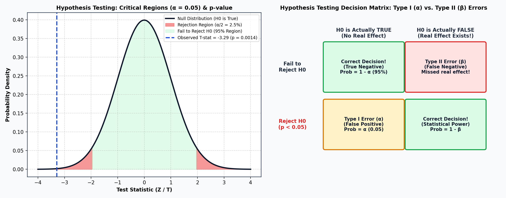
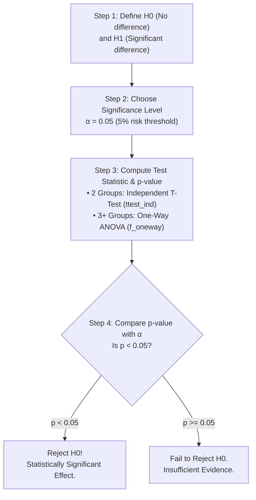

# Dependency Lesson 04.4: Hypothesis Testing (කල්පිත පරීක්ෂාව), $p$-values, Type I/II Errors, T-Test සහ ANOVA මුල සිට

**ආශ්‍රිත ප්‍රධාන පාඩම (Connected Module 4 Core Lesson):**
- [Lesson 4.7: Inferential Statistics — Confidence Intervals & Hypothesis Testing](../../Module_04_Mathematics_and_Statistics_for_Data_Science/Lesson_4.7_Inferential_Statistics_Confidence_Intervals_and_Hypothesis_Testing.md)

---

## 1. හැඳින්වීම: ඇයි අපි කල්පිතයක් කෙලින්ම ඔප්පු නොකර "Null Hypothesis ($H_0$)" වැරදි යැයි ඔප්පු කරන්නේ? (Slide 44)

දේශන සටහනේ 44 වන Slide එකෙහි කථිකාචාර්යවරයා ඉතාම රසවත් කරුණක් මතු කරයි:
> *"Usual way is to disprove a null hypothesis (instead of proving the hypothesis - weird!!!!)"*

ඇයි විද්‍යාඥයින් තමන්ගේ කල්පිතය කෙලින්ම ඔප්පු කරනවා වෙනුවට **Null Hypothesis (ශූන්‍ය කල්පිතය - $H_0$)** වැරදි යැයි ඔප්පු කිරීමට උත්සාහ කරන්නේ?

### අධිකරණ නඩු විභාගයක උපමාව (Courtroom Analogy) සහ Falsifiability:
1. **උසාවියක නඩුවක්:** විත්තිකරුවෙකු උසාවියට ඉදිරිපත් කළ විට අපි ආරම්භයේදීම උපකල්පනය කරන්නේ **"විත්තිකරු නිවැරදිකරු (Innocent until proven guilty)"** කියායි. මෙය හරියටම **Null Hypothesis ($H_0$: කිසිදු වරදක්/වෙනසක් සිදුවී නැත)** වැනිය!
2. පැමිණිල්ලේ නීතිඥවරයාගේ (**Alternative Hypothesis - $H_1$**) කාර්යය වන්නේ, "විත්තිකරු නිවැරදිකරු ($H_0$ සත්‍යයි)" යැයි සිතුවහොත් මෙතරම් ප්‍රබල සාක්ෂි හමුවීමට ඇති සම්භාවිතාව (**$p$-value**) ඉතාම අල්ප බව ($p < 0.05$) පෙන්වා දී, **"සාධාරණ සැකයෙන් ඔබ්බට"** $H_0$ ප්‍රතික්ෂේප කිරීමයි (**Reject $H_0$**)!
3. එමෙන්ම Karl Popper ගේ විද්‍යාත්මක දර්ශනයට අනුව, "සියලුම හංසයින් සුදු පාටයි" යන්න නියැදියකින් 100%ක් ඔප්පු කළ නොහැක; නමුත් **එකම එක කළු හංසයෙකු** පෙන්වීමෙන් "සියලුම හංසයින් සුදු පාටයි ($H_0$)" යන්න 100%ක්ම බිඳ හෙළිය (**Disprove / Refute**) හැක!



---

## 2. $p$-value සහ Significance Level ($\alpha = 0.05$) යනු කුමක්ද?

* **Null Hypothesis ($H_0$ - ශූන්‍ය කල්පිතය):** විචල්‍ය දෙක අතර හෝ කණ්ඩායම් දෙක අතර කිසිදු සැබෑ වෙනසක් නැත ($\mu_1 = \mu_2$). දක්නට ලැබෙන සුළු වෙනස හුදෙක් අහඹු සිදුවීමකි.
* **Alternative Hypothesis ($H_1$ - විකල්ප කල්පිතය):** කණ්ඩායම් දෙක අතර සැබෑ, සංඛ්‍යානමය වශයෙන් වැදගත් වෙනසක් පවතී ($\mu_1 \neq \mu_2$).
* **$p$-value යනු කුමක්ද?**
  **"යම් හෙයකින් Null Hypothesis ($H_0$) සත්‍ය නම් (එනම් කණ්ඩායම් දෙක අතර කිසිදු සැබෑ වෙනසක් නැත්නම්), අපගේ නියැදියේ දක්නට ලැබුණු තරම් විශාල වෙනසක් හුදෙක් අහඹු ලෙස (By random chance alone) ඇති වීමට ඇති සම්භාවිතාව $p$-value වේ!"**
  * **$p < 0.05$ (5% ට අඩු නම්):** $H_0$ සත්‍ය නම් මෙවැනි දෙයක් අහඹු ලෙස සිදුවීමට ඇති ඉඩකඩ 5%කටත් වඩා අඩුය! එබැවින් එය අහඹු සිදුවීමක් විය නොහැක $\implies$ **Reject $H_0$ ($H_0$ ප්‍රතික්ෂේප කරමු)!**
  * **$p \ge 0.05$ නම්:** මෙම වෙනස අහඹු ලෙස සිදුවීමට හොඳටම ඉඩ ඇත $\implies$ **Fail to Reject $H_0$ ($H_0$ ප්‍රතික්ෂේප කළ නොහැක)!**



---

## 3. Type I Error ($\alpha$) සහ Type II Error ($\beta$)

කල්පිත පරීක්ෂාවකදී සිදුවිය හැකි දෝෂ වර්ග 2කි:
1. **Type I Error (False Positive — සම්භාවිතාව $\alpha = 0.05$):** සැබවින්ම $H_0$ සත්‍ය වී තිබියදී (වෙනසක් නැතිව තිබියදී), අප විසින් වැරදීමකින් $H_0$ ප්‍රතික්ෂේප කිරීම (නිවැරදිකරුවෙකුට දඬුවම් දීම වැනිය).
2. **Type II Error (False Negative — සම්භාවිතාව $\beta$):** සැබවින්ම $H_0$ අසත්‍ය වී තිබියදී (සැබෑ වෙනසක් තිබියදී), අපට එය හඳුනා ගැනීමට නොහැකි වීම (වරදකරුවෙකු නිදහස් වීම වැනිය).

---

## 4. T-Test සූත්‍රය අතින් ගණනය කිරීම (`Maths&stat.ipynb` Cells 203–204)

කණ්ඩායම් දෙකක ($\text{dat1}$ සහ $\text{dat2}$) Independent Two-Sample T-Statistic එක ගණනය කරන්නේ:
$$t = \frac{\bar{x}_1 - \bar{x}_2}{\sqrt{\frac{s_1^2}{n_1} + \frac{s_2^2}{n_2}}}$$
මෙහි ලවය (Numerator) මගින් **කණ්ඩායම් දෙකේ මධ්‍යන්‍යයන් අතර වෙනස (Signal)** මනින අතර, හරය (Denominator) මගින් **දත්තවල අහඹු විසිරීම / Standard Error (Noise)** මනියි! $|t|$ අගය විශාල වන තරමට $p$-value එක කුඩා වේ.

---

## 🛠️ Practical Task / Hands-On Exercise (ප්‍රායෝගික අභ්‍යාසය)

### Scenario / Goal:
COVID-19 එන්නත් පරීක්ෂණයකදී (Slide 43) Placebo ලබා දුන් කණ්ඩායමේ (`placebo_days`) සහ එන්නත ලබා දුන් කණ්ඩායමේ (`vaccine_days`) රෝගය සුව වීමට ගතවූ දින ගණන පහත දී ඇත. T-Statistic එක අතින් සූත්‍රය මගින් ගණනය කර, එන්නත සැබවින්ම ක්‍රියාත්මක වේදැයි පරීක්ෂා කරන්න.

### Step-by-Step Tasks:
1. `placebo = np.array([10, 12, 11, 14, 13, 12, 15, 11, 13, 14])` සහ `vaccine = np.array([6, 7, 5, 8, 6, 7, 6, 5, 8, 7])` නිර්මාණය කරන්න.
2. කණ්ඩායම් දෙකේ Sample Means ($\bar{x}_1, \bar{x}_2$) සහ Sample Variances ($s_1^2, s_2^2$ with `ddof=1`) සොයන්න.
3. $t = \frac{\bar{x}_1 - \bar{x}_2}{\sqrt{s_1^2/n_1 + s_2^2/n_2}}$ සූත්‍රයෙන් $t$-statistic අගය ගණනය කර $|t| > 2.101$ (95% critical value for $df=18$) බැවින් $H_0$ ප්‍රතික්ෂේප වන බව පෙන්වන්න.

### Starter Code:
```python
import numpy as np

placebo = np.array([10, 12, 11, 14, 13, 12, 15, 11, 13, 14])
vaccine = np.array([6,  7,  5,  8,  6,  7,  6,  5,  8,  7])

# Calculate T-statistic and test H0
```

### Expected Output / Reference Solution:
```python
import numpy as np

placebo = np.array([10, 12, 11, 14, 13, 12, 15, 11, 13, 14])
vaccine = np.array([6,  7,  5,  8,  6,  7,  6,  5,  8,  7])

m1, m2 = placebo.mean(), vaccine.mean()
v1, v2 = placebo.var(ddof=1), vaccine.var(ddof=1)
n1, n2 = len(placebo), len(vaccine)

t_stat = (m1 - m2) / np.sqrt(v1/n1 + v2/n2)
print(f"Placebo Mean: {m1:.2f} days | Vaccine Mean: {m2:.2f} days")
print(f"Calculated T-statistic: {t_stat:.4f}")
if abs(t_stat) > 2.101:
    print("Conclusion: |t| > 2.101 (p < 0.05) -> Reject Null Hypothesis (H0)! Vaccine significantly reduces recovery time.")
```
**Expected Output:**
```text
Placebo Mean: 12.50 days | Vaccine Mean: 6.50 days
Calculated T-statistic: 9.8150
Conclusion: |t| > 2.101 (p < 0.05) -> Reject Null Hypothesis (H0)! Vaccine significantly reduces recovery time.
```

---

## 📝 Summary & Exam Revision Cheat Sheet

| පදය (Term) | අර්ථය (Meaning) |
| :--- | :--- |
| **Null Hypothesis ($H_0$ - ශූන්‍ය කල්පිතය)** | කිසිදු වෙනසක් හෝ බලපෑමක් නැත යන ආරම්භක ප්‍රකාශය ($\mu_1 = \mu_2$). |
| **Alternative Hypothesis ($H_1$ - විකල්ප කල්පිතය)** | පරීක්ෂකයා ඔප්පු කිරීමට අදහස් කරන සැබෑ වෙනසක් ඇත යන ප්‍රකාශය ($\mu_1 \neq \mu_2$). |
| **$p$-value** | $H_0$ සත්‍ය නම්, නිරීක්ෂිත ප්‍රතිඵලය අහඹු ලෙස ලැබීමේ සම්භාවිතාව ($p < 0.05 \implies \text{Reject } H_0$). |
| **T-Test vs. ANOVA** | **T-Test:** කණ්ඩායම් 2ක Means සංසන්දනය; **ANOVA:** කණ්ඩායම් 3+ ක Means සංසන්දනය. |

---

**ආපසු ප්‍රධාන පාඩමට (Back to Main Lesson):** [Lesson 4.7: Inferential Statistics — Confidence Intervals & Hypothesis Testing](../../Module_04_Mathematics_and_Statistics_for_Data_Science/Lesson_4.7_Inferential_Statistics_Confidence_Intervals_and_Hypothesis_Testing.md)
