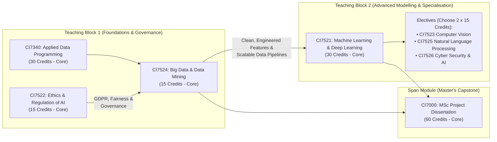
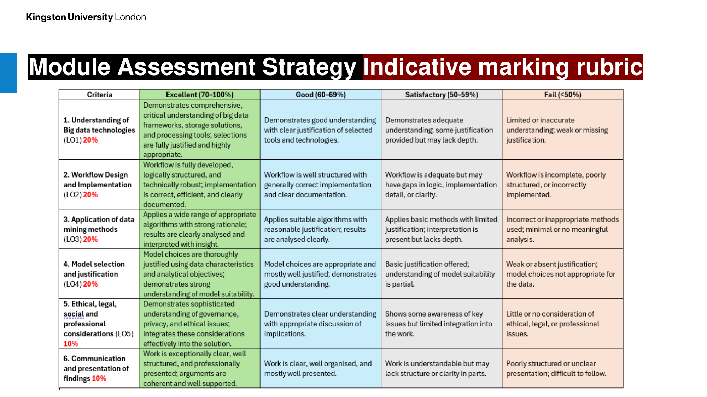
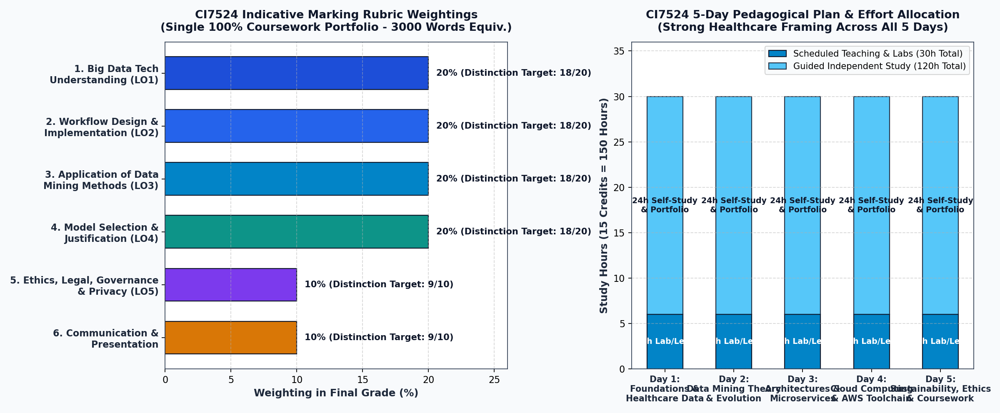
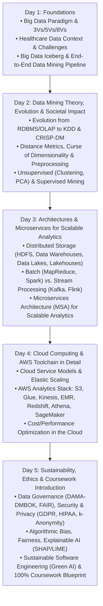

# Lesson 1.1: Module Overview, Assessment Rubric & Healthcare Big Data Context
**MSc Artificial Intelligence — CI7524: Big Data and Data Mining (Level 7, 15 Credits)**

---

> [!TIP]
> **📚 Prerequisite Dependency Guide (මූලික පූර්ව-අවශ්‍යතා පාඩම් මාලාව):**
> මෙම Module එකේ ප්‍රායෝගික කේතකරණ (coding) සහ Data Engineering කොටස් ඉතාමත් පහසුවෙන් තේරුම් ගැනීමට, අපගේ **Centralized Dependency Lesson Series** එකේ පහත පාඩම් මාලාවන් ඔබට ඕනෑම වේලාවක පරිශීලනය කළ හැක:
> - [Dep 01.1 — DataFrames, Memory Model and Data Types](../dependencies/Dep_01_Python_Pandas_and_Out_of_Core_Data_Processing/01_DataFrames_Memory_Model_and_Data_Types.md)
> - [Dep 01.2 — Chunking, Generators and Out-of-Core Processing](../dependencies/Dep_01_Python_Pandas_and_Out_of_Core_Data_Processing/02_Chunking_Generators_and_Out_of_Core_Processing.md)
> - [Dep 02.1 — Relational Databases, SQL and ACID vs. BASE](../dependencies/Dep_02_SQL_NoSQL_and_Distributed_Storage_Foundations/01_Relational_Databases_SQL_and_ACID_vs_BASE.md)
> - [Dep 02.3 — Columnar File Formats: Parquet, ORC and Partitioning](../dependencies/Dep_02_SQL_NoSQL_and_Distributed_Storage_Foundations/03_Columnar_File_Formats_Parquet_ORC_and_Partitioning.md)
> - [Dep 05.1 — Distributed Computing Architecture and Spark Execution](../dependencies/Dep_05_Apache_Spark_and_PySpark_Zero_to_Hero/01_Distributed_Computing_Architecture_and_Spark_Execution.md)

---

## 1. හැඳින්වීම (Introduction to CI7524: Big Data and Data Mining)

ආයුබෝවන්! **MSc in Artificial Intelligence** පාඨමාලාවේ ඉතාමත් වැදගත් සහ ප්‍රායෝගික **Core Module** එකක් වන **CI7524: Big Data and Data Mining** පාඩම් මාලාවට ඔබව සාදරයෙන් පිළිගන්නවා.

වර්තමාන AI ලෝකයේ බොහෝ දෙනෙක් **Machine Learning (ML)** හෝ **Deep Learning (DL)** algorithms ගැන කතා කළත්, සැබෑ Enterprise හෝ Healthcare පද්ධතියක (production system) සාර්ථකත්වයෙන් **80% කටත් වඩා** රඳා පවතින්නේ එම algorithms වලට ලබා දෙන දත්ත (Data) කොතරම් විශාලද, පිරිසිදුද, විශ්වාසවන්තද සහ කාර්යක්ෂමව සකසා (process කර) තිබේද යන්න මතයි.

මෙම පළමු පාඩමෙන් (**Lesson 1.1**) අපි ආවරණය කරන්නේ:
- `CI7524_Lectures_1_Intro.pdf` (Slides 1–12 — Dr. Pushpa Kumarapeli & Tia Haddad)
- `Big Data and Data Mining - Topic 01.pdf` (Slides 1–7 — Nirasha Kulasooriya)
- `CI7524 Big Data and Data Mining.docx` (Official Level 7 Module Descriptor) සහ `MSc_AI_Module_Delivery_Assessment.xlsx`

මෙහිදී අපි මෙම Module එකේ අරමුණු, **Learning Outcomes (LO1–LO5)**, **100% Coursework Portfolio Assessment** එක සහ එහි **Indicative Marking Rubric** එකෙන් **90%+ (Distinction)** ලකුණක් ලබා ගන්නා ආකාරය, **5-Day Pedagogical Progression** සැලැස්ම, සහ ඇයි මෙම Module එක **Healthcare Context** එකක් මත විශේෂයෙන් ගොඩනගා තිබෙන්නේ කියන කරුණු සියල්ල ගැඹුරින් සාකච්ඡා කරමු.

---

## 2. Module Teaching Team & Research Alignment (Slide 1 of Intro & Slide 1 of Topic 01)

ඕනෑම MSc Module එකකින් ඉහළම ලකුණු (90%+) ලබා ගැනීමට නම්, එම Module එක නිර්මාණය කළ සහ උගන්වන ආචාර්ය මණ්ඩලයේ **Research Interests (පර්යේෂණ ක්ෂේත්‍ර)** මොනවාදැයි හඳුනා ගැනීම ඉතාමත් වැදගත්. මන්ද, ඔවුන්ගේ Lecture examples සහ Coursework expectations සෘජුවම එම ක්ෂේත්‍ර හා බැඳී පවතිනවා.

| Role | Academic / Researcher | Affiliation | Core Research Areas & Relevance to CI7524 |
| :--- | :--- | :--- | :--- |
| **Module Leader** | **Dr. Pushpa Kumarapeli** | School Director (Learning & Teaching), Faculty of Engineering, Computing & the Environment (ECE), School of Computer Science & Mathematics (CSM), Associate Professor, Kingston University London (`P.Kumarapeli@kingston.ac.uk`, Office SB2008) | • **Software Engineering**<br>• **Health Informatics** *(Clinical coding, EHR systems)*<br>• **Cloud Computing** *(Scalable infrastructure)*<br>• **Data Engineering** *(ETL/ELT pipelines)*<br>• **Business Process Modelling**<br>• **AI in Education** |
| **Teaching Assistant** | **Tia Haddad** | Doctoral Researcher (3rd Year) in Software Engineering, ECE / CSM, Kingston University London | • **Big Healthcare Data (BHD)**<br>• **Microservices Architecture (MSA)** *(Day 3 focus)*<br>• **Sustainable Software Engineering (SEE)** *(Day 5 Green AI & carbon-aware analytics focus)* |
| **Topic 01 Lecturer** | **Nirasha Kulasooriya** | Lecturer — CI7524 Big Data and Data Mining | • **Big Data Foundations, 3Vs/5Vs/8Vs, Big Data Iceberg, and End-to-End AI Pipelines** |

> [!NOTE]
> **💡 Exam & Coursework Insight:** Dr. Pushpa Kumarapeli ගේ **Health Informatics & Data Engineering** පර්යේෂණ පසුබිම සහ Tia Haddad ගේ **Big Healthcare Data (BHD)**, **Microservices Architecture (MSA)**, සහ **Sustainable Software Engineering (SEE)** පර්යේෂණ පසුබිම නිසා තමයි මෙම Module එකේදී **Healthcare Big Data**, **Microservices (Day 3)**, සහ **Sustainability / Ethics (Day 5)** වලට විශේෂ වැදගත්කමක් ලබා දී තිබෙන්නේ!

---

## 3. Module Credit Value, Position in MSc AI & Time Allocation (Slide 4 of Topic 01 & Module Descriptor)

`Big Data and Data Mining - Topic 01.pdf` (Slide 4) සහ Official Module Descriptor එකට අනුව:
- **Module Code:** `CI7524`
- **Module Status:** **Core Module (අනිවාර්ය විෂයයකි)** — MSc Artificial Intelligence පාඨමාලාවේ **Teaching Block 1 (TB1)** හි පැවැත්වේ.
- **Academic Level:** **Level 7** (UK Postgraduate Master's Level)
- **Credit Value:** **15 Credits**
- **Total Learning Hours:** $15 \text{ Credits} \times 10 = \mathbf{150\text{ Hours}}$
  - **Scheduled Learning and Teaching (On-Campus Lectures / Practicals / PBL Workshops):** **30 Hours**
  - **Guided Independent Study (Self-Managed Study, Reading & Coursework Development):** **120 Hours**

### MSc Artificial Intelligence පාඨමාලාව තුළ CI7524 හි ස්ථානය (`C4 Programme Specification`)

MSc AI පාඨමාලාව සැලසුම් කර ඇත්තේ සැබෑ ලෝකයේ **End-to-End AI Project Roadmap** එකකට අනුකූලවයි:



**Programme Specification Gap Insight (`C4 MSc Artificial Intelligence.docx`):**
වර්තමාන Industry එකේ ප්‍රධාන ගැටලුවක් (Industry Skill Gap) ලෙස Programme Specification එක පෙන්වා දෙන්නේ:
1. AI Theory හොඳින් දන්නා පර්යේෂකයන්ට (AI Researchers) එම models සැබෑ **Enterprise Architecture / Distributed Data Platform** එකකට integrate කිරීමට අවශ්‍ය System Engineering සහ Data Engineering දැනුම මදි වීම.
2. හොඳ Software Engineers ලා AI සහ Data Mining models හුදෙක් **"Black-box component"** එකක් ලෙස භාවිතා කිරීම නිසා දත්තවල ස්වභාවය අනුව model එක customize කර ගැනීමට නොහැකි වී **Performance, Reliability, Efficiency, සහ Operational Cost** ගැටලු ඇති වීම.

**CI7524** මගින් මෙම පරතරය (gap) සම්පූර්ණයෙන්ම පියවනු ලබයි!

---

## 4. What This Module Is About & Official Curriculum Topics (Slide 2 of Intro & Descriptor)

`CI7524_Lectures_1_Intro.pdf` (Slide 2) මගින් මෙම Module එකේ මූලික කුළුණු 8 පැහැදිලි කරයි:
1. **Understand the characteristics, sources, and challenges of large and complex datasets** (විශාල සහ සංකීර්ණ දත්ත පද්ධතිවල ලක්ෂණ, මූලාශ්‍ර සහ අභියෝග තේරුම් ගැනීම).
2. **Explore big data technologies:** distributed computing, storage solutions, batch/stream processing (Distributed computing, Data Warehouses/Lakes, සහ Batch/Stream processing තාක්ෂණයන් ගවේෂණය කිරීම).
3. **Learn data mining workflows:** cleaning, integration, feature engineering, modelling (දත්ත පිරිසිදු කිරීමේ සිට Feature Engineering සහ Modelling දක්වා සම්පූර්ණ Data Mining workflow එක ඉගෙනීම).
4. **Apply supervised and unsupervised techniques:** e.g., clustering, time-series, component analysis (**Clustering (පොකුරුකරණය)**, **Time-Series Analysis (කාල-ශ්‍රේණි විශ්ලේෂණය)**, සහ **Component Analysis / PCA (සංරචක විශ්ලේෂණය)** වැනි Supervised සහ Unsupervised ක්‍රමවේද භාවිතය).
5. **Gain hands-on practice** with data mining tools, libraries, and real-world use cases (Python libraries, Cloud tools සහ සැබෑ ලෝකයේ සිද්ධි අධ්‍යයනයන් සමඟ ප්‍රායෝගික පුහුණුව).
6. **Develop skills to design and implement big data processing pipelines** (End-to-end Big Data processing pipelines නිර්මාණය කිරීම සහ ක්‍රියාත්මක කිරීම).
7. **Critically evaluate data quality, governance, security, ethics, and privacy implications** (Data Quality, Governance, Security, Ethics සහ Privacy ගැටලු විචාරාත්මකව ඇගයීම).
8. **Combine theory with practical Problem-Based Learning (PBL) and guided tool use** (න්‍යායාත්මක දැනුම **Problem-Based Learning - PBL** සමඟ මුසු කිරීම).

### Official Curriculum Structure (`CI7524 Big Data and Data Mining.docx`)
Module Descriptor එකට අනුව සම්පූර්ණ විෂය නිර්දේශය ප්‍රධාන කොටස් දෙකක් (Topics 1 & 2) සහ ඒ දෙකටම පොදු තේමාවක් (Common Theme) යටතේ බෙදා ඇත:
- **Topic 1 — Working with large and complex datasets:**
  - Big data characteristics, historical context, and evolution
  - Data warehouse and data lake architectures
  - Data processing approaches — batch and stream processing, ML applications
  - Approaches for real-time analytics and stream processing frameworks
  - Use cases of big data
- **Topic 2 — Data mining approaches for extracting insights from big data:**
  - Mathematical preliminaries (Linear Algebra, Distance metrics, High-dimensional spaces, Statistical foundations)
  - Data mining lifecycle and workflow (cleaning, integration, feature engineering)
  - Data mining techniques (clustering, time series analysis, association rules, etc.)
  - Reflecting on the use of supervised and unsupervised algorithms, role of component analysis (PCA/SVD)
- **Common to Both Topics — Data Governance and Security Issues:**
  - Data governance frameworks, security challenges, privacy issues and regulations (GDPR/HIPAA), responsible data mining practices.

---

## 5. Module Learning Outcomes — LO1 to LO5 (Slide 3 of Intro & Slide 3 of Topic 01)

මෙම Module එක සාර්ථකව අවසන් කරන ශිෂ්‍යයෙකුට පහත **Learning Outcomes (LO1–LO5)** පහම ප්‍රදර්ශනය කළ හැකි විය යුතුය. ඔබගේ 100% Coursework එක ලකුණු කරන්නේද කෙලින්ම මෙම LOs පහ පදනම් කරගෙනයි:

| LO Code | Official Learning Outcome Statement | What You Must Prove in Your Coursework | Weight in Rubric |
| :--- | :--- | :--- | :---: |
| **LO1** | **Demonstrate a comprehensive understanding of big data technologies**, including distributed computing frameworks, storage solutions, and data processing tools. | ඇයි ඔබ Data Lake / Warehouse / Parquet / Spark / Cloud භාවිතා කරන්නේ කියා විචාරාත්මකව (critically) පැහැදිලි කිරීම සහ තාක්ෂණයන් සංසන්දනය කිරීම. | **20%** |
| **LO2** | **Design and implement big data processing workflows**, interpret results, and communicate findings effectively. | Data Ingestion $\rightarrow$ Cleaning $\rightarrow$ Feature Engineering $\rightarrow$ Mining දක්වා තර්කානුකූල, ක්‍රියාත්මක වන (working code/architecture) pipeline එකක් නිර්මාණය කිරීම. | **20%** |
| **LO3** | **Apply a range of data mining methods, algorithms, and tools** to analyse and interpret complex datasets. | Supervised සහ Unsupervised algorithms (උදා: PCA, K-Means/DBSCAN, Time-Series, Classification/Regression) නිවැරදිව දත්ත මත ක්‍රියාත්මක කර ප්‍රතිඵල ගැඹුරින් විශ්ලේෂණය කිරීම. | **20%** |
| **LO4** | **Select and justify the choice of data mining models** based on the characteristics of the data and the specific objectives of the analysis, demonstrating a good understanding of model suitability. | *"ඇයි මම මේ dataset එකට K-Means වෙනුවට DBSCAN හෝ Random Forest වෙනුවට XGBoost තෝරා ගත්තේ?"* යන්න දත්තවල **Dimensionality (මාන ගණන)**, **Skewness (කුටිකතාව)**, **Outliers (බාහිර අගයන්)**, සහ **Sample Size (නියැදි ප්‍රමාණය)** මත පදනම්ව සාධාරණීකරණය (justify) කිරීම. | **20%** |
| **LO5** | **Develop the capability to utilise advanced analytics for deriving actionable insights** from large datasets, all while being mindful of **legal, social, ethical, and professional frameworks**, as well as associated **privacy concerns**. | GDPR/HIPAA, $k$-Anonymity, Algorithmic Bias, Fairness, Sustainability (Green AI), සහ Data Governance නීති ඔබේ විසඳුම තුළටම බද්ධ (integrate) කර තිබීම. | **10%** *(+ 10% Comm.)* |

---

## 6. Assessment Strategy & The Indicative Marking Rubric (Slides 4–5 of Intro & Slide 5 of Topic 01)

### 6.1 Single 100% Coursework Portfolio Strategy (Slide 4 of Intro & Slide 5 of Topic 01)
මෙම Module එකට විභාගයක් (Written Exam) නොමැත. සම්පූර්ණ ලකුණු **100% ම** හිමිවන්නේ තනි Coursework Portfolio එකකිනි:
- **Assessment Title:** *Data engineering & data mining solution development (3000 words equivalent)*
- **Format:** Scenario-based component portfolio presented as a **Comprehensive Technical Report or Scientific Paper** accompanied by your implemented workflow/code.
- **Formative Opportunities (ලකුණු නොකැපෙන පූර්ව-පුහුණු අවස්ථා):**
  - **Draft Design Submission:** ඔබේ pipeline design එක කලින් ඉදිරිපත් කර ආචාර්ය මණ්ඩලයෙන් early feedback ලබා ගැනීමේ අවස්ථාව.
  - **In-class and Canvas activities:** සතිපතා ක්‍රියාකාරකම් සහ quizzes.
- **Retake Strategy:** යම් හෙයකින් අසමත් වුවහොත් (Fail `<50%`), මුල් submission එකම වැඩිදියුණු කර නැවත ඉදිරිපත් කිරීම (Reworking and improving the original submission).

### 6.2 Deep Dive into Slide 5: Indicative Marking Rubric

පහත දැක්වෙන්නේ `CI7524_Lectures_1_Intro.pdf` හි **Slide 5** හි ඇති නිල **Indicative Marking Rubric** සටහනයි:



එමෙන්ම, එක් එක් Criterion එකට හිමිවන ලකුණු බර (Weighting %) සහ **5-Day Pedagogical Plan** එකේ කාල බෙදීම් පහත රූපසටහනින් පැහැදිලිව දැක්වේ:



අපි දැන් Slide 5 හි ඇති **Criteria 6** සහ Grade Bands 4 (**Excellent 70–100%**, **Good 60–69%**, **Satisfactory 50–59%**, **Fail <50%**) එකින් එක විමසා බලමු:

| Criteria & Weight | Excellent (70–100% / Distinction) | Good (60–69% / Merit) | Satisfactory (50–59% / Pass) | Fail (<50%) |
| :--- | :--- | :--- | :--- | :--- |
| **1. Understanding of Big Data Technologies (LO1) — 20%** | Demonstrates comprehensive, critical understanding of big data frameworks, storage solutions, and processing tools; selections are fully justified and highly appropriate. | Demonstrates good understanding with clear justification of selected tools and technologies. | Demonstrates adequate understanding; some justification provided but may lack depth. | Limited or inaccurate understanding; weak or missing justification. |
| **2. Workflow Design and Implementation (LO2) — 20%** | Workflow is fully developed, logically structured, and technically robust; implementation is correct, efficient, and clearly documented. | Workflow is well structured with generally correct implementation and clear documentation. | Workflow is adequate but may have gaps in logic, implementation detail, or clarity. | Workflow is incomplete, poorly structured, or incorrectly implemented. |
| **3. Application of Data Mining Methods (LO3) — 20%** | Applies a wide range of appropriate algorithms with strong rationale; results are clearly analysed and interpreted with insight. | Applies suitable algorithms with reasonable justification; results are analysed clearly. | Applies basic methods with limited justification; interpretation is present but lacks depth. | Incorrect or inappropriate methods used; minimal or no meaningful analysis. |
| **4. Model Selection and Justification (LO4) — 20%** | Model choices are thoroughly justified using data characteristics and analytical objectives; demonstrates strong understanding of model suitability. | Model choices are appropriate and mostly well justified; demonstrates good understanding. | Basic justification offered; understanding of model suitability is partial. | Weak or absent justification; model choices not appropriate for the data. |
| **5. Ethical, Legal, Social and Professional Considerations (LO5) — 10%** | Demonstrates sophisticated understanding of governance, privacy, and ethical issues; integrates these considerations effectively into the solution. | Demonstrates clear understanding with appropriate discussion of implications. | Shows some awareness of key issues but limited integration into the work. | Little or no consideration of ethical, legal, or professional issues. |
| **6. Communication and Presentation of Findings — 10%** | Work is exceptionally clear, well structured, and professionally presented; arguments are coherent and well supported. | Work is clear, well organised, and mostly well presented. | Work is understandable but may lack structure or clarity in parts. | Poorly structured or unclear presentation; difficult to follow. |

> [!IMPORTANT]
> **🎯 How to Score 90%+ (Distinction Strategy from the Rubric):**
> බොහෝ සිසුන් **60–69% (Good)** මට්ටමේ නතර වන්නේ ඇයි? ඔවුන් code එක ලියා model එකක් run කර accuracy එක පමණක් පෙන්වයි. **70–100% (Excellent)** මට්ටමට යාමට නම්:
> 1. **LO1 (20%):** හුදෙක් *"මම Pandas/Spark පාවිච්චි කළා"* කියනවා වෙනුවට, ඔබේ දත්තවල **8Vs profile** එක ගණනය කර, Row-oriented CSV vs. Columnar Parquet, Batch vs. Stream, සහ Data Lakehouse (Bronze/Silver/Gold) තෝරා ගැනීමට හේතු Architecture Diagram එකක් සමඟ පෙන්වන්න.
> 2. **LO2 (20%):** Pipeline එක තුළ **Data Leakage** වැළැක්වීම, Missing Data (**MCAR/MAR/MNAR**) නිසි ලෙස හැසිරවීම, සහ Reproducible code/documentation ලබා දෙන්න.
> 3. **LO3 & LO4 (40% Combined!):** එකම ගැටලුවට **Unsupervised** (උදා: PCA + K-Means vs. DBSCAN) සහ **Supervised** (උදා: Random Forest vs. XGBoost) ඇල්ගොරිදම කිහිපයක් යොදා, දත්තවල **Skewness (කුටිකතාව)**, **Curse of Dimensionality**, සහ **Outlier Sensitivity** මත පදනම්ව Model Suitability Matrix එකකින් ඔබේ තේරීම සාධාරණීකරණය කරන්න.
> 4. **LO5 (10%):** Ethics සහ Privacy යනු අවසානයට ලියන ඡේදයක් නොවිය යුතුය! ඔබේ pipeline එකේ Stage 2/4 තුළදීම PII/PHI masking හෝ **$k$-Anonymity** කේත මට්ටමින් (code-level) ක්‍රියාත්මක කර පෙන්වන්න ("integrates these considerations effectively into the solution").

---

## 7. Succeeding in the Module & Study Philosophy (Slides 6, 7 & 8 of Intro)

Dr. Pushpa Kumarapeli විසින් **Slides 6, 7, සහ 8** හරහා MSc ශිෂ්‍යයෙකු ලෙස ඔබ ගොඩනගා ගත යුතු ඉගෙනුම් පුරුදු (Study Habits) ඉතාමත් ලස්සනට පැහැදිලි කර තිබෙනවා:

### 7.1 Practical Study Strategies ("Use the Force" — Slides 6 & 7)
1. **Attend all scheduled sessions:** Learning builds day by day — සෑම දිනකම පාඩම් එකිනෙකට සම්බන්ධ වේ.
2. **Engage actively:** Discussions, workshops, සහ Problem-Based Learning (PBL) ක්‍රියාකාරකම් වලට සක්‍රීයව දායක වන්න.
3. **Ask questions during and after sessions:** යම් තැනක සැකයක් ඇත්නම් එවෙලේම හෝ පසුව Module Team එකෙන් අසන්න.
4. **Complete quizzes and Canvas activities:** ඔබේ අවබෝධය පරීක්ෂා කර ගැනීමට Canvas quizzes සම්පූර්ණ කරන්න.
5. **Explore datasets independently:** පන්තියේදී පෙන්වන commands වලට පමණක් සීමා නොවී, අලුත් datasets, methods සහ tools තනිවම අත්හදා බලන්න.
6. **Create your own study notes:** Lectures, readings සහ workshops ඔබේම වචනයෙන් සාරාංශ කර ගන්න.
7. **Use AI tools like NotebookLM responsibly:** Google **NotebookLM** වැනි AI මෙවලම් ඔබේ පාඩම් නැවත පුනරීක්ෂණය (revise) කිරීමට සහ ගැඹුරින් තේරුම් ගැනීමට භාවිතා කරන්න — *නමුත් ඔබ විසින්ම කළ යුතු තර්කානුකූල සිතීම (critical thinking) AI එකකට භාර නොදෙන්න!*
8. **Start preparing for the coursework from Day 1:** අවසාන සතිය වන තුරු නොසිට, පළමු දිනයේ සිටම ඔබේ Coursework solution එක පියවරෙන් පියවර ගොඩනගන්න.
9. **Aim high (e.g., 90%+):** ඔබේ වැඩ කොටස නිරන්තරයෙන් refine කරමින් සහ review කරමින් **90%+** ලකුණක් ඉලක්ක කරන්න.
10. **Speak to the module team about their research & think about post-MSc goals:** ආචාර්ය මණ්ඩලයේ පර්යේෂණ ගැන කතා කරන්න; ඔබේ MSc එකෙන් පසු Industry හෝ PhD/Research ගමන්මගට මෙම දැනුම සම්බන්ධ කර ගන්න.

### 7.2 "WHY Bother?" — The Compounding Effect of 1% Gains (Slide 8 of Intro)
Slide 8 හි සඳහන් කරන **"Small gains add up | even a 1% improvement can be the difference between good and exceptional"** යන අදහස ගණිතමය වශයෙන්ද ඉතා ප්‍රබලයි:
- ඔබ සෑම දිනකම ඔබේ දැනුම සහ කේතකරණ හැකියාව **1% කින් ($0.01$)** දියුණු කර ගතහොත්, දින 100 කදී:
  $$(1 + 0.01)^{100} \approx 2.7048 \quad (\text{එනම් } 270\% \text{ ක වර්ධනයක්!})$$
- මෙමගින් ඔබ හුදෙක් විභාගයක් සමත් වනවා පමණක් නොව, Data Engineer / AI Architect කෙනෙකු ලෙස ඔබේ **Professional Identity (වෘත්තීය අනන්‍යතාවය)** ගොඩනගා ගනියි.

---

## 8. The 5-Day Logical Pedagogical Progression (Slide 9 of Intro)

`CI7524_Lectures_1_Intro.pdf` (Slide 9) හි දැක්වෙන පරිදි, මෙම Module එකේ ඉගැන්වීම් සැලැස්ම (Pedagogical Progression) ඉතාමත් තර්කානුකූල දින 5 ක (5 Intensive Blocks/Days) ගමන්මගක් ලෙස පෙළගස්වා ඇත:



> [!TIP]
> **අපගේ Syllabus Mapping එක:** ඔබ දැන් කියවන මෙම සම්පූර්ණ Sinhala Blog Lesson Series එකේ **Modules 01 සිට 05 දක්වා** නිර්මාණය කර ඇත්තේ ඉහත Slide 9 හි ඇති **Day 1 සිට Day 5 දක්වා** වූ සියලුම කරුණු සහ Official Module Descriptor එකේ ඇති සෑම මාතෘකාවක්ම **100% ක්ම** ආවරණය වන පරිදියි!

---

## 9. Why Strong Focus on the Healthcare Context? (Slide 10 of Intro)

`CI7524_Lectures_1_Intro.pdf` හි **Slide 10** විශේෂයෙන්ම අවධාරණය කරන්නේ මෙම Module එක පුරාවටම **Healthcare Domain (සෞඛ්‍ය ක්ෂේත්‍රය)** ප්‍රධාන උදාහරණ රාමුව (consistent contextual framing) ලෙස භාවිතා කරන බවයි.

ඇයි Big Data සහ Data Mining ඉගෙනීමට Healthcare හොඳම ක්ෂේත්‍රය වන්නේ? Slide 10 හි දක්වා ඇති ප්‍රධාන හේතු 4 ගැඹුරින් බලමු:

### 1. Real-World Multi-Modal Use Cases (සැබෑ ලෝකයේ විවිධාකාර භාවිතයන්)
රෝහල් පද්ධතියක තත්පරයක් පාසා ජනනය වන දත්තවල **Volume, Velocity, සහ Variety** යන සියල්ලම ඉහළම මට්ටමක පවතී:
- **Structured Data:** රුධිර පරීක්ෂණ වාර්තා (Lab results — Glucose, WBC, Creatinine), රෝගීන්ගේ වයස, ඖෂධ මාත්‍රා (Medication dosages).
- **Semi-Structured Data:** **HL7 FHIR** (JSON/XML) පණිවිඩ, ICU ඇඳ අසල ඇති monitors වලින් එන IoT sensor streams (ECG, $\text{SpO}_2$ pulse oximetry, heart rate).
- **Unstructured Data:** වෛද්‍යවරුන් ලියන Clinical Notes (unstructured text), X-Ray / MRI / CT scans (**DICOM** medical imaging), සහ රෝගීන්ගේ හඬ පට (audio).

### 2. Governance and Privacy Considerations (දත්ත පාලනය සහ පෞද්ගලිකත්වය)
සාමාන්‍ය e-commerce දත්ත (උදා: පාරිභෝගිකයෙකු මිලදී ගත් සපත්තු) මෙන් නොව, රෝගියෙකුගේ වෛද්‍ය දත්ත (**Protected Health Information - PHI** / **Special Category Personal Data under UK GDPR Article 9**) යනු ලෝකයේ වඩාත්ම සංවේදී දත්ත වර්ගයයි. එබැවින්:
- **UK GDPR / EU GDPR** සහ **US HIPAA** නීතිවලට අනුකූලව දත්ත හැසිරවීම,
- **Anonymization / Pseudonymization** ($k$-Anonymity, Differential Privacy), සහ
- **Role-Based Access Control (RBAC)** හා **Audit Trails** පවත්වා ගැනීම Healthcare තුළ අනිවාර්ය වේ.

### 3. Bias, Security, and Interoperability Challenges (නැඹුරුතාව, ආරක්ෂාව සහ පද්ධති අතර දත්ත හුවමාරුව)
- **Algorithmic Bias (ඇල්ගොරිදමික නැඹුරුතාව):** යම් ජන කොට්ඨාසයක හෝ ස්ත්‍රී/පුරුෂ භාවයක දත්ත පුහුණු දත්ත කට්ටලයේ (training dataset) අඩුවෙන් පැවතුනහොත් (**Representation Bias**), Data Mining model එක මගින් එම රෝගීන්ගේ රෝග අවදානම වැරදියට අඩු තක්සේරු කළ හැකිය.
- **Security (ආරක්ෂාව):** Healthcare පද්ධති යනු Ransomware සහ Data Breaches වල ප්‍රධානතම ඉලක්කයකි.
- **Interoperability (අන්තර්-ක්‍රියාකාරීත්වය):** එක් රෝහලක **Electronic Health Record (EHR)** පද්ධතියක ඇති දත්ත තවත් රෝහලක හෝ රසායනාගාරයක පද්ධතියක් සමඟ ඒකාබද්ධ කිරීමේදී (Data Integration) රෝග කේත (**ICD-10**, **SNOMED-CT**) සහ ඒකක (`mg/dL` vs `mmol/L`) වෙනස් වීම නිසා දැඩි ඉංජිනේරු අභියෝග මතු වේ.

### 4. High-Stakes Decision-Making (ජීවිතයත් මරණයත් අතර තීරණ ගැනීම)
Netflix හෝ Spotify හි Recommendation algorithm එකක් වැරදුනහොත් සිදුවන්නේ පරිශීලකයාට අකමැති චිත්‍රපටයක් හෝ ගීතයක් පෙන්වීම පමණි. නමුත් රෝහලක **ICU Sepsis Prediction** හෝ **Cancer Tumour Classification** model එකකදී:
- **False Negative (සැබෑ රෝගියෙකු හඳුනා නොගැනීම):** රෝගියාට නිසි වේලාවට ප්‍රතිකාර නොලැබී ජීවිත හානියක් පවා සිදුවිය හැක!
- **False Positive (නිරෝගී අයෙකු රෝගියෙකු ලෙස වැරදියට හඳුනා ගැනීම):** අනවශ්‍ය ලෙස ශල්‍යකර්ම හෝ ඖෂධ ලබා දීම, රෝගියා දැඩි මානසික පීඩනයට පත්වීම සහ රෝහල් සම්පත් නාස්ති වීම සිදුවේ.

එබැවින් Healthcare Context එක හරහා Big Data ඉගෙන ගන්නා ඔබට, ඕනෑම Finance, Banking, Cyber Security හෝ Enterprise පද්ධතියක් ඉතාමත් පහසුවෙන් ගොඩනැගීමේ හැකියාව නිරායාසයෙන්ම ලැබේ!

---

## 10. Core & Additional Reference Textbooks (Slides 6–7 of Topic 01 & Module Descriptor)

`Big Data and Data Mining - Topic 01.pdf` හි **Slides 6 සහ 7** මගින් මෙම Module එක සඳහා නිර්දේශිත ප්‍රධාන පෙළපොත් (Core & Additional Reference Materials) ලැයිස්තුගත කර ඇත. ඔබේ Coursework Report එකේ **Literature Review / Methodology Justification** කොටස්වලදී මෙම පොත් Citation (Harvard / IEEE referencing) ලෙස භාවිතා කිරීමෙන් ඔබට **Excellent (70–100%)** ලකුණු පරාසයට පහසුවෙන් ළඟා විය හැක:

| Category | Textbook Title, Authors & Year | Key Chapters / Relevance to CI7524 |
| :--- | :--- | :--- |
| **Core Textbook 1** | **Aggarwal, C.C. (2015)** *Data Mining: The Textbook*. Springer. | Data preparation, similarity/distance measures, Curse of Dimensionality, PCA/SVD, Clustering (K-Means, Hierarchical, DBSCAN), Association Rules, Time-Series & Outlier Detection. |
| **Core Textbook 2** | **Deisenroth, M.P., Faisal, A.A. and Ong, C.S. (2020)** *Mathematics for Machine Learning*. Cambridge University Press. | Topic 2 Mathematical Preliminaries: Vectors, Norms, Matrices, Covariance Matrices, Eigenvalues/Eigenvectors, SVD, PCA derivations, and Probability Distributions. |
| **Core Textbook 3** | **Blum, A., Hopcroft, J. and Kannan, R. (2020)** *Foundations of Data Science*. Cambridge University Press. | High-dimensional geometry, concentration of measure in high dimensions, Singular Value Decomposition (SVD), Random Walks, Clustering theory, and Streaming algorithms. |
| **Core Textbook 4** | **Dulhare, U.N., Ahmad, K. and Ahmad, K.A.B. (eds.) (2020)** *Machine Learning and Big Data: Concepts, Algorithms, Tools and Applications*. John Wiley & Sons. | Big Data ecosystem tools, distributed computing frameworks, and real-world industry/healthcare applications. |
| **Core Textbook 5** | **Han, J., Pei, J. and Tong, H. (2022)** *Data Mining: Concepts and Techniques* (4th edn.). Morgan Kaufmann. | The classic KDD lifecycle, Data Cleaning (Missing values, Noise), Data Integration, Data Reduction, Frequent Pattern Mining (Apriori, FP-Growth), and Cluster Analysis. |
| **Core Textbook 6** | **Leskovec, J., Rajaraman, A. and Ullman, J.D. (2020)** *Mining of Massive Datasets* (3rd edn.). Cambridge University Press. | MapReduce, Distributed File Systems (HDFS), Spark, Locality-Sensitive Hashing (LSH), Mining Data Streams, and Large-Scale Clustering (BFR, CURE). |
| **Additional Ref 1** | **Gupta, P. (2021)** *Practical Data Science with Jupyter: Explore Data Cleaning, Pre-processing, Data Wrangling, Feature Engineering and Machine Learning using Python and Jupyter*. BPB Publications. | Hands-on Python, Pandas, NumPy, and Scikit-Learn implementation of data cleaning and feature engineering pipelines. |
| **Additional Ref 2** | **Zaki, M.J. and Meira Jr, W. (2020)** *Data Mining and Machine Learning: Fundamental Concepts and Algorithms* (2nd edn.). Cambridge University Press. | Rigorous mathematical formulations of exploratory data analysis, kernel methods, itemset mining, clustering validation, and classification. |

---

## 11. Icebreaker Reflection: "Who Are You!? What Are Your ICE?" (Slide 11 of Intro)

`CI7524_Lectures_1_Intro.pdf` හි **Slide 11** හි ආචාර්ය මණ්ඩලය ඔබෙන් අසන්නේ: **"Who are you!? What are your ICE?"**
මෙහි **ICE** යන්නෙන් අදහස් කරන්නේ:
- **I — Interests (ඔබේ උනන්දුව පවතින ක්ෂේත්‍ර):** උදාහරණයක් ලෙස Healthcare AI, FinTech Fraud Detection, Cloud Data Engineering, IoT Real-time Streaming.
- **C — Capabilities / Background (ඔබ සතු වත්මන් කුසලතා):** Python, SQL, Software Engineering, Statistics, හෝ Domain expertise.
- **E — Expectations (මෙම Module එකෙන් ඔබ බලාපොරොත්තු වන දේ):** Big Data Architecture නිර්මාණය කිරීම, 90%+ Distinction එකක් ලබා ගැනීම, සහ ඔබේ MSc Dissertation (`CI7000`) හෝ Industry රැකියාව සඳහා ශක්තිමත් පදනමක් දමා ගැනීම.

---

## 🛠️ Practical Task / Hands-On Exercise (ප්‍රායෝගික අභ්‍යාසය)

### Scenario / Goal
ඔබව UK NHS රෝහල් ජාලයක **Lead Big Data & Data Mining Engineer** ලෙස බඳවා ගෙන ඇත. ඔබේ කාර්යය වන්නේ **CI7524 100% Coursework Portfolio** එක සඳහා "Hospital 30-Day Patient Readmission & ICU Risk Stratification" ව්‍යාපෘතියේ මූලික **Rubric Self-Audit & Healthcare Data Profiling** පිටපත (Python script) නිර්මාණය කිරීමයි.

### Step-by-Step Tasks
1. **Task 1 (Rubric Score Simulator):** CI7524 Indicative Marking Rubric එකේ Criteria 6 (LO1: 20%, LO2: 20%, LO3: 20%, LO4: 20%, LO5: 10%, Communication: 10%) සඳහා ලකුණු ලබා දුන් විට **Weighted Mean (බරිත මධ්‍යන්‍යය)** ගණනය කර Grade Band එක (`Distinction 70-100%`, `Merit 60-69%`, `Pass 50-59%`, `Fail <50%`) පෙන්වන Python function එකක් ලියන්න.
2. **Task 2 (Synthetic Healthcare Dataset Generation & Inspection):** රෝගීන් 1,000 දෙනෙකුගේ EHR දත්ත (Patient ID, Age, Heart Rate, Blood Glucose, Diagnosis ICD-10 Code, Readmitted_30Days) සහිත කුඩා DataFrame එකක් සාදා, එහි Missing Values සහ Outliers (වැරදි සංවේදක අගයන්) පරීක්ෂා කරන්න.
3. **Task 3 (LO1–LO5 Mapping Table):** එම හඳුනාගත් දත්ත ගැටලු CI7524 Learning Outcomes (LO1–LO5) වලට සම්බන්ධ වන ආකාරය ස්වයංක්‍රීයව වාර්තා කරන්න.

### Starter Code & Reference Solution

```python
import numpy as np
import pandas as pd

# ==========================================
# Task 1: CI7524 Rubric Weighted Score Calculator
# ==========================================
def evaluate_ci7524_portfolio(scores_dict):
    weights = {
        "C1_BigData_Tech_LO1": 0.20,
        "C2_Workflow_Design_LO2": 0.20,
        "C3_DataMining_Methods_LO3": 0.20,
        "C4_Model_Justification_LO4": 0.20,
        "C5_Ethics_Governance_LO5": 0.10,
        "C6_Communication": 0.10
    }
    weighted_total = sum(scores_dict[k] * weights[k] for k in weights)
    
    if weighted_total >= 70:
        band = "EXCELLENT (Distinction: 70-100%)"
    elif weighted_total >= 60:
        band = "GOOD (Merit: 60-69%)"
    elif weighted_total >= 50:
        band = "SATISFACTORY (Pass: 50-59%)"
    else:
        band = "FAIL (<50%)"
        
    return round(weighted_total, 2), band

# Target Distinction Portfolio Scores
my_target_scores = {
    "C1_BigData_Tech_LO1": 92,
    "C2_Workflow_Design_LO2": 90,
    "C3_DataMining_Methods_LO3": 94,
    "C4_Model_Justification_LO4": 91,
    "C5_Ethics_Governance_LO5": 95,
    "C6_Communication": 90
}

final_mark, grade_band = evaluate_ci7524_portfolio(my_target_scores)
print(f"Projected CI7524 Final Mark: {final_mark}% -> {grade_band}\n")

# ==========================================
# Task 2: Healthcare EHR Data Quality & Governance Audit
# ==========================================
np.random.seed(42)
n_patients = 1000

ehr_df = pd.DataFrame({
    "nhs_number": [f"NHS-{100000 + i}" for i in range(n_patients)], # Direct PII/PHI identifier!
    "age": np.random.randint(18, 95, size=n_patients),
    "heart_rate_bpm": np.random.normal(78, 12, size=n_patients).round(1),
    "glucose_mmol_L": np.random.lognormal(mean=1.7, sigma=0.35, size=n_patients).round(2),
    "icd10_code": np.random.choice(["I10 (Hypertension)", "E11 (Type 2 Diabetes)", "J45 (Asthma)", "A41 (Sepsis)"], size=n_patients, p=[0.4, 0.3, 0.2, 0.1]),
    "readmitted_30d": np.random.choice([0, 1], size=n_patients, p=[0.82, 0.18])
})

# Inject realistic healthcare data quality issues (missing values & sensor spike outliers)
ehr_df.loc[np.random.choice(n_patients, 45, replace=False), "glucose_mmol_L"] = np.nan
ehr_df.loc[[10, 250, 777], "heart_rate_bpm"] = [999.0, -15.0, 480.0] # Impossible physiological sensor artifacts!

print("=== Healthcare Dataset Audit Summary ===")
print(f"Total Records: {len(ehr_df)}")
print(f"Missing Glucose Values: {ehr_df['glucose_mmol_L'].isna().sum()} ({ehr_df['glucose_mmol_L'].isna().mean()*100:.1f}%)")
invalid_hr = ehr_df[(ehr_df["heart_rate_bpm"] < 30) | (ehr_df["heart_rate_bpm"] > 220)]
print(f"Impossible Heart Rate Artifacts Detected: {len(invalid_hr)} rows -> Values: {invalid_hr['heart_rate_bpm'].tolist()}")
print(f"Class Balance (Readmitted=1): {ehr_df['readmitted_30d'].mean()*100:.1f}% (Imbalanced Target!)")
print(f"Direct Identifier Column Present ('nhs_number'): Requires Hashing/k-Anonymity under UK GDPR (LO5)!")
```

### Expected Output
```text
Projected CI7524 Final Mark: 91.9% -> EXCELLENT (Distinction: 70-100%)

=== Healthcare Dataset Audit Summary ===
Total Records: 1000
Missing Glucose Values: 45 (4.5%)
Impossible Heart Rate Artifacts Detected: 3 rows -> Values: [999.0, -15.0, 480.0]
Class Balance (Readmitted=1): 17.7% (Imbalanced Target!)
Direct Identifier Column Present ('nhs_number'): Requires Hashing/k-Anonymity under UK GDPR (LO5)!
```

---

## 📝 Summary & Exam Revision Cheat Sheet

| Key Concept / Slide Reference | Core Details to Remember for CI7524 |
| :--- | :--- |
| **Module Identity (`Intro Slide 1`, `Topic 01 Slide 4`)** | **CI7524: Big Data and Data Mining** — Level 7, **15 Credits** (30h Scheduled + 120h Independent = 150h total), Core Module in Teaching Block 1 (TB1). Led by **Dr. Pushpa Kumarapeli**, **Tia Haddad**, and **Nirasha Kulasooriya**. |
| **Learning Outcomes (`Intro Slide 3`)** | **LO1:** Big Data Technologies (20%) \| **LO2:** Workflow Design & Implementation (20%) \| **LO3:** Data Mining Methods Application (20%) \| **LO4:** Model Selection & Suitability Justification (20%) \| **LO5:** Ethics, Governance, Legal & Privacy (10%) + **Communication** (10%). |
| **Assessment Strategy (`Intro Slides 4–5`, `Topic 01 Slide 5`)** | **Single 100% Coursework Portfolio (3000 words equivalent)** — Scenario-based Data Engineering & Data Mining solution presented as a technical report or scientific paper. Includes formative **Draft Design Submission**. |
| **5-Day Pedagogical Plan (`Intro Slide 9`)** | **Day 1:** Foundations, Healthcare data, Challenges, Pipeline \| **Day 2:** Data mining theory, Evolution, Societal impact \| **Day 3:** Architectures & Microservices (MSA) \| **Day 4:** Cloud computing & AWS toolchain \| **Day 5:** Sustainability (SEE), Ethics & Coursework. |
| **Healthcare Framing (`Intro Slide 10`)** | Consistently used because it combines **Multi-modal real-world use cases**, strict **Governance & Privacy (GDPR/HIPAA)**, **Bias/Security/Interoperability (HL7 FHIR, ICD-10)** challenges, and **High-stakes life-or-death decision-making**. |
| **Core Textbooks (`Topic 01 Slides 6–7`)** | **Aggarwal (2015)** *Data Mining: The Textbook*; **Deisenroth et al. (2020)** *Mathematics for ML*; **Blum, Hopcroft & Kannan (2020)** *Foundations of Data Science*; **Han, Pei & Tong (2022)** *Data Mining: Concepts & Techniques*; **Leskovec, Rajaraman & Ullman (2020)** *Mining of Massive Datasets*. |

---

**Next Lesson:** [Lesson 1.2 — The 16GB RAM Challenge, The AI Paradox & Formal Definition of Big Data](Lesson_1.2_The_16GB_RAM_Challenge_AI_Paradox_and_Big_Data_Definition.md)
