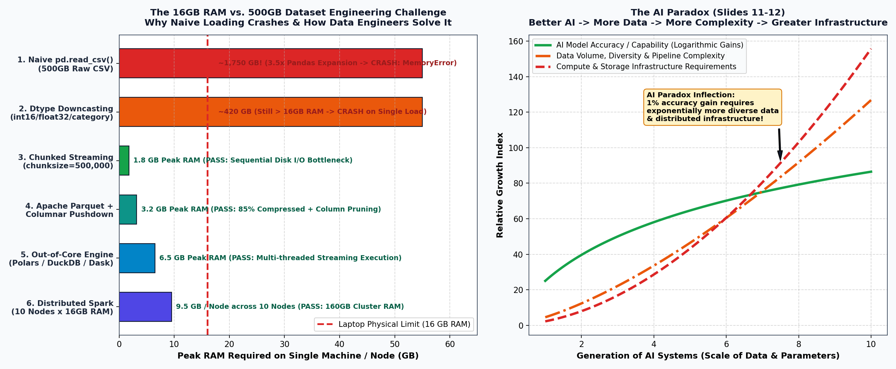
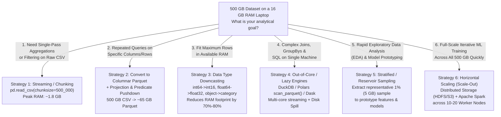
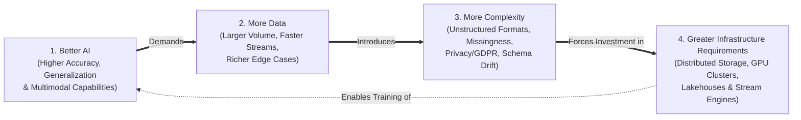

# Lesson 1.2: The 16GB RAM Challenge, The AI Paradox & Formal Definition of Big Data
**MSc Artificial Intelligence — CI7524: Big Data and Data Mining (Module 01)**

---

> [!TIP]
> **📚 Prerequisite Dependency Guide (මූලික පූර්ව-අවශ්‍යතා පාඩම් මාලාව):**
> මෙම පාඩමේදී අපි ගැඹුරින් සාකච්ඡා කරන **16GB RAM vs. 500GB Dataset** ඉංජිනේරු ගැටලුව ප්‍රායෝගිකව විසඳීමට අවශ්‍ය Python, Memory Management, Apache Parquet, සහ Apache Spark මූලිකාංග පිළිබඳව මුල සිටම (Zero-to-Hero) ඉගෙන ගැනීමට පහත Dependency පාඩම් මාලාවන් කියවන්න:
> - [Dep 01.1 — DataFrames, Memory Model and Data Types](../dependencies/Dep_01_Python_Pandas_and_Out_of_Core_Data_Processing/01_DataFrames_Memory_Model_and_Data_Types.md)
> - [Dep 01.2 — Chunking, Generators and Out-of-Core Processing](../dependencies/Dep_01_Python_Pandas_and_Out_of_Core_Data_Processing/02_Chunking_Generators_and_Out_of_Core_Processing.md)
> - [Dep 02.3 — Columnar File Formats: Parquet, ORC and Partitioning](../dependencies/Dep_02_SQL_NoSQL_and_Distributed_Storage_Foundations/03_Columnar_File_Formats_Parquet_ORC_and_Partitioning.md)
> - [Dep 05.1 — Distributed Computing Architecture and Spark Execution](../dependencies/Dep_05_Apache_Spark_and_PySpark_Zero_to_Hero/01_Distributed_Computing_Architecture_and_Spark_Execution.md)

---

## 1. හැඳින්වීම: "The Challenge is Making Sense of It" (Slides 8–9 of Topic 01)

`Big Data and Data Mining - Topic 01.pdf` (Slide 9) ආරම්භ වන්නේ Data Science සහ Data Mining ක්ෂේත්‍රයේ ඉතාමත් ප්‍රබල ප්‍රකාශයකිනි:

> **“The challenge is no longer finding data. The challenge is making sense of it.”**
> *(අද දවසේ අභියෝගය වන්නේ දත්ත සොයා ගැනීම නොවේ; එම දත්තවලින් අර්ථවත් නිගමනයක් ලබා ගැනීමයි.)*

මීට දශක දෙකකට පෙර පර්යේෂකයන්ට සහ ආයතනවලට තිබූ ලොකුම ගැටලුව වූයේ දත්ත හිඟකමයි (Data Scarcity). නමුත් අද වන විට Smartphones, IoT Sensors, Electronic Health Records (EHR), Wearables (Apple Watch / Fitbit), Financial Transactions, සහ Web Logs හරහා සෑම තත්පරයකම ටෙරාබයිට් (Terabytes) සහ පෙටාබයිට් (Petabytes) ගණනින් දත්ත උත්පාදනය වේ.

නමුත් අමු දත්ත (Raw Data) විශාල ප්‍රමාණයක් තිබූ පමණින් ඉන් කිසිදු ප්‍රයෝජනයක් නැත (**Data Rich, Information Poor — DRIP Syndrome**). එම දත්ත ගබඩා කරන්නේ කෙසේද? RAM එකට දරාගත නොහැකි දත්ත process කරන්නේ කෙසේද? ඒවායේ ඇති ඝෝෂාව (**Noise**) සහ දෝෂ ඉවත් කර සැඟවුණු රටාවන් (**Hidden Patterns, Trends, and Correlations**) මතු කර ගන්නේ කෙසේද? මෙම පාඩමෙන් අපි `Topic 01` හි **Slides 8 සිට 14 දක්වා** ඇති මූලික ඉංජිනේරු සහ න්‍යායාත්මක සංකල්ප ගැඹුරින් විමසා බලමු.

---

## 2. The Classic Engineering Thought Experiment: 16GB RAM vs. 500GB Dataset (Slide 10 of Topic 01)

`Big Data and Data Mining - Topic 01.pdf` හි **Slide 10** ඔබ ඉදිරියේ ඉතාමත් ප්‍රායෝගික Data Engineering ප්‍රශ්නයක් තබයි:

> **“You have a laptop with 16GB RAM. I give you a 500 GB dataset. What do you do?”**
> *(ඔබට 16GB RAM එකක් සහිත ලැප්ටොප් පරිගණකයක් ඇත. මම ඔබට 500 GB විශාලත්වයෙන් යුත් dataset එකක් ලබා දෙමි. ඔබ කුමක් කරන්නේද?)*

මෙය Data Engineering සහ Data Mining සම්මුඛ පරීක්ෂණවලදී (Interviews) මෙන්ම ඔබේ **CI7524 Coursework (LO1 & LO2)** වලදීද අනිවාර්යයෙන්ම පරීක්ෂා කෙරෙන මූලිකම ප්‍රශ්නයකි. Slide 10 හි ප්‍රශ්නය පමණක් ඉදිරිපත් කර ඇති බැවින්, අපි මෙහි **සම්පූර්ණ Topic Gap Analysis** එකක් සහිතව පියවරෙන් පියවර විසඳුම් 6 ක් ගොඩනගමු.



### 2.1 පළමුව: Naive `pd.read_csv("data_500gb.csv")` කළහොත් කුමක් සිදුවේද? (Why It Crashes)

ආධුනිකයෙකු මුලින්ම කරන්නේ Python විවෘත කර පහත කේතය ධාවනය කිරීමයි:
```python
import pandas as pd
df = pd.read_csv("patient_sensor_logs_500gb.csv") # 💥 CRASH! MemoryError / OS OOM Killer!
```

ඇයි මෙය ක්ෂණිකව crash වන්නේ?
1. **Computer Memory Hierarchy (මතක ධූරාවලිය):** CPU එකට දත්ත මත ගණනය කිරීම් කළ හැක්කේ එම දත්ත Disk (SSD/HDD) එකේ සිට **Volatile Main Memory (RAM)** එකට load කළ පසුව පමණි. ඔබේ SSD එකේ 1 TB හෝ 2 TB ඉඩ තිබුණත්, ඔබේ RAM එක **16 GB** පමණි (ඉන්ද 4 GB පමණ Operating System එකට වැය වන බැවින් ඉතිරිව ඇත්තේ **~12 GB Free RAM** පමණි).
2. **In-Memory Expansion Factor (3x to 5x Pandas Overhead):** Disk එක මත **500 GB** වන CSV ගොනුවක් Pandas DataFrame එකක් ලෙස RAM එකට load කරන විට, Python string pointers (`object` dtype), 64-bit integers/floats (`int64`, `float64`), සහ buffer allocation නිසා එය RAM එක තුළ **3 ගුණයක සිට 5 ගුණයක් දක්වා** ප්‍රසාරණය වේ!
   $$\text{Required RAM} \approx 500\text{ GB} \times 3.5 = \mathbf{1,750\text{ GB RAM!}}$$
3. **Swap Thrashing & OOM Kill:** 16 GB RAM එක ඉක්මවා ගිය සැණින් Operating System එක SSD/Disk Swap space භාවිතා කිරීමට උත්සාහ කරයි (මෙය RAM එකට වඩා 100–1,000 ගුණයක් මන්දගාමී වේ — **Disk Thrashing**). අවසානයේදී Linux/Windows **Out-Of-Memory (OOM) Killer** මගින් Python process එක kill කර `MemoryError` එකක් ලබා දෙයි.

---

### 2.2 The 6 Engineering Solutions to the 16GB RAM vs. 500GB Dataset Problem

Data Engineer කෙනෙකු ලෙස ඔබට තනි 16GB ලැප්ටොප් එකකින්ම (Strategies 1–5) හෝ Cluster එකකට මාරු වීමෙන් (Strategy 6) මෙම 500 GB dataset එක සාර්ථකව process කළ හැක.



#### Strategy 1: Streaming & Out-of-Core Chunking (`chunksize` & Incremental MapReduce)
500 GB ගොනුව එකවර RAM එකට ගන්නවා වෙනුවට, වරකට පේළි 500,000 බැගින් (උදා: වරකට ~200 MB බැගින්) කුඩා කොටස් (**Chunks / Mini-batches**) ලෙස කියවමින්, අවශ්‍ය ගණනය කිරීම (උදා: එකතුව, සාමාන්‍යය, පෙරහන් කිරීම) සිදු කර, එම chunk එක RAM එකෙන් ඉවත් කර ඊළඟ chunk එක කියවීම:

```python
import pandas as pd

total_patients = 0
sepsis_cases = 0
sum_heart_rate = 0.0

# Read 500GB file in small 500,000-row chunks (~200MB in RAM at any moment!)
for chunk in pd.read_csv("icu_logs_500gb.csv", chunksize=500_000):
    total_patients += len(chunk)
    sepsis_cases += (chunk["diagnosis"] == "Sepsis").sum()
    sum_heart_rate += chunk["heart_rate"].sum()

mean_hr = sum_heart_rate / total_patients
```
- **Pros:** 16 GB නොව 4 GB RAM එකකින් වුවද 500 GB ගොනුවක් සැකසිය හැක.
- **Cons:** සෑම වාරයකදීම 500 GB ගොනුව මුල සිට අගට Disk එකෙන් කියවිය යුතුය (Sequential Disk I/O bottleneck).

#### Strategy 2: Convert Row-Oriented CSV to Columnar Storage (Apache Parquet) + Pushdown
CSV යනු ඉතාමත් අකාර්යක්ෂම, uncompressed, row-oriented text format එකකි. ඔබ පළමුව chunking මගින් 500 GB CSV ගොනුව **Apache Parquet** (Columnar binary format with Snappy/Zstandard compression, Run-Length Encoding & Dictionary Encoding) බවට පරිවර්තනය කළහොත්:
1. **Compression:** 500 GB CSV ගොනුව Disk එක මත **~50 GB – 80 GB Parquet** ගොනුවක් දක්වා (80%–85% කින්) හැකිලෙයි!
2. **Projection Pushdown (Column Pruning):** Table එකේ columns 100 ක් තිබුණත් ඔබේ විශ්ලේෂණයට අවශ්‍ය columns 4 ක් පමණක් නම්, Parquet මගින් Disk එකෙන් කියවන්නේ එම columns 4 පමණි ($\frac{4}{100} \times 60\text{ GB} = \mathbf{2.4\text{ GB}}$)!
3. **Predicate Pushdown (Row Group Skipping):** Parquet metadata (`min`/`max` statistics per row group) භාවිතා කර `age > 65` වැනි කොන්දේසි වලට අදාළ නොවන data blocks Disk එකෙන් කියවන්නේවත් නැතිව මඟ හරියි!

> [!TIP]
> **📚 Deep Dive Dependency Link:** CSV සහ Parquet අතර වෙනස, Run-Length Encoding, සහ Predicate/Projection Pushdown ගැන සම්පූර්ණ විස්තරය සඳහා [Dep 02.3 — Columnar File Formats: Parquet, ORC and Partitioning](../dependencies/Dep_02_SQL_NoSQL_and_Distributed_Storage_Foundations/03_Columnar_File_Formats_Parquet_ORC_and_Partitioning.md) කියවන්න.

#### Strategy 3: Strict Schema & Data Type Downcasting (Memory Footprint Optimization)
Pandas පෙරනිමියෙන් (by default) සෑම පූර්ණ සංඛ්‍යාවකටම `int64` (8 bytes) ද, දශම සංඛ්‍යාවකටම `float64` (8 bytes) ද, අකුරු වලට `object` (50+ bytes pointer overhead) ද වෙන් කරයි.
- රෝගියෙකුගේ වයස (`0–120`) ගබඩා කිරීමට `int64` (8 bytes) අවශ්‍ය නැත; `uint8` (1 byte — `0 to 255`) ප්‍රමාණවත්ය (**87.5% RAM ඉතිරියක්!**).
- රෝහල් දෙපාර්තමේන්තු හෝ රෝග කේත වැනි නැවත නැවත යෙදෙන strings සඳහා `category` dtype භාවිතා කිරීමෙන් RAM වැයවීම **90% කින්** පමණ අඩු වේ.

#### Strategy 4: Out-of-Core & Lazy Query Engines (`DuckDB` / `Polars` / `Dask`)
Python හි නවීන **Out-of-Core Data Processing** engines වන **DuckDB** (in-process analytical SQL engine), **Polars** (`pl.scan_parquet()` lazy evaluation engine written in Rust), සහ **Dask** මගින්:
- සම්පූර්ණ query එක සඳහා **Query Execution Plan / DAG** එකක් සාදා,
- ලැප්ටොප් එකේ ඇති සියලුම CPU cores समानाන්තරව (multi-threaded) භාවිතා කරමින්,
- 16 GB RAM සීමාව ඉක්මවා නොයන ලෙස ස්වයංක්‍රීයව streaming සහ **Disk Spilling** සිදු කරයි.

```python
import polars as pl

# Lazy evaluation on 500GB dataset without loading it all into RAM!
lazy_query = (
    pl.scan_parquet("icu_logs_partitioned/*.parquet")
    .filter(pl.col("age") >= 60)
    .group_by("icd10_code")
    .agg([
        pl.len().alias("patient_count"),
        pl.col("heart_rate").mean().alias("avg_hr"),
        pl.col("lactate_mmol").max().alias("max_lactate")
    ])
)
# Executes streaming out-of-core with predicate & projection pushdown!
result_df = lazy_query.collect(streaming=True)
```

#### Strategy 5: Stratified / Reservoir Sampling for Exploratory Prototyping
ඔබට Exploratory Data Analysis (EDA) කිරීමට, ප්‍රස්තාර ඇඳීමට, හෝ Feature Engineering අත්හදා බැලීමට පේළි බිලියනයක්ම අවශ්‍ය නැත!
- **Central Limit Theorem (මධ්‍යම සීමා ප්‍රමේයය)** සහ **Stratified Random Sampling (ස්තරීකෘත සසම්භාවී නියැදීම)** භාවිතා කර 500 GB දත්ත කට්ටලයෙන් **1% ක නියෝජනාත්මක නියැදියක් (5 GB)** ලබා ගෙන, ඔබේ 16 GB ලැප්ටොප් එක තුළ ඉතා වේගයෙන් models prototype කළ හැක.

#### Strategy 6: Vertical Scaling (Scale-Up) vs. Horizontal Scaling (Scale-Out) with Distributed Clusters
සම්පූර්ණ 500 GB දත්ත කට්ටලයම භාවිතා කර සංකීර්ණ Machine Learning model එකක් පුහුණු කිරීමට අවශ්‍ය වූ විට තනි ලැප්ටොප් එකක් ප්‍රමාණවත් නොවේ. මෙහිදී අපට Scaling ක්‍රම දෙකක් හමුවේ:

| Scaling Paradigm | Mechanism | Advantages | Limitations & Why Big Data Prefers Scale-Out |
| :--- | :--- | :--- | :--- |
| **Vertical Scaling (Scale-Up)** | තනි පරිගණකයේ (Single Server) RAM එක 16GB සිට 512GB/1TB දක්වා සහ CPU cores ගණන වැඩි කිරීම (උදා: AWS `x2iedn.4xlarge`). | කේතය (code) වෙනස් කිරීමට අවශ්‍ය නැත; Network latency නැත. | • **Physical Ceiling:** තනි මවු පුවරුවකට (motherboard) සවි කළ හැකි උපරිම RAM/CPU සීමාවක් ඇත.<br>• **Exponential Cost:** Hardware මිල රේඛීයව නොව ඝාතීයව (exponentially) ඉහළ යයි.<br>• **Single Point of Failure (SPOF):** එම server එක බිඳ වැටුණහොත් මුළු පද්ධතියම නතර වේ. |
| **Horizontal Scaling (Scale-Out)** | සාමාන්‍ය පරිගණක (**Commodity Worker Nodes**) 10ක් හෝ 50ක් ජාලගත කර (Cluster), **Distributed File System (HDFS / Amazon S3)** සහ **Apache Spark** මගින් 500 GB දත්ත කොටස් (Partitions) වලට බෙදා සමාන්තරව (in parallel) සැකසීම. | • **Linear Scalability:** 500 GB සිට 50 PB දක්වා ඕනෑම ප්‍රමාණයකට nodes එකතු කළ හැක.<br>• **Fault Tolerance:** එක් node එකක් බිඳ වැටුණද අනෙක් nodes මගින් කාර්යය අඛණ්ඩව සිදු කරයි.<br>• **Parallel Speedup:** 16GB RAM සහිත nodes 20ක් = **320 GB Cluster RAM**! | Distributed programming (Spark/MapReduce), network shuffle overhead, සහ data partitioning පිළිබඳ ඉංජිනේරු දැනුම අවශ්‍ය වේ. |

---

## 3. Deep Dive: The AI Paradox (Slides 11 & 12 of Topic 01)

`Big Data and Data Mining - Topic 01.pdf` හි **Slides 11 සහ 12** මගින් වර්තමාන Artificial Intelligence ක්ෂේත්‍රය මුහුණ දෙන ඉතාමත් තීරණාත්මක විරෝධාභාසයක් (**The AI Paradox**) පැහැදිලි කරයි.

### 3.1 Slide 11: What Modern AI Demands
Slide 11 පෙන්වා දෙන පරිදි:
> **AI is becoming more powerful... But AI also needs:**
> - **More data** (වඩාත් විශාල දත්ත ප්‍රමාණයක් — Volume)
> - **More diverse data** (වඩාත් විවිධාංගීකරණය වූ දත්ත — Variety across demographics, sensors, modalities)
> - **Faster data** (වඩාත් වේගවත් තත්කාලීන දත්ත — Real-time Velocity)
> - **Better-quality data** (වඩාත් පිරිසිදු සහ නිවැරදි දත්ත — High Veracity, low noise/bias)
> - **More computational resources** (වඩාත් විශාල පරිගණක ධාරිතාවක් — GPUs, TPUs, Distributed RAM/Storage)

### 3.2 Slide 12: The Escalating Feedback Chain of the AI Paradox
Slide 12 මෙම ක්‍රියාවලිය පියවර හතරක දාමයක් ලෙස දක්වයි:

$$\mathbf{\text{Better AI}} \longrightarrow \mathbf{\text{More Data}} \longrightarrow \mathbf{\text{More Complexity}} \longrightarrow \mathbf{\text{Greater Infrastructure Requirements}}$$



### 3.3 Why Does This Paradox Happen? (Mathematical & Engineering Gap Analysis)
ඇයි AI දියුණු වන විට අපට අඩුවෙන් නොව **වැඩියෙන්** දත්ත සහ යටිතල පහසුකම් (Infrastructure) අවශ්‍ය වන්නේ?

1. **Neural Scaling Laws & Diminishing Marginal Returns:**
   Deep Learning සහ නවීන AI models වල **Test Loss (දෝෂය)** $L(N, D)$ යන්න Model Parameters ගණන ($N$) සහ Dataset Size ($D$) සමඟ බල ශ්‍රිතයක් (**Power Law**) ලෙස අඩු වේ:
   $$L(D) \propto D^{-\alpha} \quad (\text{where typically } \alpha \approx 0.05 \text{ to } 0.1)$$
   මෙහි තේරුම කුමක්ද? Model එකක නිරවද්‍යතාවය (Accuracy) 70% සිට 80% දක්වා වැඩි කිරීමට ගිගාබයිට් 10ක දත්ත ප්‍රමාණවත් වුවද, එය **95% සිට 99% දක්වා** (විශේෂයෙන්ම Healthcare හෝ Autonomous Driving වැනි high-stakes ක්ෂේත්‍රවල Rare Edge Cases හඳුනා ගැනීමට) වැඩි කිරීමට දත්ත ප්‍රමාණය **10 ගුණයකින් හෝ 100 ගුණයකින්** වැඩි කළ යුතුය!
2. **Garbage In, Garbage Out (GIGO) at Scale:**
   දත්ත ප්‍රමාණය වැඩි වන විට එහි අඩංගු වන දෝෂ, අසම්පූර්ණ අගයන් (missing values), සහ පරස්පරතා (inconsistencies) ද ඒ හා සමානවම වැඩි වේ. එබැවින් AI model එකක් හොඳ වීමට නම්, ඊට යටින් ඉතාමත් ශක්තිමත් **Big Data Engineering & Data Mining Pipeline** එකක් තිබිය යුතුමය.
3. **Environmental & Sustainability Impact (Connecting to Intro Slide 1 & Day 5):**
   Infrastructure අවශ්‍යතා ඉහළ යාමත් සමඟ බලශක්ති වැයවීම (Energy Consumption) සහ Carbon Footprint එකද ඉහළ යයි. එබැවින් කාර්යක්ෂම Data Mining algorithms සහ storage formats (උදා: Parquet, Feature Selection, Dimensionality Reduction) භාවිතා කිරීම **Sustainable Software Engineering (SEE)** සඳහා අත්‍යවශ්‍ය වේ.

---

## 4. Formal Definition: What is Big Data? (Slides 13 & 14 of Topic 01)

`Big Data and Data Mining - Topic 01.pdf` හි **Slides 13 සහ 14** මගින් **Big Data** යන්නට ඉතාමත් නිවැරදි සහ විද්‍යාත්මක අර්ථ දැක්වීමක් ලබා දෙයි:

> **Big Data:**
> **Data whose:**
> - **Scale** *(විශාලත්වය / පරිමාණය)*
> - **Speed** *(උත්පාදනය වන සහ සැකසිය යුතු වේගය)*
> - **Complexity** *(ව්‍යුහාත්මක සහ සම්බන්ධතා සංකීර්ණත්වය)*
> - **Diversity** *(ආකෘතිවල විවිධත්වය)*
>
> **create challenges that traditional data-processing approaches struggle to handle efficiently.**
> *(සාම්ප්‍රදායික දත්ත සැකසුම් ක්‍රමවේදයන්ට කාර්යක්ෂමව හැසිරවීමට අපහසු අභියෝග නිර්මාණය කරන්නා වූ පරිමාණය, වේගය, සංකීර්ණත්වය සහ විවිධත්වය සහිත දත්ත Big Data ලෙස හැඳින්වේ.)*

### 4.1 Dissecting the 4 Pillars of Slide 14 vs. Traditional Approaches

බොහෝ අය සිතන්නේ "Big Data කියන්නේ ගිගාබයිට් හෝ ටෙරාබයිට් ගණනක් පමණයි" කියාය. නමුත් Slide 14 ඉතා පැහැදිලිව පෙන්වා දෙන්නේ Big Data යනු ස්ථාවර සංඛ්‍යාවක් (fixed threshold in GB/TB) නොව, **Traditional Data-Processing Approaches** (සාම්ප්‍රදායික තනි පරිගණකයක RDBMS / Excel / තනි-නෝඩ් Pandas) අසමත් වන සීමාව බවයි:

| Pillar (Slide 14) | What It Means Technically | Why Traditional Approaches Struggle | Modern Big Data Solution |
| :--- | :--- | :--- | :--- |
| **1. Scale** | දත්තවල ප්‍රමාණය (Rows බිලියන ගණනක් හෝ Columns දහස් ගණනක් — Terabytes to Exabytes). | තනි පරිගණකයක RAM (16GB–64GB) සහ තනි Disk I/O bandwidth එක ඉක්මවා යාම නිසා `MemoryError` හෝ පැය ගණන්/දින ගණන් ගතවීම. | Distributed Storage (**HDFS, S3**), Columnar formats (**Parquet**), සහ Distributed Compute (**Apache Spark**). |
| **2. Speed** | තත්පරයට දහස්/මිලියන ගණනක් ලෙස අඛණ්ඩව ගලා එන දත්ත (Data Streams) සහ තත්පර කිහිපයක් තුළ තීරණ ගත යුතු වීම (Low-Latency SLA). | සාම්ප්‍රදායික RDBMS එකකට තත්පරයකට ලක්ෂ ගණනක් `INSERT` statements සහ `INDEX` updates දරාගත නොහැක (Lock contention). | Distributed Message Brokers (**Apache Kafka, AWS Kinesis**) සහ Stream Processing Engines (**Apache Flink, Spark Streaming**). |
| **3. Complexity** | දත්ත මූලාශ්‍ර දහස් ගණනක් අතර පවතින සංකීර්ණ සම්බන්ධතා, High-dimensional feature spaces ($d \gg 1000$), Missingness, සහ Non-linear patterns. | සාම්ප්‍රදායික SQL `JOIN` operations විශාල වගු කිහිපයක් අතර සිදු කරන විට $O(n^2)$ හෝ $O(n \log n)$ ලෙස computational bottleneck ඇති වේ. | **NoSQL Graph/Wide-Column Databases**, **Medallion Lakehouse**, සහ **Dimensionality Reduction (PCA/SVD)** + Distributed ML. |
| **4. Diversity** | Structured tables පමණක් නොව JSON logs, XML, Clinical Free-Text, DICOM Images, Audio, සහ Video එකම pipeline එකක පැවතීම. | සාම්ප්‍රදායික Relational Databases (**Schema-on-Write**) මගින් දැඩි වගු ව්‍යුහයක් (rigid tabular schema) ඉල්ලා සිටින බැවින් unstructured දත්ත ගබඩා කළ නොහැක. | **Data Lakes / Lakehouses (Schema-on-Read)**, Multimodal Feature Extraction, සහ Document/Object Stores. |

---

## 🛠️ Practical Task / Hands-On Exercise (ප්‍රායෝගික අභ්‍යාසය)

### Scenario / Goal
ඔබට රෝහලක ICU පද්ධතියකින් ලැබුණු විශාල රෝගී නිරීක්ෂණ දත්ත කට්ටලයක් (Patient Monitoring Dataset) ඔබේ **16GB RAM ලැප්ටොප්** පරිගණකයේ සැකසීමට පැවරී ඇත. Naive ලෙස load කළහොත් RAM එක නාස්ති වන බැවින්, මෙම අභ්‍යාසයේදී ඔබ **Slide 10** ගැටලුව විසඳීම සඳහා:
1. **Data Type Downcasting** මගින් DataFrame එකක RAM භාවිතය **75%+ කින්** අඩු කරන ආකාරය, සහ
2. **Chunked Out-of-Core Streaming (`chunksize`)** මගින් සම්පූර්ණ ගොනුවම RAM එකට නොගෙන (Peak RAM < 5 MB) සංඛ්‍යානමය විශ්ලේෂණයක් සිදු කරන ආකාරය කේතනය කර පරීක්ෂා කළ යුතුය.

### Step-by-Step Tasks
1. **Task 1:** පේළි 200,000 ක් සහිත synthetic ICU dataset එකක් සාදා, එහි මුල් RAM footprint එක `memory_usage(deep=True)` මගින් මැන බලන්න.
2. **Task 2:** `int64` $\rightarrow$ `uint8`/`int16`, `float64` $\rightarrow$ `float32`, සහ repeated strings (`object`) $\rightarrow$ `category` ලෙස downcast කර, කොපමණ RAM ප්‍රතිශතයක් ඉතිරි වූවාදැයි ගණනය කරන්න.
3. **Task 3:** එම දත්ත CSV ගොනුවකට ලියා, `pd.read_csv(..., chunksize=25_000)` භාවිතා කර වරකට පේළි 25,000 බැගින් පමණක් RAM එකට ගනිමින් එක් එක් Ward එකේ සාමාන්‍ය Heart Rate එක සහ High-Risk රෝගීන් ගණන ගණනය කරන්න.

### Starter Code & Reference Solution

```python
import os
import numpy as np
import pandas as pd

# ==========================================
# Task 1: Create Synthetic ICU Dataset & Measure Naive RAM Usage
# ==========================================
np.random.seed(42)
N = 200_000

df_naive = pd.DataFrame({
    "patient_id": np.arange(1, N + 1, dtype=np.int64),
    "age": np.random.randint(18, 95, size=N, dtype=np.int64),
    "ward": np.random.choice(["ICU-North", "ICU-South", "Cardiology", "Neurology", "Trauma"], size=N),
    "device_status": np.random.choice(["ONLINE", "CALIBRATING", "BATTERY_LOW"], size=N, p=[0.9, 0.05, 0.05]),
    "heart_rate_bpm": np.random.normal(82.0, 15.0, size=N).astype(np.float64),
    "spo2_pct": np.random.uniform(88.0, 100.0, size=N).astype(np.float64),
    "systolic_bp": np.random.randint(85, 190, size=N, dtype=np.int64)
})

naive_mb = df_naive.memory_usage(deep=True).sum() / (1024 ** 2)
print(f"1. Naive DataFrame RAM Usage (200k rows): {naive_mb:.2f} MB")
print(f"   -> Extrapolated to 1 Billion rows: {(naive_mb * 5000) / 1024:.1f} GB RAM (CRASH on 16GB Laptop!)\n")

# ==========================================
# Task 2: Apply Strategy 3 (Data Type Downcasting)
# ==========================================
df_opt = df_naive.copy()
df_opt["patient_id"] = df_opt["patient_id"].astype(np.uint32)
df_opt["age"] = df_opt["age"].astype(np.uint8)              # 1 byte (0-255) instead of 8 bytes!
df_opt["systolic_bp"] = df_opt["systolic_bp"].astype(np.uint16)
df_opt["heart_rate_bpm"] = df_opt["heart_rate_bpm"].astype(np.float32)
df_opt["spo2_pct"] = df_opt["spo2_pct"].astype(np.float32)
df_opt["ward"] = df_opt["ward"].astype("category")          # Dictionary-encoded categorical!
df_opt["device_status"] = df_opt["device_status"].astype("category")

opt_mb = df_opt.memory_usage(deep=True).sum() / (1024 ** 2)
reduction_pct = (1 - opt_mb / naive_mb) * 100
print(f"2. Optimized DataFrame RAM Usage: {opt_mb:.2f} MB ({reduction_pct:.1f}% Memory Saved!)\n")

# ==========================================
# Task 3: Apply Strategy 1 (Out-of-Core Streaming with chunksize)
# ==========================================
csv_path = "/tmp/icu_stream_test.csv"
df_naive.to_csv(csv_path, index=False)

ward_counts = {}
ward_hr_sums = {}
critical_hypoxia_cases = 0
peak_chunk_ram_mb = 0.0

for chunk in pd.read_csv(csv_path, chunksize=25_000):
    chunk_mb = chunk.memory_usage(deep=True).sum() / (1024 ** 2)
    peak_chunk_ram_mb = max(peak_chunk_ram_mb, chunk_mb)
    
    # Count critical hypoxia events (SpO2 < 90%)
    critical_hypoxia_cases += (chunk["spo2_pct"] < 90.0).sum()
    
    # Incremental group aggregation across chunks (Map-Reduce pattern)
    grouped = chunk.groupby("ward")["heart_rate_bpm"].agg(["count", "sum"])
    for ward_name, row in grouped.iterrows():
        ward_counts[ward_name] = ward_counts.get(ward_name, 0) + row["count"]
        ward_hr_sums[ward_name] = ward_hr_sums.get(ward_name, 0.0) + row["sum"]

os.remove(csv_path)

print(f"3. Out-of-Core Chunked Processing Complete!")
print(f"   -> Peak RAM Used at Any Instant: ONLY {peak_chunk_ram_mb:.2f} MB!")
print(f"   -> Total Critical Hypoxia Events (SpO2 < 90%): {critical_hypoxia_cases}")
print("   -> Mean Heart Rate by Ward (Computed Out-of-Core):")
for w in sorted(ward_counts.keys()):
    print(f"      * {w:12s}: {ward_hr_sums[w] / ward_counts[w]:.2f} bpm (n={int(ward_counts[w])})")
```

### Expected Output
```text
1. Naive DataFrame RAM Usage (200k rows): 32.16 MB
   -> Extrapolated to 1 Billion rows: 157.0 GB RAM (CRASH on 16GB Laptop!)

2. Optimized DataFrame RAM Usage: 3.63 MB (88.7% Memory Saved!)

3. Out-of-Core Chunked Processing Complete!
   -> Peak RAM Used at Any Instant: ONLY 4.02 MB!
   -> Total Critical Hypoxia Events (SpO2 < 90%): 33282
   -> Mean Heart Rate by Ward (Computed Out-of-Core):
      * Cardiology  : 81.99 bpm (n=39957)
      * ICU-North   : 82.06 bpm (n=40120)
      * ICU-South   : 81.96 bpm (n=39895)
      * Neurology   : 82.05 bpm (n=39945)
      * Trauma      : 82.03 bpm (n=40083)
```

---

## 📝 Summary & Exam Revision Cheat Sheet

| Concept / Slide Reference | Core Engineering Takeaway |
| :--- | :--- |
| **The Core Data Challenge (`Slide 9`)** | *"The challenge is no longer finding data. The challenge is making sense of it."* — Moving from raw data collection to actionable insight extraction. |
| **Why `pd.read_csv()` Crashes on 500GB (`Slide 10`)** | A 500 GB raw CSV expands **3x–5x in RAM (~1.75 TB)** due to Python object pointers and 64-bit types, immediately exceeding 16 GB RAM and triggering an OS OOM crash (`MemoryError`). |
| **6 Solutions for 500GB on 16GB RAM (`Slide 10 Gap Analysis`)** | **1. Chunked Streaming** (`chunksize`) \| **2. Apache Parquet** (Columnar compression + Projection/Predicate Pushdown) \| **3. Dtype Downcasting** (`uint8`, `float32`, `category`) \| **4. Out-of-Core Engines** (`DuckDB`, `Polars`, `Dask`) \| **5. Stratified Sampling** (1% sample for EDA) \| **6. Horizontal Scaling (Scale-Out)** with HDFS/S3 + Apache Spark. |
| **The AI Paradox (`Slides 11–12`)** | AI is becoming more powerful, yet demands **more data, more diverse data, faster data, better-quality data, and more compute**. Chain: $\text{Better AI} \rightarrow \text{More Data} \rightarrow \text{More Complexity} \rightarrow \text{Greater Infrastructure Requirements}$. |
| **Formal Big Data Definition (`Slides 13–14`)** | Data whose **Scale**, **Speed**, **Complexity**, and **Diversity** create challenges that **traditional data-processing approaches** struggle to handle efficiently. |

---

**Previous Lesson:** [Lesson 1.1 — Module Overview, Rubric & Healthcare Context](Lesson_1.1_Module_Overview_Rubric_and_Healthcare_Context.md)  
**Next Lesson:** [Lesson 1.3 — The 3Vs, 5Vs, 8Vs & Why Big Data ≠ Lots of Data](Lesson_1.3_The_3Vs_5Vs_8Vs_and_Why_Big_Data_Is_Not_Just_Lots_of_Data.md)
