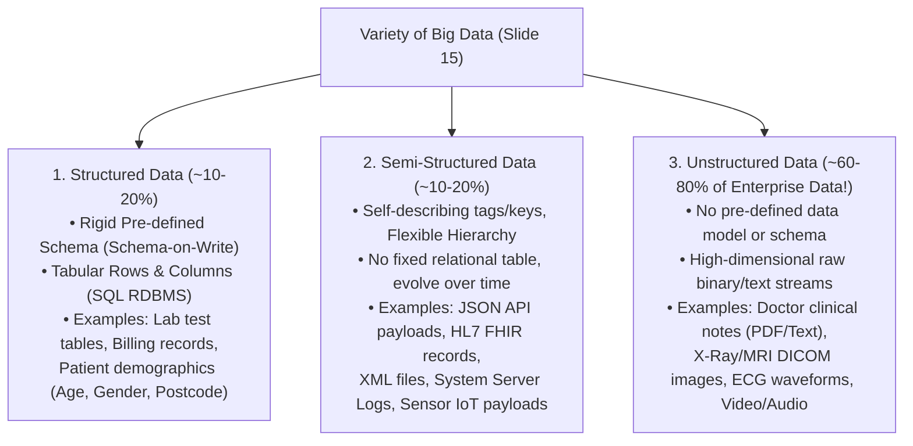
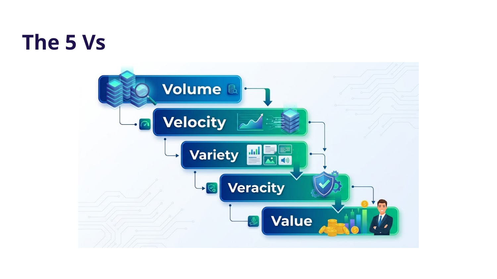
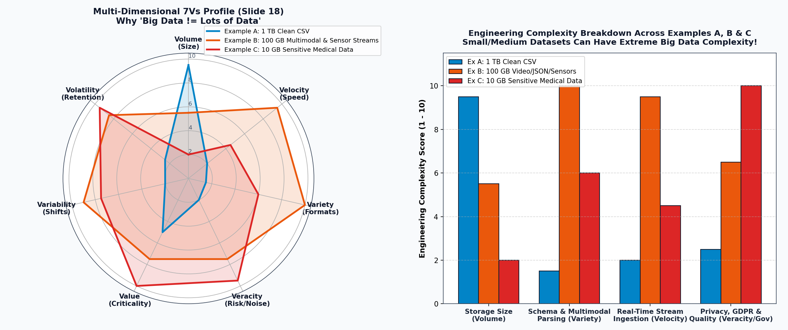

# Lesson 1.3: The 3Vs, 5Vs, 8Vs & Why "Big Data ≠ Lots of Data"
**MSc Artificial Intelligence — CI7524: Big Data and Data Mining (Module 01)**

---

> [!TIP]
> **📚 Prerequisite Dependency Guide (මූලික පූර්ව-අවශ්‍යතා පාඩම් මාලාව):**
> මෙම පාඩමේදී සාකච්ඡා කෙරෙන **Structured, Semi-Structured, සහ Unstructured Data** ගබඩා කරන ආකාරය සහ **Relational SQL vs. NoSQL** දත්ත ආකෘති පිළිබඳව මුල සිටම ඉගෙන ගැනීමට පහත Dependency පාඩම් මාලාවන් කියවන්න:
> - [Dep 02.1 — Relational Databases, SQL and ACID vs. BASE](../dependencies/Dep_02_SQL_NoSQL_and_Distributed_Storage_Foundations/01_Relational_Databases_SQL_and_ACID_vs_BASE.md)
> - [Dep 02.2 — NoSQL Data Models: Document, Key-Value, Columnar and Graph](../dependencies/Dep_02_SQL_NoSQL_and_Distributed_Storage_Foundations/02_NoSQL_Data_Models_Document_KeyValue_Columnar_Graph.md)
> - [Dep 02.3 — Columnar File Formats: Parquet, ORC and Partitioning](../dependencies/Dep_02_SQL_NoSQL_and_Distributed_Storage_Foundations/03_Columnar_File_Formats_Parquet_ORC_and_Partitioning.md)

---

## 1. හැඳින්වීම: Characterising Big Data Across the Vs (Slides 15–18 of Topic 01)

පසුගිය පාඩමෙන් (**Lesson 1.2**) අපි ඉගෙන ගත්තා Big Data යනු හුදෙක් දත්තවල විශාලත්වය පමණක් නොව, **Scale, Speed, Complexity, සහ Diversity** නිසා සාම්ප්‍රදායික දත්ත සැකසුම් ක්‍රමවේදයන් (Traditional data-processing approaches) අසමත් වන අවස්ථාවක් බව.

2001 වසරේදී Doug Laney (Gartner analyst) විසින් Big Data හි මූලික මානයන් තුනක් (**The Classic 3 Vs: Volume, Velocity, Variety**) හඳුන්වා දෙන ලදී. පසුව IBM, सों (SAS), සහ Data Engineering පර්යේෂකයන් විසින් එය **5 Vs** සහ **8 Vs** දක්වා පුළුල් කරන ලදී.

මෙම පාඩමෙන් අපි `Big Data and Data Mining - Topic 01.pdf` හි **Slides 15 සිට 18 දක්වා** ඇති:
1. **The Classic 3 Vs** (`Slide 15`: Volume, Velocity, Variety),
2. **Beyond the 3Vs** (`Slide 16`: Veracity, Value, Variability, Volatility, Visualization),
3. **The 5 Vs Visual Cascade** (`Slide 17`), සහ
4. **Why "Big Data ≠ Lots of Data"** (`Slide 18`: Examples A, B, and C)
යන සියලුම කොටස් ගැඹුරු ඉංජිනේරු සහ Healthcare උදාහරණ සහිතව විමසා බලමු.

---

## 2. The Classic 3 Vs of Big Data (Slide 15 of Topic 01)

`Big Data and Data Mining - Topic 01.pdf` හි **Slide 15** මගින් Big Data හි මූලික කුළුණු 3 හඳුන්වා දෙයි:
1. **Volume** (දත්තවල පරිමාව / විශාලත්වය)
2. **Velocity** (දත්ත උත්පාදනය වන සහ සැකසිය යුතු වේගය)
3. **Variety** (දත්තවල ආකෘතිමය විවිධත්වය)

අපි මේ එකින් එක ගැඹුරින් පරීක්ෂා කරමු:

### 2.1 Volume (පරිමාව / විශාලත්වය)
**Volume** යන්නෙන් අදහස් කරන්නේ උත්පාදනය කර ගබඩා කළ යුතු මුළු දත්ත ප්‍රමාණයයි (Total amount of data generated and stored).
- **Scale Units:** Megabytes ($\text{MB}, 10^6$) $\rightarrow$ Gigabytes ($\text{GB}, 10^9$) $\rightarrow$ Terabytes ($\text{TB}, 10^{12}$) $\rightarrow$ Petabytes ($\text{PB}, 10^{15}$) $\rightarrow$ Exabytes ($\text{EB}, 10^{18}$) $\rightarrow$ Zettabytes ($\text{ZB}, 10^{21}$).
- **Two Dimensions of Volume in Data Mining:**
  1. **Number of Records / Samples ($n$):** උදාහරණයක් ලෙස භාණ්ඩ මිලදී ගැනීම් හෝ රෝගීන්ගේ රුධිර පීඩන සටහන් බිලියන ගණනක් ($n \sim 10^9$).
  2. **Number of Features / Attributes ($d$ — Dimensionality):** උදාහරණයක් ලෙස Genomic DNA Microarray හෝ Whole-Genome Sequencing දත්ත කට්ටලයක රෝගීන් 5,000 ක් පමණක් සිටියද, එක් රෝගියෙකුට ජාන ලක්ෂණ (gene expression features) $d = 50,000$ කට වඩා පවතී!
- **Engineering Impact:** තනි තැටියක (single disk) හෝ තනි RAM එකක ගබඩා කළ නොහැකි නිසා **Distributed File Systems (HDFS / Cloud Object Storage S3)** සහ **Columnar Partitioning** අවශ්‍ය වේ.

### 2.2 Velocity (ප්‍රවේගය / වේගය)
**Velocity** යන්නෙන් කරුණු දෙකක් අදහස් වේ:
1. **Rate of Data Generation (දත්ත උත්පාදනය වන වේගය):** තත්පරයකට පද්ධතියට ඇතුළු වන දත්ත ප්‍රමාණය (e.g., events/second or MB/second).
2. **Speed of Required Processing / Latency SLA (තීරණයක් ගැනීමට ගතවිය යුතු උපරිම කාලය):** දත්තය උත්පාදනය වූ මොහොතේ සිට (Event Time) ඒ මත ක්‍රියාත්මක වීම (Action Time) දක්වා ගතවන කාලය.

| Processing Tier | Latency Requirement | Healthcare & Enterprise Examples | Technical Stack |
| :--- | :--- | :--- | :--- |
| **Batch Processing** | Hours to Days | මාසික රෝහල් වියදම් වාර්තා, වාර්ෂික වසංගත රෝග ප්‍රවණතා (Epidemiological trends). | Apache Spark (Batch), MapReduce, Data Warehouses. |
| **Micro-Batch / Near Real-Time** | Seconds to Minutes | රෝහල් හදිසි ප්‍රතිකාර ඒකකයේ (A&E) ඇඳන් පිරී යාමේ පුරෝකථනය (Bed occupancy dashboard every 2 mins). | Spark Structured Streaming, AWS Kinesis Firehose. |
| **True Real-Time Stream Processing** | Milliseconds ($< 100\text{ ms}$) | **ICU Ventricular Fibrillation / Sepsis Alert**, Credit Card Fraud Blocking at Point-of-Sale, Autonomous Vehicle LiDAR braking. | **Apache Kafka + Apache Flink**, Edge AI Inference. |

### 2.3 Variety (විවිධත්වය — The 3 Structural Taxonomies)
සාම්ප්‍රදායික දත්ත පද්ධතිවල තිබුණේ පේළි (rows) සහ තීරු (columns) වලට කොටු වූ එකම ආකාරයේ වගු පමණි. නමුත් Big Data ලෝකයේ දත්ත ප්‍රධාන වර්ග 3 කින් (**Structured, Semi-Structured, Unstructured**) පැමිණේ:



---

## 3. Beyond the 3Vs: Veracity, Value, Variability, Volatility & Visualization (Slide 16 of Topic 01)

`Big Data and Data Mining - Topic 01.pdf` හි **Slide 16** මගින් Classic 3Vs වලින් ඔබ්බට ගිය තවත් ඉතාමත් වැදගත් Vs 5 ක් හඳුන්වා දෙයි (**Total = 8 Vs**):

1. **Veracity (සත්‍යවාදී බව / දත්තවල විශ්වසනීයත්වය සහ ගුණාත්මකභාවය)**
2. **Value (වටිනාකම / ප්‍රායෝගික ප්‍රතිලාභය)**
3. **Variability (විචල්‍යතාවය / දත්තවල අර්ථය හෝ ගලා ඒමේ රටාව වෙනස් වීම)**
4. **Volatility (වාෂ්පශීලීතාවය / දත්ත වලංගුව පවතින කාලසීමාව)**
5. **Visualization (දෘශ්‍යකරණය / සංකීර්ණ ප්‍රතිඵල තේරුම් ගත හැකි ලෙස ඉදිරිපත් කිරීම)**

මෙම Vs 5 අතර ඇති සියුම් වෙනස්කම් (විශේෂයෙන්ම බොහෝ සිසුන් පටලවා ගන්නා **Variety vs. Variability** සහ **Velocity vs. Volatility**) හරියටම තේරුම් ගනිමු:

### 3.1 Veracity (Trustworthiness, Quality, Noise & Bias)
**Veracity** යනු *"අපට ලැබී ඇති දත්ත කොතරම් දුරට නිවැරදිද, සම්පූර්ණද සහ විශ්වාසවන්තද?"* යන්නයි.
- **Sources of Low Veracity:**
  - කැඩුණු හෝ දෝෂ සහිත IoT සංවේදක (Faulty sensors reporting Heart Rate = `999 bpm` or `-10 bpm`).
  - මිනිසුන් අතින් දත්ත ඇතුළත් කිරීමේදී සිදුවන අක්ෂර වින්‍යාස වැරදි (Typos in manual clinical data entry).
  - අතුරුදහන් වූ දත්ත (**Missing Values — MCAR, MAR, MNAR**).
  - පක්ෂග්‍රාහී හෝ අසම්පූර්ණ නියැදි (**Sampling & Historical Bias**).
- **Engineering Rule:** Volume සහ Velocity කොතරම් ඉහළ වුවත්, **Veracity** බිංදුව නම්, ඉන් ලැබෙන **Value** එකද බිංදුවකි (හෝ භයානක වැරදි තීරණයකි!).

### 3.2 Value (Actionable Insights & ROI)
**Value** යනු Big Data පිරමීඩයේ අවසාන ඉලක්කයයි. දත්ත ටෙරාබයිට් ගණනක් ගබඩා කිරීමට සහ සැකසීමට විශාල මුදලක් (Cloud storage & compute cost) වැය වේ. එම දත්ත මගින්:
- රෝගියෙකුගේ ජීවිතයක් බේරා ගැනීමට (Early Sepsis Detection),
- රෝහල් නැවත ඇතුළත් වීම් (30-day readmissions) අඩු කිරීමට, හෝ
- ව්‍යාපාරික පිරිවැය අඩු කර ආදායම වැඩි කිරීමට හැකි **Actionable Insights (ක්‍රියාත්මක කළ හැකි තීරණ)** ලබා ගත හැකි නම් පමණක් එම දත්තවලට **Value** එකක් පවතී.

### 3.3 Variability (Inconsistency in Data Flow & Context-Dependent Meaning)
> [!IMPORTANT]
> **🔥 Exam Distinction Concept — Variety vs. Variability:**
> බොහෝ දෙනෙක් **Variety** සහ **Variability** එකක් ලෙස වරදවා වටහා ගනී!
> - **Variety** යනු **විවිධ දත්ත ආකෘති (different formats):** CSV + JSON + Images + Audio.
> - **Variability** යනු **එකම දත්ත මූලාශ්‍රයේම හැසිරීම, ගලා එන වේගය හෝ අර්ථය කාලයත් සමඟ/සන්දර්භය අනුව වෙනස් වීමයි!**

**Variability හි ප්‍රධාන ආකාර 3:**
1. **Flow Rate Variability (Burstiness):** රෝහලක සාමාන්‍ය දිනකදී විනාඩියකට රෝගීන් 5 දෙනෙකුගේ දත්ත ඇතුළත් වුවද, හදිසි වසංගත තත්ත්වයකදී හෝ අනතුරකදී (Peak spike) විනාඩියකට දත්ත 5,000 ක් එකවර ගලා ඒම.
2. **Semantic / Contextual Variability (එකම වචනයේ හෝ අගයේ තේරුම වෙනස් වීම):**
   - NLP වලදී *"The patient's test was **positive**"* යන්න COVID/Cancer පරීක්ෂණයකදී **නරක (අවදානම්)** පුවතක් වන අතර, *"The patient showed a **positive** response to therapy"* යන්න **හොඳ** පුවතකි!
   - Heart Rate = `145 bpm` යන්න ඇඳක නිදා සිටින වැඩිහිටි රෝගියෙකුට **භයානක රෝග ලක්ෂණයක් (Tachycardia)** වුවද, Treadmill ව්‍යායාම පරීක්ෂණයක යෙදෙන ක්‍රීඩකයෙකුට හෝ අලුත උපන් බිළිඳෙකුට **සාමාන්‍ය අගයකි**!
3. **Statistical Distribution Shift (Concept Drift & Data Drift):** කාලයත් සමඟ දත්තවල **Mean (මධ්‍යන්‍යය)** සහ **Variance (විචලතාවය)** වෙනස් වීම නිසා පැරණි ML models අසාර්ථක වීම.

### 3.4 Volatility (Data Lifespan, Retention & Archival Policy)
**Volatility** යනු *"දත්ත කොපමණ කාලයක් වලංගුව සහ ප්‍රයෝජනවත්ව පවතීද? සහ කොපමණ කාලයක් ගබඩා කර තබා ගත යුතුද?"* යන්නයි.
- **High Volatility Data:** තත්කාලීන CPU උෂ්ණත්වය හෝ වෙබ් අඩවියක temporary session cache එකක් පැය කිහිපයකින් ප්‍රයෝජනයක් නැති වී යයි.
- **Regulated Retention vs. Right to Erasure:**
  - **UK GDPR Storage Limitation Principle:** පුද්ගලික දත්ත අවශ්‍ය අරමුණ ඉටු වූ පසු අනවශ්‍ය ලෙස තබා නොගෙන මකා දැමිය යුතුය.
  - **Medical Record Retention Laws:** නමුත් සෞඛ්‍ය නීති යටතේ රෝගියෙකුගේ EHR වාර්තා වසර 8–20 ක් (හෝ ළමා රෝගීන්ගේ වයස 25 වන තෙක්) ආරක්ෂිතව **Cold Storage / Archive (උදා: AWS S3 Glacier)** හි තබා ගත යුතුය. Volatility මගින් Hot $\rightarrow$ Warm $\rightarrow$ Cold $\rightarrow$ Deletion ජීවන චක්‍රය තීරණය කරයි.

### 3.5 Visualization (Human-in-the-Loop Sense-Making)
**Visualization** යනු මිලියන ගණනක් වූ high-dimensional දත්ත සහ Data Mining ප්‍රතිඵල, වෛද්‍යවරයෙකුට හෝ ආයතන ප්‍රධානියෙකුට තත්පර කිහිපයකින් තේරුම් ගත හැකි පරිදි ප්‍රස්තාර, Dashboards, Cluster plots (PCA/t-SNE/UMAP), සහ Heatmaps ලෙස දෘශ්‍යමාන කිරීමයි.

---

## 4. The 5 Vs Visual Cascade (Slide 17 of Topic 01)

පහත දැක්වෙන්නේ `Big Data and Data Mining - Topic 01.pdf` හි **Slide 17** හි ඇති **The 5 Vs** නිල රූපසටහනයි:



### Slide 17 හි දැක්වෙන Cascade (දාම) තර්කනය තේරුම් ගනිමු:
Slide 17 හි ඊතල (arrows) පෙළගස්වා ඇති ආකාරය ඉතාමත් වැදගත් පණිවිඩයක් ලබා දෙයි:
1. ඉහළින්ම ඇති **Volume** (විශාල දත්ත ගබඩා), **Velocity** (අධිවේගී දත්ත ප්‍රවාහ), සහ **Variety** (වගු, ලේඛන, රූප, හඬ පට) යන තුන මගින් අමු දත්ත (Raw Data Input) නිරූපණය කරයි.
2. නමුත් එම Volume + Velocity + Variety යන තුනෙන් කෙලින්ම **Value** (ව්‍යාපාරික හෝ සායනික වටිනාකම) ලබා ගත නොහැක!
3. ඒ සියල්ලම **Veracity** (පලිහ සහ දැති රෝද සංකේතය — Data Quality, Validation, Cleaning, Governance, Trustworthiness) නමැති පෙරහන (Filter/Gatekeeper) හරහා ගමන් කළ විට පමණක් අවසානයේදී **Value** (සාර්ථකත්වය සහ ප්‍රතිලාභය) බවට පත් වේ!

$$\underbrace{(\text{Volume} + \text{Velocity} + \text{Variety})}_{\text{Raw Big Data Complexity}} \xrightarrow{\text{Filtered \& Validated via } \mathbf{\text{Veracity}}} \mathbf{\text{Actionable Value}}$$

---

## 5. Deep Case Study Analysis: "Big Data ≠ Lots of Data" (Slide 18 of Topic 01)

`Big Data and Data Mining - Topic 01.pdf` හි **Slide 18** යනු මෙම පාඩමේ වඩාත්ම තීරණාත්මක සහ විභාග/Coursework සඳහා වැදගත්ම ස්ලයිඩයයි. එහි මාතෘකාව වන්නේ:

> **Big Data ≠ Lots of Data**
> *(Big Data යනු හුදෙක් "දත්ත ගොඩක් තිබීම" නොවේ!)*

මෙය ඔප්පු කිරීම සඳහා Slide 18 මගින් එකිනෙකට හාත්පසින්ම වෙනස් දත්ත කට්ටල 3 ක් (**Example A, Example B, Example C**) ඉදිරිපත් කරයි:
- **Example A:** `1 TB of clean CSV data`
- **Example B:** `100 GB containing: Videos, Audio, Images, JSON, Logs, Sensor streams`
- **Example C:** `10 GB of highly sensitive medical data`

බැලූ බැල්මට විශාලත්වයෙන් (Volume) ලොකුම එක **Example A (1,000 GB)** වන අතර කුඩාම එක **Example C (10 GB)** වේ. නමුත් Data Engineer කෙනෙකුට සහ Data Miner කෙනෙකුට වඩාත්ම සංකීර්ණ Big Data අභියෝග මතු කරන්නේ කුමක්ද?

පහත **7Vs Radar Chart** එක සහ **Engineering Complexity Breakdown** ප්‍රස්තාරය දෙස බලන්න:



අපි දැන් **Examples A, B, සහ C** එකින් එක ගැඹුරින් විශ්ලේෂණය කරමු:

---

### 5.1 Example A: `1 TB of clean CSV data`
- **8Vs Profile:**
  - **Volume:** High ($1\text{ TB} = 1,000\text{ GB}$).
  - **Variety:** Very Low (Single flat tabular structure — rows and columns only).
  - **Velocity:** Very Low (Static historical batch file at rest).
  - **Veracity:** Very High (Already **clean** — no missing values, no schema corruption, no sensor noise).
  - **Variability & Volatility:** Low.
- **Why Example A is Actually the EASIEST to Process:**
  1. එය දැනටමත් **clean** සහ **structured** නිසා සංකීර්ණ parsing හෝ imputation අවශ්‍ය නොවේ.
  2. ඔබ මෙම 1 TB CSV ගොනුව **Apache Parquet** බවට පරිවර්තනය කළහොත්, Columnar compression නිසා එය **~100 GB – 150 GB** දක්වා කුඩා වේ!
  3. **DuckDB** හෝ **Polars** වැනි නවීන Out-of-Core engine එකක් භාවිතා කර ඔබගේ සාමාන්‍ය ලැප්ටොප් පරිගණකයෙන්ම තත්පර කිහිපයක් තුළ මෙම 1 TB දත්ත මත SQL aggregations සහ filtering සිදු කළ හැක!
- **Key Lesson:** විශාල Volume එකක් තිබූ පමණින් (Variety, Velocity සහ Veracity ගැටලු නොමැති නම්) එය සංකීර්ණ Big Data ගැටලුවක් නොවේ.

---

### 5.2 Example B: `100 GB containing: Videos, Audio, Images, JSON, Logs, Sensor streams`
- **8Vs Profile:**
  - **Volume:** Moderate ($100\text{ GB}$ — Example A ට වඩා 10 ගුණයකින් කුඩාය!).
  - **Variety:** **EXTREME (10/10)** — Multimodal data spanning all three categories:
    - *Unstructured Binary Media:* **Videos** (MP4/H.264 frames + temporal motion), **Audio** (WAV/MP3 spectrograms), **Images** (JPEG/PNG/DICOM pixel tensors).
    - *Semi-Structured:* Nested **JSON** documents, unstructured application **Logs**.
    - *Time-Series:* High-frequency **Sensor streams**.
  - **Velocity & Variability:** **VERY HIGH** — Sensor streams සහ Logs අඛණ්ඩව සහ විවිධ වේගයන්ගෙන් (bursty streams) ගලා එයි.
  - **Veracity:** Moderate-to-Low — Background audio noise, blurry video frames, dropped sensor packets, malformed JSON payloads.
- **Why Example B is a True Big Data Engineering Challenge (Despite Being Only 100 GB):**
  1. ඔබට මේ සියල්ල එකම SQL වගුවකට (`SELECT * FROM table`) දැමිය නොහැක!
  2. **Storage Architecture:** මේ සඳහා **Data Lake / Medallion Lakehouse** එකක් (Object Storage like Amazon S3 + NoSQL Document Store for JSON + Time-Series DB for sensors) අවශ්‍ය වේ.
  3. **Multimodal Feature Engineering:** Data Mining කිරීමට පෙර Video/Images වලින් CNN embeddings ද, Audio වලින් MFCCs/Spectrograms ද, JSON/Logs වලින් parsed structured attributes ද, Sensor streams වලින් rolling window features (**Mean (මධ්‍යන්‍යය)**, **Standard Deviation (සම්මත අපගමනය)**, FFT) ද වෙන් කර ගෙන **Data Integration / Multimodal Alignment** (කාලය හා entity ID අනුව ඒකාබද්ධ කිරීම) සිදු කළ යුතුය.

---

### 5.3 Example C: `10 GB of highly sensitive medical data`
- **8Vs Profile:**
  - **Volume:** Small ($10\text{ GB}$ — ඕනෑම 16GB RAM ලැප්ටොප් එකක මතකය තුළට පවා පහසුවෙන් ඇතුළත් කළ හැක!).
  - **Variety:** Moderate-to-High (EHR tables, ICD-10/SNOMED clinical codes, clinician notes, lab panels).
  - **Veracity:** **EXTREME CRITICALITY** — Clinical data contains **MNAR (Missing Not At Random)** values (වෛද්‍යවරයා පරීක්ෂණයක් නොකරන්නේ රෝගියාගේ තත්ත්වය අනුවයි!), censored survival data, measurement bias across hospital devices, and severe class imbalance.
  - **Value & Governance / Privacy Risk:** **MAXIMUM (10/10)** — Life-or-death clinical decisions + strict legal compliance (**UK GDPR Special Category Data**, **HIPAA**, **NHS Caldicott Principles**).
- **Why Example C is a Massive Data Mining & Governance Challenge (Despite Being Only 10 GB):**
  1. **Legal & Privacy Engineering:** ඔබට මෙම 10 GB දත්ත කට්ටලය සාමාන්‍ය public cloud bucket එකකට හෝ ChatGPT/public API එකකට upload කළ නොහැක (නීතිමය වශයෙන් පවුම් මිලියන ගණනක දඩයක් හිමිවන GDPR breach එකකි!).
  2. **Re-identification Risk:** රෝගියාගේ නම සහ NHS අංකය ඉවත් කළ පමණින් දත්ත ආරක්ෂිත නොවේ! `(Age, Postcode, Gender, Rare Diagnosis)` යන **Quasi-Identifiers** එකතු කිරීමෙන් පුද්ගලයා නැවත හඳුනාගත හැක (**Linkage Attack**). එබැවින් **$k$-Anonymity**, **$l$-Diversity**, සහ **Differential Privacy** යෙදිය යුතුය.
  3. **Explainability & High-Stakes Validation:** Black-box prediction එකක් වෛද්‍යවරයෙකු පිළිගන්නේ නැත. **SHAP / LIME Explainable AI**, Subgroup Fairness auditing (විවිධ ජනවර්ග හා වයස් කාණ්ඩ අතර False Negative Rate පරීක්ෂාව), සහ Domain Expert (Clinician) validation අනිවාර්ය වේ.

### Summary Comparison Matrix of Slide 18 (Examples A, B & C)

| Dimension | Example A: `1 TB Clean CSV` | Example B: `100 GB Multimodal & Streams` | Example C: `10 GB Sensitive Medical Data` |
| :--- | :--- | :--- | :--- |
| **Raw Size (Volume)** | **1,000 GB (Largest)** | 100 GB (Medium) | **10 GB (Smallest)** |
| **Primary V Bottleneck** | **Volume** only | **Variety, Velocity & Variability** | **Veracity, Value, Governance & Privacy** |
| **Storage Solution** | Single machine **Apache Parquet** file (~120 GB compressed) | **Data Lakehouse** (S3 Object Storage + NoSQL JSON + Kafka Stream) | Encrypted, Access-Controlled (RBAC/ABAC), HIPAA/GDPR Compliant Vault |
| **Processing Engine** | **DuckDB / Polars** (Out-of-core single node) or Spark | **Apache Kafka + Flink** (Streams) + GPU Multimodal Feature Extractors | Privacy-Preserving Pipeline ($k$-Anonymity) + Domain-Validated Scikit-Learn/XGBoost + **SHAP** |
| **Overall Complexity** | ⭐⭐ (Low-Moderate) | ⭐⭐⭐⭐⭐ (Extreme Technical Complexity) | ⭐⭐⭐⭐⭐ (Extreme Governance, Veracity & Ethical Complexity) |

---

## 🛠️ Practical Task / Hands-On Exercise (ප්‍රායෝගික අභ්‍යාසය)

### Scenario / Goal
ඔබේ ආයතනයට අලුතින් ව්‍යාපෘති 3 ක් (**Example A: 1TB Retail CSV**, **Example B: 100GB Smart Ambulance Multimodal Stream**, **Example C: 10GB NHS Oncology EHR**) ලැබී ඇත. **CI7524 LO1 & LO4** සඳහා, ඕනෑම දත්ත කට්ටලයක **8Vs Profile** එක ලබා දුන් විට එහි **Composite Big Data Complexity Index** එක ගණනය කර, සුදුසුම Storage සහ Processing Architecture එක නිර්දේශ කරන Python Decision Engine එකක් සහ Example B හි ඇති Multimodal (JSON + Sensor Log) දත්ත ඒකාබද්ධ කරන කේතයක් ලියන්න.

### Step-by-Step Tasks
1. **Task 1:** Examples A, B, සහ C සඳහා 8Vs ලකුණු (1–10 පරිමාණයෙන්) ඇතුළත් කර, හුදෙක් Volume පමණක් බැලීම සහ සම්පූර්ණ 8Vs බරිත සංකීර්ණතාව (**Weighted Complexity Score**) අතර වෙනස පෙන්වන්න.
2. **Task 2 (Multimodal Variety Parsing — Example B):** Smart Ambulance එකකින් ලැබෙන Semi-structured JSON metadata, Unstructured text log, සහ High-velocity sensor time-series array එකක් parse කර තනි structured feature vector එකක් බවට පරිවර්තනය කරන්න.
3. **Task 3 (Privacy & Veracity Check — Example C):** Medical dataset එකක Quasi-Identifiers (`age`, `postcode_prefix`, `gender`) මත **$k$-Anonymity** උල්ලංඝනය වන ($k < 3$) රෝගීන් කණ්ඩායම් හඳුනා ගන්න.

### Starter Code & Reference Solution

```python
import json
import numpy as np
import pandas as pd

# ==========================================
# Task 1: Slide 18 (Examples A, B, C) 8Vs Complexity Evaluator
# ==========================================
examples_8v = pd.DataFrame([
    {"Scenario": "Example A (1 TB Clean CSV)",           "Size_GB": 1000, "Volume": 9, "Velocity": 2, "Variety": 1, "Veracity_Risk": 1, "Value_Stakes": 5, "Variability": 2, "Volatility_Gov": 2, "Visualization": 3},
    {"Scenario": "Example B (100 GB Video/JSON/Sensor)", "Size_GB": 100,  "Volume": 5, "Velocity": 9, "Variety": 10,"Veracity_Risk": 8, "Value_Stakes": 8, "Variability": 9, "Volatility_Gov": 8, "Visualization": 9},
    {"Scenario": "Example C (10 GB Sensitive Medical)",  "Size_GB": 10,   "Volume": 2, "Velocity": 4, "Variety": 6, "Veracity_Risk": 9, "Value_Stakes": 10,"Variability": 7, "Volatility_Gov": 10,"Visualization": 8},
])

v_cols = ["Volume", "Velocity", "Variety", "Veracity_Risk", "Value_Stakes", "Variability", "Volatility_Gov", "Visualization"]
examples_8v["Overall_8V_Complexity"] = examples_8v[v_cols].mean(axis=1).round(2)

print("=== Slide 18: Why Big Data != Lots of Data ===")
print(examples_8v[["Scenario", "Size_GB", "Volume", "Variety", "Velocity", "Veracity_Risk", "Overall_8V_Complexity"]].to_string(index=False))
print()

# ==========================================
# Task 2: Example B - Multimodal Variety Feature Extraction (JSON + Logs + Sensor Stream)
# ==========================================
raw_ambulance_event = {
    "json_payload": '{"ambulance_id": "AMB-204", "patient_age": 68, "triage_tags": ["chest_pain", "diaphoresis"]}',
    "raw_server_log": "2026-11-14T10:15:02Z [WARN] ECG_LEAD_II artifact detected; spo2_sensor_confidence=0.94",
    "ecg_hr_stream_hz": [112.0, 115.5, 118.0, 999.0, 121.0, 124.5], # Contains 999.0 noise spike!
    "image_frame_shape": (1080, 1920, 3)
}

# Parse Semi-Structured JSON
meta = json.loads(raw_ambulance_event["json_payload"])
# Clean Sensor Stream (Filter out Veracity artifact > 250 bpm) & extract statistical features
clean_hr = [x for x in raw_ambulance_event["ecg_hr_stream_hz"] if 30 <= x <= 250]
# Parse Unstructured Log
has_warn = "WARN" in raw_ambulance_event["raw_server_log"]

unified_feature_row = {
    "ambulance_id": meta["ambulance_id"],
    "patient_age": meta["patient_age"],
    "num_symptoms": len(meta["triage_tags"]),
    "hr_mean": round(float(np.mean(clean_hr)), 2),
    "hr_std": round(float(np.std(clean_hr)), 2),
    "sensor_artifacts_removed": len(raw_ambulance_event["ecg_hr_stream_hz"]) - len(clean_hr),
    "log_warning_flag": int(has_warn)
}
print("=== Example B: Unified Feature Vector from Multimodal Sources ===")
print(unified_feature_row)
print()

# ==========================================
# Task 3: Example C - Medical Privacy k-Anonymity Audit on Quasi-Identifiers
# ==========================================
medical_df = pd.DataFrame({
    "age_band": ["60-69", "60-69", "60-69", "30-39", "30-39", "80+"],
    "postcode_district": ["KT1", "KT1", "KT1", "SW1", "SW1", "KT2"],
    "gender": ["F", "F", "F", "M", "M", "F"],
    "diagnosis": ["Breast Cancer", "Hypertension", "Diabetes", "HIV+", "Asthma", "Rare Genetic Syndrome"]
})

k_counts = medical_df.groupby(["age_band", "postcode_district", "gender"]).size().reset_index(name="k_group_size")
vulnerable = k_counts[k_counts["k_group_size"] < 3]
print("=== Example C: k-Anonymity Re-Identification Risk Audit (Target k >= 3) ===")
print(vulnerable.to_string(index=False))
```

### Expected Output
```text
=== Slide 18: Why Big Data != Lots of Data ===
                             Scenario  Size_GB  Volume  Variety  Velocity  Veracity_Risk  Overall_8V_Complexity
           Example A (1 TB Clean CSV)     1000       9        1         2              1                   3.12
Example B (100 GB Video/JSON/Sensor)      100       5       10         9              8                   8.25
  Example C (10 GB Sensitive Medical)       10       2        6         4              9                   7.00

=== Example B: Unified Feature Vector from Multimodal Sources ===
{'ambulance_id': 'AMB-204', 'patient_age': 68, 'num_symptoms': 2, 'hr_mean': 118.2, 'hr_std': 4.32, 'sensor_artifacts_removed': 1, 'log_warning_flag': 1}

=== Example C: k-Anonymity Re-Identification Risk Audit (Target k >= 3) ===
age_band postcode_district gender  k_group_size
   30-39               SW1      M             2
     80+               KT2      F             1
```

---

## 📝 Summary & Exam Revision Cheat Sheet

| The V / Concept | Core Definition & Engineering Metric | Key Distinction / Exam Tip |
| :--- | :--- | :--- |
| **1. Volume (`Slide 15`)** | Total scale of data (TB, PB, ZB; $n$ rows $\times d$ features). | High Volume alone is easily solved via **Parquet + Out-of-Core/Spark**. |
| **2. Velocity (`Slide 15`)** | Speed of data generation & required processing latency (Batch vs. Micro-batch vs. Real-time ms stream). | Governs whether you need **Kafka/Flink** vs. scheduled night batch jobs. |
| **3. Variety (`Slide 15`)** | Structural diversity: **Structured** (SQL tables), **Semi-Structured** (JSON, XML, HL7 FHIR, Logs), **Unstructured** (Text, Images, Audio, Video). | ~80% of enterprise/clinical data is Unstructured or Semi-Structured. |
| **4. Veracity (`Slide 16–17`)** | Trustworthiness, accuracy, quality, noise, missingness, and bias of the data. | Acts as the **Gatekeeper in the 5Vs Cascade** (`Slide 17`) before Value can be extracted. |
| **5. Value (`Slide 16–17`)** | Actionable clinical, scientific, or business ROI extracted from the data. | Raw data has zero value until processed into verified insights. |
| **6. Variability (`Slide 16`)** | Changes in data flow rate (bursts), semantic meaning by context, or statistical distribution shift (Concept Drift). | **Do NOT confuse with Variety!** Variety = different file formats; Variability = shifting meaning/distribution. |
| **7. Volatility (`Slide 16`)** | Lifespan of data validity and retention policy (Hot $\rightarrow$ Cold storage $\rightarrow$ GDPR erasure vs. medical archival). | **Do NOT confuse with Velocity!** Velocity = arrival speed; Volatility = retention lifespan. |
| **8. Visualization (`Slide 16`)** | Presenting complex high-dimensional patterns clearly for human decision-makers. | Bridges complex algorithms and human interpretation. |
| **Big Data $\neq$ Lots of Data (`Slide 18`)** | **Ex A (1TB Clean CSV):** High Volume, Low Complexity.<br>**Ex B (100GB Multimodal):** Extreme Variety & Velocity.<br>**Ex C (10GB Medical):** Extreme Veracity, Governance & Privacy criticality. | Always evaluate a dataset across **all 8 Vs**, never just gigabytes/terabytes! |

---

**Previous Lesson:** [Lesson 1.2 — The 16GB RAM Challenge, The AI Paradox & Big Data Definition](Lesson_1.2_The_16GB_RAM_Challenge_AI_Paradox_and_Big_Data_Definition.md)  
**Next Lesson:** [Lesson 1.4 — The Big Data Iceberg & The End-to-End AI Pipeline](Lesson_1.4_The_Big_Data_Iceberg_and_End_to_End_AI_Pipeline.md)
