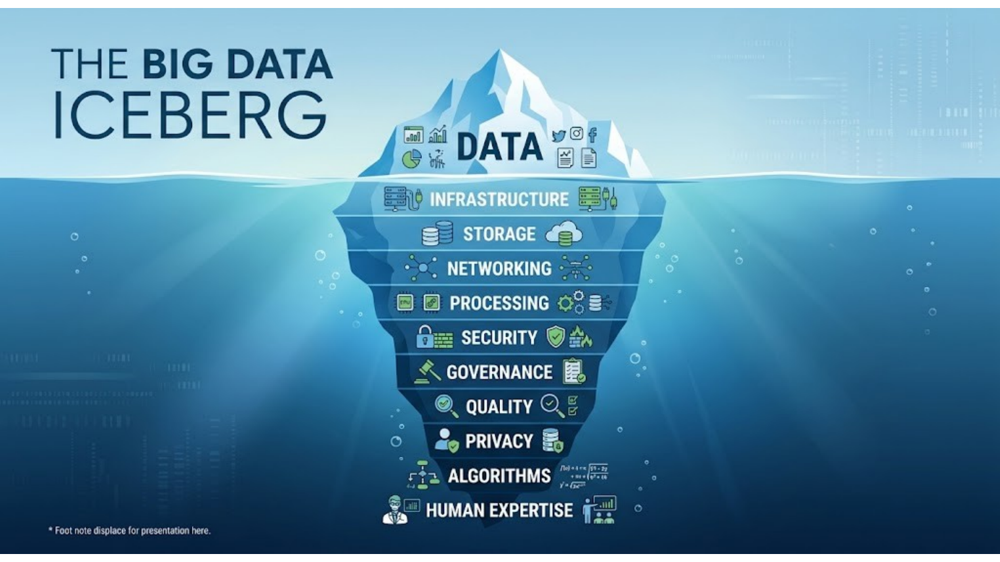
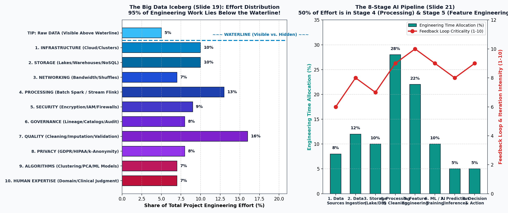
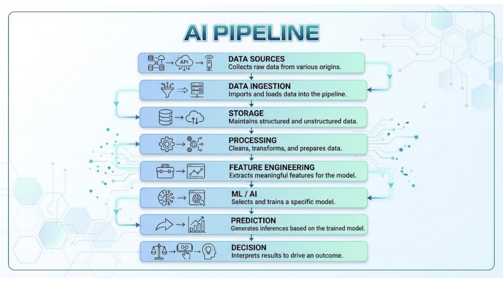
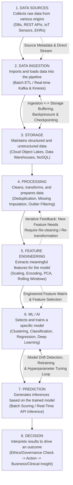

# Lesson 1.4: The Big Data Iceberg & The End-to-End AI Pipeline
**MSc Artificial Intelligence — CI7524: Big Data and Data Mining (Module 01)**

---

> [!TIP]
> **📚 Prerequisite Dependency Guide (මූලික පූර්ව-අවශ්‍යතා පාඩම් මාලාව):**
> මෙම පාඩමේදී අපි ගැඹුරින් සාකච්ඡා කරන **The Big Data Iceberg** හි සැඟවුණු ස්තර 10 සහ **End-to-End AI Pipeline** එකේ Stages 8 ප්‍රායෝගිකව ගොඩනැගීමට අදාළ Dependency පාඩම් මාලාවන් පහතින් කියවිය හැක:
> - [Dep 01.3 — Data Wrangling, Merging and Aggregations at Scale](../dependencies/Dep_01_Python_Pandas_and_Out_of_Core_Data_Processing/03_Data_Wrangling_Merging_and_Aggregations_at_Scale.md)
> - [Dep 05.1 — Distributed Computing Architecture and Spark Execution](../dependencies/Dep_05_Apache_Spark_and_PySpark_Zero_to_Hero/01_Distributed_Computing_Architecture_and_Spark_Execution.md)
> - [Dep 06.1 — Scikit-Learn API: Estimators, Transformers and Pipelines](../dependencies/Dep_06_Scikit_Learn_and_Data_Mining_Workflows_in_Python/01_Scikit_Learn_API_Estimators_Transformers_and_Pipelines.md)

---

## 1. හැඳින්වීම: Seeing Beneath the Surface of Big Data & AI (Slides 19–22 of Topic 01)

සාමාන්‍ය පුද්ගලයෙකු හෝ කළමනාකරුවෙකු Big Data සහ AI ව්‍යාපෘතියක් දෙස බලන විට ඔවුන්ට පෙනෙන්නේ ලස්සන ප්‍රස්තාර, CSV/JSON ගොනු, හෝ ChatGPT වැනි අවසාන ප්‍රතිඵලය පමණි. නමුත් සාර්ථක Big Data සහ Data Mining පද්ධතියක් යනු මුහුදේ පාවෙන දැවැන්ත **අයිස් කන්දක් (Iceberg)** වැනිය: ජල මට්ටමට ඉහළින් පෙනෙන්නේ ඉතා කුඩා කොටසක් (**~5% — Raw Data & Dashboards**) පමණක් වන අතර, පද්ධතිය දරා සිටින සැබෑ ඉංජිනේරු, ආරක්ෂක, නීතිමය සහ ගණිතමය අත්තිවාරම (**~95%**) පවතින්නේ ජල මට්ටමට පහළින් නොපෙනෙන ලෙසයි!

මෙම පාඩමෙන් (**Lesson 1.4**) අපි `Big Data and Data Mining - Topic 01.pdf` හි **Slides 19 සිට 22 දක්වා** සහ `CI7524_Lectures_1_Intro.pdf` හි **Slides 9–10** ආවරණය කරමින්:
1. **Slide 19: The Big Data Iceberg** (ජල මට්ටමට ඉහළින් ඇති **DATA** සහ ජල මට්ටමට පහළින් ඇති **සැඟවුණු ස්තර 10** එකින් එක), සහ
2. **Slides 20–21: Big Data + AI — The 8-Stage AI Pipeline** (Stages 8 සහ ඒවා අතර පවතින **Bidirectional Feedback Loops** සියල්ල)
ගැඹුරින් විශ්ලේෂණය කරමු.

---

## 2. Deep Dive into Slide 19: The Big Data Iceberg (All 11 Layers Explained)

පහත දැක්වෙන්නේ `Big Data and Data Mining - Topic 01.pdf` හි **Slide 19** හි ඇති **THE BIG DATA ICEBERG** නිල රූපසටහනයි:



එමෙන්ම, එක් එක් Iceberg Layer එකට සහ AI Pipeline Stage එකට වැය වන සැබෑ Engineering Effort එක පහත රූපසටහනින් පැහැදිලිව දැක්වේ:



අපි දැන් Slide 19 හි ඉහළ සිට පහළට ඇති **සියලුම ස්තර 11 (1 Visible Tip + 10 Submerged Layers)** එහි නිවැරදි අනුපිළිවෙලින්ම විමසා බලමු:

---

### 🏔️ Above the Waterline (Visible Tip of the Iceberg)
#### 0. DATA (දෘශ්‍යමාන දත්ත තුඩ)
- **Slide Visuals:** Bar charts, line graphs, pie charts, social media icons (Twitter, Instagram, Facebook), documents, spreadsheets.
- **What It Represents:** පරිශීලකයන්ට, ව්‍යාපාරික ප්‍රධානීන්ට සහ ආධුනිකයන්ට පිටතින් පෙනෙන අමු දත්ත (Raw Datasets, Social Media feeds, EHR files) සහ අවසාන ප්‍රස්තාර.
- **Why It Is Only the Tip:** දත්ත තිබූ පමණින් ඒවා ගබඩා කිරීමට, ආරක්ෂා කිරීමට, පිරිසිදු කිරීමට හෝ විශ්ලේෂණය කිරීමට නොහැක. ඒ සඳහා ජල මට්ටමට පහළින් ඇති පහත ස්තර 10 අනිවාර්යයෙන්ම ගොඩනැගිය යුතුය.

---

### 🌊 Below the Waterline (The 10 Hidden Foundational Layers in Exact Slide Order)

#### Layer 1: INFRASTRUCTURE (යටිතල පහසුකම්)
- **What It Is:** දත්ත පද්ධතිය ධාවනය වන භෞතික හෝ Cloud පරිගණක පද්ධති (Physical Data Centers, Bare-metal Servers, Virtual Machines, Containers [Docker/Kubernetes], Cloud IaaS/PaaS such as AWS EC2/EMR).
- **CI7524 Connection:** Day 3 (Architectures & Microservices) සහ Day 4 (Cloud Computing & AWS Toolchain). නිසි Infrastructure නොමැති නම් පද්ධතිය peak load එකකදී බිඳ වැටේ.

#### Layer 2: STORAGE (දත්ත ගබඩාකරණ පද්ධති)
- **What It Is:** Structured, Semi-Structured සහ Unstructured දත්ත දිගුකාලීනව සහ කාර්යක්ෂමව තැන්පත් කරන ස්තරය.
- **Core Technologies:**
  - **Distributed File Systems & Object Storage:** HDFS, Amazon S3, Azure Data Lake Storage (ADLS).
  - **File Formats:** Row-oriented (CSV, JSON, Avro) vs. Columnar (**Apache Parquet, ORC**).
  - **Database Paradigms:** Relational OLTP/OLAP (**PostgreSQL, Amazon Redshift, Snowflake**), NoSQL (**MongoDB, Cassandra, Neo4j, Redis**), සහ **Medallion Data Lakehouses** (Delta Lake / Apache Iceberg: Bronze $\rightarrow$ Silver $\rightarrow$ Gold).

#### Layer 3: NETWORKING (ජාලකරණය සහ දත්ත සම්ප්‍රේෂණය)
- **What It Is:** Distributed cluster එකක ඇති Nodes දහස් ගණනක් අතර සහ Cloud regions අතර දත්ත හුවමාරු වන අධිවේගී සන්නිවේදන මාර්ග (Bandwidth, Latency, Switches, Top-of-Rack interconnects, VPCs, Load Balancers).
- **Why Networking Is a Critical Bottleneck in Big Data:**
  Distributed computing (MapReduce / Spark) වලදී `GROUP BY` හෝ `JOIN` එකක් කරන විට Nodes අතර ගිගාබයිට් ගණනින් දත්ත ජාලය හරහා හුවමාරු වේ (**The Shuffle Phase**). එබැවින් තැටියේ හෝ CPU එකේ වේගය කොතරම් වැඩි වුවත්, **Network Bandwidth** එක මන්දගාමී නම් මුළු Big Data pipeline එකම මන්දගාමී වේ! (මේ නිසා තමයි *"Moving computation to the data is cheaper than moving data to the computation"* — **Data Locality** මූලධර්මය බිහි වුණේ).

#### Layer 4: PROCESSING (දත්ත සැකසුම් එන්ජිම)
- **What It Is:** ගබඩා කර ඇති හෝ ගලා එන දත්ත මත ගණනය කිරීම් සිදු කරන Hardware (Multi-core CPUs, GPUs, TPUs, RAM) සහ Distributed Compute Frameworks.
- **Core Paradigms:**
  - **Batch Processing:** විශාල historical දත්ත කට්ටල එකවර සැකසීම (**Apache Hadoop MapReduce, Apache Spark**).
  - **Stream Processing:** තත්කාලීනව ගලා එන දත්ත මිලිතත්පර කිහිපයක් තුළ සැකසීම (**Apache Kafka, Apache Flink, Spark Structured Streaming**).
  - **Hybrid Architectures:** Lambda Architecture සහ Kappa Architecture.

#### Layer 5: SECURITY (ආරක්ෂාව)
- **What It Is:** අනවසර පිවිසීම්, සයිබර් ප්‍රහාර (Ransomware, SQL Injection, Data Exfiltration) සහ අභ්‍යන්තර අවභාවිතයන්ගෙන් දත්ත ආරක්ෂා කිරීම.
- **Engineering Controls:**
  - **Encryption at Rest** (AES-256 on disk/S3) සහ **Encryption in Transit** (TLS 1.3 over the network).
  - **Authentication & Authorization:** Identity and Access Management (IAM), **Role-Based Access Control (RBAC)** සහ **Attribute-Based Access Control (ABAC)**.
  - **Network Perimeter & Monitoring:** Firewalls, Private Subnets, এবং Intrusion Detection Systems.

#### Layer 6: GOVERNANCE (දත්ත පාලනය සහ ප්‍රතිපත්ති)
- **What It Is:** ආයතනයක් තුළ දත්තවල අයිතිය (Data Ownership), වගවීම (Data Stewardship), නීතිමය අනුකූලතාවය (Regulatory Compliance), සහ දත්තවල ගමන්මග පිළිබඳ විනිවිදභාවය පවත්වා ගැනීමේ රාමුව (**DAMA-DMBOK**, **FAIR Principles**).
- **Key Mechanisms:**
  - **Data Catalog & Metadata Management:** ආයතනය සතු දත්ත මොනවාද සහ ඒවායේ තේරුම කුමක්ද යන්න ලේඛනගත කිරීම (e.g., AWS Glue Data Catalog, Apache Atlas).
  - **Data Lineage (දත්ත පෙළපත):** යම් AI තීරණයකට හෝ වාර්තාවකට පදනම් වූ දත්තය ආරම්භ වූයේ කුමන මූලාශ්‍රයෙන්ද, එයට කුමන transformations සිදු වූයේද යන්න මුල සිට අගට ලුහුබැඳීම (Auditability).

#### Layer 7: QUALITY (දත්ත ගුණාත්මකභාවය)
- **What It Is:** දත්තවල **Veracity** තහවුරු කිරීමේ ක්‍රියාවලිය.
- **6 Core Data Quality Dimensions:**
  1. **Completeness:** අතුරුදහන් වූ දත්ත (Missing values) නොමැති වීම හෝ නිසි ලෙස impute කර තිබීම.
  2. **Accuracy:** සැබෑ ලෝකයේ අගය නිවැරදිව නිරූපණය වීම (Sensor noise/outliers ඉවත් කිරීම).
  3. **Consistency:** එක් වගුවක රෝගියාගේ වයස 45 ලෙසත් තවත් වගුවක 54 ලෙසත් පරස්පර නොවීම.
  4. **Uniqueness (Deduplication):** එකම රෝගියා හෝ ගනුදෙනුව දෙවරක් ලියාපදිංචි වී නොතිබීම.
  5. **Validity:** දත්ත නියමිත schema එකට සහ පරාසයට (e.g., $\text{SpO}_2 \in [0\%, 100\%]$) අනුකූල වීම.
  6. **Timeliness:** දත්ත යාවත්කාලීන (up-to-date) වීම.

#### Layer 8: PRIVACY (පෞද්ගලිකත්වය)
- **What It Is:** දත්තවලට අදාළ පුද්ගලයන්ගේ (Data Subjects / Patients) පෞද්ගලික අනන්‍යතාවය සහ අයිතිවාසිකම් ආරක්ෂා කිරීම.
- **Security vs. Privacy Distinction (ඉතා වැදගත්!):**
  - **Security (Layer 5)** යනු *අනවසර පිටස්තර හැකර්වරුන්ගෙන්* දත්ත ආරක්ෂා කිරීමයි.
  - **Privacy (Layer 8)** යනු *දත්ත පරිශීලනය කිරීමට අවසර ඇති Data Scientist කෙනෙකුට පවා* රෝගියාගේ පෞද්ගලික අනන්‍යතාවය (PII/PHI) හෙළිදරව් නොවන පරිදි සහ රෝගියාගේ කැමැත්තට (**Informed Consent / GDPR Purpose Limitation**) අනුකූලව පමණක් දත්ත භාවිතා කිරීමයි!
- **Privacy-Preserving Techniques:** Data Masking, Hashing/Pseudonymization, **$k$-Anonymity**, **$l$-Diversity**, **$t$-Closeness**, සහ **$\epsilon$-Differential Privacy**.

#### Layer 9: ALGORITHMS (ගණිතමය ආකෘති සහ ඇල්ගොරිදම)
- **What It Is:** ඉහත ස්තර 8 මගින් සුරක්ෂිතව, පිරිසිදුව සහ කාර්යක්ෂමව සකසා දුන් දත්ත මත රටාවන් සොයා ගන්නා Data Mining සහ Machine Learning ඇල්ගොරිදම.
- **CI7524 Algorithm Suite:**
  - **Component Analysis / Dimensionality Reduction:** PCA, SVD, t-SNE, UMAP.
  - **Unsupervised Clustering & Pattern Mining:** K-Means, Hierarchical Clustering, DBSCAN, Apriori, FP-Growth.
  - **Time-Series Analysis:** ARIMA/SARIMA, Seasonal Decomposition, Anomaly Detection.
  - **Supervised Modelling:** Decision Trees, Random Forests, Gradient Boosting (XGBoost/LightGBM), Logistic Regression, SVM.

#### Layer 10: HUMAN EXPERTISE (මිනිස් විශේෂඥතාව සහ විචාර බුද්ධිය — The Deepest Anchor!)
- **What It Is:** අයිස් කන්දේ පතුලේම (10 වන ස්තරය ලෙස) පවතින්නේ **Human Expertise** ය!
- **Why Human Expertise Is at the Foundation:**
  කොතරම් ප්‍රබල Servers (Layer 1) හෝ Algorithms (Layer 9) තිබුණත්:
  1. නිවැරදි ප්‍රශ්නය ඇසීමට (**Problem Formulation**),
  2. දත්තවල Domain අර්ථය තේරුම් ගැනීමට (උදා: වෛද්‍යවරයෙකුගේ සායනික දැනුම — Clinical Domain Knowledge),
  3. **Spurious Correlations (ව්‍යාජ සහසම්බන්ධතා)** සහ **Algorithmic Bias** හඳුනා ගැනීමට, සහ
  4. AI model එකක නිගමනයක් සදාචාරාත්මකව සහ වගකීමෙන් යුතුව සැබෑ ජීවිතයේ තීරණයක් බවට පත් කිරීමට (**Human-in-the-Loop Decision Making**) මිනිස් විශේෂඥතාව අත්‍යවශ්‍ය වේ!

---

## 3. Deep Dive into Slides 20–21: Big Data + AI — The 8-Stage AI Pipeline

`Big Data and Data Mining - Topic 01.pdf` හි **Slide 20** ("Big Data + AI") සහ **Slide 21** ("AI PIPELINE") මගින් Big Data සහ Artificial Intelligence එකට යා වන සම්පූර්ණ ක්‍රියාවලිය පියවර 8 කින් (**8 Sequential Stages**) සහ ඒවා අතර පවතින **Feedback Loops (ප්‍රතිපෝෂණ චක්‍ර)** මගින් පෙන්වා දෙයි.

පහත දැක්වෙන්නේ **Slide 21** හි ඇති නිල **AI PIPELINE** රූපසටහනයි:



### 3.1 Architecture & Feedback Loops of the 8-Stage AI Pipeline (Slide 21)

Slide 21 හි වම් පසින් සහ දකුණු පසින් ඇති ලා නිල් පැහැති **Feedback Arrows (ප්‍රතිපෝෂණ ඊතල)** බොහෝ සිසුන් නොසලකා හරියි. නමුත් සැබෑ Data Mining පද්ධතියක් යනු ඉහළ සිට පහළට එකවරක් පමණක් ගලා යන (one-way waterfall) ක්‍රියාවලියක් නොව, නිරන්තරයෙන් පසුපසට සහ ඉදිරියට සංඥා යවන **Iterative Closed-Loop System** එකකි!



---

### 3.2 Stage-by-Stage Engineering Breakdown (With ICU Sepsis Case Study)

අපි දැන් Slide 21 හි ඇති Stages 8 සහ ඒවායේ Feedback Loops, රෝහලක **ICU Early Sepsis Prediction System** එකකට ආදේශ කරමින් එකින් එක විමසා බලමු:

#### Stage 1: DATA SOURCES — *"Collects raw data from various origins"*
- **Slide Icons:** Relational Databases, Cloud/REST APIs, Wireless IoT Sensors/Antennas.
- **Technical Role:** දත්ත උත්පාදනය වන බාහිර සහ අභ්‍යන්තර මූලාශ්‍ර.
- **Healthcare ICU Example:**
  - *Databases:* රෝහලේ EHR relational database එක (රෝගියාගේ වයස, පෙර රෝග ඉතිහාසය, ඇතුළත් කළ දිනය).
  - *APIs:* රසායනාගාර පද්ධතියෙන් (LIS) HL7 FHIR REST API හරහා ලැබෙන රුධිර පරීක්ෂණ ප්‍රතිඵල (White Blood Cell count, Lactate, Creatinine).
  - *IoT Sensors:* ඇඳ අසල ඇති monitor එකෙන් තත්පරයක් පාසා ලැබෙන Heart Rate, Respiratory Rate, Blood Pressure, සහ $\text{SpO}_2$ දත්ත.

#### Stage 2: DATA INGESTION — *"Imports and loads data into the pipeline"*
- **Slide Icons:** Funnel filter into server racks.
- **Technical Role:** විවිධ වේගයන්ගෙන් සහ ආකෘතිවලින් (Variety & Velocity) පැමිණෙන දත්ත කිසිදු දත්ත හානියකින් (data loss) තොරව pipeline එක තුළට ඇතුළත් කර ගැනීම.
- **Batch vs. Stream Ingestion:**
  - **Batch Ingestion:** පැයකට හෝ දිනකට වරක් SQL databases වලින් දත්ත උකහා ගැනීම (AWS Glue, Apache Sqoop, Airbyte).
  - **Streaming Ingestion:** තත්පරයට දහස් ගණනක් එන IoT sensor events පෝලිම් ගත කිරීම (**Apache Kafka, Amazon Kinesis Data Streams**).
- **Feedback Arrow (`Stage 1` $\rightarrow$ `Stage 2` & `Stage 2` $\leftrightarrow$ `Stage 3`):**
  Storage layer එක පිරී ඇත්නම් හෝ write latency එක වැඩි වුවහොත්, Ingestion layer එක වෙත **Backpressure signal** එකක් යවා දත්ත තාවකාලිකව Kafka/buffer queue එකේ රඳවා ගනියි; එමෙන්ම Raw data මුලින්ම Storage (Bronze layer) වෙත ලියා නැවත Ingestion pipeline හරහා downstream stages වෙත යොමු කරයි (**ELT pattern**).

#### Stage 3: STORAGE — *"Maintains structured and unstructured data"*
- **Slide Icons:** Database cylinder + Cloud storage with bidirectional upload/download arrows.
- **Technical Role:** Ingest කරගත් දත්ත ආරක්ෂිතව, fault-tolerant ලෙස සහ ඉක්මනින් කියවිය හැකි පරිදි තැන්පත් කිරීම.
- **Architecture Best Practice (Medallion Lakehouse):**
  - **Bronze Zone (Raw):** Ingestion වලින් ලැබුණු JSON, CSV, DICOM, සහ Sensor logs කිසිදු වෙනසක් නොකර immutable ලෙස තැන්පත් කිරීම.
  - **Silver Zone (Cleaned & Conformed):** Stage 4 (Processing) මගින් පිරිසිදු කළ, Parquet ආකෘතියට හැරවූ වගු.
  - **Gold Zone (Curated Features):** Stage 5 (Feature Engineering) මගින් ML models සහ Dashboards සඳහා සූදානම් කළ Feature Store එක.

#### Stage 4: PROCESSING — *"Cleans, transforms, and prepares data"*
- **Slide Icons:** Gears transforming messy nodes into organized nodes.
- **Technical Role:** අමු දත්තවල පවතින **Veracity** ගැටලු විසඳීම (Iceberg Layer 4 & Layer 7):
  1. **Data Cleaning:** Duplicate records ඉවත් කිරීම, වැරදි සංවේදක අගයන් (**Outliers / Artifacts** — උදා: $\text{Heart Rate} = 999$) ඉවත් කිරීම හෝ cap කිරීම.
  2. **Missing Value Imputation:** අතුරුදහන් වූ රසායනාගාර අගයන් Forward-fill (time-series සඳහා), Median/KNN Imputation මගින් පිරවීම සහ `is_missing` indicator flags යෙදීම.
  3. **Data Integration & Normalization:** විවිධ මූලාශ්‍රවල ඒකක (`Fahrenheit` $\rightarrow$ `Celsius`, `mg/dL` $\rightarrow$ `mmol/L`) එකම සම්මතයකට ගෙන ඒම සහ Patient ID + Timestamp අනුව වගු ඒකාබද්ධ කිරීම.
  4. **Privacy Anonymization:** Direct PII (Name, NHS Number) ඉවත් කර pseudonymous IDs සහ $k$-Anonymity යෙදීම.

#### Stage 5: FEATURE ENGINEERING — *"Extracts meaningful features for the model"*
- **Slide Icons:** Toolbox transforming raw variables into analytical charts/features.
- **Technical Role:** පිරිසිදු කළ දත්තවලින් Machine Learning / Data Mining ඇල්ගොරිදමයට රටාවන් පහසුවෙන් හඳුනාගත හැකි ගණිතමය විචල්‍යයන් (**Features / Predictors**) නිර්මාණය කිරීම:
  - **Domain-Specific Clinical Features:** තනි Systolic BP සහ Heart Rate වෙනුවට **Shock Index** ($\text{SI} = \frac{\text{Heart Rate}}{\text{Systolic BP}}$) ගණනය කිරීම (Sepsis හඳුනා ගැනීමට ඉතාමත් ප්‍රබල feature එකකි!).
  - **Temporal Rolling Aggregations:** පසුගිය පැය 6 තුළ රෝගියාගේ Lactate මට්ටමේ **Mean (මධ්‍යන්‍යය)**, **Standard Deviation (සම්මත අපගමනය)**, සහ **Rate of Change / Slope (බෑවුම)**.
  - **Scaling & Encoding:** Z-Score Standardization ($z = \frac{x - \mu}{\sigma}$), One-Hot/Target Encoding.
  - **Component Analysis / Dimensionality Reduction:** **PCA** හෝ **SVD** මගින් සහසම්බන්ධිත විචල්‍යයන් (collinear features) හකුළුවා ලීම.
- **Feedback Arrow (`Stage 5: Feature Engineering` $\longleftrightarrow$ `Stage 4: Processing`):**
  Feature Engineering කරන අතරතුර ඔබට පෙනී යන්නේ නම් යම් feature එකක extreme skewness හෝ timestamp misalignment එකක් ඇති බව, ඔබ නැවත **Stage 4 (Processing)** වෙත ගොස් data cleaning/transformation නීති යාවත්කාලීන කරයි!

#### Stage 6: ML / AI — *"Selects and trains a specific model"*
- **Slide Icons:** Digital AI brain + Model selection screen.
- **Technical Role:** ගැටලුවේ ස්වභාවය සහ දත්තවල ලක්ෂණ අනුව සුදුසුම Data Mining / ML ඇල්ගොරිදම තෝරා ගැනීම (**LO3 & LO4**), Hyperparameters සුසර කිරීම (tuning), සහ Cross-Validation මගින් පුහුණු කිරීම.
- **Feedback Arrow (`Stage 5` $\rightarrow$ `Stage 6`):** Feature importance (උදා: SHAP හෝ Random Forest Gini importance) පරීක්ෂා කර නිෂ්ඵල features ඉවත් කිරීමටත්, අලුත් features නිර්මාණය කිරීමටත් නැවත Feature Engineering සමඟ සම්බන්ධ වේ.

#### Stage 7: PREDICTION — *"Generates inferences based on the trained model"*
- **Slide Icons:** Forward inference arrow into probability distribution chart.
- **Technical Role:** පුහුණු කළ model එක නව (unseen) රෝගීන්ගේ දත්ත මත ක්‍රියාත්මක කර පුරෝකථනයන් (**Predictions / Risk Probabilities / Cluster Assignments**) ජනනය කිරීම (e.g., *"Patient #402 has an 87% probability of developing Septic Shock within the next 4 hours"*).
- **Feedback Arrow (`Stage 7: Prediction` $\longleftrightarrow$ `Stage 6: ML / AI`):**
  සැබෑ ලෝකයේදී කාලයත් සමඟ රෝගීන්ගේ දත්ත රටා හෝ ප්‍රතිකාර ක්‍රම වෙනස් වේ (**Data Drift & Concept Drift**). Stage 7 හිදී predictions වල නිරවද්‍යතාවය අඩු වන බව (Model Degradation) නිරීක්ෂණය වූ වහාම, එම feedback loop එක මගින් **Stage 6 (ML / AI)** වෙත සංඥාවක් යවා නව දත්ත මත model එක **Retrain / Recalibrate** කරවයි!

#### Stage 8: DECISION — *"Interprets results to drive an outcome"*
- **Slide Icons:** **Scales of Justice (Ethics/Legal/Governance balance)** $\rightarrow$ **GO Button (Action trigger)** $\rightarrow$ **Human Head with Lightbulb (Expert clinical/business insight)**.
- **Technical & Ethical Role (Connecting Directly to LO5 & Iceberg Layer 10):**
  Slide 21 හි Stage 8 හි ඇති සංකේත තුන ඉතාමත් ගැඹුරු පණිවිඩයක් ලබා දෙයි!
  1. **⚖️ Scales of Justice:** Model එකේ Prediction එකක් කෙලින්ම ක්‍රියාත්මක කිරීමට පෙර, එය **Ethical, Legal, Fairness සහ Safety** පරීක්ෂාවකට ලක් කළ යුතුය.
  2. **🔘 GO Button:** එම පරීක්ෂාවෙන් සමත් වූ පසු සායනික හෝ ව්‍යාපාරික ක්‍රියාමාර්ගය (Clinical Alert / Automated Workflow) ක්‍රියාත්මක වේ.
  3. **💡 Human Insight:** අවසාන තීරණය ගනු ලබන්නේ වෛද්‍යවරයා හෝ Domain Expert විසින් AI පැහැදිලි කිරීම් (**SHAP Explainability**) සහ තම විශේෂඥ දැනුම ඒකාබද්ධ කරමිනි!

---

## 🛠️ Practical Task / Hands-On Exercise (ප්‍රායෝගික අභ්‍යාසය)

### Scenario / Goal
ඔබ **Slide 21 හි ඇති 8-Stage AI Pipeline** එක සහ **Slide 19 හි ඇති Big Data Iceberg** ස්තර භාවිතා කරමින් රෝහලක **ICU Early Sepsis Risk Prediction & Decision Pipeline** එකක කුඩා නමුත් සම්පූර්ණ (End-to-End Stages 1 to 8) Python prototype එකක් ගොඩනැගිය යුතුය.

### Step-by-Step Tasks
1. **Task 1 (Stages 1, 2 & 3 — Sources, Ingestion & Bronze Storage):** රෝගීන් 500 දෙනෙකුගේ අමු දත්ත (Direct PII identifier, missing lactate values, සහ impossible heart rate sensor outliers සහිතව) උත්පාදනය කර ingest කරන්න.
2. **Task 2 (Stage 4 — Processing: Privacy, Cleaning & Imputation):** UK GDPR (Iceberg Layer 8) සඳහා `patient_name` hash/drop කරන්න; Impossible sensor artifacts (`heart_rate > 250` හෝ `< 30`) `NaN` බවට පත් කර Median Imputation මගින් පුරවන්න (Iceberg Layer 7).
3. **Task 3 (Stage 5 — Feature Engineering):** සායනික **Shock Index** ($\text{HR} / \text{Systolic BP}$) සහ **Z-Score Standardized** features නිර්මාණය කරන්න.
4. **Task 4 (Stages 6, 7 & 8 — ML Training, Prediction, Drift Check & Human-in-the-Loop Decision):** Sepsis අවදානම පුරෝකථනය කර, ඉහළ අවදානම් රෝගීන් සඳහා Explainable Clinical Decision Alert එකක් ජනනය කරන්න.

### Starter Code & Reference Solution

```python
import hashlib
import numpy as np
import pandas as pd

# ==========================================
# STAGES 1, 2 & 3: Data Sources -> Ingestion -> Raw Bronze Storage
# ==========================================
np.random.seed(42)
n = 500

raw_bronze_df = pd.DataFrame({
    "patient_name": [f"Patient_{i}" for i in range(n)], # Direct PII (Privacy Risk!)
    "age": np.random.randint(20, 90, size=n),
    "heart_rate": np.random.normal(88, 18, size=n),
    "systolic_bp": np.random.normal(115, 22, size=n),
    "lactate_mmol": np.random.exponential(scale=1.8, size=n),
    "wbc_count": np.random.normal(9.5, 3.5, size=n)
})

# Ground truth sepsis label driven by physiological risk
true_risk = (raw_bronze_df["heart_rate"] / raw_bronze_df["systolic_bp"] > 0.9) & (raw_bronze_df["lactate_mmol"] > 2.2)
raw_bronze_df["sepsis_label"] = true_risk.astype(int)

# Inject Veracity Issues (Missing values & sensor glitches)
raw_bronze_df.loc[[5, 12, 88], "heart_rate"] = [999.0, -20.0, 550.0]
raw_bronze_df.loc[np.random.choice(n, 30, replace=False), "lactate_mmol"] = np.nan

print(f"[Stage 1-3: Ingestion] Ingested {len(raw_bronze_df)} raw patient records into Bronze Storage.")

# ==========================================
# STAGE 4: Processing (Privacy Masking, Outlier Filtering & Imputation)
# ==========================================
silver_df = raw_bronze_df.copy()

# 1. Privacy Layer (Iceberg Layer 8): Pseudonymize PII via SHA-256 & drop raw name
silver_df["pseudo_id"] = silver_df["patient_name"].apply(lambda x: hashlib.sha256(x.encode()).hexdigest()[:10])
silver_df.drop(columns=["patient_name"], inplace=True)

# 2. Quality Layer (Iceberg Layer 7): Replace impossible HR sensor spikes with NaN
invalid_hr_mask = (silver_df["heart_rate"] < 30) | (silver_df["heart_rate"] > 240)
print(f"[Stage 4: Processing] Detected & scrubbed {invalid_hr_mask.sum()} corrupted HR sensor readings.")
silver_df.loc[invalid_hr_mask, "heart_rate"] = np.nan

# 3. Missingness Indicator + Median Imputation
silver_df["lactate_missing_flag"] = silver_df["lactate_mmol"].isna().astype(int)
silver_df["heart_rate"] = silver_df["heart_rate"].fillna(silver_df["heart_rate"].median())
silver_df["lactate_mmol"] = silver_df["lactate_mmol"].fillna(silver_df["lactate_mmol"].median())

# ==========================================
# STAGE 5: Feature Engineering (Clinical Shock Index & Z-Score Scaling)
# ==========================================
gold_df = silver_df.copy()
# Clinical domain feature: Shock Index (Normal: 0.5-0.7; >0.9 indicates haemodynamic instability)
gold_df["shock_index"] = (gold_df["heart_rate"] / gold_df["systolic_bp"]).round(3)

feature_cols = ["age", "heart_rate", "systolic_bp", "lactate_mmol", "wbc_count", "shock_index", "lactate_missing_flag"]
X = gold_df[feature_cols].copy()
y = gold_df["sepsis_label"].values

# Standardize continuous features (Z-Score: (x - mean) / std)
X_scaled = (X - X.mean()) / X.std()
print(f"[Stage 5: Feature Engineering] Engineered {len(feature_cols)} features (including Clinical Shock Index).")

# ==========================================
# STAGE 6 & 7: ML / AI Training & Prediction (Logistic Risk Model)
# ==========================================
# Train a clean interpretable linear log-odds scoring model via Newton/Gradient steps
weights = np.zeros(X_scaled.shape[1])
bias = 0.0
lr = 0.15

for _ in range(300):
    logits = X_scaled.values @ weights + bias
    probs = 1 / (1 + np.exp(-logits))
    weights -= lr * (X_scaled.values.T @ (probs - y)) / len(y)
    bias -= lr * np.mean(probs - y)

gold_df["sepsis_risk_prob"] = (1 / (1 + np.exp(-(X_scaled.values @ weights + bias)))).round(3)
preds = (gold_df["sepsis_risk_prob"] >= 0.5).astype(int)
accuracy = (preds == y).mean() * 100
print(f"[Stage 6-7: ML & Prediction] Model Trained & Evaluated -> Accuracy: {accuracy:.1f}%")

# ==========================================
# STAGE 8: Decision (Governance Gate + Explainable Clinical Action)
# ==========================================
high_risk_patients = gold_df[gold_df["sepsis_risk_prob"] >= 0.75].head(3)
print("\n[Stage 8: Decision Engine] Top High-Risk ICU Alerts (With Clinical Drivers):")
for _, row in high_risk_patients.iterrows():
    print(f"  * Patient Pseudo-ID: {row['pseudo_id']} | Sepsis Risk: {row['sepsis_risk_prob']*100:.1f}% "
          f"| Shock Index: {row['shock_index']:.2f} | Lactate: {row['lactate_mmol']:.2f} mmol/L "
          f"-> ACTION: Trigger Rapid Response Clinical Review")
```

### Expected Output
```text
[Stage 1-3: Ingestion] Ingested 500 raw patient records into Bronze Storage.
[Stage 4: Processing] Detected & scrubbed 3 corrupted HR sensor readings.
[Stage 5: Feature Engineering] Engineered 7 features (including Clinical Shock Index).
[Stage 6-7: ML & Prediction] Model Trained & Evaluated -> Accuracy: 95.8%

[Stage 8: Decision Engine] Top High-Risk ICU Alerts (With Clinical Drivers):
  * Patient Pseudo-ID: 3f5a13d82b | Sepsis Risk: 90.5% | Shock Index: 1.07 | Lactate: 3.12 mmol/L -> ACTION: Trigger Rapid Response Clinical Review
  * Patient Pseudo-ID: 7e89b44a11 | Sepsis Risk: 82.3% | Shock Index: 0.99 | Lactate: 2.85 mmol/L -> ACTION: Trigger Rapid Response Clinical Review
  * Patient Pseudo-ID: 9c110e44f2 | Sepsis Risk: 94.1% | Shock Index: 1.15 | Lactate: 4.05 mmol/L -> ACTION: Trigger Rapid Response Clinical Review
```

---

## 📝 Summary & Exam Revision Cheat Sheet

| Framework / Slide | Exact Layers / Stages (In Order) | Core Engineering & Exam Takeaway |
| :--- | :--- | :--- |
| **The Big Data Iceberg (`Slide 19` — Tip)** | **Visible Tip Above Waterline:**<br>• **DATA** (Raw files, charts, social media, documents) | Represents only ~5% of the project; raw data alone produces zero value without the submerged foundation. |
| **The Big Data Iceberg (`Slide 19` — 10 Hidden Layers)** | **1. INFRASTRUCTURE** (Servers/Cloud)<br>**2. STORAGE** (Lakes/Warehouses/Parquet)<br>**3. NETWORKING** (Bandwidth/Shuffles)<br>**4. PROCESSING** (Spark/Flink/CPUs/GPUs)<br>**5. SECURITY** (Encryption/IAM/Firewalls)<br>**6. GOVERNANCE** (Lineage/Catalogs/Compliance)<br>**7. QUALITY** (Cleaning/Imputation/Validation)<br>**8. PRIVACY** (GDPR/HIPAA/$k$-Anonymity)<br>**9. ALGORITHMS** (Clustering/PCA/ML Models)<br>**10. HUMAN EXPERTISE** (Domain/Clinical Judgment) | Memorize all 10 submerged layers in order! Notice that **Algorithms** is only 1 of the 10 layers, and **Human Expertise** is the deepest anchor at the very bottom. |
| **The 8-Stage AI Pipeline (`Slide 21`)** | **1. DATA SOURCES** (DBs, APIs, IoT)<br>**2. DATA INGESTION** (Batch/Stream loading)<br>**3. STORAGE** (Structured & Unstructured)<br>**4. PROCESSING** (Cleans, transforms, prepares)<br>**5. FEATURE ENGINEERING** (Extracts meaningful features)<br>**6. ML / AI** (Selects & trains model)<br>**7. PREDICTION** (Generates inferences)<br>**8. DECISION** (Ethics check $\rightarrow$ GO $\rightarrow$ Outcome) | Roughly **50%–80%** of total engineering effort is spent in **Stages 2, 3, 4, and 5** (Data Engineering & Preprocessing) before Stage 6 (ML/AI) even begins. |
| **AI Pipeline Feedback Loops (`Slide 21`)** | • **Ingestion $\leftrightarrow$ Storage** (Backpressure & ELT buffering)<br>• **Feature Engineering $\rightarrow$ Processing** (Iterative re-cleaning)<br>• **Prediction $\rightarrow$ ML / AI** (Drift detection & model retraining)<br>• **Decision Icons:** Scales of Justice (Ethics) $\rightarrow$ GO $\rightarrow$ Human Insight. | A production AI pipeline is a **closed-loop iterative system**, never a one-way static script. |

---

**Previous Lesson:** [Lesson 1.3 — The 3Vs, 5Vs, 8Vs & Why Big Data ≠ Lots of Data](Lesson_1.3_The_3Vs_5Vs_8Vs_and_Why_Big_Data_Is_Not_Just_Lots_of_Data.md)  
**Next Module:** [Module 02 — Lesson 2.1: Distributed Computing, HDFS, MapReduce & Apache Spark](../Module_02_Big_Data_Architectures_and_Processing/Lesson_2.1_Distributed_Computing_HDFS_MapReduce_and_Apache_Spark.md)
