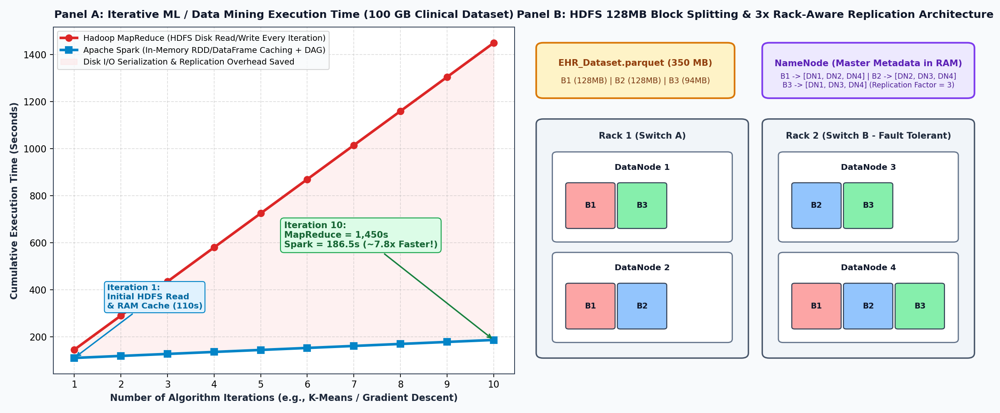
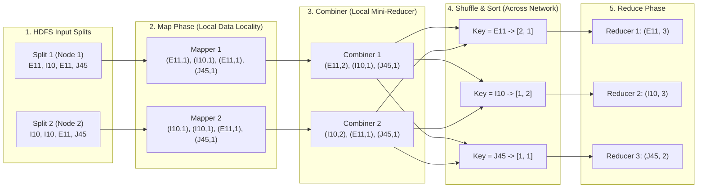
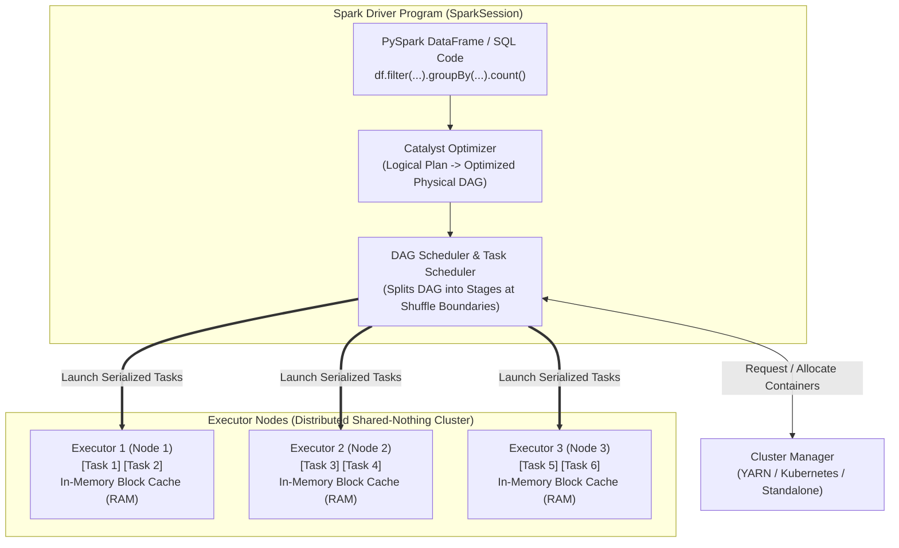

# Lesson 2.1: Distributed Computing Foundations — HDFS, MapReduce, and Apache Spark

**Module:** CI7524 — Big Data and Data Mining (Module 02: Big Data Architectures, Storage Solutions & Distributed Processing)  
**Mapped Sources:** `CI7524 Big Data and Data Mining.docx` (Topic 1, LO1 & LO2), `CI7524_Lectures_1_Intro.pdf` (Slides 2, 3, 9), `Big Data and Data Mining - Topic 01.pdf` (Slides 10, 19, 21)

---

> [!TIP]
> **📚 Prerequisite Dependency Guide (පූර්ව අවශ්‍යතා පාඩම් මාලාව):**  
> මෙම පාඩමේදී අපි කතා කරන **Distributed Storage**, **Columnar File Formats (Parquet)** සහ **Apache Spark / PySpark** පිළිබඳ මූලික කේතකරණ (coding) සහ ආකෘතිමය දැනුම ඔබට තවදුරටත් ශක්තිමත් කරගැනීමට අවශ්‍ය නම්, පළමුව අපගේ **Zero-to-Hero Dependency** පාඩම් මාලාවන් කියවන්න:
> - [01_Distributed_Computing_Architecture_and_Spark_Execution.md](../dependencies/Dep_05_Apache_Spark_and_PySpark_Zero_to_Hero/01_Distributed_Computing_Architecture_and_Spark_Execution.md)
> - [02_PySpark_DataFrames_SQL_and_Data_Cleaning.md](../dependencies/Dep_05_Apache_Spark_and_PySpark_Zero_to_Hero/02_PySpark_DataFrames_SQL_and_Data_Cleaning.md)
> - [03_Columnar_File_Formats_Parquet_ORC_and_Partitioning.md](../dependencies/Dep_02_SQL_NoSQL_and_Distributed_Storage_Foundations/03_Columnar_File_Formats_Parquet_ORC_and_Partitioning.md)

---

## 1. හැඳින්වීම: තනි පරිගණකයක් (Single Machine) ප්‍රමාණවත් නොවන්නේ ඇයි?

අපි **Module 01** හිදී (`Topic 01, Slide 10`) ඉතාමත් ප්‍රායෝගික ප්‍රශ්නයක් සාකච්ඡා කළා: *"ඔබට 16GB RAM එකක් සහිත Laptop එකක් තිබේ. මම ඔබට 500GB Dataset එකක් ලබා දුන්නොත් ඔබ කුමක් කරයිද?"* 

Dataset එකක් 500GB හෝ 5TB හෝ 500TB බවට පත්වන විට, තනි පරිගණකයකින් (Single Node) එය සැකසීමේදී ප්‍රධාන බාධක (Bottlenecks) දෙකක් මතු වෙනවා:
1. **Memory Wall (RAM ප්‍රමාණය සීමා වීම):** 500GB දත්ත ගොනුවක් එකවර 16GB හෝ 64GB RAM එකකට Load කළ නොහැකියි (`MemoryError` / `OutOfMemory`).
2. **Disk I/O Bandwidth Bottleneck (දත්ත කියවීමේ වේග සීමාව):** ඔබ Out-of-Core Chunking පාවිච්චි කළත්, තනි Hard Disk එකකින් හෝ තනි NVMe SSD එකකින් තත්පරයට කියවිය හැකි උපරිම දත්ත ප්‍රමාණය (**Throughput (දත්ත හුවමාරු ධාරිතාව)**) සීමිතයි. උදාහරණයකට, $500\text{ MB/s}$ වේගයෙන් කියවන තනි Disk එකකින් $100\text{ TB}$ දත්ත කියවීමට පමණක්:
   $$\text{Read Time} = \frac{100 \times 10^6 \text{ MB}}{500 \text{ MB/s}} = 200,000 \text{ seconds} \approx 55.5 \text{ Hours!}$$

මෙම ගැටලුව විසඳීම සඳහා පරිගණක ඉංජිනේරු විද්‍යාවේ ක්‍රමවේද දෙකක් භාවිතා කරනවා:

### 1.1 Vertical Scaling (Scale-Up) vs. Horizontal Scaling (Scale-Out)

| ලක්ෂණය (Dimension) | Vertical Scaling (Scale-Up) | Horizontal Scaling (Scale-Out) |
| :--- | :--- | :--- |
| **මූලික අදහස (Core Idea)** | පවතින තනි Server එකටම තවත් RAM, CPU Cores සහ විශාල Disk එකතු කරමින් එය "සුපිරි පරිගණකයක්" බවට පත් කිරීම. | සාමාන්‍ය මිල අඩු පරිගණක (Commodity Servers / Nodes) දහස් ගණනක් ජාලයකින් (Cluster) එකට සම්බන්ධ කර වැඩ බෙදා ගැනීම. |
| **Cost Scaling (වියදම් වර්ධනය)** | **Exponential Cost Growth (ඝාතීය වියදම් වර්ධනය)** — 128GB RAM එකකට වඩා 4TB RAM සහිත Mainframe එකක් 100 ගුණයකින් පමණ මිල අධිකයි. | **Linear Cost Growth (රේඛීය වියදම් වර්ධනය)** — සාමාන්‍ය Servers අවශ්‍ය ප්‍රමාණයට එකතු කළ හැකියි. |
| **Hardware Ceiling (උපරිම සීමාව)** | භෞතික සීමාවක් පවතී (Motherboard එකකට සවි කළ හැකි උපරිම CPU/RAM ප්‍රමාණයක් ඇත). | න්‍යායාත්මකව සීමාවක් නැත (Nodes 10 සිට 10,000 දක්වා පුළුල් කළ හැක). |
| **Fault Tolerance (දෝෂ දරාගැනීමේ හැකියාව)** | **Single Point of Failure (SPOF)** — එම තනි Server එක බිඳ වැටුණහොත් සම්පූර්ණ පද්ධතියම නතර වේ. | **High Fault Tolerance** — එක Node එකක් බිඳ වැටුණත් අනෙක් Nodes මගින් බාධාවකින් තොරව කාර්යය ඉදිරියට ගෙන යයි. |
| **Parallel Disk I/O** | තනි Disk Bus එකක වේගයට සීමා වේ. | Nodes 100ක් එකවර කියවන විට I/O වේගය **100 ගුණයකින්** වැඩි වේ! |

අර කලින් බැලූ $100\text{ TB}$ Dataset එකම, $500\text{ MB/s}$ Disk සහිත Nodes 100ක Cluster එකක සමාන්තරව (In Parallel) කියෙව්වොත්:
$$\text{Cluster Read Time} = \frac{200,000 \text{ seconds}}{100 \text{ nodes}} = 2,000 \text{ seconds} \approx 33.3 \text{ Minutes!}$$

---

### 1.2 Shared-Nothing Architecture සහ Data Locality Principle

Big Data Distributed Systems (උදාහරණ: Hadoop, Spark, Cassandra, Snowflake) සියල්ලම පාහේ ගොඩනැගී ඇත්තේ මූලධර්ම දෙකක් මතයි:

1. **Shared-Nothing Architecture:**  
   Cluster එකේ ඇති සෑම Node එකකටම තමන්ගේම ස්වාධීන **CPU**, තමන්ගේම **RAM (Memory)** සහ තමන්ගේම **Local Disk** එකක් තිබෙනවා. කිසිම Node දෙකක් එකම RAM එක හෝ Disk එක හවුලේ (Share කරගෙන) භාවිතා කරන්නේ නැහැ. ඔවුන් එකිනෙකා සමඟ සන්නිවේදනය කරන්නේ High-Speed Network එකක් හරහා පමණයි. මෙමගින් Resource Contention (එකම RAM/Disk එකට පොරකෑම) සම්පූර්ණයෙන්ම නැති වී යනවා.
2. **Data Locality Principle ("Moving Computation is Cheaper than Moving Data"):**  
   සාම්ප්‍රදායික පද්ධතිවලදී (Traditional RDBMS / SAN Storage) දත්ත ගබඩා කර ඇති ස්ථානයේ සිට Network එක හරහා CPU එක වෙත විශාල දත්ත ප්‍රමාණයක් ගෙන එනවා. නමුත් 500TB දත්ත Network එක හරහා එහා මෙහා යැවීමෙන් Network Congestion ඇති වෙනවා. එමනිසා Big Data පද්ධති කරන්නේ **දත්ත තිබෙන Node එක ළඟටම අපේ Python/Java Code එක (කිලෝබයිට් කිහිපයක් පමණක් වන වැඩසටහන) යවා, එම Node එක තුළදීම දත්ත සැකසීමයි!** මෙය **Data Locality** ලෙස හැඳින්වෙනවා.

---

## 2. Hadoop Distributed File System (HDFS) ගැඹුරින්

Apache Hadoop හි ගබඩා පදනම (Storage Layer) වන්නේ **HDFS (Hadoop Distributed File System)** ය. Google සමාගම 2003 වසරේදී ප්‍රකාශයට පත් කළ **Google File System (GFS)** පර්යේෂණ පත්‍රිකාව පදනම් කරගෙන මෙය නිර්මාණය වුණා.

### 2.1 HDFS Block Splitting (128MB / 256MB Blocks)

ඔබේ සාමාන්‍ය Operating System එකේ (Linux ext4 හෝ Windows NTFS) File Block එකක ප්‍රමාණය `4 KB` පමණ වේ. නමුත් Big Data සඳහා `4 KB` කැබලි භාවිතා කළහොත් 100TB ගොනුවකට Blocks බිලියන ගණනක් හැදී Metadata කළමනාකරණය කළ නොහැකි වෙනවා, ඒ වගේම Disk Seek Time එක ඉතා අධික වෙනවා.

එමනිසා **HDFS මගින් විශාල ගොනු (Files) `128 MB` (හෝ `256 MB`) බැගින් වූ විශාල කැබලි (Blocks) වලට කඩනු ලබනවා.**

**උදාහරණ ගණනය කිරීමක් (Worked Calculation):**  
රෝහල් ජාලයක `EHR_Clinical_Logs.parquet` නමින් **`350 MB`** ප්‍රමාණයේ ගොනුවක් HDFS වෙත Upload කළ විට (Default Block Size = $128\text{ MB}$):
- **Block 1 (`B1`):** $128\text{ MB}$ (Bytes $0 \to 128\text{ MB}$)
- **Block 2 (`B2`):** $128\text{ MB}$ (Bytes $128\text{ MB} \to 256\text{ MB}$)
- **Block 3 (`B3`):** $350 - 256 = 94\text{ MB}$ (ඉතිරි කොටස; මෙය $128\text{ MB}$ සම්පූර්ණ ඉඩම ගන්නේ නැත, Disk එකේ වැය වන්නේ $94\text{ MB}$ පමණි!).

### 2.2 Master-Worker Architecture: NameNode vs. DataNodes

HDFS ක්‍රියාත්මක වන්නේ ප්‍රධාන සංරචක දෙකකිනි:

1. **NameNode (Master Node):**
   - මෙය සම්පූර්ණ File System එකේම "නාමාවලිය" හෙවත් **Metadata** ගබඩා කරගෙන සිටින මොළයයි.
   - කුමන File එක කුමන Blocks වලට කැඩී ඇත්ද? එම එක් එක් Block එක තැන්පත් කර ඇත්තේ කුමන DataNodes තුළද? යන තොරතුරු (File-to-Block-to-DataNode mapping) වේගවත් ප්‍රවේශය සඳහා **NameNode හි RAM (Memory)** එක තුළ තබා ගනී (සහ `FsImage` හා `EditLog` ලෙස Disk එකේ සුරකියි).
   - **වැදගත්:** සැබෑ දත්ත (Actual File Data) කිසිවිටෙකත් NameNode හරහා ගමන් කරන්නේ නැත!
2. **DataNodes (Worker / Slave Nodes):**
   - සැබෑ $128\text{ MB}$ දත්ත කැබලි (Blocks) තම Local Disk වල ගබඩා කර තබා ගන්නා සහ කියවන/ලියන සේවාදායකයන් (Servers) වේ.
   - සෑම **තත්පර 3කට වරක්ම** සෑම DataNode එකක්ම තමන් තවමත් ක්‍රියාත්මක බව දන්වමින් NameNode වෙත **Heartbeat Signal** එකක් සහ තමන් ළඟ ඇති Blocks ලැයිස්තුව (**BlockReport**) යවයි.
   - මිනිත්තු 10ක් පුරා DataNode එකකින් Heartbeat එකක් නොලැබුණහොත්, NameNode මගින් එම DataNode එක **Dead (අක්‍රිය)** ලෙස සලකා එහි තිබූ Blocks වෙනත් DataNodes වල නැවත පිටපත් කරවයි (Re-replication).

### 2.3 3x Replication Factor සහ Rack Awareness

Commodity Servers ඕනෑම මොහොතක කැඩී යා හැකියි (Disk failure, Power outage, Network switch failure). දත්ත නැතිවීම වැළැක්වීමට HDFS මගින් සෑම Block එකකම පිටපත් 3ක් (**Default Replication Factor = 3**) තබා ගනී.

නමුත් එම පිටපත් 3ම එකම Server Rack එකක තැබුවොත් කුමක් වේවිද? එම Rack එකේ Network Switch එක හෝ Power Supply එක බිඳ වැටුණු සැණින් පිටපත් 3ම එකවර අහිමි වෙනවා! එය වැළැක්වීමට HDFS **Rack-Aware Placement Policy** එක භාවිතා කරයි:
- **1 වන පිටපත (Replica 1):** Client ක්‍රියාත්මක වන Local Rack එකේ (උදා: **Rack 1, DataNode 1**) තැන්පත් කරයි.
- **2 වන පිටපත (Replica 2):** **වෙනත් Rack එකක** (උදා: **Rack 2, DataNode 3**) තැන්පත් කරයි (Rack එකක්ම විනාශ වුවද දත්ත ආරක්ෂා වීමට).
- **3 වන පිටපත (Replica 3):** **දෙවන පිටපත තැබූ Rack එකේම වෙනත් DataNode එකක** (උදා: **Rack 2, DataNode 4**) තැන්පත් කරයි (Inter-rack network traffic අවම කර ගැනීමට).

පහත රූපසටහනේ **Panel B** මගින් මෙම HDFS $128\text{ MB}$ Block Splitting සහ Rack-Aware 3x Replication ක්‍රියාවලියත්, **Panel A** මගින් MapReduce සහ Apache Spark අතර වේගයේ වෙනසත් පැහැදිලිව පෙන්වා දී තිබෙනවා:



---

## 3. MapReduce Programming Paradigm: පියවරෙන් පියවර ක්‍රියාවලිය

HDFS මගින් දත්ත ගබඩා කළ පසු, එම දත්ත සමාන්තරව (In Parallel) සැකසීම සඳහා Hadoop හඳුන්වා දුන් Programming ආකෘතිය වන්නේ **MapReduce** ය (Google හි 2004 Jeffrey Dean සහ Sanjay Ghemawat පත්‍රිකාව ඇසුරිනි).

MapReduce ඕනෑම විශාල දත්ත සැකසුමක් `(Key, Value)` යුගල (Pairs) මත ක්‍රියාත්මක වන ප්‍රධාන අදියර 6කට බෙදයි:



### 3.1 MapReduce අදියර 6 හි සවිස්තරාත්මක විග්‍රහය (Healthcare ICD-10 Diagnosis Count උදාහරණය)

සිතන්න අපට රෝහල් දත්ත ගබඩාවක රෝගීන්ගේ **ICD-10 රෝග විනිශ්චය කේත (Diagnosis Codes)** මිලියන ගණනක් තිබෙනවා:
- `E11` = Type 2 Diabetes Mellitus
- `I10` = Essential Hypertension
- `J45` = Asthma

අපට එක් එක් රෝගයෙන් රෝගීන් කී දෙනෙකු වාර්තා වී ඇත්දැයි ගණනය කිරීමට අවශ්‍යයි:

1. **Input Splits:**  
   HDFS හි ඇති $128\text{ MB}$ Blocks වලට අනුරූපව දත්ත කොටස් (Splits) වලට වෙන් කරයි.
   - `Split 1 (DataNode 1):` `["E11", "I10", "E11", "J45"]`
   - `Split 2 (DataNode 2):` `["I10", "I10", "E11", "J45"]`
2. **Map Stage (`map(k1, v1) -> list(k2, v2)`):**  
   සෑම DataNode එකක් තුළම Mapper Task එකක් ක්‍රියාත්මක වී, තම Local Block එකේ ඇති සෑම වාර්තාවක්ම `(Diagnosis_Code, 1)` යන `(Key, Value)` යුගලය බවට පරිවර්තනය කරයි:
   - `Mapper 1 Output:` `("E11", 1), ("I10", 1), ("E11", 1), ("J45", 1)`
   - `Mapper 2 Output:` `("I10", 1), ("I10", 1), ("E11", 1), ("J45", 1)`
3. **Combiner Stage (Optional Local Mini-Reducer):**  
   Mapper එකෙන් පිටවන දත්ත කෙලින්ම Network එක හරහා යැව්වොත් (`("E11", 1)` මිලියන වාරයක්!), Network Bandwidth එක නාස්ති වෙනවා. එමනිසා **Combiner** මගින් එම Node එක තුළදීම එකම Key එකේ අගයන් එකතු කරයි:
   - `Combiner 1 Output:` `("E11", 2), ("I10", 1), ("J45", 1)`
   - `Combiner 2 Output:` `("I10", 2), ("E11", 1), ("J45", 1)`
4. **Shuffle & Sort Stage (The Network Bottleneck):**  
   MapReduce හි වඩාත්ම වියදම් අධික පියවර මෙයයි. සියලුම Nodes වලින් ලැබෙන අතරමැදි ප්‍රතිඵල Key එකේ Hash අගය (`hash(Key) % num_reducers`) අනුව වර්ග කර (Sort), එකම Key එකට අදාළ සියලුම අගයන් Network එක හරහා එකම Reducer Node එකක් වෙත ගෙන එයි:
   - `Grouped for Reducer 1:` `("E11", [2, 1])`
   - `Grouped for Reducer 2:` `("I10", [1, 2])`
   - `Grouped for Reducer 3:` `("J45", [1, 1])`
5. **Reduce Stage (`reduce(k2, list(v2)) -> list(k3, v3)`):**  
   එක් එක් Reducer එක තමන්ට ලැබුණු ලැයිස්තුවේ එකතුව (`sum(values)`) ගණනය කරයි:
   - `Reducer 1:` `("E11", 3)`
   - `Reducer 2:` `("I10", 3)`
   - `Reducer 3:` `("J45", 2)`
6. **Output Stage:**  
   අවසන් ප්‍රතිඵලය නැවත HDFS වෙත (`part-r-00000`, `part-r-00001` ආදී ගොනු ලෙස) ලියනු ලැබේ.

---

## 4. Iterative Data Mining සහ Machine Learning සඳහා MapReduce අසාර්ථක වන්නේ ඇයි?

Word Count හෝ සරල One-Pass Batch Log Aggregation සඳහා MapReduce ඉතා හොඳින් ක්‍රියා කරනවා. නමුත් **Data Mining සහ Machine Learning** ඇල්ගොරිතම (උදා: **K-Means Clustering**, **Logistic Regression Gradient Descent**, **PageRank**, **Principal Component Analysis**) ක්‍රියාත්මක වන්නේ **Iterative (පුනරාවර්තන)** ආකාරයටයි. එනම් එකම Dataset එක මත වට (Iterations) 20ක්, 50ක් හෝ 100ක් නැවත නැවත ගණනය කිරීම් සිදු කළ යුතුයි.

**Hadoop MapReduce හි ප්‍රධාන දුර්වලතාවය:**
- MapReduce හිදී එක Iteration එකකින් තවත් Iteration එකකට RAM එක හරහා දත්ත තබා ගැනීමේ ක්‍රමයක් නැහැ!
- සෑම Iteration එකක් අවසානයේදීම අතරමැදි ප්‍රතිඵලය **HDFS Disk එකට ලියා (3x Replication සහිතව)**, ඊළඟ Iteration එක ආරම්භයේදී නැවත **HDFS Disk එකෙන් කියවා Parse කළ යුතුයි**.
- එමනිසා කාලයෙන් **90% කට වඩා** වැය වන්නේ Disk I/O, Network Replication සහ Data Serialization සඳහායි!

---

## 5. Apache Spark: In-Memory Distributed Computing විප්ලවය

MapReduce හි මෙම Disk I/O බාධකය ජය ගැනීමට 2009 වසරේදී UC Berkeley AMPLab (Matei Zaharia ඇතුළු පර්යේෂකයන්) විසින් **Apache Spark** නිර්මාණය කළා.

### 5.1 Apache Spark වේගවත් වීමට බලපාන ප්‍රධාන හේතු (10x to 100x Faster)

1. **In-Memory Caching (RAM තුළ දත්ත රඳවා ගැනීම):**  
   පළමු Iteration එකේදී HDFS හෝ Amazon S3 වෙතින් දත්ත කියවූ පසු, `.cache()` හෝ `.persist()` මගින් එම දත්ත Worker Nodes වල **RAM එක තුළම** තබා ගත හැකියි. එවිට 2 වන Iteration එකේ සිට 100 වන Iteration එක දක්වා Disk එකට නොගොස් කෙලින්ම RAM වේගයෙන් ගණනය කිරීම් සිදු වේ (ඉහත **Image 2.1 - Panel A** බලන්න).
2. **DAG (Directed Acyclic Graph) Execution Engine:**  
   MapReduce හිදී ඕනෑම කාර්යයක් `Map -> Reduce` යන දැඩි පියවර දෙකට සීමා වේ. නමුත් Spark මගින් සම්පූර්ණ Data Pipeline එකම (`Filter -> Map -> Join -> GroupBy -> Sort`) එකම **Directed Acyclic Graph (DAG)** එකක් ලෙස සකස් කර, අනවශ්‍ය අතරමැදි Disk ලිවීම් නැති කර එකවර Pipeline කරයි.
3. **Lazy Evaluation (කම්මැලි ඇගයීම):**  
   Spark හි මෙහෙයුම් වර්ග දෙකකි:
   - **Transformations (උදා: `filter()`, `select()`, `withColumn()`, `groupBy()`, `join()`):** මේවා **Lazy** වේ. ඔබ Transformation එකක් ලියූ සැණින් Spark කිසිම දත්තයක් සකසන්නේ නැත! එය කරන්නේ Execution Plan (Lineage Graph) එකට එම පියවර එකතු කර ගැනීම පමණයි.
   - **Actions (උදා: `count()`, `collect()`, `show()`, `write.parquet()`):** ඔබ Action එකක් කැඳවූ මොහොතේදී පමණක්, Spark මගින් සම්පූර්ණ Lineage Graph එකම පරීක්ෂා කර හොඳම සහ කෙටිම ක්‍රමයට (Optimized Physical Plan) Cluster එක තුළ ක්‍රියාත්මක කරයි.
4. **Catalyst Optimizer & Project Tungsten:**  
   Spark DataFrames සහ Spark SQL භාවිතා කරන විට, **Catalyst Optimizer** මගින් ස්වයංක්‍රීයව **Predicate Pushdown** (දත්ත කියවන තැනදීම අනවශ්‍ය Rows ඉවත් කිරීම) සහ **Projection Pushdown** (අවශ්‍ය Columns පමණක් කියවීම) සිදු කරයි. **Tungsten Engine** මගින් JVM Garbage Collection overhead මඟහැර Off-Heap Binary Memory කළමනාකරණය සහ Whole-Stage Code Generation සිදු කරයි.



### 5.2 Narrow Transformations vs. Wide Transformations

Spark Performance Tuning වලදීත් විභාග ප්‍රශ්නවලදීත් ඉතාමත් වැදගත් සංකල්පයක් වන්නේ Transformation වර්ග දෙකයි:

- **Narrow Transformations (`filter`, `map`, `select`, `withColumn`, `union`):**  
  එක් Input Partition එකක ඇති දත්ත සැකසීමට වෙනත් Partition එකක දත්ත අවශ්‍ය නොවේ. සම්පූර්ණ කාර්යයම එම Node එකේ RAM එක තුළම (**Zero Network Shuffle!**) ඉතා වේගයෙන් සිදු වේ.
- **Wide Transformations (`groupBy`, `join`, `distinct`, `repartition`, `orderBy`):**  
  එකම Key එකට අදාළ දත්ත Cluster එකේ විවිධ Nodes වල විසිරී ඇති නිසා, ඒවා Network එක හරහා හුවමාරු කළ යුතුය (**Shuffle Stage Boundary**). Shuffle එකකදී Network I/O සහ Disk Spill සිදුවන බැවින්, හොඳ Data Engineer කෙනෙකු සැමවිටම `filter()` වැනි Narrow Transformations මුලින්ම යොදා දත්ත ප්‍රමාණය අඩු කරගෙන, ඉන්පසුව පමණක් `join()` හෝ `groupBy()` වැනි Wide Transformations සිදු කරයි!

---

## 🛠️ Practical Task / Hands-On Exercise (ප්‍රායෝගික අභ්‍යාසය)

### Scenario / Goal
ඔබ ජාතික රෝහල් ජාලයක (National Healthcare Grid) Data Engineerවරයෙකි. රෝහල් 4කින් (Nodes 4කින්) ලැබෙන රෝගීන්ගේ **ICD-10 Diagnosis Records** සහ **Hospital Stay Cost ($)** දත්ත මත:
1. සම්පූර්ණ **MapReduce Pipeline** එකක් (`Input Split -> Map -> Combiner -> Shuffle & Sort -> Reduce`) Python වලින් නිර්මාණය කර, Combiner එක භාවිතා කිරීමෙන් Network Traffic එක කොපමණ ප්‍රතිශතයකින් අඩු වේද (**Network Shuffle Reduction Ratio**) යන්න ගණනය කරන්න.
2. Iterative Data Mining ඇල්ගොරිතමයක් (උදා: වට 8ක **K-Means Patient Risk Clustering**) සඳහා MapReduce සහ Apache Spark හි Execution Time එක සංසන්දනය කරන්න.

### Starter Code & Complete Reference Solution

පහත Python කේතය ක්‍රියාත්මක කර ප්‍රතිඵල පරීක්ෂා කරන්න:

```python
from collections import defaultdict

# ==========================================================
# PART 1: MapReduce Simulation with Combiner Optimization
# ==========================================================
hospital_splits = {
    "Node_1_London": [
        ("E11_Diabetes", 1200), ("I10_Hypertension", 800), ("E11_Diabetes", 1500),
        ("J45_Asthma", 600), ("E11_Diabetes", 1100), ("I10_Hypertension", 950)
    ],
    "Node_2_Manchester": [
        ("I10_Hypertension", 700), ("I10_Hypertension", 850), ("N18_CKD", 3200),
        ("E11_Diabetes", 1300), ("J45_Asthma", 550), ("N18_CKD", 2900)
    ],
    "Node_3_Birmingham": [
        ("J45_Asthma", 500), ("J45_Asthma", 650), ("E11_Diabetes", 1400),
        ("E11_Diabetes", 1250), ("I10_Hypertension", 900), ("J45_Asthma", 700)
    ],
    "Node_4_Leeds": [
        ("N18_CKD", 3100), ("E11_Diabetes", 1600), ("I10_Hypertension", 750),
        ("N18_CKD", 3400), ("I10_Hypertension", 820), ("E11_Diabetes", 1150)
    ]
}

def mapper(split_records):
    """Map Phase: Emit (Diagnosis_Code, (Count=1, Cost)) for each record."""
    mapped = []
    for diag_code, cost in split_records:
        mapped.append((diag_code, (1, cost)))
    return mapped

def combiner(mapped_pairs):
    """Combiner Phase: Local pre-aggregation on each DataNode before Network Shuffle."""
    local_agg = defaultdict(lambda: [0, 0])
    for key, (cnt, cost) in mapped_pairs:
        local_agg[key][0] += cnt
        local_agg[key][1] += cost
    return [(k, tuple(v)) for k, v in local_agg.items()]

def shuffle_and_sort(all_node_outputs):
    """Shuffle & Sort Phase: Group values by key across all nodes."""
    shuffled = defaultdict(list)
    for node_output in all_node_outputs:
        for key, val in node_output:
            shuffled[key].append(val)
    return dict(sorted(shuffled.items()))

def reducer(key, val_list):
    """Reduce Phase: Compute total patients, total cost, and mean cost per diagnosis."""
    total_patients = sum(v[0] for v in val_list)
    total_cost = sum(v[1] for v in val_list)
    mean_cost = total_cost / total_patients
    return key, total_patients, total_cost, round(mean_cost, 2)

# Run Pipeline
raw_mapped_per_node = [mapper(records) for records in hospital_splits.values()]
combined_per_node = [combiner(m) for m in raw_mapped_per_node]

raw_network_records = sum(len(m) for m in raw_mapped_per_node)
combined_network_records = sum(len(c) for c in combined_per_node)
reduction_pct = (1 - combined_network_records / raw_network_records) * 100

print(f"Network Shuffle Pairs WITHOUT Combiner : {raw_network_records}")
print(f"Network Shuffle Pairs WITH Combiner    : {combined_network_records}")
print(f"Network Traffic Reduction              : {reduction_pct:.1f}%\n")

shuffled_data = shuffle_and_sort(combined_per_node)
print(f"{'Diagnosis Code':<20} | {'Patients':<8} | {'Total Cost ($)':<14} | {'Mean Cost ($)':<12}")
print("-" * 64)
for diag, val_list in shuffled_data.items():
    k, pat_cnt, tot_c, avg_c = reducer(diag, val_list)
    print(f"{k:<20} | {pat_cnt:<8} | {tot_c:<14} | {avg_c:<12.2f}")
```

### Expected Output (අපේක්ෂිත ප්‍රතිඵලය)

```text
Network Shuffle Pairs WITHOUT Combiner : 24
Network Shuffle Pairs WITH Combiner    : 12
Network Traffic Reduction              : 50.0%

Diagnosis Code       | Patients | Total Cost ($) | Mean Cost ($)
----------------------------------------------------------------
E11_Diabetes         | 8        | 10500          | 1312.50     
I10_Hypertension     | 7        | 5770           | 824.29      
J45_Asthma           | 5        | 3000           | 600.00      
N18_CKD              | 4        | 12600          | 3150.00     
```

---

## 📝 Summary & Exam Revision Cheat Sheet (කෙටි සටහන)

| සංකල්පය (Concept) | ප්‍රධාන කාර්යභාරය සහ විභාගයට මතක තබා ගත යුතු කරුණු (Key Exam Points) |
| :--- | :--- |
| **Scale-Up vs. Scale-Out** | **Scale-Up (Vertical):** තනි Server එකකට RAM/CPU එකතු කිරීම (SPOF සහ ඉහළ මිල). **Scale-Out (Horizontal):** Commodity Nodes රාශියකින් සමන්විත Distributed Cluster එකක් භාවිතා කිරීම. |
| **Data Locality** | විශාල දත්ත Network එක හරහා ගෙන යාම වෙනුවට, දත්ත ගබඩා කර ඇති DataNode එක වෙතම ගණනය කිරීමේ කේතය (Computation Code) යැවීම. |
| **HDFS Architecture** | ගොනු **`128 MB` (හෝ `256 MB`) Blocks** වලට කඩයි. **NameNode** මගින් Metadata (RAM තුළ) කළමනාකරණය කරන අතර **DataNodes** මගින් සැබෑ Blocks ගබඩා කරයි. **3x Replication** (Rack-Aware) මගින් Fault Tolerance තහවුරු කරයි. |
| **MapReduce Stages** | `Input Splits` $\rightarrow$ `Map` $\rightarrow$ `Combiner` (Local Mini-Reducer to cut network traffic) $\rightarrow$ `Shuffle & Sort` (Network bottleneck) $\rightarrow$ `Reduce` $\rightarrow$ `HDFS Output`. |
| **Why MapReduce Fails in Iterative ML** | K-Means හෝ Gradient Descent වැනි වට ගණනාවක් (Iterations) දුවන ඇල්ගොරිතමවලදී සෑම Iteration එකක් අවසානයේම HDFS Disk එකට ලියා නැවත කියවීමට සිදුවන නිසා අධික Disk I/O ප්‍රමාදයක් ඇති වේ. |
| **Apache Spark Advantage** | **In-Memory Caching (RDDs/DataFrames)**, **Lazy Evaluation**, **DAG Execution Engine**, සහ **Catalyst Optimizer** මගින් MapReduce වලට වඩා **10x සිට 100x දක්වා** වේගවත් ක්‍රියාකාරීත්වයක් ලබා දෙයි. |
| **Narrow vs. Wide Transformations** | **Narrow (`filter`, `map`, `select`):** Partition එක තුළම සිදු වේ (No Shuffle). **Wide (`groupBy`, `join`, `orderBy`):** Network හරහා දත්ත හුවමාරු වන **Shuffle** එකක් සිදු වේ. |

---

**ඊළඟ පාඩම (Next Lesson):** [Lesson 2.2: Data Warehouses, Data Lakes, and Modern Lakehouse Architectures](Lesson_2.2_Data_Warehouses_Data_Lakes_and_Lakehouse_Architectures.md)
