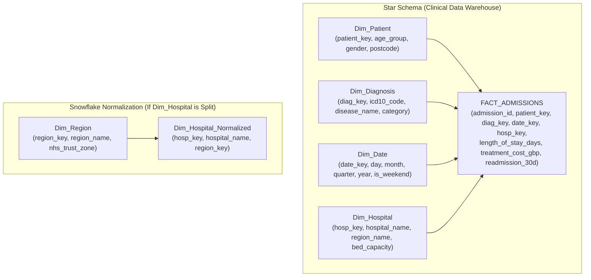
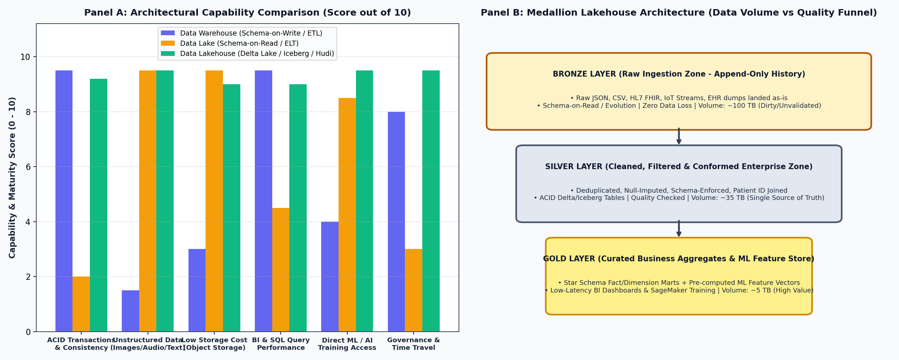
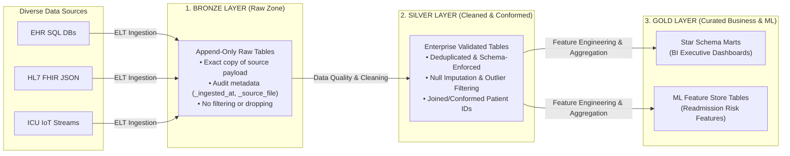

# Lesson 2.2: Data Warehouses, Data Lakes, and Modern Lakehouse Architectures

**Module:** CI7524 — Big Data and Data Mining (Module 02: Big Data Architectures, Storage Solutions & Distributed Processing)  
**Mapped Sources:** `CI7524 Big Data and Data Mining.docx` (Topic 1: Data warehouse and data lake architectures; LO1 & LO2), `CI7524_Lectures_1_Intro.pdf` (Slides 2, 3, 9), `Big Data and Data Mining - Topic 01.pdf` (Slides 18, 19, 21)

---

> [!TIP]
> **📚 Prerequisite Dependency Guide (පූර්ව අවශ්‍යතා පාඩම් මාලාව):**  
> මෙම පාඩමේදී භාවිතා වන **Relational Databases (SQL)**, **ACID vs. BASE ගුණාංග**, **NoSQL Data Models** සහ **Apache Parquet Columnar Storage** පිළිබඳ මූලික පදනම ඔබට පැහැදිලි කරගැනීමට පහත Dependency පාඩම් කියවන්න:
> - [01_Relational_Databases_SQL_and_ACID_vs_BASE.md](../dependencies/Dep_02_SQL_NoSQL_and_Distributed_Storage_Foundations/01_Relational_Databases_SQL_and_ACID_vs_BASE.md)
> - [02_NoSQL_Data_Models_Document_KeyValue_Columnar_Graph.md](../dependencies/Dep_02_SQL_NoSQL_and_Distributed_Storage_Foundations/02_NoSQL_Data_Models_Document_KeyValue_Columnar_Graph.md)
> - [03_Columnar_File_Formats_Parquet_ORC_and_Partitioning.md](../dependencies/Dep_02_SQL_NoSQL_and_Distributed_Storage_Foundations/03_Columnar_File_Formats_Parquet_ORC_and_Partitioning.md)

---

## 1. හැඳින්වීම: OLTP සහ OLAP පද්ධති අතර වෙනස කුමක්ද?

ඕනෑම ආයතනයක (උදාහරණයක් ලෙස රෝහලක, බැංකුවක හෝ E-Commerce වෙබ් අඩවියක) දත්ත පද්ධති ප්‍රධාන වර්ග දෙකකට බෙදෙනවා:
1. **OLTP (Online Transaction Processing):** එදිනෙදා මෙහෙයුම් කටයුතු (Operational Workloads) සිදු කරන පද්ධති. උදාහරණයක් ලෙස රෝගියෙකු රෝහලට ඇතුළත් කිරීම (`INSERT INTO admissions`), බෙහෙත් තුණ්ඩුවක් නිකුත් කිරීම හෝ බැංකු ගිණුමකින් මුදල් ආපසු ගැනීම (`UPDATE accounts`).
2. **OLAP (Online Analytical Processing):** වසර ගණනාවක ඓතිහාසික දත්ත (Historical Data) විශ්ලේෂණය කරමින් තීරණ ගැනීමට සහ Data Mining / Machine Learning ආකෘති පුහුණු කිරීමට භාවිතා කරන පද්ධති. උදාහරණයක් ලෙස *"පසුගිය වසර 5 තුළ දියවැඩියා රෝගීන්ගේ නැවත රෝහල්ගත වීමේ අනුපාතය (**Readmission Rate (නැවත ඇතුළත් වීමේ අනුපාතය)**) වයස් කාණ්ඩය අනුව කෙසේ වෙනස් වීද?"* යන්න විමසීම.

**එදිනෙදා OLTP Database එක මතම විශාල Data Mining Queries දිව්වොත් කුමක් වේවිද?**  
Rows මිලියන 500ක් Scan කරන බරපතල Analytical Query එකක් නිසා OLTP Database එකේ CPU සහ Disk I/O 100%ක් සිර වී (Lock contention), හදිසි ප්‍රතිකාර ඒකකයේ (ICU) වෛද්‍යවරුන්ට රෝගියෙකුගේ දත්ත ඇතුළත් කිරීමට නොහැකිව පද්ධතියම අඩපණ වෙනවා! එමනිසා අපි OLTP සහ OLAP පද්ධති එකිනෙකින් වෙන් කරනවා.

| ලක්ෂණය (Dimension) | OLTP (Online Transaction Processing) | OLAP (Online Analytical Processing) |
| :--- | :--- | :--- |
| **ප්‍රධාන අරමුණ (Primary Purpose)** | එදිනෙදා මෙහෙයුම් කටයුතු (Day-to-day operations) ක්‍රියාත්මක කිරීම. | Historical Analytics, BI Reporting, සහ Data Mining / ML තීරණ ගැනීම. |
| **Query ස්වභාවය (Query Pattern)** | ඉතා කෙටි, වේගවත් `INSERT`, `UPDATE`, `DELETE` සහ තනි Row එකක් කියවන `SELECT` queries. | මිලියන ගණනක් Rows එකවර Scan කරන සංකීර්ණ Aggregations (`SUM`, `AVG`, `GROUP BY`, `JOIN`). |
| **Storage Layout** | **Row-Oriented Storage** (MySQL, PostgreSQL, Oracle) — සම්පූර්ණ Row එකම එකවර ලිවීමට පහසුයි. | **Columnar Storage** (Parquet, ORC, Redshift, Snowflake) — අවශ්‍ය Columns කිහිපය පමණක් වේගයෙන් කියවීමට පහසුයි. |
| **Data Schema Design** | **Highly Normalized (3NF)** — දත්ත පිටපත් වීම (Redundancy) වැළැක්වීමට Tables රාශියකට කඩා ඇත. | **Denormalized (Star / Snowflake Schema)** — Join ප්‍රමාණය අඩු කර කියවීමේ වේගය වැඩි කර ඇත. |
| **Latency & Volume** | **Latency (ප්‍රමාද කාලය):** Milliseconds; **Volume:** Gigabytes (GB). | **Latency (ප්‍රමාද කාලය):** Seconds to Minutes; **Volume:** Terabytes (TB) to Petabytes (PB). |

---

## 2. Data Warehouse (දත්ත ගබඩාව) Architecture

1980 සහ 1990 දශකවලදී (Bill Inmon සහ Ralph Kimball විසින්) **Data Warehouse** සංකල්පය හඳුන්වා දෙනු ලැබුවා. Data Warehouse එකක් යනු ආයතනයක විවිධ OLTP Databases, ERP සහ CRM පද්ධතිවලින් එන **Structured (ව්‍යුහගත)** දත්ත එක්රැස් කර, පිරිසිදු කර, විශ්ලේෂණය සඳහාම විශේෂයෙන් සැලසුම් කළ මධ්‍යගත Repository එකකි.

### 2.1 ETL (Extract, Transform, Load) සහ Schema-on-Write

Data Warehouse එකක් ක්‍රියාත්මක වන්නේ **ETL** සහ **Schema-on-Write** මූලධර්මය මතයි:
1. **Extract:** විවිධ මූලාශ්‍රවලින් (OLTP SQL databases, CSV files) දත්ත ලබා ගැනීම.
2. **Transform (Staging Area තුළදී):** දත්ත Warehouse එකට ඇතුළත් කිරීමට *පෙර* පිරිසිදු කිරීම, Data Types නිවැරදි කිරීම, අඩුපාඩු (Missing Values) පිරවීම සහ දැඩි Schema එකකට අනුකූලව සකස් කිරීම.
3. **Load:** පිරිසිදු කළ ව්‍යුහගත දත්ත Data Warehouse Tables තුළට ලිවීම (**Schema-on-Write** — එනම් ලියන මොහොතේදීම Schema එක දැඩිව පරීක්ෂා කෙරේ).

### 2.2 Dimensional Modelling: Star Schema vs. Snowflake Schema

Data Warehouse එකක් තුළ දත්ත සංවිධානය කරන්නේ **Fact Tables** සහ **Dimension Tables** ඇසුරිනි:
- **Fact Table (මැද පිහිටි ප්‍රධාන වගුව):** සංඛ්‍යාත්මක මිනුම් (**Quantitative Metrics / Measures**) සහ Dimension වගුවලට සම්බන්ධ වන Foreign Keys අඩංගු වේ. උදාහරණ: `Fact_Hospital_Admissions` වගුවේ `admission_cost`, `length_of_stay_days`, `lab_test_count`, `readmitted_30d_flag` වැනි ගණනය කළ හැකි සංඛ්‍යා පවතී.
- **Dimension Tables (වටේට පිහිටි විස්තරාත්මක වගු):** `"කවුද? කොහේද? කවදාද? කුමක්ද?"` (`Who, Where, When, What`) යන සන්දර්භය (Context) විස්තර කරයි. උදාහරණ: `Dim_Patient`, `Dim_Doctor`, `Dim_Diagnosis`, `Dim_Hospital`, `Dim_Date`.



- **Star Schema:** සෑම Dimension වගුවක්ම තනි Denormalized වගුවක් ලෙස කෙලින්ම මැද ඇති Fact Table එකට සම්බන්ධ වේ (තාරකාවක හැඩය ගනී). **වාසිය:** SQL Queries වලදී අවශ්‍ය වන්නේ එක Join මට්ටමක් පමණක් නිසා **Query Performance ඉතාමත් ඉහළයි!**
- **Snowflake Schema:** Dimension වගු තවදුරටත් Normalize කර උප-වගුවලට (Sub-dimensions) කඩා ඇත (උදා: `Dim_Hospital` වගුවෙන් `Dim_Region` සහ `Dim_Country` වෙන් කිරීම). **වාසිය:** Disk ඉඩ සුළු වශයෙන් ඉතිරි වේ. **අවාසිය:** Joins වැඩි වන නිසා Analytical Queries මන්දගාමී වේ.

### 2.3 Data Warehouse හි සීමාවන් (Why Data Warehouses Struggle with Big Data)
1. **Unstructured සහ Semi-Structured දත්ත ගබඩා කළ නොහැක:** රෝහලක ඇති X-Ray / MRI රූප (DICOM), වෛද්‍යවරුන්ගේ හඬ පට (Audio), Clinical Free-Text Notes, හෝ Wearable ECG JSON Streams සාම්ප්‍රදායික Data Warehouse එකකට දැමිය නොහැක (`Topic 01, Slide 18 - Example B`).
2. **Rigid Schema-on-Write Overhead:** අලුත් IoT Sensor එකක් හෝ අලුත් Data Field එකක් එකතු වූ සැණින් සම්පූර්ණ ETL Pipeline එකම නැවත වෙනස් කිරීමට සති ගණනක් ගත වේ.
3. **High Compute & Storage Coupling Cost:** සාම්ප්‍රදායික Warehouses වල Storage සහ Compute එකට බැඳී ඇති නිසා Petabytes ගණනක දත්ත ගබඩා කිරීම අධික වියදම් සහගතය.

---

## 3. Data Lake (දත්ත විල) Architecture

Data Warehouse හි ඉහත සීමාවන් ජය ගැනීමට 2010 දශකයේදී **Data Lake** සංකල්පය (James Dixon විසින්) හඳුන්වා දුන්නා.

### 3.1 ELT (Extract, Load, Transform) සහ Schema-on-Read

Data Lake එකක් යනු **Structured** (CSV, SQL tables), **Semi-Structured** (JSON, XML, HL7 FHIR, Server Logs), සහ **Unstructured** (Images, Videos, PDFs, Audio) යන **සියලුම වර්ගවල දත්ත** ඒවායේ මුල් ස්වරූපයෙන්ම (Raw Native Format), ඉතා අඩු වියදම් සහිත Distributed Object Storage එකක (උදා: **Amazon S3**, **Azure Data Lake Storage [ADLS]**, **Google Cloud Storage [GCS]**, හෝ **HDFS**) ගබඩා කරන ගෘහ නිර්මාණ ශිල්පයයි.

- **ELT (Extract $\rightarrow$ Load $\rightarrow$ Transform):** දත්ත ලැබුණු සැණින් කිසිදු බාධාවකින් හෝ පෙර-සැකසුමකින් තොරව කෙලින්ම Data Lake එකට **Load** කරයි. පසුව Data Scientist හෝ Data Engineer විසින් තමන්ට අවශ්‍ය විශ්ලේෂණය කරන මොහොතේදී පමණක් (Apache Spark / PySpark භාවිතයෙන්) දත්ත **Transform** කර ගනී.
- **Schema-on-Read:** දත්ත ලියන විට Schema එකක් බල කරන්නේ නැත; දත්ත කියවන මොහොතේදී (Read time) පමණක් Schema එක අර්ථ දක්වයි. මෙය Machine Learning සහ Exploratory Data Mining සඳහා ඉතාමත් නම්‍යශීලී වේ.

### 3.2 "Data Swamp" (දත්ත වගුරු බිමක්) බවට පත්වීමේ අවදානම!

නිසි **Data Governance (දත්ත පාලනය)**, Metadata Catalog එකක් හෝ තත්ත්ව පරීක්ෂාවක් නොමැතිව සියලුම Raw ගොනු Data Lake එකකට ඔහේ ගොඩගැසුවහොත්, මාස කිහිපයකින් එය කිසිවෙකුට තේරුම් ගත නොහැකි, දූෂිත දත්ත පිරුණු **"Data Swamp" (දත්ත වගුරු බිමක්)** බවට පත් වේ!

පළමු පරම්පරාවේ Data Lakes (HDFS / Raw S3 Parquet folders) වල තිබූ ප්‍රධාන තාක්ෂණික දුර්වලතා:
1. **No ACID Transactions:** Spark Job එකක් දත්ත ලියමින් සිටින අතරතුර මැදදී Crash වුවහොත්, අර්ධ වශයෙන් ලියැවුණු (Corrupted/Partial) Parquet ගොනු ඉතිරි වී සම්පූර්ණ Dataset එකම දූෂිත වේ.
2. **No Schema Enforcement or Evolution:** එක් දිනකදී `patient_age` තීරුව Integer ලෙසත්, පසු දිනකදී `"Forty-Five"` ලෙස String එකක් ලෙසත් ලැබුණහොත් Data Lake එක එය කිසිදු පරීක්ෂාවකින් තොරව භාර ගන්නා අතර Downstream ML Pipelines බිඳ වැටේ.
3. **Hard to Update/Delete Single Records (GDPR Compliance Issue):** S3 හි ඇති Parquet ගොනු Immutable (වෙනස් කළ නොහැකි) නිසා, GDPR "Right to Erasure" යටතේ එක් රෝගියෙකුගේ වාර්තාවක් මකා දැමීමට මුළු Terabyte ගණනක Partition එකම නැවත ලිවීමට සිදු විය.

---

## 4. Modern Data Lakehouse සහ Medallion Architecture

Data Warehouse හි ඇති **ACID විශ්වසනීයත්වය, Governance සහ SQL වේගයත්**, Data Lake හි ඇති **අඩු වියදම ($23/TB/month on S3), නම්‍යශීලීත්වය සහ සියලුම දත්ත වර්ග (Multimodal) හැසිරවීමේ හැකියාවත්** එකම පද්ධතියක් තුළට ගෙන ආ නවතම පරම්පරාවේ ආකෘතිය **Data Lakehouse Architecture** ලෙස හැඳින්වෙනවා.

### 4.1 Open Table Formats: Delta Lake, Apache Iceberg, සහ Apache Hudi

Data Lake එකක ඇති සාමාන්‍ය Parquet ගොනු මත **Transactional Metadata Layer** එකක් (JSON/Avro Transaction Log එකක්) එක් කිරීමෙන් Lakehouse එකක් ගොඩනැගේ. ප්‍රධාන Open-Source තාක්ෂණයන් 3 වන්නේ **Delta Lake (Databricks)**, **Apache Iceberg (Netflix/Apple/AWS)**, සහ **Apache Hudi (Uber)** ය. මේවා මගින් ලබා දෙන විශේෂ හැකියාවන්:
- **ACID Transactions on Object Storage:** කියවන්නන් (Readers) සහ ලියන්නන් (Writers) එකවර ක්‍රියාත්මක වුවද **Serializable / Snapshot Isolation** තහවුරු කරයි. Job එකක් අතරමග නතර වුවහොත් Transaction Log එකේ Commit නොවන නිසා Corrupted දත්ත කිසිවිටෙකත් නොපෙනේ.
- **Time Travel (Data Versioning):** ඕනෑම පැරණි Snapshot එකකට ආපසු යා හැකියි! උදාහරණයක් ලෙස මීට මාස 3කට පෙර ML Model එක පුහුණු කළ දිනයේදී Dataset එක තිබූ ආකාරයටම නැවත ලබා ගැනීමට:
  ```sql
  SELECT * FROM clinical_lakehouse.patient_vitals VERSION AS OF 42;
  SELECT * FROM clinical_lakehouse.patient_vitals TIMESTAMP AS OF '2026-10-01 09:00:00';
  ```
- **Schema Enforcement & Evolution:** වැරදි Data Types සහිත දත්ත ඇතුළුවීම ස්වයංක්‍රීයව වළක්වයි.
- **Row-Level `UPDATE`, `DELETE`, & `MERGE` (Upserts):** GDPR මකාදැමීම් සහ Change Data Capture (CDC) යාවත්කාලීන කිරීම් තනි SQL විධානයකින් සිදු කළ හැකිය.

පහත රූපසටහනේ **Panel A** මගින් Data Warehouse, Data Lake සහ Data Lakehouse අතර හැකියාවන් සංසන්දනය කර ඇති අතර, **Panel B** මගින් **Medallion Architecture** හි දත්ත පිරිපහදු වන ආකාරය පෙන්වා දෙයි:



### 4.2 The Medallion Architecture (Bronze $\rightarrow$ Silver $\rightarrow$ Gold Layers)

Data Lakehouse එකක් තුළ දත්ත "Data Swamp" එකක් වීම වැළැක්වීම සඳහා කර්මාන්තයේ සම්මත පිළිවෙත වන්නේ ස්ථර තුනකින් යුත් **Medallion Architecture** එකයි:



1. **Bronze Layer (Raw Ingestion Zone):**
   - බාහිර මූලාශ්‍රවලින් ලැබෙන දත්ත (JSON, CSV, IoT packets) කිසිදු වෙනස්කමක් නොකර **Append-Only** ලෙස ගබඩා කරයි.
   - `_ingestion_timestamp` සහ `_source_system` වැනි Metadata තීරු පමණක් එක් කරයි.
   - **වැදගත්කම:** පසුකාලීනව Silver හෝ Gold pipeline එකක කේත දෝෂයක් (Bug) හමු වුවහොත්, මුල් මූලාශ්‍රයෙන් නැවත දත්ත ඉල්ලන්නේ නැතිව Bronze Layer එකේ සිට ඕනෑම වේලාවක සම්පූර්ණ Pipeline එකම **Replay / Reprocess** කළ හැකියි!
2. **Silver Layer (Cleaned, Filtered & Conformed Zone):**
   - Bronze දත්ත පිරිසිදු කරයි: Duplicate records ඉවත් කිරීම (`dropDuplicates`), Data Types නිවැරදි කිරීම, Missing Values හා Imputation සිදු කිරීම, සහ ICD-10 / SNOMED-CT කේත ප්‍රමිතිගත කිරීම මෙහිදී සිදු වේ.
   - විවිධ පද්ධතිවලින් ආ දත්ත පොදු `patient_id` එකක් යටතේ ඒකාබද්ධ කර (Entity Resolution) ආයතනයේ **"Single Source of Truth"** එක නිර්මාණය කරයි.
3. **Gold Layer (Curated Business & ML Feature Zone):**
   - Silver දත්ත මත Business Aggregations සහ **Feature Engineering** සිදු කර නිර්මාණය කරන අවසාන වගු වේ.
   - මෙහි Star Schema Fact/Dimension වගු (PowerBI / Tableau Dashboards සඳහා) සහ Machine Learning ආකෘති පුහුණු කිරීමට සූදානම් කළ **Feature Store Tables** (උදා: රෝගියෙකුගේ පසුගිය දින 30 තුළ සාමාන්‍ය රුධිර පීඩනය, මුළු රෝහල්ගතවීම් ගණන) අඩංගු වේ.

---

## 🛠️ Practical Task / Hands-On Exercise (ප්‍රායෝගික අභ්‍යාසය)

### Scenario / Goal
ඔබේ රෝහල් ජාලයේ Data Lakehouse පද්ධතිය සඳහා **Bronze $\rightarrow$ Silver $\rightarrow$ Gold Medallion Pipeline** එකක් Python/Pandas මගින් ක්‍රියාත්මක කිරීමට ඔබට පැවරී ඇත.
1. **Bronze Layer:** දූෂිත වාර්තා (Duplicates, Missing values, Negative/Impossible heart rates, String formatting errors) සහිත Raw JSON/Dict වාර්තා ලබා ගෙන `_ingested_at` metadata සමඟ Bronze වගුව සාදන්න.
2. **Silver Layer:** Duplicate `event_id` ඉවත් කරන්න, වැරදි Data Types නිවැරදි කරන්න, කායිකව විය නොහැකි Heart Rate අගයන් (`< 30` හෝ `> 220` BPM) ඉවත් කරන්න, සහ Missing Blood Glucose අගයන් එක් එක් රෝගියාගේ හෝ සමස්ත **Median (මධ්‍යස්ථය)** අගයෙන් Impute කරන්න.
3. **Gold Layer:** එක් එක් රෝගියා සඳහා (`patient_id`) ML Feature Table එකක් (`mean_hr`, `max_hr`, `mean_glucose`, `total_cost`, සහ `high_risk_flag`) ගොඩනගන්න.

### Starter Code & Complete Reference Solution

```python
import pandas as pd
import numpy as np

# ==========================================================
# 1. BRONZE LAYER: Raw Unvalidated Clinical Ingestion
# ==========================================================
raw_events = [
    {"event_id": "E001", "patient_id": "P101", "heart_rate": "82",  "glucose_mg_dl": 110.0, "cost_gbp": 450.0},
    {"event_id": "E001", "patient_id": "P101", "heart_rate": "82",  "glucose_mg_dl": 110.0, "cost_gbp": 450.0}, # Exact Duplicate!
    {"event_id": "E002", "patient_id": "P101", "heart_rate": "118", "glucose_mg_dl": np.nan, "cost_gbp": 620.0}, # Missing Glucose
    {"event_id": "E003", "patient_id": "P102", "heart_rate": "-15", "glucose_mg_dl": 95.0,  "cost_gbp": 300.0}, # Sensor Glitch (-15 BPM)
    {"event_id": "E004", "patient_id": "P102", "heart_rate": "76",  "glucose_mg_dl": 98.0,  "cost_gbp": 310.0},
    {"event_id": "E005", "patient_id": "P103", "heart_rate": "125", "glucose_mg_dl": 195.0, "cost_gbp": 890.0},
    {"event_id": "E006", "patient_id": "P103", "heart_rate": "132", "glucose_mg_dl": 210.0, "cost_gbp": 950.0},
    {"event_id": "E007", "patient_id": "P102", "heart_rate": "79",  "glucose_mg_dl": 102.0, "cost_gbp": 290.0},
]

df_bronze = pd.DataFrame(raw_events)
df_bronze["_source_system"] = "ICU_Telemetry_API"
print(f"--- BRONZE LAYER (Rows: {len(df_bronze)}) ---")
print(df_bronze[["event_id", "patient_id", "heart_rate", "glucose_mg_dl", "cost_gbp"]], "\n")

# ==========================================================
# 2. SILVER LAYER: Deduplication, Schema Enforcement & Cleaning
# ==========================================================
df_silver = df_bronze.drop_duplicates(subset=["event_id"]).copy()
df_silver["heart_rate"] = pd.to_numeric(df_silver["heart_rate"], errors="coerce")

# Filter physiologically valid heart rates (30 <= HR <= 220 BPM)
df_silver = df_silver[(df_silver["heart_rate"] >= 30) & (df_silver["heart_rate"] <= 220)].copy()

# Impute missing glucose using median glucose
median_glucose = df_silver["glucose_mg_dl"].median()
df_silver["glucose_mg_dl"] = df_silver["glucose_mg_dl"].fillna(median_glucose)

print(f"--- SILVER LAYER (Cleaned & Conformed Rows: {len(df_silver)}, Imputed Median Glucose: {median_glucose}) ---")
print(df_silver[["event_id", "patient_id", "heart_rate", "glucose_mg_dl", "cost_gbp"]], "\n")

# ==========================================================
# 3. GOLD LAYER: Curated Patient-Level ML Feature Store Table
# ==========================================================
df_gold = df_silver.groupby("patient_id", as_index=False).agg(
    valid_visits=("event_id", "count"),
    mean_heart_rate=("heart_rate", "mean"),
    max_heart_rate=("heart_rate", "max"),
    mean_glucose=("glucose_mg_dl", "mean"),
    total_cost_gbp=("cost_gbp", "sum")
)

# Engineer Target/Risk Feature for Clinical Decision Support
df_gold["high_risk_flag"] = ((df_gold["mean_heart_rate"] > 100) | (df_gold["mean_glucose"] > 150)).astype(int)

print(f"--- GOLD LAYER (ML Feature Store & BI Summary Rows: {len(df_gold)}) ---")
print(df_gold.round(2))
```

### Expected Output (අපේක්ෂිත ප්‍රතිඵලය)

```text
--- BRONZE LAYER (Rows: 8) ---
  event_id patient_id heart_rate  glucose_mg_dl  cost_gbp
0     E001       P101         82          110.0     450.0
1     E001       P101         82          110.0     450.0
2     E002       P101        118            NaN     620.0
3     E003       P102        -15           95.0     300.0
4     E004       P102         76           98.0     310.0
5     E005       P103        125          195.0     890.0
6     E006       P103        132          210.0     950.0
7     E007       P102         79          102.0     290.0 

--- SILVER LAYER (Cleaned & Conformed Rows: 6, Imputed Median Glucose: 110.0) ---
  event_id patient_id  heart_rate  glucose_mg_dl  cost_gbp
0     E001       P101          82          110.0     450.0
2     E002       P101         118          110.0     620.0
4     E004       P102          76           98.0     310.0
5     E005       P103         125          195.0     890.0
6     E006       P103         132          210.0     950.0
7     E007       P102          79          102.0     290.0 

--- GOLD LAYER (ML Feature Store & BI Summary Rows: 3) ---
  patient_id  valid_visits  mean_heart_rate  max_heart_rate  mean_glucose  total_cost_gbp  high_risk_flag
0       P101             2            100.0             118         110.0          1070.0               0
1       P102             2             77.5              79         100.0           600.0               0
2       P103             2            128.5             132         202.5          1840.0               1
```

---

## 📝 Summary & Exam Revision Cheat Sheet (කෙටි සටහන)

| ලක්ෂණය (Feature) | Data Warehouse | Data Lake | Data Lakehouse (Modern Standard) |
| :--- | :--- | :--- | :--- |
| **Data Types Supported** | Structured (Relational Tables) පමණි. | Structured, Semi-Structured (JSON/Logs), Unstructured (Images, Audio, Text). | සියලුම දත්ත වර්ග (Structured + Semi-Structured + Unstructured). |
| **Schema Handling** | **Schema-on-Write** (ලියන විටම දැඩිව පරීක්ෂා වේ). | **Schema-on-Read** (කියවන විට පමණක් අර්ථ දක්වයි). | **Schema Enforcement + Evolution** (Delta Lake / Apache Iceberg / Hudi මගින්). |
| **Pipeline Pattern** | **ETL** (Extract $\rightarrow$ Transform $\rightarrow$ Load). | **ELT** (Extract $\rightarrow$ Load $\rightarrow$ Transform). | **ELT with Medallion Layers** (Bronze $\rightarrow$ Silver $\rightarrow$ Gold). |
| **ACID Transactions & Time Travel** | ඔව් (සම්පූර්ණ ACID සහාය ඇත). | නැත (Corrupted files හා Data Swamp අවදානම). | ඔව් (Transaction Logs සහ Snapshot Time Travel සහිතයි). |
| **Storage Cost** | ඉහළයි (Proprietary Coupled Storage). | ඉතා අඩුයි (Cloud Object Storage - S3/ADLS). | ඉතා අඩුයි (Cloud Object Storage + Open Parquet). |
| **Primary Users** | Business Analysts (BI / SQL). | Data Scientists & ML Engineers. | BI Analysts, Data Engineers, සහ Data Scientists යන සියලු දෙනාම. |

---

**ඊළඟ පාඩම (Next Lesson):** [Lesson 2.3: Batch vs. Stream Processing and Real-Time Analytics Frameworks](Lesson_2.3_Batch_vs_Stream_Processing_and_Real_Time_Analytics.md)
