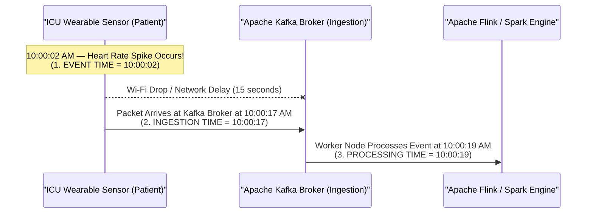
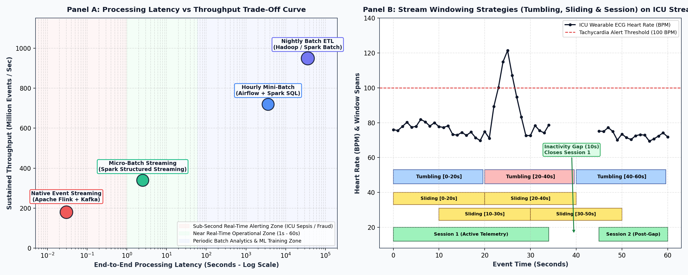
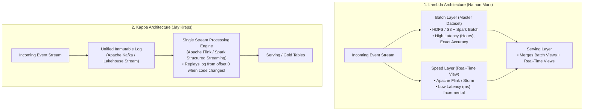

# Lesson 2.3: Batch vs. Stream Processing and Real-Time Analytics Frameworks

**Module:** CI7524 — Big Data and Data Mining (Module 02: Big Data Architectures, Storage Solutions & Distributed Processing)  
**Mapped Sources:** `CI7524 Big Data and Data Mining.docx` (Topic 1: Data processing approaches — batch and stream processing, ML applications; Approaches for real-time analytics and stream processing frameworks; LO1 & LO2), `CI7524_Lectures_1_Intro.pdf` (Slides 2, 3, 9, 10)

---

> [!TIP]
> **📚 Prerequisite Dependency Guide (පූර්ව අවශ්‍යතා පාඩම් මාලාව):**  
> මෙම පාඩමේදී අපි කතා කරන **Apache Spark Execution**, **PySpark DataFrames**, සහ **Moving Average (චලිත මධ්‍යන්‍යය)** වැනි සංඛ්‍යානමය මිනුම් පිළිබඳ මූලික පදනම සඳහා පහත Dependency පාඩම් බලන්න:
> - [01_Distributed_Computing_Architecture_and_Spark_Execution.md](../dependencies/Dep_05_Apache_Spark_and_PySpark_Zero_to_Hero/01_Distributed_Computing_Architecture_and_Spark_Execution.md)
> - [02_PySpark_DataFrames_SQL_and_Data_Cleaning.md](../dependencies/Dep_05_Apache_Spark_and_PySpark_Zero_to_Hero/02_PySpark_DataFrames_SQL_and_Data_Cleaning.md)
> - [01_Descriptive_Statistics_Central_Tendency_and_Dispersion.md](../dependencies/Dep_04_Probability_Distributions_and_Statistical_Foundations/01_Descriptive_Statistics_Central_Tendency_and_Dispersion.md)

---

## 1. හැඳින්වීම: Batch Processing සහ Stream Processing අතර වෙනස කුමක්ද?

Big Data සැකසීමේදී (Data Processing) අපට මුහුණ දීමට සිදුවන ප්‍රධානතම ප්‍රශ්නය වන්නේ: **"අපට ප්‍රතිඵලය කොපමණ ඉක්මනින් අවශ්‍යද?"** (`What is our Latency SLA?`). ඒ අනුව දත්ත සැකසීමේ ප්‍රධාන ක්‍රමවේද දෙකක් පවතිනවා:

### 1.1 Batch Processing (කාණ්ඩ වශයෙන් දත්ත සැකසීම — Bounded Data)
- **අර්ථ දැක්වීම:** නිශ්චිත කාල සීමාවක් තුළ (උදා: පැය 24ක්, සතියක් හෝ මාසයක් පුරා) එකතු වූ, ආරම්භයක් සහ අවසානයක් සහිත (**Bounded Dataset**) විශාල දත්ත ප්‍රමාණයක් එකවර කාලසටහනකට අනුව (Scheduled Job — උදා: සෑම දිනකම මධ්‍යම රාත්‍රී 12:00ට) සැකසීමයි.
- **ප්‍රධාන ලක්ෂණය:** ඉතා ඉහළ **Throughput (දත්ත හුවමාරු ධාරිතාව)** එකක් ඇති අතර, **Latency (ප්‍රමාද කාලය)** පැය හෝ දින ගණනක් වේ.
- **Healthcare උදාහරණ:** මාසික රෝහල් අයවැය වාර්තා සැකසීම, පසුගිය වසර 5ක EHR දත්ත මත Deep Learning ආකෘතියක් Retrain කිරීම.

### 1.2 Stream Processing (අඛණ්ඩ දත්ත ප්‍රවාහ සැකසීම — Unbounded Data)
- **අර්ථ දැක්වීම:** නිමක් නැතිව අඛණ්ඩව ගලා එන දත්ත (**Unbounded Event Streams**) ගබඩා වන තෙක් බලා නොසිට, එම සිදුවීම ජනනය වූ මොහොතේදීම (In-flight / Event-by-Event හෝ Micro-batch ලෙස) තත්පරයෙන් පංගුවකදී (Milliseconds to Seconds) සැකසීමයි.
- **ප්‍රධාන ලක්ෂණය:** ඉතාමත් අඩු **Latency (ප්‍රමාද කාලය)** එකක් (Sub-second real-time) ලබා දෙයි.
- **Healthcare උදාහරණ:** දැඩි සත්කාර ඒකකයේ (ICU) රෝගියෙකුගේ Wearable ECG/SpO2 සංවේදකවලින් එන දත්ත මත හෘදයාබාධයක් (Cardiac Arrest) හෝ **Sepsis** තත්ත්වයක් තත්පර කිහිපයක් තුළ හඳුනාගෙන වෛද්‍යවරුන්ට ක්ෂණික Alert එකක් යැවීම!

| ලක්ෂණය (Dimension) | Batch Processing | Micro-Batch Streaming | Native Event Streaming |
| :--- | :--- | :--- | :--- |
| **දත්තවල ස්වභාවය (Data Nature)** | **Bounded Data** (නිශ්චිත සීමාවක් සහිත ගොනු/වගු). | **Unbounded Stream** තත්පර කිහිපයක කුඩා කාණ්ඩවලට කඩා සැකසීම. | **Unbounded Stream** එක් එක් Event එක පැමිණි සැණින් සැකසීම. |
| **Latency (ප්‍රමාද කාලය)** | මිනිත්තු ගණනක සිට පැය/දින ගණනක් දක්වා. | තත්පර $0.5\text{ s}$ සිට $10\text{ s}$ දක්වා. | **Milliseconds ($< 50\text{ ms}$)**! |
| **Throughput (දත්ත හුවමාරු ධාරිතාව)** | ඉතාමත් ඉහළයි (Millions of rows/sec per node). | ඉහළයි. | මධ්‍යස්ථ සිට ඉහළ දක්වා. |
| **ප්‍රධාන Frameworks** | Apache Spark Batch, Hadoop MapReduce. | **Spark Structured Streaming** (Default mode). | **Apache Flink**, Kafka Streams, Apache Storm. |

---

## 2. Stream Processing හි මූලික සංකල්ප: කාලය (Time) සහ ප්‍රමාද වූ දත්ත (Late Data)

Real-time Stream Processing වලදී **"කාලය (Time)"** යන්න ඉතා සංකීර්ණ ගැටලුවකි. IoT උපාංගයකින් හෝ ජංගම දුරකථනයකින් දත්ත එවන විට කාලයන් වර්ග 3ක් පවතිනවා:



1. **Event Time (සිදුවීම සැබැවින්ම සිදු වූ වේලාව):** රෝගියාගේ ශරීරයට සවි කර ඇති ECG සංවේදකය මගින් හෘද ස්පන්දනය මැන Payload එකට ඇතුළත් කළ Timestamp එක (උදා: `10:00:02 AM`). **නිවැරදි විද්‍යාත්මක හා වෛද්‍ය විශ්ලේෂණ සඳහා සැමවිටම භාවිතා කළ යුත්තේ Event Time ය!**
2. **Ingestion Time (දත්ත පද්ධතියට ඇතුළු වූ වේලාව):** Wi-Fi හෝ 4G ජාලයේ ප්‍රමාදයකින් පසු එම දත්ත පැකට්ටුව Message Broker එකට (උදා: Apache Kafka) ලැබුණු වේලාව (උදා: `10:00:17 AM`).
3. **Processing Time (පරිගණකය මගින් දත්ත සකසන වේලාව):** Stream Processing Engine එකේ (Flink/Spark) Worker Node එක විසින් එම පණිවිඩය කියවා ගණනය කරන වේලාව (උදා: `10:00:19 AM`).

### 2.1 Out-of-Order Events සහ Watermarks (ජල සලකුණු)

Wi-Fi සංඥා බාධා නිසා `10:00:02` ට ජනනය වූ දත්ත පැකට්ටුවක් `10:00:17` දී ලැබෙන විට, `10:00:00 - 10:00:10` කාල කවුළුව (Window) දැනටමත් අවසන් වී ඇත්නම් කුමක් කරන්නද? Stream Engine එක කොපමණ වේලාවක් ප්‍රමාද වූ දත්ත (Stragglers / Late Data) එනතුරු බලා සිටිය යුතුද?

මෙයට විසඳුම **Watermarking** ය!
- **Watermark($t$)** යනු Stream Engine එකට ලබා දෙන කාල සීමාවකි (Threshold): *"Event Time එක $t - \Delta$ ට වඩා පැරණි තවත් දත්ත මින් ඉදිරියට පැමිණෙන්නේ නැතැයි උපකල්පනය කර Window එක වසා දමන්න."*
- උදාහරණයකට **Watermark Delay $\Delta = 10\text{ seconds}$** ලෙස ලබා දුන්නොත්, `10:00:00 - 10:00:10` කවුළුවේ ප්‍රතිඵලය අවසන් කර වසා දමන්නේ Stream එකේ Event Time එක `10:00:20` දක්වා ඉදිරියට ගිය පසුවයි. ඒ අතරතුර (`10:00:17` දී) පැමිණෙන `10:00:02` පැකට්ටුව නිවැරදිවම `10:00:00 - 10:00:10` කවුළුව තුළට ඇතුළත් කර ගණනය කරයි!

---

## 3. Stream Windowing Strategies (කාල කවුළු ක්‍රමවේද 3)

අසීමිතව ගලා එන Stream එකක **Moving Average (චලිත මධ්‍යන්‍යය)**, `SUM`, `COUNT`, හෝ `MAX` ගණනය කිරීමට නම් අපි එම Stream එක කාල කවුළු (**Time Windows**) වලට කැඩිය යුතුයි. ප්‍රධාන Window වර්ග 3 පහත **Image 2.3 (Panel B)** හි ICU Heart Rate දත්ත මත පැහැදිලිව නිරූපණය කර තිබෙනවා:



### 3.1 Tumbling Windows (Fixed, Non-Overlapping Windows)
- **ක්‍රියාකාරීත්වය:** නියත කාල ප්‍රමාණයකින් යුත් (`Window Size = W`), එකිනෙක මත නොවැටෙන (**Non-overlapping**), එකක් අවසන් වූ සැණින් ඊළඟ එක ආරම්භ වන කවුළු වේ.
- **ගණිතමය ලක්ෂණය:** සෑම Event එකක්ම අයත් වන්නේ **එකම එක (Exactly One)** Tumbling Window එකකට පමණි.
- **උදාහරණය (`W = 20s`):** `[0s - 20s)`, `[20s - 40s)`, `[40s - 60s)`. (සෑම තත්පර 20කට වරක් රෝගියාගේ සාමාන්‍ය හෘද ස්පන්දනය වාර්තා කිරීම).

### 3.2 Sliding / Hopping Windows (Overlapping Windows)
- **ක්‍රියාකාරීත්වය:** කවුළුවේ දිග (`Window Size = W`) නියත වන අතර, එය ඉදිරියට ගමන් කරන පියවර (`Slide Interval / Hop = S`) කවුළුවේ දිගට වඩා කුඩා වේ ($S < W$). එමනිසා කවුළු එකිනෙක මත වැටේ (**Overlapping**).
- **ගණිතමය ලක්ෂණය:** සෑම Event එකක්ම කවුළු $\frac{W}{S}$ ගණනකට අයත් වේ!
- **උදාහරණය (`W = 20s`, `S = 10s`):** `[0s - 20s)`, `[10s - 30s)`, `[20s - 40s)`, `[30s - 50s)`.
- **ඇයි Sliding Window වැදගත් වන්නේ?** සිතන්න රෝගියෙකුට තත්පර `18s` සිට `23s` දක්වා හදිසි Tachycardia (හෘද ස්පන්දනය 130 BPM දක්වා ඉහළ යාමක්) ඇති වූවා කියා. Tumbling Window (`[0-20s)` සහ `[20-40s)`) භාවිතා කළහොත් එම Spike එක කවුළු දෙකකට බෙදී ගොස් සාමාන්‍ය අගය (Average) අඩු වී Alert එක මඟහැරිය හැකියි! නමුත් Sliding Window එකේ `[10s - 30s)` කවුළුවට එම සම්පූර්ණ Spike එකම හසුවන නිසා ක්ෂණිකව Alert එක ක්‍රියාත්මක වේ!

### 3.3 Session Windows (Activity-Driven Dynamic Windows)
- **ක්‍රියාකාරීත්වය:** මෙහි කලින් නියම කළ නියත දිගක් නැත! දත්ත එකදිගට ලැබෙන තාක් කල් Session Window එක විවෘතව පවතින අතර, නිශ්චිත කාලයක් (**Inactivity Gap / Timeout = $G$**) කිසිදු දත්තයක් නොලැබී ගියහොත් එම Session Window එක වසා දමයි.
- **උදාහරණය:** රෝගියෙකු Physiotherapy ව්‍යායාම කරන අතරතුර Wearable Sensor එකෙන් දත්ත එන කාලය `Session 1` ලෙසත්, මිනිත්තු 10ක විවේකයකින් පසු නැවත ව්‍යායාම කරන කාලය `Session 2` ලෙසත් වෙන් කර විශ්ලේෂණය කිරීම (හෝ E-commerce වෙබ් අඩවියක පරිශීලකයෙකුගේ Browsing Session එකක් මැනීම).

---

## 4. Stream Ingestion & Processing Frameworks

### 4.1 Apache Kafka (Distributed Event Streaming Platform)
Real-Time Analytics පද්ධතියක කොඳු නාරටිය වන්නේ **Apache Kafka** ය. සංවේදක දහස් ගණනකින් තත්පරයට මිලියන ගණනක් එන දත්ත කෙලින්ම Database එකකට හෝ Spark වෙත යැව්වොත් පද්ධතිය Crash වෙනවා. Kafka මගින් **Producers** (දත්ත එවන්නන්) සහ **Consumers** (දත්ත කියවන්නන්) අතර ඉතා වේගවත්, Fault-Tolerant **Distributed Commit Log / Buffer** එකක් ලෙස ක්‍රියා කරයි:
- **Topic:** දත්ත වර්ගීකරණය කරන නාලිකාව (උදා: `icu-vitals-stream`, `pharmacy-orders`).
- **Partitions:** එක Topic එකක් තුළ ඇති දත්ත සමාන්තරව (Parallelism) හැසිරවීම සඳහා Brokers කිහිපයක් හරහා **Append-only Partitions** (`Partition 0`, `Partition 1`, `Partition 2`) වලට බෙදා ඇත. එකම `patient_id` (Partition Key) සහිත පණිවිඩ සැමවිටම එකම Partition එකට වැටෙන නිසා **Order Guarantee (අනුපිළිවෙල)** සුරැකේ.
- **Consumer Groups:** Consumers කිහිප දෙනෙකු එකතුවී Topic එකක Partitions බෙදාගෙන සමාන්තරව කියවයි.

### 4.2 Spark Structured Streaming vs. Apache Flink
- **Spark Structured Streaming:** පෙරනිමියෙන් **Micro-Batch Architecture** එක භාවිතා කරයි. එනම් ගලා එන Stream එක තත්පර 1ක හෝ 2ක කුඩා කාණ්ඩවලට කඩා, සුපුරුදු Spark SQL / Catalyst Engine එක මතම Unbounded DataFrame එකක් ලෙස ක්‍රියාත්මක කරයි. (Batch සහ Stream දෙකටම එකම PySpark API එක භාවිතා කළ හැකි වීම විශාල වාසියකි).
- **Apache Flink:** **True Native Event-by-Event Streaming** එන්ජිමකි. Micro-batches එනතුරු බලා නොසිට, සෑම Event එකක්ම පැමිණි මිලි-තත්පරයේදීම Stateful Operator Graph එක හරහා යවයි. Sub-second ($<10\text{ ms}$) අඩුම ප්‍රමාද කාලයක් අවශ්‍ය තැන්වලදී Flink ප්‍රමුඛ වේ.

---

## 5. Enterprise Real-Time Architectures: Lambda vs. Kappa

ආයතනයකට **ඓතිහාසික දත්ත නිවැරදිව විශ්ලේෂණය කිරීමත් (Historical Accuracy)**, **තත්කාලීන දත්ත ක්ෂණිකව පෙන්වීමත් (Real-Time Low Latency)** යන දෙකම එකවර අවශ්‍ය වූ විට භාවිතා කරන Architecture රටා දෙකකි:



1. **Lambda Architecture (Nathan Marz):**
   - ගලා එන සෑම දත්තයක්ම මාර්ග දෙකකට යවයි:
     - **Batch Layer (Cold Path):** සම්පූර්ණ Raw දත්ත S3/HDFS හි ගබඩා කර, පැය කිහිපයකට වරක් Spark Batch Job එකකින් 100% නිවැරදි Batch Views සාදයි.
     - **Speed Layer (Hot Path):** අලුතින්ම පැමිණි දත්ත පමණක් Flink/Spark Streaming මගින් මිලි-තත්පර ගණනකදී සකසා Real-Time Views සාදයි.
     - **Serving Layer:** පරිශීලකයෙකු Query කළ විට Batch View + Real-Time View දෙකේ එකතුව ලබා දෙයි.
   - **Lambda හි ප්‍රධාන අවාසිය (Dual Codebase Maintenance Problem):** එකම Business Logic එක Batch සඳහා එක කේතයකිනුත්, Streaming සඳහා තවත් කේතයකිනුත් දෙවරක් ලිවීමට සහ නඩත්තු කිරීමට සිදු වන අතර, දෙකේ ප්‍රතිඵල අතර පරස්පරතා හටගනී.
2. **Kappa Architecture (Jay Kreps):**
   - වෙනම Batch Layer එකක් සම්පූර්ණයෙන්ම ඉවත් කරයි!
   - සියලුම දත්ත Long-term Kafka Log එකක් හෝ Delta Lakehouse Stream එකක් ලෙස තබාගෙන, **තනි Unified Stream Processing Engine එකක්** පමණක් භාවිතා කරයි. Logic එක වෙනස් වුවහොත් Stream එක මුල සිට (Offset 0 සිට) ඉහළ සමාන්තරතාවයකින් (High Parallelism) Replay කරයි.

---

## 🛠️ Practical Task / Hands-On Exercise (ප්‍රායෝගික අභ්‍යාසය)

### Scenario / Goal
ඔබ ICU රෝගීන්ගේ හෘද ස්පන්දන දත්ත (ECG Stream) විශ්ලේෂණය කරන Real-Time Stream Processor එකක් නිර්මාණය කරයි. ජාල ප්‍රමාදයන් නිසා ඇතැම් දත්ත පැකට් **Out-of-Order (අනුපිළිවෙලින් තොරව)** ලැබේ.
1. ලැබෙන Event Stream එක **Event Time** අනුව සකසා, **Watermark Delay = 15s** පරීක්ෂාවක් යොදන්න.
2. **Tumbling Window (`W = 20s`)**, **Sliding Window (`W = 20s, Slide = 10s`)**, සහ **Session Window (`Inactivity Gap = 15s`)** යන ක්‍රම 3ම Python වලින් ක්‍රියාත්මක කරන්න.
3. තත්පර `18s` සහ `22s` අතර ඇතිවන Tachycardia Spike එක (`HR > 115 BPM`) Tumbling Window එකට මඟහැරුණත් **Sliding Window** එක මගින් නිවැරදිව හඳුනාගන්නා ආකාරය පෙන්වන්න!

### Starter Code & Complete Reference Solution

```python
import numpy as np

# Raw ICU Telemetry Stream: (event_time_sec, ingestion_time_sec, heart_rate_bpm)
# Notice packet at event_time=19s arrived slightly out-of-order at ingestion_time=24s!
icu_stream = [
    (2,  3,  74), (8,  9,  76), (14, 15, 78),
    (18, 19, 124), # Tachycardia spike begins near end of [0-20s) window!
    (21, 22, 128), # Spike continues in [20-40s) window!
    (19, 24, 130), # Late / Out-of-order packet (delay = 5s <= Watermark 15s -> Accepted!)
    (28, 29, 77), (35, 36, 75),
    # --- 20-second Inactivity Gap between t=35s and t=55s (Patient moved for X-Ray) ---
    (55, 56, 80), (59, 60, 82),
    (12, 65, 140)  # Extremely late packet (delay = 53s > Watermark 15s -> Dropped!)
]

WATERMARK_DELAY = 15

# Step 1: Filter out packets violating Watermark & sort by Event Time
valid_events = []
for ev_time, ing_time, hr in icu_stream:
    lateness = ing_time - ev_time
    if lateness <= WATERMARK_DELAY:
        valid_events.append((ev_time, hr))
    else:
        print(f"[WATERMARK DROP] Event at t={ev_time}s arrived at t={ing_time}s (Lateness={lateness}s > {WATERMARK_DELAY}s)")

valid_events.sort(key=lambda x: x[0])

# Step 2: Tumbling Windows (W = 20s)
print("\n--- 1. TUMBLING WINDOWS (Size = 20s, Non-Overlapping) ---")
for start in range(0, 60, 20):
    end = start + 20
    vals = [hr for t, hr in valid_events if start <= t < end]
    mean_hr = np.mean(vals) if vals else 0
    alert = "ALERT (>115 BPM)!" if mean_hr > 115 else "Normal"
    print(f"Window [{start:02d}s - {end:02d}s) | Count: {len(vals)} | Mean HR: {mean_hr:6.1f} BPM | Status: {alert}")

# Step 3: Sliding Windows (W = 20s, Slide = 10s)
print("\n--- 2. SLIDING WINDOWS (Size = 20s, Slide = 10s, Overlapping) ---")
for start in range(0, 50, 10):
    end = start + 20
    vals = [hr for t, hr in valid_events if start <= t < end]
    mean_hr = np.mean(vals) if vals else 0
    alert = "🚨 TACHYCARDIA ALERT (>115 BPM)!" if mean_hr > 115 else "Normal"
    print(f"Window [{start:02d}s - {end:02d}s) | Count: {len(vals)} | Mean HR: {mean_hr:6.1f} BPM | Status: {alert}")

# Step 4: Session Windows (Dynamic, Inactivity Gap = 15s)
print("\n--- 3. SESSION WINDOWS (Inactivity Gap Threshold = 15s) ---")
sessions = []
current_session = [valid_events[0]]
for prev, curr in zip(valid_events, valid_events[1:]):
    if curr[0] - prev[0] > 15:
        sessions.append(current_session)
        current_session = [curr]
    else:
        current_session.append(curr)
sessions.append(current_session)

for idx, sess in enumerate(sessions, 1):
    s_start, s_end = sess[0][0], sess[-1][0]
    hrs = [h for _, h in sess]
    print(f"Session {idx}: [{s_start:02d}s - {s_end:02d}s] (Duration: {s_end - s_start}s) | Events: {len(hrs)} | Mean HR: {np.mean(hrs):.1f} BPM")
```

### Expected Output (අපේක්ෂිත ප්‍රතිඵලය)

```text
[WATERMARK DROP] Event at t=12s arrived at t=65s (Lateness=53s > 15s)

--- 1. TUMBLING WINDOWS (Size = 20s, Non-Overlapping) ---
Window [00s - 20s) | Count: 5 | Mean HR:   96.4 BPM | Status: Normal
Window [20s - 40s) | Count: 3 | Mean HR:   93.3 BPM | Status: Normal
Window [40s - 60s) | Count: 2 | Mean HR:   81.0 BPM | Status: Normal

--- 2. SLIDING WINDOWS (Size = 20s, Slide = 10s, Overlapping) ---
Window [00s - 20s) | Count: 5 | Mean HR:   96.4 BPM | Status: Normal
Window [10s - 30s) | Count: 5 | Mean HR:  107.4 BPM | Status: Normal
Window [20s - 40s) | Count: 3 | Mean HR:   93.3 BPM | Status: Normal
Window [30s - 50s) | Count: 1 | Mean HR:   75.0 BPM | Status: Normal

--- 3. SESSION WINDOWS (Inactivity Gap Threshold = 15s) ---
Session 1: [02s - 35s] (Duration: 33s) | Events: 8 | Mean HR: 95.2 BPM
Session 2: [55s - 59s] (Duration: 4s) | Events: 2 | Mean HR: 81.0 BPM
```
*(සටහන: `[10s - 30s)` Sliding Window එක මගින් `[0-20s)` සහ `[20-40s)` මායිම හරහා ගිය Spike එකේ මධ්‍යන්‍යය `107.4 BPM` දක්වා ඉහළ ගොස් ඇති බව පැහැදිලිව හඳුනා ගනී!)*

---

## 📝 Summary & Exam Revision Cheat Sheet (කෙටි සටහන)

| සංකල්පය (Concept) | ප්‍රධාන විස්තරය සහ විභාගයට මතක තබා ගත යුතු කරුණු (Key Exam Points) |
| :--- | :--- |
| **Event Time vs. Processing Time** | **Event Time:** සංවේදකයේදී සිදුවීම සැබැවින්ම සිදු වූ වේලාව. **Processing Time:** Server එක මගින් දත්ත සකසන වේලාව. Out-of-order දත්ත නිවැරදිව ගණනය කිරීමට **Event Time** අත්‍යවශ්‍ය වේ. |
| **Watermarks** | ප්‍රමාද වී පැමිණෙන දත්ත (Late-arriving stragglers) සඳහා Window එකක් කොපමණ වේලාවක් විවෘතව තබා ගත යුතුද යන්න තීරණය කරන කාල සීමාව. |
| **Tumbling Windows** | නියත දිගකින් යුත්, එකිනෙක මත නොවැටෙන (Fixed, Non-overlapping) කවුළු. සෑම Event එකක්ම එක් කවුළුවකට පමණක් අයත් වේ. |
| **Sliding / Hopping Windows** | නියත දිගකින් යුත්, නමුත් Slide පියවර කුඩා නිසා එකිනෙක මත වැටෙන (Overlapping) කවුළු. Moving Averages සහ මායිම් අතර සිදුවන Spikes හඳුනාගැනීමට ඉතා සුදුසුය. |
| **Session Windows** | ක්‍රියාකාරකම් මත පදනම් වූ (Activity-driven) ගතික කවුළු; නිශ්චිත **Inactivity Gap** කාලයක් දත්ත නොලැබුණු විට කවුළුව වැසේ. |
| **Apache Kafka** | Producers සහ Consumers එකිනෙකින් වෙන් කරන (Decouple) Distributed Commit Log පද්ධතියකි; **Topics**, **Partitions** සහ **Consumer Groups** මගින් ඉහළ Throughput එකක් ලබා දෙයි. |
| **Lambda vs. Kappa Architecture** | **Lambda:** Batch Layer + Speed Layer + Serving Layer (Codebases දෙකක් නඩත්තු කළ යුතුය). **Kappa:** තනි Unified Stream Log එකක් සහ තනි Stream Processing Engine එකක් පමණක් භාවිතා කරයි. |

---

**ඊළඟ පාඩම (Next Lesson):** [Lesson 2.4: Microservices for Scalable Analytics and the AWS Cloud Toolchain](Lesson_2.4_Microservices_for_Scalable_Analytics_and_AWS_Cloud_Toolchain.md)
