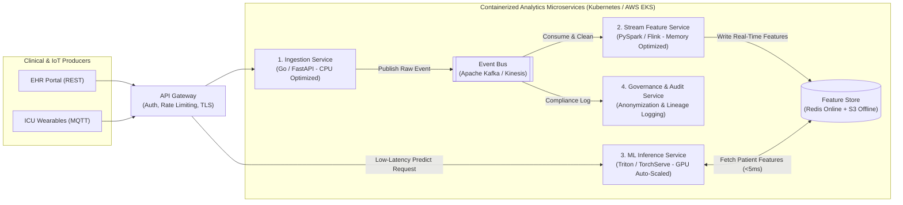
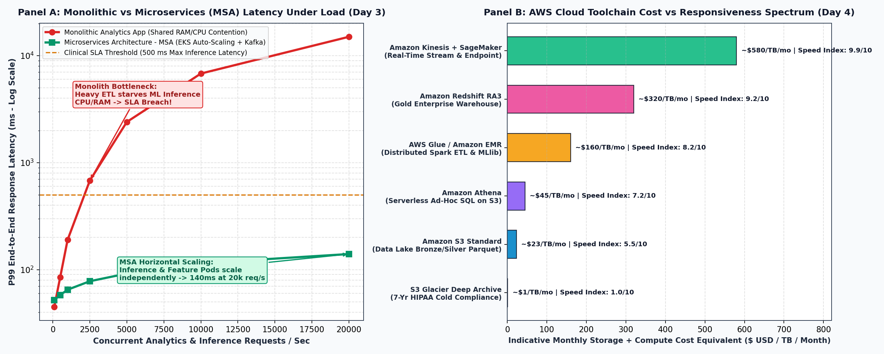
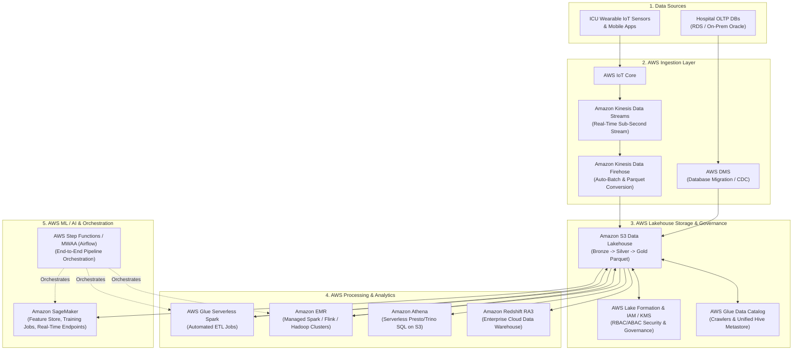

# Lesson 2.4: Microservices for Scalable Analytics and the AWS Cloud Toolchain

**Module:** CI7524 — Big Data and Data Mining (Module 02: Big Data Architectures, Storage Solutions & Distributed Processing)  
**Mapped Sources:** `CI7524_Lectures_1_Intro.pdf` (Slide 1: Research focus on Microservices Architecture [MSA], Cloud Computing, Data Engineering; Slide 9: **Day 3 — Architectures and microservices for scalable analytics** & **Day 4 — Cloud computing and AWS toolchain in detail**), `CI7524 Big Data and Data Mining.docx` (LO1 & LO2), `C4 MSc Artificial Intelligence.docx` (Enterprise AI Engineering Gap)

---

> [!TIP]
> **📚 Prerequisite Dependency Guide (පූර්ව අවශ්‍යතා පාඩම් මාලාව):**  
> මෙම පාඩමේදී අපි කතා කරන **Cloud Columnar Storage (Parquet on S3)**, **NoSQL Databases (DynamoDB)**, සහ **Distributed Spark Clusters (Amazon EMR / AWS Glue)** පිළිබඳ මූලික පදනම සඳහා පහත Dependency පාඩම් කියවන්න:
> - [02_NoSQL_Data_Models_Document_KeyValue_Columnar_Graph.md](../dependencies/Dep_02_SQL_NoSQL_and_Distributed_Storage_Foundations/02_NoSQL_Data_Models_Document_KeyValue_Columnar_Graph.md)
> - [03_Columnar_File_Formats_Parquet_ORC_and_Partitioning.md](../dependencies/Dep_02_SQL_NoSQL_and_Distributed_Storage_Foundations/03_Columnar_File_Formats_Parquet_ORC_and_Partitioning.md)
> - [01_Distributed_Computing_Architecture_and_Spark_Execution.md](../dependencies/Dep_05_Apache_Spark_and_PySpark_Zero_to_Hero/01_Distributed_Computing_Architecture_and_Spark_Execution.md)

---

## 1. හැඳින්වීම: The Enterprise AI Engineering Gap (`C4 Spec` & `Intro Slide 9`)

අපගේ MSc AI පාඨමාලා විස්තර පත්‍රිකාවේ (`C4 MSc Artificial Intelligence.docx`) සහ `CI7524_Lectures_1_Intro.pdf` (Slide 1 සහ Slide 9 — **Day 3 & Day 4**) හි ඉතාමත් වැදගත් කර්මාන්ත ගැටලුවක් පෙන්වා දී තිබෙනවා:
- බොහෝ AI පර්යේෂකයන්ට Jupyter Notebook එකක් තුළ Machine Learning Model එකක් සෑදිය හැකි වුවත්, එය මිලියන ගණනක් පරිශීලකයන් භාවිතා කරන **Scalable Enterprise Platform** එකක් ලෙස Production වෙත යෙදවීමට (Deploy කිරීමට) අපහසුයි.
- එලෙසම, සාම්ප්‍රදායික Software Engineers ලා AI/Data Mining ආකෘතිවල සම්පත් අවශ්‍යතා (GPU/RAM/Data Pipeline bottlenecks) නොදැන ඒවා "Black-box" ලෙස භාවිතා කිරීමට යාමෙන් පද්ධතියේ කාර්යක්ෂමතාව සහ පිරිවැය පාලනය බිඳ වැටෙනවා.

මෙම පරතරය පියවීම සඳහා **Day 3** හිදී **Microservices Architecture (MSA) for Scalable Analytics** පිළිබඳවත්, **Day 4** හිදී **Cloud Computing සහ AWS Big Data Toolchain** පිළිබඳවත් අපි ගැඹුරින් ඉගෙන ගන්නවා.

---

## 2. Day 3 Deep Dive: Monolithic vs. Microservices Architecture (MSA) for Analytics

### 2.1 Monolithic Analytics Pipeline එකක් Big Data හමුවේ අසාර්ථක වන්නේ ඇයි?

**Monolithic Architecture** එකකදී Data Ingestion, Data Cleaning, Feature Engineering, Machine Learning Model Training, Real-Time Inference API, සහ Reporting Dashboard යන සියලුම කොටස් **එකම විශාල කේත ගොනුවක් (Single Codebase) සහ එකම Server Process එකක්** තුළ එකට ගැටගසා (Tightly Coupled) ඇත.

මෙහිදී පැනනගින ප්‍රධාන ගැටලු 4:
1. **Resource Contention (සම්පත් සඳහා පොරකෑම):** විශාල Batch Feature Engineering හෝ Model Retraining කාර්යයක් ආරම්භ වූ සැණින් එය Server එකේ CPU සහ RAM 100%ක්ම භාවිතා කරයි. එහි ප්‍රතිඵලයක් ලෙස තත්කාලීන රෝගී පරීක්ෂා කිරීම් සිදු කරන **Real-Time Inference API** එකට RAM/CPU නොලැබී ප්‍රතිචාර කාලය (**Latency (ප්‍රමාද කාලය)**) තත්පර ගණනකින් ඉහළ ගොස් SLA බිඳ වැටේ!
2. **All-or-Nothing Scaling (අකාර්යක්ෂම Scaling):** ඔබේ පද්ධතියේ වැඩිපුරම කාර්යබහුල වන්නේ GPU අවශ්‍ය වන **ML Inference** කොටස පමණක් වුවත්, Monolith එකකදී ඔබට මිල අධික GPU සහිත Servers මත මුළු යෙදුමම (Ingestion, UI, Auth ඇතුළුව) පිටපත් කිරීමට සිදු වේ.
3. **Single Point of Failure (Cascading Crash):** Data Ingestion කොටසේ corrupt වූ PDF ගොනුවක් නිසා `MemoryError` එකක් ආවොත්, සම්පූර්ණ Monolithic Server එකම Crash වී ML Prediction සේවාවද නතර වේ.
4. **Technology Lock-in:** සම්පූර්ණ පද්ධතියම එකම පරිගණක භාෂාවකින් (උදා: Python හෝ Java පමණක්) ලිවීමට සිදු වේ.

### 2.2 Microservices Architecture (MSA) for Scalable Big Data & AI

**Microservices Architecture (MSA)** මගින් Big Data සහ AI Pipeline එකේ එක් එක් වගකීම (Single Responsibility) ස්වාධීනව Deploy කළ හැකි, ස්වාධීනව Scale කළ හැකි කුඩා **Containerized Services (Docker + Kubernetes / AWS EKS)** බවට වෙන් කරයි:



### 2.3 MSA හි ප්‍රධාන ඉංජිනේරු වාසි (Day 3 Key Takeaways)

1. **Independent Horizontal Auto-Scaling:** හදිසියේම රෝහල්වලින් ලැබෙන Prediction ඉල්ලීම් 10 ගුණයකින් වැඩි වුවහොත්, Kubernetes Horizontal Pod Autoscaler (HPA) මගින් **ML Inference Service** එකේ Pods පමණක් 2 සිට 20 දක්වා වැඩි කරයි; අනෙක් Services වෙනස් නොවේ (පහත **Image 2.4 - Panel A** බලන්න).
2. **Heterogeneous Hardware & Polyglot Tech Stack:**
   - **Ingestion Microservice:** ඉහළ I/O සඳහා Go හෝ Python FastAPI (`c6i` Compute-optimized CPU nodes මත).
   - **Distributed ETL / Feature Service:** PySpark / Flink (`r6i` Memory-optimized nodes මත).
   - **Deep Learning Inference Microservice:** PyTorch / ONNX Runtime (`g5` GPU instances මත).
3. **Asynchronous Decoupling via Event Bus (Kafka / Kinesis):**  
   Microservices එකිනෙකාට සෘජුවම REST API calls ගසා බලා සිටියහොත් (Synchronous Chaining), එක Service එකක් මන්දගාමී වන විට සියල්ලම හිර වේ. එමනිසා Big Data MSA වලදී Services අතර සන්නිවේදනයට **Apache Kafka / Amazon Kinesis** වැනි Asynchronous Event Bus එකක් (Backpressure buffering සහිතව) භාවිතා කරයි.
4. **Fault Isolation & Circuit Breakers:** Recommendation හෝ Batch Training microservice එකක දෝෂයක් ආවත්, Real-Time Clinical Alerting microservice එක අඛණ්ඩව ක්‍රියාත්මක වේ.



---

## 3. Day 4 Deep Dive: Cloud Computing & The AWS Big Data Toolchain

සාම්ප්‍රදායිකව තමන්ගේම Data Center එකක (On-Premise) servers මිලදී ගෙන Hadoop/Spark Cluster එකක් පවත්වාගෙන යාමේදී **CapEx (Capital Expenditure)** ඉතා අධික වන අතර, මාස ගණනක් ගත වේ. **Cloud Computing (AWS / Azure / GCP)** මගින්:
- **OpEx (Pay-as-you-go):** භාවිතා කරන තත්පර ගණනට සහ ගබඩා කරන GB ප්‍රමාණයට පමණක් මුදල් ගෙවීම.
- **Separation of Storage and Compute:** දත්ත සැමවිටම ඉතා ලාභදායී **Amazon S3** හි තබාගෙන, දත්ත සැකසීමට අවශ්‍ය පැය 2 සඳහා පමණක් Spark Cluster එකක් (**Amazon EMR**) පණ ගන්වා, වැඩේ අවසන් වූ සැණින් Cluster එක Terminate කර Compute වියදම $0 බවට පත් කළ හැකියි!

අපි දැන් `Topic 01, Slide 21` හි ඉගෙන ගත් **8-Stage Big Data + AI Pipeline** එකේ සෑම පියවරක්ම **AWS (Amazon Web Services) Toolchain** එකට නිවැරදිවම සම්බන්ධ (Map) කරන ආකාරය බලමු:



### 3.1 Ingestion Layer (දත්ත ඇතුළත් කර ගැනීමේ සේවාවන්)
1. **Amazon Kinesis Data Streams (KDS):**  
   Apache Kafka හා සමානව ක්‍රියා කරන, තත්පරයට දස දහස් ගණනක් Real-time events (උදා: ICU telemetry, Clickstreams, Financial trades) මිලි-තත්පර ගණනකදී ඇතුළත් කරගන්නා Managed Streaming සේවාවකි. Shards මගින් Throughput පාලනය කරයි.
2. **Amazon Kinesis Data Firehose:**  
   Streaming දත්ත කෙලින්ම **Amazon S3**, **Amazon Redshift**, හෝ **OpenSearch** වෙත ස්වයංක්‍රීයව ලබා දෙන Serverless නලයකි. **විශේෂත්වය:** ගලා එන Raw JSON දත්ත S3 හි ලිවීමට පෙර ස්වයංක්‍රීයවම **Apache Parquet හෝ ORC** බවට පරිවර්තනය කර (Compress කර) Partition කිරීමට Firehose හට හැකියාව ඇත!
3. **AWS DMS (Database Migration Service):**  
   රෝහලේ පවතින On-Premise SQL Server / Oracle / PostgreSQL OLTP දත්ත ගබඩාවල සිදුවන වෙනස්කම් (**CDC — Change Data Capture**) කිසිදු Downtime එකකින් තොරව S3 Data Lake එකට හෝ Redshift වෙත අඛණ්ඩව පිටපත් කරයි.
4. **AWS IoT Core:**  
   මිලියන ගණනක් වෛද්‍ය උපකරණ හෝ Smart Sensors ආරක්ෂිතව (MQTT / TLS හරහා) Cloud එකට සම්බන්ධ කරයි.

### 3.2 Storage, Catalog & Governance Layer (දත්ත ගබඩා කිරීම සහ පාලනය)
1. **Amazon S3 (Simple Storage Service):**  
   AWS Big Data පද්ධතියේ හදවතයි. **99.999999999% (11 Nines) Durability** සහිත Object Storage එකකි. Medallion Architecture හි Bronze, Silver සහ Gold Parquet/Iceberg/Delta වගු සියල්ල ගබඩා කරන්නේ S3 තුළයි.
   - **S3 Storage Tiers (පිරිවැය ප්‍රශස්තකරණය):** නිතර භාවිතා කරන දත්ත සඳහා **S3 Standard** (~$23/TB/month), කලාතුරකින් බලන දත්ත සඳහා **S3 Intelligent-Tiering / S3 Standard-IA**, සහ වසර 7–10ක් නීතිමය අවශ්‍යතා (HIPAA/GDPR Audit) සඳහා තබා ගන්නා Cold Archive දත්ත සඳහා **S3 Glacier Deep Archive** (~$1/TB/month!) භාවිතා කරයි.
2. **AWS Glue Data Catalog & Glue Crawlers:**  
   S3 හි ඇති දහස් ගණනක් Parquet/JSON ෆෝල්ඩරවල Schema එක ස්වයංක්‍රීයව Scan කර හඳුනාගන්නා **Glue Crawlers** මගින් මධ්‍යගත Metadata නාමාවලියක් (**Glue Data Catalog**) සාදයි.
3. **AWS Lake Formation:**  
   S3 Data Lakehouse එක මත මධ්‍යගත ආරක්ෂාව (Fine-grained Column-level, Row-level, සහ Cell-level access control) ලබා දෙයි. උදාහරණයක් ලෙස පර්යේෂකයෙකුට `patient_name` සහ `nhs_number` තීරු සඟවා (Masking) අනෙකුත් සායනික තීරු පමණක් පෙන්වීමට Lake Formation භාවිතා කළ හැකියි.

### 3.3 Processing, Querying & Data Warehousing Layer
1. **AWS Glue (Serverless Spark ETL):**  
   Servers හෝ Clusters කිසිවක් කළමනාකරණය නොකර, PySpark හෝ Python කේතයක් ලියා Bronze සිට Silver/Gold දක්වා දත්ත පිරිසිදු කිරීමට භාවිතා කරන Serverless ETL සේවාවකි.
2. **Amazon EMR (Elastic MapReduce):**  
   දැවැන්ත Petabyte-scale Apache Spark, Apache Flink, Hadoop, HBase හෝ Presto clusters විනාඩි කිහිපයකින් ගොඩනැගිය හැකි Managed Cluster සේවාවකි. **AWS Spot Instances** (අමතර EC2 ධාරිතාව) භාවිතා කිරීමෙන් EMR Compute පිරිවැය **70%–80% කින්** අඩු කර ගත හැකිය!
3. **Amazon Athena (Serverless Interactive SQL):**  
   කිසිදු Database Server එකක් හෝ Warehouse එකක් Load කරන්නේ නැතිව, **Amazon S3 හි ඇති Parquet/Iceberg ගොනු මත කෙලින්ම Standard SQL (Trino/Presto engine)** ධාවනය කරන සේවාවකි. ගෙවිය යුත්තේ Scan කරන දත්ත ප්‍රමාණයට පමණි ($5 per TB scanned). CSV වෙනුවට Partitioned Parquet භාවිතා කිරීමෙන් Athena වියදම සහ වේගය 90% කට වඩා වැඩි දියුණු වේ!
4. **Amazon Redshift (Cloud Enterprise Data Warehouse):**  
   Gold Layer එකේ ඇති Star Schema වගු මත ඉතා වේගවත් BI Dashboards (QuickSight / Tableau) සහ සංකීර්ණ OLAP Joins ධාවනය කිරීමට භාවිතා කරන MPP (Massively Parallel Processing) Columnar Data Warehouse එකකි. **Redshift Spectrum** මගින් Redshift තුළ සිටම S3 හි ඇති Exabytes ගණනක දත්තද Query කළ හැකිය.

### 3.4 Data Mining, Machine Learning & Workflow Orchestration
1. **Amazon SageMaker:**  
   End-to-End Machine Learning සහ Data Mining වේදිකාවයි:
   - **SageMaker Feature Store:** Online (Low-latency ms inference) සහ Offline (S3 training) features එකවර කළමනාකරණය කරයි.
   - **SageMaker Training Jobs & Clarify:** Distributed GPU/CPU clusters මත K-Means, PCA, XGBoost, හෝ Deep Learning ආකෘති පුහුණු කරයි; **SageMaker Clarify** මගින් Algorithmic Bias සහ SHAP Explainability පරීක්ෂා කරයි.
   - **SageMaker Real-Time / Serverless Endpoints:** පුහුණු කළ ආකෘතිය Auto-scaling HTTPS Microservice එකක් ලෙස Deploy කරයි.
2. **AWS Step Functions & Amazon MWAA (Managed Workflows for Apache Airflow):**  
   `Glue Crawler -> Glue Silver ETL -> EMR Feature Engineering -> SageMaker Training -> Model Evaluation` යන සම්පූර්ණ Pipeline එක පියවරෙන් පියවර ස්වයංක්‍රීයව (DAG orchestration, retry logic, failure alerts සහිතව) ක්‍රියාත්මක කරවයි.

---

## 🛠️ Practical Task / Hands-On Exercise (ප්‍රායෝගික අභ්‍යාසය)

### Scenario / Goal
ඔබේ CI7524 Coursework ව්‍යාපෘතිය සඳහා දිනකට **500 GB** බැගින් (මසකට **15 TB**) සායනික දත්ත ලැබෙන AWS Cloud Pipeline එකක **Architecture Cost & Query Performance FinOps Simulator** එකක් ලිවීමට ඔබට පැවරී ඇත.
1. Analyst කෙනෙකු දිනකට SQL Queries 40ක් (සෑම Query එකකටම Columns 20න් Columns 3ක් පමණක් අවශ්‍ය වේ) **Amazon Athena** මත ධාවනය කරයි.
2. දත්ත **Raw Uncompressed CSV** ලෙස S3 හි තැබූ විට සහ **Snappy-Compressed Columnar Parquet (4x compression + Columnar Projection)** ලෙස S3 හි තැබූ විට මාසික S3 Storage වියදම සහ Athena Query වියදම ($5 per TB scanned) සංසන්දනය කරන්න.
3. Monolithic EC2 (`24/7 On-Demand`) සහ Event-Driven Serverless/Spot MSA (`EMR Serverless + SageMaker Auto-scaling`) අතර මාසික Compute පිරිවැය ගණනය කරන්න.

### Starter Code & Complete Reference Solution

```python
# ==========================================================
# AWS Big Data Architecture FinOps & Performance Calculator
# ==========================================================
MONTHLY_RAW_DATA_TB = 15.0        # 500 GB/day * 30 days = 15 TB/month
TOTAL_COLUMNS = 20
QUERIED_COLUMNS = 3               # Analysts only select 3 columns per query
QUERIES_PER_MONTH = 40 * 30       # 1,200 queries/month

S3_COST_PER_TB = 23.0             # $23 / TB / month (S3 Standard)
ATHENA_COST_PER_TB_SCANNED = 5.0  # $5 / TB scanned

# Scenario A: Naive Raw CSV on S3 + Monolithic 24/7 Server
csv_storage_tb = MONTHLY_RAW_DATA_TB
csv_s3_cost = csv_storage_tb * S3_COST_PER_TB
# CSV is row-oriented: Athena must scan 100% of the 15 TB file on every query!
csv_tb_scanned_per_query = csv_storage_tb
csv_athena_cost = QUERIES_PER_MONTH * csv_tb_scanned_per_query * ATHENA_COST_PER_TB_SCANNED
monolith_ec2_24_7_cost = 4 * 0.768 * 24 * 30  # 4 large nodes running 24/7 (~$2,211.84)

# Scenario B: Optimized Lakehouse (Parquet + Partitioning + Spot EMR + MSA)
PARQUET_COMPRESSION_RATIO = 4.0   # 15 TB CSV -> 3.75 TB Parquet
PARTITION_PRUNING_FACTOR = 0.20   # Partitioning by date scans only 20% of partitions

parquet_storage_tb = MONTHLY_RAW_DATA_TB / PARQUET_COMPRESSION_RATIO
parquet_s3_cost = parquet_storage_tb * S3_COST_PER_TB

# Columnar projection reads only (3/20) columns of compressed, partition-pruned data!
parquet_tb_scanned_per_query = (
    parquet_storage_tb * (QUERIED_COLUMNS / TOTAL_COLUMNS) * PARTITION_PRUNING_FACTOR
)
parquet_athena_cost = QUERIES_PER_MONTH * parquet_tb_scanned_per_query * ATHENA_COST_PER_TB_SCANNED
msa_transient_spot_cost = 480.0   # Transient Spot EMR (2 hrs/day) + Auto-scaled EKS pods

total_naive = csv_s3_cost + csv_athena_cost + monolith_ec2_24_7_cost
total_optimized = parquet_s3_cost + parquet_athena_cost + msa_transient_spot_cost
savings_pct = (1 - total_optimized / total_naive) * 100

print(f"{'Cost / Performance Metric':<38} | {'Naive CSV + Monolith':<22} | {'Optimized AWS Lakehouse':<23}")
print("-" * 89)
print(f"{'S3 Storage Footprint (TB)':<38} | {csv_storage_tb:<22.2f} | {parquet_storage_tb:<23.2f}")
print(f"{'S3 Monthly Storage Cost ($)':<38} | ${csv_s3_cost:<21.2f} | ${parquet_s3_cost:<22.2f}")
print(f"{'Data Scanned per Athena Query (TB)':<38} | {csv_tb_scanned_per_query:<22.4f} | {parquet_tb_scanned_per_query:<23.4f}")
print(f"{'Athena Monthly Query Cost ($)':<38} | ${csv_athena_cost:<21.2f} | ${parquet_athena_cost:<22.2f}")
print(f"{'Monthly Compute Cost (EC2 vs MSA) ($)':<38} | ${monolith_ec2_24_7_cost:<21.2f} | ${msa_transient_spot_cost:<22.2f}")
print("-" * 89)
print(f"{'TOTAL MONTHLY CLOUD BILL ($)':<38} | ${total_naive:<21.2f} | ${total_optimized:<22.2f}")
print(f"\nTotal Cloud Cost Reduction: {savings_pct:.2f}% (Data scanned reduced by {csv_tb_scanned_per_query/parquet_tb_scanned_per_query:.0f}x!)")
```

### Expected Output (අපේක්ෂිත ප්‍රතිඵලය)

```text
Cost / Performance Metric              | Naive CSV + Monolith   | Optimized AWS Lakehouse
-----------------------------------------------------------------------------------------
S3 Storage Footprint (TB)              | 15.00                  | 3.75                   
S3 Monthly Storage Cost ($)            | $345.00                | $86.25                 
Data Scanned per Athena Query (TB)     | 15.0000                | 0.1125                 
Athena Monthly Query Cost ($)          | $90000.00              | $675.00                
Monthly Compute Cost (EC2 vs MSA) ($)  | $2211.84               | $480.00                
-----------------------------------------------------------------------------------------
TOTAL MONTHLY CLOUD BILL ($)           | $92556.84              | $1241.25               

Total Cloud Cost Reduction: 98.66% (Data scanned reduced by 133x!)
```

---

## 📝 Summary & Exam Revision Cheat Sheet (කෙටි සටහන)

| Pipeline Stage / Concept | AWS Service / Architecture Choice | ඇයි මෙය තෝරා ගන්නේ? (Justification for CI7524 Coursework LO1/LO2) |
| :--- | :--- | :--- |
| **Microservices Architecture (MSA)** | **Amazon EKS (Kubernetes) / AWS ECS + Kafka** | Monolithic resource contention වළක්වා Ingestion, Feature Engineering, සහ GPU ML Inference ස්වාධීනව Scale කිරීමට. |
| **Real-Time Stream Ingestion** | **Amazon Kinesis Data Streams & Firehose** | තත්පරයට දහස් ගණනක් IoT/Clinical events ලබා ගැනීමට සහ Firehose මගින් ස්වයංක්‍රීයව S3 Parquet බවට පත් කිරීමට. |
| **Lakehouse Object Storage** | **Amazon S3 + S3 Glacier Deep Archive** | 11-nines durability, Compute වලින් වෙන් වූ ලාභදායී Storage ($23/TB) සහ වසර 7ක HIPAA/GDPR සංරක්ෂණය ($1/TB). |
| **Metadata & Governance** | **AWS Glue Data Catalog + AWS Lake Formation** | S3 Parquet වගුවල Schema ස්වයංක්‍රීයව හඳුනා ගැනීමට (Crawlers) සහ Column/Row-level PII ආරක්ෂාව පැනවීමට. |
| **Distributed Processing & ETL** | **AWS Glue Spark ETL / Amazon EMR (Spot)** | Serverless Spark jobs (Glue) හෝ විශාල Petabyte-scale Spark/Flink clusters (EMR with 70% Spot savings) ධාවනය කිරීමට. |
| **Ad-Hoc SQL & Warehousing** | **Amazon Athena + Amazon Redshift RA3** | S3 Parquet මත කෙලින්ම Serverless SQL දිවීමට (Athena) සහ වේගවත් Gold BI Dashboards සඳහා (Redshift). |
| **ML Lifecycle & Orchestration** | **Amazon SageMaker + AWS Step Functions / MWAA** | Feature Store, Distributed Model Training, Bias Detection (Clarify), Auto-scaling Endpoints, සහ Pipeline Orchestration. |

---

**ඊළඟ මොඩියුලය (Next Module):** [Module 03 — Lesson 3.1: Data Mining Theory, Evolution, and Lifecycle Frameworks (KDD, CRISP-DM, SEMMA)](../Module_03_Data_Mining_Lifecycle_and_Preprocessing/Lesson_3.1_Data_Mining_Theory_Evolution_and_Lifecycle_Frameworks.md)
