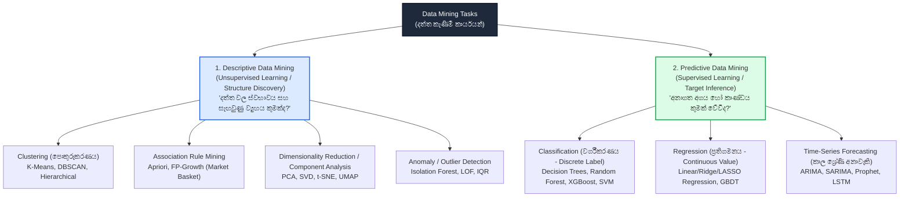
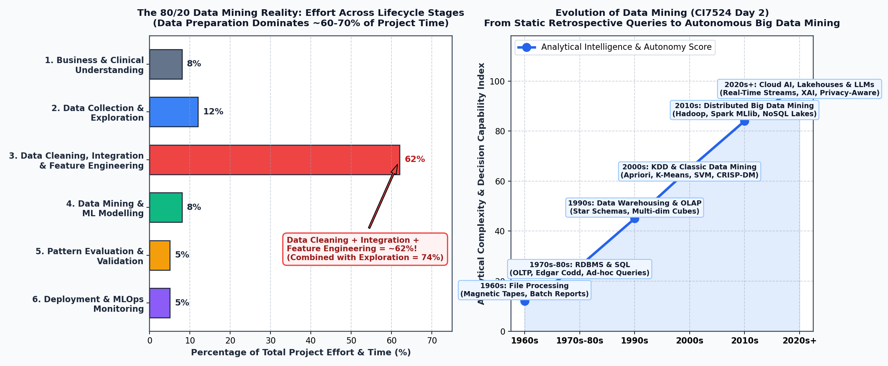
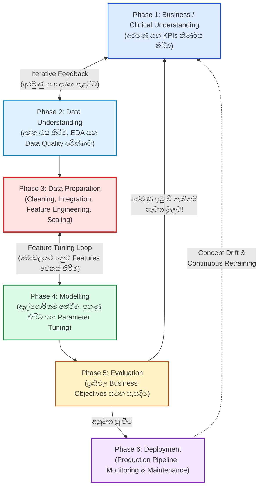

# Lesson 3.1: Data Mining Theory, Evolution & Lifecycle Frameworks (KDD, CRISP-DM & SEMMA)

**Module:** CI7524 — Big Data and Data Mining (Module 03: Data Mining Lifecycle, Mathematical Preliminaries & Preprocessing)  
**Mapped Lecture Sources:** `CI7524_Lectures_1_Intro.pdf` (Slides 2, 3, 4, 5, 9: Day 1 & Day 2 — Data mining theory, evolution, and societal impact), `Big Data and Data Mining - Topic 01.pdf` (Slide 21: AI Pipeline — Processing & Feature Engineering), `CI7524 Big Data and Data Mining.docx` (Topic 2: Data mining lifecycle and workflow)  
**Core Textbooks:** Han, Pei & Tong (2022) *Data Mining: Concepts and Techniques*; Aggarwal (2015) *Data Mining: The Textbook*

---

> [!TIP]
> **📚 Prerequisite Dependency Guides (පූර්ව අවශ්‍යතා පාඩම් මාලාව):**
> මෙම පාඩමේදී සාකච්ඡා කරන Data Mining Workflows සහ Python Pipelines ප්‍රායෝගිකව ක්‍රියාත්මක කිරීමට පෙර, පහත දැක්වෙන අපගේ Dependency පාඩම් මාලාවන් කියවා අවබෝධ කර ගැනීම ඉතාමත් ප්‍රයෝජනවත් වේ:
> - [Dep 01 — 03_Data_Wrangling_Merging_and_Aggregations_at_Scale.md](../dependencies/Dep_01_Python_Pandas_and_Out_of_Core_Data_Processing/03_Data_Wrangling_Merging_and_Aggregations_at_Scale.md)
> - [Dep 06 — 01_Scikit_Learn_API_Estimators_Transformers_and_Pipelines.md](../dependencies/Dep_06_Scikit_Learn_and_Data_Mining_Workflows_in_Python/01_Scikit_Learn_API_Estimators_Transformers_and_Pipelines.md)

---

## 1. හැඳින්වීම: "Data" වලින් "Knowledge" එකක් නිස්සාරණය කරන්නේ කොහොමද?

අපි Module 01 සහ Module 02 වලදී ඉගෙන ගත්තා Terabytes සහ Petabytes ගණනක විශාල දත්ත (**Big Data**) ගබඩා කරන්නේ සහ Distributed Clusters හරහා process කරන්නේ කොහොමද කියලා. හැබැයි `Topic 01 - Slide 9` හි සඳහන් වූ ඉතාම වැදගත් ප්‍රකාශය ඔබට මතක ඇති:

> **"The challenge is no longer finding data. The challenge is making sense of it."**  
> *(දැන් තියෙන අභියෝගය දත්ත හොයාගන්න එක නෙවෙයි; ඒ දත්ත වලින් අර්ථවත් දෙයක් තේරුම් ගන්න එකයි.)*

උදාහරණයක් විදිහට, රෝහලක Electronic Health Records (EHR) පද්ධතියක රෝගීන් මිලියන 10 කගේ රුධිර පරීක්ෂණ වාර්තා, ICU sensor streams සහ බෙහෙත් වට්ටෝරු ගබඩා වෙලා තියෙනවා කියලා හිතන්න. මේ දත්ත නිකම්ම Hard Disk වල හෝ Cloud Data Lake එකක තිබුණා කියලා කිසිම රෝගියෙකුගේ ජීවිතයක් බේරෙන්නේ නැහැ. ඒ අමු දත්ත (**Raw Data**) ඇතුළේ හැංගිලා තියෙන රටාවන් (**Hidden Patterns**), සහසම්බන්ධතා (**Correlations**) සහ අනාවැකි (**Predictions**) එළියට ගන්නා විද්‍යාත්මක හා ඉංජිනේරුමය ක්‍රියාවලියට තමයි අපි **Data Mining** කියලා කියන්නේ.

`CI7524_Lectures_1_Intro.pdf (Slide 9)` හි **Day 2: Data mining theory, evolution, and societal impact** යටතේත්, Module Descriptor හි **Topic 2** යටතේත් මෙම ක්‍රියාවලිය ගැඹුරින් අධ්‍යයනය කිරීමට නියම කර තිබෙනවා.

---

## 2. Evolution of Data Mining (1960s සිට 2020s+ දක්වා විකාශනය)

Data Mining කියන විෂය ක්ෂේත්‍රය එක රැයකින් බිහිවුණු දෙයක් නෙවෙයි. Database Technology, **Statistics (සංඛ්‍යානය)**, සහ Machine Learning යන ක්ෂේත්‍ර 3 හි එකතුවෙන් දශක 6 ක් පුරා සිදුවුණු විකාශනයක් ලෙස මෙය හඳුන්වන්න පුළුවන්.

```mermaid
flowchart LR
    E1["1960s: File Processing\n(Magnetic Tapes & COBOL)"] --> E2["1970s-1980s: RDBMS & SQL\n(OLTP & Relational Tables)"]
    E2 --> E3["1990s: Data Warehouses & OLAP\n(Multidimensional Cubes)"]
    E3 --> E4["2000s: KDD & Classic Data Mining\n(Apriori, K-Means, CRISP-DM)"]
    E4 --> E5["2010s: Distributed Big Data Mining\n(Hadoop, Spark MLlib, NoSQL)"]
    E5 --> E6["2020s+: Cloud Lakehouses & AI\n(Real-Time Streaming, XAI, GDPR)"]

    style E1 fill:#f1f5f9,stroke:#475569,stroke-width:1.5px
    style E2 fill:#dbeafe,stroke:#2563eb,stroke-width:1.5px
    style E3 fill:#e0e7ff,stroke:#4f46e5,stroke-width:1.5px
    style E4 fill:#fef3c7,stroke:#d97706,stroke-width:1.5px
    style E5 fill:#fce7f3,stroke:#db2777,stroke-width:1.5px
    style E6 fill:#dcfce7,stroke:#16a34a,stroke-width:2px
```



අපි මේ එක් එක් යුගයෙහි (Era) තාක්ෂණික වෙනස්කම් සහ ඒවායින් ඇසිය හැකි ප්‍රශ්න (Analytical Questions) මොනවාදැයි බලමු:

| කාල වකවානුව (Era) | ප්‍රධාන තාක්ෂණයන් (Core Technologies) | ඇසිය හැකි ප්‍රශ්නයේ ස්වභාවය (Example Healthcare Query) | Analytical Paradigm |
| :--- | :--- | :--- | :--- |
| **1. 1960s: Data Collection & File Processing** | Magnetic Tapes, Flat Files, COBOL Batch Programs | *"පසුගිය මාසයේ රෝහලට ඇතුළත් වූ මුළු රෝගීන් ගණන කීයද?"* | **Retrospective, Static Data Delivery** (ඉතාම ප්‍රාථමික ගණනය කිරීම්) |
| **2. 1970s–1980s: Relational Databases (RDBMS)** | Edgar Codd ගේ Relational Model, SQL, OLTP (Online Transaction Processing), ER Diagrams | *"2025 මාර්තු මාසයේදී Cardiology වාට්ටුවට ඇතුළත් වූ වයස 60 ට වැඩි රෝගීන්ගේ ලැයිස්තුව කුමක්ද?"* | **Retrospective, Dynamic Data Access** (Record-level queries) |
| **3. 1990s: Data Warehousing & OLAP** | Star/Snowflake Schemas, OLAP (Online Analytical Processing), Drill-down, Roll-up, Slice & Dice | *"පසුගිය අවුරුදු 5 තුළ එක් එක් පළාතේ, එක් එක් කාර්තුවේදී දියවැඩියා රෝගීන්ගේ ඇතුළත් වීම් වෙනස් වුණේ කොහොමද?"* | **Retrospective, Multi-Dimensional Summarization** |
| **4. 2000s: Knowledge Discovery (KDD) & Data Mining** | Association Rules (Apriori), Clustering (K-Means), Decision Trees, SVM, CRISP-DM Framework | *"ලබන මාසයේදී Heart Attack එකක් හැදීමේ වැඩිම අවදානමක් (Risk) තියෙන්නේ කවර රෝගීන්ටද? ඒ ඇයි?"* | **Prospective & Predictive Pattern Discovery** |
| **5. 2010s: Distributed Big Data Mining** | Apache Hadoop, MapReduce, Apache Spark (`MLlib`), NoSQL Databases, Cloud Data Lakes | *"රෝගීන් මිලියන 50 කගේ EHR, DNA sequences සහ X-Ray images එකවර විශ්ලේෂණය කර රෝගී කාණ්ඩ (Clusters) හඳුනාගන්නේ කොහොමද?"* | **Horizontal Scale-Out Mining on 3Vs/5Vs** |
| **6. 2020s+: Real-Time Streaming, Lakehouses & Responsible AI** | Apache Kafka/Flink, Delta Lakehouse, Deep Learning, SHAP/LIME Explainability, Differential Privacy | *"ICU ඇඳේ සිටින රෝගියාගේ තත්පරයෙන් තත්පරයට එන ECG stream එකෙන් තව පැය 4 කින් Sepsis ඇතිවේදැයි Privacy ආරක්ෂා කරමින් අනාවැකි කියන්නේ කොහොමද?"* | **Real-Time Autonomous, Explainable & Privacy-Preserving Mining** |

---

## 3. Data Mining යනු කුමක්ද? (Formal Definition & Taxonomy)

**Jiawei Han, Jian Pei, සහ Hanghang Tong (2022)** ගේ *Data Mining: Concepts and Techniques* පෙළපොතට අනුව:

> **Data Mining** යනු විශාල දත්ත සමූහයන් (Massive Datasets) තුළ සැඟවී පවතින, මීට පෙර නොදැන සිටි (**Previously Unknown**), සත්‍ය (**Valid**), අලුත් (**Novel**), ප්‍රායෝගිකව ප්‍රයෝජනවත් (**Potentially Useful**), සහ මිනිසෙකුට තේරුම් ගත හැකි (**Ultimately Understandable**) රටාවන් සහ දැනුම (**Knowledge**) ස්වයංක්‍රීයව හෝ අර්ධ-ස්වයංක්‍රීයව නිස්සාරණය කිරීමේ ක්‍රියාවලියයි.

### Data Mining නොවන දේවල් (What is NOT Data Mining?):
බොහෝ සිසුන් වරදවා වටහා ගන්නා කරුණක් තමයි සාමාන්‍ය Database Query එකක් හෝ සරල Dashboard එකක් Data Mining ලෙස හැඳින්වීම:
- ❌ **SQL Query එකකින් රෝගියෙකුගේ නම හෝ වාර්තාව සෙවීම:** මෙය සාමාන්‍ය Information Retrieval / Database Lookup එකක් පමණයි.
- ❌ **Google Search එකකින් වෙබ් පිටුවක් සෙවීම:** මෙය Indexing & Keyword Matching ක්‍රියාවලියක් (නමුත් Search Engine එක පිටුපස PageRank සහ User Clickstream Pattern Mining ක්‍රියාත්මක වේ).
- ❌ **SQL `GROUP BY` මගින් මාසික ආදායම එකතු කිරීම:** මෙය OLAP / Descriptive Reporting පමණයි. එහිදී අලුත් සැඟවුණු රටාවක් (Hidden Algorithmic Pattern) සොයා ගන්නේ නැහැ.

---

### Taxonomy of Data Mining Tasks: Descriptive vs. Predictive

Data Mining Tasks ප්‍රධාන වශයෙන් කාණ්ඩ දෙකකට බෙදෙනවා (`CI7524.docx - Topic 2`):



1. **Descriptive Data Mining (විස්තරාත්මක දත්ත කැණීම — Unsupervised):**
   - මෙහිදී අප සතුව කලින් ලේබල් කරන ලද Target Variable ($y$) එකක් නැහැ. දත්ත වල සාමාන්‍ය ගතිලක්ෂණ සහ සැඟවුණු ව්‍යුහයන් (Underlying Structure) හඳුනා ගැනීම මෙහි අරමුණයි.
   - **Clustering (පොකුරුකරණය):** සමාන රෝග ලක්ෂණ ඇති රෝගීන් කාණ්ඩ (Patient Phenotypes) වලට වෙන් කිරීම.
   - **Association Rule Mining (සංඝටන රීති කැණීම):** *"රෝගියෙකුට Hypertension සහ Obesity තිබේ නම්, 82% ක විශ්වාසයකින් (Confidence) Type-2 Diabetes තිබිය හැක"* වැනි Co-morbidity රටාවන් සෙවීම.
   - **Component Analysis / Summarization:** විචල්‍යයන් 500 ක් ඇති දත්ත සමූහයක් ප්‍රධාන සංරචක (**Principal Components**) 3 කට හෝ 5 කට සංක්ෂිප්ත කිරීම.
   - **Anomaly / Outlier Detection:** රෝහල් බිල්පත් වංචා (Healthcare Insurance Fraud) හෝ අසාමාන්‍ය ICU sensor readings හඳුනා ගැනීම.

2. **Predictive Data Mining (අනාවැකිමය දත්ත කැණීම — Supervised):**
   - අතීත දත්ත ($X$) සහ ඒවායේ සැබෑ ප්‍රතිඵලය ($y$ — Ground Truth Label) මත පුහුණු වී, අලුත් දත්ත සඳහා අනාවැකි පළ කිරීම මෙහිදී සිදු වේ.
   - **Classification (වර්ගීකරණය):** නිශ්චිත කාණ්ඩයක් (Discrete Class Label) අනාවැකි කීම (උදා: `Sepsis = Yes/No`, `Tumor = Benign / Malignant`).
   - **Regression (ප්‍රතිගමනය):** අඛණ්ඩ සංඛ්‍යාත්මක අගයක් (**Continuous Numerical Value**) අනාවැකි කීම (උදා: රෝගියා රෝහලේ රැඳී සිටින දින ගණන — *Length of Stay in Days*, හෝ රෝහල් ගාස්තුව).
   - **Time-Series Analysis & Forecasting (කාල ශ්‍රේණි විශ්ලේෂණය):** කාලයත් සමඟ වෙනස් වන දත්ත මත පදනම්ව ඉදිරි පැය/දින/මාස සඳහා අනාවැකි කීම (උදා: ඊළඟ සතියේ Emergency Ward එකට පැමිණෙන රෝගීන් සංඛ්‍යාව).

---

### Societal Impact of Data Mining (Day 2: සමාජීය බලපෑම — යහපත් සහ අයහපත් පැතිකඩ)

`CI7524_Lectures_1_Intro.pdf (Slides 9 & 10)` හි අවධාරණය කරන පරිදි, Data Mining තාක්ෂණය සමාජයට දැවැන්ත ප්‍රතිලාභ ගෙන දෙන අතරම, නිසි පාලනයක් (**Governance & Ethics**) නොමැති වුවහොත් බරපතල අවදානම් ද ඇති කරයි:

- **🌟 Positive Societal Impacts (ධනාත්මක බලපෑම්):**
  - **Precision Medicine & Early Diagnosis:** පිළිකා (Cancer) හෝ Sepsis වැනි මාරාන්තික තත්ත්වයන් රෝග ලක්ෂණ මතු වීමට පැය ගණනාවකට පෙර හඳුනා ගැනීම.
  - **Epidemic Outbreak Tracking:** වසංගත රෝග පැතිරීමේ රටාවන් කල්තියා හඳුනාගෙන රෝහල් සම්පත් (ICU Beds, Ventilators) නිසි ලෙස බෙදා හැරීම.
  - **Fraud & Cyber-Attack Prevention:** බැංකු කාඩ්පත් වංචා සහ සයිබර් ප්‍රහාර තත්පර කිහිපයක් තුළ නැවැත්වීම.
- **⚠️ Negative Risks & Ethical Challenges (සෘණාත්මක අවදානම් සහ ආචාරධර්ම ගැටලු):**
  - **Privacy Invasion & Re-identification:** නිසි ලෙස Anonymize නොකළ වෛද්‍ය දත්ත වලින් පුද්ගලයන්ගේ පෞද්ගලික රහස් හෙළිදරව් වීම.
  - **Algorithmic Bias & Discrimination:** ඓතිහාසික දත්ත වල පවතින පක්ෂග්‍රාහීත්වය (**Historical Bias**) නිසා සුළුතර ජන කොටස් වලට අසාධාරණ ලෙස වෛද්‍ය ප්‍රතිකාර හෝ බැංකු ණය ප්‍රතික්ෂේප වීම.
  - **Surveillance & Profiling:** පුරවැසියන්ගේ අනුදැනුමකින් තොරව ඔවුන්ගේ හැසිරීම් නිරීක්ෂණය කිරීම. (මේ පිළිබඳව අපි Module 05 හිදී GDPR, HIPAA සහ $k$-Anonymity යටතේ ගැඹුරින් ඉගෙන ගනිමු).

---

## 4. Lifecycle Frameworks Deep Dive: KDD, CRISP-DM සහ SEMMA

Data Mining ව්‍යාපෘතියක් කියන්නේ කෙලින්ම Python script එකක් ඇරලා `model.fit(X, y)` ගහන එක නෙවෙයි! කර්මාන්තයේ (Industry) සහ පර්යේෂණ වලදී (Academic Research) භාවිතා වන ප්‍රධානතම ජීවන චක්‍ර ආකෘති (**Lifecycle Frameworks**) 3 ක් තිබෙනවා:
1. **KDD (Knowledge Discovery in Databases)** — Academic & Data-Centric Foundation
2. **CRISP-DM (Cross-Industry Standard Process for Data Mining)** — #1 Industry Standard
3. **SEMMA (Sample, Explore, Modify, Model, Assess)** — SAS Exploratory Workflow

පහත රූපසටහනින් Data Mining ව්‍යාපෘතියක එක් එක් අදියර සඳහා වැයවන කාලය සහ ශ්‍රමය (**Effort Distribution**) මෙන්ම Data Mining විකාශනය පැහැදිලිව දැක්වේ:



> [!IMPORTANT]
> **The 80/20 Rule of Data Mining (දත්ත සැකසීමේ යථාර්ථය):**
> ඉහත ප්‍රස්තාරයේ වම් පස පැනලය දෙස බලන්න! සැබෑ ලෝකයේ Data Mining ව්‍යාපෘතියක මුළු කාලයෙන් **60% සිට 70% දක්වාම** වැය වන්නේ **Data Cleaning, Data Integration සහ Feature Engineering** (එනම් Data Preparation) සඳහායි. Data Understanding සමඟ එකතු කළ විට එය **~75%–80%** ක් වන අතර, ඇල්ගොරිතම ධාවනය කිරීමට (Modelling) වැය වන්නේ **8%–10%** ක් පමණි! `"Garbage In, Garbage Out (GIGO)"` නිසා හොඳින් පිරිසිදු නොකළ දත්ත මත ලෝකයේ හොඳම AI මොඩලය පුහුණු කළත් ලැබෙන්නේ වැරදි ප්‍රතිඵලයකි.

---

### 4.1 KDD Process (Knowledge Discovery in Databases — Han, Pei & Tong)

1996 දී Usama Fayyad ඇතුළු පර්යේෂකයන් විසින් හඳුන්වා දී, පසුව Han, Pei & Tong පෙළපොතෙහි ප්‍රමුඛව විස්තර කරන **KDD Process** එක මගින් පෙන්වා දෙන්නේ **"Data Mining"** යනු සම්පූර්ණ KDD ක්‍රියාවලියේ එක් පියවරක් (Step 5) පමණක් බවයි! KDD ක්‍රියාවලිය පියවර 7 කින් සමන්විත වේ:

```mermaid
flowchart LR
    DB[("Raw Databases /\nData Streams")] --> S1["1. Data Cleaning\n(Noise & Missing අගයන් ඉවත් කිරීම)"]
    S1 --> S2["2. Data Integration\n(විවිධ මූලාශ්‍ර ඒකාබද්ධ කිරීම)"]
    S2 --> DW[("Data Warehouse /\nLakehouse")]
    DW --> S3["3. Data Selection\n(අදාළ දත්ත තෝරා ගැනීම)"]
    S3 --> S4["4. Data Transformation\n(Scaling, Encoding, Aggregation)"]
    S4 --> S5["5. Data Mining\n(Core Algorithms: Clustering/ML)"]
    S5 --> S6["6. Pattern Evaluation\n(Interestingness & Metrics පරීක්ෂාව)"]
    S6 --> S7["7. Knowledge Presentation\n(Visualisation & Clinical Decisions)"]

    style S1 fill:#fee2e2,stroke:#dc2626
    style S2 fill:#fee2e2,stroke:#dc2626
    style S3 fill:#fef3c7,stroke:#d97706
    style S4 fill:#fef3c7,stroke:#d97706
    style S5 fill:#dcfce7,stroke:#16a34a,stroke-width:2.5px
    style S6 fill:#dbeafe,stroke:#2563eb
    style S7 fill:#f3e8ff,stroke:#9333ea
```



1. **Data Cleaning (දත්ත පිරිසිදු කිරීම):** දත්ත වල ඇති ඝෝෂාව (**Noise**), වැරදි සටහන් (Inconsistencies), Outliers, සහ අස්ථානගත අගයන් (**Missing Values**) ඉවත් කිරීම හෝ Impute කිරීම (Lesson 3.3).
2. **Data Integration (දත්ත ඒකාබද්ධ කිරීම):** විවිධ දත්ත මූලාශ්‍ර (උදා: Hospital SQL DB + Lab CSVs + Wearable JSON streams) එකම Schema එකකට ගෙන ඒම සහ අනුපිටපත් (Duplicates / Redundancies) ඉවත් කිරීම (Lesson 3.3).
3. **Data Selection (දත්ත තෝරා ගැනීම):** අපගේ විශ්ලේෂණ කාර්යයට (Analysis Task) සෘජුවම අදාළ වන Data Tables, Rows සහ Columns පමණක් Database/Warehouse එකෙන් තෝරා ගැනීම.
4. **Data Transformation (දත්ත පරිවර්තනය / Consolidation):** තෝරාගත් දත්ත Data Mining ඇල්ගොරිතම වලට ගැළපෙන ආකාරයට සකස් කිරීම — එනම් **Feature Scaling (Normalization/Standardization)**, **Categorical Encoding**, සහ **Aggregation** (Lesson 3.4).
5. **Data Mining (දත්ත කැණීම — The Core Engine):** බුද්ධිමත් ඇල්ගොරිතම (Clustering, Classification, Association Rules, Regression, PCA) යොදාගෙන දත්ත තුළින් රටාවන් (**Patterns**) නිස්සාරණය කිරීම (Module 04).
6. **Pattern Evaluation (රටා ඇගයීම):** නිස්සාරණය කරගත් රටාවන් සැබවින්ම වැදගත්ද (Interestingness Measures: Support, Confidence, Lift, Silhouette Score, F1-Score, ROC-AUC) සහ ඒවා Overfitting නොවී වලංගු වේදැයි පරීක්ෂා කිරීම.
7. **Knowledge Presentation (දැනුම ඉදිරිපත් කිරීම):** සොයාගත් දැනුම වෛද්‍යවරුන්ට හෝ කළමනාකරුවන්ට පහසුවෙන් තේරුම් ගත හැකි Dashboards, Decision Trees, SHAP Plots, හෝ Reports ලෙස ඉදිරිපත් කිරීම.

> [!NOTE]
> `Big Data and Data Mining - Topic 01.pdf (Slide 21)` හි දැක්වෙන **AI Pipeline** එකේ **Stage 4 (Processing)** සහ **Stage 5 (Feature Engineering)** අතර ඇති Bidirectional Feedback Loop එකෙන් නිරූපණය වන්නේ ඉහත KDD පියවර 1 සිට 4 දක්වා ඇති Data Preprocessing ක්‍රියාවලියයි!

---

### 4.2 CRISP-DM (Cross-Industry Standard Process for Data Mining)

1999 දී යුරෝපීය සමාගම් සමූහයක් (DaimlerChrysler, SPSS, NCR) විසින් නිර්මාණය කළ **CRISP-DM** යනු අදටත් ලෝකයේ Data Science සහ Data Mining ව්‍යාපෘති සඳහා වැඩිම පිරිසක් භාවිතා කරන Industry-Standard ක්‍රමවේදයයි. KDD ආකෘතිය දත්ත මත පමණක් (Data-Centric) අවධානය යොමු කරද්දී, CRISP-DM ආකෘතිය ආරම්භ වන්නේත් අවසන් වන්නේත් **ව්‍යාපාරික හෝ සායනික අරමුණෙන් (Business / Clinical Objective)** ය.



CRISP-DM හි ප්‍රධාන අදියර 6 (6 Phases) සහ ඒවායේ Bidirectional Feedback Loops පහත පරිදි වේ:

1. **Phase 1 — Business (or Clinical) Understanding:**
   - අපි විසඳන්න යන සැබෑ ගැටලුව කුමක්ද? (උදා: *"රෝහලෙන් පිටව ගිය හෘද රෝගීන් දින 30 ක් ඇතුළත නැවත රෝහල්ගත වීම (30-Day Readmission Rate) 20% කින් අඩු කිරීම"*).
   - මෙම ව්‍යාපාරික/සායනික ගැටලුව නිශ්චිත **Data Mining Problem** එකකට පරිවර්තනය කිරීම (උදා: Binary Classification + Patient Risk Clustering) සහ සාර්ථකත්වය මනින නිර්ණායක (Success Metrics: උදා. `Recall >= 0.85`) තීරණය කිරීම.
2. **Phase 2 — Data Understanding:**
   - අවශ්‍ය දත්ත එකතු කිරීම, **Exploratory Data Analysis (EDA)** සිදු කිරීම, විචල්‍යයන්ගේ ව්‍යාප්තිය (**Distributions**) පරීක්ෂා කිරීම සහ Data Quality ගැටලු (Missing values කොපමණ තිබේද? Outliers මොනවාද?) හඳුනා ගැනීම.
   - *Feedback Loop (Phase 1 ↔ Phase 2):* දත්ත පරීක්ෂා කරන විට අපට පෙනී ගියොත් අවශ්‍ය දත්ත අප සතුව නොමැති බව, අපට නැවත Phase 1 වෙත ගොස් අපගේ අරමුණු සංශෝධනය කිරීමට සිදු වේ.
3. **Phase 3 — Data Preparation:**
   - ව්‍යාපෘතියේ වැඩිම කාලයක් (~60%–70%) ගතවන අදියරයි. Data Cleaning, Missing Data Imputation, Outlier Handling, Feature Engineering, Scaling, Encoding, සහ SMOTE Oversampling මෙහිදී සිදු කෙරේ.
4. **Phase 4 — Modelling:**
   - ගැටලුවට ගැළපෙන Data Mining ඇල්ගොරිතම (K-Means, PCA, Random Forest, XGBoost) තෝරා ගැනීම, Train/Validation/Test splits සැකසීම, සහ Hyperparameter Tuning සිදු කිරීම.
   - *Feedback Loop (Phase 3 ↔ Phase 4):* සමහර ඇල්ගොරිතම (උදා: K-Means, SVM) සඳහා Feature Scaling අනිවාර්ය වන අතර, මොඩලයේ ක්‍රියාකාරිත්වය මදි නම් නැවත Phase 3 වෙත ගොස් අලුත් Features නිර්මාණය කිරීමට සිදු වේ.
5. **Phase 5 — Evaluation:**
   - මොඩලය තාක්ෂණිකව (F1-Score, Silhouette Score) පමණක් නොව, Phase 1 හිදී අප පිහිටුවා ගත් **Business/Clinical Objectives, Fairness (Bias නොමැති බව), සහ Privacy/GDPR නීති** වලට අනුකූලද යන්න දැඩිව පරීක්ෂා කිරීම.
   - *Feedback Loop (Phase 5 → Phase 1):* මොඩලය තාක්ෂණිකව 90% ක් නිවැරදි වුවත්, එය වෛද්‍යවරුන්ට භාවිතා කළ නොහැකි නම් හෝ එක් ජන කොටසකට අසාධාරණ නම් (Biased), නැවත Phase 1 වෙත යා යුතුය.
6. **Phase 6 — Deployment:**
   - අනුමත වූ මොඩලය සැබෑ පද්ධතියකට (උදා: AWS SageMaker Endpoint හෝ Hospital Dashboard) ඇතුළත් කිරීම, **Model Drift / Concept Drift** නිරීක්ෂණය කිරීම සහ කාලීනව නැවත පුහුණු කිරීම (Retraining).

---

### 4.3 SEMMA (SAS Institute Framework)

SAS ආයතනය විසින් ඔවුන්ගේ *SAS Enterprise Miner* මෘදුකාංගය සඳහා හඳුන්වා දුන් **SEMMA** යනු පියවර 5 කින් යුත් තාක්ෂණික වැඩපිළිවෙළකි:

1. **S — Sample (නියැදි ගැනීම):** Terabytes ගණනක විශාල දත්ත සමූහයකින්, මුල් දත්තවල සියලුම සංඛ්‍යානමය ලක්ෂණ නියෝජනය වන පරිදි ප්‍රමාණවත් නියැදියක් (**Statistically Representative Stratified Sample**) තෝරා ගැනීම. මගින් මූලික ගවේෂණය ඉතා වේගවත් වේ (`Topic 01 - Slide 10` හි 16GB RAM ගැටලුවට ද මෙය එක් විසඳුමකි!).
2. **E — Explore (ගවේෂණය කිරීම):** දත්ත වල ඇති රටාවන්, විෂමතා (Anomalies), සහ විචල්‍යයන් අතර සම්බන්ධතා දෘශ්‍යමය වශයෙන් (Visual Plots) සහ සංඛ්‍යානමය වශයෙන් පරීක්ෂා කිරීම.
3. **M — Modify (වෙනස් කිරීම / සැකසීම):** Outliers පාලනය කිරීම, Missing values පිරවීම, විචල්‍යයන් පරිවර්තනය කිරීම (Log Transform, Scaling) සහ Feature Selection සිදු කිරීම.
4. **M — Model (මොඩල නිර්මාණය):** Data Mining ඇල්ගොරිතම යොදාගෙන අපේක්ෂිත ප්‍රතිඵලය පුරෝකථනය කරන මොඩල ගොඩනැගීම.
5. **A — Assess (ඇගයීම):** Hold-out Test Set එකක් මත මොඩලයේ නිරවද්‍යතාවය, විශ්වසනීයත්වය සහ ප්‍රායෝගික උපයෝගීතාවය පරීක්ෂා කිරීම.

---

### 4.4 KDD vs. CRISP-DM vs. SEMMA සංසන්දනය

| ලක්ෂණය (Dimension) | KDD (Knowledge Discovery in Databases) | CRISP-DM (Cross-Industry Standard Process) | SEMMA (SAS Methodology) |
| :--- | :--- | :--- | :--- |
| **හඳුන්වා දුන් පාර්ශවය** | Fayyad et al. (1996) / Han, Pei & Tong | Industry Consortium (SPSS, NCR, Daimler - 1999) | SAS Institute |
| **ප්‍රධාන අවධානය (Primary Focus)** | දත්ත ගබඩාවල සිට දැනුම දක්වා යන **Data Transformation** ක්‍රියාවලිය | **Business / Clinical Problem** එකේ සිට **Deployment** දක්වා සම්පූර්ණ ව්‍යාපෘති කළමනාකරණය | ඉතා විශාල දත්ත සමූහයක් **Sampling** කර වේගයෙන් මොඩල ගොඩනැගීම |
| **පියවර ගණන (Stages)** | පියවර 7 (Cleaning → Integration → Selection → Transformation → Mining → Evaluation → Presentation) | අදියර 6 (Business Understanding → Data Understanding → Data Prep → Modelling → Evaluation → Deployment) | පියවර 5 (Sample → Explore → Modify → Model → Assess) |
| **Business Understanding & Deployment ඇතුළත්ද?** | ❌ සෘජුවම ඇතුළත් නැත (Data-focused) | ✅ ඔව්! (Phase 1 සහ Phase 6 ලෙස ප්‍රමුඛව ඇත) | ❌ නැත (Technical modelling steps පමණි) |
| **වඩාත්ම සුදුසු අවස්ථාව** | Academic Research & Database-centric pipelines | **Enterprise Big Data Projects & CI7524 Coursework!** | Exploratory Prototyping on Massive Datasets |

---

## 5. CI7524 100% Coursework (LO1–LO5) සඳහා CRISP-DM + KDD භාවිතා කරන ආකාරය

`CI7524_Lectures_1_Intro.pdf (Slides 4 & 5)` අනුව ඔබේ මුළු ලකුණු 100% ම තීරණය වන්නේ **"Data engineering & data mining solution development (3000 words equivalent)"** වාර්තාව මතයි. එහි **Criterion 2 (Workflow Design and Implementation — LO2, 20% marks)** යටතේ **70–100% (Distinction)** ලබා ගැනීමට නම්:

> *"Workflow is fully developed, logically structured, and technically robust; implementation is correct, efficient, and clearly documented."*

ඔබේ Coursework වාර්තාව ආවට ගියාට ලියන්නේ නැතිව, **CRISP-DM අදියර 6** සහ **KDD තාක්ෂණික පියවර** එකට බද්ධ කරමින් (Hybrid CRISP-DM + KDD Architecture) පහත වගුවේ පරිදි ව්‍යුහගත කළ විට පරීක්ෂකවරුන්ට (Assessors) ඉහළම ලකුණු ලබා දීම ඉතාම පහසු වේ:

| CRISP-DM Phase | KDD Equivalent Step | CI7524 Coursework Section & Learning Outcome (LO) Mapping |
| :--- | :--- | :--- |
| **1. Business / Domain Understanding** | *(Pre-KDD Framing)* | ගැටලුව හඳුනා ගැනීම, Healthcare/Enterprise context එක පැහැදිලි කිරීම සහ **LO5 (Governance, GDPR/HIPAA, Ethics)** මූලික අවශ්‍යතා නිර්වචනය කිරීම. |
| **2. Data Understanding & Big Data Storage** | Data Selection | දත්තවල **5Vs/8Vs** ගතිලක්ෂණ විශ්ලේෂණය, EDA සිදු කිරීම සහ **LO1 (Big Data Architecture: Data Lakehouse / Spark / Parquet)** තෝරා ගැනීම සාධාරණීකරණය කිරීම. |
| **3. Data Preparation Pipeline** | Data Cleaning + Integration + Transformation | **LO2 (Workflow Design & Implementation):** Missing data (MCAR/MAR/MNAR) පිරවීම, Outlier handling (IQR/Z-Score), Feature Scaling, Encoding, සහ SMOTE යෙදීම. |
| **4. Data Mining & Modelling** | Data Mining | **LO3 & LO4:** Unsupervised (K-Means, DBSCAN, PCA) සහ Supervised (Random Forest, XGBoost, Time-Series) ඇල්ගොරිතම ක්‍රියාත්මක කිරීම සහ **Model Suitability Justification (LO4)** ඉදිරිපත් කිරීම. |
| **5. Pattern Evaluation & Ethics Audit** | Pattern Evaluation | **LO3, LO4 & LO5:** Silhouette Score, F1-Score, ROC-AUC මගින් ඇගයීම මෙන්ම Algorithmic Bias (Fairness metrics) සහ SHAP Explainability පරීක්ෂා කිරීම. |
| **6. Knowledge Presentation & Deployment** | Knowledge Presentation | **LO2 & Criterion 6 (Communication 10%):** Actionable clinical/business insights, visual dashboards, සහ MLOps deployment blueprint එක ඉදිරිපත් කිරීම. |

---

## 🛠️ Practical Task / Hands-On Exercise (ප්‍රායෝගික අභ්‍යාසය)

### Scenario / Goal
ඔබව රෝහල් ජාලයක **Lead Big Data Mining Engineer** ලෙස පත් කර ඇත. රෝහලේ දැඩි සත්කාර ඒකකයේ (ICU) රෝගීන්ගේ දත්ත භාවිතා කරමින් **CRISP-DM / KDD** පියවර අනුව ස්වයංක්‍රීයව Data Quality Audit එකක් සහ Lifecycle Pipeline Skeleton එකක් Python වලින් නිර්මාණය කිරීම ඔබේ කාර්යයයි.

### Step-by-Step Tasks
1. **Phase 1 & 2 (Business & Data Understanding):** රෝගීන් 500 දෙනෙකුගේ කෘත්‍රිම (Synthetic) ICU දත්ත සමූහයක් ජනනය කර, එහි Shape, Memory Usage, Missing Values ප්‍රතිශතය සහ Data Types පරීක්ෂා කරන `data_understanding_audit()` ශ්‍රිතයක් ලියන්න.
2. **Phase 3 (Data Preparation — Cleaning & Feature Engineering):** Missing values සඳහා **Median Imputation** යොදා, `Weight_kg` සහ `Height_m` මගින් `BMI` නමැති අලුත් Feature එක නිර්මාණය කරන්න.
3. **Phase 4 & 5 (Modelling & Evaluation):** සරල Rule-based / Statistical Risk Stratification එකක් මගින් High-Risk රෝගීන් හඳුනාගෙන Summary Report එකක් මුද්‍රණය කරන්න.

### Starter Code & Reference Solution

```python
import numpy as np
import pandas as pd

# =====================================================================
# STEP 1: Simulate Raw Hospital ICU Dataset (500 Patients)
# =====================================================================
np.random.seed(42)
n_patients = 500

df_raw = pd.DataFrame({
    "Patient_ID": [f"ICU_{i:04d}" for i in range(1, n_patients + 1)],
    "Age": np.random.randint(25, 90, size=n_patients),
    "Weight_kg": np.random.normal(72, 15, size=n_patients).round(1),
    "Height_m": np.random.normal(1.68, 0.09, size=n_patients).round(2),
    "Systolic_BP": np.random.normal(128, 22, size=n_patients).round(1),
    "Lactate_mmol_L": np.random.exponential(scale=1.8, size=n_patients).round(2),
    "ICU_Readmission_30d": np.random.choice([0, 1], size=n_patients, p=[0.78, 0.22])
})

# Inject realistic missing values (10% in Systolic_BP, 8% in Lactate)
missing_bp_idx = np.random.choice(df_raw.index, size=50, replace=False)
missing_lac_idx = np.random.choice(df_raw.index, size=40, replace=False)
df_raw.loc[missing_bp_idx, "Systolic_BP"] = np.nan
df_raw.loc[missing_lac_idx, "Lactate_mmol_L"] = np.nan

# =====================================================================
# STEP 2: CRISP-DM Phase 2 - Data Understanding Audit
# =====================================================================
def crisp_dm_data_understanding(df: pd.DataFrame):
    print("=== [CRISP-DM Phase 2: Data Understanding Report] ===")
    print(f"Total Records (n): {df.shape[0]} | Total Attributes (d): {df.shape[1]}")
    mem_kb = df.memory_usage(deep=True).sum() / 1024
    print(f"In-Memory Footprint: {mem_kb:.2f} KB\n")
    
    audit_table = pd.DataFrame({
        "Dtype": df.dtypes,
        "Missing_Count": df.isnull().sum(),
        "Missing_Pct (%)": (df.isnull().mean() * 100).round(2),
        "Unique_Values": df.nunique()
    })
    print(audit_table)
    print("-" * 55)

crisp_dm_data_understanding(df_raw)

# =====================================================================
# STEP 3: CRISP-DM Phase 3 - Data Preparation (Cleaning & Transformation)
# =====================================================================
def crisp_dm_data_preparation(df: pd.DataFrame) -> pd.DataFrame:
    df_clean = df.copy()
    
    # 1. Create Missingness Indicator Flags before imputation
    df_clean["Systolic_BP_is_missing"] = df_clean["Systolic_BP"].isnull().astype(int)
    df_clean["Lactate_is_missing"] = df_clean["Lactate_mmol_L"].isnull().astype(int)
    
    # 2. Impute numerical columns with Median (robust to skewness)
    for col in ["Systolic_BP", "Lactate_mmol_L"]:
        median_val = df_clean[col].median()
        df_clean[col] = df_clean[col].fillna(median_val)
        
    # 3. Domain Feature Engineering: Body Mass Index (BMI)
    df_clean["BMI"] = (df_clean["Weight_kg"] / (df_clean["Height_m"] ** 2)).round(2)
    return df_clean

df_prepared = crisp_dm_data_preparation(df_raw)
print("\n=== [CRISP-DM Phase 3: Post-Preparation Check] ===")
print(f"Remaining Missing Values: {df_prepared.isnull().sum().sum()}")
print(df_prepared[["Patient_ID", "Systolic_BP", "Lactate_mmol_L", "BMI"]].head(3))

# =====================================================================
# STEP 4: CRISP-DM Phase 4 & 5 - Pattern Discovery & Evaluation
# =====================================================================
high_risk = df_prepared[(df_prepared["Lactate_mmol_L"] > 2.5) & (df_prepared["Systolic_BP"] > 140)]
readmit_rate_high_risk = high_risk["ICU_Readmission_30d"].mean() * 100
readmit_rate_overall = df_prepared["ICU_Readmission_30d"].mean() * 100

print("\n=== [CRISP-DM Phase 5: Evaluation & Actionable Insight] ===")
print(f"Identified High-Risk Cohort Count: {len(high_risk)} patients")
print(f"Overall Baseline Readmission Rate : {readmit_rate_overall:.1f}%")
print(f"High-Risk Cohort Readmission Rate : {readmit_rate_high_risk:.1f}%")
```

### Expected Output
```text
=== [CRISP-DM Phase 2: Data Understanding Report] ===
Total Records (n): 500 | Total Attributes (d): 7
In-Memory Footprint: 53.35 KB

                       Dtype  Missing_Count  Missing_Pct (%)  Unique_Values
Patient_ID            object              0              0.0            500
Age                    int64              0              0.0             65
Weight_kg            float64              0              0.0            251
Height_m             float64              0              0.0             46
Systolic_BP          float64             50             10.0            261
Lactate_mmol_L       float64             40              8.0            237
ICU_Readmission_30d    int64              0              0.0              2
-------------------------------------------------------

=== [CRISP-DM Phase 3: Post-Preparation Check] ===
Remaining Missing Values: 0
  Patient_ID  Systolic_BP  Lactate_mmol_L    BMI
0   ICU_0001        144.6            1.65  26.12
1   ICU_0002        128.0            0.14  26.54
2   ICU_0003        127.3            0.61  30.45

=== [CRISP-DM Phase 5: Evaluation & Actionable Insight] ===
Identified High-Risk Cohort Count: 31 patients
Overall Baseline Readmission Rate : 22.8%
High-Risk Cohort Readmission Rate : 29.0%
```

---

## 📝 Summary & Exam Revision Cheat Sheet (සාරාංශය)

| Concept / Framework | Key Takeaway for CI7524 Exam & Coursework |
| :--- | :--- |
| **Data Mining Definition** | විශාල දත්ත සමූහයන් තුළ සැඟවී පවතින **Previously Unknown, Valid, Novel, Useful & Understandable** රටාවන් නිස්සාරණය කිරීමේ ක්‍රියාවලියයි. |
| **Descriptive vs. Predictive Mining** | **Descriptive (Unsupervised):** Clustering, Association Rules, PCA, Anomaly Detection (Target label $y$ නොමැත). **Predictive (Supervised):** Classification, Regression, Time-Series Forecasting (Target label $y$ ඇත). |
| **The 80/20 Effort Rule** | Data Mining ව්‍යාපෘතියක මුළු කාලයෙන් **~60%–70%** ක්ම වැය වන්නේ **Data Cleaning, Integration සහ Feature Engineering** (Data Preparation) සඳහායි. |
| **KDD 7 Stages** | 1. Cleaning → 2. Integration → 3. Selection → 4. Transformation → 5. **Data Mining** → 6. Pattern Evaluation → 7. Knowledge Presentation. |
| **CRISP-DM 6 Phases** | 1. Business Understanding ↔ 2. Data Understanding → 3. Data Preparation ↔ 4. Modelling → 5. Evaluation → 6. Deployment (Iterative & Bidirectional). |
| **SEMMA 5 Steps** | **S**ample → **E**xplore → **M**odify → **M**odel → **A**ssess (SAS විසින් හඳුන්වා දුන් Sampling-first ප්‍රවේශය). |
| **LO2 Coursework Strategy** | ඔබේ ලකුණු 100% Coursework වාර්තාව **CRISP-DM අදියර 6** අනුව ව්‍යුහගත කර, Phase 3 යටතේ KDD Preprocessing පියවරයන් පැහැදිලිව කේත සහිතව පෙන්වන්න. |
