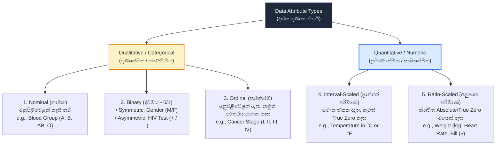
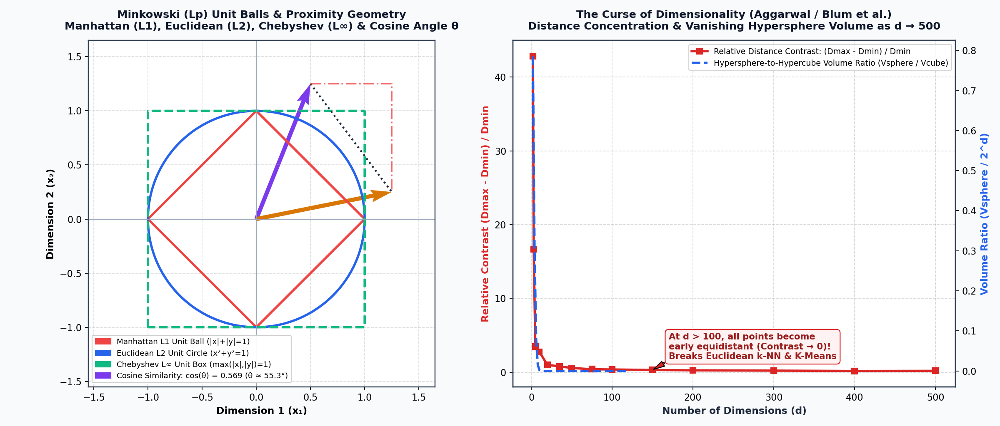

# Lesson 3.2: Mathematical Preliminaries, Distance Metrics & The Curse of Dimensionality

**Module:** CI7524 — Big Data and Data Mining (Module 03: Data Mining Lifecycle, Mathematical Preliminaries & Preprocessing)  
**Mapped Lecture Sources:** `CI7524 Big Data and Data Mining.docx` (Topic 2: Mathematical preliminaries; Data mining approaches for extracting insights from big data), `Big Data and Data Mining - Topic 01.pdf` (Slide 6: Core Reference Materials — Aggarwal 2015, Deisenroth et al. 2020, Blum/Hopcroft/Kannan 2020)  
**Core Textbooks:** Aggarwal (2015) *Data Mining: The Textbook* (Chapters 1–3); Blum, Hopcroft & Kannan (2020) *Foundations of Data Science* (Chapter 2: High-Dimensional Space); Deisenroth, Faisal & Ong (2020) *Mathematics for Machine Learning*

---

> [!TIP]
> **📚 Prerequisite Dependency Guides (පූර්ව අවශ්‍යතා පාඩම් මාලාව):**
> මෙම පාඩමේදී භාවිතා වන **Vectors (දෛශික)**, **Norms (නියමයන්)**, සහ **Covariance Matrix (සහවිචලතා න්‍යාසය)** පිළිබඳ මූලික ගණිතමය පදනම බින්දුවේ සිට ඉගෙන ගැනීමට පහත Dependency පාඩම් කියවන්න:
> - [Dep 03 — 01_Vectors_High_Dimensional_Spaces_and_Norms.md](../dependencies/Dep_03_Linear_Algebra_Vectors_Matrices_and_Eigen_Decomposition/01_Vectors_High_Dimensional_Spaces_and_Norms.md)
> - [Dep 03 — 02_Matrices_Transformations_and_Covariance_Matrices.md](../dependencies/Dep_03_Linear_Algebra_Vectors_Matrices_and_Eigen_Decomposition/02_Matrices_Transformations_and_Covariance_Matrices.md)

---

## 1. හැඳින්වීම: Data Mining වලට ගණිතමය පදනමක් (Mathematical Preliminaries) අවශ්‍ය ඇයි?

අපි Clustering (උදා: K-Means, DBSCAN), Classification (උදා: $k$-Nearest Neighbors, SVM) හෝ Anomaly Detection ඇල්ගොරිතමයක් ධාවනය කරන විට, පරිගණකය නිතරම අසන මූලිකම ප්‍රශ්නය තමයි:

> **"රෝගියා A සහ රෝගියා B කොතරම් දුරට එකිනෙකාට සමානද (Similar) හෝ වෙනස්ද (Dissimilar / Distant)?"**

මිනිසෙකුට රෝගීන් දෙදෙනෙකුගේ වාර්තා දෙස බලා "මේ දෙන්නාගේ රෝග ලක්ෂණ ගොඩක් දුරට එක වගේ" කියලා කියන්න පුළුවන්. නමුත් පරිගණක ඇල්ගොරිතමයකට එය තේරුම් ගැනීමට නම්:
1. සෑම රෝගියෙකුම මාන $d$ ගණනක අවකාශයක පිහිටි **Feature Vector (ලක්ෂණ දෛශිකයක්)** ලෙස නිරූපණය කළ යුතුය.
2. එම දෛශික දෙක අතර ඇති **Distance (දුර / අසමානතාවය)** හෝ **Similarity (සමානතාවය)** ගණනය කරන නිශ්චිත ගණිතමය සූත්‍රයක් (**Distance Metric**) තිබිය යුතුය.

CI7524 Module Descriptor හි **Topic 2** යටතේ පළමු මාතෘකාව ලෙසම **Mathematical Preliminaries** ඇතුළත් කර ඇත්තේත්, **LO4 (Model Selection & Suitability Justification — 20% marks)** යටතේ ඔබ තෝරා ගන්නා Distance Metric එක දත්තවල ස්වභාවයට ගැළපෙන්නේ ඇයිදැයි තර්කානුකූලව පැහැදිලි කිරීම අනිවාර්ය නිසාත් ය.

---

## 2. Data Matrix ($X$) සහ Proximity / Distance Matrix ($D$)

Data Mining වලදී අපි භාවිතා කරන ප්‍රධානතම න්‍යාස (**Matrices**) දෙකක් තිබෙනවා (Han, Pei & Tong, 2022):

### 2.1 Data Matrix (Object-by-Attribute Structure)
අප සතුව දත්ත වස්තූන් (Data Objects / Records / Patients) $n$ ගණනක් සහ ඒ එක් එක් වස්තුව විස්තර කරන ගුණාංග (Attributes / Features / Dimensions) $d$ ගණනක් ඇත්නම්, අපි එය $n \times d$ ප්‍රමාණයේ **Data Matrix (දත්ත න්‍යාසයක්)** $X \in \mathbb{R}^{n \times d}$ ලෙස ලියමු:

$$X = \begin{bmatrix} x_{11} & x_{12} & \cdots & x_{1d} \\ x_{21} & x_{22} & \cdots & x_{2d} \\ \vdots & \vdots & \ddots & \vdots \\ x_{n1} & x_{n2} & \cdots & x_{nd} \end{bmatrix}$$

- මෙහි $i$-වන පේළිය (Row $i$) මගින් $i$-වන රෝගියාගේ **Feature Vector (ලක්ෂණ දෛශිකය)** $\mathbf{x}_i = (x_{i1}, x_{i2}, \dots, x_{id}) \in \mathbb{R}^d$ නිරූපණය කරයි.
- මෙහි $j$-වන තීරුව (Column $j$) මගින් $j$-වන විචල්‍යය (උදා: සියලුම රෝගීන්ගේ `Systolic Blood Pressure` අගයන්) නිරූපණය කරයි.
- එය **Two-Mode Matrix** එකක් ලෙස හැඳින්වේ (මන්ද පේළි වලින් Objects ද, තීරු වලින් Attributes ද නිරූපණය වන බැවිනි).

### 2.2 Proximity / Distance Matrix (Object-by-Object Structure)
රෝගීන් $n$ දෙනා අතර එකිනෙකාට ඇති දුර $d(i, j)$ ගණනය කළ විට අපට ලැබෙන්නේ $n \times n$ ප්‍රමාණයේ **Distance Matrix (දුර න්‍යාසයක්)** $D \in \mathbb{R}^{n \times n}$ ය:

$$D = \begin{bmatrix} 0 & d(1,2) & d(1,3) & \cdots & d(1,n) \\ d(2,1) & 0 & d(2,3) & \cdots & d(2,n) \\ d(3,1) & d(3,2) & 0 & \cdots & d(3,n) \\ \vdots & \vdots & \vdots & \ddots & \vdots \\ d(n,1) & d(n,2) & d(n,3) & \cdots & 0 \end{bmatrix}$$

- මෙය **One-Mode Matrix** එකකි (පේළි සහ තීරු දෙකෙන්ම නිරූපණය වන්නේ Objects/Patients ය).
- ප්‍රධාන විකර්ණය (Main Diagonal) සැමවිටම $d(i, i) = 0$ වේ (ඕනෑම ලක්ෂ්‍යයක සිට එම ලක්ෂ්‍යයටම ඇති දුර 0 කි).
- සම්මත දුර මිනුමක් සමමිතික (**Symmetric**) නිසා $d(i, j) = d(j, i)$ වේ; එබැවින් න්‍යාසයේ පහළ ත්‍රිකෝණාකාර කොටස (Lower Triangular Part) පමණක් ගබඩා කිරීම ප්‍රමාණවත් වේ.

> [!WARNING]
> **Big Data Memory Warning ($O(n^2)$ Complexity):**
> රෝගීන් $n = 1,000,000$ (මිලියනයක්) සිටින Big Data ගැටලුවකදී සම්පූර්ණ Distance Matrix $D$ ගණනය කිරීමට ගියොත් $n^2 = 10^{12}$ (ට්‍රිලියනයක්) float64 අගයන් — එනම් **~8 Terabytes RAM** අවශ්‍ය වේ! Hierarchical Clustering හෝ DBSCAN වැනි $D$ න්‍යාසය මත යැපෙන ඇල්ගොරිතම මිලියන ගණනක දත්ත මත කෙලින්ම ධාවනය කළ නොහැකි වීමට ප්‍රධානතම හේතුව මෙයයි!

---

## 3. Data Attribute Types (දත්ත ගුණාංග වර්ගීකරණය — NOIR Taxonomy)

Distance Metric එකක් තෝරා ගැනීමට පෙර, අපගේ දත්ත තීරු (Attributes) අයත් වන්නේ කුමන වර්ගයටදැයි හඳුනා ගත යුතුය:



| Attribute Type | අර්ථ දැක්වීම සහ ලක්ෂණ | වලංගු ගණිතමය ක්‍රියාකාරකම් | Healthcare උදාහරණ |
| :--- | :--- | :--- | :--- |
| **1. Nominal (නාමික)** | හුදෙක් හඳුනාගැනීම සඳහා යොදන නම් හෝ ලේබල්. කිසිදු අනුපිළිවෙළක් නැත. | $=, \neq$, **Mode (මාතය)**, $\chi^2$ Test | `Blood_Type` ($A, B, AB, O$), `ICD10_Code`, `Hospital_Ward` |
| **2a. Symmetric Binary** | අවස්ථා 2 ක් පමණක් ඇති අතර, අවස්ථා දෙකම සමාන වැදගත්කමක් දරයි. | Simple Matching Coefficient (SMC) | `Biological_Sex` (`M` / `F`) |
| **2b. Asymmetric Binary** | අවස්ථා 2 න් එකක් (`1 = Positive/Present`) අනෙකට (`0 = Negative/Absent`) වඩා බෙහෙවින් වැදගත් හා දුර්ලභ වේ. | **Jaccard Similarity** (`0-0` ගැළපීම් නොසලකා හරියි!) | `Sepsis_Detected` (`1` vs `0`), `Rare_Symptom_Present` |
| **3. Ordinal (තරාතිරම්)** | අර්ථවත් අනුපිළිවෙළක් (Ranking) ඇත, නමුත් අනුයාත මට්ටම් දෙකක් අතර පරතරය හරියටම සමාන යැයි කිව නොහැක. | $=, \neq, <, >$, **Median (මධ්‍යස්ථය)**, Percentiles, Rank Correlation | `Pain_Scale` (Mild < Moderate < Severe), `Tumor_Grade` (Stage I, II, III, IV) |
| **4. Interval-Scaled** | සමාන ඒකක වලින් මනිනු ලබයි, නමුත් **සැබෑ ශූන්‍යයක් (True / Absolute Zero) නොමැත** ($0^\circ\text{C}$ යනු උෂ්ණත්වය නැත්තටම නැති වීම නොවේ; $20^\circ\text{C}$ යනු $10^\circ\text{C}$ මෙන් දෙගුණයක උණුසුමක් නොවේ). | $+, -$, **Mean (මධ්‍යන්‍යය)**, **Standard Deviation (සම්මත අපගමනය)** | `Body_Temperature_Celsius`, `Calendar_Year` |
| **5. Ratio-Scaled** | සමාන ඒකක මෙන්ම **නිශ්චිත සැබෑ ශූන්‍යයක් (True Zero)** පවතී ($0\text{ kg}$ යනු බරක් නොමැති වීමයි; $80\text{ kg}$ යනු $40\text{ kg}$ මෙන් දෙගුණයකි). | $+, -, \times, \div$, Geometric Mean, Ratio comparisons | `Age`, `Weight_kg`, `Lactate_mmol_L`, `Hospital_Bill_USD` |

---

## 4. Proximity & Distance Metrics (සූත්‍ර සහ පියවරෙන් පියවර අතින් ගණනය කිරීම්)

සැබෑ ගණිතමය **Distance Metric (දුර මිනුමක්)** $d(p, q)$ ලෙස පිළිගැනීමට නම් එය පහත සඳහන් මූලික නියමයන් 4 (Metric Axioms) තෘප්තිමත් කළ යුතුය:
1. **Non-negativity (සෘණ නොවන බව):** $d(p, q) \ge 0$
2. **Identity of Indiscernibles:** $d(p, q) = 0 \iff p = q$
3. **Symmetry (සමමිතික බව):** $d(p, q) = d(q, p)$
4. **Triangle Inequality (ත්‍රිකෝණ අසමානතාවය):** $d(p, r) \le d(p, q) + d(q, r)$ (ලක්ෂ්‍ය දෙකක් අතර කෙලින්ම යන දුර, තුන්වන ලක්ෂ්‍යයක් හරහා යන දුරට වඩා සැමවිටම අඩු හෝ සමාන වේ).

දැන් අපි ප්‍රධාන Distance Metrics 7 ම එකින් එක ගෙන, **රෝගීන් දෙදෙනෙකුගේ ත්‍රිමාණ (3D) Feature Vectors දෙකක්** වන:
$$\mathbf{p} = (2, 5, 1) \quad \text{සහ} \quad \mathbf{q} = (5, 1, 1)$$
භාවිතා කරමින් පියවරෙන් පියවර අතින් ගණනය කර (Step-by-step Hand Calculation) බලමු! *(මෙහි මාන 3 මගින් පිළිවෙළින් `ICU_Days`, `SOFA_Severity_Score`, සහ `Prior_Surgeries` නිරූපණය වේ යැයි සිතමු).*

---

### 4.1 Minkowski Distance ($L_p$ Norm Family — මින්කොව්ස්කි දුර පවුල)

මාන $d$ ගණනක පිහිටි $\mathbf{p} = (p_1, p_2, \dots, p_d)$ සහ $\mathbf{q} = (q_1, q_2, \dots, q_d)$ යන ලක්ෂ්‍ය දෙකක් අතර සාධාරණීකරණය කළ **Minkowski Distance (මින්කොව්ස්කි දුර)** සූත්‍රය මෙසේය:

$$d_p(\mathbf{p}, \mathbf{q}) = \|\mathbf{p} - \mathbf{q}\|_p = \left( \sum_{i=1}^{d} |p_i - q_i|^p \right)^{\frac{1}{p}}$$

මෙහි $p \ge 1$ යන පරාමිතියට ලබා දෙන අගය අනුව අපට ප්‍රධාන දුර මිනුම් 3 ක් ලැබේ:

#### (A) Manhattan / City-Block / Taxicab Distance ($L_1$ Norm, $p = 1$)
නගරයක කොටු හැඩැති මංමාවත් දිගේ (Grid blocks) ගමන් කරන කුලී රථයක් යන මුළු දුරට සමාන වේ. එක් එක් මානයේ නිරපේක්ෂ වෙනස්කම්වල (**Absolute Differences**) එකතුවයි:

$$d_1(\mathbf{p}, \mathbf{q}) = \sum_{i=1}^{d} |p_i - q_i|$$

- **Step-by-Step Hand Calculation for $\mathbf{p}=(2, 5, 1)$ and $\mathbf{q}=(5, 1, 1)$:**
  $$d_1(\mathbf{p}, \mathbf{q}) = |2 - 5| + |5 - 1| + |1 - 1| = |-3| + |4| + |0| = 3 + 4 + 0 = \mathbf{7.0}$$
- **වාසිය:** වෙනස්කම් වර්ග (Square) නොකරන නිසා **Outliers වලට අඩු සංවේදීතාවයක් (More Robust to Outliers)** දක්වන අතර ඉහළ මාන ($d \gg 50$) වලදී Euclidean දුරට වඩා හොඳින් ක්‍රියා කරයි (Aggarwal et al., 2001).

#### (B) Euclidean Distance ($L_2$ Norm, $p = 2$ — යුක්ලීඩීය දුර)
අවකාශයේ ලක්ෂ්‍ය දෙකක් යා කරන සරල රේඛාවේ කෙටිම දුරයි (Straight-line "as the crow flies" distance):

$$d_2(\mathbf{p}, \mathbf{q}) = \sqrt{\sum_{i=1}^{d} (p_i - q_i)^2}$$

- **Step-by-Step Hand Calculation for $\mathbf{p}=(2, 5, 1)$ and $\mathbf{q}=(5, 1, 1)$:**
  $$d_2(\mathbf{p}, \mathbf{q}) = \sqrt{(2 - 5)^2 + (5 - 1)^2 + (1 - 1)^2} = \sqrt{(-3)^2 + (4)^2 + 0^2} = \sqrt{9 + 16 + 0} = \sqrt{25} = \mathbf{5.0}$$
- **සැලකිය යුතු කරුණ:** වෙනස්කම් වර්ග කරන නිසා ($(\Delta x)^2$), එක් විචල්‍යයක විශාල පරිමාණයක් හෝ Outlier අගයක් තිබුණහොත් මුළු Euclidean දුරම එම එක් විචල්‍යය මගින් ගිල ගනී! එබැවින් Euclidean දුර භාවිතා කරන **K-Means** සහ **$k$-NN** වලට පෙර **Feature Scaling** අනිවාර්ය වේ.

#### (C) Supremum / Chebyshev / $L_{\max}$ Distance ($L_\infty$ Norm, $p \to \infty$)
$p \to \infty$ වන විට, ඕනෑම තනි මානයක් දිගේ පවතින **උපරිම නිරපේක්ෂ වෙනස (Maximum Absolute Difference across any single dimension)** ලෙස මෙය අර්ථ දැක්වේ:

$$d_\infty(\mathbf{p}, \mathbf{q}) = \lim_{p \to \infty} \left( \sum_{i=1}^{d} |p_i - q_i|^p \right)^{\frac{1}{p}} = \max_{1 \le i \le d} |p_i - q_i|$$

- **Step-by-Step Hand Calculation for $\mathbf{p}=(2, 5, 1)$ and $\mathbf{q}=(5, 1, 1)$:**
  $$d_\infty(\mathbf{p}, \mathbf{q}) = \max\left( |2 - 5|, |5 - 1|, |1 - 1| \right) = \max(3, 4, 0) = \mathbf{4.0}$$
- **භාවිතය:** රෝගියෙකුගේ කිසියම් හෝ එක තීරණාත්මක පරාමිතියක් (Worst-case threshold deviation) සීමාව ඉක්මවා ඇත්දැයි පරීක්ෂා කිරීමට සහ Warehouse Logistics (Overhead Crane movements) වලදී භාවිතා වේ.

> [!NOTE]
> **Mathematical Inequality Relationship:** ඕනෑම දෛශික දෙකක් සඳහා සැමවිටම $d_\infty(\mathbf{p}, \mathbf{q}) \le d_2(\mathbf{p}, \mathbf{q}) \le d_1(\mathbf{p}, \mathbf{q})$ සම්බන්ධතාවය සත්‍ය වේ! අපගේ ගණනය කිරීමෙන් ද $4.0 \le 5.0 \le 7.0$ ලෙස එය තහවුරු විය.

---

### 4.2 Cosine Similarity & Cosine Distance (කොසයින සමානතාවය සහ දුර)

ලක්ෂ්‍ය දෙකක් අතර දුර මැනීම වෙනුවට, මූල ලක්ෂ්‍යයේ (Origin) සිට ඇඳි $\mathbf{p}$ සහ $\mathbf{q}$ දෛශික දෙක අතර පවතින **කෝණයේ කොසයින අගය ($\cos\theta$)** මැනීම මෙහිදී සිදු වේ:

$$\text{Cosine Similarity} = \cos(\theta) = \frac{\mathbf{p} \cdot \mathbf{q}}{\|\mathbf{p}\|_2 \|\mathbf{q}\|_2} = \frac{\sum_{i=1}^{d} p_i q_i}{\sqrt{\sum_{i=1}^{d} p_i^2} \sqrt{\sum_{i=1}^{d} q_i^2}}$$

$$\text{Cosine Distance} = 1 - \cos(\theta)$$

- **Step-by-Step Hand Calculation for $\mathbf{p}=(2, 5, 1)$ and $\mathbf{q}=(5, 1, 1)$:**
  1. **Dot Product (තිත් ගුණිතය):**
     $$\mathbf{p} \cdot \mathbf{q} = (2 \times 5) + (5 \times 1) + (1 \times 1) = 10 + 5 + 1 = 16$$
  2. **Euclidean Norms (දෛශිකවල විශාලත්වය / දිග):**
     $$\|\mathbf{p}\|_2 = \sqrt{2^2 + 5^2 + 1^2} = \sqrt{4 + 25 + 1} = \sqrt{30} \approx 5.4772$$
     $$\|\mathbf{q}\|_2 = \sqrt{5^2 + 1^2 + 1^2} = \sqrt{25 + 1 + 1} = \sqrt{27} \approx 5.1962$$
  3. **Cosine Similarity & Distance:**
     $$\cos(\theta) = \frac{16}{\sqrt{30} \times \sqrt{27}} = \frac{16}{\sqrt{810}} = \frac{16}{28.4605} \approx \mathbf{0.5622} \quad (\theta \approx 55.8^\circ)$$
     $$\text{Cosine Distance} = 1 - 0.5622 = \mathbf{0.4378}$$

- **Cosine Similarity විශේෂ වන්නේ ඇයි? (Why Cosine Excels in Text & High-Dimensional Sparse Data):**
  Cosine Similarity මගින් දෛශිකයේ විශාලත්වය (**Magnitude**) නොසලකා හැර, එහි **දිශාව / අනුපාතය (Direction / Orientation)** පමණක් සලකයි. උදාහරණයක් ලෙස වෛද්‍ය වාර්තාවක `"diabetes"` යන වචනය 5 වතාවක් සහ `"insulin"` 10 වතාවක් තිබුණු කෙටි ලිපියක් $\mathbf{a}=(5, 10)$ සහ එම වචනම දෙගුණයක් අඩංගු දිගු ලිපියක් $\mathbf{b}=(10, 20)$ ගත්තොත්, ඒවා අතර Euclidean දුර විශාල වුවත්, දෛශික දෙකම එකම දිශාවට පවතින නිසා **$\cos(\theta) = 1.0$ (Cosine Distance = 0)** වේ! එබැවින් NLP, TF-IDF Document Clustering, Gene Expression සහ Recommender Systems සඳහා Cosine Similarity වඩාත්ම සුදුසු වේ.

---

### 4.3 Jaccard Similarity & Jaccard Distance (Asymmetric Binary / Set Data සඳහා)

රෝගීන් දෙදෙනෙකුට පවතින රෝග ලක්ෂණ (Symptoms Present = `1`, Absent = `0`) හෝ Market Basket Transactions සංසන්දනය කරන විට, ලෝකයේ ඇති දහස් ගණනක් රෝග ලක්ෂණ අතරින් රෝගීන් දෙදෙනාටම **නොමැති (`0-0` negative matches)** රෝග ලක්ෂණ ගණන් ගතහොත් සියලුම රෝගීන් 99% ක් එක සමාන බව පෙනී යයි! එබැවින් Asymmetric Binary Attributes සඳහා `0-0` ගැළපීම් ඉවත් කරන **Jaccard Coefficient (ජැකාඩ් සංගුණකය)** භාවිතා කෙරේ:

$$J(A, B) = \frac{|A \cap B|}{|A \cup B|} = \frac{f_{11}}{f_{11} + f_{10} + f_{01}}, \qquad d_{\text{Jaccard}}(A, B) = 1 - J(A, B)$$

- මෙහි $f_{11}$ යනු දෙදෙනාටම පොදුවේ ඇති (`1-1`) ලක්ෂණ ගණනයි; $f_{10}$ සහ $f_{01}$ යනු එක් අයෙකුට පමණක් ඇති ලක්ෂණ ගණනයි ($f_{00}$ සම්පූර්ණයෙන්ම නොසලකා හැරේ!).
- **Worked Example:** රෝග ලක්ෂණ 6 ක් `(Fever, Cough, Fatigue, Rash, Seizure, Coma)` සඳහා:
  - Patient 1: $\mathbf{u} = (1, 1, 1, 0, 0, 0)$
  - Patient 2: $\mathbf{v} = (1, 0, 1, 1, 0, 0)$
  - මෙහි $f_{11} = 2$ (`Fever`, `Fatigue`), $f_{10} = 1$ (`Cough`), $f_{01} = 1$ (`Rash`), සහ $f_{00} = 2$ (`Seizure`, `Coma` — ignored!).
  - $J(\mathbf{u}, \mathbf{v}) = \frac{2}{2 + 1 + 1} = \frac{2}{4} = \mathbf{0.50}$ සහ $d_{\text{Jaccard}}(\mathbf{u}, \mathbf{v}) = 1 - 0.50 = \mathbf{0.50}$.

---

### 4.4 Mahalanobis Distance (මහලනොබිස් දුර — Correlated & Multi-Scale Features සඳහා)

Euclidean දුරෙහි ඇති ලොකුම දුර්වලතා දෙකක් තමයි:
1. එය සියලුම විචල්‍යයන්ගේ පරිමාණයන් (Variance / Scale) සමාන යැයි උපකල්පනය කිරීම.
2. විචල්‍යයන් එකිනෙකින් ස්වායත්ත (Uncorrelated / Orthogonal) යැයි උපකල්පනය කිරීම.

නමුත් සැබෑ ලෝකයේදී `Weight (බර)` සහ `Waist Circumference (ඉණ වටප්‍රමාණය)` හෝ `Systolic BP` සහ `Diastolic BP` එකිනෙකට දැඩි ලෙස සහසම්බන්ධ (**Correlated**) වේ. ඉන්දීය සංඛ්‍යානඥ P. C. Mahalanobis (1936) විසින් හඳුන්වා දුන් **Mahalanobis Distance** මගින් දත්තවල **Covariance Matrix (සහවිචලතා න්‍යාසය)** $\Sigma$ හි ප්‍රතිලෝමය ($\Sigma^{-1}$ — Inverse Covariance / Precision Matrix) භාවිතා කරමින් මෙම ගැටලු දෙකම විසඳයි:

$$d_M(\mathbf{p}, \mathbf{q}) = \sqrt{(\mathbf{p} - \mathbf{q})^T \Sigma^{-1} (\mathbf{p} - \mathbf{q})}$$

- **එය ක්‍රියා කරන්නේ කෙසේද?** $\Sigma^{-1}$ මගින් ස්වයංක්‍රීයවම දත්ත Principal Axes දිගේ කරකවා (Decorrelates features), එක් එක් දිශාවේ **Variance (විචලතාවය)** මගින් බෙදනු ලබයි (Standardizes variance). ඉදින් $\Sigma = I$ (Identity Matrix) නම්, Mahalanobis දුර හරියටම Euclidean දුරට සමාන වේ! Multivariate Outlier Detection සහ Elliptical Cluster Detection සඳහා මෙය අතිශයින්ම බලවත් වේ.

---

## 5. The Curse of Dimensionality (ඉහළ මානවල ශාපය — Blum, Hopcroft & Kannan / Aggarwal)

අපගේ CI7524 නිර්දේශිත පෙළපොත් දෙකක් වන **Charu Aggarwal (2015)** සහ **Blum, Hopcroft & Kannan (2020) — Chapter 2: High-Dimensional Space** හි ඉතාම ගැඹුරින් සාකච්ඡා කරන සංකල්පයක් තමයි **The Curse of Dimensionality** (Richard Bellman විසින් නම් කරන ලදී).

අපි මාන 2 ක් ($2\text{D}$) හෝ මාන 3 ක් ($3\text{D}$) ඇති අවකාශයකදී ගොඩනගා ගන්නා ජ්‍යාමිතික අවබෝධය (Geometric Intuition), මාන ගණන $d = 100, 500$ හෝ $10,000$ වන විට **සම්පූර්ණයෙන්ම බිඳ වැටේ!** ඊට ප්‍රධාන හේතු 3 ක් තිබේ:



### 5.1 Exponential Data Sparsity (දත්ත අවකාශය හිස් වීම)
- $1\text{D}$ රේඛාවක $[0, 1]$ පරාසය කොටස් 10 කට බෙදා සෑම කොටසකටම එක් ලක්ෂ්‍යයක් තැබීමට අවශ්‍ය වන්නේ ලක්ෂ්‍ය $10^1 = 10$ ක් පමණි.
- $2\text{D}$ සමචතුරස්‍රයක එම ඝනත්වයම (Density) පවත්වා ගැනීමට ලක්ෂ්‍ය $10^2 = 100$ ක් අවශ්‍ය වේ.
- $d = 100$ මාන සහිත Hypercube එකක එම ඝනත්වයම පවත්වා ගැනීමට ලක්ෂ්‍ය $10^{100}$ ක් (විශ්වයේ ඇති මුළු පරමාණු ගණන වන $10^{80}$ ටත් වඩා වැඩි ප්‍රමාණයක්!) අවශ්‍ය වේ.
- එබැවින් ඉහළ මානවලදී දත්ත සැමවිටම ඉතාමත් තුනීව (**Extremely Sparse**) විසිරී පවතී.

### 5.2 Vanishing Hypersphere Volume (ගෝලයේ පරිමාව ශූන්‍යයට ළඟා වීම)
පැත්තක දිග $2r = 2$ වන මාන $d$ ගණනක Hypercube (අධි-ඝනකයක්) ඇතුළත ස්පර්ශ වන සේ තබා ඇති අරය $r = 1$ වන Unit Hypersphere (අධි-ගෝලය) සලකන්න (Blum, Hopcroft & Kannan, 2020):
- Hypercube එකේ පරිමාව: $V_{\text{cube}}(d) = 2^d$
- Hypersphere එකේ පරිමාව: $V_{\text{sphere}}(d) = \frac{\pi^{d/2}}{\Gamma\left(\frac{d}{2} + 1\right)}$
- ගෝලයේ පරිමාව සහ ඝනකයේ පරිමාව අතර අනුපාතය $d \to \infty$ වන විට:

$$\lim_{d \to \infty} \frac{V_{\text{sphere}}(d)}{V_{\text{cube}}(d)} = \lim_{d \to \infty} \frac{\pi^{d/2}}{2^d \, \Gamma\left(\frac{d}{2} + 1\right)} = 0$$

- $d=2$ දී වෘත්තය සමචතුරස්‍රයෙන් **78.5%** ($\pi/4$) ක් ආවරණය කරයි.
- $d=3$ දී ගෝලය ඝනකයෙන් **52.4%** ($\pi/6$) ක් ආවරණය කරයි.
- $d=10$ වන විට එය **0.25%** ක් පමණක් වන අතර, $d=100$ වන විට $\approx 10^{-70}$ (ශූන්‍යය!) වේ! එනම් ඉහළ මානවලදී දත්ත සියල්ලම මැද (Center) නොරැඳී, Hypercube එකේ **මුලු වල (Corners / Outer Shell)** ගොනු වේ!

### 5.3 Distance Concentration (සියලුම ලක්ෂ්‍ය අතර දුර සමාන වීම!)
Aggarwal et al. (2001) සහ Beyer et al. (1999) විසින් ඔප්පු කරන ලද වැදගත්ම ප්‍රමේයය නම්: මාන ගණන $d \to \infty$ වන විට, ඕනෑම Query ලක්ෂ්‍යයක සිට ළඟම ඇති ලක්ෂ්‍යයට ඇති දුර ($D_{\min}$) සහ දුරම ඇති ලක්ෂ්‍යයට ඇති දුර ($D_{\max}$) අතර සාපේක්ෂ වෙනස (**Relative Distance Contrast**) ශූන්‍යයට ළඟා වන බවයි!

$$\lim_{d \to \infty} \frac{D_{\max} - D_{\min}}{D_{\min}} = 0 \implies \frac{D_{\max}}{D_{\min}} \to 1$$

> [!CAUTION]
> **Why This Breaks $k$-NN, K-Means & DBSCAN (LO4 Model Justification Insight):**
> ඉහත සමීකරණයෙන් කියැවෙන්නේ මාන ගණන $d > 100$ වන විට **ළඟම අසල්වැසියාට (Nearest Neighbor) ඇති දුරත්, දුරම ලක්ෂ්‍යයට (Farthest Point) ඇති දුරත් එක සමාන වන බවයි!** "හැමෝම එකම දුරකින් සිටී නම්" **Nearest Neighbor ($k$-NN)** හෝ **Euclidean K-Means** යන්නෙහි කිසිදු අර්ථයක් ඉතිරි නොවේ!
> **විසඳුම (Remedies):**
> 1. Euclidean ($L_2$) වෙනුවට **Manhattan ($L_1$)**, Fractional Norms ($L_p$ with $p < 1$), හෝ **Cosine Similarity** භාවිතා කිරීම.
> 2. Clustering හෝ $k$-NN ධාවනය කිරීමට පෙර **Feature Selection** හෝ **Dimensionality Reduction (PCA, SVD, UMAP — Module 04)** මගින් මාන ගණන අඩු කිරීම.

---

## 🛠️ Practical Task / Hands-On Exercise (ප්‍රායෝගික අභ්‍යාසය)

### Scenario / Goal
ඔබ රෝගීන් දෙදෙනෙකුගේ Feature Vectors වන $\mathbf{p} = (2, 5, 1)$ සහ $\mathbf{q} = (5, 1, 1)$ සඳහා අප අතින් ගණනය කළ සියලුම දුර මිනුම් Python (`numpy`) මගින් තහවුරු කළ යුතු අතර, මාන ගණන $d = 2$ සිට $d = 1000$ දක්වා වැඩි වන විට **Distance Concentration** සිදුවන ආකාරය අත්හදා බැලිය යුතුය.

### Step-by-Step Tasks
1. $\mathbf{p} = (2, 5, 1)$ සහ $\mathbf{q} = (5, 1, 1)$ සඳහා Manhattan ($L_1$), Euclidean ($L_2$), Chebyshev ($L_\infty$), සහ Cosine Similarity/Distance ගණනය කරන Python ශ්‍රිත ලියන්න.
2. Covariance Matrix එකක් සහිත 2D රෝගී දත්ත සමූහයක් සඳහා **Mahalanobis Distance** ගණනය කරන්න.
3. $d \in [2, 10, 50, 200, 1000]$ සඳහා අහඹු ලක්ෂ්‍ය 300 ක් ජනනය කර, Relative Distance Contrast $\frac{D_{\max}-D_{\min}}{D_{\min}}$ අගය 0 කරා ළඟා වන බව පෙන්වන්න.

### Starter Code & Reference Solution

```python
import numpy as np

# =====================================================================
# TASK 1: Verify Hand Calculations on Patient Vectors p=(2,5,1), q=(5,1,1)
# =====================================================================
p = np.array([2.0, 5.0, 1.0])
q = np.array([5.0, 1.0, 1.0])

l1_dist = np.sum(np.abs(p - q))
l2_dist = np.sqrt(np.sum((p - q) ** 2))
linf_dist = np.max(np.abs(p - q))

cos_sim = np.dot(p, q) / (np.linalg.norm(p) * np.linalg.norm(q))
cos_dist = 1.0 - cos_sim

print("=== [Task 1: Distance Metrics Verification for p=(2,5,1), q=(5,1,1)] ===")
print(f"Manhattan Distance (L1)   : {l1_dist:.4f}  (Hand Calc = 7.0000)")
print(f"Euclidean Distance (L2)   : {l2_dist:.4f}  (Hand Calc = 5.0000)")
print(f"Chebyshev Distance (L_inf): {linf_dist:.4f}  (Hand Calc = 4.0000)")
print(f"Cosine Similarity cos(θ)  : {cos_sim:.4f}  (Hand Calc = 0.5622)")
print(f"Cosine Distance (1-cos(θ)): {cos_dist:.4f}  (Hand Calc = 0.4378)")

# =====================================================================
# TASK 2: Jaccard Similarity & Mahalanobis Distance
# =====================================================================
u_bin = np.array([1, 1, 1, 0, 0, 0])
v_bin = np.array([1, 0, 1, 1, 0, 0])
f11 = np.sum((u_bin == 1) & (v_bin == 1))
f10_01 = np.sum(u_bin != v_bin)
jaccard_sim = f11 / (f11 + f10_01)
print(f"Jaccard Similarity J(u,v) : {jaccard_sim:.4f}  (Hand Calc = 0.5000)")

# Mahalanobis Distance with Covariance Matrix Sigma
Sigma = np.array([[4.0, 1.2, 0.0],
                  [1.2, 9.0, 0.0],
                  [0.0, 0.0, 1.0]])
Sigma_inv = np.linalg.inv(Sigma)
diff = p - q
mahalanobis_d = np.sqrt(diff.T @ Sigma_inv @ diff)
print(f"Mahalanobis Distance d_M  : {mahalanobis_d:.4f}\n")

# =====================================================================
# TASK 3: Curse of Dimensionality Simulation (d = 2 to 1000)
# =====================================================================
print("=== [Task 3: Curse of Dimensionality - Distance Concentration] ===")
print(f"{'Dimensions (d)':>15} | {'D_min':>10} | {'D_max':>10} | {'Relative Contrast (Dmax-Dmin)/Dmin':>36}")
print("-" * 80)

np.random.seed(42)
for d in [2, 10, 50, 200, 1000]:
    X = np.random.uniform(0, 1, size=(300, d))
    # Distances from the origin query point to all 300 points
    dists = np.linalg.norm(X, axis=1)
    d_min, d_max = np.min(dists), np.max(dists)
    contrast = (d_max - d_min) / d_min
    print(f"{d:15d} | {d_min:10.4f} | {d_max:10.4f} | {contrast:36.4f}")
```

### Expected Output
```text
=== [Task 1: Distance Metrics Verification for p=(2,5,1), q=(5,1,1)] ===
Manhattan Distance (L1)   : 7.0000  (Hand Calc = 7.0000)
Euclidean Distance (L2)   : 5.0000  (Hand Calc = 5.0000)
Chebyshev Distance (L_inf): 4.0000  (Hand Calc = 4.0000)
Cosine Similarity cos(θ)  : 0.5622  (Hand Calc = 0.5622)
Cosine Distance (1-cos(θ)): 0.4378  (Hand Calc = 0.4378)
Jaccard Similarity J(u,v) : 0.5000  (Hand Calc = 0.5000)
Mahalanobis Distance d_M  : 2.2610

=== [Task 3: Curse of Dimensionality - Distance Concentration] ===
 Dimensions (d) |      D_min |      D_max |   Relative Contrast (Dmax-Dmin)/Dmin
--------------------------------------------------------------------------------
              2 |     0.0515 |     1.3679 |                              25.5714
             10 |     1.1326 |     2.3694 |                               1.0920
             50 |     3.5621 |     4.5880 |                               0.2880
            200 |     7.6939 |     8.6596 |                               0.1255
           1000 |    17.7812 |    18.7798 |                               0.0562
```

---

## 📝 Summary & Exam Revision Cheat Sheet (සාරාංශය)

| Distance / Similarity Metric | Mathematical Formula | Best Used For (LO4 Justification) | Key Pitfall / Limitation |
| :--- | :--- | :--- | :--- |
| **Manhattan Distance ($L_1$)** | $\sum_{i=1}^d \|p_i - q_i\|$ | Outliers සහිත දත්ත, Grid-based paths, සහ මධ්‍යස්ථ-ඉහළ මාන ($d > 20$). | විකර්ණ (Diagonal) කෙටිම මාර්ගය නොසලකයි. |
| **Euclidean Distance ($L_2$)** | $\sqrt{\sum_{i=1}^d (p_i - q_i)^2}$ | Continuous, isotropic, low-dimensional ($d < 20$), scaled features (K-Means, $k$-NN). | Feature Scale එකට සහ Outliers වලට දැඩිව සංවේදී වේ; ඉහළ මානවලදී බිඳ වැටේ. |
| **Chebyshev Distance ($L_\infty$)** | $\max_i \|p_i - q_i\|$ | Worst-case single attribute deviation පරීක්ෂා කිරීම. | එක් මානයක් පමණක් සලකා අනෙක් මාන නොසලකා හරියි. |
| **Cosine Similarity** | $\frac{\mathbf{p} \cdot \mathbf{q}}{\|\mathbf{p}\|_2 \|\mathbf{q}\|_2}$ | High-dimensional sparse data, Text/NLP (TF-IDF), Gene Expression vectors. | දෛශිකයේ විශාලත්වය (Magnitude) සම්පූර්ණයෙන්ම නොසලකා හරියි. |
| **Jaccard Similarity** | $\frac{f_{11}}{f_{11} + f_{10} + f_{01}}$ | Asymmetric Binary data (Symptoms present, Market Basket sets). | Continuous සංඛ්‍යාත්මක දත්ත සඳහා භාවිතා කළ නොහැක. |
| **Mahalanobis Distance** | $\sqrt{(\mathbf{p}-\mathbf{q})^T \Sigma^{-1} (\mathbf{p}-\mathbf{q})}$ | එකිනෙකට සහසම්බන්ධ (**Correlated**) සහ විවිධ පරිමාණ සහිත විචල්‍යයන්. | $\Sigma^{-1}$ ගණනය කිරීමට $O(d^3)$ ගණනය කිරීමේ බලයක් අවශ්‍ය වේ; Singular matrices වලදී අසමත් වේ. |
| **Curse of Dimensionality** | $\lim_{d\to\infty} \frac{D_{\max}-D_{\min}}{D_{\min}} = 0$ | මාන ගණන $d \gg 100$ වන විට PCA/SVD හෝ Feature Selection යෙදීම සාධාරණීකරණය කිරීමට. | Euclidean දුර මත පදනම් වූ $k$-NN සහ K-Means ඉහළ මානවලදී අසාර්ථක කරයි. |
