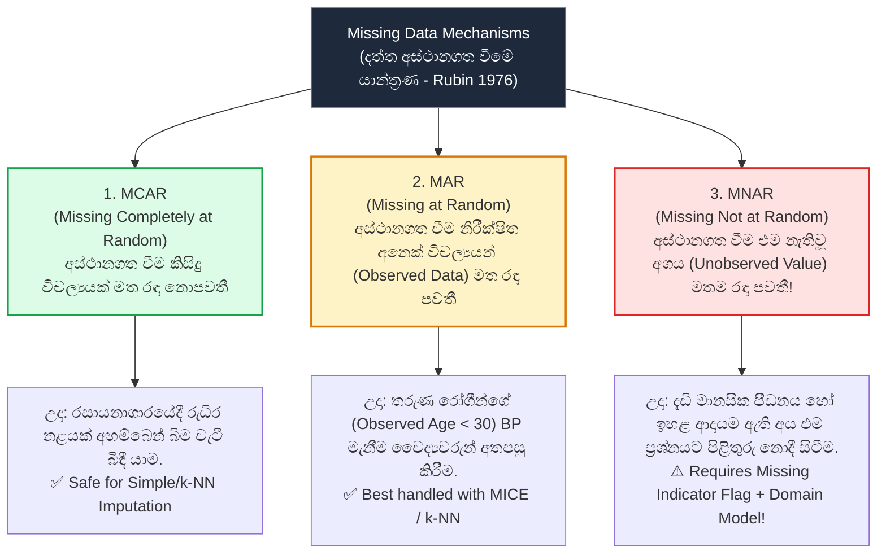
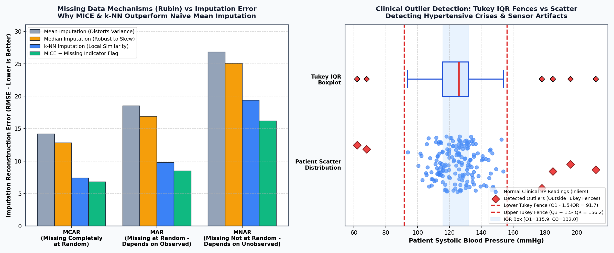

# Lesson 3.3: Data Quality, Cleaning, Integration & Missing Data Imputation

**Module:** CI7524 — Big Data and Data Mining (Module 03: Data Mining Lifecycle, Mathematical Preliminaries & Preprocessing)  
**Mapped Lecture Sources:** `CI7524 Big Data and Data Mining.docx` (Topic 2: Data mining lifecycle and workflow — cleaning, integration, feature engineering), `Big Data and Data Mining - Topic 01.pdf` (Slide 16: Veracity; Slide 19: The Big Data Iceberg — Layer 7 Quality; Slide 21: AI Pipeline — Stage 4 Processing), `CI7524_Lectures_1_Intro.pdf` (Slide 10: Healthcare interoperability challenges)  
**Core Textbooks:** Han, Pei & Tong (2022) *Data Mining: Concepts and Techniques* (Chapter 3: Data Preprocessing); Aggarwal (2015) *Data Mining: The Textbook* (Chapter 2: Data Preparation); Gupta (2021) *Practical Data Science with Jupyter*

---

> [!TIP]
> **📚 Prerequisite Dependency Guides (පූර්ව අවශ්‍යතා පාඩම් මාලාව):**
> මෙම පාඩමේදී භාවිතා වන **Mean (මධ්‍යන්‍යය)**, **Median (මධ්‍යස්ථය)**, **Interquartile Range - IQR (අන්තර්-චතුර්ථක පරාසය)**, **Z-Score (සම්මත ලකුණු)**, සහ Pandas Data Wrangling පිළිබඳ මූලික පදනම සඳහා පහත Dependency පාඩම් කියවන්න:
> - [Dep 01 — 03_Data_Wrangling_Merging_and_Aggregations_at_Scale.md](../dependencies/Dep_01_Python_Pandas_and_Out_of_Core_Data_Processing/03_Data_Wrangling_Merging_and_Aggregations_at_Scale.md)
> - [Dep 04 — 01_Descriptive_Statistics_Central_Tendency_and_Dispersion.md](../dependencies/Dep_04_Probability_Distributions_and_Statistical_Foundations/01_Descriptive_Statistics_Central_Tendency_and_Dispersion.md)
> - [Dep 04 — 02_Probability_Normal_Distribution_and_Z_Scores.md](../dependencies/Dep_04_Probability_Distributions_and_Statistical_Foundations/02_Probability_Normal_Distribution_and_Z_Scores.md)

---

## 1. හැඳින්වීම: Data Quality සහ Veracity (විශ්වසනීයත්වය) යනු ඇයි?

`Big Data and Data Mining - Topic 01.pdf` හි **Slide 16 & 17 (Veracity)** සහ **Slide 19 (The Big Data Iceberg — Layer 7: Quality)** මගින් අපට පෙන්වා දුන් ප්‍රධානතම සත්‍යයක් තමයි සැබෑ ලෝකයේ දත්ත ඉතාමත් අපිරිසිදු (**"Dirty"**) බව! විශේෂයෙන්ම රෝහල් සහ Healthcare Big Data පද්ධතිවලදී:
- හෙදියකට කලබලයේදී රෝගියෙකුගේ රුධිර පීඩනය සටහන් කිරීමට මඟ හැරිය හැකිය (**Incomplete / Missing Data**).
- ICU සංවේදකයක (Sensor) දෝෂයක් නිසා හෘද ස්පන්දන වේගය `Heart Rate = 999 bpm` හෝ වයස `Age = -5` ලෙස සටහන් විය හැකිය (**Noisy / Outlier Data**).
- එක් වාට්ටුවක රෝගියාගේ උෂ්ණත්වය Celsius ($^\circ\text{C}$) වලින්ද, තවත් වාට්ටුවක Fahrenheit ($^\circ\text{F}$) වලින්ද, දිනය `MM/DD/YYYY` සහ `DD/MM/YYYY` ලෙස පරස්පර විරෝධීවද ගබඩා වී තිබිය හැකිය (**Inconsistent Data**).

### The 6 Dimensions of Data Quality (දත්ත ගුණාත්මකභාවයේ මානයන් 6 — Han, Pei & Tong)

Data Mining ආරම්භ කිරීමට පෙර ඕනෑම දත්ත සමූහයක් පහත මානයන් 6 යටතේ පරීක්ෂා කළ යුතුය:

| Data Quality Dimension | අර්ථ දැක්වීම (Definition) | සැබෑ Healthcare උදාහරණය (Real-World Clinical Example) |
| :--- | :--- | :--- |
| **1. Accuracy (නිරවද්‍යතාවය)** | දත්ත මගින් සැබෑ ලෝකයේ පවතින සත්‍ය අගය කොතරම් නිවැරදිව නිරූපණය කරන්නේද? | රෝගියාගේ සැබෑ බර $72\text{ kg}$ වුවද, යතුරුලියන දෝෂයකින් (Typo) $270\text{ kg}$ ලෙස සටහන් වීම. |
| **2. Completeness (සම්පූර්ණත්වය)** | අවශ්‍ය සියලුම විචල්‍යයන් සහ වාර්තා අඩුවකින් තොරව (Non-null) පවතීද? | දියවැඩියා රෝගීන්ගෙන් 35% කගේම `HbA1c` පරීක්ෂණ අගය `NULL` / `NaN` වී තිබීම. |
| **3. Consistency (අනුකූලතාවය)** | විවිධ වගු හෝ පද්ධති හරහා දත්ත ආකෘති සහ අගයන් එකිනෙකට පරස්පර නොවී පවතීද? | රෝගියාගේ `Date_of_Birth = 2010` ලෙස තිබියදී `Age = 45` ලෙස තිබීම හෝ `Sex = Male` සහ `Pregnant = True` ලෙස තිබීම. |
| **4. Timeliness (කාලීන බව)** | තීරණ ගැනීමට අවශ්‍ය මොහොත වන විට දත්ත යාවත්කාලීන (Up-to-date) වී තිබේද? | ICU Sepsis අනාවැකියක් සඳහා අවශ්‍ය රුධිර වාර්තාව පද්ධතියට ලැබෙන්නේ දින 3 කට පසුව නම් එහි Timeliness ශූන්‍ය වේ. |
| **5. Believability (විශ්වාසනීයත්වය)** | පරිශීලකයන් (වෛද්‍යවරුන්) මෙම දත්ත කොතරම් දුරට සත්‍ය යැයි විශ්වාස කරන්නේද? | ක්‍රමාංකනය (Calibrate) නොකළ ලාභදායී උපකරණයකින් ගත් දත්ත වෛද්‍යවරුන් විසින් ප්‍රතික්ෂේප කිරීම. |
| **6. Interpretability (තේරුම්ගත හැකි බව)** | දත්ත කේත, ඒකක සහ Metadata කොතරම් පැහැදිලිව ලේඛනගත කර තිබේද? | Column නම `VAL_X99` ලෙස තිබूनද එහි ඒකකය $\text{mg/dL}$ ද නැතහොත් $\text{mmol/L}$ ද යන්න Data Dictionary එකක සඳහන් නොවීම. |

---

## 2. Missing Data Taxonomy (Rubin's Classification: MCAR, MAR, MNAR)

දත්ත සමූහයක `NaN` හෝ `NULL` අගයන් දුටු පමණින් ඒවා ඉවත් කිරීම (`df.dropna()`) හෝ සාමාන්‍ය අගයෙන් පිරවීම (`df.fillna(mean)`) MSc මට්ටමේදී බරපතල වරදකි! 1976 දී සංඛ්‍යානඥ **Donald Rubin** විසින් හඳුන්වා දුන් වර්ගීකරණයට අනුව, දත්ත අස්ථානගත වීමට බලපෑ **යාන්ත්‍රණය (Missingness Mechanism)** ප්‍රධාන වර්ග 3 කට බෙදේ:



1. **MCAR (Missing Completely at Random — සම්පූර්ණයෙන්ම අහඹු ලෙස අස්ථානගත වීම):**
   - අගයක් අස්ථානගත වීමේ සම්භාවිතාව, එම විචල්‍යයේ අගය මත හෝ වෙනත් කිසිදු විචල්‍යයක් මත රඳා නොපවතී: $P(\text{Missing} \mid Y_{\text{obs}}, Y_{\text{mis}}) = P(\text{Missing})$.
   - *Healthcare උදාහරණය:* රුධිර සාම්පලයක් පරීක්ෂණාගාරයට ගෙන යන අතරතුර අහම්බෙන් බිම වැටී බිඳී යාම, හෝ ජාල සම්බන්ධතාවය තත්පරයකට බිඳ වැටීම.
2. **MAR (Missing at Random — නිරීක්ෂිත දත්ත මත රඳා පවතින අස්ථානගත වීම):**
   - අගයක් අස්ථානගත වීමට හේතුව, දත්ත සමූහයේ **අපට පෙනෙන්නට තිබෙන වෙනත් විචල්‍යයක් (Observed Variable)** මත රඳා පවතී: $P(\text{Missing} \mid Y_{\text{obs}}, Y_{\text{mis}}) = P(\text{Missing} \mid Y_{\text{obs}})$.
   - *Healthcare උදාහරණය:* වයස අවුරුදු 25 ට අඩු නිරෝගී රෝගීන්ට (`Age` යනු Observed විචල්‍යයකි) වෛද්‍යවරුන් විසින් `Cholesterol_Test` එක නිර්දේශ නොකිරීම නිසා තරුණ අයගේ Cholesterol අගයන් බහුලව Missing වී තිබීම.
3. **MNAR (Missing Not at Random — නොපෙනෙන අගය මතම රඳා පවතින අස්ථානගත වීම):**
   - අගයක් අස්ථානගත වීමට සෘජුවම බලපාන්නේ **එම අස්ථානගත වූ අගයේම ස්වභාවයයි (The Unobserved Value Itself)!**
   - *Healthcare උදාහරණය:* අධික තරබාරු (Extremely High Weight) පුද්ගලයින් තම බර පෝරමයේ සඳහන් කිරීම ප්‍රතික්ෂේප කිරීම, හෝ රෝගියා ඉතාම අසාධ්‍ය වී සිහිසුන්ව සිටින නිසා ඔහුට සමීක්ෂණ පෝරමය පිරවීමට නොහැකි වීම. මෙහිදී **අගය Missing වී තිබීමම (Missingness itself) ඉතා ප්‍රබල තොරතුරකි (Informative Missingness)!**

---

## 3. Missing Data Imputation Strategies (අස්ථානගත දත්ත පිරවීමේ ක්‍රමවේද)



ඉහත රූපසටහනේ වම් පැනලයෙන් පෙනෙන පරිදි, සරල Mean Imputation වලට වඩා **k-NN Imputation** සහ **MICE + Missing Indicator Flag** මගින් Imputation Error (RMSE) අගය කැපී පෙනෙන ලෙස අඩු කරයි. අපි ප්‍රධාන ක්‍රමවේද 6 ක් සලකා බලමු:

1. **Listwise / Case Deletion (`df.dropna()`):**
   - Missing අගයක් ඇති මුළු පේළියම (Row) ඉවත් කිරීම.
   - *අවදානම:* දත්ත MCAR නොවී MAR හෝ MNAR නම්, පේළි ඉවත් කිරීමෙන් දැඩි **Selection Bias (නියැදි පක්ෂග්‍රාහීත්වයක්)** ඇති වේ! (උදා: තරුණ රෝගීන් සියල්ලම ඉවත් වී වැඩිහිටි රෝගීන් පමණක් ඉතිරි වීම). එය භාවිතා කළ හැක්කේ Missing ප්‍රතිශතය $< 2\%$ ක් සහ දත්ත MCAR වන විට පමණි.
2. **Univariate Mean vs. Median vs. Mode Imputation:**
   - **Mean Imputation (මධ්‍යන්‍යයෙන් පිරවීම):** Normal (Symmetric) ව්‍යාප්තියක් ඇති සහ Outliers නොමැති සංඛ්‍යාත්මක විචල්‍යයන් සඳහා පමණක් සුදුසුය. (නමුත් එය දත්තවල **Variance / Standard Deviation** කෘත්‍රිමව අඩු කරයි!).
   - **Median Imputation (මධ්‍යස්ථයෙන් පිරවීම):** **Skewed (කුටික)** හෝ Outliers සහිත විචල්‍යයන් (උදා: `Income`, `Hospital_Bill`, `Lactate_Level`) සඳහා සැමවිටම **Mean වෙනුවට Median** භාවිතා කළ යුතුය!
   - **Mode / `"Missing"` Category Imputation:** Categorical විචල්‍යයන් සඳහා වැඩිම වාර ගණනක් යෙදෙන අගය (**Mode / මාතය**) හෝ `"Unknown"` නමැති වෙනම කාණ්ඩයක් ලබා දීම.
3. **Time-Series Imputation (Forward Fill `ffill`, Backward Fill `bfill`, & Linear Interpolation):**
   - කාල ශ්‍රේණි දත්තවලදී (උදා: ICU Heart Rate stream) මුළු දත්ත සමූහයේම Mean එක දැමීම වැරදිය. ඒ වෙනුවට පෙර තත්පරයේ පැවති අගය ඉදිරියට ගෙන ඒම (**Forward Fill / Last Observation Carried Forward - LOCF**) හෝ යාබද ලක්ෂ්‍ය දෙක අතර **Linear Interpolation** භාවිතා කෙරේ.
4. **$k$-Nearest Neighbors ($k$-NN) Imputation:**
   - රෝගියෙකුගේ `Systolic_BP` අගය අස්ථානගත වී ඇත්නම්, අනෙකුත් විචල්‍යයන් (`Age`, `Weight`, `Heart_Rate`) අනුව ඔහුට වඩාත්ම සමාන (Euclidean දුර අඩුම) රෝගීන් $k$ දෙනා සොයාගෙන, ඔවුන්ගේ `Systolic_BP` අගයන්ගේ බර තබන ලද සාමාන්‍යයෙන් (Distance-weighted average) එම හිස්තැන පුරවයි.
5. **MICE (Multivariate Imputation by Chained Equations / `IterativeImputer`):**
   - MAR දත්ත සඳහා ඇති විශිෂ්ටතම ක්‍රමයයි. මෙහිදී අස්ථානගත වූ සෑම විචල්‍යයක්ම Target Variable ($y$) එකක් ලෙස සලකා, අනෙක් විචල්‍යයන් ($X$) භාවිතා කරමින් Regression මොඩලයක් (උදා: Bayesian Ridge හෝ Random Forest) මගින් වට කිහිපයක් (Iterations) පුරෝකථනය කරමින් පුරවයි.
6. **Adding Binary Missingness Indicator Flags (`_is_missing`):**
   - දත්ත **MNAR** වන විට, Imputation කිරීමට පෙර `df["Lactate_is_missing"] = df["Lactate"].isnull().astype(int)` ලෙස `0/1` තීරුවක් එක් කිරීම අනිවාර්ය වේ. එවිට පරීක්ෂණය සිදු නොකළ බව යන වැදගත් සායනික සංඥාව Machine Learning මොඩලයට අහිමි නොවේ!

---

## 4. Noise Smoothing & Outlier Detection (ඝෝෂාව සහ අසාමාන්‍ය අගයන් හඳුනා ගැනීම)

**Noise (ඝෝෂාව)** යනු මිනුම් දෝෂයක් (Random error or variance in a measured variable) වන අතර, **Outlier (බාහිර අගයක්)** යනු සෙසු දත්ත වලින් අසාමාන්‍ය ලෙස වෙනස් වන නිරීක්ෂණයකි.

### 4.1 Binning Methods for Data Smoothing (Han, Pei & Tong)
දත්ත ආරෝහණ පිළිවෙළට (Sorted order) පෙළගස්වා, ඒවා කුඩා කාණ්ඩ (Bins / Buckets) වලට බෙදා ඝෝෂාව ඉවත් කිරීමේ ක්‍රම 3 කි:
- *උදාහරණ දත්ත:* `[4, 8, 15, 21, 21, 24, 25, 28, 34]` → Equal-frequency bins 3 කට බෙදූ විට:
  - `Bin 1: [4, 8, 15]`, `Bin 2: [21, 21, 24]`, `Bin 3: [25, 28, 34]`
- **Smoothing by Bin Means:** එක් එක් Bin එකේ අගයන් එහි මධ්‍යන්‍යයෙන් ප්‍රතිස්ථාපනය කිරීම (`Bin 1: [9, 9, 9]`, `Bin 2: [22, 22, 22]`, `Bin 3: [29, 29, 29]`).
- **Smoothing by Bin Medians:** එක් එක් Bin එකේ මධ්‍යස්ථයෙන් ප්‍රතිස්ථාපනය කිරීම (`Bin 1: [8, 8, 8]`, `Bin 2: [21, 21, 21]`, `Bin 3: [28, 28, 28]`).
- **Smoothing by Bin Boundaries:** එක් එක් Bin එකේ අවම සහ උපරිම සීමාවන් (Min/Max boundaries) අතරින් ආසන්නතම සීමාවට පත් කිරීම (`Bin 1: [4, 4, 15]`, `Bin 2: [21, 21, 24]`, `Bin 3: [25, 25, 34]`).

---

### 4.2 Parametric Outlier Detection: The Z-Score Method ($|z| > 3$)
දත්ත ආසන්න වශයෙන් **Normal Distribution (ප්‍රමත ව්‍යාප්තියකට)** අනුකූල වන විට, ඕනෑම $x$ අගයක් මධ්‍යන්‍යයේ ($\mu$) සිට **Standard Deviations (සම්මත අපගමන)** $\sigma$ කීයක් දුරින් පිහිටා ඇත්දැයි **Z-Score (සම්මත ලකුණ)** මගින් මනිනු ලබයි:

$$z = \frac{x - \mu}{\sigma}$$

- **68–95–99.7 Empirical Rule** අනුව දත්ත වලින් 99.73% ක්ම $\mu \pm 3\sigma$ පරාසය තුළ පවතී. එබැවින් **$|z| > 3.0$** වන අගයන් Outliers ලෙස සැලකේ.
- *දුර්වලතාවය:* $\mu$ සහ $\sigma$ යන දෙකම Extreme Outliers නිසා විකෘති වන බැවින් (Masking Effect), Skewed දත්ත සඳහා Z-Score ක්‍රමයට වඩා Tukey's IQR ක්‍රමය බෙහෙවින් සාර්ථක වේ.

---

### 4.3 Non-Parametric Outlier Detection: Tukey's IQR Method (Worked Hand Calculation)
John Tukey විසින් හඳුන්වා දුන් **Interquartile Range - IQR (අන්තර්-චතුර්ථක පරාසය)** ක්‍රමය දත්තවල ව්‍යාප්තිය කුමක් වුවත් (Distribution-free) ඉතාමත් ශක්තිමත්ව ක්‍රියා කරයි:

$$\text{IQR} = Q_3 - Q_1$$
$$\text{Lower Tukey Fence} = Q_1 - 1.5 \times \text{IQR}, \qquad \text{Upper Tukey Fence} = Q_3 + 1.5 \times \text{IQR}$$

*(Extreme Outliers හඳුනා ගැනීමට $3.0 \times \text{IQR}$ Outer Fences ද භාවිතා වේ).*

#### ✍️ Step-by-Step Worked Hand Calculation (රෝගීන් 11 දෙනෙකුගේ Systolic BP දත්ත):
පහත දැක්වෙන පිළිවෙළට සකස් කළ (Sorted) රුධිර පීඩන (mmHg) අගයන් 11 සලකන්න:
$$\text{Data} = [65, \; 115, \; 118, \; 120, \; 122, \; \mathbf{125}, \; 128, \; 130, \; 132, \; 136, \; 195]$$

1. **Median ($Q_2$ — 50th Percentile):** අගයන් 11 හි මැද (6 වන) අගය: $Q_2 = \mathbf{125}$.
2. **First Quartile ($Q_1$ — 25th Percentile):** පහළ අර්ධයේ `[65, 115, 118, 120, 122]` මැද (3 වන) අගය: $Q_1 = \mathbf{118}$.
3. **Third Quartile ($Q_3$ — 75th Percentile):** ඉහළ අර්ධයේ `[128, 130, 132, 136, 195]` මැද (9 වන) අගය: $Q_3 = \mathbf{132}$.
4. **Interquartile Range (IQR):**
   $$\text{IQR} = Q_3 - Q_1 = 132 - 118 = \mathbf{14\text{ mmHg}}$$
5. **Tukey Fences ගණනය කිරීම:**
   $$\text{Lower Fence} = Q_1 - 1.5 \times \text{IQR} = 118 - 1.5(14) = 118 - 21 = \mathbf{97\text{ mmHg}}$$
   $$\text{Upper Fence} = Q_3 + 1.5 \times \text{IQR} = 132 + 1.5(14) = 132 + 21 = \mathbf{153\text{ mmHg}}$$
6. **Outlier නිගමනය:** පිළිගත හැකි සාමාන්‍ය පරාසය $[97, 153]$ වේ. එබැවින් **$65\text{ mmHg}$** ($< 97$, Hypotensive shock) සහ **$195\text{ mmHg}$** ($> 153$, Hypertensive crisis) යන අගයන් දෙකම නිශ්චිතවම **Outliers** ලෙස හඳුනා ගැනේ!

---

### 4.4 Multivariate Outlier Detection: Isolation Forest & LOF
තනි විචල්‍යයක් (Univariate) ලෙස බැලූ විට සාමාන්‍ය ලෙස පෙනෙන අගයක්, විචල්‍යයන් කිහිපයක් එකට ගත් විට (Multivariate) අසාමාන්‍ය විය හැකිය (උදා: වයස අවුරුදු 7 ක ළමයෙකුගේ බර $85\text{ kg}$ වීම — $85\text{ kg}$ යනු තනිව ගත් විට සාමාන්‍ය බරක් වුවද, `Age = 7` සමඟ ගත් විට Extreme Outlier එකකි!).
- **Isolation Forest:** අහඹු Decision Trees (iTrees) භාවිතා කරමින් දත්ත ලක්ෂ්‍ය වෙන් කරයි (Isolate). සාමාන්‍ය ලක්ෂ්‍ය වෙන් කිරීමට ගැඹුරු කැපුම් (Deep splits) රාශියක් අවශ්‍ය වුවද, හුදෙකලාව පිහිටි Outliers ඉතා කෙටි Path Length එකකින් (Few splits near the root) වෙන් වේ!
- **LOF (Local Outlier Factor):** ලක්ෂ්‍යයක ඝනත්වය (Local Density) එහි අසල්වැසි ලක්ෂ්‍ය $k$ ගේ ඝනත්වය සමඟ සංසන්දනය කරයි.

---

## 5. Data Integration, Deduplication & Redundancy Detection

විවිධ මූලාශ්‍රවලින් (Hospital EHR, National Death Registry, Pharmacy DB) දත්ත එකතු කරන විට (**Data Integration**) ප්‍රධාන අභියෝග 3 කට මුහුණ දීමට සිදු වේ:

1. **Schema Integration & Entity Identification Problem:**
   - එක් පද්ධතියක `patient_id` ලෙසත්, තවත් පද්ධතියක `nhs_num` හෝ `cust_no` ලෙසත් එකම දේ විවිධ නම් වලින් පැවතීම.
   - **Entity Resolution / Record Linkage (Deduplication):** ජාතික හැඳුනුම්පත් අංකයක් නොමැති විට, `"Mohomed Nimal Perera"` සහ `"M. Nimal Perera"` යන වාර්තා දෙකම එකම රෝගියාට අයත්දැයි හඳුනා ගැනීමට **Levenshtein Edit Distance** හෝ **Jaro-Winkler String Similarity** මත පදනම් වූ Fuzzy Matching භාවිතා කෙරේ.
2. **Detecting Redundant Numeric Attributes — Pearson Correlation Coefficient ($r$):**
   - සංඛ්‍යාත්මක විචල්‍යයන් දෙකක් (උදා: `Weight_kg` සහ `Weight_lbs`) එකම තොරතුර දරයි නම්, ඒවා අතර **Pearson Correlation Coefficient (පියර්සන් සහසම්බන්ධතා සංගුණකය)** $r \to \pm 1.0$ වේ:
     $$r_{X,Y} = \frac{\sum_{i=1}^n (x_i - \bar{x})(y_i - \bar{y})}{(n-1) s_X s_Y}$$
3. **Detecting Redundant Categorical Attributes — Chi-Square ($\chi^2$) Independence Test:**
   - කාණ්ඩමය (Categorical) විචල්‍යයන් දෙකක් (උදා: `Smoking_Status` සහ `Lung_Disease`) එකිනෙකින් ස්වායත්තද (Independent) නැතහොත් සහසම්බන්ධද (Correlated/Redundant) යන්න පරීක්ෂා කිරීමට **Chi-Square ($\chi^2$) Test** භාවිතා කෙරේ:
     $$\chi^2 = \sum_{i=1}^{c} \sum_{j=1}^{r} \frac{(O_{ij} - E_{ij})^2}{E_{ij}}, \qquad \text{where } E_{ij} = \frac{\text{Row Total}_i \times \text{Column Total}_j}{N}$$

#### ✍️ Worked Contingency Table Hand Calculation for $\chi^2$:
රෝගීන් $N = 200$ දෙනෙකුගේ `Smoker (Yes/No)` සහ `Respiratory_Illness (Yes/No)` වගුව සලකන්න:

| | Respiratory = Yes | Respiratory = No | **Row Total** |
| :--- | :---: | :---: | :---: |
| **Smoker = Yes** | $O_{11} = 60$ ($E_{11} = 40$) | $O_{12} = 40$ ($E_{12} = 60$) | **100** |
| **Smoker = No** | $O_{21} = 20$ ($E_{21} = 40$) | $O_{22} = 80$ ($E_{22} = 60$) | **100** |
| **Column Total** | **80** | **120** | **$N = 200$** |

- **Expected Frequencies ($E_{ij}$) ගණනය කිරීම:**
  - $E_{11} = \frac{100 \times 80}{200} = 40$, $\quad E_{12} = \frac{100 \times 120}{200} = 60$
  - $E_{21} = \frac{100 \times 80}{200} = 40$, $\quad E_{22} = \frac{100 \times 120}{200} = 60$
- **$\chi^2$ අගය ගණනය කිරීම:**
  $$\chi^2 = \frac{(60 - 40)^2}{40} + \frac{(40 - 60)^2}{60} + \frac{(20 - 40)^2}{40} + \frac{(80 - 60)^2}{60} = \frac{400}{40} + \frac{400}{60} + \frac{400}{40} + \frac{400}{60}$$
  $$\chi^2 = 10 + 6.67 + 10 + 6.67 = \mathbf{33.33}$$
- **නිගමනය:** Degrees of Freedom $\text{df} = (2-1)(2-1) = 1$ සඳහා $\alpha = 0.001$ මට්ටමේ තීරණාත්මක අගය (Critical Value) $10.83$ වේ. අපට ලැබුණු $\chi^2 = 33.33 > 10.83$ නිසා **Null Hypothesis (ශූන්‍ය කල්පිතය — විචල්‍ය දෙක ස්වායත්ත බව)** ප්‍රතික්ෂේප වන අතර විචල්‍ය දෙක අතර ඉතා ප්‍රබල සහසම්බන්ධතාවයක් පවතින බව ඔප්පු වේ!

---

## 🛠️ Practical Task / Hands-On Exercise (ප්‍රායෝගික අභ්‍යාසය)

### Scenario / Goal
ඔබට ලැබී ඇති සායනික දත්ත සමූහයේ Missing Values, Outliers සහ Categorical Redundancy පරීක්ෂා කර පිරිසිදු කිරීමේ සම්පූර්ණ Python පිටපතක් (Script) ලිවිය යුතුය.

### Step-by-Step Tasks
1. රෝගීන් 11 දෙනාගේ `Systolic_BP = [65, 115, 118, 120, 122, 125, 128, 130, 132, 136, 195]` දත්ත සඳහා Tukey's IQR Fences ගණනය කර Outliers හඳුනා ගන්න.
2. අස්ථානගත අගයන් සහිත Feature Matrix එකක් සඳහා Missingness Indicator Flag එකක් එක් කර, $k$-NN Imputation (හෝ Median Imputation) ක්‍රියාත්මක කරන්න.
3. ඉහත අප අතින් ගණනය කළ $2 \times 2$ Contingency Table එක සඳහා $\chi^2$ අගය Python මගින් තහවුරු කරන්න.

### Starter Code & Reference Solution

```python
import numpy as np
import pandas as pd

# =====================================================================
# TASK 1: Verify Tukey's IQR Outlier Detection Hand Calculation
# =====================================================================
bp_sorted = np.array([65, 115, 118, 120, 122, 125, 128, 130, 132, 136, 195])

# Using Weibull/Tukey median-of-halves definition matching our hand calculation
q2 = np.median(bp_sorted)
q1 = np.median(bp_sorted[:5])
q3 = np.median(bp_sorted[6:])
iqr = q3 - q1
lower_fence = q1 - 1.5 * iqr
upper_fence = q3 + 1.5 * iqr

outliers = bp_sorted[(bp_sorted < lower_fence) | (bp_sorted > upper_fence)]

print("=== [Task 1: Tukey IQR Outlier Detection] ===")
print(f"Q1 = {q1:.1f}, Median (Q2) = {q2:.1f}, Q3 = {q3:.1f}, IQR = {iqr:.1f}")
print(f"Tukey Fences: [{lower_fence:.1f}, {upper_fence:.1f}]")
print(f"Detected Outliers: {outliers.tolist()}\n")

# =====================================================================
# TASK 2: Missingness Indicator + Custom 2-NN Distance-Weighted Imputer
# =====================================================================
df_patients = pd.DataFrame({
    "Age": [28.0, 32.0, 65.0, 70.0, 30.0],
    "BMI": [22.1, 23.4, 31.5, 33.0, 22.8],
    "Glucose": [88.0, 92.0, 165.0, 178.0, np.nan]  # Patient 4 (Age=30, BMI=22.8) is missing Glucose!
})

df_patients["Glucose_is_missing"] = df_patients["Glucose"].isnull().astype(int)

# Naive Mean Imputation vs 2-NN Imputation based on (Age, BMI) similarity
mean_imp = df_patients["Glucose"].mean()

known = df_patients.dropna(subset=["Glucose"])
target_features = df_patients.loc[4, ["Age", "BMI"]].values
dists = np.linalg.norm(known[["Age", "BMI"]].values - target_features, axis=1)
nearest_2_idx = np.argsort(dists)[:2]
knn_imp = known.iloc[nearest_2_idx]["Glucose"].mean()

print("=== [Task 2: Naive Mean vs Local k-NN Imputation] ===")
print(f"Patient 4 (Age=30, BMI=22.8) Naive Mean Imputed Glucose : {mean_imp:.2f} mg/dL (Biased by elderly!)")
print(f"Patient 4 (Age=30, BMI=22.8) 2-NN Local Imputed Glucose : {knn_imp:.2f} mg/dL (Accurate for young cohort!)\n")

# =====================================================================
# TASK 3: Chi-Square (χ²) Contingency Test Verification
# =====================================================================
observed = np.array([[60.0, 40.0],
                     [20.0, 80.0]])
row_totals = observed.sum(axis=1, keepdims=True)
col_totals = observed.sum(axis=0, keepdims=True)
N = observed.sum()
expected = (row_totals @ col_totals) / N
chi2_stat = np.sum(((observed - expected) ** 2) / expected)

print("=== [Task 3: Chi-Square Independence Test] ===")
print("Expected Frequencies:\n", expected)
print(f"Calculated Chi-Square (χ²) Statistic: {chi2_stat:.2f} (Critical Value at α=0.001 is 10.83)")
```

### Expected Output
```text
=== [Task 1: Tukey IQR Outlier Detection] ===
Q1 = 118.0, Median (Q2) = 125.0, Q3 = 132.0, IQR = 14.0
Tukey Fences: [97.0, 153.0]
Detected Outliers: [65, 195]

=== [Task 2: Naive Mean vs Local k-NN Imputation] ===
Patient 4 (Age=30, BMI=22.8) Naive Mean Imputed Glucose : 130.75 mg/dL (Biased by elderly!)
Patient 4 (Age=30, BMI=22.8) 2-NN Local Imputed Glucose : 90.00 mg/dL (Accurate for young cohort!)

=== [Task 3: Chi-Square Independence Test] ===
Expected Frequencies:
 [[40. 60.]
 [40. 60.]]
Calculated Chi-Square (χ²) Statistic: 33.33 (Critical Value at α=0.001 is 10.83)
```

---

## 📝 Summary & Exam Revision Cheat Sheet (සාරාංශය)

| Concept / Method | Mathematical Rule / Mechanism | When to Use in CI7524 Coursework |
| :--- | :--- | :--- |
| **MCAR / MAR / MNAR** | **MCAR:** Random accident; **MAR:** Depends on observed columns; **MNAR:** Depends on the missing value itself. | Data Preparation (LO2) කොටසේදී ඔබේ Missing Data Imputation තේරීම සාධාරණීකරණය කිරීමට. |
| **Median vs. Mean Imputation** | Mean: $\bar{x} = \frac{1}{n}\sum x_i$; Median: 50th percentile ($Q_2$). | Skewed හෝ Outliers සහිත විචල්‍යයන් සඳහා සැමවිටම **Median** භාවිතා කරන්න; MNAR සඳහා `_is_missing` flag එකක් එක් කරන්න. |
| **$k$-NN & MICE Imputation** | Local feature distance similarity ($k$-NN) හෝ Chained Regression equations (MICE). | MAR දත්තවල විචල්‍යයන් අතර සහසම්බන්ධතාවය ආරක්ෂා කරමින් ඉහළ නිරවද්‍යතාවයකින් හිස්තැන් පිරවීමට. |
| **Z-Score Outlier Rule** | $z = \frac{x - \mu}{\sigma}, \quad \|z\| > 3.0$ | දත්ත Gaussian / Normal ව්‍යාප්තියකට අනුකූල වන විට පමණක් Outliers සෙවීමට. |
| **Tukey's IQR Fences** | $[Q_1 - 1.5\text{IQR}, \; Q_3 + 1.5\text{IQR}]$ where $\text{IQR} = Q_3 - Q_1$ | Skewed සහ Non-Normal දත්තවල Outliers හඳුනා ගැනීමට ඇති හොඳම Non-parametric ක්‍රමයයි. |
| **Pearson $r$ vs. Chi-Square $\chi^2$** | Pearson $r$: Numeric-to-Numeric correlation; $\chi^2 = \sum \frac{(O-E)^2}{E}$: Categorical-to-Categorical independence. | Data Integration වලදී අනුපිටපත් (Redundant) විචල්‍යයන් හඳුනාගෙන ඉවත් කිරීමට. |
