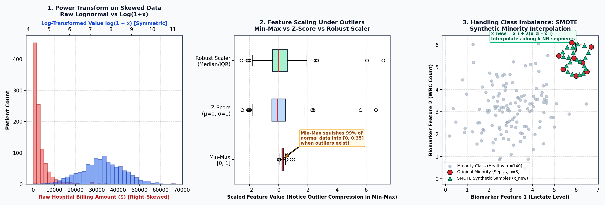
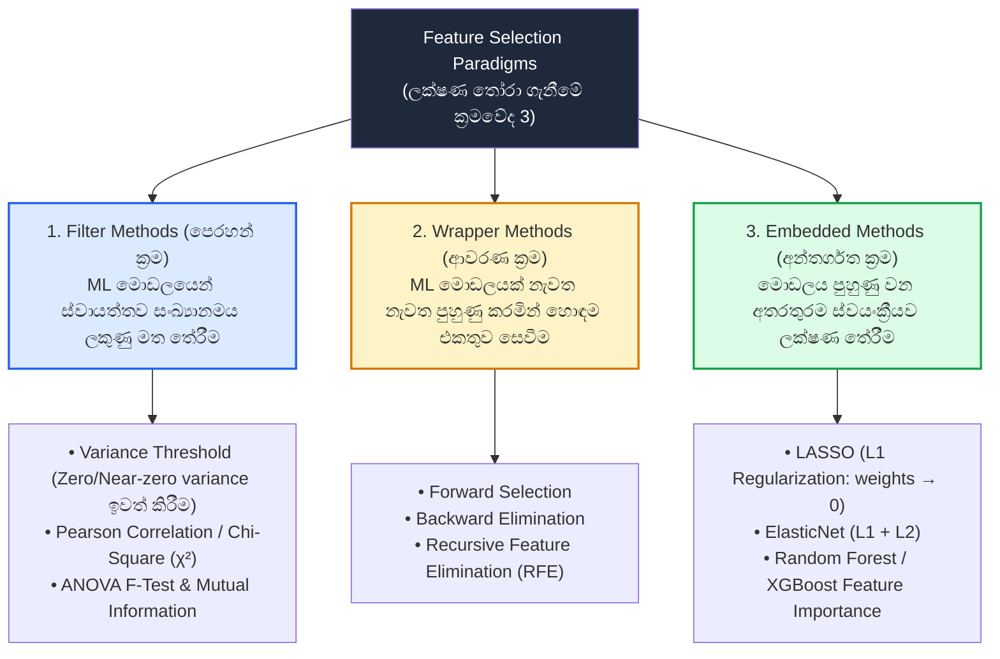

# Lesson 3.4: Feature Engineering, Scaling, Encoding, Selection & Class Imbalance (SMOTE)

**Module:** CI7524 — Big Data and Data Mining (Module 03: Data Mining Lifecycle, Mathematical Preliminaries & Preprocessing)  
**Mapped Lecture Sources:** `Big Data and Data Mining - Topic 01.pdf` (Slide 21: AI Pipeline — Stage 4 Processing ↔ Stage 5 Feature Engineering ↔ Stage 6 ML/AI), `CI7524 Big Data and Data Mining.docx` (Topic 2: Data mining lifecycle and workflow — cleaning, integration, feature engineering; LO2, LO3, LO4)  
**Core Textbooks:** Han, Pei & Tong (2022) *Data Mining: Concepts and Techniques*; Aggarwal (2015) *Data Mining: The Textbook*; Gupta (2021) *Practical Data Science with Jupyter*

---

> [!TIP]
> **📚 Prerequisite Dependency Guides (පූර්ව අවශ්‍යතා පාඩම් මාලාව):**
> මෙම පාඩමේදී සාකච්ඡා කරන Feature Scaling, Z-Scores, සහ Scikit-Learn `Pipeline` / `ColumnTransformer` මගින් **Data Leakage** වළක්වා ගන්නා ආකාරය පිළිබඳ පූර්ණ අවබෝධයක් ලබා ගැනීමට පහත Dependency පාඩම් කියවන්න:
> - [Dep 04 — 02_Probability_Normal_Distribution_and_Z_Scores.md](../dependencies/Dep_04_Probability_Distributions_and_Statistical_Foundations/02_Probability_Normal_Distribution_and_Z_Scores.md)
> - [Dep 06 — 01_Scikit_Learn_API_Estimators_Transformers_and_Pipelines.md](../dependencies/Dep_06_Scikit_Learn_and_Data_Mining_Workflows_in_Python/01_Scikit_Learn_API_Estimators_Transformers_and_Pipelines.md)

---

## 1. හැඳින්වීම: Feature Engineering යනු කුමක්ද සහ එය ඇල්ගොරිතමයටත් වඩා වැදගත් ඇයි?

`Big Data and Data Mining - Topic 01.pdf (Slide 21 — AI Pipeline)` හිදී **Stage 4 (Processing)** සහ **Stage 6 (ML/AI)** යන අදියර දෙක යා කරන ප්‍රධාන පාලම ලෙස දක්වා ඇත්තේ **Stage 5: Feature Engineering ("Extracts meaningful features for the model")** ය.

Data Science ලෝකයේ ඉතාම ප්‍රසිද්ධ කියමනක් තිබෙනවා (Pedro Domingos / Andrew Ng):

> *"Coming up with features is difficult, time-consuming, requires expert knowledge. Applied machine learning is basically feature engineering."*

ඇයි අමු දත්ත (Raw Data) කෙලින්ම Data Mining ඇල්ගොරිතමයකට ලබා දිය නොහැක්කේ?
1. **Scale Dominance (පරිමාණ ආධිපත්‍යය):** රෝගියෙකුගේ `Annual_Income` එක රුපියල් $1,500,000$ ක් වන අතර `Age` එක අවුරුදු $45$ ක් සහ `Creatinine` මට්ටම $1.2\text{ mg/dL}$ ක් යැයි සිතන්න. ඔබ මේ දත්ත කෙලින්ම **K-Means Clustering** හෝ **$k$-NN** වෙත ලබා දුන්නොත්, Euclidean Distance සූත්‍රය $\sqrt{(\Delta \text{Income})^2 + (\Delta \text{Age})^2 + (\Delta \text{Creatinine})^2}$ තුළ $(\Delta \text{Income})^2 \approx 10^{11}$ වන නිසා `Age` සහ `Creatinine` යන විචල්‍යයන් දෙක **සම්පූර්ණයෙන්ම නොසලකා හැරේ!**
2. **Non-Numeric Formats:** බොහෝ ගණිතමය ඇල්ගොරිතම වලට `"Blood_Group = O+"` වැනි Text strings හෝ `"2026-11-14 03:45:00"` වැනි Timestamps කෙලින්ම ගණනය කළ නොහැක.
3. **High-Dimensional Noise & Redundancy:** අනවශ්‍ය විචල්‍යයන් සිය ගණනක් තිබීම නිසා Lesson 3.2 හි අප ඉගෙන ගත් **Curse of Dimensionality** ඇති වී මොඩලය Overfit වේ.
4. **Severe Class Imbalance (පන්ති අසමතුලිතතාවය):** රෝගීන් 10,000 කින් දුර්ලභ පිළිකාවක් ඇත්තේ 100 දෙනෙකුට (1%) පමණක් නම්, සියලුම රෝගීන් "නිරෝගී (Healthy)" යැයි අනාවැකි කියන මොඩලයක් **99% Accuracy** ලබා ගත්තද, එයින් සැබෑ රෝගීන් 100 දෙනාම මිය යයි!

---

## 2. Feature Scaling & Non-Linear Transformations (සූත්‍ර, ගණනය කිරීම් සහ භාවිතය)



අපි ප්‍රධාන Feature Scaling සහ Transformation ක්‍රම 4 ක් ගෙන, ඒවායේ සූත්‍ර සහ පියවරෙන් පියවර අතින් ගණනය කිරීම් (Worked Hand Calculations) බලමු. උදාහරණයක් ලෙස රෝගීන් 5 දෙනෙකුගේ `Heart_Rate` අගයන් $\mathbf{x} = [60, 70, 80, 90, 100]$ සලකමු (මෙහි $x_{\min}=60, x_{\max}=100, \mu=80, \sigma=\sqrt{200}\approx 14.14, Q_1=70, \text{Median}=80, Q_3=90, \text{IQR}=20$). $x = 90$ යන අගය පරිවර්තනය වන ආකාරය බලමු:

### 2.1 Min-Max Normalization (Range Scaling to $[0, 1]$)
දත්තවල අවම අගය $0$ බවටත්, උපරිම අගය $1$ බවටත් පත් වන සේ රේඛීයව හැකිලීම:

$$x' = \frac{x - x_{\min}}{x_{\max} - x_{\min}}$$

- **Hand Calculation for $x = 90$:**
  $$x' = \frac{90 - 60}{100 - 60} = \frac{30}{40} = \mathbf{0.75}$$
- **වාසි සහ අවාසි:** සියලුම විචල්‍යයන් හරියටම $[0, 1]$ පරාසයට ගෙන එයි (Image pixel processing සහ Neural Networks සඳහා ඉතා සුදුසුය). නමුත් **Outliers වලට අතිශයින්ම සංවේදී වේ!** (ඉහත රූපසටහනේ මැද පැනලයේ පෙන්වා ඇති පරිදි, එක් Outlier අගයක් `250` ලෙස තිබුණහොත් සාමාන්‍ය දත්ත සියල්ලම $[0, 0.25]$ වැනි ඉතා පටු පරාසයකට තෙරපී යයි!).

### 2.2 Z-Score Standardization (Zero Mean & Unit Variance)
දත්තවල **Mean (මධ්‍යන්‍යය)** $\mu = 0$ බවටත්, **Standard Deviation (සම්මත අපගමනය)** $\sigma = 1$ බවටත් පත් කිරීම (`StandardScaler`):

$$z = \frac{x - \mu}{\sigma}$$

- **Hand Calculation for $x = 90$ ($\mu=80, \sigma=14.142$):**
  $$z = \frac{90 - 80}{14.142} = \frac{10}{14.142} \approx \mathbf{+0.7071}$$
- **භාවිතය:** **PCA (Principal Component Analysis)**, **Support Vector Machines (SVM)**, **Logistic/Linear Regression (with L1/L2 Regularization)**, සහ **K-Means Clustering** සඳහා Standard Default තේරීම මෙයයි.

### 2.3 Robust Scaling (Outlier-Resistant Scaling using Median & IQR)
$\mu$ සහ $\sigma$ වෙනුවට Outliers වලින් බලපෑමක් නොවන **Median (මධ්‍යස්ථය)** සහ **Interquartile Range - IQR (අන්තර්-චතුර්ථක පරාසය)** භාවිතා කරයි (`RobustScaler`):

$$x_{\text{robust}} = \frac{x - \text{Median}(X)}{\text{IQR}(X)} = \frac{x - Q_2}{Q_3 - Q_1}$$

- **Hand Calculation for $x = 90$ ($\text{Median}=80, \text{IQR}=20$):**
  $$x_{\text{robust}} = \frac{90 - 80}{90 - 70} = \frac{10}{20} = \mathbf{+0.50}$$
- **භාවිතය:** සායනික දත්ත හෝ මූල්‍ය දත්ත වැනි ස්වභාවිකවම Extreme Outliers පවතින (සහ ඒවා ඉවත් කළ නොහැකි) අවස්ථාවලදී Min-Max හෝ Z-Score වෙනුවට **Robust Scaling** භාවිතා කළ යුතුය.

### 2.4 Non-Linear Power Transformations (Log, Box-Cox & Yeo-Johnson)
රෝහල් බිල්පත් (`Hospital_Bill`), ආදායම (`Income`), හෝ `C-Reactive Protein` වැනි දැඩි ලෙස දකුණට බර වූ (**Heavily Right-Skewed / Lognormal**) විචල්‍යයන් සඳහා Linear Scaling (Min-Max හෝ Z-Score) යෙදුවද ඒවායේ Skewness එක වෙනස් නොවේ! එවැනි විචල්‍යයන් සමමිතික **Gaussian-like (Bell Curve)** ව්‍යාප්තියකට හැරවීමට (ඉහත රූපයේ පළමු පැනලය බලන්න):
- **Log1p Transformation:** $x' = \ln(1 + x)$ (ශූන්‍ය අගයන් $x=0$ තිබුණද $\ln(1+0)=0$ ලෙස ආරක්ෂිතව ක්‍රියා කරයි).
- **Box-Cox Transformation:** $x > 0$ (ධන අගයන් පමණක්) සඳහා ප්‍රශස්ත $\lambda$ පරාමිතිය ස්වයංක්‍රීයව සොයා ගනී.
- **Yeo-Johnson Transformation:** ධන, ශූන්‍ය සහ සෘණ ($x \in \mathbb{R}$) යන ඕනෑම අගයක් සඳහා ක්‍රියා කරන Power Transform ක්‍රමයයි.

---

### ⚠️ The Golden Rule of Scaling: Preventing Data Leakage (දත්ත කාන්දු වීම වැළැක්වීම)
Train/Test Split කිරීමට **පෙර** මුළු දත්ත සමූහයටම `scaler.fit_transform(X_all)` යෙදීම බරපතල වරදකි! එමගින් Test Set එකේ $\mu, \sigma, \min, \max$ තොරතුරු Training ක්‍රියාවලිය තුළට කාන්දු වේ (**Data Leakage**).
- ✅ **නිවැරදි ක්‍රමය:** Training Set එක මත පමණක් `scaler.fit_transform(X_train)` ක්‍රියාත්මක කර, එමගින් උගත් පරාමිතීන් භාවිතා කරමින් Test Set එකට `scaler.transform(X_test)` පමණක් යොදන්න!

---

### Which Algorithms Require Feature Scaling? (LO4 Justification Guide)

| Algorithm Family | Examples | Requires Feature Scaling? | Mathematical Reason |
| :--- | :--- | :---: | :--- |
| **Distance-Based Models** | **K-Means**, **$k$-NN**, **DBSCAN**, Hierarchical Clustering, SVM (RBF) | ✅ **YES (Mandatory!)** | Euclidean / Manhattan දුර ගණනය කිරීමේදී විශාල පරිමාණයක් ඇති විචල්‍යයන් මුළු දුරම යටපත් කරයි. |
| **Variance / Matrix Models** | **PCA**, **SVD**, Linear Discriminant Analysis (LDA) | ✅ **YES (Mandatory!)** | PCA සොයන්නේ උපරිම Variance ඇති දිශාවන්ය; Scale නොකළහොත් වැඩිම ඒකක ඇති විචල්‍යය පළමු Principal Component එක බවට පත් වේ! |
| **Gradient Descent & Regularized Models** | Linear/Logistic Regression (L1/L2 Ridge/LASSO), **Neural Networks / Deep Learning** | ✅ **YES (Mandatory!)** | Gradient Descent ඉක්මනින් Converge වීමට සහ L1/L2 දඬුවම් (Penalty $\lambda \|w\|$) සියලුම සංගුණකවලට සාධාරණව බලපෑමට. |
| **Tree-Based & Rule Models** | **Decision Trees (CART)**, **Random Forest**, **XGBoost**, **LightGBM**, Naive Bayes | ❌ **NO (Scale-Invariant!)** | ගස් (Trees) දත්ත බෙදන්නේ තනි විචල්‍යයක සීමාවක් (`Age > 50`) මත පමණි; Monotonic scaling මගින් Tree split ලක්ෂ්‍යය හෝ Entropy/Gini අගය වෙනස් නොවේ! |

---

## 3. Categorical Encoding & Domain Feature Extraction

### 3.1 Categorical Encoding Strategies
1. **Ordinal Encoding:** ස්වභාවික අනුපිළිවෙළක් ඇති **Ordinal** විචල්‍යයන් සඳහා (උදා: `Triage_Level`: `"Low" -> 0`, `"Medium" -> 1`, `"High" -> 2`, `"Critical" -> 3`).
2. **One-Hot Encoding (Dummy Variables):** අනුපිළිවෙළක් නැති **Nominal** විචල්‍යයන් සඳහා (උදා: `Blood_Type` $\in \{A, B, AB, O\}$ සඳහා Binary `0/1` තීරු නිර්මාණය කිරීම).
   - *The Dummy Variable Trap (Multicollinearity):* කාණ්ඩ $k$ ක් සඳහා තීරු $k$ ම තැබුවහොත් $\sum_{j=1}^k D_j = 1$ නිසා Linear Regression වලදී න්‍යාසය Singular වේ. එබැවින් තීරු $k-1$ ක් (`drop_first=True`) භාවිතා කෙරේ.
   - *High-Cardinality Problem:* `ICD10_Diagnosis_Code` හෝ `Postal_Code` වැනි අගයන් 5,000 ක් ඇති විචල්‍යයකට One-Hot Encoding යෙදුවහොත් තීරු 5,000 ක් හැදී **Curse of Dimensionality** ඇති වේ!
3. **Target Encoding (with Smoothing) & Frequency Encoding:** High-Cardinality විචල්‍යයන් සඳහා එක් එක් කාණ්ඩය ඊට අදාළ Target ($y$) මධ්‍යන්‍යයෙන් හෝ එම කාණ්ඩයේ සංඛ්‍යාතයෙන් (Frequency count) ප්‍රතිස්ථාපනය කිරීම.

### 3.2 Domain Feature Extraction (Cyclical Time & Interaction Ratios)
- **Interaction Ratios:** `Weight_kg` සහ `Height_m` වෙන වෙනම දෙනවාට අමතරව $\text{BMI} = \frac{\text{Weight}}{\text{Height}^2}$ හෝ `Shock_Index = Heart_Rate / Systolic_BP` වැනි වෛද්‍ය විද්‍යාත්මකව අර්ථවත් අනුපාත නිර්මාණය කිරීම.
- **Cyclical Temporal Encoding ($\sin / \cos$ Transform):** දවසේ පැය `Hour` ($0$ සිට $23$ දක්වා) සාමාන්‍ය අංකයක් ලෙස දුන්නොත්, රාත්‍රී `23:00` සහ මධ්‍යම රාත්‍රී `00:00` අතර පරතරය පැය 1 ක් වුවද ඇල්ගොරිතමයට එය $|23 - 0| = 23$ ක විශාල දුරක් ලෙස පෙනේ! එය විසඳීමට පැය (හෝ මාසය) ත්‍රිකෝණමිතික වෘත්තයක් මතට ප්‍රක්ෂේපණය කරයි:
  $$\text{Hour}_{\sin} = \sin\left(\frac{2\pi \cdot \text{Hour}}{24}\right), \qquad \text{Hour}_{\cos} = \cos\left(\frac{2\pi \cdot \text{Hour}}{24}\right)$$

---

## 4. Feature Selection Paradigms (Filter, Wrapper & Embedded Methods)

අප සතුව විචල්‍යයන් (Features) සිය ගණනක් ඇති විට, වඩාත්ම වැදගත් විචල්‍යයන් උපකුලකය (Optimal Feature Subset) තෝරා ගැනීමේ ප්‍රධාන ක්‍රමවේද 3 කි:



| Paradigm | ක්‍රියාකාරිත්වය සහ උදාහරණ | Computational Speed | Feature Interactions සලකයිද? |
| :--- | :--- | :---: | :---: |
| **1. Filter Methods** | ML මොඩලයක් භාවිතා නොකර, සංඛ්‍යානමය පරීක්ෂණ (**Variance Threshold**, **Pearson $r$**, **ANOVA $F$-test**, **Mutual Information**, **$\chi^2$**) මගින් එක් එක් විචල්‍යයට ලකුණක් දී ඉහළම $k$ ගණන තෝරා ගනී. | ⚡ **ඉතාම වේගවත්** (Ideal for Big Data initial screening) | ❌ නැත (බොහෝවිට Univariate ලෙස තනි තනිව පරීක්ෂා කරයි). |
| **2. Wrapper Methods** | නිශ්චිත ML මොඩලයක් භාවිතා කරමින් විවිධ Feature combinations පරීක්ෂා කරයි (**Forward Selection**, **Backward Elimination**, **Recursive Feature Elimination - RFE**). | 🐢 **ඉතාම මන්දගාමී** ($O(2^d)$ search space; Big Data සඳහා අපහසුය) | ✅ ඔව්! විචල්‍යයන් කිහිපයක එකතුවෙන් ලැබෙන බලපෑම හඳුනා ගනී. |
| **3. Embedded Methods** | මොඩලයේ Loss Function එක හෝ ව්‍යුහය තුළම Feature Selection අන්තර්ගත වී ඇත: **LASSO ($L_1$ Regularization)**: $\mathcal{L}_{\text{LASSO}} = \text{MSE} + \lambda \sum_{j=1}^d |w_j|$ මගින් අනවශ්‍ය විචල්‍යයන්ගේ බර හරියටම $w_j = 0$ බවට පත් කරයි! එසේම **Tree-based Impurity Importance** ද මෙයට අයත් වේ. | 🚀 **මධ්‍යස්ථ හා කාර්යක්ෂම** (Best balance of speed & accuracy) | ✅ ඔව්! |

---

## 5. Handling Class Imbalance: SMOTE & Cost-Sensitive Learning

### 5.1 The Accuracy Paradox (99% Accuracy උගුල)
රෝහලකට පැමිණෙන රෝගීන් 1,000 කින් 990 දෙනෙකුම සාමාන්‍ය රෝගීන් (`Class 0 — Majority`) වන අතර, 10 දෙනෙකුට පමණක් මාරාන්තික Sepsis තත්ත්වය (`Class 1 — Minority = 1%`) ඇතැයි සිතන්න. කිසිදු බුද්ධියක් නැති මොඩලයක් සෑම රෝගියෙකුටම `0 (Healthy)` යැයි අනාවැකි කීවොත්:
- **Accuracy** = $\frac{990}{1000} = \mathbf{99.0\%}$!
- නමුත් Sepsis රෝගීන් හඳුනා ගැනීමේ හැකියාව (**Recall / Sensitivity**) = $\frac{0}{10} = \mathbf{0.0\%}$!
එබැවින් Imbalanced Datasets වලදී Accuracy භාවිතා කිරීම තහනම් වන අතර **Precision, Recall, F1-Score, සහ PR-AUC** භාවිතා කළ යුතුය.

### 5.2 Data-Level & Algorithm-Level Solutions
1. **Random Undersampling (Majority Class අඩු කිරීම):** බහුතර පන්තියෙන් අහඹු ලෙස පේළි ඉවත් කිරීම. *අවාසිය:* වැදගත් සායනික තොරතුරු විශාල ප්‍රමාණයක් අහිමි වේ.
2. **Random Oversampling (Minority Class පිටපත් කිරීම):** සුළුතර පන්තියේ පේළි එලෙසම නැවත නැවත පිටපත් (Exact Duplicates) කිරීම. *අවාසිය:* මොඩලය එම නිශ්චිත ලක්ෂ්‍ය කටපාඩම් කර **Severe Overfitting** වලට ලක් වේ.
3. **SMOTE (Synthetic Minority Over-sampling Technique — Chawla et al., 2002):**
   පිටපත් කිරීම වෙනුවට, සුළුතර පන්තියේ (Minority Class) පවතින ලක්ෂ්‍ය අතර ජ්‍යාමිතික රේඛා ඛණ්ඩ දිගේ **අලුත්ම කෘත්‍රිම ලක්ෂ්‍ය (Synthetic Samples)** නිර්මාණය කරයි (ඉහත රූපයේ 3 වන පැනලය බලන්න!):
   - **SMOTE Mathematical Algorithm:**
     1. සුළුතර පන්තියේ ඕනෑම ලක්ෂ්‍යයක් $\mathbf{x}_i$ තෝරා ගන්න.
     2. සුළුතර පන්තිය තුළම $\mathbf{x}_i$ ට ළඟම පිහිටි අසල්වැසියන් $k$ දෙනා ($k$-Nearest Minority Neighbors, සාමාන්‍යයෙන් $k=5$) සොයා ගන්න.
     3. එම අසල්වැසියන් $k$ දෙනා අතරින් එක් අසල්වැසියෙකු $\mathbf{x}_{zi}$ අහඹු ලෙස තෝරා ගන්න.
     4. $\lambda \sim \text{Uniform}(0, 1)$ අහඹු අගයක් ගෙන, $\mathbf{x}_i$ සහ $\mathbf{x}_{zi}$ යා කරන රේඛාව මත අලුත් ලක්ෂ්‍යය නිර්මාණය කරන්න:
        $$\mathbf{x}_{\text{new}} = \mathbf{x}_i + \lambda \cdot (\mathbf{x}_{zi} - \mathbf{x}_i)$$
   - **Worked Hand Calculation:** Sepsis රෝගීන් දෙදෙනෙකුගේ `(Lactate, WBC)` දෛශික $\mathbf{x}_i = (4.0, 12.0)$ සහ අසල්වැසි $\mathbf{x}_{zi} = (6.0, 18.0)$ නම්, සහ අහඹු $\lambda = 0.4$ නම්:
     $$\mathbf{x}_{\text{new}} = (4.0, 12.0) + 0.4 \times \left( (6.0 - 4.0), \; (18.0 - 12.0) \right) = (4.0, 12.0) + 0.4 \times (2.0, 6.0) = \mathbf{(4.8, \; 14.4)}$$
   - **⚠️ Critical Leakage Rule:** SMOTE යෙදිය යුත්තේ **Training Set එකට පමණි!** කිසිවිටෙකත් Test Set එකට SMOTE යොදන්න එපා (Test Set එක සැබෑ ලෝකයේ ව්‍යාප්තිය නියෝජනය කළ යුතුය).
4. **Cost-Sensitive Learning (`class_weight='balanced'`):**
   දත්ත ප්‍රමාණය වෙනස් නොකර, Loss Function එක තුළ සුළුතර පන්තියේ රෝගියෙකු වරදවා වර්ගීකරණය කිරීමට (False Negative) ඉතා ඉහළ දඬුවමක් (High Misclassification Penalty Weight $w_c = \frac{N}{n_{\text{classes}} \cdot N_c}$) ලබා දීම.

---

## 🛠️ Practical Task / Hands-On Exercise (ප්‍රායෝගික අභ්‍යාසය)

### Scenario / Goal
ඔබේ CI7524 Coursework එක සඳහා Feature Scaling (Min-Max, Z-Score, Robust, Log1p), Cyclical Time Encoding, සහ SMOTE Synthetic Interpolation යන සියල්ල ක්‍රියාත්මක කර අපගේ අතින් කළ ගණනය කිරීම් තහවුරු කරන Python පිටපතක් ලියන්න.

### Step-by-Step Tasks
1. `Heart_Rate = [60, 70, 80, 90, 100]` දත්ත පෙළට Extreme Outlier එකක් (`250`) එක්වීමට පෙර සහ පසුව Min-Max, Z-Score, සහ Robust Scaler අගයන් සංසන්දනය කරන්න.
2. පැය `23:00` සහ `00:00` අතර Euclidean දුර සාමාන්‍ය නිරූපණයේදී සහ Cyclical $(\sin, \cos)$ නිරූපණයේදී වෙනස් වන ආකාරය පෙන්වන්න.
3. $\mathbf{x}_i = (4.0, 12.0)$ සහ $\mathbf{x}_{zi} = (6.0, 18.0)$ අතර SMOTE සූත්‍රය ක්‍රියාත්මක කර අලුත් සාම්පල 5 ක් ජනනය කරන්න.

### Starter Code & Reference Solution

```python
import numpy as np
import pandas as pd

# =====================================================================
# TASK 1: Compare Min-Max, Z-Score, and Robust Scaling on x = [60,70,80,90,100]
# =====================================================================
hr = np.array([60.0, 70.0, 80.0, 90.0, 100.0])

minmax = (hr - hr.min()) / (hr.max() - hr.min())
zscore = (hr - hr.mean()) / hr.std()  # population std sqrt(200) = 14.1421
q25, q50, q75 = np.percentile(hr, [25, 50, 75])
robust = (hr - q50) / (q75 - q25)

df_scaled = pd.DataFrame({
    "Raw_HR": hr,
    "MinMax_[0,1]": minmax.round(4),
    "Z_Score": zscore.round(4),
    "Robust_IQR": robust.round(4)
})
print("=== [Task 1: Feature Scaling Verification (Watch x=90 row)] ===")
print(df_scaled.to_string(index=False))

# =====================================================================
# TASK 2: Cyclical Time Encoding (Hour 23:00 vs Hour 00:00)
# =====================================================================
h1, h2 = 23.0, 0.0
raw_hour_dist = abs(h1 - h2)

vec_h1 = np.array([np.sin(2 * np.pi * h1 / 24.0), np.cos(2 * np.pi * h1 / 24.0)])
vec_h2 = np.array([np.sin(2 * np.pi * h2 / 24.0), np.cos(2 * np.pi * h2 / 24.0)])
cyclical_dist = np.linalg.norm(vec_h1 - vec_h2)

print("\n=== [Task 2: Cyclical Encoding of 23:00 vs 00:00] ===")
print(f"Naive Numerical Distance |23 - 0|        : {raw_hour_dist:.4f} hours (Wrongly looks far apart!)")
print(f"Cyclical (sin, cos) Euclidean Distance   : {cyclical_dist:.4f} (Correctly adjacent on unit circle!)")

# =====================================================================
# TASK 3: SMOTE Geometric Interpolation Implementation
# =====================================================================
x_i = np.array([4.0, 12.0])
x_zi = np.array([6.0, 18.0])

print("\n=== [Task 3: SMOTE Synthetic Minority Generation] ===")
for lam in [0.2, 0.4, 0.6, 0.8]:
    x_new = x_i + lam * (x_zi - x_i)
    print(f"λ = {lam:.1f} -> Synthetic Patient Vector x_new = (Lactate={x_new[0]:.2f}, WBC={x_new[1]:.2f})")
```

### Expected Output
```text
=== [Task 1: Feature Scaling Verification (Watch x=90 row)] ===
 Raw_HR  MinMax_[0,1]  Z_Score  Robust_IQR
   60.0          0.00  -1.4142        -1.0
   70.0          0.25  -0.7071        -0.5
   80.0          0.50   0.0000         0.0
   90.0          0.75   0.7071         0.5
  100.0          1.00   1.4142         1.0

=== [Task 2: Cyclical Encoding of 23:00 vs 00:00] ===
Naive Numerical Distance |23 - 0|        : 23.0000 hours (Wrongly looks far apart!)
Cyclical (sin, cos) Euclidean Distance   : 0.2611 (Correctly adjacent on unit circle!)

=== [Task 3: SMOTE Synthetic Minority Generation] ===
λ = 0.2 -> Synthetic Patient Vector x_new = (Lactate=4.40, WBC=13.20)
λ = 0.4 -> Synthetic Patient Vector x_new = (Lactate=4.80, WBC=14.40)
λ = 0.6 -> Synthetic Patient Vector x_new = (Lactate=5.20, WBC=15.60)
λ = 0.8 -> Synthetic Patient Vector x_new = (Lactate=5.60, WBC=16.80)
```

---

## 📝 Summary & Exam Revision Cheat Sheet (සාරාංශය)

| Technique / Concept | Mathematical Formula / Rule | Best Used When (LO2 & LO4 Justification) |
| :--- | :--- | :--- |
| **Min-Max Normalization** | $x' = \frac{x - x_{\min}}{x_{\max} - x_{\min}} \in [0, 1]$ | Outliers නොමැති දත්ත නිශ්චිත $[0, 1]$ සීමාවකට ගෙන ඒමට (Neural Nets, Image processing). |
| **Z-Score Standardization** | $z = \frac{x - \mu}{\sigma}$ ($\mu=0, \sigma=1$) | **K-Means, $k$-NN, PCA, SVM, Logistic/Ridge/LASSO Regression** සඳහා අනිවාර්ය සම්මත පරිමාණකරණය. |
| **Robust Scaling** | $x' = \frac{x - \text{Median}}{\text{IQR}}$ | Outliers බහුලව පවතින සායනික/මූල්‍ය විචල්‍යයන් Scale කිරීමට. |
| **Log1p Power Transform** | $x' = \ln(1 + x)$ | දැඩි ලෙස දකුණට බර වූ (**Right-Skewed**) විචල්‍යයන් (Bills, Length of stay) සමමිතික බවට පත් කිරීමට. |
| **Filter vs. Wrapper vs. Embedded** | Filter: Statistical ($\chi^2$, ANOVA); Wrapper: RFE; Embedded: LASSO ($L_1$). | Big Data වලදී මුලින්ම **Filter** මගින් විචල්‍ය අඩු කර, පසුව **Embedded (LASSO / Tree Importance)** භාවිතා කරන්න. |
| **SMOTE Oversampling** | $\mathbf{x}_{\text{new}} = \mathbf{x}_i + \lambda(\mathbf{x}_{zi} - \mathbf{x}_i)$ | Imbalanced classes (උදා: 1% rare disease) සමතුලිත කිරීමට — **Training Set එකට පමණක් යොදන්න!** |
| **Data Leakage Prevention** | `fit_transform(X_train)` $\to$ `transform(X_test)` | Scaling, Imputation, PCA සහ SMOTE සැමවිටම Training Split එක මත පමණක් Fit කළ යුතුය. |
