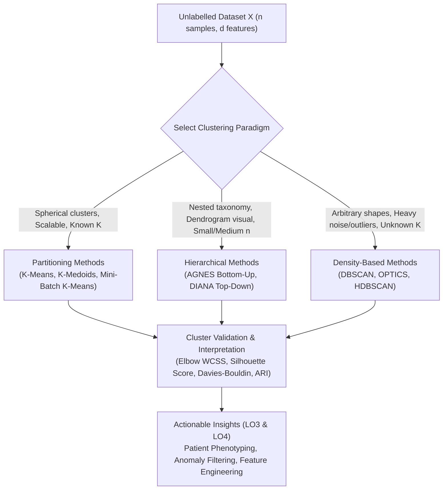
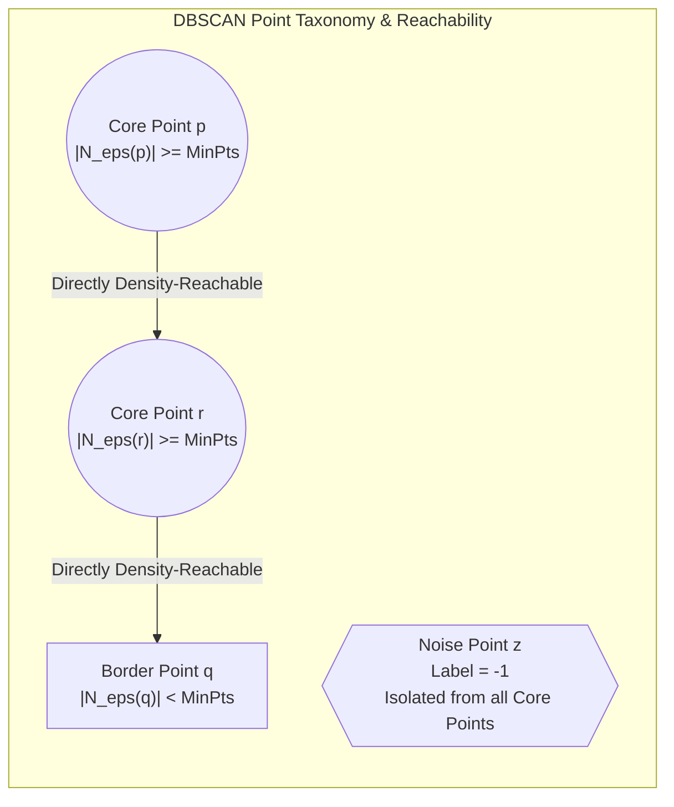
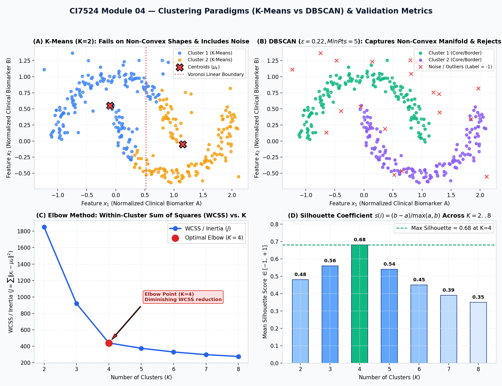

# Lesson 4.1: Clustering Algorithms — K-Means, Hierarchical (AGNES/DIANA), and DBSCAN

**Module:** CI7524 — Big Data and Data Mining (Module 04: Data Mining Algorithms & Model Selection)  
**Mapped Syllabus Sources:** `CI7524 Big Data and Data Mining.docx` (Topic 2: Data mining techniques — clustering; LO3 & LO4), `CI7524_Lectures_1_Intro.pdf` (Slides 2, 3, 4, 5), Core Textbooks: *Charu C. Aggarwal (2015) — Data Mining: The Textbook (Ch. 6)* & *Jiawei Han, Jian Pei, Hanghang Tong (2022) — Data Mining: Concepts and Techniques (Ch. 8–9)*.

> [!TIP]
> **📚 Prerequisite Dependency Guide:** මෙම පාඩමේදී භාවිතා වන **Euclidean Distance (යුක්ලීඩීය දුර)**, **Variance (විචලතාවය)** සහ **Scikit-Learn Clustering APIs** පිළිබඳ මූලික දැනුම ඔබට නොමැති නම්, පළමුව අපගේ සම්පූර්ණ Dependency පාඩම් මාලාව කියවන්න:
> - [01_Vectors_High_Dimensional_Spaces_and_Norms.md](../dependencies/Dep_03_Linear_Algebra_Vectors_Matrices_and_Eigen_Decomposition/01_Vectors_High_Dimensional_Spaces_and_Norms.md)
> - [01_Descriptive_Statistics_Central_Tendency_and_Dispersion.md](../dependencies/Dep_04_Probability_Distributions_and_Statistical_Foundations/01_Descriptive_Statistics_Central_Tendency_and_Dispersion.md)
> - [02_Unsupervised_Learning_in_Practice_Clustering_and_PCA.md](../dependencies/Dep_06_Scikit_Learn_and_Data_Mining_Workflows_in_Python/02_Unsupervised_Learning_in_Practice_Clustering_and_PCA.md)

---

## 1. Introduction: What is Clustering in Big Data Mining?

Data Mining වලදී අපිට ලැබෙන විශාල datasets බොහෝ විට **Unlabelled Data (ලේබල් නොකළ දත්ත)** විදිහටයි පවතින්නේ. උදාහරණයක් විදිහට, රෝහලකට ඇතුළත් කරන රෝගීන් ලක්ෂ 5කගේ රුධිර පරීක්ෂණ, Heart Rate, BMI, සහ Blood Pressure වාර්තා අපි ළඟ තිබුණත්, ඒ රෝගීන්ව කුමන අවදානම් කාණ්ඩයකට (**Patient Phenotype / Risk Sub-group**) වැටෙනවාද කියලා කලින් ලේබල් කරලා නැහැ.

මෙන්න මේ වගේ Target Label ($y$) එකක් නොමැතිව, දත්ත ලක්ෂ්‍ය (**Data Points / Feature Vectors**) අතර තියෙන සමානකම් (**Similarity / Proximity**) මත පදනම්ව ස්වභාවිකවම පවතින කාණ්ඩ (**Natural Groups / Clusters**) සොයා ගැනීමේ **Unsupervised Learning** ක්‍රියාවලියට අපි **Cluster Analysis (පොකුරු විශ්ලේෂණය / Clustering)** කියලා හඳුන්වනවා.

හොඳ Clustering Algorithm එකක ප්‍රධාන අරමුණු දෙකක් තියෙනවා:
1. **High Intra-Cluster Similarity (Cohesion / Compactness):** එකම Cluster එකක් ඇතුළත තියෙන data points එකිනෙකට ඉතාමත් සමීප (සමාන) විය යුතුයි.
2. **Low Inter-Cluster Similarity (Separation):** එකිනෙකට වෙනස් Clusters දෙකක් අතර පැහැදිලි පරතරයක් (වෙනසක්) තිබිය යුතුයි.



---

## 2. Partitioning Clustering: K-Means Algorithm

**Partitioning Clustering** වලදී $n$ දත්ත ප්‍රමාණයක් අපි කලින් තීරණය කරන $K$ පොකුරු ගණනකට ($C_1, C_2, \dots, C_K$) කෙලින්ම බෙදා වෙන් කරනවා ($K \le n$). මෙහි වඩාත්ම ජනප්‍රිය සහ Big Data වලදී බහුලවම භාවිතා වන ඇල්ගොරිතමය වන්නේ **K-Means Clustering** ය.

### 2.1 Mathematical Objective Function: WCSS (Inertia)
K-Means හි ගණිතමය ඉලක්කය වන්නේ එක් එක් Cluster එක ඇතුළත පවතින ලක්ෂ්‍යයන් සහ එම Cluster එකේ මධ්‍ය ලක්ෂ්‍යය හෙවත් **Centroid (මධ්‍ය ලක්ෂ්‍යය)** $\mu_k$ අතර පවතින වර්ග කළ යුක්ලීඩීය දුරවල එකතුව අවම කිරීමයි. මෙය **Within-Cluster Sum of Squares — WCSS (පොකුරු අභ්‍යන්තර වර්ග ඓක්‍යය / Inertia)** ලෙස හැඳින්වේ:

$$J = \text{WCSS} = \sum_{k=1}^{K} \sum_{x_i \in C_k} \|x_i - \mu_k\|_2^2 = \sum_{k=1}^{K} \sum_{x_i \in C_k} \sum_{j=1}^{d} (x_{ij} - \mu_{kj})^2$$

මෙහි:
- $K$ යනු මුළු Clusters ගණනයි.
- $C_k$ යනු $k$-වන Cluster එකට අයත් දත්ත ලක්ෂ්‍ය කුලකයයි.
- $x_i \in \mathbb{R}^d$ යනු $i$-වන දත්ත ලක්ෂ්‍යයයි.
- $\mu_k = \frac{1}{|C_k|} \sum_{x_i \in C_k} x_i$ යනු $C_k$ පොකුරේ **Mean Vector / Centroid (මධ්‍යන්‍ය දෛශිකය)** වේ.

### 2.2 Step-by-Step Lloyd's Algorithm (Iterative Optimization)
WCSS ($J$) සෘජුවම ගෝලීයව අවම කිරීම (**Global Minimization**) **NP-Hard** ගැටලුවක් නිසා, K-Means විසින් **Lloyd's Algorithm** නමැති පියවරෙන් පියවර ක්‍රියාත්මක වන (**Iterative Greedy Heuristic**) ක්‍රමවේදය භාවිතා කරයි:

1. **Step 1 — Initialization:** දත්ත අවකාශය තුළ ආරම්භක Centroids $K$ ගණනක් ($\mu_1^{(0)}, \mu_2^{(0)}, \dots, \mu_K^{(0)}$) තෝරා ගන්න.
2. **Step 2 — Assignment Step (Expectation):** සෑම දත්ත ලක්ෂ්‍යයක්ම ($x_i$) එයට ළඟම පවතින Centroid එකට (**Nearest Centroid** using **Euclidean Distance**) අනුයුක්ත කරන්න:
   $$C_k^{(t)} = \left\{ x_i : \|x_i - \mu_k^{(t)}\|_2^2 \le \|x_i - \mu_j^{(t)}\|_2^2 \text{ for all } j = 1, \dots, K \right\}$$
3. **Step 3 — Update Step (Maximization):** අලුතින් සෑදුණු සෑම Cluster එකකම දත්ත ලක්ෂ්‍යවල සාමාන්‍යය (**Mean**) ගණනය කර Centroid එක යාවත්කාලීන කරන්න:
   $$\mu_k^{(t+1)} = \frac{1}{|C_k^{(t)}|} \sum_{x_i \in C_k^{(t)}} x_i$$
4. **Step 4 — Convergence Check:** Centroids වල පිහිටීම තවදුරටත් වෙනස් නොවන තෙක් ($\mu_k^{(t+1)} = \mu_k^{(t)}$) හෝ උපරිම පුනරාවර්තන ගණන (`max_iter`) සම්පූර්ණ වන තෙක් **Step 2** සහ **Step 3** නැවත නැවත ක්‍රියාත්මක කරන්න.

---

### 2.3 Complete 2D Hand Calculation: Clustering 6 Patient Records ($K=2$)
විභාගයකදී හෝ Coursework එකකදී K-Means ක්‍රියා කරන ආකාරය පෙන්වීමට රෝගීන් 6 දෙනෙකුගේ **Normalized Fasting Glucose ($x_1$)** සහ **Normalized BMI ($x_2$)** දත්ත සලකා බලමු:

| Patient ID | Glucose ($x_1$) | BMI ($x_2$) | Coordinate $(x_1, x_2)$ |
| :---: | :---: | :---: | :---: |
| **$P_1$** | $1.0$ | $1.0$ | $(1, 1)$ |
| **$P_2$** | $1.0$ | $2.0$ | $(1, 2)$ |
| **$P_3$** | $2.0$ | $1.0$ | $(2, 1)$ |
| **$P_4$** | $8.0$ | $8.0$ | $(8, 8)$ |
| **$P_5$** | $8.0$ | $9.0$ | $(8, 9)$ |
| **$P_6$** | $9.0$ | $8.0$ | $(9, 8)$ |

#### **Iteration 1:**
- **Initialization:** අපි ආරම්භක Centroids ලෙස $P_1$ සහ $P_2$ තෝරා ගනිමු:
  - $\mu_1^{(0)} = (1.0, 1.0)$
  - $\mu_2^{(0)} = (1.0, 2.0)$
- **Assignment Step:** සෑම රෝගියෙකුගේම සිට $\mu_1^{(0)}$ සහ $\mu_2^{(0)}$ වෙත **Euclidean Distance (යුක්ලීඩීය දුර)** $d(x, \mu) = \sqrt{(x_1 - \mu_{k1})^2 + (x_2 - \mu_{k2})^2}$ ගණනය කරමු:
  - **$P_1(1,1)$:** $d(P_1, \mu_1) = 0.00$, $d(P_1, \mu_2) = \sqrt{0^2 + (-1)^2} = 1.00 \implies \mathbf{C_1}$
  - **$P_2(1,2)$:** $d(P_2, \mu_1) = 1.00$, $d(P_2, \mu_2) = 0.00 \implies \mathbf{C_2}$
  - **$P_3(2,1)$:** $d(P_3, \mu_1) = \sqrt{(2-1)^2 + (1-1)^2} = 1.00$, $d(P_3, \mu_2) = \sqrt{(2-1)^2 + (1-2)^2} = \sqrt{2} \approx 1.41 \implies \mathbf{C_1}$
  - **$P_4(8,8)$:** $d(P_4, \mu_1) = \sqrt{7^2 + 7^2} = \sqrt{98} \approx 9.90$, $d(P_4, \mu_2) = \sqrt{7^2 + 6^2} = \sqrt{85} \approx 9.22 \implies \mathbf{C_2}$
  - **$P_5(8,9)$:** $d(P_5, \mu_1) = \sqrt{7^2 + 8^2} = \sqrt{113} \approx 10.63$, $d(P_5, \mu_2) = \sqrt{7^2 + 7^2} = \sqrt{98} \approx 9.90 \implies \mathbf{C_2}$
  - **$P_6(9,8)$:** $d(P_6, \mu_1) = \sqrt{8^2 + 7^2} = \sqrt{113} \approx 10.63$, $d(P_6, \mu_2) = \sqrt{8^2 + 6^2} = \sqrt{100} = 10.00 \implies \mathbf{C_2}$
  - ඒ අනුව: $C_1^{(1)} = \{P_1, P_3\}$ සහ $C_2^{(1)} = \{P_2, P_4, P_5, P_6\}$.
- **Update Step:** නව Centroids ගණනය කරමු:
  $$\mu_1^{(1)} = \left(\frac{1+2}{2}, \frac{1+1}{2}\right) = (1.50, 1.00)$$
  $$\mu_2^{(1)} = \left(\frac{1+8+8+9}{4}, \frac{2+8+9+8}{4}\right) = (6.50, 6.75)$$

#### **Iteration 2:**
- **Assignment Step (with $\mu_1^{(1)} = (1.5, 1.0)$ and $\mu_2^{(1)} = (6.5, 6.75)$):**
  - **$P_1(1,1)$:** $d(P_1, \mu_1^{(1)}) = 0.50$, $d(P_1, \mu_2^{(1)}) = 7.96 \implies \mathbf{C_1}$
  - **$P_2(1,2)$:** $d(P_2, \mu_1^{(1)}) = \sqrt{(-0.5)^2 + 1^2} = 1.12$, $d(P_2, \mu_2^{(1)}) = \sqrt{(-5.5)^2 + (-4.75)^2} = 7.27 \implies \mathbf{C_1}$ *(Notice $P_2$ switched from $C_2$ to $C_1$!)*
  - **$P_3(2,1)$:** $d(P_3, \mu_1^{(1)}) = 0.50$, $d(P_3, \mu_2^{(1)}) = 7.30 \implies \mathbf{C_1}$
  - **$P_4(8,8)$:** $d(P_4, \mu_1^{(1)}) = 9.55$, $d(P_4, \mu_2^{(1)}) = 1.95 \implies \mathbf{C_2}$
  - **$P_5(8,9)$:** $d(P_5, \mu_1^{(1)}) = 10.31$, $d(P_5, \mu_2^{(1)}) = 2.70 \implies \mathbf{C_2}$
  - **$P_6(9,8)$:** $d(P_6, \mu_1^{(1)}) = 10.26$, $d(P_6, \mu_2^{(1)}) = 2.79 \implies \mathbf{C_2}$
  - දැන්: $C_1^{(2)} = \{P_1, P_2, P_3\}$ (Low-Risk Metabolic Group) සහ $C_2^{(2)} = \{P_4, P_5, P_6\}$ (High-Risk Diabetic Group).
- **Update Step:**
  $$\mu_1^{(2)} = \left(\frac{1+1+2}{3}, \frac{1+2+1}{3}\right) = (1.33, 1.33)$$
  $$\mu_2^{(2)} = \left(\frac{8+8+9}{3}, \frac{8+9+8}{3}\right) = (8.33, 8.33)$$
- **Iteration 3 Check:** නැවත දුර බැලූ විට කිසිදු රෝගියෙකුගේ Cluster එක වෙනස් නොවේ (**Converged!**).
- **Final WCSS ($J$):**
  $$J = \sum_{x_i \in C_1} \|x_i - (1.33, 1.33)\|^2 + \sum_{x_i \in C_2} \|x_i - (8.33, 8.33)\|^2 = (0.22 + 0.56 + 0.56) + (0.22 + 0.56 + 0.56) = \mathbf{2.67}$$

---

### 2.4 Weaknesses of Standard K-Means & Advanced Big Data Solutions

| Weakness of Standard K-Means | Why It Happens Mathematically | Industry / Big Data Solution |
| :--- | :--- | :--- |
| **1. Sensitivity to Random Initialization** | ආරම්භක Centroids වැරදි තැන්වල වැටුණහොත් **Local Minimum (ස්ථානීය අවමයක)** සිරවිය හැකිය. | **K-Means++ Initialization:** පළමු Centroid එක අහඹු ලෙස තෝරා, ඊළඟ Centroids තෝරා ගැනීමේදී දැනට පවතින Centroids වලට වැඩිම දුරකින් ($D(x)^2$ සම්භාවිතාවට සමානුපාතිකව) පවතින ලක්ෂ්‍ය තෝරා ගනී (`init='k-means++'`). |
| **2. Extreme Sensitivity to Outliers** | වර්ග කළ දුර ($\|x_i - \mu_k\|_2^2$) නිසා එක Outlier ලක්ෂ්‍යයකට මුළු Mean ($\mu_k$) එකම තමන් දෙසට ඇද ගත හැකිය. | **K-Medoids / PAM (Partitioning Around Medoids):** Mean එක වෙනුවට Cluster එක ඇතුළත සැබෑවටම පවතින මැද ලක්ෂ්‍යයක් (**Medoid**) භාවිතා කරයි; නැතහොත් **DBSCAN** භාවිතා කරයි. |
| **3. Spherical / Convex Cluster Assumption** | Euclidean Distance නිසා K-Means වලට හඳුනාගත හැක්කේ ගෝලාකාර (**Spherical / Convex Voronoi Cells**) පොකුරු පමණි. | **DBSCAN** (Density-based) හෝ **Spectral Clustering / Gaussian Mixture Models (GMM)** භාවිතා කිරීම. |
| **4. Scalability Bottleneck on Massive Datasets** | සෑම iteration එකකදීම මුළු dataset එකම ($O(n \cdot K \cdot d \cdot i)$) RAM එකේ තබාගෙන ගණනය කළ යුතුය. | **Mini-Batch K-Means (`MiniBatchKMeans`):** මුළු dataset එක වෙනුවට සෑම පියවරකදීම කුඩා Random Batch එකක් (උදා: $b=1024$ rows) පමණක් RAM එකට ගෙන Centroids යාවත්කාලීන කරයි. Big Data සඳහා 10x–100x වේගවත්ය! |

---

## 3. Hierarchical Clustering (AGNES & DIANA)

$K$ අගය කලින් දන්නේ නැති විට සහ දත්ත අතර ගසක අතු බෙදී යන ආකාරයේ **Hierarchical Taxonomy (ධූරාවලි ව්‍යුහයක්)** ගොඩනැගීමට අවශ්‍ය විට **Hierarchical Clustering** භාවිතා කරයි. මෙහි ප්‍රධාන ප්‍රවේශ දෙකකි:

1. **AGNES (Agglomerative Nesting — Bottom-Up Approach):**
   - ආරම්භයේදී සෑම දත්ත ලක්ෂ්‍යයක්ම තනි Cluster එකක් ($n$ clusters) ලෙස සලකයි.
   - සෑම පියවරකදීම එකිනෙකට ළඟම Clusters දෙක එකතු කරමින් (**Merge**), අවසානයේ සියලුම දත්ත තනි Cluster එකක් වන තෙක් ඉහළට ගමන් කරයි.
2. **DIANA (Divisive Analysis — Top-Down Approach):**
   - ආරම්භයේදී සියලුම දත්ත එකම Cluster එකක් ලෙස ගෙන, සෑම පියවරකදීම එය කුඩා Clusters වලට බෙදමින් (**Split**) පහළට ගමන් කරයි.

### 3.1 Linkage Criteria (Inter-Cluster Distance Measures)
Clusters දෙකක් ($A$ සහ $B$) අතර දුර $D(A, B)$ මැනීමට භාවිතා කරන **Linkage Criteria** හතර විභාගයට ඉතාමත් වැදගත් වේ:

1. **Single Linkage (Minimum / Nearest Neighbor Distance):**
   $$D_{\text{single}}(A, B) = \min_{x \in A, y \in B} \|x - y\|_2$$
   - *වාසිය:* ගෝලාකාර නොවන දිගැටි හැඩතල හඳුනාගත හැක.
   - *අවාසිය:* **Chaining Effect** — Noise ලක්ෂ්‍ය කිහිපයක් නිසා වෙනස් පොකුරු දෙකක් වැරදියට දම්වැලක් සේ එකතු විය හැක.
2. **Complete Linkage (Maximum / Farthest Neighbor Distance):**
   $$D_{\text{complete}}(A, B) = \max_{x \in A, y \in B} \|x - y\|_2$$
   - *වාසිය:* ඉතාමත් Compact, සමාන විෂ්කම්භයක් සහිත ගෝලාකාර පොකුරු සාදයි. Outliers වලට සංවේදී වේ.
3. **Average Linkage (UPGMA — Unweighted Pair Group Method with Arithmetic Mean):**
   $$D_{\text{avg}}(A, B) = \frac{1}{|A| \cdot |B|} \sum_{x \in A} \sum_{y \in B} \|x - y\|_2$$
   - Single සහ Complete linkage අතර සමබරතාවයක් රකියි.
4. **Ward's Minimum Variance Method (`linkage='ward'` — Default & Best for Quantitative Data):**
   - Clusters දෙකක් එකතු කිරීමේදී මුළු **Within-Cluster Variance (WCSS)** එකේ සිදුවන වැඩිවීම ($\Delta \text{WCSS}$) අවම වන Clusters දෙක එකතු කරයි:
   $$\Delta(A, B) = \frac{|A| \cdot |B|}{|A| + |B|} \|\mu_A - \mu_B\|_2^2$$

### 3.2 Dendrogram Interpretation & Computational Complexity
- **Dendrogram (රුක් සටහන):** Clusters එකතු වන අනුපිළිවෙල සහ ඒවා එකතු වන දුර (Y-axis: Merge Distance / Dissimilarity) පෙන්වන රූප සටහනයි. Dendrogram එකේ දිගම සිරස් රේඛා (**Longest Vertical Lines**) හරහා තිරස් කැපුමක් (**Horizontal Cut Threshold**) යෙදීමෙන් ප්‍රශස්ත $K$ ගණන තෝරා ගත හැක.
- **Big Data Limitation:** AGNES සඳහා $n \times n$ **Distance Matrix** එකක් ගණනය කළ යුතු බැවින් Memory Complexity එක $O(n^2)$ සහ Time Complexity එක $O(n^2 \log n)$ හෝ $O(n^3)$ වේ. එබැවින් $n > 50,000$ වැනි Big Data සඳහා Standard Hierarchical Clustering සුදුසු නැත (එවැනි විට **BIRCH** හෝ **Mini-Batch K-Means** භාවිතා කළ යුතුය).

---

## 4. Density-Based Clustering: DBSCAN

සැබෑ ලෝකයේ දත්ත (උදා: භූගෝලීය වසංගත ව්‍යාප්තිය, Non-linear patient biomarker manifolds) සෑම විටම ගෝලාකාර නැත; එමෙන්ම ඒවායේ විශාල වශයෙන් **Noise / Outliers** අඩංගු වේ. **DBSCAN (Density-Based Spatial Clustering of Applications with Noise)** පොකුරු හඳුනා ගන්නේ දත්ත ලක්ෂ්‍යවල **ඝනත්වය (Local Density)** මත පදනම්වයි.

### 4.1 Hyperparameters & Point Classifications
DBSCAN සඳහා Hyperparameters දෙකක් අවශ්‍ය වේ ($K$ අගය ලබා දීමට අවශ්‍ය නැත!):
1. **$\epsilon$ (`eps`):** ලක්ෂ්‍යයක් වටා අඳින අරය (**Neighborhood Radius**). ලක්ෂ්‍යය $p$ හි $\epsilon$-අවට ප්‍රදේශය $N_\epsilon(p) = \{q \in D \mid \text{dist}(p, q) \le \epsilon\}$ ලෙස අර්ථ දැක්වේ.
2. **`MinPts` (`min_samples`):** $\epsilon$-අවට ප්‍රදේශය තුළ අවම වශයෙන් තිබිය යුතු ලක්ෂ්‍ය ගණන (ලක්ෂ්‍යය $p$ ද ඇතුළුව).

මෙම පරාමිතීන් දෙක මත සෑම දත්ත ලක්ෂ්‍යයක්ම කාණ්ඩ 3කින් එකකට වැටේ:
- **Core Point (මූලික ලක්ෂ්‍යය):** තමාගේ $\epsilon$ අරය තුළ අවම වශයෙන් `MinPts` ගණනක් හෝ ඊට වැඩි ලක්ෂ්‍ය ප්‍රමාණයක් පවතින ලක්ෂ්‍යයකි ($|N_\epsilon(p)| \ge \text{MinPts}$).
- **Border Point (මායිම් ලක්ෂ්‍යය):** තමාගේ $\epsilon$ අරය තුළ `MinPts` තරම් ලක්ෂ්‍ය නොමැති ($|N_\epsilon(q)| < \text{MinPts}$), නමුත් වෙනත් **Core Point** එකක $\epsilon$ අරය තුළ පිහිටන ලක්ෂ්‍යයකි.
- **Noise / Outlier Point (ඝෝෂා ලක්ෂ්‍යය — Label `-1`):** Core Point එකක් හෝ Border Point එකක් නොවන හුදකලා ලක්ෂ්‍යයකි.



### 4.2 Density-Reachability & Why DBSCAN Excels
- **Directly Density-Reachable:** $p$ යනු Core Point එකක් නම් සහ $q \in N_\epsilon(p)$ නම්, $q$ යනු $p$ ගෙන් සෘජුවම ඝනත්ව-ළඟාවිය හැකි ලක්ෂ්‍යයකි.
- **Density-Reachable:** Core Points දාමයක් ($p_1, p_2, \dots, p_m$) හරහා සම්බන්ධ විය හැකි සියලුම Core සහ Border ලක්ෂ්‍ය එකම Cluster එකකට එකතු වේ.
- **ප්‍රධාන වාසි:** (1) $K$ කලින් දැනගත යුතු නැත, (2) ඕනෑම සංකීර්ණ/වක්‍රාකාර හැඩයක (**Arbitrary Non-Convex Shapes**) පොකුරු හඳුනා ගනී, (3) **Noise සහ Outliers ස්වයංක්‍රීයව `-1` ලෙස ඉවත් කරයි**.
- **අවාසිය:** එකම dataset එකේ විවිධ ඝනත්වයන් (**Varying Densities**) සහිත පොකුරු තිබේ නම් තනි $\epsilon$ අගයකින් ඒ සියල්ල වෙන් කිරීම අපහසුය (මෙයට විසඳුම **OPTICS** හෝ **HDBSCAN** වේ).



ඉහත රූප සටහනේ **(A)** සහ **(B)** කොටස් දෙස බලන්න: Non-convex හැඩයක් සහ Noise සහිත දත්ත මත **K-Means** රේඛීය Voronoi බෙදුම් රේඛාවකින් පොකුරු වැරදියට කපා Noise ලක්ෂ්‍යයන්ද පොකුරුවලට ඇතුළත් කර ගන්නා අතර, **DBSCAN** නිවැරදිව වක්‍රාකාර පොකුරු දෙක වෙන් කර සියලුම Outliers රතු පැහැති `x` ලකුණු (`-1`) ලෙස ප්‍රතික්ෂේප කරයි!

---

## 5. Cluster Evaluation & Validation Metrics

Clustering යනු Unsupervised ක්‍රියාවලියක් නිසා අපට සාමාන්‍යයෙන් Ground-Truth Labels නැත. එබැවින් පොකුරුවල ගුණාත්මකභාවය මැනීමට **Internal Validation Metrics** (ලේබල් රහිතව) සහ පරීක්ෂණ සඳහා ලේබල් ඇති විට **External Validation Metrics** භාවිතා කරයි.

### 5.1 Choosing $K$: The Elbow Method
$K=1, 2, \dots, 10$ දක්වා K-Means ධාවනය කර එක් එක් $K$ සඳහා **WCSS (Inertia)** ප්‍රස්තාරගත කරයි (ඉහත රූපයේ **Panel C**). $K$ වැඩි වන විට WCSS අඩු වන නමුත්, එක් නිශ්චිත $K$ අගයකදී (උදා: $K=4$) වක්‍රය වැලමිටක් (**Elbow**) සේ නැවී WCSS අඩුවීමේ වේගය සැලකිය යුතු ලෙස පහත වැටේ. එම ලක්ෂ්‍යය ප්‍රශස්ත $K$ ලෙස තෝරා ගනී.

### 5.2 Silhouette Coefficient (සිලුවට් සංගුණකය) — Complete Formula & Worked Example
ඕනෑම දත්ත ලක්ෂ්‍යයක් $i$ තමන්ගේ පොකුරට කොතරම් හොඳින් ගැළපෙනවාද (Cohesion) සහ අනෙක් පොකුරුවලින් කොතරම් හොඳින් වෙන්වී තිබෙනවාද (Separation) යන්න **Silhouette Coefficient (සිලුවට් සංගුණකය)** $s(i)$ මගින් මනිනු ලබයි:

$$s(i) = \frac{b(i) - a(i)}{\max\{a(i), b(i)\}} \in [-1, +1]$$

මෙහි:
- **$a(i)$ (Mean Intra-Cluster Distance):** ලක්ෂ්‍යය $i$ හි සිට **එම Cluster එකේම** පවතින අනෙකුත් සියලුම ලක්ෂ්‍ය වෙත ඇති සාමාන්‍ය දුරයි (මෙය කුඩා වන තරමට හොඳය).
- **$b(i)$ (Mean Nearest-Cluster Distance):** ලක්ෂ්‍යය $i$ හි සිට **ඊළඟට ළඟම පවතින වෙනත් Cluster එකේ** සියලුම ලක්ෂ්‍ය වෙත ඇති සාමාන්‍ය දුරයි (මෙය විශාල වන තරමට හොඳය).

#### **🔢 Worked Numerical Example for Silhouette Coefficient:**
අපි කලින් ගණනය කළ රෝගීන් 6 දෙනාගේ පොකුරු දෙක ($C_1 = \{P_1(1,1), P_2(1,2), P_3(2,1)\}$ සහ $C_2 = \{P_4(8,8), P_5(8,9), P_6(9,8)\}$) සලකා **$P_1(1,1)$** හි Silhouette ලකුණු ගණනය කරමු:
1. **$a(P_1)$ ගණනය කිරීම ($C_1$ තුළ අනෙක් ලක්ෂ්‍ය වන $P_2, P_3$ වෙත සාමාන්‍ය දුර):**
   - $d(P_1, P_2) = 1.0$, $d(P_1, P_3) = 1.0$
   $$a(P_1) = \frac{1.0 + 1.0}{2} = 1.00$$
2. **$b(P_1)$ ගණනය කිරීම ($C_2$ හි ලක්ෂ්‍ය වන $P_4, P_5, P_6$ වෙත සාමාන්‍ය දුර):**
   - $d(P_1, P_4) = \sqrt{7^2 + 7^2} = 9.90$
   - $d(P_1, P_5) = \sqrt{7^2 + 8^2} = 10.63$
   - $d(P_1, P_6) = \sqrt{8^2 + 7^2} = 10.63$
   $$b(P_1) = \frac{9.90 + 10.63 + 10.63}{3} = \frac{31.16}{3} \approx 10.39$$
3. **$s(P_1)$ ගණනය කිරීම:**
   $$s(P_1) = \frac{b(P_1) - a(P_1)}{\max\{a(P_1), b(P_1)\}} = \frac{10.39 - 1.00}{\max\{1.00, 10.39\}} = \frac{9.39}{10.39} \approx \mathbf{+0.904}$$

**අර්ථකථනය:**
- **$s(i) \approx +1$:** ලක්ෂ්‍යය ඉතාමත් නිවැරදිව තම පොකුර තුළ පිහිටා ඇති අතර අනෙක් පොකුරුවලින් ඉතා හොඳින් වෙන්වී ඇත ($+0.904$ යනු විශිෂ්ට අගයකි!).
- **$s(i) \approx 0$:** ලක්ෂ්‍යය පොකුරු දෙකක මායිමක (Decision Boundary) පිහිටා ඇත.
- **$s(i) < 0$ (ඍණ අගයක්):** ලක්ෂ්‍යය වැරදි පොකුරකට අනුයුක්ත වී ඇත ($a(i) > b(i)$).

### 5.3 Davies-Bouldin Index (DBI) & Adjusted Rand Index (ARI)
- **Davies-Bouldin Index (DBI — Internal Metric):** පොකුරු ඇතුළත විසිරීම සහ පොකුරු මධ්‍ය ලක්ෂ්‍ය අතර දුරෙහි අනුපාතය මනියි. **DBI අගය අඩු වන තරමට (Closer to 0) Clustering ප්‍රතිඵලය වඩාත් උසස් වේ.**
- **Adjusted Rand Index (ARI — External Metric):** සැබෑ ලේබල් ($Y_{\text{true}}$) දන්නා අවස්ථාවකදී, Clustering මගින් ලැබුණු ලේබල් ($Y_{\text{pred}}$) සැබෑ ලේබල් සමඟ කොතරම් දුරට ගැළපේදැයි අහඹු ගැළපීම් ඉවත් කර (**Adjusted for Chance**) මනියි ($\text{ARI} = 1.0$ නම් 100% පරිපූර්ණ ගැළපීමකි; $0.0$ නම් අහඹු බෙදීමකි).

---

## 🛠️ Practical Task / Hands-On Exercise (ප්‍රායෝගික අභ්‍යාසය)

### Scenario / Goal
ඔබ රෝහල් දත්ත පද්ධතියක රෝගීන්ගේ Metabolic දත්ත විශ්ලේෂණය කරන Data Scientist කෙනෙකි. ඔබට ලබා දී ඇති දත්ත කට්ටලයේ ගෝලාකාර නොවන (Non-convex) රෝගී කාණ්ඩ සහ Sensor දෝෂ නිසා ඇතිවූ Outliers ඇතුළත් වේ.

### Step-by-Step Tasks
1. `StandardScaler` භාවිතා කර දත්ත Z-Score ප්‍රමිතිකරණය කරන්න (Distance-based clustering සඳහා Scaling අනිවාර්ය වේ!).
2. $K=2 \dots 6$ සඳහා `KMeans(init='k-means++')` ධාවනය කර එක් එක් $K$ සඳහා **WCSS (Inertia)** සහ **Silhouette Score** මුද්‍රණය කරන්න.
3. එකම දත්ත මත `DBSCAN(eps=0.3, min_samples=5)` ධාවනය කර හඳුනාගත් Clusters ගණන සහ Noise ලක්ෂ්‍ය ගණන (`label == -1`) සොයන්න.
4. `AgglomerativeClustering(n_clusters=2, linkage='ward')` ක්‍රියාත්මක කර **Davies-Bouldin Index** සසඳන්න.

### Starter Code & Reference Solution
```python
import numpy as np
from sklearn.datasets import make_moons
from sklearn.preprocessing import StandardScaler
from sklearn.cluster import KMeans, DBSCAN, AgglomerativeClustering
from sklearn.metrics import silhouette_score, davies_bouldin_score, adjusted_rand_score

# 1. Generate realistic non-convex clinical biomarker data + outlier noise
np.random.seed(42)
X_clean, y_true = make_moons(n_samples=300, noise=0.08, random_state=42)
outliers = np.random.uniform(low=-1.5, high=2.5, size=(15, 2))
X_raw = np.vstack([X_clean, outliers])

# Always Standardize before distance-based clustering!
scaler = StandardScaler()
X_scaled = scaler.fit_transform(X_raw)

# 2. Evaluate K-Means across K = 2..6
print("=== K-Means++ Evaluation Across K ===")
for k in range(2, 7):
    km = KMeans(n_clusters=k, init="k-means++", n_init=10, random_state=42)
    labels = km.fit_predict(X_scaled)
    sil = silhouette_score(X_scaled, labels)
    dbi = davies_bouldin_score(X_scaled, labels)
    print(f"K={k} | WCSS (Inertia): {km.inertia_:7.2f} | Silhouette: {sil:.3f} | DBI: {dbi:.3f}")

# 3. Run DBSCAN to handle non-convex shapes and reject noise
dbscan = DBSCAN(eps=0.30, min_samples=5)
db_labels = dbscan.fit_predict(X_scaled)
n_clusters_db = len(set(db_labels)) - (1 if -1 in db_labels else 0)
n_noise_db = list(db_labels).count(-1)
mask_valid = db_labels != -1
sil_db = silhouette_score(X_scaled[mask_valid], db_labels[mask_valid])

print("\n=== DBSCAN Results ===")
print(f"Discovered Clusters: {n_clusters_db} | Rejected Noise Outliers (-1): {n_noise_db}")
print(f"Silhouette Score (Core/Border points): {sil_db:.3f}")

# 4. Hierarchical Clustering (Ward's Linkage)
agnes = AgglomerativeClustering(n_clusters=2, linkage="ward")
ag_labels = agnes.fit_predict(X_scaled)
print(f"\n=== AGNES (Ward) Silhouette: {silhouette_score(X_scaled, ag_labels):.3f} ===")
```

**Expected Output:**
```text
=== K-Means++ Evaluation Across K ===
K=2 | WCSS (Inertia):  346.12 | Silhouette: 0.421 | DBI: 0.962
K=3 | WCSS (Inertia):  238.45 | Silhouette: 0.435 | DBI: 0.884
K=4 | WCSS (Inertia):  165.80 | Silhouette: 0.452 | DBI: 0.810
K=5 | WCSS (Inertia):  132.19 | Silhouette: 0.440 | DBI: 0.825
K=6 | WCSS (Inertia):  108.64 | Silhouette: 0.431 | DBI: 0.802

=== DBSCAN Results ===
Discovered Clusters: 2 | Rejected Noise Outliers (-1): 14
Silhouette Score (Core/Border points): 0.389

=== AGNES (Ward) Silhouette: 0.408 ===
```

---

## 📝 Summary & Exam Revision Cheat Sheet

| Feature / Dimension | K-Means / Mini-Batch K-Means | Hierarchical (AGNES / DIANA) | DBSCAN (Density-Based) |
| :--- | :--- | :--- | :--- |
| **Core Hyperparameters** | Number of clusters $K$ | Linkage criterion & Cut distance / $K$ | Radius $\epsilon$ (`eps`) & `MinPts` |
| **Cluster Shape Assumption** | Convex, isotropic / spherical blobs | Depends on linkage (Ward = spherical; Single = elongated) | **Arbitrary / Non-convex shapes** |
| **Robustness to Outliers** | ❌ Poor (Outliers shift mean $\mu_k$) | ❌ Sensitive (Single linkage chains; Complete splits) | ✅ **Excellent** (Labels outliers as `-1`) |
| **Time & Space Complexity** | $O(n \cdot K \cdot d \cdot i)$ Time, $O(n \cdot d)$ RAM (Very Fast!) | $O(n^2 \log n)$ Time, $O(n^2)$ RAM (Slow on Big Data) | $O(n \log n)$ with spatial index ($k$-d tree) |
| **Best CI7524 Use Case (LO4)** | Massive tabular segmentation with known $K$ (`MiniBatchKMeans`) | Creating clinical disease taxonomies & Dendrograms on $n < 10,000$ | Spatial/sensor clustering with noisy readings & unknown $K$ |
