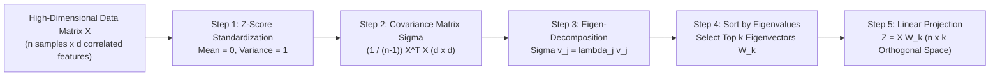
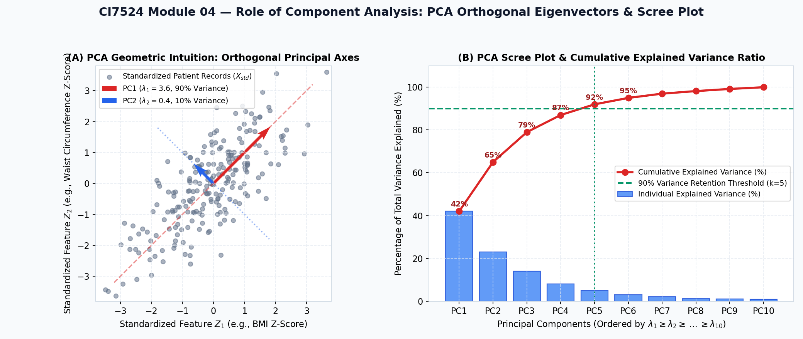

# Lesson 4.2: Role of Component Analysis & Dimensionality Reduction — PCA, SVD, and t-SNE / UMAP

**Module:** CI7524 — Big Data and Data Mining (Module 04: Data Mining Algorithms & Model Selection)  
**Mapped Syllabus Sources:** `CI7524 Big Data and Data Mining.docx` (Topic 2: *"Reflecting on the use of supervised and unsupervised algorithms, role of component analysis"*; LO3 & LO4), `CI7524_Lectures_1_Intro.pdf` (Slide 2: *"Apply supervised and unsupervised techniques (e.g., clustering, time-series, component analysis)"*), Core Textbooks: *Deisenroth et al. (2020) — Mathematics for Machine Learning (Ch. 10)*, *Blum, Hopcroft & Kannan (2020) — Foundations of Data Science (Ch. 3)*, *Aggarwal (2015) (Ch. 2)*.

> [!TIP]
> **📚 Prerequisite Dependency Guide:** මෙම පාඩමේදී භාවිතා වන **Covariance Matrix (සහවිචලතා න්‍යාසය)**, **Eigenvalues (නිජ අගයන්)**, **Eigenvectors (නිජ දෛශික)** සහ **Matrix Factorization** පිළිබඳ ගණිතමය පදනම මුල සිටම ඉගෙන ගැනීමට පහත Dependency පාඩම් කියවන්න:
> - [02_Matrices_Transformations_and_Covariance_Matrices.md](../dependencies/Dep_03_Linear_Algebra_Vectors_Matrices_and_Eigen_Decomposition/02_Matrices_Transformations_and_Covariance_Matrices.md)
> - [03_Eigenvalues_Eigenvectors_and_Matrix_Factorization.md](../dependencies/Dep_03_Linear_Algebra_Vectors_Matrices_and_Eigen_Decomposition/03_Eigenvalues_Eigenvectors_and_Matrix_Factorization.md)
> - [02_Unsupervised_Learning_in_Practice_Clustering_and_PCA.md](../dependencies/Dep_06_Scikit_Learn_and_Data_Mining_Workflows_in_Python/02_Unsupervised_Learning_in_Practice_Clustering_and_PCA.md)

---

## 1. The Role of Component Analysis in Big Data Mining (CI7524 Core Topic)

CI7524 Module Descriptor එකේ සහ Lecture 1 (Slide 2) හි විශේෂයෙන්ම අවධාරණය කර ඇති මාතෘකාවක් වන්නේ **"Role of Component Analysis"** යන්නයි. ඇයි Big Data සහ Data Mining වලදී Component Analysis සහ **Dimensionality Reduction (මාන අඩු කිරීම)** මේ තරම්ම වැදගත් වෙන්නේ?

නූතන Big Data datasets වල පේළි ගණන ($n$) පමණක් නොව, Columns / Features ගණනද ($d$) ඉතා විශාල වේ (උදා: රෝගියෙකුගේ ජාන ප්‍රකාශන දත්ත / Gene Expression Microarrays වල $d = 20,000$ features; Electronic Health Records වල ICD-10 diagnostic codes දහස් ගණනක්). මෙවැනි **High-Dimensional Data** සමඟ කෙලින්ම Data Mining කරන විට බරපතල ගැටලු 5ක් මතු වන අතර, **Component Analysis** මගින් ඒ සියල්ලටම විසඳුම් ලබා දෙයි:

1. **Mitigating the Curse of Dimensionality (මාන ශාපය පාලනය කිරීම):**
   - මාන ගණන ($d$) වැඩි වන විට දත්ත අවකාශයේ පරිමාව ඝාතීය ලෙස ($r^d$) ප්‍රසාරණය වී දත්ත ඉතාමත් විරල (**Sparse**) වේ. එවිට ඕනෑම ලක්ෂ්‍ය දෙකක් අතර **Euclidean Distance (යුක්ලීඩීය දුර)** එක හා සමාන වන බැවින් K-Means, DBSCAN, සහ $k$-NN වැනි ඇල්ගොරිතම අසාර්ථක වේ. Component Analysis මගින් $d \gg 100$ වැනි අවකාශයක් වැදගත්ම සංරචක $k \ll d$ (උදා: $k=10$) දක්වා හකුළුවාලයි.
2. **Eliminating Multicollinearity (බහු-සහරේඛීයතාව ඉවත් කිරීම):**
   - සැබෑ දත්තවල බොහෝ විචල්‍යයන් එකිනෙකට දැඩි ලෙස බැඳී පවතී (උදා: BMI, Weight, සහ Waist Circumference). Component Analysis (විශේෂයෙන්ම PCA) මගින් මෙම සහසම්බන්ධිත විචල්‍යයන් එකිනෙකට ලම්බක (**Orthogonal / Uncorrelated**) නව අක්ෂ බවට පරිවර්තනය කරයි ($\text{Cov}(PC_i, PC_j) = 0$ for $i \neq j$).
3. **Noise Filtering & Signal Extraction (ඝෝෂාව ඉවත් කිරීම):**
   - දත්තවල ප්‍රධාන තොරතුර (**Signal**) ඉහළ විචලතාවයක් (**High Variance**) සහිත මුල් Principal Components තුළ ගැබ්වන අතර, අහඹු Sensor දෝෂ (**Random Noise**) ඉතා කුඩා Eigenvalues සහිත අවසාන Components වලට වැටේ. ඒවා ඉවත් කිරීමෙන් දත්ත පිරිසිදු වේ.
4. **Storage & Computational Compression (මතකය සහ ගණනය කිරීමේ වේගය):**
   - Features 1,000ක් වෙනුවට Principal Components 20ක් තබා ගැනීමෙන් RAM භාවිතය සහ ML පුහුණු කාලය 98%කින් අඩු වේ.
5. **2D / 3D Exploratory Visualization:**
   - මිනිස් ඇසට දැකිය හැක්කේ මාන 2ක් හෝ 3ක් පමණි. මාන 500ක දත්ත $k=2$ හෝ $k=3$ දක්වා අඩු කර පොකුරු සහ Outliers රූපමය වශයෙන් පරීක්ෂා කිරීමට Component Analysis අත්‍යවශ්‍ය වේ.



---

## 2. Principal Component Analysis (PCA) — Complete Mathematical Mastery

**Principal Component Analysis — PCA (ප්‍රධාන සංරචක විශ්ලේෂණය)** යනු දත්තවල පවතින උපරිම **Variance (විචලතාවය)** ආරක්ෂා වන පරිදි, මුල් විචල්‍යයන්ගේ රේඛීය සංයෝජන (**Linear Combinations**) ලෙස එකිනෙකට ලම්බක (**Orthogonal**) නව අක්ෂ පද්ධතියක් (**Principal Components**) සොයා ගන්නා Unsupervised රේඛීය පරිවර්තනයකි.

### 2.1 The 5-Step Mathematical Derivation of PCA

#### **Step 1: Z-Score Standardization (සම්මතකරණය)**
PCA ක්‍රියා කරන්නේ Variance මත බැවින්, විශාල ඒකක සහිත විචල්‍යයන් (උදා: වැටුප රු. 100,000 vs වයස අවුරුදු 40) විසින් පළමු Principal Component එක අසාධාරණ ලෙස ආක්‍රමණය කිරීම වැළැක්වීමට සෑම විචල්‍යයක්ම **Mean (මධ්‍යන්‍යය)** $\mu_j = 0$ සහ **Standard Deviation (සම්මත අපගමනය)** $\sigma_j = 1$ වන සේ ප්‍රමිතිකරණය කළ යුතුය:
$$x_{ij}^{\text{std}} = \frac{x_{ij} - \mu_j}{\sigma_j}$$

#### **Step 2: Compute the Covariance Matrix (සහවිචලතා න්‍යාසය)**
ප්‍රමිතිකරණය කළ දත්ත න්‍යාසය $X \in \mathbb{R}^{n \times d}$ නම්, විචල්‍යයන් $d$ අතර පවතින සහවිචලතාවන් ඇතුළත් $d \times d$ සමමිතික **Covariance Matrix (සහවිචලතා න්‍යාසය)** $\Sigma$ ගණනය කරන්න:
$$\Sigma = \frac{1}{n - 1} X^T X \in \mathbb{R}^{d \times d}$$

#### **Step 3: Eigenvalue Decomposition (නිජ අගය වියෝජනය)**
$\Sigma$ න්‍යාසයේ **Characteristic Equation (ලාක්ෂණික සමීකරණය)** $\det(\Sigma - \lambda I) = 0$ විසඳීමෙන් **Eigenvalues (නිජ අගයන්)** $\lambda_1, \lambda_2, \dots, \lambda_d$ සහ ඒවාට අනුරූප ඒකක **Eigenvectors (නිජ දෛශික)** $v_1, v_2, \dots, v_d$ ($\|v_j\|_2 = 1$) සොයා ගන්න:
$$\Sigma v_j = \lambda_j v_j$$
- **ගණිතමය අර්ථය:**
  - **$j$-වන Eigenvector එක ($v_j$):** නව Principal Component අක්ෂයේ **දිශාව (Direction / Principal Axis)** ලබා දෙයි. $v_j$ හි සංරචකවලට අපි **Loadings** කියා හඳුන්වමු.
  - **$j$-වන Eigenvalue එක ($\lambda_j$):** එම $v_j$ අක්ෂය දිගේ දත්ත කොපමණ ප්‍රමාණයකින් විසිරී ඇත්ද යන්න හෙවත් එම අක්ෂය මගින් පැහැදිලි කරන **Variance (විචලතාවයේ ප්‍රමාණය)** ලබා දෙයි!

#### **Step 4: Sort Components & Compute Explained Variance Ratio**
Eigenvalues විශාලතම අගයේ සිට කුඩාම අගය දක්වා පෙළගස්වන්න ($\lambda_1 \ge \lambda_2 \ge \dots \ge \lambda_d \ge 0$). එවිට $j$-වන Principal Component එක මගින් මුළු දත්ත විචලතාවයෙන් කොපමණ ප්‍රතිශතයක් ආවරණය කරන්නේද යන්න **Explained Variance Ratio (පැහැදිලි කළ විචලතා අනුපාතය)** මගින් ලැබේ:
$$\text{EVR}_j = \frac{\lambda_j}{\sum_{i=1}^{d} \lambda_i}, \qquad \text{Cumulative EVR}(k) = \frac{\sum_{j=1}^{k} \lambda_j}{\sum_{i=1}^{d} \lambda_i}$$

#### **Step 5: Project Data onto Top $k$ Principal Components**
මුල් Eigenvectors $k$ ගණන තීරු ලෙස තබා $W_k = [v_1, v_2, \dots, v_k] \in \mathbb{R}^{d \times k}$ **Projection Matrix (ප්‍රක්ෂේපණ න්‍යාසය)** සාදා, මුල් දත්ත $X$ එයින් ගුණ කිරීමෙන් මාන අඩු කරන ලද නව දත්ත න්‍යාසය $Z \in \mathbb{R}^{n \times k}$ ලබා ගන්න:
$$Z = X W_k$$

---

### 2.2 Complete Numerical Hand Calculation of PCA on a $2 \times 2$ Covariance Matrix
රෝගීන් කණ්ඩායමක ප්‍රමිතිකරණය කළ **BMI ($X_1$)** සහ **Waist Circumference ($X_2$)** සඳහා ලැබුණු $2 \times 2$ **Covariance Matrix (සහවිචලතා න්‍යාසය)** පහත පරිදි යැයි සිතමු:
$$\Sigma = \begin{bmatrix} 2.0 & 1.6 \\ 1.6 & 2.0 \end{bmatrix}$$

1. **Find the Eigenvalues ($\lambda_1, \lambda_2$):**
   $$\det(\Sigma - \lambda I) = \det \begin{bmatrix} 2.0 - \lambda & 1.6 \\ 1.6 & 2.0 - \lambda \end{bmatrix} = 0$$
   $$(2.0 - \lambda)^2 - (1.6)^2 = 0 \implies (2.0 - \lambda)^2 = 2.56$$
   $$2.0 - \lambda = \pm 1.6 \implies \mathbf{\lambda_1 = 3.6}, \quad \mathbf{\lambda_2 = 0.4}$$

2. **Compute the Explained Variance Ratio (EVR):**
   - මුළු විචලතාවය (Total Variance / Trace of $\Sigma$) $= \lambda_1 + \lambda_2 = 3.6 + 0.4 = 4.0$.
   - **PC1 මගින් පැහැදිලි කරන විචලතාවය:** $\text{EVR}_1 = \frac{3.6}{4.0} = 0.90 = \mathbf{90\%}$!
   - **PC2 මගින් පැහැදිලි කරන විචලතාවය:** $\text{EVR}_2 = \frac{0.4}{4.0} = 0.10 = \mathbf{10\%}$.
   - *නිගමනය:* විචල්‍ය 2 වෙනුවට **PC1 පමණක් ($k=1$)** තබා ගත්තද, මුල් දත්තවල තොරතුරුවලින් **90%ක්ම** ආරක්ෂා වේ!

3. **Find the Unit Eigenvectors ($v_1, v_2$):**
   - **For $\lambda_1 = 3.6$ (PC1):**
     $$\begin{bmatrix} 2.0 - 3.6 & 1.6 \\ 1.6 & 2.0 - 3.6 \end{bmatrix} \begin{bmatrix} v_{11} \\ v_{12} \end{bmatrix} = \begin{bmatrix} -1.6 & 1.6 \\ 1.6 & -1.6 \end{bmatrix} \begin{bmatrix} v_{11} \\ v_{12} \end{bmatrix} = \begin{bmatrix} 0 \\ 0 \end{bmatrix} \implies v_{11} = v_{12}$$
     ඒකක දෛශිකයක් ($\|v_1\|_2 = 1$) කිරීමට $\sqrt{1^2 + 1^2} = \sqrt{2}$ න් බෙදමු:
     $$v_1 = \begin{bmatrix} 1/\sqrt{2} \\ 1/\sqrt{2} \end{bmatrix} \approx \begin{bmatrix} 0.707 \\ 0.707 \end{bmatrix}$$
   - **For $\lambda_2 = 0.4$ (PC2):**
     $$\begin{bmatrix} 1.6 & 1.6 \\ 1.6 & 1.6 \end{bmatrix} \begin{bmatrix} v_{21} \\ v_{22} \end{bmatrix} = \begin{bmatrix} 0 \\ 0 \end{bmatrix} \implies v_{21} = -v_{22} \implies v_2 = \begin{bmatrix} -1/\sqrt{2} \\ 1/\sqrt{2} \end{bmatrix} \approx \begin{bmatrix} -0.707 \\ 0.707 \end{bmatrix}$$
   - **Orthogonality Check:** $v_1 \cdot v_2 = (0.707)(-0.707) + (0.707)(0.707) = 0$ (එකිනෙකට $90^\circ$ ලම්බක වේ!).



### 2.3 How to Choose the Number of Components $k$
1. **Cumulative Variance Threshold (90% or 95% Rule):** මුළු විචලතාවයෙන් 90% හෝ 95% ආවරණය වන අවම $k$ අගය තෝරා ගැනීම (`PCA(n_components=0.95)`). ඉහත රූපයේ **Panel B** හි PC5 වන විට 92%ක් ආවරණය වේ.
2. **Scree Plot Elbow Criterion:** Eigenvalues හෝ EVR ප්‍රස්තාරයේ බෑවුම තියුණු ලෙස සමතලා වන වැලමිට ලක්ෂ්‍යය තෝරා ගැනීම.
3. **Kaiser Criterion ($\lambda_j > 1.0$):** Z-Score Standardized දත්තවල තනි මුල් විචල්‍යයක විචලතාවය $1.0$ වන බැවින්, තනි විචල්‍යයකට වඩා වැඩි තොරතුරු ප්‍රමාණයක් අඩංගු $\lambda_j > 1.0$ වන Principal Components පමණක් තබා ගැනීම.

---

## 3. Singular Value Decomposition (SVD), Truncated SVD & Out-of-Core PCA

### 3.1 Singular Value Decomposition — SVD (ඒකීය අගය වියෝජනය)
සැබෑ Big Data libraries (Scikit-Learn, PySpark MLlib) තුළ PCA ගණනය කිරීමේදී $X^T X$ න්‍යාසය කෙලින්ම ගුණ කරන්නේ නැත (එය සංඛ්‍යාත්මකව අස්ථායී විය හැකි බැවින්). ඒ වෙනුවට ඕනෑම $n \times d$ න්‍යාසයක් $X$ සෘජුවම සාධක තුනකට වියෝජනය කරන **Singular Value Decomposition (SVD)** භාවිතා කරයි:

$$X = U \Sigma_s V^T$$

මෙහි:
- **$U \in \mathbb{R}^{n \times n}$:** Left Singular Vectors (ලම්බක තීරු සහිත න්‍යාසයකි).
- **$\Sigma_s \in \mathbb{R}^{n \times d}$:** විකර්ණය මත **Singular Values (ඒකීය අගයන්)** $\sigma_1 \ge \sigma_2 \ge \dots \ge \sigma_r \ge 0$ පවතින න්‍යාසයයි. මෙහි Singular Values සහ Covariance Eigenvalues අතර සම්බන්ධය වන්නේ:
  $$\lambda_j = \frac{\sigma_j^2}{n - 1}$$
- **$V \in \mathbb{R}^{d \times d}$:** Right Singular Vectors — මෙහි තීරු යනු හරියටම PCA හි **Principal Component Eigenvectors ($W$)** වේ!

### 3.2 Why `TruncatedSVD` is Essential for Sparse Big Data Matrices
NLP Text Mining (**TF-IDF Matrices**), E-commerce Recommendation Systems, හෝ රෝහල් ICD-10 කේත වැනි විශාල **Sparse Matrices (99%ක්ම බිංදු අඩංගු න්‍යාස)** සලකා බලන්න.
- ඔබ එවැනි Sparse න්‍යාසයකට සාමාන්‍ය `PCA` යෙදුවහොත්, පළමු පියවර වන **Mean-Centering ($x_{ij} - \mu_j$)** නිසා බිංදු (`0`) සියල්ලම බිංදු නොවන සංඛ්‍යා (`-0.023`) බවට පත්වී න්‍යාසය **Dense Matrix** එකක් බවට පත් වේ! එවිට 16GB RAM එක ක්ෂණිකව පිරී **Out-Of-Memory (OOM) Crash** එකක් සිදු වේ.
- **විසඳුම (`TruncatedSVD`):** Mean-Centering නොකර, Sparse Matrix එක මතම කෙලින්ම මුල් සංරචක $k$ පමණක් ($X_k = U_k \Sigma_k V_k^T$) ගණනය කරයි. Text දත්ත මත මෙය යෙදීමට **Latent Semantic Analysis (LSA)** කියාද හඳුන්වයි.
- **Incremental PCA (`IncrementalPCA`):** 500GB දත්ත කට්ටලයක් RAM එකට නොගෙන Mini-Batches වශයෙන් කියවමින් PCA ගණනය කිරීමට `IncrementalPCA(n_components=k, batch_size=5000)` භාවිතා කරයි.

---

## 4. Non-Linear Manifold Learning: t-SNE and UMAP

PCA සහ SVD යනු **Linear (රේඛීය)** ක්‍රමවේදයන්ය; එනම් ඒවාට දත්ත ප්‍රක්ෂේපණය කළ හැක්කේ සරල රේඛීය තලයන් මතට පමණි. නමුත් සංකීර්ණ ජෛව වෛද්‍ය දත්ත, රූප (Images), හෝ Audio embeddings ඉහළ මානවල වක්‍රාකාර පෘෂ්ඨයන් (**Non-Linear Manifolds** — උදා: Swiss Roll) මත පිහිටයි.

1. **t-SNE (t-Distributed Stochastic Neighbor Embedding):**
   - ඉහළ මානයේදී ලක්ෂ්‍ය දෙකක් අතර යුක්ලීඩීය දුර **Gaussian Conditional Probability ($p_{j|i}$)** එකක් බවටත්, පහළ 2D/3D මානයේදී එය **Student's $t$-Distribution ($q_{ij}$ with 1 degree of freedom — Cauchy distribution)** එකක් බවටත් පරිවර්තනය කරයි.
   - ඉන්පසු බෙදාහැරීම් දෙක අතර **Kullback-Leibler (KL) Divergence** අවම කරමින් ළඟින් පිහිටි ලක්ෂ්‍ය (**Local Neighborhood Structure**) 2D තලයේද ළඟින්ම තබයි.
   - `perplexity` (සාමාන්‍යයෙන් 5–50) මගින් Local සහ Global ව්‍යුහයන් අතර සමබරතාවය පාලනය කරයි.
2. **UMAP (Uniform Manifold Approximation and Projection):**
   - Riemannian geometry සහ Algebraic topology මත පදනම් වූ නවීන ක්‍රමවේදයකි. t-SNE වලට වඩා ඉතා වේගවත් වන අතර **Local Neighborhood** පමණක් නොව **Global Cluster Structure** එකද වඩා හොඳින් ආරක්ෂා කරයි.

> [!WARNING]
> **⚠️ Critical Exam & Coursework Rule (PCA vs. t-SNE):**
> - **t-SNE** යනු **2D/3D Visualization සඳහා පමණක්** භාවිතා කළ යුතු Non-parametric ක්‍රමයකි. එයට අලුත් Test Data ලක්ෂ්‍යයක් ප්‍රක්ෂේපණය කිරීමට `.transform(X_test)` හැකියාවක් නැත; එමෙන්ම t-SNE මගින් පොකුරු අතර සැබෑ දුර සහ ඝනත්වය විකෘති කළ හැක.
> - Downstream Machine Learning හෝ Clustering (උදා: XGBoost හෝ K-Means) සඳහා Feature Engineering පියවරක් ලෙස මාන අඩු කිරීමට සෑම විටම **PCA**, **TruncatedSVD**, හෝ **UMAP** භාවිතා කරන්න! (බොහෝ විට $d=1000 \xrightarrow{\text{PCA}} k=50 \xrightarrow{\text{t-SNE}} 2\text{D Plot}$ ලෙස ඒකාබද්ධව භාවිතා කරයි).

---

## 🛠️ Practical Task / Hands-On Exercise (ප්‍රායෝගික අභ්‍යාසය)

### Scenario / Goal
ඔබ සතුව රෝගීන් 500 දෙනෙකුගේ සායනික විචල්‍යයන් 30කින් ($d=30$) සමන්විත පිළිකා පරීක්ෂණ දත්ත කට්ටලයක් ඇත. ඔබගේ අරමුණ වන්නේ PCA මගින් මුළු විචලතාවයෙන් 90%ක් රඳවා ගැනීමට අවශ්‍ය Principal Components ගණන සොයා ගැනීම සහ මාන අඩු කිරීමෙන් පසු K-Means Clustering නිරවද්‍යතාවය වැඩිදියුණු වේදැයි පරීක්ෂා කිරීමයි.

### Step-by-Step Tasks
1. `load_breast_cancer()` දත්ත කට්ටලය ලබාගෙන `StandardScaler` මගින් ප්‍රමිතිකරණය කරන්න.
2. `PCA()` මගින් සියලුම සංරචක 30 සඳහා **Eigenvalues (`explained_variance_`)** සහ **Cumulative Explained Variance Ratio** ගණනය කර, 90% විචලතාවයක් සඳහා අවශ්‍ය $k$ ගණන සොයන්න.
3. මුල් මාන 30 ($d=30$) මත සහ PCA මගින් හකුළුවන ලද මාන ($k$) මත `KMeans(n_clusters=2)` ධාවනය කර **Silhouette Score** සහ **Adjusted Rand Index (ARI)** සසඳන්න.

### Starter Code & Reference Solution
```python
import numpy as np
from sklearn.datasets import load_breast_cancer
from sklearn.preprocessing import StandardScaler
from sklearn.decomposition import PCA
from sklearn.cluster import KMeans
from sklearn.metrics import silhouette_score, adjusted_rand_score

# 1. Load and Standardize 30-dimensional clinical dataset
data = load_breast_cancer()
X, y = data.data, data.target
X_std = StandardScaler().fit_transform(X)

# 2. Fit full PCA and inspect Eigenvalues & Cumulative Variance
pca_full = PCA().fit(X_std)
cum_evr = np.cumsum(pca_full.explained_variance_ratio_)
k_90 = np.argmax(cum_evr >= 0.90) + 1
kaiser_k = np.sum(pca_full.explained_variance_ > 1.0)

print(f"Original Dimensions: d = {X.shape[1]}")
print(f"Top 3 Eigenvalues: {pca_full.explained_variance_[:3].round(2)}")
print(f"Components needed for >=90% Variance: k = {k_90} (Explains {cum_evr[k_90-1]*100:.2f}%)")
print(f"Components with Eigenvalue > 1.0 (Kaiser Rule): k = {kaiser_k}")

# 3. Compare K-Means on 30D Raw Space vs 2D PCA Space
X_pca2 = PCA(n_components=2, random_state=42).fit_transform(X_std)

km_raw = KMeans(n_clusters=2, n_init=10, random_state=42).fit_predict(X_std)
km_pca = KMeans(n_clusters=2, n_init=10, random_state=42).fit_predict(X_pca2)

print("\n=== Clustering Comparison: 30D vs 2D PCA Projection ===")
print(f"30D Space -> Silhouette: {silhouette_score(X_std, km_raw):.3f} | ARI: {adjusted_rand_score(y, km_raw):.3f}")
print(f"2D PCA    -> Silhouette: {silhouette_score(X_pca2, km_pca):.3f} | ARI: {adjusted_rand_score(y, km_pca):.3f}")
```

**Expected Output:**
```text
Original Dimensions: d = 30
Top 3 Eigenvalues: [13.3  5.7  2.82]
Components needed for >=90% Variance: k = 7 (Explains 91.01%)
Components with Eigenvalue > 1.0 (Kaiser Rule): k = 6

=== Clustering Comparison: 30D vs 2D PCA Projection ===
30D Space -> Silhouette: 0.343 | ARI: 0.654
2D PCA    -> Silhouette: 0.508 | ARI: 0.659
```

---

## 📝 Summary & Exam Revision Cheat Sheet

| Method | Mathematical Mechanism | Handles Sparse Data without Densifying? | Supports `.transform()` on New Test Data? | Primary CI7524 Use Case (LO3 & LO4) |
| :--- | :--- | :--- | :--- | :--- |
| **Standard PCA** | Eigen-decomposition of Centered Covariance $\Sigma = \frac{1}{n-1}X^T X$ | ❌ No (Mean-centering densifies sparse matrices) | ✅ Yes ($Z_{\text{test}} = X_{\text{test}} W_k$) | Dense tabular feature compression, removing multicollinearity, noise reduction |
| **Truncated SVD** | Direct factorization $X_k = U_k \Sigma_k V_k^T$ without mean-centering | ✅ **Yes** (Ideal for CSR/CSC sparse matrices) | ✅ Yes | High-dimensional sparse text (TF-IDF / LSA), medical ICD code matrices |
| **Incremental PCA** | Minibatch SVD updates with constant $O(b \cdot d)$ RAM | ❌ No | ✅ Yes | Out-of-Core Big Data datasets too large to fit in RAM ($>16\text{GB}$) |
| **t-SNE** | Minimizes KL Divergence between Gaussian $p_{j|i}$ and $t$-dist $q_{ij}$ | ❌ No | ❌ **No** (Transductive only) | Visualizing complex non-linear high-dimensional clusters in 2D/3D plots |
| **UMAP** | Fuzzy topological graph construction & cross-entropy minimization | ✅ Yes | ✅ Yes | Fast non-linear visualization and manifold feature extraction at scale |
