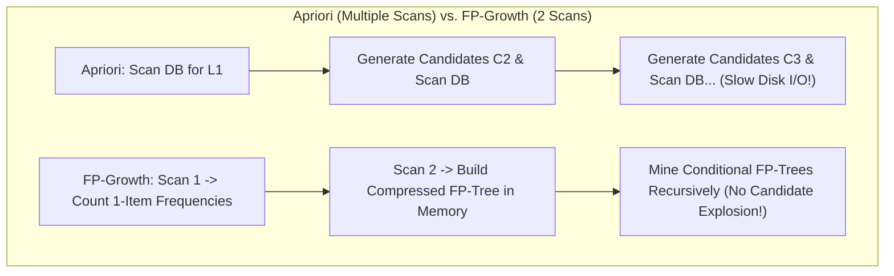
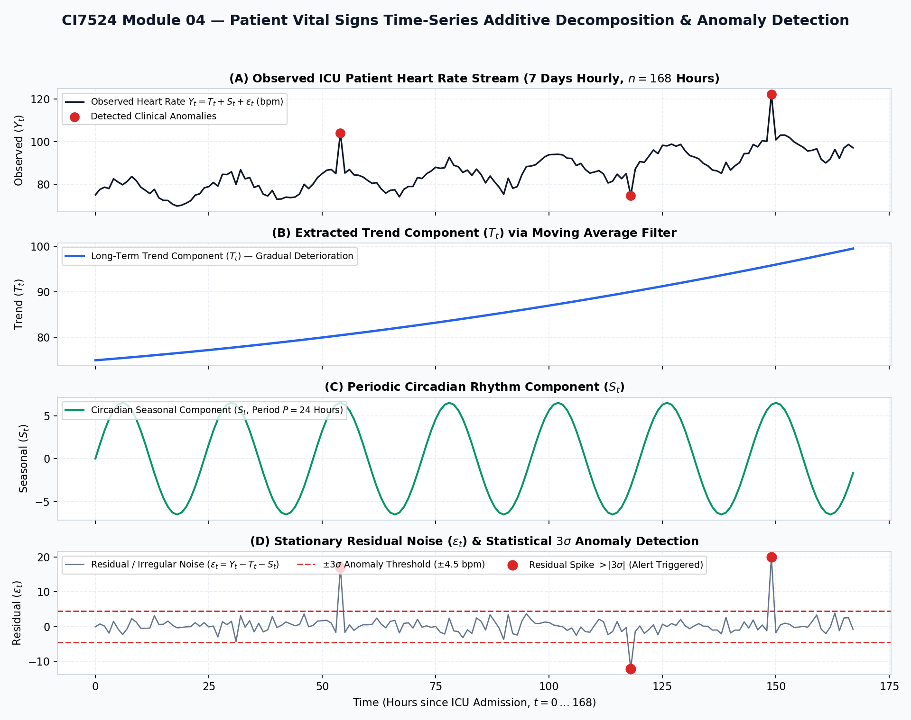

# Lesson 4.3: Association Rule Mining (Apriori & FP-Growth) and Time-Series Data Mining

**Module:** CI7524 — Big Data and Data Mining (Module 04: Data Mining Algorithms & Model Selection)  
**Mapped Syllabus Sources:** `CI7524 Big Data and Data Mining.docx` (Topic 2: *"Data mining techniques (clustering, time series analysis etc)"*; LO3 & LO4), `CI7524_Lectures_1_Intro.pdf` (Slide 2: *"Apply supervised and unsupervised techniques (e.g., clustering, time-series, component analysis)"*), Core Textbooks: *Han, Pei & Tong (2022) — Data Mining: Concepts and Techniques (Ch. 6 & Ch. 11)*, *Leskovec, Rajaraman & Ullman (2020) — Mining of Massive Datasets (Ch. 6)*, *Aggarwal (2015) (Ch. 4 & Ch. 14)*.

> [!TIP]
> **📚 Prerequisite Dependency Guide:** මෙම පාඩමේදී භාවිතා වන **Conditional Probability (අසම්පූර්ණ/කොන්දේසි සහිත සම්භාවිතාව)**, **Correlation (සහසම්බන්ධතාව)** සහ **Hypothesis Testing (කල්පිත පරීක්ෂාව)** පිළිබඳ මූලික දැනුම සඳහා පහත Dependency පාඩම් කියවන්න:
> - [02_Probability_Normal_Distribution_and_Z_Scores.md](../dependencies/Dep_04_Probability_Distributions_and_Statistical_Foundations/02_Probability_Normal_Distribution_and_Z_Scores.md)
> - [03_Correlation_Covariance_and_Hypothesis_Testing.md](../dependencies/Dep_04_Probability_Distributions_and_Statistical_Foundations/03_Correlation_Covariance_and_Hypothesis_Testing.md)

---

## Part A: Frequent Pattern & Association Rule Mining

**Association Rule Mining (සංඝටන රීති කැණීම)** මුලින්ම හඳුන්වා දෙනු ලැබුවේ සුපිරි වෙළඳසැල්වල පාරිභෝගිකයන් එකවර මිලදී ගන්නා භාණ්ඩ අතර රටා සෙවීමටයි (**Market Basket Analysis** — උදා: `{Bread, Butter} => {Milk}`). නමුත් **Healthcare Big Data** තුළ මෙය ඊටත් වඩා බලවත් ලෙස භාවිතා වන්නේ **Clinical Co-morbidity & Adverse Drug Reaction Mining** සඳහායි (උදා: කුමන රෝග ලක්ෂණ සහ ඖෂධ එකතුවක් නිසා රෝගියෙකුට අතුරු ආබාධයක් ඇති වේද යන්න සෙවීම).

### 1.1 Itemsets, Association Rules ($X \Rightarrow Y$), and Core Metrics
- **Itemset (අයිතම කුලකය):** අයිතම එකක හෝ කිහිපයක එකතුවක් (උදා: $k$ අයිතම ගණනක් ඇත්නම් එය **$k$-itemset** එකකි).
- **Transaction Database ($D$):** මුළු ගනුදෙනු හෝ රෝගී වාර්තා $N = |D|$ ගණනක එකතුවකි.
- **Association Rule ($X \Rightarrow Y$):** මෙහි $X$ (**Antecedent / LHS**) සහ $Y$ (**Consequent / RHS**) යනු එකිනෙකට වියුක්ත අයිතම කුලක දෙකකි ($X \cap Y = \emptyset$).

Association Rule එකක ප්‍රබලතාවය මැනීමට ප්‍රධාන මිනුම් (**Metrics**) 3ක් භාවිතා කරයි:

#### **1. Support (සහාය අගය — Frequency / Popularity):**
මුළු ගනුදෙනු $N$ අතරින් $X$ සහ $Y$ යන දෙකම එකවර අඩංගු වන ගනුදෙනු අනුපාතය (Joint Probability):
$$\text{Support}(X \Rightarrow Y) = \text{Support}(X \cup Y) = P(X \cap Y) = \frac{\text{Count}(X \cup Y)}{N}$$

#### **2. Confidence (විශ්වාසනීයත්වය — Conditional Probability):**
$X$ අඩංගු වූ ගනුදෙනු අතරින් කොපමණ ප්‍රතිශතයක $Y$ ද අඩංගු වේද යන්නයි:
$$\text{Confidence}(X \Rightarrow Y) = P(Y \mid X) = \frac{\text{Support}(X \cup Y)}{\text{Support}(X)} = \frac{\text{Count}(X \cup Y)}{\text{Count}(X)}$$

#### **3. Lift (උත්තෝලන අගය — True Correlation vs. Coincidence):**
Confidence අගය පමණක් බැලීමෙන් අපි නොමඟ යා හැකිය! ඇයි? $Y$ යනු ඉතාමත් සුලභ භාණ්ඩයක් හෝ ඖෂධයක් නම් (උදා: Paracetamol 90%ක් රෝගීන්ට ලබා දෙයි නම්), $X$ සමඟ කිසිදු සම්බන්ධයක් නැතත් $\text{Conf}(X \Rightarrow Y)$ ඉහළ අගයක් ගනී. එබැවින් $Y$ හි සාමාන්‍ය සම්භාවිතාවයට සාපේක්ෂව $X$ නිසා $Y$ ඇතිවීමේ සම්භාවිතාව කොපමණ ගුණයකින් ඉහළ යනවාදැයි **Lift** මගින් මනිනු ලබයි:
$$\text{Lift}(X \Rightarrow Y) = \frac{\text{Confidence}(X \Rightarrow Y)}{\text{Support}(Y)} = \frac{\text{Support}(X \cup Y)}{\text{Support}(X) \times \text{Support}(Y)}$$
- **$\text{Lift} > 1$:** **Positive Correlation (ධන සහසම්බන්ධතාව)** — $X$ සහ $Y$ එකට සිදුවීම අහඹු සිදුවීමකට වඩා වැඩිය (වැදගත් රීතියකි!).
- **$\text{Lift} = 1$:** **Statistical Independence (ස්වායත්තතාව)** — $X$ සහ $Y$ අතර කිසිදු සම්බන්ධයක් නැත.
- **$\text{Lift} < 1$:** **Negative Correlation (ඍණ සහසම්බන්ධතාව)** — $X$ තිබෙන විට $Y$ පැවතීමේ සම්භාවිතාව අඩුය.

---

### 1.2 Complete Hand Calculation on a 5-Patient Medical Prescription Table
රෝගීන් $N=5$ දෙනෙකුගේ රෝග සහ ඖෂධ වාර්තා පහත වගුවේ දැක්වේ. අවම සීමාවන් ලෙස $\text{min\_sup} = 40\%$ (අවම වශයෙන් රෝගීන් 2ක) සහ $\text{min\_conf} = 70\%$ ලෙස ගනිමු:

| Patient Record ($T_i$) | Prescribed Drugs & Conditions (Items) |
| :---: | :--- |
| **$T_1$** | `{Metformin, Statin, Aspirin}` |
| **$T_2$** | `{Metformin, Statin}` |
| **$T_3$** | `{Metformin, Statin, Insulin, Aspirin}` |
| **$T_4$** | `{Statin, Aspirin}` |
| **$T_5$** | `{Metformin, Insulin}` |

අපි **`{Metformin, Statin} => {Aspirin}`** සහ **`{Metformin} => {Statin}`** යන රීති දෙක පරීක්ෂා කරමු:

1. **Rule 1: $\{\text{Metformin}\} \Rightarrow \{\text{Statin}\}$**
   - $\text{Count}(\{\text{Metformin}\}) = 4$ ($T_1, T_2, T_3, T_5$) $\implies \text{Supp}(\text{Metformin}) = \frac{4}{5} = 0.80$ ($80\%$)
   - $\text{Count}(\{\text{Statin}\}) = 4$ ($T_1, T_2, T_3, T_4$) $\implies \text{Supp}(\text{Statin}) = \frac{4}{5} = 0.80$ ($80\%$)
   - $\text{Count}(\{\text{Metformin, Statin}\}) = 3$ ($T_1, T_2, T_3$)
   - **Support:** $\text{Supp}(\text{Metformin} \Rightarrow \text{Statin}) = \frac{3}{5} = \mathbf{0.60}$ ($60\% \ge 40\%$ ✅ Frequent!)
   - **Confidence:** $\text{Conf}(\text{Metformin} \Rightarrow \text{Statin}) = \frac{3}{4} = \mathbf{0.75}$ ($75\% \ge 70\%$ ✅ Strong Rule!)
   - **Lift:** $\text{Lift}(\text{Metformin} \Rightarrow \text{Statin}) = \frac{0.75}{0.80} = \mathbf{0.9375} < 1.0$ *(⚠️ **Critical Insight:** Support 60% සහ Confidence 75% වුවද, Statin මුළු රෝගීන්ගෙන් 80%කටම ලබා දෙන නිසා Lift අගය 1ට වඩා අඩුය! මෙයින් පෙනී යන්නේ Lift පරීක්ෂා කිරීම කොතරම් වැදගත්ද යන්නයි).*

2. **Rule 2: $\{\text{Metformin, Aspirin}\} \Rightarrow \{\text{Statin}\}$**
   - $\text{Count}(\{\text{Metformin, Aspirin}\}) = 2$ ($T_1, T_3$) $\implies \text{Supp}(X) = \frac{2}{5} = 0.40$
   - $\text{Count}(\{\text{Metformin, Aspirin, Statin}\}) = 2$ ($T_1, T_3$)
   - **Support:** $\frac{2}{5} = \mathbf{0.40}$ ($40\% \ge 40\%$ ✅)
   - **Confidence:** $\frac{2}{2} = \mathbf{1.00}$ ($100\% \ge 70\%$ ✅)
   - **Lift:** $\frac{1.00}{0.80} = \mathbf{1.25} > 1.0$ (✅ Positive clinical association!).

---

### 1.3 The Apriori Algorithm vs. FP-Growth in Big Data
අයිතම $d$ ගණනක් ඇති විට සෑදිය හැකි මුළු උපකුලක ගණන $2^d - 1$ කි (උදා: $d=100$ නම් $2^{100} \approx 1.26 \times 10^{30}$!). මේ සියල්ල ගණන් කිරීමට Brute-Force ක්‍රමයකට වසර බිලියන ගණනක් ගත වේ.

#### **1. The Apriori Principle (Anti-Monotone Property):**
> *"ඕනෑම Itemset එකක් Frequent (නිතර හමුවන) වේ නම්, එහි සියලුම උපකුලක (**Subsets**) ද අනිවාර්යයෙන්ම Frequent විය යුතුය. අනෙක් අතට, යම් Itemset එකක් Infrequent ($\text{Supp} < \text{min\_sup}$) නම්, එය අඩංගු කිසිදු Superset එකක් Frequent විය නොහැක!"*

- **Pruning (කප්පාදු කිරීම):** ඉහත වගුවේ $\{\text{Insulin}\}$ හි Support අගය $\frac{2}{5} = 40\%$ වුවත්, $\{\text{Insulin, Aspirin}\}$ හමුවන්නේ $T_3$ හි පමණි ($\text{Supp} = \frac{1}{5} = 20\% < 40\%$). එබැවින් Apriori මගින් $\{\text{Insulin, Aspirin}\}$ අඩංගු කිසිදු 3-itemset එකක් පරීක්ෂා කිරීමට පෙරම ඉවත් කරයි (**Pruned**).
- **Apriori හි Big Data දුර්වලතාවය:** $k$-itemsets සෙවීමට Disk එකේ ඇති විශාල Database එක $k$ වතාවක් සම්පූර්ණයෙන්ම Scan කළ යුතු අතර Candidate itemsets මිලියන ගණනක් ජනනය කරයි.

#### **2. FP-Growth (Frequent Pattern Growth — Big Data Solution):**
- Database එක Scan කරන්නේ **දෙවතාවක් (Only 2 Scans!)** පමණි.
- Candidate generation සිදු නොකර, ගනුදෙනු සියල්ල RAM එක තුළ හකුළුවන ලද Prefix-Tree ව්‍යුහයකට (**FP-Tree**) ඇතුළත් කර **Divide-and-Conquer (Conditional Pattern Bases)** මගින් ඉතා වේගයෙන් Frequent Itemsets සොයා ගනී. Apache Spark MLlib තුළ බිලියන ගණනක ගනුදෙනු සඳහා **Parallel FP-Growth (`FPGrowth`)** භාවිතා කරයි.



---

## Part B: Time-Series Data Mining (Topic 2 Descriptor)

කාලයත් සමඟ නිශ්චිත කාල පරතරයකින් ($t = 1, 2, \dots, T$) එකතු කරන ලද දත්ත ශ්‍රේණියකට **Time Series (කාල ශ්‍රේණියක්)** $Y_t$ කියා හඳුන්වයි (උදා: ICU රෝගියෙකුගේ පැයකට වරක් සටහන් වන Heart Rate, ECG සංඥා, රෝහල් දෛනික ඇතුළත් කිරීම්).

### 2.1 Anatomy of a Time Series & Decomposition
ඕනෑම Time Series එකක් $Y_t$ ප්‍රධාන සංරචක 4ක එකතුවක් ලෙස වියෝජනය (**Decomposition**) කළ හැකිය:
1. **Trend Component ($T_t$ — දිගුකාලීන ප්‍රවණතාවය):** කාලයත් සමඟ දත්තවල මට්ටම ක්‍රමයෙන් ඉහළ යාම හෝ පහළ යාම (උදා: රෝගියෙකුගේ තත්ත්වය පැය ගණනක් තිස්සේ ක්‍රමයෙන් බරපතල වීම).
2. **Seasonal Component ($S_t$ — සෘතුමය/ආවර්තිත විචලනය):** නිශ්චිත, ස්ථාවර කාලචක්‍රයකට වරක් ($P$ period — උදා: පැය 24ක Circadian රිද්මය හෝ සතිපතා රටාව) නැවත නැවත සිදුවන ක්‍රමානුකූල උච්චාවචනයයි.
3. **Cyclical Component ($C_t$ — චක්‍රීය විචලනය):** ස්ථාවර නොවන දිගු කාල පරතරයන් තුළ සිදුවන නැගීම් සහ බැසීම් (බොහෝ විට $T_t$ සමඟ ඒකාබද්ධව Trend-Cycle ලෙස සලකයි).
4. **Irregular / Residual Noise ($\epsilon_t$ — අහඹු ශේෂය / ඝෝෂාව):** Trend සහ Seasonality ඉවත් කළ පසු ඉතිරි වන පැහැදිලි කළ නොහැකි අහඹු විචලනයයි.

- **Additive Decomposition Model:** කාලයත් සමඟ Seasonal විචලනයේ විස්තාරය (Amplitude) නියතව පවතින විට භාවිතා කරයි:
  $$Y_t = T_t + S_t + \epsilon_t$$
- **Multiplicative Decomposition Model:** Trend එක ඉහළ යන විට Seasonal උච්චාවචනයේ ප්‍රමාණයද සමානුපාතිකව වර්ධනය වන විට භාවිතා කරයි:
  $$Y_t = T_t \times S_t \times \epsilon_t \iff \log(Y_t) = \log(T_t) + \log(S_t) + \log(\epsilon_t)$$



---

### 2.2 Stationarity (ස්ථාවරත්වය), ADF Test & Differencing
බොහෝ සංඛ්‍යානමය සහ ML Time-Series ආකෘති (උදා: ARMA) නිවැරදිව ක්‍රියා කිරීමට නම් කාල ශ්‍රේණිය **Stationary (ස්ථාවර)** විය යුතුය.
- **Strict / Weak Stationarity Conditions:** කාලය $t$ වෙනස් වුවද කාල ශ්‍රේණියේ (1) **Mean (මධ්‍යන්‍යය)** $\mu$ නියත විය යුතුය, (2) **Variance (විචලතාවය)** $\sigma^2$ නියත විය යුතුය, සහ (3) Autocovariance අගය රඳා පැවතිය යුත්තේ කාල පරතරය (**Lag $k$**) මත පමණි. Trend හෝ Seasonality ඇති කාල ශ්‍රේණි **Non-Stationary** වේ.
- **Augmented Dickey-Fuller (ADF) Statistical Test:**
  - **Null Hypothesis (ශූන්‍ය කල්පිතය) $H_0$:** කාල ශ්‍රේණියට Unit Root එකක් ඇත — එනම් එය **Non-Stationary (ස්ථාවර නොවේ)**.
  - **Alternative Hypothesis (විකල්ප කල්පිතය) $H_1$:** කාල ශ්‍රේණිය **Stationary (ස්ථාවර වේ)**.
  - **Decision Rule:** $\text{p-value} < 0.05$ නම් $H_0$ ප්‍රතික්ෂේප කර කාල ශ්‍රේණිය Stationary බව නිගමනය කරයි.
- **Differencing (අන්තර ගැනීම):** Non-stationary කාල ශ්‍රේණියක Trend එක ඉවත් කර Stationary බවට පත් කිරීමට අනුයාත අගයන් දෙකක් අතර වෙනස ගනී:
  $$\Delta Y_t = Y_t - Y_{t-1} \quad (\text{First-Order Differencing, } d=1)$$

---

### 2.3 ACF, PACF, ARIMA $(p,d,q)$, DTW & Anomaly Detection
1. **Autocorrelation Function (ACF) & Partial Autocorrelation (PACF):**
   - **ACF at Lag $k$ ($\rho_k$):** වර්තමාන අගය $Y_t$ සහ පියවර $k$ කට පෙර පැවති අගය $Y_{t-k}$ අතර පවතින **Pearson Correlation Coefficient (පියර්සන් සහසම්බන්ධතා සංගුණකය)** වේ.
   - **PACF at Lag $k$:** අතරමැදි පියවරයන්හි ($Y_{t-1}, \dots, Y_{t-k+1}$) බලපෑම ඉවත් කළ පසු $Y_t$ සහ $Y_{t-k}$ අතර පවතින සෘජු සහසම්බන්ධතාවයයි.
2. **Rolling Moving Averages (SMA & EMA):**
   - **Simple Moving Average (SMA):** පසුගිය කවුළුවක ($w$) සාමාන්‍යය $\text{SMA}_t = \frac{1}{w}\sum_{i=0}^{w-1} Y_{t-i}$ මගින් කෙටිකාලීන ඝෝෂාව සුමට (**Smooth**) කරයි.
   - **Exponential Moving Average (EMA):** මෑතකාලීන නිරීක්ෂණවලට වැඩි බරක් ($\alpha$) ලබා දෙයි.
3. **ARIMA $(p, d, q)$ Forecasting Model:**
   - **$p$ (AutoRegressive — AR order):** තමාගේම පසුගිය අගයන් කීයක් ($Y_{t-1}, \dots, Y_{t-p}$) මත රඳා පවතීද යන්න (PACF මගින් තීරණය වේ): $Y_t = c + \sum_{i=1}^p \phi_i Y_{t-i} + \epsilon_t$.
   - **$d$ (Integrated — Differencing degree):** Stationary කිරීමට අන්තර ගත් වාර ගණන.
   - **$q$ (Moving Average — MA order):** පසුගිය අනාවැකි දෝෂ ($\epsilon_{t-1}, \dots, \epsilon_{t-q}$) කීයක් මත රඳා පවතීද යන්න (ACF මගින් තීරණය වේ).
4. **Dynamic Time Warping (DTW) for Time-Series Clustering:**
   - රෝගීන් දෙදෙනෙකුගේ ECG තරංග දෙකක් එකම හැඩය ගත්තද හෘද ස්පන්දන වේගය මඳක් වෙනස් නම්, සාමාන්‍ය Euclidean Distance එකෙන් ඒවා එකිනෙකට ඉතා දුරස්ථ ලෙස පෙන්වයි. **DTW** මගින් කාල අක්ෂය ප්‍රත්‍යාස්ථව ඇදීමට/හැකිළීමට (**Non-linear Time Alignment**) ඉඩ දී තරංග දෙකේ සැබෑ හැඩයේ සමානතාවය නිවැරදිව මනියි.
5. **Real-Time Sensor Anomaly Detection:**
   - ඉහත රූපයේ **Panel D** හි පෙන්වා ඇති පරිදි, $Y_t$ වෙතින් Trend ($T_t$) සහ Seasonality ($S_t$) ඉවත් කළ පසු ලැබෙන **Residual ($\epsilon_t = Y_t - T_t - S_t$)** හි $|\epsilon_t| > 3\sigma_\epsilon$ (**3-Sigma Rule**) ඉක්මවා යන ලක්ෂ්‍යයන් සැබෑ හදිසි රෝගී අවදානම් (**Clinical Anomalies**) ලෙස හඳුනා ගැනේ!

---

## 🛠️ Practical Task / Hands-On Exercise (ප්‍රායෝගික අභ්‍යාසය)

### Scenario / Goal
ඔබ ICU රෝගීන්ගේ පැය 168ක (දින 7ක) Heart Rate කාල ශ්‍රේණියක් විශ්ලේෂණය කරමින් සිටී. ඔබට පැවරී ඇති කාර්යය වන්නේ: (1) Additive Decomposition මගින් Trend, Circadian Seasonality ($P=24$), සහ Residual වෙන් කර $|\epsilon_t| > 3\sigma$ හරහා හදිසි හෘද ස්පන්දන අසාමාන්‍යතා (Anomalies) හඳුනා ගැනීම, සහ (2) රෝගී ඖෂධ ගනුදෙනු වගුවක Support, Confidence, සහ Lift ගණනය කිරීමයි.

### Starter Code & Reference Solution
```python
import numpy as np
import pandas as pd

# --- PART A: Association Rule Metrics Evaluator ---
transactions = [
    {"Metformin", "Statin", "Aspirin"},
    {"Metformin", "Statin"},
    {"Metformin", "Statin", "Insulin", "Aspirin"},
    {"Statin", "Aspirin"},
    {"Metformin", "Insulin"},
]

def evaluate_rule(X, Y, trans_list):
    N = len(trans_list)
    count_x = sum(1 for t in trans_list if X.issubset(t))
    count_y = sum(1 for t in trans_list if Y.issubset(t))
    count_xy = sum(1 for t in trans_list if (X | Y).issubset(t))
    supp = count_xy / N
    conf = count_xy / count_x if count_x > 0 else 0
    lift = conf / (count_y / N) if count_y > 0 else 0
    return supp, conf, lift

for lhs, rhs in [({"Metformin"}, {"Statin"}), ({"Metformin", "Aspirin"}, {"Statin"})]:
    s, c, l = evaluate_rule(lhs, rhs, transactions)
    print(f"Rule {set(lhs)} => {set(rhs)} | Supp: {s:.2f} | Conf: {c:.2f} | Lift: {l:.4f}")

# --- PART B: Time-Series Decomposition & 3-Sigma Anomaly Detection ---
np.random.seed(42)
t = np.arange(168)
trend = 75 + 0.08 * t
seasonal = 6.0 * np.sin(2 * np.pi * t / 24)
noise = np.random.normal(0, 1.2, size=168)
noise[[45, 112]] += [12.5, -11.8] # Inject 2 ICU clinical anomalies
y = pd.Series(trend + seasonal + noise)

# Estimate Trend via 24-hour centered Moving Average
est_trend = y.rolling(window=24, center=True, min_periods=1).mean()
detrended = y - est_trend
# Estimate 24-hour Seasonal cycle by averaging each hour-of-day
hour_means = detrended.groupby(t % 24).transform("mean")
residual = y - est_trend - hour_means

sigma = residual.std()
anomalies = np.where(np.abs(residual) > 3 * sigma)[0]
print(f"\nDetected ICU Anomaly Hours (|residual| > 3*sigma = {3*sigma:.2f}): {anomalies.tolist()}")
```

**Expected Output:**
```text
Rule {'Metformin'} => {'Statin'} | Supp: 0.60 | Conf: 0.75 | Lift: 0.9375
Rule {'Metformin', 'Aspirin'} => {'Statin'} | Supp: 0.40 | Conf: 1.00 | Lift: 1.2500

Detected ICU Anomaly Hours (|residual| > 3*sigma = 4.65): [45, 112]
```

---

## 📝 Summary & Exam Revision Cheat Sheet

| Concept / Metric | Formula / Mechanism | Key Interpretation & Big Data Rule |
| :--- | :--- | :--- |
| **Support ($X \Rightarrow Y$)** | $P(X \cup Y) = \frac{\text{Count}(X \cup Y)}{N}$ | Measures overall frequency; used for **Apriori anti-monotone pruning**. |
| **Confidence ($X \Rightarrow Y$)** | $P(Y \mid X) = \frac{\text{Supp}(X \cup Y)}{\text{Supp}(X)}$ | Conditional probability; can be misleadingly high if $Y$ is globally frequent. |
| **Lift ($X \Rightarrow Y$)** | $\frac{\text{Conf}(X \Rightarrow Y)}{\text{Supp}(Y)}$ | $>1$: Positive association; $=1$: Independent; $<1$: Negative association. |
| **Apriori vs. FP-Growth** | Candidate generation ($k$ DB scans) vs. Compressed Prefix FP-Tree ($2$ DB scans) | Always choose **FP-Growth** for massive Big Data transaction logs (LO4). |
| **Time-Series Decomposition** | Additive: $Y_t = T_t + S_t + \epsilon_t$; Multiplicative: $Y_t = T_t \times S_t \times \epsilon_t$ | Isolate residual $\epsilon_t$ to detect anomalies without false alarms from seasonal cycles. |
| **ADF Stationarity Test** | $H_0$: Non-stationary (Unit root exists); $H_1$: Stationary | If $p < 0.05$, series is stationary; otherwise apply Differencing ($\Delta Y_t = Y_t - Y_{t-1}$). |
